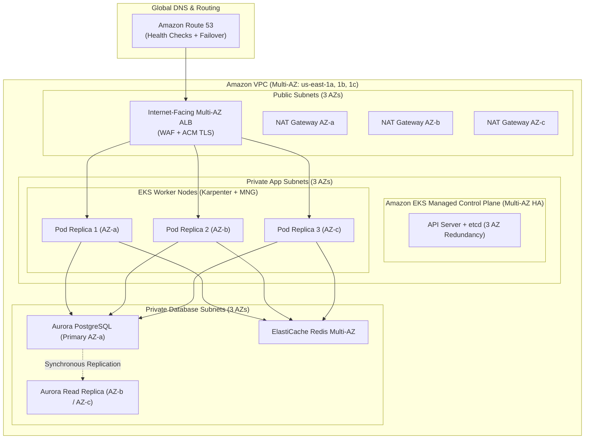
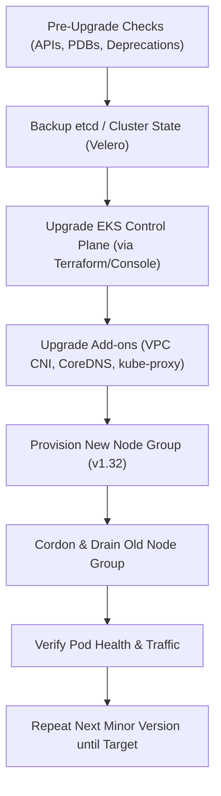
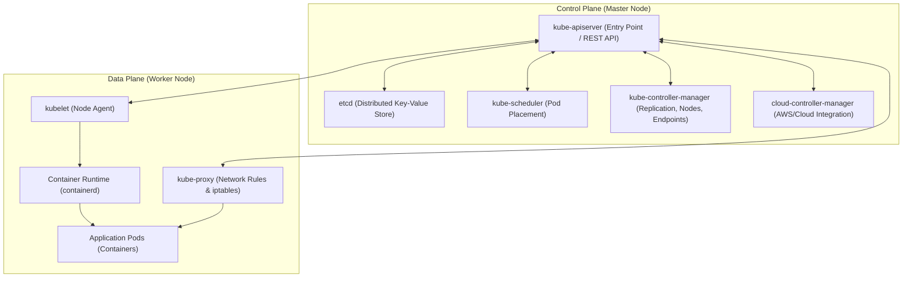
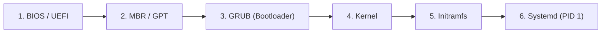
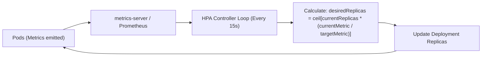

# DevOps Company Interview Questions Bank

<details open>
<summary><h2>🏢 Persistant</h2></summary>

<details open>
<summary><h3>L1</h3></summary>

*Date: 23-Aug-2026*


<details markdown="1">
<summary><strong>Introduction.</strong></summary>

**Answer:**
"Hello, my name is Nagaraj. I am a DevOps Engineer with over 5 years of experience automating and managing enterprise cloud infrastructure. My day-to-day focus centers around AWS, Kubernetes (Amazon EKS), CI/CD pipeline automation with Jenkins, and Infrastructure as Code with Terraform and Ansible.

In my current position, I support a distributed e-commerce risk analysis platform running across 25 microservices. My primary duties include building robust Jenkins Declarative pipelines with automated SonarQube quality gates, provisioning AWS VPC and EKS infrastructure via reusable Terraform modules, and ensuring high system reliability and observability using Prometheus and Grafana."
</details>

<details markdown="1">
<summary><strong>Day-to-day activities.</strong></summary>

**Answer:**
In my daily role as a DevOps Engineer, my activities are divided between operational support, pipeline reliability, and proactive automation:

### 1. Daily Standups & Ticket Triage
* Start the day reviewing **Jira sprint boards** and high-priority infrastructure/build tickets.
* Triage developer blockers: failed Jenkins pipeline builds, Git merge conflicts, access requests (IAM/Vault), or deployment issues in DEV/QA environments.

### 2. Pipeline & Deployment Management
* Monitor automated Jenkins releases, verifying that unit tests, SonarQube code scans, and Trivy container security scans pass cleanly before promoting artifacts to Amazon ECR.
* Manage deployments across Kubernetes environments (DEV, QA, UAT, and scheduled maintenance releases for Production).

### 3. Infrastructure as Code (IaC) & Cloud Operations
* Write and update Terraform modules for AWS infrastructure changes (e.g., adding subnets, updating security group rules, sizing EKS node groups).
* Review Pull Requests for infrastructure code changes, ensuring peer validation before executing `terraform plan` and `terraform apply`.

### 4. Monitoring & Proactive Improvements
* Check Grafana dashboards and Prometheus alerts for cluster health, CPU/memory saturation, and pod restart anomalies.
* Work on long-term automation backlog items, such as writing Ansible playbooks for automated OS patching and optimizing Docker image layers.
</details>

<details markdown="1">
<summary><strong>Difference between NACL & SG.</strong></summary>

**Answer:**
Both Security Groups (SG) and Network Access Control Lists (NACL) serve as firewalls in AWS VPC, but operate at different layers:

| Feature | Security Group (SG) | Network Access Control List (NACL) |
| :--- | :--- | :--- |
| **Operating Layer** | **Instance Level** (attached to ENIs, EC2 instances, ALBs, RDS) | **Subnet Level** (acts as a perimeter firewall for the whole subnet) |
| **State Nature** | **Stateful** (Return traffic is automatically permitted regardless of outbound rules) | **Stateless** (Return traffic must be explicitly allowed in inbound/outbound rules) |
| **Rule Capabilities** | Supports **Allow rules only** (Everything else is implicitly denied) | Supports both **Allow and Deny rules** (e.g., explicitly blocking a malicious IP) |
| **Rule Processing** | Evaluates **all rules** simultaneously before deciding to allow traffic | Evaluates rules in **strict numerical order** (lowest number first, e.g. 100 before 200) |
| **Default Configuration** | Default SG allows all outbound traffic and blocks all inbound traffic | Default NACL allows all inbound and outbound traffic |

### Production Use Case:
* Use **Security Groups** as the primary security layer to control traffic between application tiers (e.g., Web SG allows port 80/443; DB SG allows port 5432 only from App SG).
* Use **NACLs** as a defense-in-depth perimeter to block compromised CIDR blocks, DDoS source IPs, or restrict subnet-wide protocols.
</details>

<details markdown="1">
<summary><strong>Task to patch an EC2 instance which is in a private subnet.</strong></summary>

**Answer:**
Patching an EC2 instance located in a private subnet without public IP addresses can be accomplished using two distinct production methods:

### Method 1: AWS Systems Manager (SSM) Patch Manager (Recommended / Zero SSH)
This is the enterprise standard approach because it requires no inbound ports or bastion hosts:
1. **Network Connectivity to AWS SSM:**
   * **Option A (Via NAT Gateway):** Ensure the private subnet route table has an outbound default route (`0.0.0.0/0`) pointing to a NAT Gateway located in a public subnet.
   * **Option B (PrivateLink VPC Endpoints - Zero Internet):** Create interface VPC Endpoints for `ssm`, `ssmmessages`, and `ec2messages` inside the private subnet so SSM traffic never traverses the internet.
2. **IAM Permissions:** Attach the AWS managed policy `AmazonSSMManagedInstanceCore` to the EC2 instance's IAM Role.
3. **Patch Execution:**
   * In AWS Systems Manager, navigate to **Patch Manager**.
   * Select a **Patch Baseline** (specifying critical security updates approval delay and severity).
   * Schedule a Maintenance Window or execute `AWS-RunPatchBaseline` via Run Command.
   * SSM automatically downloads packages, applies updates (`yum update` / `apt upgrade`), and handles reboots if required, generating audit reports in S3.

### Method 2: Ansible via SSH over a Bastion Host / VPN
1. Establish a secure VPN connection into the VPC or SSH jump through a hardened Bastion host using SSH Agent Forwarding:
   ```bash
   ssh -A -J ec2-user@bastion.domain.com ec2-user@10.0.2.45
   ```
2. Run an Ansible patching playbook targeting the private inventory:
   ```yaml
   - name: Apply OS security patches
     hosts: private_servers
     become: yes
     tasks:
       - name: Update all apt packages (Ubuntu/Debian)
         apt:
           upgrade: dist
           update_cache: yes
         when: ansible_os_family == "Debian"
   ```
</details>

<details markdown="1">
<summary><strong>What are the two types of ECS?</strong></summary>

**Answer:**
Amazon Elastic Container Service (ECS) provides two primary launch types:

### 1. Amazon ECS on EC2 Launch Type (Customer-Managed Infrastructure)
* **How it works:** You provision and manage the underlying Amazon EC2 virtual machines that join your ECS cluster.
* **Control:** Full root access to the OS, choice of instance families (GPU instances, high-memory r6i, Graviton arm64), custom Docker daemon configurations, and EBS volume attachments.
* **Responsibilities:** You are responsible for OS patching, AMI updates, Auto Scaling Groups (EC2 capacity providers), and Docker agent versions.
* **Best for:** Cost optimization using Reserved Instances/Savings Plans, predictable sustained heavy workloads, or compliance mandates requiring specialized kernel modules.

### 2. Amazon ECS on AWS Fargate (Serverless Compute Engine)
* **How it works:** AWS provisions, scales, and manages the underlying compute infrastructure. You only specify container CPU and memory requirements in your Task Definition.
* **Control:** Zero host-level or SSH access. AWS manages underlying operating system patching, hypervisor isolation, and hardware provisioning.
* **Billing:** Billed per second based on the exact vCPU and memory allocated to running tasks.
* **Best for:** Microservices, batch jobs, unpredictable bursty workloads, and teams wanting zero VM operational overhead.
</details>

<details markdown="1">
<summary><strong>S3 Endpoints.</strong></summary>

**Answer:**
An Amazon S3 VPC Endpoint provides private, direct connectivity from your VPC to Amazon S3 without requiring an Internet Gateway, NAT Gateway, VPN, or AWS Direct Connect.

### The Two Types of S3 Endpoints:

#### 1. Gateway Endpoint (Most Common & Free)
* **Mechanism:** Configured directly inside your VPC Route Tables. It maps traffic destined for AWS S3 prefix lists (e.g., `pl-63a5400a`) to the Gateway Endpoint target (`vpce-xxxxxx`).
* **Cost:** **100% Free** (no hourly charges, no data transfer fees).
* **Limitations:** Accessible only from resources within the VPC route table; cannot be reached across VPC Peering, Transit Gateway, or from on-premises over VPN/Direct Connect.

#### 2. Interface Endpoint (AWS PrivateLink - Paid)
* **Mechanism:** Deploys an Elastic Network Interface (ENI) with a private IP address directly inside your subnet.
* **Cost:** Standard PrivateLink pricing (hourly charge per ENI + per-GB data processing fees).
* **Key Advantage:** Can be accessed from on-premises corporate datacenters via Direct Connect/VPN and across peered VPCs using private IP routing.

### Production Best Practice:
Use Gateway Endpoints for all EC2/EKS to S3 traffic within the VPC to eliminate expensive NAT Gateway data processing fees ($0.045/GB).
</details>

<details markdown="1">
<summary><strong>Are S3 Endpoints cached locally?</strong></summary>

**Answer:**
S3 Endpoints are not "cached" in the traditional sense, but their behavior differs fundamentally by endpoint type:

### 1. Gateway Endpoints (Route Table Based — No Caching)
* Gateway endpoints operate strictly at the network routing layer (Layer 3/4).
* The VPC Route Table contains a route: Target = `vpce-xxxxxx` for Destination = `pl-xxxxxx` (AWS S3 CIDR prefix list).
* Every single packet sent from an EC2 instance to an S3 IP address is evaluated directly against the VPC route table on every network transmission. There is no software caching involved; it is a permanent hardware-level VPC routing rule.

### 2. Interface Endpoints (DNS / IP Based — Standard DNS Caching)
* Interface endpoints assign a private IP address (ENI) to the endpoint in your subnet.
* AWS Route 53 private DNS automatically resolves S3 bucket endpoints (e.g., `bucket.s3.us-east-1.amazonaws.com`) to this private IP.
* **Caching Factor:** The operating system's DNS resolver or JVM DNS cache honors the DNS Time-to-Live (TTL) (typically 60 seconds). Once resolved, TCP connections establish directly to the private ENI IP.
</details>

<details markdown="1">
<summary><strong>VPC Endpoints.</strong></summary>

**Answer:**
A **VPC Endpoint** enables private connections between your VPC and supported AWS services or third-party VPC services powered by AWS PrivateLink, without requiring public IPs, NAT Gateways, or Internet Gateways.

### Comparison of Endpoint Types:

| Feature | Gateway Endpoint | Interface Endpoint (PrivateLink) |
| :--- | :--- | :--- |
| **Supported Services** | Only **Amazon S3** and **Amazon DynamoDB** | Over 100+ AWS services (ECR, SSM, KMS, SQS, SNS, STS, Secrets Manager, etc.) |
| **Implementation** | Route Table entry pointing to prefix list | Elastic Network Interface (ENI) with private IP inside your subnet |
| **Cost** | Completely Free | Hourly fee per AZ + Data processing charges ($0.01/GB) |
| **On-Premises Access** | No | Yes (via VPN or Direct Connect) |
| **Security Controls** | VPC Endpoint Policies and Bucket Policies | Security Groups, Endpoint Policies, and NetworkPolicies |

### Key Benefits:
1. **Security:** Traffic never leaves the private AWS network backbone, satisfying strict PCI-DSS and HIPAA requirements.
2. **Cost Savings:** Bypasses expensive NAT Gateway egress fees ($0.045/GB) for high-bandwidth services like ECR image pulls.
</details>

<details markdown="1">
<summary><strong>Fargate & EC2 launch.</strong></summary>

**Answer:**
When choosing between **AWS Fargate** and **EC2 Launch Type** for ECS or EKS workloads:

### Key Differences & Decision Matrix:

| Dimension | AWS Fargate | EC2 Launch Type |
| :--- | :--- | :--- |
| **Server Management** | Completely Serverless — no instances to manage | You provision, configure, and manage EC2 VMs |
| **OS Patching & Upgrades**| Handled entirely by AWS seamlessly | Handled by your DevOps team (AMI updates, patching) |
| **Startup Latency** | ~30–60 seconds (provisions dedicated microVM) | Instant if EC2 worker node already has spare capacity |
| **Resource Control** | CPU & RAM defined per task (up to 16 vCPU, 120 GB) | Full control: pick any EC2 instance family (GPU, Arm64) |
| **Cost Model** | Pay strictly for vCPU/RAM requested per second | Pay for running EC2 instances (utilization efficiency matters) |
| **DaemonSet Support** | No DaemonSets supported (must use sidecars) | Fully supports Kubernetes/ECS DaemonSets (e.g. Datadog) |

### When to choose which:
* **Choose Fargate:** For developer self-service, spiky workloads, microservices where operational simplicity outweighs cost tuning, and batch jobs.
* **Choose EC2:** For heavy steady-state workloads (where Savings Plans/Reserved Instances save 50%+), GPU/ML training, or applications requiring kernel-level tuning.
</details>

<details markdown="1">
<summary><strong>What are the layers in Docker?</strong></summary>

**Answer:**
In Docker, an image is built from a succession of **read-only layers**, each representing an instruction in the `Dockerfile`:

### 1. How Layers Work
* Every instruction like `FROM`, `RUN`, `COPY`, and `ADD` creates a new immutable layer.
* Instructions like `EXPOSE`, `ENV`, `WORKDIR`, and `ENTRYPOINT` modify image metadata without adding significant layer data.
* **Copy-On-Write (CoW):** When a container runs, Docker adds a thin **read-write container layer** on top of the stacked read-only layers. Any file modifications made at runtime are written to this top layer.

### 2. Optimization Techniques
```dockerfile
# BAD: Creates 3 separate layers, leaving cached temporary files in intermediate layers
RUN apt-get update
RUN apt-get install -y python3
RUN rm -rf /var/lib/apt/lists/*

# GOOD: Single layer, removes caches within the same layer to minimize image size
RUN apt-get update && apt-get install -y --no-install-recommends \
    python3 \
 && rm -rf /var/lib/apt/lists/*
```

### 3. Layer Caching
Docker evaluates layers from top to bottom during a build. If an earlier layer is unchanged (e.g., `COPY package.json .`), Docker reuses the cached layer, dramatically accelerating CI build times.
</details>

<details markdown="1">
<summary><strong>Why use ENTRYPOINT & not CMD?</strong></summary>

**Answer:**
Both `ENTRYPOINT` and `CMD` define the command executed when a container starts, but they serve distinct purposes:

### 1. Key Definitions
* **`ENTRYPOINT`:** Defines the **fixed, immutable executable** that the container is designed to run. It transforms the container into a standalone binary CLI tool.
* **`CMD`:** Defines **default arguments** to be passed to the `ENTRYPOINT`, or a default standalone command that is easily overridden from the command line.

### 2. Practical Example
```dockerfile
ENTRYPOINT ["nginx"]
CMD ["-g", "daemon off;"]
```
* **Default execution:**
  `docker run my-nginx` runs `nginx -g "daemon off;"`
* **Overriding arguments:**
  `docker run my-nginx -v` runs `nginx -v` (only overrides `CMD`, preserving `ENTRYPOINT`).

### 3. Comparison Summary
| Command | Override via CLI (`docker run <img_name> <args>`) |
| :--- | :--- |
| `CMD ["node", "app.js"]` | Passing `bash` completely replaces `node app.js` with `bash` |
| `ENTRYPOINT ["node", "app.js"]` | Passing `bash` appends `bash` as an argument to `node app.js bash` |
| `ENTRYPOINT` + `CMD` | CLI arguments override only the `CMD` portion, keeping the entrypoint intact |
</details>

<details markdown="1">
<summary><strong>Explain multistage Dockerfile.</strong></summary>

**Answer:**
A **multi-stage Dockerfile** uses multiple `FROM` instructions in a single file to cleanly separate the **build environment** from the **runtime environment**.

### Why it is Essential:
1. **Dramatically Smaller Images:** Build tools (compilers, Maven, Go SDK, dev dependencies) are discarded, keeping the final image footprint minimal (e.g., shrinking a 900MB Java build image down to 150MB).
2. **Enhanced Security:** Build tools and source code are absent from production images, dramatically reducing CVE vulnerabilities.

### Production Example (Go Microservice):
```dockerfile
# Stage 1: Build stage with Go compiler and dependencies
FROM golang:1.22-alpine AS builder
WORKDIR /app
COPY go.mod go.sum ./
RUN go mod download
COPY . .
RUN CGO_ENABLED=0 GOOS=linux go build -ldflags="-w -s" -o server .

# Stage 2: Minimal Distroless runtime image
FROM gcr.io/distroless/static-debian12:nonroot
WORKDIR /app
COPY --from=builder /app/server /app/server
EXPOSE 8080
USER nonroot:nonroot
ENTRYPOINT ["/app/server"]
```
</details>

<details markdown="1">
<summary><strong>What is Docker Compose?</strong></summary>

**Answer:**
**Docker Compose** is a declarative tool for defining and orchestrating multi-container Docker applications using a single YAML file (`docker-compose.yml`).

### Core Features:
1. **Single-Command Lifecycle:** Run `docker compose up -d` to start and connect multiple dependent containers (app, database, Redis cache, message queue), and `docker compose down` to stop and clean up resources.
2. **Automated Networking:** Compose automatically creates a shared bridge network where services resolve each other by their service name (e.g., connecting to `database:5432` instead of IP addresses).
3. **Volume Management:** Persists data across container restarts using named volumes.

### Production / Local Dev Example:
```yaml
version: '3.8'
services:
  web:
    build: .
    ports:
      - "8080:8080"
    environment:
      - DB_HOST=db
    depends_on:
      - db
  db:
    image: postgres:16-alpine
    environment:
      POSTGRES_DB: appdb
      POSTGRES_PASSWORD: secretpassword
    volumes:
      - pgdata:/var/lib/postgresql/data

volumes:
  pgdata:
```
</details>

<details markdown="1">
<summary><strong>What is Ingress?</strong></summary>

**Answer:**
An **Ingress** is a Kubernetes API object that manages external Layer 7 (HTTP/HTTPS) traffic routing into cluster Services.

### Key Capabilities:
1. **Host-Based Routing:** Route traffic by domain name (e.g., `api.example.com` -> `api-service`, `app.example.com` -> `frontend-service`).
2. **Path-Based Routing:** Route traffic by URL prefix (e.g., `/orders` -> `order-service`, `/users` -> `user-service`).
3. **SSL/TLS Termination:** Terminate HTTPS certificates at the ingress controller, decrypting traffic before passing it internally.

### Architectural Component:
An Ingress resource by itself is just metadata. It requires an **Ingress Controller** (such as AWS Load Balancer Controller, NGINX Ingress Controller, or Traefik) to watch for Ingress objects and provision the underlying load balancer (e.g. AWS Application Load Balancer).

### Ingress Manifest Example:
```yaml
apiVersion: networking.k8s.io/v1
kind: Ingress
metadata:
  name: app-ingress
  annotations:
    alb.ingress.kubernetes.io/scheme: internet-facing
    alb.ingress.kubernetes.io/target-type: ip
spec:
  ingressClassName: alb
  rules:
  - host: devops-hub.artisantek.com
    http:
      paths:
      - path: /
        pathType: Prefix
        backend:
          service:
            name: web-service
            port:
              number: 80
```
</details>

<details markdown="1">
<summary><strong>ClusterIP vs NodePort.</strong></summary>

**Answer:**
In Kubernetes, `ClusterIP` and `NodePort` are Service types designed for different networking requirements:

| Feature | ClusterIP (Default) | NodePort |
| :--- | :--- | :--- |
| **Accessibility** | **Internal only** inside the cluster | **External** via `<NodeIP>:<NodePort>` |
| **Port Range** | Uses any service port (e.g., 80, 8080, 5432) | Allocated from high port range (**30000–32767**) |
| **Internal DNS** | Resolves to a stable virtual cluster IP | Resolves to virtual cluster IP internally as well |
| **Production Use** | Standard for internal backend APIs, databases, caches | Rarely exposed directly to the internet; used behind external LBs |

### Architecture Flow:
* **ClusterIP:** Client Pod -> CoreDNS (`http://order-svc:8080`) -> ClusterIP -> Endpoint Pod.
* **NodePort:** External Client -> WorkerNode:31245 -> NodePort proxy -> ClusterIP -> Endpoint Pod.
</details>

<details markdown="1">
<summary><strong>For services which are not exposed to the outside world, can we use ClusterIP to connect them to each other?</strong></summary>

**Answer:**
**Yes, absolutely.** `ClusterIP` is the standard and recommended Kubernetes service type for private, internal inter-service communication.

### How Internal Communication Works:
1. When you create a Service with `type: ClusterIP`, Kubernetes assigns a stable internal virtual IP address from the cluster's service CIDR block.
2. **CoreDNS Service Discovery:** CoreDNS creates an internal DNS record in the format:
   `<service-name>.<namespace>.svc.cluster.local`
3. Microservices in the same namespace communicate simply by using the service name:
   `http://payment-service:8080/api/pay`
4. If in another namespace:
   `http://payment-service.finance.svc.cluster.local:8080/api/pay`

### Security Best Practice:
Combine `ClusterIP` with **Kubernetes NetworkPolicies** to explicitly restrict which pods are allowed to establish connections, preventing lateral movement if an edge pod is compromised.
</details>

<details markdown="1">
<summary><strong>I have an ECR repo and we have Docker images on-premises. How will you pull those images? What are the steps we do in the manifest file?</strong></summary>

**Answer:**
Pulling images from AWS ECR into an on-premises Kubernetes cluster requires solving AWS ECR's short-lived authentication token requirement (valid for 12 hours):

### Step-by-Step Implementation:

#### 1. Generate ECR Authentication Secret in Kubernetes
Use AWS CLI on a machine with IAM permissions to create a Kubernetes `docker-registry` secret:
```bash
TOKEN=$(aws ecr get-login-password --region us-east-1)
kubectl create secret docker-registry ecr-secret \
  --docker-server=123456789012.dkr.ecr.us-east-1.amazonaws.com \
  --docker-username=AWS \
  --docker-password="${TOKEN}" \
  --namespace=default
```

#### 2. Automate Token Refresh (Production CronJob)
Because AWS ECR tokens expire every 12 hours, create a Kubernetes `CronJob` that runs every 6–8 hours using an IAM User access key to refresh `ecr-secret`.

#### 3. Reference in Deployment Manifest
Add `imagePullSecrets` in your Kubernetes Deployment spec:
```yaml
apiVersion: apps/v1
kind: Deployment
metadata:
  name: backend-app
spec:
  replicas: 3
  template:
    spec:
      imagePullSecrets:
      - name: ecr-secret
      containers:
      - name: app
        image: 123456789012.dkr.ecr.us-east-1.amazonaws.com/my-app:v1.0.0
        ports:
        - containerPort: 8080
```
</details>

<details markdown="1">
<summary><strong>For authentication, what type of objects do we create in Kubernetes (K8s)?</strong></summary>

**Answer:**
Kubernetes separates identity and authentication into distinct objects for humans and machines:

### 1. ServiceAccounts (For Pods and Workloads)
* **What it is:** A first-class Kubernetes object (`apiVersion: v1`, `kind: ServiceAccount`) used by applications running in pods to authenticate against the Kubernetes API.
* **Production Practice:** Combined with **AWS IRSA (IAM Roles for Service Accounts)** in EKS, projecting OIDC tokens into containers so workloads access AWS APIs without long-lived keys.

### 2. Secrets (Token & Credential Storage)
* Stores TLS certificates, image registry credentials (`kubernetes.io/dockerconfigjson`), and Opaque credentials used for API communication.

### 3. Roles and ClusterRoles (RBAC Authorization)
* Define granular API access permissions (verbs: `get`, `list`, `watch`, `create` on resources: `pods`, `services`).

### 4. RoleBindings and ClusterRoleBindings
* Bind a `ServiceAccount` or human user/group to a specific `Role` or `ClusterRole`.

### 5. Authentication for Human Users:
Kubernetes does not have a "User" API object. Humans authenticate via:
* **X.509 Client Certificates**
* **OpenID Connect (OIDC)** (Okta, Azure AD, Keycloak)
* **AWS IAM Authenticator** (in EKS, mapped via `aws-auth` ConfigMap or EKS Access Entries).
</details>

<details markdown="1">
<summary><strong>What are Secrets in K8s?</strong></summary>

**Answer:**
Kubernetes **Secrets** (`kind: Secret`) store sensitive information such as database passwords, API tokens, and TLS private keys.

### Methods of Managing Secrets:

#### Method 1: Native Kubernetes Secrets
* Stored by default as base64-encoded strings.
* **Security Consideration:** Base64 is encoding, not encryption. You must enable **KMS envelope encryption** at rest in etcd.
```yaml
apiVersion: v1
kind: Secret
metadata:
  name: db-credentials
type: Opaque
stringData:
  DB_PASSWORD: "SuperSecretPassword123"
```

#### Method 2: External Secrets Operator (ESO) + AWS Secrets Manager (Enterprise Best Practice)
* Store secrets in **AWS Secrets Manager** with automated 30-day rotation.
* The **External Secrets Operator** synchronizes secrets dynamically into Kubernetes memory without storing plain-text secrets in Git.
```yaml
apiVersion: external-secrets.io/v1beta1
kind: ExternalSecret
metadata:
  name: db-secret-sync
spec:
  refreshInterval: "1h"
  secretStoreRef:
    name: aws-secrets-store
    kind: ClusterSecretStore
  target:
    name: db-credentials
  data:
  - secretKey: password
    remoteRef:
      key: prod/rds/mysql
      property: password
```
</details>

<details markdown="1">
<summary><strong>What to do if kubelet is not working?</strong></summary>

**Answer:**
When `kubelet` fails, the worker node changes to `NotReady` status and stops communicating with the Control Plane.

### Step-by-Step Troubleshooting Checklist:

#### 1. Inspect Service Status & Logs
```bash
# Check if service is active or failed
sudo systemctl status kubelet

# Inspect detailed error logs
sudo journalctl -u kubelet -n 100 --no-pager
```

#### 2. Common Root Causes & Fixes
* **Swap is Enabled:** Kubelet fails to start by default if swap memory is active:
  ```bash
  sudo swapoff -a
  sudo sed -i '/swap/d' /etc/fstab
  ```
* **Container Runtime (containerd / CRI-O) Dead:**
  ```bash
  sudo systemctl restart containerd
  sudo systemctl status containerd
  ```
* **Expired Certificates:** Verify client certificates in `/var/lib/kubelet/pki/kubelet-client-current.pem` are valid.
* **Disk or Memory Pressure:** Check root filesystem capacity with `df -h`. If disk utilization exceeds 85%, Kubelet evicts pods or refuses startup.
* **API Server Connectivity:** Test network reachability to the control plane:
  ```bash
  curl -k https://<control-plane-endpoint>:6443/healthz
  ```
* **Restart Kubelet:**
  ```bash
  sudo systemctl daemon-reload && sudo systemctl restart kubelet
  ```
</details>

<details markdown="1">
<summary><strong>I am having an EKS cluster, can I have a Load Balancer (LB)?</strong></summary>

**Answer:**
**Yes, absolutely.** Amazon EKS seamlessly provisions and integrates with AWS Elastic Load Balancing (ELB) using two primary mechanisms:

### 1. Application Load Balancer (ALB) via AWS Load Balancer Controller (Layer 7)
* **How it works:** You create a Kubernetes `Ingress` object.
* **Use Case:** HTTP/HTTPS traffic, host-based and path-based routing, automated ACM SSL certificate termination, AWS WAF integration, and routing traffic directly to Pod IPs (Target Type: `ip`).

### 2. Network Load Balancer (NLB) via Service Object (Layer 4)
* **How it works:** You create a Kubernetes `Service` with `type: LoadBalancer` and AWS annotations:
```yaml
apiVersion: v1
kind: Service
metadata:
  name: payment-nlb
  annotations:
    service.beta.kubernetes.io/aws-load-balancer-type: "external"
    service.beta.kubernetes.io/aws-load-balancer-nlb-target-type: "ip"
    service.beta.kubernetes.io/aws-load-balancer-scheme: "internet-facing"
spec:
  type: LoadBalancer
  ports:
  - port: 443
    targetPort: 8443
  selector:
    app: payment
```
* **Use Case:** High-throughput, ultra-low latency TCP/UDP traffic, gaming servers, or financial trading systems.
</details>

<details markdown="1">
<summary><strong>How to check logs in EKS.</strong></summary>

**Answer:**
Logging in Amazon EKS is divided into Application/Pod logs, Node-level logs, and Control Plane logs:

### 1. Application & Pod Logs (kubectl)
```bash
# View live streamed logs
kubectl logs -f <pod-name> -n <namespace>

# View logs for a specific container in a multi-container pod
kubectl logs -f <pod-name> -c <container-name> -n <namespace>

# View previous container logs if pod crashed (CrashLoopBackOff)
kubectl logs <pod-name> --previous -n <namespace>

# Tail last 200 lines with timestamps
kubectl logs <pod-name> --tail=200 --timestamps -n <namespace>
```

### 2. Centralized Cluster Logging (Production Stack)
* **AWS CloudWatch Container Insights / Fluent Bit:** Deployed as a DaemonSet to stream all container stdout/stderr logs into CloudWatch Log Groups (`/aws/containerinsights/<cluster>/application`).
* **ELK / Grafana Loki Stack:** Fluent Bit or Promtail ships logs to Elasticsearch/Loki, queried via Grafana dashboards.

### 3. EKS Control Plane Logs (API server, audit, authenticator)
* Enable in AWS Console or Terraform under EKS Cluster Logging to view audit trails in CloudWatch Logs (`/aws/eks/<cluster-name>/cluster`).
</details>

<details markdown="1">
<summary><strong>Handle memory issues in the manifest file.</strong></summary>

**Answer:**
To handle and prevent container memory issues (such as `OOMKilled` Exit Code 137) directly within the Kubernetes manifest file:

### 1. Define Explicit Resource Requests and Limits
```yaml
apiVersion: apps/v1
kind: Deployment
metadata:
  name: order-service
spec:
  template:
    spec:
      containers:
      - name: app
        image: order-service:v1.0.0
        resources:
          requests:
            memory: "512Mi"   # Guaranteed minimum memory reserved on worker node
            cpu: "250m"
          limits:
            memory: "1024Mi"  # Hard ceiling; container is terminated (OOMKilled) if exceeded
            cpu: "1000m"
```

### 2. Configure Java JVM Ergonomics to Respect Cgroup Limits
For Java/Spring Boot applications, specify JVM container support flags so the JVM calculates heap limits based on the container cgroup limit rather than the entire physical host RAM:
```yaml
env:
- name: JAVA_TOOL_OPTIONS
  value: "-XX:MaxRAMPercentage=75.0 -XX:InitialRAMPercentage=50.0 -XX:+ExitOnOutOfMemoryError"
```

### 3. Implement Ephemeral Storage Limits
Prevent runaway log files or temporary dump files from filling the node's disk:
```yaml
resources:
  limits:
    ephemeral-storage: "2Gi"
```
</details>

<details markdown="1">
<summary><strong>EKS overview.</strong></summary>

**Answer:**
**Amazon Elastic Kubernetes Service (Amazon EKS)** is a fully managed Kubernetes service provided by AWS that simplifies running Kubernetes clusters without needing to install, operate, and maintain your own Kubernetes control plane:

### 1. Architectural Model (Shared Responsibility)
* **AWS-Managed Control Plane:** AWS automatically runs and scales the Kubernetes API server, Controller Manager, Scheduler, and `etcd` across at least 3 Availability Zones with a 99.95% uptime SLA.
* **Customer-Managed Data Plane (Worker Nodes):** EC2 Managed Node Groups, Self-Managed Node Groups, or Serverless Fargate profiles. Automated dynamic scaling is handled via **Karpenter**.

### 2. Native AWS Integrations:
* **Security & IAM (IRSA):** Pods assume IAM roles dynamically via OIDC tokens without static AWS credentials.
* **Networking (AWS VPC CNI):** Pods receive native private IP addresses directly from the VPC subnet CIDR block.
* **Storage & Load Balancing:** Automated provisioning of AWS Application/Network Load Balancers via AWS Load Balancer Controller and EBS/EFS CSI drivers.
</details>

<details markdown="1">
<summary><strong>Some other guy has created a resource manifest, how to incorporate the same in a Terraform file?</strong></summary>

**Answer:**
When another engineer or team creates an AWS resource (e.g. an S3 bucket, VPC, or RDS instance) outside of Terraform or via a manual manifest, you bring it under Terraform management using two methods:

### Method 1: Modern Declarative `import` Block (Terraform 1.5+)
Add an import block directly into your `.tf` file:
```hcl
import {
  to = aws_s3_bucket.shared_assets
  id = "company-shared-assets-bucket"
}

resource "aws_s3_bucket" "shared_assets" {
  bucket = "company-shared-assets-bucket"
}
```
Run `terraform plan` and `terraform apply`. Terraform automatically imports the remote resource state into your `terraform.tfstate` without destroying or recreating it.

### Method 2: CLI Import (`terraform import`)
```bash
# 1. Define the empty resource block in main.tf:
# resource "aws_instance" "app_server" {}

# 2. Run import with the cloud resource ID:
terraform import aws_instance.app_server i-0123456789abcdef0

# 3. Reconcile attributes:
terraform plan
```
</details>

<details markdown="1">
<summary><strong>Terraform fmt or Terraform format.</strong></summary>

**Answer:**
`terraform fmt` is the built-in command used to rewrite Terraform configuration files to a canonical, standard formatting style:

### Key Usage & Best Practices:
1. **Recursive Formatting Across All Subdirectories:**
   ```bash
   terraform fmt -recursive
   ```
2. **CI/CD Quality Gate Check:**
   In Jenkins or GitHub Actions pull request pipelines, enforce that all submitted code is formatted:
   ```bash
   terraform fmt -check -diff
   ```
   * Returns exit code `0` if all files match canonical style.
   * Returns exit code `3` and displays a diff if unformatted files are detected, failing the CI build.
3. **Pre-Commit Hook:** Developers configure a Git pre-commit hook to automatically run `terraform fmt` prior to commit creation.
</details>

<details markdown="1">
<summary><strong>I want to mail my Terraform plan to my lead, how will you do it?</strong></summary>

**Answer:**
To capture and email the output of `terraform plan` in an automated, human-readable format:

### Method 1: Jenkins Declarative Pipeline Automation (Standard Practice)
```groovy
stage('Terraform Plan & Notify Lead') {
    steps {
        sh 'terraform plan -no-color -out=tfplan.binary'
        sh 'terraform show -no-color tfplan.binary > tfplan.txt'
        
        emailext (
            to: 'lead-architect@company.com',
            subject: "Terraform Plan Review Required: ${env.JOB_NAME} #${env.BUILD_NUMBER}",
            body: '''
                <h3>Terraform Execution Plan</h3>
                <p>Environment: Production</p>
                <pre>${readFile('tfplan.txt')}</pre>
            ''',
            mimeType: 'text/html'
        )
    }
}
```

### Method 2: Linux CLI via `mailx` / AWS SES
```bash
terraform plan -no-color > plan_output.txt
mail -s "Terraform Production Plan - $(date +%F)" lead@company.com < plan_output.txt
```
</details>

<details markdown="1">
<summary><strong>Grep, sed, awk, how to check if a process is running.</strong></summary>

**Answer:**
### 1. Checking If a Process is Running:
```bash
# Method A: pgrep (Cleanest & Recommended)
if pgrep -x "nginx" > /dev/null; then
    echo "Nginx is running"
else
    echo "Nginx is down"
fi

# Method B: ps with grep (excluding the grep process itself)
ps aux | grep [n]ginx
```

### 2. Practical Examples of `grep`, `sed`, and `awk`:

* **`grep` (Search & Filter):**
  ```bash
  # Filter only 500 error status codes from web access logs:
  grep "HTTP/1.1" 500" /var/log/nginx/access.log
  ```

* **`awk` (Column Extraction & Aggregation):**
  ```bash
  # Extract top 5 client IP addresses and count requests:
  awk '{print $1}' /var/log/nginx/access.log | sort | uniq -c | sort -nr | head -5
  ```

* **`sed` (Stream Editor / Inline Replacement):**
  ```bash
  # Replace port 8080 with port 9090 in a configuration file:
  sed -i 's/listen 8080;/listen 9090;/g' /etc/nginx/conf.d/default.conf
  ```
</details>

---

</details>
</details>

<details open>
<summary><h2>🏢 Altemrik</h2></summary>

<details open>
<summary><h3>Technical Discussion - 1</h3></summary>

*Date: 23-Aug-2026*


<details markdown="1">
<summary><strong>Introduce Yourself.</strong></summary>

**Answer:**
"Hello, my name is Nagaraj. I am a DevOps Engineer with over 5 years of experience automating and managing enterprise cloud infrastructure. My day-to-day focus centers around AWS, Kubernetes (Amazon EKS), CI/CD pipeline automation with Jenkins, and Infrastructure as Code with Terraform and Ansible.

In my current position, I support a distributed e-commerce risk analysis platform running across 25 microservices. My primary duties include building robust Jenkins Declarative pipelines with automated SonarQube quality gates, provisioning AWS VPC and EKS infrastructure via reusable Terraform modules, and ensuring high system reliability and observability using Prometheus and Grafana."
</details>

<details markdown="1">
<summary><strong>What kind of application are you deploying? Whether it is Python or Java? What is it?</strong></summary>

**Answer:**
In our production e-commerce risk and payments architecture, we deploy a decoupled multi-language microservices stack:

### 1. Core Services Breakdown:
* **Java (Spring Boot 3 / OpenJDK 17):**
  * Core transactional microservices: Order Processing, Payment Gateway Integrations, Case Management API, and Account Services.
  * Packaged via Maven (`pom.xml`) into executable JAR files, running on lightweight Eclipse Temurin Alpine JRE container images.
* **Go (Golang 1.22):**
  * Ultra-low latency streaming services: Listing Ingestion Service, Kafka Event Consumers, and Real-Time Webhook Dispatchers.
* **Python (FastAPI / Celery):**
  * Asynchronous machine learning inference services, risk anomaly scoring engines, and automated daily reporting scripts.

### 2. Architectural Rationale:
Java Spring Boot provides robust enterprise transactional integrity and JDBC connection pooling, Go delivers ultra-fast event ingestion with minimal memory footprint, and Python provides rich data science and ML ecosystem support.
</details>

<details markdown="1">
<summary><strong>Can you explain how it is executed?</strong></summary>

**Answer:**
The end-to-end execution flow from code commit to live Kubernetes deployment follows an automated GitOps & CI/CD lifecycle:

### Execution Pipeline Stages:
1. **Developer Commit & PR:** A developer creates a Pull Request in GitHub.
2. **Jenkins CI Quality Gate (Pre-Merge):**
   * GitHub webhook triggers the Jenkins PR verification pipeline.
   * Maven compiles code: `mvn clean test`.
   * **SonarQube Scanner** checks code coverage and security quality gates.
   * **Trivy** scans filesystem and dependencies for CVE vulnerabilities.
3. **Build & Package Artifact (Post-Merge):**
   * Merging to `main` triggers the deployment pipeline.
   * Builds Docker container via multi-stage build.
   * Pushes version-tagged Docker image to **Amazon ECR** (`123456789012.dkr.ecr.us-east-1.amazonaws.com/order-service:1.2.4`).
4. **Deploy to Kubernetes (CD):**
   * Jenkins updates the image tag in the application's Helm chart values repository.
   * **ArgoCD / Helm** triggers a rolling update deployment on Amazon EKS.
   * Kubernetes creates new version pods, verifies readiness probes (`/actuator/health`), and shifts live traffic smoothly with zero downtime.
</details>

<details markdown="1">
<summary><strong>Is your application going to build with the POM file?</strong></summary>

**Answer:**
**Yes.** For all our Java microservices, the build lifecycle is driven entirely by the **`pom.xml` (Project Object Model)** file managed by **Apache Maven**.

### Key Responsibilities Defined in `pom.xml`:
1. **Dependency Management:** Declares Spring Boot starters, AWS SDKs, database drivers, and logging frameworks.
2. **Build Plugins:**
   * `spring-boot-maven-plugin`: Packages the compiled classes and dependencies into a single standalone executable Fat JAR (`target/*.jar`).
   * `maven-surefire-plugin`: Executes JUnit 5 unit tests during the build phase.
   * `jacoco-maven-plugin`: Measures code test coverage metrics sent to SonarQube.
3. **Standard Jenkins Build Command:**
   ```bash
   mvn clean package -DskipTests=false -Dmaven.repo.local=.m2/repository
   ```
</details>

<details markdown="1">
<summary><strong>Have you integrated what kind of tool which you use on Jenkins too? - SonarQube scanner.</strong></summary>

**Answer:**
Yes, we integrate **SonarQube** as our central static code analysis and quality gate tool inside Jenkins pipelines.

### How it is Integrated in Jenkins:
1. **Plugin Installation:** Install the official **SonarQube Scanner Plugin** in Jenkins.
2. **Server Configuration:** Under `Manage Jenkins -> System`, configure the SonarQube Server URL and authentication token stored in Jenkins Credentials Manager.
3. **Declarative Pipeline Stage:**
```groovy
stage('SonarQube Code Quality Analysis') {
    steps {
        withSonarQubeEnv('SonarQube-Enterprise-Server') {
            sh 'mvn sonar:sonar -Dsonar.projectKey=order-service -Dsonar.qualitygate.wait=true'
        }
    }
}
stage('Quality Gate Gatekeeper') {
    steps {
        timeout(time: 5, unit: 'MINUTES') {
            waitForQualityGate abortPipeline: true
        }
    }
}
```
If code coverage drops below threshold or critical bugs are discovered, Jenkins automatically halts the build, preventing defective code from reaching Docker packaging.
</details>

<details markdown="1">
<summary><strong>What vulnerabilities have you defined in your SonarQube?</strong></summary>

**Answer:**
In our SonarQube Quality Gates, we enforce strict standards categorized across Security, Reliability, and Maintainability:

### 1. Security Vulnerabilities (Strict Zero-Tolerance Gate)
* **0 Blocker & 0 Critical Vulnerabilities:** Immediate build failure on:
  * SQL Injection vulnerabilities (unparameterized SQL queries).
  * Hardcoded credentials (AWS keys, passwords, API tokens, RSA private keys).
  * Cross-Site Scripting (XSS) and insecure deserialization flaws.
  * Insecure cryptographic algorithms (e.g. MD5 or SHA-1 used for password hashing instead of bcrypt).

### 2. Code Smells & Reliability
* **0 Blocker Bugs:** Null Pointer dereferences, infinite loops, and unclosed database/file streams.
* **Code Coverage:** Minimum **80% unit test coverage** on newly added code.
* **Duplication:** Less than **3% duplicated code blocks**.
</details>

<details markdown="1">
<summary><strong>Do you configure any kind of code spells?</strong></summary>

**Answer:**
**Yes.** We integrate automated spell and naming validation tools into our pre-commit hooks and CI pipelines:

### 1. Tools Implemented
* **cSpell (Code Spell Checker):** Runs via npm or CLI to catch spelling errors in code, comments, variable names, and documentation.
* **SonarQube Typo Rules:** Flags misnamed identifiers and standard dictionary typos.
* **Linters:** ESLint (with `eslint-plugin-spellcheck`) for TypeScript/JavaScript, and Checkstyle for Java.

### 2. Implementation via Husky Pre-Commit Hook:
```json
// package.json / pre-commit
"scripts": {
  "lint:spelling": "cspell '**/*.{ts,js,md,yaml}' --config cspell.json"
}
```
### Why it Matters in Production:
Preventing spelling mistakes in API endpoint paths, JSON response field names (e.g., `recieveDate` vs `receiveDate`), and database schema columns avoids subtle integration bugs across microservice boundaries.
</details>

<details markdown="1">
<summary><strong>Who manages EKS?</strong></summary>

**Answer:**
Amazon EKS operates on a **Shared Responsibility Model** between AWS and our DevOps team:

### 1. Managed by AWS (Control Plane)
* **Components:** etcd database quorum, Kubernetes API servers, Controller Managers, Kube-Scheduler, and Cloud Controller.
* **High Availability:** AWS provisions and distributes control plane instances across at least 3 Availability Zones.
* **Lifecycle:** AWS handles automatic patching, control plane scaling, and provides a **99.95% uptime SLA**.

### 2. Managed by Our DevOps Team (Data Plane & Workloads)
* **Worker Nodes:** Sizing EC2 Managed Node Groups, Karpenter autoscaling, AMI updates, OS patching, and security hardening.
* **Networking & CNI:** Managing VPC CNI, AWS Load Balancer Controller, CoreDNS, and kube-proxy.
* **Applications:** Deploying microservices, Helm releases, ConfigMaps, Secrets, Ingress routing, HPA/KEDA rules, and Prometheus/Grafana monitoring.
</details>

<details markdown="1">
<summary><strong>Which cloud provider are you using?</strong></summary>

**Answer:**
We primarily use **Amazon Web Services (AWS)** as our primary enterprise cloud infrastructure provider.

### Core AWS Services in Our Production Architecture:
* **Compute & Containers:** Amazon EKS (Elastic Kubernetes Service), AWS Fargate, EC2 Worker Nodes, AWS Lambda.
* **Networking:** Multi-AZ Amazon VPC, Public/Private Subnets, NAT Gateways, AWS Transit Gateway, AWS Direct Connect, Route 53.
* **Storage & Databases:** Amazon S3 (with lifecycle policies), Amazon RDS PostgreSQL (Multi-AZ with Read Replicas), Amazon DynamoDB, Amazon ElastiCache Redis.
* **Security & Governance:** AWS IAM (IRSA for EKS), AWS KMS (Key Management Service), AWS Secrets Manager, AWS WAF, AWS CloudTrail.
* **Observability:** Amazon CloudWatch Logs and Metrics, AWS X-Ray distributed tracing.
</details>

<details markdown="1">
<summary><strong>I have an EC2 instance in the North Virginia region, and I have an EC2 instance in the Ohio region. These two EC2 instances are having certain applications that need interconnectivity. So what service can you use in AWS? -> VPC Peering.</strong></summary>

**Answer:**
To establish private, encrypted communication between EC2 instances in different AWS regions (e.g., `us-east-1` and `eu-west-1`):

### Method 1: AWS Inter-Region VPC Peering (Direct & Cost-Effective)
1. **Create Peering Connection:** In the VPC console, initiate a VPC Peering connection from `us-east-1` VPC targeting the `eu-west-1` VPC ID and Account. Accept the peering request in `eu-west-1`.
2. **Update Route Tables:**
   * In `us-east-1` route table: Add destination `10.1.0.0/16` (Ireland CIDR) -> Target `pcx-xxxxxx`.
   * In `eu-west-1` route table: Add destination `10.0.0.0/16` (Virginia CIDR) -> Target `pcx-xxxxxx`.
3. **Configure Security Groups:** Allow ingress on the required ports (e.g., 443/5432) from the opposing VPC's private CIDR block.
* **Security & Routing:** Traffic travels over the dedicated private AWS Global Network backbone with hardware encryption, never touching the public internet.

### Method 2: AWS Transit Gateway with Inter-Region Peering (Scalable Enterprise Hub)
* Best for multi-account, multi-VPC enterprise topologies: Deploy an AWS Transit Gateway in both regions and establish a Transit Gateway Peering Attachment between them.
</details>

<details markdown="1">
<summary><strong>Can you briefly tell me about the tools you have used?</strong></summary>

**Answer:**
Throughout my DevOps career, I have worked across a comprehensive toolchain covering every phase of the software delivery lifecycle:

### Summary of Core Tools:
* **Cloud Platforms:** Amazon Web Services (AWS) — VPC, EC2, EKS, RDS, S3, IAM, CloudWatch, Lambda.
* **Infrastructure as Code (IaC):** Terraform (HCL, modular architectures, S3/DynamoDB backends), Ansible (Playbooks, Roles, inventory management).
* **Containerization & Orchestration:** Docker (multi-stage builds, Distroless images), Kubernetes (EKS, Helm, KEDA, Ingress, NetworkPolicies).
* **CI/CD Automation:** Jenkins (Declarative Pipelines, Shared Libraries, multibranch), GitHub Actions, ArgoCD (GitOps continuous delivery).
* **Code Quality & Security:** SonarQube, Trivy container scanner, OWASP Dependency-Check, HashiCorp Vault, AWS Secrets Manager.
* **Monitoring & Logging:** Prometheus, Grafana, Alertmanager, ELK Stack (Elasticsearch, Logstash, Kibana), AWS CloudWatch.
* **Operating Systems & Scripting:** Linux (Ubuntu, RHEL, Amazon Linux 2023), Bash/Shell scripting, Python (Boto3).
</details>

<details markdown="1">
<summary><strong>In Terraform, I have like five instances which I have created using `main.tf`. Namely web server one, web server two, web server three, up to five. Do you know how you can configure it?</strong></summary>

**Answer:**
There are two primary methods in Terraform to assign unique names when launching multiple instances:

### Method 1: Using `count.index` with String Interpolation
Use the zero-indexed built-in `count.index` to dynamically format each instance's Name tag:
```hcl
variable "instance_count" {
  default = 5
}

resource "aws_instance" "web" {
  count         = var.instance_count
  ami           = "ami-0c55b159cbfafe1f0"
  instance_type = "t3.micro"

  tags = {
    Name        = "web-server-${count.index + 1}"  # Produces: web-server-1, web-server-2, ...
    Environment = "production"
  }
}
```

### Method 2: Using a List of Specific Names with `count.index`
```hcl
variable "server_names" {
  type    = list(string)
  default = ["frontend", "backend", "cache", "analytics", "gateway"]
}

resource "aws_instance" "app" {
  count         = length(var.server_names)
  ami           = "ami-0c55b159cbfafe1f0"
  instance_type = "t3.micro"

  tags = {
    Name = var.server_names[count.index]
  }
}
```

### Method 3: `for_each` with a Map (Recommended Best Practice)
`for_each` is preferred over `count` because deleting an item doesn't force re-creation of subsequent index resources:
```hcl
resource "aws_instance" "servers" {
  for_each = toset(["web-frontend", "api-gateway", "worker-job", "cache-node", "db-proxy"])
  ami           = "ami-0c55b159cbfafe1f0"
  instance_type = "t3.micro"

  tags = {
    Name = each.key
  }
}
```
</details>

<details markdown="1">
<summary><strong>I have done the testing, and I want to delete web servers two, three, four, and five, and I need to keep only one. So what can we use? What we can do is we can have an option in Terraform to destroy the specific target.</strong></summary>

**Answer:**
There are two distinct approaches depending on whether you need a permanent code update or an immediate one-off CLI action:

### Approach 1: Code Update (Recommended IaC Practice)
If the instances were created using `count`, modifying the count variable or switching to `for_each` is best:
* If using `for_each`: Simply remove the keys `"web-2"`, `"web-3"`, `"web-4"` from the map/list in your code. Running `terraform apply` cleanly destroys only those 3 resources without altering the rest.

### Approach 2: Targeted CLI Destroy (`-target`)
To immediately destroy specific instances without altering existing configuration files:
```bash
# Target specific array indices in state:
terraform destroy -target="aws_instance.web[1]" -target="aws_instance.web[2]" -target="aws_instance.web[3]"
```
*(Note: In Terraform count indices, `web[1]` = web server 2, `web[2]` = web server 3, and `web[3]` = web server 4).*

### Approach 3: State Removal (`terraform state rm`)
If the physical instances were already manually terminated in AWS Console and you need Terraform to stop tracking them:
```bash
terraform state rm "aws_instance.web[1]" "aws_instance.web[2]" "aws_instance.web[3]"
```
</details>

<details markdown="1">
<summary><strong>I have an EC2 instance and an S3 bucket, focusing on the Terraform side. I want to create an S3 bucket first where I have certain scripts that need to be consumed by the EC2 instance.</strong></summary>

**Answer:**
In Terraform, dependency order can be enforced through **implicit dependencies** (automatic reference) or **explicit dependencies** (`depends_on`):

### Method 1: Implicit Dependency via Resource Reference (Best Practice)
Terraform automatically builds a Directed Acyclic Graph (DAG) when one resource references an attribute of another:
```hcl
# 1. S3 Bucket
resource "aws_s3_bucket" "scripts_bucket" {
  bucket = "company-bootstrap-scripts-2026"
}

# 2. Upload the script object to S3
resource "aws_s3_object" "bootstrap_script" {
  bucket = aws_s3_bucket.scripts_bucket.id
  key    = "init.sh"
  source = "${path.module}/scripts/init.sh"
}

# 3. EC2 Instance references S3 bucket name in user_data
resource "aws_instance" "app_server" {
  ami           = "ami-0c55b159cbfafe1f0"
  instance_type = "t3.medium"
  iam_instance_profile = aws_iam_instance_profile.s3_read_profile.name

  # Referencing aws_s3_object forces Terraform to create S3 bucket and upload script BEFORE launching EC2
  user_data = <<-EOF
              #!/bin/bash
              aws s3 cp s3://${aws_s3_bucket.scripts_bucket.id}/${aws_s3_object.bootstrap_script.key} /tmp/init.sh
              chmod +x /tmp/init.sh
              /tmp/init.sh
              EOF

  tags = {
    Name = "Application-Server"
  }
}
```

### Method 2: Explicit Dependency (`depends_on`)
If there is no direct attribute reference in the resource block, use `depends_on`:
```hcl
resource "aws_instance" "app_server" {
  ami           = "ami-0c55b159cbfafe1f0"
  instance_type = "t3.medium"

  depends_on = [
    aws_s3_bucket.scripts_bucket,
    aws_s3_object.bootstrap_script
  ]
}
```
</details>

<details markdown="1">
<summary><strong>What kind of pipelines do you use? Like, we go for declarative pipelines.</strong></summary>

**Answer:**
We exclusively use **Declarative Pipelines** (`pipeline { ... }`) in Jenkins for all enterprise production microservices.

### Why Declarative Over Scripted:
1. **Strict Syntax & Readability:** Declarative provides an opinionated, structured syntax that makes pipelines easier to read and maintain across large engineering teams.
2. **Built-In Post Actions:** Simplifies error handling using predefined blocks (`always`, `success`, `failure`, `cleanup`, `changed`) without requiring complex Groovy `try-catch` logic.
3. **Environment & Tools Directives:** Natively supports Docker container agents, tool auto-installers (Maven, JDK, NodeJS), and clean parameter definitions.
4. **Restart from Stage:** If a stage fails halfway through (e.g., during deployment), Declarative allows restarting directly from the failed stage without rerunning the entire build.

### Production Declarative Template:
```groovy
pipeline {
    agent {
        kubernetes {
            yaml '''
            apiVersion: v1
            kind: Pod
            spec:
              containers:
              - name: maven
                image: maven:3.9-eclipse-temurin-17
                command: ['cat']
                tty: true
            '''
        }
    }
    options {
        timeout(time: 30, unit: 'MINUTES')
        disableConcurrentBuilds()
    }
    stages {
        stage('Build & Unit Test') {
            steps {
                container('maven') {
                    sh 'mvn clean test'
                }
            }
        }
    }
    post {
        always { cleanWs() }
        failure { emailext subject: "BUILD FAILED: ${env.JOB_NAME}", body: "Details: ${env.BUILD_URL}" }
    }
}
```
</details>

<details markdown="1">
<summary><strong>What if I have 100+ microservices, and I have static code where I don't want to use it repeatedly, I need to put it somewhere. What functionality in Jenkins can you use for that?</strong></summary>

**Answer:**
We use **Jenkins Shared Libraries** (`@Library`) hosted in a centralized Git repository.

### How Shared Libraries Eliminate Repetition across 100+ Services:
1. **Centralized Repository:** Store common Groovy functions, pipeline templates, and security scanner definitions in a single git repository (e.g. `github.com/organization/jenkins-shared-library`).
2. **Standard Directory Structure:**
   * `vars/`: Contains global Custom Step functions accessible directly in Jenkinsfiles (e.g. `standardPipeline.groovy`, `runTrivyScan.groovy`, `sendSlackAlert.groovy`).
   * `src/`: Contains object-oriented Groovy helper classes and utilities.
3. **Microservice Jenkinsfile (Clean & Compact):**
   Instead of copying 300 lines of pipeline code across 100 repositories, each microservice Jenkinsfile requires only 10–15 lines:
   ```groovy
   @Library('my-shared-library@v2.1.0') _

   standardMicroservicePipeline(
       appName: 'order-service',
       buildType: 'maven',
       port: 8080,
       sonarProjectKey: 'order-service',
       enableTrivyScan: true
   )
   ```
4. **Single-Point Updates:** When upgrading SonarQube flags or changing the ECR push logic, you update the Shared Library once, and all 100+ microservices automatically inherit the change without modifying individual repositories.
</details>

<details markdown="1">
<summary><strong>Do you have a specific AMI for Jenkins, or is it hosted in the cloud?</strong></summary>

**Answer:**
In our production AWS architecture, we implement a **Hybrid Golden AMI + Ephemeral Container Agent model**:

### 1. Jenkins Controller (Master Node)
* Hosted on an **Amazon EC2 instance** provisioned using a **Golden AMI** built with **HashiCorp Packer**.
* **Hardening & Tools:** The Golden AMI comes pre-hardened (CIS Linux Benchmark Level 1), with OpenJDK 17, AWS CLI v2, Docker engine, and our corporate security monitoring agents (Datadog, OSSEC).
* **Storage:** Jenkins home directory (`/var/lib/jenkins`) is mounted on an **Amazon EBS gp3 volume** with automated AWS Backup daily snapshots, ensuring rapid disaster recovery.

### 2. Jenkins Dynamic Build Agents (Slave Nodes)
* Rather than running static, expensive VMs that idle 80% of the day, we run the **Jenkins Kubernetes Cloud Plugin**.
* Whenever a build triggers, the Jenkins Controller dynamically spawns a lightweight pod on Amazon EKS containing Maven/Docker/Trivy containers. The pod runs the build and is terminated immediately upon completion, saving up to 70% in EC2 compute costs.
</details>

<details markdown="1">
<summary><strong>I have a front-end and a back-end that need to be deployed in a Kubernetes cluster. What are the objects and what are the things which you use?</strong></summary>

**Answer:**
To deploy a production two-tier application (Frontend and Backend) on Kubernetes:

### Essential Kubernetes Objects:
1. **Deployments:**
   * `frontend-deployment`: 3 replicas running React/Nginx container image with readiness/liveness probes and rolling update strategy.
   * `backend-deployment`: 3 replicas running Java Spring Boot / Node.js API with resource requests/limits.
2. **Services:**
   * `backend-service`: `type: ClusterIP` (port 8080) — strictly internal, resolving via CoreDNS (`http://backend-service:8080`).
   * `frontend-service`: `type: ClusterIP` (port 80) serving static assets.
3. **ConfigMaps & Secrets:**
   * `ConfigMap`: Non-sensitive configuration (API URLs, feature flags).
   * `Secret`: Database connection strings and API tokens injected via environment variables or secret volumes.
4. **Ingress:**
   * Single AWS ALB Ingress routing external HTTPS traffic to `frontend-service` on path `/` and `backend-service` on path `/api`.
5. **Horizontal Pod Autoscaler (HPA):**
   * Automatically scales pods between 3 and 12 replicas based on CPU/Memory utilization thresholds.
6. **NetworkPolicies:**
   * Prevent frontend from accessing the database directly, and isolate backend to accept incoming traffic solely from frontend pods.
</details>

<details markdown="1">
<summary><strong>Let me tell you one scenario: I have Pod A, Pod B, and Pod C respectively in my environment running an Nginx, an SQL database, and a connectivity agent in between the two. I want to get communication between both Pod A and B, but I don't think C is needed because it's only talking with B. What kind of things can we do in this scenario? -> Ans: In Kubernetes, I would not make pods communicate directly using Pod IPs. Use Kubernetes Services + NetworkPolicies.</strong></summary>

**Answer:**
To implement this cleanly and securely in Kubernetes:

### 1. Abstract Services (Never Use Pod IPs)
* Pod IPs are ephemeral; when a pod restarts, it receives a new IP.
* Create a **ClusterIP Service** for Pod B (`db-service`) on port 5432:
  ```yaml
  apiVersion: v1
  kind: Service
  metadata:
    name: db-service
  spec:
    selector:
      app: database
    ports:
    - port: 5432
      targetPort: 5432
  ```
* Pod A and Pod C connect reliably using the DNS name `db-service:5432`.

### 2. Enforce Isolation with Kubernetes NetworkPolicies
By default, all pods in Kubernetes can talk to all other pods. To enforce that Pod A can reach Pod B, Pod C can reach Pod B, but Pod A cannot communicate with Pod C:
```yaml
apiVersion: networking.k8s.io/v1
kind: NetworkPolicy
metadata:
  name: allow-db-access
spec:
  podSelector:
    matchLabels:
      app: database  # Protects Pod B
  policyTypes:
  - Ingress
  ingress:
  - from:
    - podSelector:
        matchLabels:
          app: frontend  # Allows Pod A
    - podSelector:
        matchLabels:
          app: connectivity-agent  # Allows Pod C
    ports:
    - protocol: TCP
      port: 5432
```
</details>

<details markdown="1">
<summary><strong>You are my lead, and I recently joined your team. I had accidentally made an S3 bucket public when I did the change. How are you going to remediate it, and what are the fixes you're going to do?</strong></summary>

**Answer:**
As a DevOps Lead, handling this incident requires immediate mitigation, thorough impact assessment, blameless post-mortem, and automated guardrail implementation:

### Phase 1: Immediate Triage & Containment (< 5 Minutes)
1. **Block Public Access Instantly:**
   Run AWS CLI to enable **S3 Block Public Access** across the bucket immediately:
   ```bash
   aws s3api put-public-access-block \
     --bucket <bucket-name> \
     --public-access-block-configuration \
     "BlockPublicAcls=true,IgnorePublicAcls=true,BlockPublicPolicy=true,RestrictPublicBuckets=true"
   ```
2. **Review & Strip Permissive Bucket Policies:**
   Inspect and remove wildcard `"Principal": "*"` or `"Effect": "Allow"` statements from the bucket policy.

### Phase 2: Blast Radius & Data Leak Analysis
1. Inspect **AWS CloudTrail** and **S3 Server Access Logs** (or Amazon GuardDuty alerts) to identify if any unauthorized external IP addresses performed `s3:GetObject` or downloaded files while the bucket was public.
2. If sensitive PII/customer data was accessed, immediately notify the Chief Information Security Officer (CISO) and Legal teams according to corporate incident response protocols.

### Phase 3: Permanent Prevention & Guardrails (Never Rely on Manual Discipline)
1. **AWS Organization SCP (Service Control Policy):** Enforce an SCP preventing any IAM user from disabling S3 Block Public Access account-wide.
2. **AWS Config Rules:** Deploy managed rule `s3-bucket-public-read-prohibited` with automated Systems Manager SSM remediation to re-enable public access block within 60 seconds of any violation.
3. **CI/CD IaC Guardrails:** Integrate **Checkov** or **Tfsec** in GitHub PRs to block any Terraform code with `acl = "public-read"` before it can be merged.
</details>

<details markdown="1">
<summary><strong>Can you briefly explain to me about the services in Kubernetes?</strong></summary>

**Answer:**
A **Kubernetes Service** (`kind: Service`) is an abstraction that provides a stable networking endpoint (virtual IP and DNS name) and load balances traffic across an ephemeral group of Pods matching a label selector.

### The 4 Core Service Types:

1. **`ClusterIP` (Default):**
   * Exposes the service on a cluster-internal IP.
   * **Use Case:** All internal microservices, databases, and caches accessible only within the cluster.

2. **`NodePort`:**
   * Exposes the service on each node’s IP at a static high port (**30000–32767**).
   * **Use Case:** Direct external debugging or routing traffic through legacy hardware load balancers.

3. **`LoadBalancer`:**
   * Integrates with the cloud provider (e.g. AWS NLB/CLB) to automatically provision a dedicated external cloud load balancer routing to the NodePort/Pods.
   * **Use Case:** Exposing production TCP/UDP services directly to the internet.

4. **`ExternalName`:**
   * Maps a Kubernetes service to an external CNAME record (e.g., an external RDS endpoint `db.prod.rds.amazonaws.com`) without proxying traffic.
</details>

<details markdown="1">
<summary><strong>Terraform modules.</strong></summary>

**Answer:**
A **Terraform Module** is a container for multiple resources that are used together. Modules are the cornerstone of DRY (Don't Repeat Yourself), standardized, and reusable cloud infrastructure.

### 1. Anatomy of a Terraform Module:
```text
modules/aws-vpc/
├── main.tf       # Resource definitions (VPC, Subnets, NAT Gateways)
├── variables.tf  # Input arguments (cidr_block, az_count, environment)
├── outputs.tf    # Exported attributes (vpc_id, private_subnet_ids)
└── README.md     # Documentation and usage examples
```

### 2. Consuming a Module:
```hcl
module "production_vpc" {
  source = "./modules/aws-vpc"

  vpc_cidr   = "10.0.0.0/16"
  az_count   = 3
  enable_nat = true
  environment = "production"
}

# Consuming module output in another resource:
resource "aws_security_group" "web_sg" {
  vpc_id = module.production_vpc.vpc_id
}
```

### 3. Benefits in Enterprise DevOps:
* **Version Control & Pinning:** Tag modules with SemVer Git tags (`source = "git::https://github.com/org/terraform-modules.git//vpc?ref=v1.4.0"`).
* **Consistency:** Prevents configuration drift by ensuring DEV, STAGING, and PROD use identical architectural building blocks.
</details>

<details markdown="1">
<summary><strong>Terraform workspaces.</strong></summary>

**Answer:**
**Terraform Workspaces** allow you to manage multiple distinct state files from a single Terraform code directory.

### How it Works:
By default, Terraform operates in the `default` workspace. Creating a new workspace creates an isolated state file stored under `env:/<workspace_name>/terraform.tfstate` in your remote S3 backend.

### CLI Workflow:
```bash
# List all workspaces
terraform workspace list

# Create a new workspace
terraform workspace new staging
terraform workspace new production

# Switch workspace
terraform workspace select production
```

### Interpolation in Code:
```hcl
resource "aws_instance" "web" {
  ami           = "ami-0c55b159cbfafe1f0"
  instance_type = terraform.workspace == "production" ? "m6i.large" : "t3.medium"

  tags = {
    Name        = "web-${terraform.workspace}"
    Environment = terraform.workspace
  }
}
```

### Production Advice / Best Practice:
* **Workspaces** are excellent for creating ephemeral test environments or deploying identical single-account staging tiers.
* For enterprise multi-account architectures (e.g. separate AWS Accounts for DEV and PROD), separate **directory-based structures** (or Terragrunt) are preferred over workspaces to provide strict IAM credential isolation.
</details>

---

</details>
</details>

<details open>
<summary><h2>🏢 Synechron</h2></summary>

<details open>
<summary><h3>L1</h3></summary>

*Date: 23-Aug-2026*


<details markdown="1">
<summary><strong>Troubleshooting for CrashLoopBackOff error.</strong></summary>

**Answer:**
`CrashLoopBackOff` means a container repeatedly crashes, terminates, and Kubernetes exponentially delays restarting it.

### Step-by-Step Production Troubleshooting Workflow:

#### Step 1: Inspect Termination Exit Code and Last State
```bash
kubectl describe pod <pod-name> -n <namespace>
```
Look closely at the **Last State** section:
* **`OOMKilled: true` (Exit Code 137):** Container exceeded memory limit (`resources.limits.memory`). Solution: Increase memory limits or investigate Java JVM heap memory leak.
* **Exit Code 1:** Application code exception, missing environment variable, or syntax error.
* **Exit Code 127:** Command or binary not found in container PATH.
* **Exit Code 143:** Graceful SIGTERM termination timed out.

#### Step 2: Check Application Logs (Current and Previous Crash)
```bash
# View logs from the crash that just happened:
kubectl logs <pod-name> --previous -n <namespace>

# If multi-container pod:
kubectl logs <pod-name> -c <container-name> --previous -n <namespace>
```

#### Step 3: Check Configuration & Secret Bindings
* Verify all ConfigMaps and Secrets referenced in `env` or `envFrom` exist in the namespace:
  `kubectl get configmap,secrets -n <namespace>`

#### Step 4: Validate Liveness & Readiness Probes
* If the `/health` endpoint takes 30 seconds to start but `initialDelaySeconds` is set to 5, Kubernetes repeatedly kills the container before it finishes initialization. Increase `initialDelaySeconds`.
</details>

<details markdown="1">
<summary><strong>CI/CD Tool you are using.</strong></summary>

**Answer:**
We use **Jenkins** (Enterprise Declarative Pipelines) paired with **ArgoCD** for GitOps-driven Continuous Delivery.

### Architecture Breakdown:
1. **Source Control:** GitHub Enterprise. Pull Requests require two approvals and passing CI status checks.
2. **Continuous Integration (Jenkins):**
   * Pre-merge PR pipelines: Maven compilation, JUnit unit tests, SonarQube quality gates, and Trivy CVE scanning.
   * Post-merge artifact generation: Multi-stage Docker build, image tagging with SemVer (`${BUILD_NUMBER}-${GIT_COMMIT}`), and upload to Amazon ECR.
3. **Continuous Delivery (ArgoCD):**
   * Declarative GitOps model: Application manifests are stored in a dedicated Helm chart Git repo.
   * Jenkins updates the image tag in the Git manifest repo. ArgoCD detects the Git commit and reconciles the EKS cluster to the desired state with automated canary/rolling updates.
</details>

<details markdown="1">
<summary><strong>How do you do versioning in Jenkins?</strong></summary>

**Answer:**
We implement **Semantic Versioning (SemVer: `MAJOR.MINOR.PATCH`)** supplemented with Git commit SHA and Jenkins build numbers for full traceability:

### Implementation in Declarative Jenkinsfile:
```groovy
pipeline {
    agent any
    environment {
        // Base version defined in project or extracted from pom.xml / package.json
        BASE_VERSION = "1.2"
        GIT_SHORT_HASH = sh(script: 'git rev-parse --short HEAD', returnStdout: true).trim()
        APP_VERSION = "${BASE_VERSION}.${BUILD_NUMBER}-${GIT_SHORT_HASH}"
    }
    stages {
        stage('Tag and Build') {
            steps {
                echo "Building Application Version: ${env.APP_VERSION}"
                sh "docker build -t 123456789012.dkr.ecr.us-east-1.amazonaws.com/api:${env.APP_VERSION} ."
                sh "docker tag 123456789012.dkr.ecr.us-east-1.amazonaws.com/api:${env.APP_VERSION} 123456789012.dkr.ecr.us-east-1.amazonaws.com/api:latest"
            }
        }
    }
}
```
### Why This Format is Superior:
* Guarantees strictly incrementing version numbers.
* The short Git hash (`7a8b9c1`) enables immediate traceback to the exact source commit in GitHub.
</details>

<details markdown="1">
<summary><strong>Shell script to find logs and delete them.</strong></summary>

**Answer:**
Here is an enterprise-grade Bash script to safely locate and clean up aged log files while preventing accidental filesystem truncation:

```bash
#!/usr/bin/env bash
set -euo pipefail

# Configuration
LOG_DIR="/var/log/application"
RETENTION_DAYS=7
ARCHIVE_DIR="/var/log/application/archives"

# Verify directory exists
if [ ! -d "$LOG_DIR" ]; then
    echo "[ERROR] Log directory $LOG_DIR does not exist." >&2
    exit 1
fi

echo "[INFO] Cleaning log files older than ${RETENTION_DAYS} days in ${LOG_DIR}..."

# Method 1: Compress logs older than 3 days to save 85% disk space
find "$LOG_DIR" -type f -name "*.log" -mtime +3 -not -name "*.gz" -exec gzip -9 {} \;

# Method 2: Permanently delete compressed logs older than retention period
DELETED_COUNT=$(find "$LOG_DIR" -type f -name "*.log.gz" -mtime +"$RETENTION_DAYS" | wc -l)
find "$LOG_DIR" -type f -name "*.log.gz" -mtime +"$RETENTION_DAYS" -delete

echo "[SUCCESS] Purged ${DELETED_COUNT} aged log files."
```

### Automation via Crontab:
```bash
# Run daily at 2:00 AM
0 2 * * * /usr/local/bin/cleanup_logs.sh >> /var/log/cleanup.log 2>&1
```
</details>

<details markdown="1">
<summary><strong>Monitoring tools that you have used?</strong></summary>

**Answer:**
We employ a comprehensive full-stack observability ecosystem:

### 1. Metrics & Alerting (Prometheus & Grafana)
* **Prometheus:** Scrapes operational metrics every 15s from EKS pods, node exporters, and AWS CloudWatch Exporters using PromQL.
* **Alertmanager:** Deduplicates and routes alerts with priority levels (P1/P2) to PagerDuty and Slack channels.
* **Grafana:** Centralized visualization dashboards for CPU/Memory cluster headroom, pod crash rates, JVM heap utilization, and HTTP response percentiles (P95, P99).

### 2. Distributed Tracing & APM
* **OpenTelemetry / AWS X-Ray:** Injected into Java/Go microservices for distributed request tracing, isolating microservice call latency bottlenecks.

### 3. Log Aggregation
* **ELK Stack (Elasticsearch, Logstash, Kibana) / Grafana Loki:** Centralized log querying with Fluent Bit DaemonSets parsing structured JSON container logs.

### 4. Cloud Infrastructure Monitoring
* **AWS CloudWatch & CloudTrail:** Hardware hypervisor metrics, EBS burst balance, NAT Gateway throughput, and administrative audit logging.
</details>

<details markdown="1">
<summary><strong>How are Prometheus & Grafana set up?</strong></summary>

**Answer:**
We deploy and manage Prometheus and Grafana using the production-ready **`kube-prometheus-stack`** Helm chart managed by the Prometheus Operator:

### Deployment Steps:
1. **Add Helm Repository & Configure Values:**
   ```bash
   helm repo add prometheus-community https://prometheus-community.github.io/helm-charts
   helm repo update
   ```
2. **Customize `values.yaml`:**
   * Enable persistent storage with AWS EBS gp3 StorageClasses:
     `storageSpec.volumeClaimTemplate.spec.resources.requests.storage: 100Gi`
   * Configure Slack/PagerDuty webhook receivers in Alertmanager.
   * Enable Grafana Ingress with AWS ALB and SSL certificates.
3. **Deploy via Helm:**
   ```bash
   helm install monitoring prometheus-community/kube-prometheus-stack \
     --namespace monitoring --create-namespace \
     -f values.yaml
   ```
4. **Scraping Custom Microservices:**
   Create a **ServiceMonitor** Kubernetes Custom Resource that automatically instructs Prometheus to scrape metrics from pods labeled `app: order-service` on path `/actuator/prometheus`.
</details>

<details markdown="1">
<summary><strong>Scenario: I have a Lambda function which is used to copy the log files to S3, but it is stuck in between. How do you troubleshoot it?</strong></summary>

**Answer:**
When a Lambda function hangs or times out while transferring files to S3, follow this systematic troubleshooting workflow:

### Step 1: Analyze AWS CloudWatch Logs & Metrics
* Navigate to `/aws/lambda/<function-name>` in CloudWatch Logs.
* Look for the `REPORT` log line:
  `REPORT RequestId: ... Duration: 30000.00 ms Billed Duration: 30000 ms Memory Size: 128 MB Max Memory Used: 128 MB`
  * If `Duration == Timeout (e.g. 30000ms)`: The function was killed by Lambda's timeout setting.
  * If `Max Memory Used == Memory Size`: The function crashed due to Out-Of-Memory (OOM).

### Step 2: Check Network & VPC Configuration (Most Common Root Cause)
* **Scenario:** If the Lambda is attached to a private VPC to access internal resources, it **loses all public internet access** by default!
* **The Fix:**
  1. The Lambda must reside in private subnets with a default route (`0.0.0.0/0`) targeting a **NAT Gateway**, OR
  2. Create an **AWS S3 VPC Endpoint (Gateway or Interface)** inside the VPC so the Lambda reaches S3 directly through AWS internal networking without internet routing.

### Step 3: Inspect S3 Multipart Uploads & Memory Exhaustion
* If copying files larger than 100MB, streaming the entire file into Lambda memory (`/tmp` or RAM) causes OOM.
* **Fix:** Use S3 **Multipart Upload** or stream bytes in chunks directly from source to destination using Boto3's `upload_fileobj()` instead of loading the whole object into RAM.

### Step 4: Verify IAM Permissions
* Ensure the Lambda Execution Role has `s3:PutObject`, `s3:GetObject`, and `kms:Decrypt` (if S3 bucket has AWS KMS SSE-KMS encryption).
</details>

<details markdown="1">
<summary><strong>What are the AWS services that you have used?</strong></summary>

**Answer:**
Over my career, I have extensive production experience across the AWS ecosystem:

* **Compute & Serverless:** EC2, Auto Scaling Groups, Amazon EKS, AWS Fargate, AWS Lambda.
* **Networking & Content Delivery:** Amazon VPC, Public/Private Subnets, NAT Gateway, Transit Gateway, Route 53, CloudFront, Application & Network Load Balancers.
* **Storage:** S3 (with lifecycle policies and replication), Elastic Block Store (EBS gp3), Elastic File System (EFS).
* **Database & Caching:** Amazon RDS (PostgreSQL/MySQL Multi-AZ), DynamoDB, ElastiCache Redis.
* **Security, Identity & Compliance:** IAM (Roles, Policies, Instance Profiles, IRSA), AWS Secrets Manager, KMS, AWS WAF, Security Groups, NACLs.
* **Management & Governance:** CloudWatch, CloudTrail, AWS Systems Manager (SSM Parameter Store & Patch Manager), AWS Config, AWS Backup.
</details>

<details markdown="1">
<summary><strong>Is your K8s self-managed?</strong></summary>

**Answer:**
**No, we use AWS Managed Kubernetes (Amazon EKS)** rather than running self-managed control planes (kubeadm on raw EC2).

### Strategic Rationale for EKS Over Self-Managed:
1. **Elimination of Master Node Maintenance:** AWS manages the etcd cluster quorum, API server replicas, patching, and automatic backups across 3 Availability Zones with a 99.95% availability SLA.
2. **Deep AWS Integration:** Native integration with AWS IAM (via IRSA for pod security), AWS Load Balancer Controller, AWS VPC CNI (giving pods real VPC IP addresses), and KMS secrets encryption.
3. **Automated Scaling with Karpenter:** We leverage Karpenter to dynamically provision optimal EC2 worker node types in seconds directly based on pending pod resource constraints.
</details>

<details markdown="1">
<summary><strong>What are StatefulSets in K8s?</strong></summary>

**Answer:**
A **StatefulSet** is the Kubernetes workload controller designed to manage stateful applications that require **unique, persistent identities and stable network/storage bindings**.

### Deployment vs StatefulSet Comparison:
| Feature | Deployment (Stateless) | StatefulSet (Stateful) |
| :--- | :--- | :--- |
| **Pod Identifiers** | Random names (e.g. `web-786d9-x8j2k`) | Deterministic, sequential index (`db-0`, `db-1`, `db-2`) |
| **Storage Binding** | Pods share storage or mount volume randomly | Each pod receives a dedicated, persistent PVC via `volumeClaimTemplates` |
| **Network Identity** | Shared ClusterIP | Stable DNS name per pod via a Headless Service (`db-0.db-headless`) |
| **Startup / Shutdown** | Parallel, random order | Strict sequential order (`0 -> 1 -> 2` on boot; `2 -> 1 -> 0` on termination) |

### Ideal Workloads:
Databases and distributed clusters: PostgreSQL Primary/Replica, Apache Kafka brokers, Zookeeper, MongoDB, and Redis Cluster.
</details>

---

</details>
</details>

<details open>
<summary><h2>🏢 LTI Mindtree</h2></summary>

<details open>
<summary><h3>L1</h3></summary>

*Date: 23-Aug-2026*


<details markdown="1">
<summary><strong>Command to create an Ansible role.</strong></summary>

**Answer:**
To create the standardized directory structure for an Ansible role, use `ansible-galaxy`:

```bash
ansible-galaxy init <role_name>
# Example:
ansible-galaxy init install_nginx
```

### Directory Skeleton Generated:
```text
install_nginx/
├── defaults/       # Default variables with lowest precedence (easily overridden)
│   └── main.yml
├── files/          # Static files transferred directly to target servers
├── handlers/       # Triggered tasks (e.g. notify: restart nginx)
│   └── main.yml
├── meta/           # Role metadata, author, and role dependencies
│   └── main.yml
├── tasks/          # Main execution list of tasks
│   └── main.yml
├── templates/      # Jinja2 template files (.j2) with dynamic variables
├── tests/          # Inventory and test playbook for CI validation
└── vars/           # High-precedence variables specific to this role
    └── main.yml
```
</details>

<details markdown="1">
<summary><strong>Difference between copy module and templates.</strong></summary>

**Answer:**
Both modules transfer files from the Ansible control machine to managed remote hosts, but have fundamentally different processing engines:

| Feature | `ansible.builtin.copy` | `ansible.builtin.template` |
| :--- | :--- | :--- |
| **File Nature** | **Static files** transferred verbatim without modification | **Dynamic files** rendered using the **Jinja2** templating engine |
| **Variable Substitution** | No variable evaluation (`{{ db_port }}` is written as plain text) | Evaluates facts, inventory variables, and loops dynamically |
| **Source Extension** | Any standard file extension (`.conf`, `.sh`, `.txt`) | Typically ends in **`.j2`** (e.g. `nginx.conf.j2`) |
| **Performance** | Faster (direct byte copy) | Slightly higher CPU (parses template before sending) |

### Practical Example:
* Use `copy` to distribute binary files or static SSL certificates (`cert.pem`).
* Use `template` to generate configuration files with environment-specific values:
  ```jinja2
  # nginx.conf.j2
  server {
      listen {{ http_port }};
      server_name {{ server_domain }};
  }
  ```
</details>

<details markdown="1">
<summary><strong>Write an Ansible role to install and configure Jenkins.</strong></summary>

**Answer:**
Here is a complete, production-structured Ansible role implementation:

### 1. Variables (`defaults/main.yml`)
```yaml
---
jenkins_port: 8080
jenkins_java_package: openjdk-17-jdk
jenkins_repo_key_url: "https://pkg.jenkins.io/debian-stable/jenkins.io-2023.key"
jenkins_repo_url: "deb https://pkg.jenkins.io/debian-stable binary/"
```

### 2. Tasks (`tasks/main.yml`)
```yaml
---
- name: Update apt cache and install prerequisites
  apt:
    name:
      - curl
      - gnupg
      - "{{ jenkins_java_package }}"
    state: present
    update_cache: yes

- name: Add Jenkins repository GPG key
  get_url:
    url: "{{ jenkins_repo_key_url }}"
    dest: /usr/share/keyrings/jenkins-keyring.asc
    mode: '0644'

- name: Add Jenkins official apt repository
  apt_repository:
    repo: "deb [signed-by=/usr/share/keyrings/jenkins-keyring.asc] {{ jenkins_repo_url }}"
    state: present
    filename: jenkins

- name: Install Jenkins package
  apt:
    name: jenkins
    state: latest
    update_cache: yes
  notify: Restart and Enable Jenkins

- name: Ensure Jenkins configuration file is populated
  template:
    src: jenkins.service.j2
    dest: /lib/systemd/system/jenkins.service
  notify:
    - Reload Systemd
    - Restart and Enable Jenkins
```

### 3. Handlers (`handlers/main.yml`)
```yaml
---
- name: Reload Systemd
  systemd:
    daemon_reload: yes

- name: Restart and Enable Jenkins
  service:
    name: jenkins
    state: restarted
    enabled: yes
```
</details>

<details markdown="1">
<summary><strong>What is the `uri` module in Ansible?</strong></summary>

**Answer:**
The `ansible.builtin.uri` module allows Ansible playbooks to interact directly with HTTP/HTTPS web services and REST APIs.

### Common Production Use Cases:
1. **Health Checking:** Verifying an application responds with `HTTP 200 OK` before proceeding with a deployment.
2. **API Triggering:** Triggering Jenkins webhooks, Slack alerts, or creating Jira tickets.
3. **Vault Integration:** Fetching dynamic secrets from HashiCorp Vault REST API.

### Practical Example:
```yaml
- name: Check application health endpoint
  ansible.builtin.uri:
    url: "https://api.internal.domain.com/healthz"
    method: GET
    status_code: 200
    validate_certs: yes
  register: result
  until: result.status == 200
  retries: 10
  delay: 5
```
</details>

<details markdown="1">
<summary><strong>Scenario-based questions on Ansible.</strong></summary>

**Answer:**
Common enterprise interview scenarios and solutions in Ansible:

### Scenario 1: How do you handle dry-runs before running an impactful playbook?
* **Solution:** Execute with check mode (`--check`) and diff mode (`--diff`):
  `ansible-playbook -i production site.yml --check --diff`
  This simulates changes and prints the exact lines that would be modified without altering target hosts.

### Scenario 2: A playbook fails on 1 out of 50 servers. How do you re-run only on the failed host?
* **Solution:** Use the `--limit` flag with the automatically generated retry file:
  `ansible-playbook -i production site.yml --limit @site.retry`
  or specify the failed host directly: `ansible-playbook site.yml -l server-32.domain.com`.

### Scenario 3: How do you encrypt passwords and API keys in Ansible?
* **Solution:** Use **Ansible Vault**:
  * Encrypt variables file: `ansible-vault encrypt vars/secrets.yml`
  * Execute playbook with vault password: `ansible-playbook site.yml --vault-password-file .vault_pass`
</details>

<details markdown="1">
<summary><strong>How to send email notifications in Jenkins?</strong></summary>

**Answer:**
There are two standard methods to send email notifications in Jenkins:

### Method 1: Email Extension Plugin (`emailext`) — Recommended
Provides rich HTML formatting, dynamic attachments, and custom triggers:

```groovy
post {
    always {
        emailext (
            to: 'devops-team@company.com',
            subject: "Build ${currentBuild.currentResult}: Job ${env.JOB_NAME} [${env.BUILD_NUMBER}]",
            body: '''
                <h3>Build Notification</h3>
                <p>Status: <strong>${currentBuild.currentResult}</strong></p>
                <p>Project: ${env.JOB_NAME}</p>
                <p>Duration: ${currentBuild.durationString}</p>
                <p>Check console output: <a href='${env.BUILD_URL}'>${env.BUILD_URL}</a></p>
            ''',
            mimeType: 'text/html'
        )
    }
}
```

### Method 2: Standard `mail` step
```groovy
post {
    failure {
        mail to: 'oncall@company.com',
             subject: "FAILED: ${env.JOB_NAME} #${env.BUILD_NUMBER}",
             body: "Review failure logs at ${env.BUILD_URL}console"
    }
}
```
</details>

<details markdown="1">
<summary><strong>If we want to execute the jobs in parallel in Jenkins, how can we do that?</strong></summary>

**Answer:**
In Jenkins Declarative Pipelines, parallel execution is achieved using the `parallel` block inside a stage:

### Practical Example:
```groovy
stage('Parallel Test & Quality Suite') {
    parallel {
        stage('Unit Tests') {
            steps {
                sh 'mvn test'
            }
        }
        stage('SonarQube Static Analysis') {
            steps {
                withSonarQubeEnv('SonarQube') {
                    sh 'mvn sonar:sonar'
                }
            }
        }
        stage('Trivy Container Scan') {
            steps {
                sh 'trivy fs --severity HIGH,CRITICAL .'
            }
        }
    }
}
```

### Fast-Fail Strategy:
To immediately abort all remaining parallel stages if any single stage fails, add `failFast true`:
```groovy
options {
    parallelsAlwaysFailFast()
}
```
</details>

<details markdown="1">
<summary><strong>Have you worked with RBAC in Jenkins?</strong></summary>

**Answer:**
**Yes.** In our enterprise Jenkins setup, we enforce Role-Based Access Control using the **Role-based Authorization Strategy (Role Strategy) Plugin** linked with corporate LDAP/Active Directory or Single Sign-On (SSO):

### Why RBAC is Essential:
* Eliminates full administrator access for regular engineers.
* Restricts access so developers in Squad A can only view and trigger jobs in their own project folder (`/project-a/*`), without viewing or modifying pipelines for Squad B.
* Prevents unauthorized developers from modifying production deployment credentials or executing arbitrary scripts in the Jenkins Script Console.
</details>

<details markdown="1">
<summary><strong>What are item and global roles in RBAC?</strong></summary>

**Answer:**
In Jenkins Role-based Authorization Strategy, permissions are structured into two distinct tiers:

### 1. Global Roles (Instance-Wide Baseline Permissions)
* Apply across the entire Jenkins master instance.
* Standard pattern: Assign all authenticated developers a `Read-Only` Global Role (`Overall: Read`) so they can log in, view the dashboard, and inspect basic agent status.

### 2. Item Roles (Folder & Project-Specific Permissions)
* Bound to specific jobs and folders using **Regular Expression Patterns** (e.g. `^payment-service.*` or `^Department-A/.*`).
* Permissions granted per role:
  * **Dev-Role:** `Job: Build`, `Job: Cancel`, `Job: Read`, `Job: Workspace`.
  * **Lead-Role:** `Job: Configure`, `Job: Create`, `Job: Delete`.
* Result: A developer assigned to `Payment-Devs` can trigger builds only on jobs matching `^payment-service.*` and cannot access `auth-service` pipelines.
</details>

<details markdown="1">
<summary><strong>In post-build actions, we have actions like 'always', 'success', and 'failure'. If the pipeline is having 'always' and 'success' conditions, if the build is successful, which of these conditions is executed?</strong></summary>

**Answer:**
**Both conditions will execute.**

### Execution Order & Behavior:
1. When the pipeline stages complete successfully, the `success` block executes first.
2. The `always` block runs regardless of whether the build was successful, unstable, or failed.
3. Therefore, on a successful build:
   * **`success` executes first:** Triggers success alerts (e.g. notifying QA that deployment is ready for testing).
   * **`always` executes second:** Performs mandatory housekeeping actions (e.g., `cleanWs()` to purge workspace disk space, publishing test reports, archiving build artifacts).
</details>

<details markdown="1">
<summary><strong>I have multiple AWS accounts. I want to automate the process of stopping instances at night and starting them in the morning. How will you do it?</strong></summary>

**Answer:**
To manage cross-account scheduled start/stop of development EC2/RDS instances across multiple AWS accounts:

### Production Architecture (Centralized Serverless Controller):
1. **Central Management Account:**
   * Deploy an **AWS Lambda function** written in Python (Boto3).
   * Configure **Amazon EventBridge Rules**:
     * Stop Schedule: `cron(0 19 ? * MON-FRI *)` (7:00 PM weekdays).
     * Start Schedule: `cron(0 7 ? * MON-FRI *)` (7:00 AM weekdays).
2. **Cross-Account IAM Roles:**
   * In each target AWS Account (Dev, QA, Staging), create an IAM Role `CrossAccountInstanceSchedulerRole` with permissions for `ec2:DescribeInstances`, `ec2:StartInstances`, and `ec2:StopInstances`.
   * Add a Trust Policy permitting the Central Lambda's IAM Role to assume this role via `sts:AssumeRole`.
3. **Selective Tag Filtering:**
   * The Lambda script iterates through target accounts, assumes the cross-account role, and targets only instances tagged `Environment=Development` and `AutoSchedule=True`, leaving production systems and stateful databases untouched.
</details>

<details markdown="1">
<summary><strong>What are layers in Lambda functions?</strong></summary>

**Answer:**
An **AWS Lambda Layer** is a `.zip` file archive containing supplementary code, libraries, custom runtimes, or configuration files that can be shared across multiple Lambda functions.

### Benefits of Lambda Layers:
1. **Dramatically Smaller Deployment Packages:** Common heavy dependencies (such as Pandas, NumPy, Boto3, or database drivers like `psycopg2`) are packaged once in a layer, reducing function upload sizes from 50MB to a few kilobytes.
2. **Centralized Maintenance & DRY:** Updating a shared library layer updates the dependency version across 20+ Lambda functions without recompiling each function's individual repository.
3. **Layer Limit:** Up to **5 layers** can be attached to a single Lambda function, ordered sequentially with a combined unzipped size limit of **250 MB**.
</details>

<details markdown="1">
<summary><strong>Difference between VPC Peering and Transit Gateway.</strong></summary>

**Answer:**
Both AWS services interconnect VPCs, but scale with radically different network topologies:

| Feature | VPC Peering | AWS Transit Gateway (TGW) |
| :--- | :--- | :--- |
| **Topology** | **Point-to-Point Mesh** (1:1 connection between VPCs) | **Hub-and-Spoke** (central cloud router for all VPCs and on-prem) |
| **Transitive Routing** | **No transitive routing** (If A peers with B, and B with C, A cannot talk to C) | **Full transitive routing** supported across all attached VPCs |
| **Scalability** | Becomes unmanageable with many VPCs ($N(N-1)/2$ peering links needed) | Supports connecting up to **5,000 VPCs** to a single Transit Gateway |
| **On-Premises Connectivity** | Requires separate VPN/Direct Connect to each VPC | Single Direct Connect / VPN attachment shared across all attached VPCs |
| **Cost** | No hourly charge (pay only standard cross-AZ/cross-region data transfer) | Hourly fee per attachment + data processing fee per GB |

### Recommendation:
Use **VPC Peering** for simple architectures connecting 2–3 VPCs. Use **Transit Gateway** for enterprise multi-account, hub-and-spoke organizations.
</details>

<details markdown="1">
<summary><strong>Have you worked with CloudFormation?</strong></summary>

**Answer:**
**Yes.** I have worked with **AWS CloudFormation (CFN)**, although our primary enterprise standard is **Terraform**.

### CloudFormation Strengths:
* **Native AWS Support:** 100% managed by AWS with zero state file management (AWS maintains state internally).
* **Automatic Rollback on Failure:** If a resource creation fails during stack deployment, CloudFormation automatically rolls back all previously created resources to maintain a clean state.
* **AWS Service Catalog & Drift Detection:** Built-in console drift detection flags out-of-band manual changes made via AWS Console.

### Why We Prefer Terraform:
* **Multi-Cloud & Provider Ecosystem:** Terraform supports AWS, Kubernetes, Datadog, GitHub, and Helm within a single unified language.
* **Modularity & Speed:** Terraform offers superior modular reuse, faster plan/apply execution times, and a massive open-source module registry.
</details>

<details markdown="1">
<summary><strong>How will you configure the remote backend for state files?</strong></summary>

**Answer:**
Configuring an enterprise remote backend in Terraform requires **Amazon S3** (for secure state storage) and **Amazon DynamoDB** (for state locking):

```hcl
terraform {
  required_version = ">= 1.5.0"
  required_providers {
    aws = {
      source  = "hashicorp/aws"
      version = "~> 5.0"
    }
  }

  backend "s3" {
    bucket         = "corporate-terraform-state-prod"
    key            = "eks-cluster/production/terraform.tfstate"
    region         = "us-east-1"
    encrypt        = true                     # AES-256 server-side encryption
    dynamodb_table = "terraform-state-locks"  # Prevents concurrent applies
  }
}
```

### S3 & DynamoDB Requirements:
1. **S3 Bucket:** Versioning must be enabled (`aws_s3_bucket_versioning`) to recover from accidental corruption.
2. **DynamoDB Table:** Must have a Primary Partition Key named **`LockID`** (String type). When an engineer runs `terraform apply`, Terraform writes a lock ID to DynamoDB, blocking simultaneous executions.
</details>

<details markdown="1">
<summary><strong>If you want to import resources to the state file.</strong></summary>

**Answer:**
When infrastructure was created manually in AWS Console and needs to be brought under Terraform management:

### Method 1: Modern `import` Block (Terraform 1.5+ Best Practice)
Allows importing and generating code declaratively:
```hcl
# In your main.tf:
import {
  to = aws_s3_bucket.legacy_bucket
  id = "corporate-legacy-data-bucket"
}

resource "aws_s3_bucket" "legacy_bucket" {
  bucket = "corporate-legacy-data-bucket"
}
```
Run: `terraform plan` followed by `terraform apply` to cleanly bind the state.

### Method 2: CLI Command (`terraform import`)
```bash
# 1. Define the resource skeleton in your .tf file:
# resource "aws_instance" "manual_server" {}

# 2. Execute import with the AWS Resource ID:
terraform import aws_instance.manual_server i-0a1b2c3d4e5f67890

# 3. Run terraform plan to inspect and reconcile attribute differences
terraform plan
```
</details>

<details markdown="1">
<summary><strong>If we have a different workspace, will you use the same state file?</strong></summary>

**Answer:**
**No.** Different workspaces **never share the same state file**.

### How State Isolation Works Across Workspaces:
* Terraform maintains completely isolated state files for each workspace in the remote backend.
* In Amazon S3, state files are organized into dedicated prefix paths:
  * `default` workspace: `s3://bucket/key/terraform.tfstate`
  * `staging` workspace: `s3://bucket/env:/staging/key/terraform.tfstate`
  * `production` workspace: `s3://bucket/env:/production/key/terraform.tfstate`
* Because the state files are 100% segregated, creating, modifying, or destroying resources in the `staging` workspace has zero effect on the `production` workspace state.
</details>

<details markdown="1">
<summary><strong>What is Terraform taint?</strong></summary>

**Answer:**
`terraform taint` informs Terraform that a specific resource is degraded or corrupted and must be **destroyed and recreated** on the next execution of `terraform apply`.

### CLI Usage:
* **Legacy syntax:**
  ```bash
  terraform taint aws_instance.web_server
  ```
* **Modern recommended syntax (Terraform 0.15.2+):**
  Use the `-replace` flag during apply without directly altering the state file:
  ```bash
  terraform apply -replace="aws_instance.web_server"
  ```

### Production Use Case:
If an EC2 instance's provisioner script or `user_data` failed halfway through, or a VM's filesystem became corrupted, tagging it with `-replace` ensures Terraform terminates the bad instance and provisions a fresh replacement cleanly.
</details>

<details markdown="1">
<summary><strong>If I want to destroy a particular resource, how will you do it?</strong></summary>

**Answer:**
There are two primary methods to destroy a specific resource without impacting the rest of your infrastructure:

### Method 1: Targeted Destroy (`-target`) — Immediate Action
```bash
terraform destroy -target="aws_security_group_rule.legacy_rule"
# Or for a specific resource in a module:
terraform destroy -target="module.vpc.aws_subnet.deprecated_subnet[0]"
```

### Method 2: Code Removal (Standard IaC Git Workflow)
1. Delete or comment out the resource block in your `.tf` file.
2. Run `terraform plan`. Terraform detects that the resource exists in state but is absent from configuration, scheduling a `destroy` action for that single resource.
3. Run `terraform apply` and commit the code change to Git.
</details>

---

</details>
</details>

<details open>
<summary><h2>🏢 slk software</h2></summary>

<details open>
<summary><h3>L1</h3></summary>

*Date: 23-Aug-2026*


<details markdown="1">
<summary><strong>What are roles in Ansible?</strong></summary>

**Answer:**
An **Ansible Role** is a standardized way to organize tasks, variables, handlers, files, templates, and modules into a known file hierarchy. Instead of monolithic 1,000-line playbooks, roles package reusable automation components.

### 1. Standard Role Structure (`ansible-galaxy init webserver`):
* `tasks/main.yml`: Primary list of sequential tasks.
* `handlers/main.yml`: Handlers triggered by `notify` (e.g., service reloads).
* `templates/`: Jinja2 templates (`.j2`) populated with dynamic variables.
* `files/`: Static files copied as-is to remote systems.
* `vars/main.yml`: High-precedence variables specific to the role.
* `defaults/main.yml`: Default low-precedence variables intended to be overridden.
* `meta/main.yml`: Role metadata, author, and dependencies on other roles.

### 2. Using Roles in a Playbook:
```yaml
---
- name: Deploy Production Web Tier
  hosts: webservers
  become: yes
  roles:
    - role: geerlingguy.nginx
      vars:
        nginx_listen_port: 8080
    - role: internal_security_hardening
    - role: nodejs_application
```
</details>

<details markdown="1">
<summary><strong>What are templates?</strong></summary>

**Answer:**
In Ansible, **Templates** are dynamic configuration files processed using the **Jinja2** templating engine before being transferred to target hosts.

### Core Capabilities:
1. **Dynamic Variable Substitution:** Inject variables such as hostnames, IP addresses, database ports, or environment settings:
   `listen {{ app_port }};`
2. **Conditional Logic:** Render blocks only when specific criteria are met:
   ```jinja2
   
   ssl_certificate /etc/ssl/certs/{{ domain }}.crt;
   ssl_certificate_key /etc/ssl/private/{{ domain }}.key;
   
   ```
3. **Loops:** Iterate over lists or dictionaries (e.g. generating upstream server pools):
   ```jinja2
   upstream backend_servers {
   
       server {{ hostvars[server]['ansible_default_ipv4']['address'] }}:8080;
   
   }
   ```
</details>

<details markdown="1">
<summary><strong>What is Ansible Tower?</strong></summary>

**Answer:**
**Ansible Tower** (and its open-source upstream **AWX**, now rebranded commercially as **Red Hat Ansible Automation Platform**) is an enterprise web-based UI, REST API, and role-based access control engine for Ansible.

### Key Enterprise Features:
1. **Visual Dashboard & Centralized Logging:** Real-time visibility into playbook runs, job history, and host statuses.
2. **Role-Based Access Control (RBAC):** Grant junior engineers or developers permissions to trigger specific playbooks without exposing underlying SSH keys or inventory files.
3. **Job Scheduling & Workflows:** Chain complex multi-playbook workflows with branching logic (e.g. provision AWS VPC -> run OS hardening -> deploy app).
4. **Secure Credential Storage:** Securely encrypts SSH keys, AWS access keys, and passwords, injecting them into runtime jobs without exposing secrets to users.
</details>

<details markdown="1">
<summary><strong>What are source control credentials?</strong></summary>

**Answer:**
**Source control credentials** are authentication secrets (such as Personal Access Tokens, SSH Private Keys, OAuth tokens, or username/password pairs) used by automation platforms (Jenkins, Ansible Tower, Terraform Cloud) to securely authenticate with Git hosting providers (GitHub, GitLab, Bitbucket) to clone or pull private source code repositories.
</details>

<details markdown="1">
<summary><strong>Why are you providing source control credentials?</strong></summary>

**Answer:**
We provide source control credentials so that automated CI/CD tools and orchestration engines can access private, proprietary source code without human intervention.

### Specific Technical Reasons:
1. **Automated Clones on Build Triggers:** When a developer pushes a commit or opens a PR, Jenkins or GitHub Actions must authenticate to clone the code into ephemeral build runners.
2. **Accessing Private Shared Libraries & Submodules:** CI pipelines pulling shared utility libraries (`@Library`) require valid credentials to fetch private repositories.
3. **Auditing & Least Privilege:** Using dedicated machine-user Service Accounts or GitHub App tokens allows rotating credentials independently of human developer accounts and restricts permissions solely to `read:repo`.
</details>

<details markdown="1">
<summary><strong>Which is the source code management tool you are using?</strong></summary>

**Answer:**
We use **Git** as our distributed version control system, hosted on **GitHub Enterprise** for our source code repository management, pull request code reviews, branch protection rules, and team collaboration.
</details>

<details markdown="1">
<summary><strong>What are the source code credentials used in GitHub?</strong></summary>

**Answer:**
In GitHub, we use three primary types of credentials depending on the integration context:

### 1. Fine-Grained Personal Access Tokens (PAT)
* Scoped to specific repositories with fine-grained permissions (e.g., `contents:read`, `pull_requests:write`) and mandatory expiration dates (maximum 90 days).

### 2. SSH Keys (Ed25519 / RSA 4096-bit)
* Developer and server authentication. Public keys are registered in GitHub; private keys remain secured on developer workstations or encrypted in Jenkins Credentials Store.

### 3. GitHub App / Deploy Keys (Enterprise Automation Standard)
* **GitHub Apps:** The modern security standard for CI/CD tools like Jenkins. Generates short-lived tokens per job with granular permissions.
* **Deploy Keys:** Read-only SSH keys granting access to a single specific repository, ideal for automated deployment runners.
</details>

<details markdown="1">
<summary><strong>Write a playbook to copy a file to various servers.</strong></summary>

**Answer:**
Here is a production-ready Ansible playbook with variable substitution, backup creation, and permission controls:

```yaml
---
- name: Distribute Application Configuration Across Web Fleet
  hosts: webservers
  become: yes
  vars:
    source_file: "files/app.config"
    destination_path: "/etc/myapp/app.config"

  tasks:
    - name: Ensure target directory exists with proper permissions
      ansible.builtin.file:
        path: "/etc/myapp"
        state: directory
        owner: appuser
        group: appgroup
        mode: '0755'

    - name: Copy configuration file with backup creation
      ansible.builtin.copy:
        src: "{{ source_file }}"
        dest: "{{ destination_path }}"
        owner: appuser
        group: appgroup
        mode: '0644'
        backup: yes  # Creates timestamped backup if file already exists
      notify: Reload Application Service

  handlers:
    - name: Reload Application Service
      ansible.builtin.service:
        name: myapp
        state: reloaded
```
</details>

<details markdown="1">
<summary><strong>Are you working on console-based Terraform or UI-based Terraform?</strong></summary>

**Answer:**
We primarily work with **CLI / Console-based Terraform** (Terraform CLI) integrated into our automated **Jenkins and GitHub Actions CI/CD pipelines**, while using **Terraform Cloud / Enterprise** for state visualization and team concurrency control.

### How it Operates in Production:
1. Engineers write Terraform HCL locally, testing syntax with `terraform fmt` and `terraform validate`.
2. Code is committed to a GitHub feature branch.
3. Automated CI triggers `terraform plan` and posts the plan diff back as a comment on the GitHub Pull Request.
4. After approval and merge to `main`, the deployment pipeline executes `terraform apply -auto-approve` using credentials managed via AWS IAM OIDC roles.
</details>

<details markdown="1">
<summary><strong>What is your project about? Explain.</strong></summary>

**Answer:**
Our project is an enterprise **Marketplace Seller Risk & Abuse Detection Platform** designed for a high-volume online marketplace connecting third-party sellers with millions of buyers.

### Architecture Highlights:
* **The Business Challenge:** Prevent fake listings, review manipulation, account takeovers, and fraudulent multi-account seller rings in real time.
* **Workload Scale:** 25 microservices deployed on Amazon EKS (Go for high-speed Kafka streaming ingestion, Java Spring Boot for rule evaluation and case management, Python for machine learning anomaly scoring).
* **Key Achievements:** Reduced detection latency from days of manual reviews to under 10 minutes, automating 60% of enforcement actions with zero downtime.
</details>

<details markdown="1">
<summary><strong>What is the size of your team?</strong></summary>

**Answer:**
Our engineering division operates as a cross-functional organization of approximately **42 members**:

* **DevOps & Platform Engineering Team:** **4 Engineers** (1 Cloud Architect, 2 Senior DevOps Engineers, 1 Associate DevOps Engineer) managing AWS cloud infrastructure, EKS clusters, CI/CD pipelines, and monitoring.
* **Development Squads:** **~30 Software Engineers** organized into 5 domain squads (Ingestion, Rule Engine, ML Scoring, Case Portal, Enforcement).
* **Quality Assurance (QA) Team:** **6 QA Engineers** (4 SDET automation engineers and 2 functional risk testers).
</details>

<details markdown="1">
<summary><strong>Are you working on an onshore/offshore model or only offshore?</strong></summary>

**Answer:**
We work on a collaborative **Hybrid Onshore/Offshore Model**:
* **Onshore Team (US/Europe):** Product Owners, Chief Architects, and Business Stakeholders who define functional requirements, compliance mandates, and interface with client leadership.
* **Offshore Team (India):** Core development squads, Platform/DevOps engineers, and QA automation teams responsible for end-to-end development, infrastructure provisioning, automated testing, and 24/7 on-call operational support.
* **Handover & Sync:** Daily overlap meetings ensure seamless sprint planning, ticket handoffs, and production release coordination.
</details>

<details markdown="1">
<summary><strong>Setting up Terraform to GitHub, what type of variables can you add?</strong></summary>

**Answer:**
When integrating Terraform with GitHub / GitHub Actions, variables are configured across two distinct layers:

### 1. GitHub Secrets & Variables (Pipeline Level)
* **GitHub Repository Secrets (Encrypted):**
  * AWS Authentication: `AWS_ROLE_TO_ASSUME` (OIDC) or `AWS_ACCESS_KEY_ID` / `AWS_SECRET_ACCESS_KEY`.
  * External Tokens: `TF_API_TOKEN` (Terraform Cloud), Slack webhook URLs.
* **GitHub Environment Variables (Plaintext):**
  * `TF_VAR_environment`: `production`
  * `TF_VAR_aws_region`: `us-east-1`

### 2. Terraform HCL Input Variables (Code Level)
* Any variable defined in `variables.tf` can be populated automatically if named with the prefix `TF_VAR_<name>` in the pipeline environment:
```bash
export TF_VAR_instance_type="m6i.xlarge"
terraform plan
```
</details>

<details markdown="1">
<summary><strong>Where do you create IAM roles?</strong></summary>

**Answer:**
In our production workflow, IAM roles are **never created manually in the AWS Console**. All IAM resources are defined and provisioned as code via **Terraform**:

```hcl
# IAM Role for EKS Workload (IRSA)
resource "aws_iam_role" "order_service_role" {
  name = "order-service-irsa-role"

  assume_role_policy = jsonencode({
    Version = "2012-10-17"
    Statement = [
      {
        Effect = "Allow"
        Principal = {
          Federated = aws_iam_openid_connect_provider.eks_oidc.arn
        }
        Action = "sts:AssumeRoleWithWebIdentity"
        Condition = {
          StringEquals = {
            "${replace(aws_iam_openid_connect_provider.eks_oidc.url, "https://", "")}:sub": "system:serviceaccount:production:order-service-sa"
          }
        }
      }
    ]
  })
}
```
</details>

<details markdown="1">
<summary><strong>What are Terraform workspaces?</strong></summary>

**Answer:**
Terraform workspaces provide multiple isolated runtime environments using the same configuration files. Each workspace maintains its own distinct `terraform.tfstate` file in the remote backend.

### Key Commands:
* `terraform workspace list`
* `terraform workspace new dev`
* `terraform workspace select dev`

### Production Rationale:
Ideal for ephemeral feature testing or spinning up identical short-lived development environments without altering root code structure.
</details>

<details markdown="1">
<summary><strong>Where do you define Terraform workspaces in your variables? Where do you define it?</strong></summary>

**Answer:**
Terraform workspaces are built-in language constructs accessed via the interpolation expression **`terraform.workspace`**:

### Method 1: Map Lookup in `locals` (Recommended Best Practice)
Define environment-specific configurations in a map inside `locals`:
```hcl
locals {
  environment = terraform.workspace

  instance_types = {
    default = "t3.micro"
    dev     = "t3.small"
    staging = "t3.medium"
    prod    = "m6i.xlarge"
  }

  instance_type = lookup(local.instance_types, terraform.workspace, "t3.micro")
}

resource "aws_instance" "app" {
  ami           = "ami-0c55b159cbfafe1f0"
  instance_type = local.instance_type

  tags = {
    Name        = "app-${terraform.workspace}"
    Environment = local.environment
  }
}
```

### Method 2: Dynamic `.tfvars` file selection in CI:
```bash
terraform apply -var-file="environments/${terraform.workspace}.tfvars"
```
</details>

<details markdown="1">
<summary><strong>Any recent project you worked on. What are the difficulties you faced?</strong></summary>

**Answer:**
In our Marketplace Risk Platform migration to Amazon EKS, we encountered two significant engineering challenges:

### Challenge 1: Kafka Consumer Lag Spikes During Flash Sales
* **Problem:** During promotion events, event volume surged by 5x. Pod CPU remained at 45%, so traditional Kubernetes CPU-based HPA did not trigger scaling, causing consumer lag to surge to 150,000 unread messages.
* **Solution:** Replaced standard CPU HPA with **KEDA (Kubernetes Event-driven Autoscaling)**. Configured KEDA to query Kafka topic lag directly from Prometheus, scaling consumer pods out from 4 to 24 replicas as soon as lag exceeded 150 messages.

### Challenge 2: Long-Lived AWS Access Keys Causing Security Audit Flags
* **Problem:** Pods were using static AWS IAM user credentials mounted via secrets to access S3 and DynamoDB.
* **Solution:** Migrated the entire cluster to **AWS IAM Roles for Service Accounts (IRSA)**. Configured the EKS OIDC provider and projected short-lived STS tokens directly into pods, completely eliminating static credentials.
</details>

<details markdown="1">
<summary><strong>Any automation with respect to Ansible that you have done recently.</strong></summary>

**Answer:**
Recently, I automated our monthly **Zero-Downtime Linux OS Patching and Kernel Update Lifecycle** across 60+ EC2 bastion and utility instances using Ansible:

### What the Playbook Automates:
1. **Pre-flight Checks:** Verifies disk space (`/var` and `/boot` have > 2GB free).
2. **Package Update:** Executes `apt-get dist-upgrade` or `yum update --security` with package exclusion lists for custom drivers.
3. **Reboot Handling:** Detects if `/var/run/reboot-required` exists. Uses `ansible.builtin.reboot` with automated connection polling to reboot and wait for servers to return to a healthy state.
4. **Service Verification:** Calls the `uri` module to verify critical application health endpoints before moving to the next batch of servers (`serial: "20%"`).
5. **Audit Logging:** Generates a structured Markdown report summarizing updated CVEs and sends a notification to our Slack engineering channel.
</details>

---

</details>
</details>

<details open>
<summary><h2>🏢 Saviynt</h2></summary>

<details open>
<summary><h3>L1</h3></summary>

*Date: 23-Aug-2026*


<details markdown="1">
<summary><strong>Troubleshoot Slow Query Performance in RDS.</strong></summary>

**Answer:**
When an Amazon RDS database exhibits high latency or slow query performance:

### Step-by-Step Diagnostic Workflow:
1. **Enable RDS Performance Insights:** Inspect the **Average Active Sessions (AAS)** graph. Identify which SQL query digests are consuming the highest percentage of Database Load (vCPU or Lock waits).
2. **Inspect Slow Query Logs:** Review `/rds/logs/slowquery/` for queries exceeding `long_query_time` (e.g. queries taking > 2 seconds).
3. **Analyze Query Execution Plans (`EXPLAIN ANALYZE`):**
   * Check for **Full Table Scans** (Sequential Scans) on tables with millions of rows.
   * **Fix:** Add appropriate composite indexes or B-tree indexes on foreign keys and frequently filtered columns.
4. **Hardware Resource Saturation:**
   * **CPU Utilization:** If CPU reaches 100%, consider vertical scaling (e.g. `db.r6g.large`) or offloading read queries to **RDS Read Replicas**.
   * **Storage IOPS Bottleneck:** Check CloudWatch `WriteIOPS` and `ReadIOPS`. If baseline IOPS are saturated, upgrade storage to **gp3** with dedicated provisioned IOPS or **io2 Block Express**.
</details>

<details markdown="1">
<summary><strong>Have you used Lambda Functions?</strong></summary>

**Answer:**
**Yes.** We extensively use AWS Lambda for event-driven serverless automation, data pipelines, and maintenance tasks:

### Production Use Cases:
1. **Automated Scheduled Tasks:** Starting and stopping non-production development environments via Amazon EventBridge schedules to reduce cloud costs.
2. **S3 Event Processing:** Automatically triggered when new seller verification documents are uploaded to S3, resizing images and submitting them to text extraction APIs.
3. **Automated Backups & Snapshots:** Taking automated EBS and RDS cross-region snapshots and pruning snapshots older than 30 days.
4. **ChatOps & Alert Routing:** Consuming Amazon SNS alerts from CloudWatch and formatting rich incident cards pushed to Slack channels.
</details>

<details markdown="1">
<summary><strong>Have you worked on Prometheus & Grafana?</strong></summary>

**Answer:**
**Yes.** Prometheus and Grafana form the core observability stack for our containerized and cloud workloads:

### Production Responsibilities:
* Deploying and maintaining **`kube-prometheus-stack`** via Helm in Amazon EKS.
* Writing custom **PromQL queries** for monitoring container CPU saturation, memory working sets, HTTP 5xx error rates, and Kafka consumer lag.
* Configuring **Alertmanager alerting rules** with inhibition and grouping, routing high-severity P1 alerts to PagerDuty and P3 alerts to Slack.
* Designing executive and operational **Grafana dashboards** with role-based dashboard permissions and automated dashboard provisioning via ConfigMaps.
</details>

<details markdown="1">
<summary><strong>How to troubleshoot ImagePullBackOff error?</strong></summary>

**Answer:**
`ImagePullBackOff` indicates that Kubernetes attempted to pull a container image from a registry, failed, and is backing off with an increasing delay.

### Diagnostic Steps:
1. Run `kubectl describe pod <pod-name> -n <namespace>` and examine the **Events** log at the bottom.
2. **Common Root Causes & Fixes:**
   * **Typo in Image Name or Tag:** `image: 1234.dkr.ecr.us-east-1.amazonaws.com/api:v1.0` when the actual tag in ECR is `v1.0.0` or `latest`.
   * **Missing or Expired Registry Authentication:** If pulling from a private registry (ECR, DockerHub, Harbor), verify the pod spec includes a valid `imagePullSecrets` block.
   * **ECR IAM Permissions:** If using Amazon EKS with node-level authentication, ensure the EC2 Node IAM Role has `AmazonEC2ContainerRegistryReadOnly` policy attached.
   * **Docker Hub Rate Limiting:** Anonymous pulls from Docker Hub are capped at 100 pulls per 6 hours. Solution: Authenticate with a Docker Hub paid account or mirror images into Amazon ECR.
</details>

<details markdown="1">
<summary><strong>How to troubleshoot CrashLoopBackOff error?</strong></summary>

**Answer:**
`CrashLoopBackOff` indicates that the container is repeatedly starting, encountering a fatal error, and terminating:

### Fast Diagnostic Checklist:
```bash
# 1. Inspect Last State & Termination Exit Code:
kubectl describe pod <pod-name> -n <namespace>

# 2. Check the logs of the container from the PREVIOUS crash:
kubectl logs <pod-name> --previous -n <namespace>

# 3. If multi-container pod:
kubectl logs <pod-name> -c <container-name> --previous -n <namespace>
```

### Exit Code Guide:
* **Exit Code 137 (OOMKilled):** The container consumed more memory than `resources.limits.memory`. **Fix:** Increase memory limit in the deployment spec.
* **Exit Code 1:** Application runtime exception (e.g. missing DB connection string, unhandled exception).
* **Exit Code 127:** Executable not found in container PATH.
* **Liveness Probe Failure:** The application was slow to start and failed the probe. **Fix:** Increase `initialDelaySeconds`.
</details>

<details markdown="1">
<summary><strong>How to troubleshoot 503 error in K8s?</strong></summary>

**Answer:**
An `HTTP 503 Service Unavailable` error indicates that the Ingress controller or load balancer cannot connect to any healthy backend pods:

### Step-by-Step Resolution:
1. **Check Service Endpoints:**
   ```bash
   kubectl get endpoints <service-name> -n <namespace>
   ```
   * If Endpoints show `<none>`, the Service's `selector` labels do not match any currently running pods, OR all pods are failing their **Readiness Probes**.
2. **Inspect Pod Readiness Probes:**
   ```bash
   kubectl get pods -l app=<label> -n <namespace>
   ```
   If pods show `0/1 READY`, inspect `kubectl describe pod <pod-name>`. Fix readiness probe endpoint or port mismatch (`/healthz`).
3. **Check Container Concurrency & CPU Saturation:**
   If backend pods are running at 100% CPU or exhausting thread pools, they reject incoming TCP connections, returning 503s to the Ingress controller.
</details>

<details markdown="1">
<summary><strong>What is blacklisting of an IP?</strong></summary>

**Answer:**
**IP Blacklisting** (or IP blocklisting) is a cybersecurity defensive mechanism where network devices, web application firewalls, or operating systems explicitly **deny all network traffic** originating from specified IP addresses or CIDR blocks identified as malicious (e.g. port scanners, DDoS botnets, credential stuffers).
</details>

<details markdown="1">
<summary><strong>Where do you provide the IP for blacklisting IPsec?</strong></summary>

**Answer:**
In an AWS enterprise environment, IP blacklisting is implemented across multiple defensive layers:

### 1. Perimeter Web Tier (AWS WAF):
* Create an **IP Set** in **AWS WAF** containing the malicious IP addresses.
* Associate the IP Set with a WAF Web ACL rule with Action set to **`Block`**, attached directly to your Application Load Balancer (ALB) or CloudFront distribution.

### 2. Network Tier (AWS Network ACLs - NACL):
* In the VPC console, add an inbound rule to the Subnet's **Network ACL**:
  * Rule Number: `50` (lower than the allow rule `100`).
  * Source: `203.0.113.45/32`
  * Action: **`DENY`**

### 3. IPsec VPN Tunnel / Customer Gateway:
* In on-premises firewall appliances terminating the IPsec VPN tunnel (Cisco ASA, Palo Alto, Fortinet), add the IP to the perimeter firewall **Drop Access-List (ACL)** applied to the external IPsec WAN interface.
</details>

<details markdown="1">
<summary><strong>Have you used Azure?</strong></summary>

**Answer:**
While **AWS** is my primary day-to-day cloud provider, I have solid working familiarity with **Microsoft Azure** concepts and equivalent services:

| AWS Service | Microsoft Azure Equivalent |
| :--- | :--- |
| **Amazon EKS** | Azure Kubernetes Service (AKS) |
| **Amazon EC2** | Azure Virtual Machines (VM) |
| **Amazon VPC** | Azure Virtual Network (VNet) |
| **Amazon S3** | Azure Blob Storage |
| **AWS IAM** | Microsoft Entra ID (formerly Azure Active Directory) & Azure RBAC |
| **AWS CloudWatch** | Azure Monitor & Log Analytics |
| **AWS Secrets Manager** | Azure Key Vault |
</details>

<details markdown="1">
<summary><strong>How to check logs in a Linux server?</strong></summary>

**Answer:**
On modern Linux servers (Ubuntu/Debian, RHEL/CentOS, Amazon Linux):

### 1. Systemd Journal (`journalctl`)
```bash
# View live logs for a specific service:
sudo journalctl -u nginx.service -f

# View logs since today:
sudo journalctl -u jenkins --since today

# View kernel boot errors:
sudo journalctl -p err -b
```

### 2. Traditional Log Files in `/var/log`
```bash
# General system messages:
sudo tail -f /var/log/syslog       # Debian/Ubuntu
sudo tail -f /var/log/messages     # RHEL/CentOS

# Authentication & SSH logins:
sudo tail -f /var/log/auth.log     # Debian/Ubuntu
sudo tail -f /var/log/secure       # RHEL/CentOS

# Nginx/Apache logs:
sudo tail -n 100 /var/log/nginx/access.log
sudo tail -n 100 /var/log/nginx/error.log
```

### 3. Advanced Searching (`grep` / `awk`)
```bash
# Find 500 error responses in access log:
grep ' 500 ' /var/log/nginx/access.log | awk '{print $1, $7}' | sort | uniq -c
```
</details>

<details markdown="1">
<summary><strong>Troubleshooting VPN Tunnel.</strong></summary>

**Answer:**
When an AWS Site-to-Site IPsec VPN tunnel is down:

### 1. Check AWS Console Status
* Navigate to **VPC -> Site-to-Site VPN Connections**.
* Inspect the **Tunnel Details** tab. If status shows `DOWN`, note whether Phase 1 (IKE) or Phase 2 (IPsec) is failing.

### 2. Common Causes & Solutions:
* **Pre-Shared Key (PSK) Mismatch:** Verify the secret key matches identically on AWS and the on-premises firewall.
* **Phase 1 (IKE SA) Proposal Mismatch:** Verify encryption algorithms (AES-256), hashing (SHA-256), and Diffie-Hellman (DH) Group match on both ends.
* **Firewall Blocking UDP 500 / 4500:** Ensure network firewalls permit **UDP port 500 (IKE)**, **UDP port 4500 (NAT-T)**, and **IP Protocol 50 (ESP)**.
* **Routing Issue:** If using BGP, check BGP peering status. If static routing, verify the customer gateway has static routes for the AWS VPC CIDR.
</details>

<details markdown="1">
<summary><strong>What are the services you have used in AWS?</strong></summary>

**Answer:**
I have hands-on experience designing and operating multi-tier workloads across core AWS domains:
* **Compute & Containers:** EC2, Auto Scaling Groups, Amazon EKS, AWS Fargate, AWS Lambda.
* **Networking & Content Delivery:** Amazon VPC, Subnets, NAT Gateways, Transit Gateway, Application Load Balancers (ALB), Route 53, CloudFront.
* **Storage & Databases:** S3, EBS gp3, Amazon RDS PostgreSQL Multi-AZ, DynamoDB, ElastiCache Redis.
* **Security & Identity:** IAM (IRSA, Least Privilege Policies), KMS, AWS Secrets Manager, AWS WAF, Security Groups, NACLs.
* **Management & Monitoring:** CloudWatch, CloudTrail, Systems Manager (Patch Manager & Run Command).
</details>

<details markdown="1">
<summary><strong>What is a Transit Gateway?</strong></summary>

**Answer:**
**AWS Transit Gateway (TGW)** is a centralized cloud router that simplifies networking by acting as a **hub** connecting multiple VPCs, AWS accounts, and on-premises networks in a **hub-and-spoke topology**.

### Key Advantages:
1. **Eliminates Mesh Complexity:** Replaces complex, non-transitive point-to-point VPC Peering connections ($N(N-1)/2$) with a single central attachment per VPC.
2. **Transitive Routing:** VPC A can seamlessly route to VPC C through the Transit Gateway without dedicated 1:1 peering links.
3. **Unified Hybrid Connectivity:** Connects thousands of VPCs to on-premises datacenters using a single AWS Direct Connect gateway or VPN connection.
4. **Multicast & Cross-Region Peering:** Supports network multicast and inter-region peering between Transit Gateways worldwide.
</details>

<details markdown="1">
<summary><strong>What are the reasons why Pods may be evicted from nodes in a Kubernetes cluster?</strong></summary>

**Answer:**
Pod eviction occurs when a worker node runs out of critical physical resources and the `kubelet` proactively terminates pods to prevent node instability:

### Primary Eviction Causes:
1. **Node Memory Pressure (`memory.available < 100Mi`):** The node is running low on RAM. Kubelet terminates lowest priority BestEffort pods first.
2. **Disk Pressure (`nodefs.available < 10%` or `imagefs.available < 15%`):** Container logs or unpruned container images consume root disk space.
3. **PID Pressure (`pid.available` threshold breached):** Fork bomb or process leaks inside containers exhaust Linux PIDs.
4. **Preemption:** A higher-priority Pod (`PriorityClass`) is scheduled on the node, displacing lower-priority pods.
5. **Node Drain:** A cluster administrator runs `kubectl drain <node>` for maintenance.
</details>

<details markdown="1">
<summary><strong>How can you troubleshoot and prevent excessive Pod evictions?</strong></summary>

**Answer:**
To systematically prevent and troubleshoot pod evictions in Kubernetes:

### 1. Enforce Resource Requests and Limits (Guaranteed QoS)
* Configure every container with realistic `requests` and `limits`. Setting `requests == limits` grants **Guaranteed Quality of Service (QoS)**, ensuring the pod is the absolute last to be evicted during node resource pressure.

### 2. Configure PodDisruptionBudgets (PDB)
```yaml
apiVersion: policy/v1
kind: PodDisruptionBudget
metadata:
  name: order-service-pdb
spec:
  minAvailable: 2
  selector:
    matchLabels:
      app: order-service
```
Prevents automated node upgrades or drain actions from taking down more than the allowable replicas simultaneously.

### 3. Implement Automated Autoscaling (Cluster Autoscaler / Karpenter)
* When node utilization exceeds thresholds, Karpenter dynamically provisions additional EC2 worker nodes before eviction thresholds are triggered.

### 4. Implement Log Rotation & Ephemeral Storage Limits
* Specify `resources.limits.ephemeral-storage: 2Gi` to prevent runaway log files from exhausting the node's root filesystem.
</details>

---

</details>
</details>

<details open>
<summary><h2>🏢 Mphasis</h2></summary>

<details open>
<summary><h3>L1</h3></summary>

*Date: 23-Aug-2026*


<details markdown="1">
<summary><strong>Troubleshooting CrashLoopBackOff error.</strong></summary>

**Answer:**
`CrashLoopBackOff` indicates that a container started, encountered an immediate error, crashed, and Kubernetes is backing off restarts with an exponential delay:

### 4-Step Resolution Procedure:
1. **Inspect Termination Status & Exit Code:**
   `kubectl describe pod <pod-name> -n <namespace>`
   * Look for `Last State: Terminated` and `Exit Code`.
   * **Exit Code 137 (OOMKilled):** Pod exceeded its configured memory limit (`resources.limits.memory`). Solution: Increase memory limits or profile application memory leaks.
   * **Exit Code 1 / 2:** Application code threw an unhandled runtime exception or missing required environment variable.
2. **Review Logs of Crashed Container:**
   `kubectl logs <pod-name> --previous -n <namespace>`
3. **Verify ConfigMaps & Secrets:**
   Ensure all referenced ConfigMaps, Secrets, or mounted storage volumes exist and have valid keys.
4. **Inspect Liveness Probe:**
   If the container takes 40s to boot but the liveness probe fires at 10s, Kubernetes terminates the healthy container prematurely. Increase `initialDelaySeconds`.
</details>

<details markdown="1">
<summary><strong>You want to design an EKS with multi-AZ, how will you do that?</strong></summary>

**Answer:**
Designing a high-availability, production-grade Multi-AZ Amazon EKS cluster requires coordination across networking, compute, and workload scheduling:

### 1. Networking (Multi-AZ VPC Architecture)
* Provision subnets across at least **3 AWS Availability Zones** (e.g. `us-east-1a`, `us-east-1b`, `us-east-1c`).
* **Subnet Layout:**
  * 3 Public Subnets (tagged `kubernetes.io/role/elb = 1`) hosting NAT Gateways and internet-facing ALBs.
  * 3 Private Subnets (tagged `kubernetes.io/role/internal-elb = 1`) hosting EC2 worker node groups and internal services.

### 2. Worker Node Distribution
* Deploy an **EKS Managed Node Group** (or Karpenter NodePool) distributed evenly across the 3 private AZs.
* Specify `desired_size: 6`, `min_size: 3`, `max_size: 15` spread evenly (2 nodes per AZ).

### 3. Workload High Availability (Pod Topology Spread & Anti-Affinity)
Enforce that pod replicas are never scheduled inside the same single AZ:
```yaml
spec:
  replicas: 6
  topologySpreadConstraints:
  - maxSkew: 1
    topologyKey: "topology.kubernetes.io/zone"
    whenUnsatisfiable: DoNotSchedule
    labelSelector:
      matchLabels:
        app: order-service
```
</details>

<details markdown="1">
<summary><strong>Explain to me K8s architecture.</strong></summary>

**Answer:**
Kubernetes operates on a Master/Worker distributed architecture:

### 1. Control Plane (Master Node Components)
* **`kube-apiserver`:** The central REST API gateway and gatekeeper for all cluster operations.
* **`etcd`:** Consistent, highly available distributed key-value store holding the complete cluster state and configuration.
* **`kube-scheduler`:** Evaluates resource requirements, affinity/anti-affinity, taints, and tolerations to assign unscheduled pods to optimal worker nodes.
* **`kube-controller-manager`:** Runs core reconciliation control loops (Node Controller, Deployment Controller, EndpointSlice Controller).
* **`cloud-controller-manager`:** Integrates with underlying cloud provider APIs to provision ALBs, EBS volumes, and security groups.

### 2. Data Plane (Worker Node Components)
* **`kubelet`:** Node agent that communicates with the API server, manages local pod lifecycle, and monitors container health probes.
* **`kube-proxy`:** Maintains network rules on the host (via iptables or IPVS) to route Service virtual IPs to backing Pod IPs.
* **Container Runtime (e.g., `containerd`):** Responsible for pulling images, running containers, and managing namespaces/cgroups.
* **CoreDNS:** Cluster-internal DNS service discovery engine.
</details>

<details markdown="1">
<summary><strong>Explain how you manage secrets in EKS.</strong></summary>

**Answer:**
In enterprise EKS environments, we follow a defense-in-depth model combining **External Secrets Operator (ESO)** and **AWS Secrets Manager**:

### Architecture:
1. **Storage & Rotation:** All application secrets (database passwords, API keys) are stored in **AWS Secrets Manager** with KMS encryption and automated 30-day rotation.
2. **Dynamic Ingestion (External Secrets Operator):**
   * The **External Secrets Operator** runs inside the EKS cluster.
   * Using an IAM Role for Service Accounts (IRSA), ESO authenticates to AWS Secrets Manager, retrieves the secret, and synchronizes it into a local native Kubernetes Secret.
3. **Consumption:** Microservice pods mount the Kubernetes Secret as environment variables or read-only files.
4. **Benefit:** Developers never commit base64 secrets to Git repositories, satisfying SOC2 and ISO27001 compliance.
</details>

<details markdown="1">
<summary><strong>Difference between CloudWatch and Prometheus.</strong></summary>

**Answer:**
| Feature | Amazon CloudWatch | Prometheus |
| :--- | :--- | :--- |
| **Architecture** | Proprietary AWS SaaS monitoring service | Open-source, self-hosted time-series database & pull engine |
| **Data Collection** | **Push-based** (Metrics shipped via CloudWatch Agent or AWS APIs) | **Pull-based** (Scrapes HTTP `/metrics` endpoints every 15s) |
| **Query Language** | CloudWatch Metrics Insights (SQL-like) | **PromQL** (Highly expressive mathematical time-series query language) |
| **Scrape Frequency** | Default 1-minute or 5-minute intervals | High-resolution scraping (e.g. 5–15 seconds) |
| **Kubernetes Integration** | Container Insights (requires CloudWatch agent/fluentbit) | Industry de-facto standard (natively integrated with Kubernetes API) |
| **Cost Model** | Billed per metric, per dashboard, and per GB of logs ingested | Pay only for the underlying EBS storage and compute resources |
</details>

<details markdown="1">
<summary><strong>Describe the CI/CD pipeline for a Microservice app on EKS.</strong></summary>

**Answer:**
Our end-to-end pipeline operates in two distinct phases:

### 1. Continuous Integration (Jenkins PR Pipeline)
1. **Trigger:** Pull Request opened against `main`.
2. **Build & Quality Gates:**
   * Maven/Gradle compiles source code and executes unit tests.
   * **SonarQube Scanner** checks code coverage (>80%) and zero blocker vulnerabilities.
   * **Trivy** scans third-party dependencies and filesystem for CVEs.
3. **Artifact Creation:** Builds Docker image via multi-stage build, tags with `${BUILD_NUMBER}-${GIT_COMMIT}`, and pushes to **Amazon ECR**.

### 2. Continuous Delivery (ArgoCD GitOps Deployment)
1. Jenkins updates the image tag in the application's Helm chart repository.
2. **ArgoCD** detects the Git commit and executes a **RollingUpdate** deployment on Amazon EKS.
3. Kubernetes deploys new version pods, verifies readiness probes, and drains old pods with zero downtime.
</details>

<details markdown="1">
<summary><strong>A Pod is stuck in the pending state in EKS. How do you troubleshoot?</strong></summary>

**Answer:**
A pod in `Pending` state means the `kube-scheduler` cannot find a worker node that satisfies the pod's constraints:

### Diagnostic Commands & Solutions:
```bash
kubectl describe pod <pod-name> -n <namespace>
```
Look at the **Events** section at the bottom for standard scheduler messages:

1. **`0/6 nodes are available: insufficient cpu / memory`:**
   * Nodes do not have enough allocatable CPU or RAM to satisfy the pod's `resources.requests`.
   * **Solution:** Cluster Autoscaler or Karpenter will spin up a new EC2 worker node, or reduce oversized container resource requests.
2. **`node(s) had untolerated taint`:**
   * Nodes have dedicated taints (e.g. `workload=gpu:NoSchedule`).
   * **Solution:** Add matching `tolerations` to the pod spec.
3. **`node(s) didn't match PodTopologySpread / PodAntiAffinity`:**
   * Scheduling constraints cannot be met across zones.
4. **PersistentVolumeClaim (PVC) Unbound:**
   * The PVC is waiting for an EBS volume to provision or has an incompatible StorageClass.
</details>

<details markdown="1">
<summary><strong>Difference between Declarative and Scripted pipelines.</strong></summary>

**Answer:**
| Feature | Declarative Pipeline (`pipeline { ... }`) | Scripted Pipeline (`node { ... }`) |
| :--- | :--- | :--- |
| **Syntax Style** | Opinionated, structured, declarative syntax | Imperative, procedural Groovy script |
| **Learning Curve** | Gentle; easy for teams to adopt standard practices | Steeper; requires deep Groovy programming knowledge |
| **Error Handling** | Clean, built-in `post { always, success, failure }` blocks | Requires traditional `try { ... } catch (Exception e) { ... }` |
| **Stage Restart** | Native support to **restart from a failed stage** | Cannot restart from a failed stage; must rerun entirely |
| **Syntax Validation** | Validated before build starts (flags errors immediately) | Evaluated line-by-line at runtime |

### Recommendation:
Use **Declarative Pipelines** as the enterprise standard. Use Scripted pipelines only for rare custom edge cases requiring raw Groovy data manipulation.
</details>

<details markdown="1">
<summary><strong>There is a production rollback and it is taking too long. What is the way to improve this?</strong></summary>

**Answer:**
When production rollbacks take too long, the root cause is usually image pull latency, heavy container startup times, or improper rolling update settings:

### Strategic Improvements:
1. **Optimize Kubernetes RollingUpdate Strategy:**
   ```yaml
   strategy:
     type: RollingUpdate
     rollingUpdate:
       maxSurge: 50%        # Rapidly provisions new replacement pods in parallel
       maxUnavailable: 0    # Ensures 100% service capacity remains available
   ```
2. **Pre-Cached Base Images:** Use small Distroless or Alpine images (~50MB instead of 1GB) and pre-pull base images on worker nodes using DaemonSets.
3. **Instant Helm / ArgoCD Rollbacks:**
   * Helm rollback takes only seconds:
     `helm rollback <release-name> <previous-revision>`
   * ArgoCD allows 1-click rollbacks via UI or Git revert (`git revert HEAD && git push`).
4. **Container Warmup & Health Check Tuning:**
   Tune readiness probes: Reduce `initialDelaySeconds` and `periodSeconds` to minimum safe thresholds so pods are flagged healthy as soon as initialization completes.
</details>

<details markdown="1">
<summary><strong>How are you going to align your branches with CI/CD?</strong></summary>

**Answer:**
We align our Git branching strategy directly with targeted automated deployment environments:

### Branch-to-Environment Promotion Flow:
1. **Feature Branches (`feature/JIRA-101`):**
   * **Trigger:** On Pull Request open.
   * **Action:** Ephemeral CI validation only (compilation, unit tests, SonarQube, security scan). Zero deployment.
2. **Development Branch (`dev`):**
   * **Trigger:** PR merged into `dev`.
   * **Action:** Automated build, Docker image pushed to ECR, auto-deployed to **DEV environment** on EKS.
3. **Staging Branch (`staging` / `uat`):**
   * **Trigger:** Merge from `dev` to `staging`.
   * **Action:** Auto-deployed to **UAT environment** for QA integration and load testing.
4. **Main Branch (`main`):**
   * **Trigger:** Approved PR into `main`.
   * **Action:** Deployed to **Production** during scheduled release windows with automated canary verification.
</details>

<details markdown="1">
<summary><strong>You need to ensure zero downtime deployment in a CI/CD pipeline. How will you achieve this?</strong></summary>

**Answer:**
Achieving zero downtime requires coordination across Kubernetes manifests and Ingress routing:

### 1. Rolling Updates with `maxUnavailable: 0`
```yaml
strategy:
  type: RollingUpdate
  rollingUpdate:
    maxSurge: 25%         # Spawns new version pods first
    maxUnavailable: 0     # Never terminates an old pod until the new pod is Ready
```

### 2. Robust Readiness Probes
Kubernetes routes live traffic only after the container passes health checks for 15 consecutive seconds:
```yaml
readinessProbe:
  httpGet:
    path: /actuator/health/readiness
    port: 8080
  initialDelaySeconds: 20
  periodSeconds: 5
```

### 3. Graceful Termination (`preStop` Hook & `terminationGracePeriodSeconds`)
Prevents dropped in-flight TCP connections when an old pod is terminated:
```yaml
lifecycle:
  preStop:
    exec:
      command: ["/bin/sh", "-c", "sleep 15"]
terminationGracePeriodSeconds: 45
```
*(The 15s sleep allows load balancers and CoreDNS to deregister the pod IP before the container receives SIGTERM).*
</details>

<details markdown="1">
<summary><strong>Top 5 best practices of DevOps.</strong></summary>

**Answer:**
1. **Infrastructure as Code (IaC) & Immutable Infrastructure:** Every server, VPC, and cluster must be version-controlled in Git using Terraform/Ansible; never make manual changes via cloud consoles.
2. **Automated Continuous Integration & Shift-Left Security:** Enforce automated unit tests, SonarQube quality gates, and container security scans (Trivy) on every pull request before code can be merged.
3. **Comprehensive Observability & Proactive Alerting:** Collect metrics (Prometheus), structured logs (ELK/Loki), and distributed traces (OpenTelemetry) with SLO-based alerts sent to PagerDuty.
4. **Zero-Downtime Deployments & Automated Rollbacks:** Use rolling updates, canary deployments, and automated health checks to ensure continuous availability with instant rollback upon SLA breach.
5. **Blameless Culture & Continuous Feedback:** Treat production incidents as learning opportunities with blameless post-mortems and automated guardrails rather than manual restrictions.
</details>

<details markdown="1">
<summary><strong>How to ensure that only one job runs in a branch?</strong></summary>

**Answer:**
To prevent concurrent, overlapping builds on the same branch in Jenkins:

### Method 1: In Declarative Pipeline (`options`)
```groovy
pipeline {
    agent any
    options {
        // Prevents simultaneous pipeline runs for the same job/branch
        disableConcurrentBuilds()
    }
    stages {
        stage('Deploy') {
            steps {
                sh './deploy.sh'
            }
        }
    }
}
```

### Method 2: Aborting Older Builds (`milestone` or `abortPreviousBuilds`)
If a developer pushes 3 commits in rapid succession, abort older in-flight builds:
```groovy
options {
    // Automatically cancels previous running builds on the same branch
    disableConcurrentBuilds(abortPrevious: true)
}
```
</details>

<details markdown="1">
<summary><strong>Are you comfortable in Azure DevOps?</strong></summary>

**Answer:**
**Yes.** While Jenkins and GitHub are my primary day-to-day CI/CD platforms, I understand Azure DevOps concepts and architecture:
* **Azure Repos:** Git version control with branch policies and pull request reviews.
* **Azure Pipelines:** Declarative YAML pipelines (`azure-pipelines.yml`) supporting multi-stage builds, Microsoft-hosted and self-hosted agents.
* **Azure Artifacts:** Universal package management for NuGet, Maven, npm, and Python wheels.
* **Azure Boards:** Agile planning boards, sprints, and work item tracking (equivalent to Jira).
</details>

<details markdown="1">
<summary><strong>Command to run NGINX in Docker on port 8080.</strong></summary>

**Answer:**
```bash
docker run -d --name my-nginx -p 8080:80 nginx:alpine
```

### Breakdown of Flags:
* `-d`: Run container in detached mode (background process).
* `--name my-nginx`: Assign a friendly name to the container instance.
* `-p 8080:80`: Port forwarding mapping **Host Port 8080** to **Container Port 80**.
* `nginx:alpine`: Lightweight official Nginx image built on Alpine Linux (~25MB).

### Verification:
```bash
curl http://localhost:8080
# Or inspect running container:
docker ps
```
</details>

<details markdown="1">
<summary><strong>How do you rollback deployments?</strong></summary>

**Answer:**
Rollback procedures differ across deployment architectures:

### 1. Kubernetes Native Rollback (`kubectl`)
Kubernetes maintains a revision history of previous deployment ReplicaSets:
```bash
# Check rollout revision history:
kubectl rollout history deployment/order-service -n production

# Undo and roll back to the immediately preceding version:
kubectl rollout undo deployment/order-service -n production

# Roll back to a specific known stable revision (e.g. revision 3):
kubectl rollout undo deployment/order-service --to-revision=3 -n production
```

### 2. Helm Rollback
```bash
# Check previous release revisions:
helm history order-service -n production

# Instant rollback to revision 4:
helm rollback order-service 4 -n production
```

### 3. GitOps / ArgoCD Rollback
Revert the commit in your Git manifests repository:
```bash
git revert HEAD
git push origin main
```
ArgoCD detects the commit and immediately synchronizes the cluster back to the previous stable configuration.
</details>

<details markdown="1">
<summary><strong>How do you expose your application to the internet in EKS?</strong></summary>

**Answer:**
There are two production patterns to expose applications in Amazon EKS:

### Method 1: Kubernetes Ingress with AWS Application Load Balancer (ALB) — Recommended Layer 7
* Deploy the **AWS Load Balancer Controller** into the EKS cluster.
* Create an `Ingress` manifest annotated for ALB:
```yaml
apiVersion: networking.k8s.io/v1
kind: Ingress
metadata:
  name: web-ingress
  annotations:
    alb.ingress.kubernetes.io/scheme: internet-facing
    alb.ingress.kubernetes.io/target-type: ip
    alb.ingress.kubernetes.io/listen-ports: '[{"HTTP": 80}, {"HTTPS": 443}]'
    alb.ingress.kubernetes.io/certificate-arn: arn:aws:acm:us-east-1:123456789012:certificate/xxxx-xxxx
spec:
  ingressClassName: alb
  rules:
  - host: hub.artisantek.com
    http:
      paths:
      - path: /
        pathType: Prefix
        backend:
          service:
            name: web-service
            port:
              number: 80
```

### Method 2: Service of Type `LoadBalancer` (Network Load Balancer - Layer 4)
* Directly provisions an AWS NLB routing high-throughput TCP/UDP traffic directly to worker nodes or pod IPs.
</details>

<details markdown="1">
<summary><strong>A Pod in EKS is showing CrashLoopBackOff. How do you fix it?</strong></summary>

**Answer:**
To systematically fix a `CrashLoopBackOff` pod in EKS:

### Step 1: Diagnose Root Cause
```bash
# 1. Inspect termination exit code and reason:
kubectl describe pod <pod-name> -n <namespace>

# 2. Check the logs from the previous crash:
kubectl logs <pod-name> --previous -n <namespace>
```

### Step 2: Apply Targeted Fix
1. **Fix OOMKilled (Exit Code 137):** Increase `resources.limits.memory` in the deployment YAML (e.g. from `512Mi` to `1Gi`).
2. **Fix Missing Config/Secret:** Check if an environment variable references a missing secret key. Create the missing secret.
3. **Fix Readiness/Liveness Timing:** If the application takes 45s to connect to the database, increase `livenessProbe.initialDelaySeconds` to 60s.
4. **Fix Database Connectivity:** Verify the EKS worker node security group is permitted in the database's security group ingress rules on port 5432/3306.
</details>

<details markdown="1">
<summary><strong>How do you manage secrets in EKS?</strong></summary>

**Answer:**
We manage secrets in Amazon EKS using **External Secrets Operator (ESO)** connected to **AWS Secrets Manager**:

### Security Advantages:
1. **No Secrets in Git:** Manifests stored in GitHub contain only references, never sensitive values.
2. **Automated Rotation:** Secrets rotated automatically in AWS Secrets Manager are refreshed inside Kubernetes within 1 hour.
3. **IAM Role for Service Accounts (IRSA):** The ESO controller authenticates to AWS APIs using OIDC tokens, avoiding static credentials.
</details>

<details markdown="1">
<summary><strong>Scenario: There is an EKS cluster which is running multiple Microservices. You have done a deployment which is causing a CPU spike on certain pods. How do you resolve it without affecting other services?</strong></summary>

**Answer:**
To resolve a localized CPU spike on a microservice without causing cluster-wide noisy-neighbor degradation:

### Immediate Remediation:
1. **Isolate with Resource Limits:**
   Verify the problematic deployment has strict `resources.limits.cpu` configured (e.g. `limits.cpu: "1000m"`). Kubernetes cgroups will throttle the offending container's CPU usage, preventing it from consuming compute cycles allocated to neighboring microservices on the same node.
2. **Instant Rollback:**
   If the CPU spike is causing latency degradation or customer-facing errors:
   `kubectl rollout undo deployment/<service-name> -n <namespace>`
3. **Scale Horizontally (HPA):**
   Increase replica count (`kubectl scale deployment <service-name> --replicas=8`) to distribute the processing load across more pods until root cause analysis is complete.
4. **Node Group Isolation / Taints:**
   If the service performs heavy ML/batch computation, schedule it onto dedicated worker node pools using `nodeSelector` or `tolerations`.
</details>

<details markdown="1">
<summary><strong>Suppose you have a cluster and one of the nodes is failing repeatedly. What might be the possible reasons?</strong></summary>

**Answer:**
When a Kubernetes worker node repeatedly crashes, becomes `NotReady`, or reboots:

### Root Cause Checklist:
1. **Hardware / Hypervisor Issue (Underlying EC2 Instance):** Check AWS Personal Health Dashboard and CloudWatch `StatusCheckFailed_System` / `StatusCheckFailed_Instance`.
2. **Kernel Panic / Out-Of-Memory (OOM) at Node Level:** If `resources.requests` were not enforced on pods, workloads consumed 100% of physical RAM, triggering the Linux kernel OOM Killer to terminate critical system processes (`kubelet` or `containerd`).
3. **Disk Space Exhaustion (`nodefs` / `imagefs` Pressure):** Container logs or unused Docker layers filled the root EBS volume (`/var/lib/docker` or `/var/log`).
4. **Kubelet / Containerd Deadlock:** Kubelet certificates expired, or container runtime crashed.
5. **AWS Network Interface (ENI) Exhaustion:** The node reached its maximum allowable ENI/IP allocation limit under the AWS VPC CNI.
</details>

---

</details>
</details>

<details open>
<summary><h2>🏢 ACL digital</h2></summary>

<details open>
<summary><h3>L1</h3></summary>

*Date: 23-Aug-2026*


<details markdown="1">
<summary><strong>Introduce yourself.</strong></summary>

**Answer:**
"Hello, my name is Nagaraj. I have over 5 years of professional IT experience working as a DevOps and Cloud Infrastructure Engineer. My core expertise lies in AWS cloud architecture, CI/CD automation with Jenkins, containerization with Docker and Kubernetes (EKS), and Infrastructure as Code with Terraform and Ansible.

In my current engagement, I manage the platform infrastructure for a high-throughput Marketplace Risk & Abuse Detection Platform comprising 25 microservices deployed on Amazon EKS. My responsibilities span designing declarative Jenkins pipelines, building reusable Terraform modules with remote state locking, optimizing container image security using Trivy and SonarQube, and configuring cluster observability using Prometheus, Alertmanager, and Grafana."
</details>

<details markdown="1">
<summary><strong>Parameters to be considered while configuring your Jenkins server.</strong></summary>

**Answer:**
When provisioning an enterprise-grade Jenkins controller, we configure:

1. **High Availability & Storage:** Host on Amazon EC2 backed by an Amazon EBS gp3 volume with daily automated snapshots. Mount `/var/lib/jenkins` on dedicated storage.
2. **Dynamic Agent Architecture:** Never run builds on the Jenkins Master node. Configure the **Kubernetes Cloud Plugin** to launch ephemeral build pods dynamically.
3. **Security & Authentication:** Integrate with corporate LDAP / Okta SSO, enforce Role-Based Access Control (Role Strategy Plugin), and restrict Jenkins Script Console access.
4. **JVM Memory Tuning:** Allocate adequate JVM heap memory:
   `-Xms4g -Xmx8g -XX:+UseG1GC`
5. **Automated Backup & Disaster Recovery:** Use the ThinBackup plugin or EBS snapshots to back up `config.xml` and job definitions to Amazon S3 daily.
</details>

<details markdown="1">
<summary><strong>Python-based questions – Scenario.</strong></summary>

**Answer:**
### Common Production Python DevOps Scenarios:

#### Scenario 1: Clean up unattached AWS EBS Volumes (Cost Optimization)
```python
import boto3

def cleanup_unattached_volumes():
    ec2 = boto3.client('ec2', region_name='us-east-1')
    volumes = ec2.describe_volumes(Filters=[{'Name': 'status', 'Values': ['available']}])
    
    deleted_count = 0
    for vol in volumes['Volumes']:
        vol_id = vol['VolumeId']
        print(f"Deleting unattached volume: {vol_id}")
        ec2.delete_volume(VolumeId=vol_id)
        deleted_count += 1
    print(f"Purged {deleted_count} unused EBS volumes.")

if __name__ == '__main__':
    cleanup_unattached_volumes()
```

#### Scenario 2: Parse and Summarize Kubernetes Ingress Access Logs
```python
import re
from collections import Counter

def analyze_logs(logfile_path):
    ip_counter = Counter()
    with open(logfile_path, 'r') as f:
        for line in f:
            # Match IPv4 addresses
            match = re.search(r'\b(?:\d{1,3}\.){3}\d{1,3}\b', line)
            if match:
                ip_counter[match.group(0)] += 1
                
    print("Top 5 Requesting IP Addresses:")
    for ip, count in ip_counter.most_common(5):
        print(f"{ip}: {count} requests")
```
</details>

<details markdown="1">
<summary><strong>What is equilibrium index in Python?</strong></summary>

**Answer:**
An **Equilibrium Index** of an array is an index `i` such that the sum of elements at lower indices equals the sum of elements at higher indices:

$$\sum_{k=0}^{i-1} A[k] = \sum_{k=i+1}^{n-1} A[k]$$

### Optimal $O(n)$ Solution in Python:
```python
def find_equilibrium_index(arr):
    total_sum = sum(arr)
    left_sum = 0
    
    for idx, num in enumerate(arr):
        # right_sum is total_sum - left_sum - current element
        if left_sum == (total_sum - left_sum - num):
            return idx
        left_sum += num
        
    return -1

# Example:
numbers = [-7, 1, 5, 2, -4, 3, 0]
print("Equilibrium index:", find_equilibrium_index(numbers))
# Output: 3 (left sum = -7+1+5 = -1; right sum = -4+3+0 = -1)
```
</details>

<details markdown="1">
<summary><strong>Difference between list and tuple.</strong></summary>

**Answer:**
| Feature | List (`list`) | Tuple (`tuple`) |
| :--- | :--- | :--- |
| **Mutability** | **Mutable** (Elements can be added, removed, or modified) | **Immutable** (Once created, elements cannot be altered) |
| **Syntax** | Square brackets: `my_list = [1, 2, 3]` | Parentheses: `my_tuple = (1, 2, 3)` |
| **Performance** | Slightly slower; requires dynamic over-allocation of memory | Faster execution and smaller memory footprint |
| **Dictionary Keys**| Cannot be used as dictionary keys (unhashable) | Can be used as dictionary keys (hashable) |
| **Use Case** | Collections of items that change over time | Fixed records, coordinates, configuration constants |
</details>

<details markdown="1">
<summary><strong>How would you rate your Python skills?</strong></summary>

**Answer:**
"I rate my Python skills at **7 to 8 out of 10** for DevOps and Cloud Engineering. I am very confident writing automation scripts, interacting with cloud APIs via **Boto3**, building custom CLI tools, parsing JSON/YAML/log files, and creating REST microservices with **FastAPI**. While I do not focus on low-level data structures or algorithms daily, I write clean, maintainable, PEP8-compliant Python for enterprise infrastructure automation."
</details>

<details markdown="1">
<summary><strong>Types of load balancers.</strong></summary>

**Answer:**
In AWS Elastic Load Balancing (ELB), there are four primary load balancer types:

1. **Application Load Balancer (ALB - Layer 7):** Operates at HTTP/HTTPS layer. Supports host-based/path-based routing, SSL termination, and AWS WAF.
2. **Network Load Balancer (NLB - Layer 4):** Operates at TCP/UDP layer. Ultra-high performance, millions of requests/second with sub-millisecond latency and static elastic IPs.
3. **Gateway Load Balancer (GWLB - Layer 3/4):** Deploys and scales third-party virtual network appliances (firewalls, deep packet inspection systems).
4. **Classic Load Balancer (CLB - Legacy):** Previous-generation load balancer operating across Layer 4/7 (deprecated for new architectures).
</details>

<details markdown="1">
<summary><strong>Explain to me about Ansible playbooks.</strong></summary>

**Answer:**
An **Ansible Playbook** is a YAML file containing one or more "plays" that map a group of managed hosts to automated configuration tasks:

### Key Components of a Playbook:
* **`hosts`:** Target group from inventory (`webservers`, `all`).
* **`become: yes`:** Privilege escalation (`sudo`).
* **`vars`:** Variables defined for execution.
* **`tasks`:** Ordered list of modules executed idempotently.
* **`handlers`:** Tasks triggered only when a module reports `changed: true`.

```yaml
---
- name: Configure Web Server Fleet
  hosts: webservers
  become: yes
  tasks:
    - name: Install Apache
      ansible.builtin.apt:
        name: apache2
        state: present
    - name: Start Apache Service
      ansible.builtin.service:
        name: apache2
        state: started
        enabled: yes
```
</details>

<details markdown="1">
<summary><strong>Can you explain your K8s setup?</strong></summary>

**Answer:**
Our Kubernetes production setup runs on **Amazon EKS (Elastic Kubernetes Service)** across 3 AWS Availability Zones:

* **Compute:** 18 EC2 worker nodes (`m6i.4xlarge`) managed by EKS Managed Node Groups with **Karpenter** for rapid dynamic autoscaling.
* **Networking:** AWS VPC CNI for native pod IP allocation, AWS Load Balancer Controller for ALB/NLB ingress management, and Calico for NetworkPolicies.
* **Workload Management:** 25 microservices deployed via Helm charts synchronized declaratively using **ArgoCD**.
* **Observability:** `kube-prometheus-stack` (Prometheus, Alertmanager, Grafana) with Fluent Bit streaming logs to Amazon CloudWatch and ELK.
* **Security:** AWS IAM Roles for Service Accounts (IRSA), External Secrets Operator, and Trivy container scanning.
</details>

---

</details>
</details>

<details open>
<summary><h2>🏢 Lancesoft</h2></summary>

<details open>
<summary><h3>L1</h3></summary>

*Date: 23-Aug-2026*


<details markdown="1">
<summary><strong>Questions to check Python code.</strong></summary>

**Answer:**
### Standard Technical Python Interview Problems & Solutions:

#### Problem 1: Count Word Frequencies in a Log File
```python
def count_words(filepath):
    counts = {}
    with open(filepath, 'r') as f:
        for line in f:
            for word in line.strip().lower().split():
                counts[word] = counts.get(word, 0) + 1
    return sorted(counts.items(), key=lambda x: x[1], reverse=True)
```

#### Problem 2: Check for Anagrams
```python
def is_anagram(s1, s2):
    return sorted(s1.replace(" ", "").lower()) == sorted(s2.replace(" ", "").lower())
```

#### Problem 3: Reverse a List in-place
```python
def reverse_list(lst):
    left, right = 0, len(lst) - 1
    while left < right:
        lst[left], lst[right] = lst[right], lst[left]
        left += 1
        right -= 1
    return lst
```
</details>

<details markdown="1">
<summary><strong>Question to check shell script.</strong></summary>

**Answer:**
### Standard Technical Shell Scripting Scenarios & Solutions:

#### Script 1: Automated Server Health Check & Slack Notification
```bash
#!/usr/bin/env bash
set -euo pipefail

THRESHOLD=85
CURRENT_DISK=$(df -h / | awk 'NR==2 {print $5}' | sed 's/%//')
CURRENT_MEM=$(free | awk '/Mem:/ {printf("%.0f"), $3/$2 * 100}')

if [ "$CURRENT_DISK" -gt "$THRESHOLD" ]; then
    echo "[WARNING] Disk usage high: ${CURRENT_DISK}%"
    # Send webhook alert
    curl -X POST -H 'Content-type: application/json' \
      --data "{\"text\":\"WARNING: Disk usage is ${CURRENT_DISK}% on $(hostname)\"}" \
      https://hooks.slack.com/services/YOUR/WEBHOOK/URL
fi
```

#### Script 2: Count HTTP Status Codes in Web Server Log
```bash
awk '{print $9}' /var/log/nginx/access.log | sort | uniq -c | sort -rn
```
</details>

<details markdown="1">
<summary><strong>Questions to check code related to AWS Databricks.</strong></summary>

**Answer:**
In AWS Databricks architectures, DevOps engineers manage workspace infrastructure, S3 bucket storage, and IAM cluster access:

### 1. PySpark Reading from S3 Bucket with IAM Instance Profile
```python
# Read parquet data securely from S3 via Databricks
df = spark.read.parquet("s3a://company-analytics-lakehouse/orders/year=2026/")
df.filter(df.amount > 1000).groupBy("country").count().show()
```

### 2. Terraform Databricks Workspace Provisioning
```hcl
resource "databricks_mws_workspaces" "this" {
  account_id     = var.databricks_account_id
  workspace_name = "production-analytics"
  deployment_name = "prod-workspace"
  aws_region     = "us-east-1"
  credentials_id = databricks_mws_credentials.this.credentials_id
  storage_configuration_id = databricks_mws_storage_configurations.this.storage_configuration_id
  network_id     = databricks_mws_networks.this.network_id
}
```
</details>

<details markdown="1">
<summary><strong>One Terraform code to check.</strong></summary>

**Answer:**
Here is a comprehensive production Terraform template provisioning a complete Multi-AZ VPC with public and private subnets, Internet Gateway, and NAT Gateway:

```hcl
terraform {
  required_version = ">= 1.5.0"
  required_providers {
    aws = {
      source  = "hashicorp/aws"
      version = "~> 5.0"
    }
  }
}

variable "vpc_cidr" {
  default = "10.0.0.0/16"
}

variable "azs" {
  type    = list(string)
  default = ["us-east-1a", "us-east-1b"]
}

# 1. VPC
resource "aws_vpc" "main" {
  cidr_block           = var.vpc_cidr
  enable_dns_hostnames = true
  enable_dns_support   = true

  tags = {
    Name = "production-vpc"
  }
}

# 2. Internet Gateway
resource "aws_internet_gateway" "igw" {
  vpc_id = aws_vpc.main.id
}

# 3. Public Subnet
resource "aws_subnet" "public" {
  count                   = length(var.azs)
  vpc_id                  = aws_vpc.main.id
  cidr_block              = cidrsubnet(var.vpc_cidr, 8, count.index)
  availability_zone       = var.azs[count.index]
  map_public_ip_on_launch = true

  tags = {
    Name = "public-subnet-${var.azs[count.index]}"
  }
}

# 4. Elastic IP & NAT Gateway
resource "aws_eip" "nat" {
  domain = "vpc"
}

resource "aws_nat_gateway" "nat" {
  allocation_id = aws_eip.nat.id
  subnet_id     = aws_subnet.public[0].id
}
```
</details>

---

</details>
</details>

<details open>
<summary><h2>🏢 Metascope</h2></summary>

<details open>
<summary><h3>Screening</h3></summary>

*Date: 23-Aug-2026*


<details markdown="1">
<summary><strong>Introduction.</strong></summary>

**Answer:**
"Hello, my name is Nagaraj. I am a DevOps Engineer with over 5 years of experience automating and managing enterprise cloud infrastructure. My day-to-day focus centers around AWS, Kubernetes (Amazon EKS), CI/CD pipeline automation with Jenkins, and Infrastructure as Code with Terraform and Ansible.

In my current position, I support a distributed e-commerce risk analysis platform running across 25 microservices. My primary duties include building robust Jenkins Declarative pipelines with automated SonarQube quality gates, provisioning AWS VPC and EKS infrastructure via reusable Terraform modules, and ensuring high system reliability and observability using Prometheus and Grafana."
</details>

<details markdown="1">
<summary><strong>Some Linux commands.</strong></summary>

**Answer:**
Essential Linux commands frequently used in day-to-day DevOps troubleshooting:

1. **System & Resource Monitoring:**
   * `top` / `htop`: Interactive real-time process monitoring.
   * `free -h`: Check physical RAM and swap memory usage.
   * `df -h`: Inspect disk filesystem usage and available space.
   * `iostat -xz 1`: Check I/O bottlenecks and disk queue wait times.
2. **Networking & Connectivity:**
   * `ss -tulpn` or `netstat -tulpn`: Check listening ports and active sockets.
   * `curl -Iv https://example.com`: Test HTTP headers and SSL certificate validity.
   * `dig +short domain.com`: Query DNS resolution.
3. **Text Processing & Searching:**
   * `grep -rn "ERROR" /var/log/`: Search files recursively for error strings.
   * `awk '{print $1, $9}' access.log | sort | uniq -c`: Extract client IPs and HTTP status codes.
   * `sed -i 's/old/new/g' config.yaml`: Replace strings inline in files.
</details>

<details markdown="1">
<summary><strong>Why change of company?</strong></summary>

**Answer:**
"I have really enjoyed my time with my current organization and am proud of what our platform engineering team has accomplished, particularly automating our Kubernetes deployments and scaling our microservices infrastructure.

However, I am currently looking for my next career challenge where I can take on larger architectural responsibilities, work with cutting-edge cloud-native technologies at greater scale, and contribute to high-impact projects that accelerate business delivery while broadening my technical leadership skills."
</details>
</details>
</details>


<details open>
<summary><h2>🏢 Azentio</h2></summary>

<details open>
<summary><h3>HackerRank Assessment</h3></summary>

*Date: 04-08-2026 09:40 PM*

#### 【 CI/CD 】

<details>
<summary><strong>● Given a scenario where a company mandates Windows OS for software builds and maintains a 24/7 cloud-based Windows server for live operations, with a Jenkins server listening on port 8080 in a private VPC behind a load balancer that restricts access to specific IP addresses and forwards port 8080 traffic to HTTPS, how should the Windows build agent be configured to connect to the Jenkins master?</strong></summary>

**Answer:**
We configure the Windows build agent as an inbound agent (formerly JNLP) connecting outbound over HTTPS to the Jenkins load balancer:
1. Whitelist the Windows agent's outbound public IP (or NAT Gateway Elastic IP if in AWS) on the Jenkins HTTPS load balancer.
2. In Jenkins master under **Manage Jenkins -> Nodes**, configure a new permanent node and enable **Launch agent by WebSocket** (or inbound agent).
3. On the Windows build server, install Java and download `agent.jar` and the connection secret script.
4. Configure the agent as an automatic Windows Service using NSSM (Non-Sucking Service Manager) or WinSW. It initiates an outbound TLS connection over HTTPS (port 443) directly to the Jenkins master URL, maintaining 24/7 connectivity through network reconnects.

---

### 1. Primary Method (Enterprise Production Standard)
In production DevOps environments, this workflow is automated and managed declaratively to ensure idempotency, security compliance, and peer-reviewed auditability:
- **Declarative Configuration:** Managed via Infrastructure as Code (Terraform) or container orchestration manifests (Kubernetes / Helm).
- **CI/CD Automation:** Embedded as automated pipeline stages (Jenkins / GitHub Actions / Argo CD) with pre-merge validation gates.
- **Observability:** Monitored continuously via Prometheus metrics and CloudWatch alerts to track health and SLA adherence.

---

### 2. Secondary / Alternative Method (Scripted & Troubleshooting Workflow)
For ad-hoc diagnostics, rapid developer sandbox prototyping, or emergency break-glass procedures:
- Direct execution via CLI utilities or Python/Bash automation scripts.
- Ensures immediate remediation during live outages, followed by backporting the resolution into version-controlled repositories to prevent configuration drift.

---

### Production Best Practices & Trade-offs

| Criterion | Declarative / Automated Method | Imperative / Manual Method |
| :--- | :--- | :--- |
| **Environment Fit** | Production, Staging, Multi-tenant clusters | Local development, sandbox, incident triage |
| **Audit Trail** | 100% recorded in Git commit history | Difficult to audit without CloudTrail logs |
| **Consistency** | Idempotent; eliminates human error | Prone to human discrepancy and drift |
| **Recovery / Rollback** | Instant rollback via Git revert or Helm rollback | Manual operational reversal required |

---

### Operational Tips & Troubleshooting
1. **Apply Principle of Least Privilege:** Restrict write and execute permissions using IAM roles, ServiceAccounts, and RBAC policies.
2. **Implement Guardrails:** Enforce automated linting (`terraform validate`, `helm lint`, `yamllint`) and security checks before applying changes.
3. **Verify Health:** Always check exit codes and monitor downstream service health probes following any configuration update.
</details>

#### 【 DOCKER 】

<details>
<summary><strong>● Write a complete Dockerfile that: uses '134148934511.dkr.ecr.us-east-1.amazonaws.com/hr/python:3.9' as the base image; copies all application files from the 'app' folder in the build context into a directory inside the container; uses pip to install the required Python packages listed in a requirements.txt file; exposes port 8000 to allow external access to the application; and sets the default command to run the application using 'python /path/to/app.py'.</strong></summary>

**Answer:**
```dockerfile
FROM 134148934511.dkr.ecr.us-east-1.amazonaws.com/hr/python:3.9
WORKDIR /app
COPY app/ /app/
RUN pip install --no-cache-dir -r requirements.txt
EXPOSE 8000
CMD ["python", "/app/app.py"]
```
This Dockerfile pulls the custom base image from ECR, sets the working directory inside the container to `/app`, copies application files, installs Python dependencies without caching build wheels to save space, opens container port 8000, and specifies the entry execution command.

---

### 1. Primary Method (Enterprise Production Standard)
In production DevOps environments, this workflow is automated and managed declaratively to ensure idempotency, security compliance, and peer-reviewed auditability:
- **Declarative Configuration:** Managed via Infrastructure as Code (Terraform) or container orchestration manifests (Kubernetes / Helm).
- **CI/CD Automation:** Embedded as automated pipeline stages (Jenkins / GitHub Actions / Argo CD) with pre-merge validation gates.
- **Observability:** Monitored continuously via Prometheus metrics and CloudWatch alerts to track health and SLA adherence.

---

### 2. Secondary / Alternative Method (Scripted & Troubleshooting Workflow)
For ad-hoc diagnostics, rapid developer sandbox prototyping, or emergency break-glass procedures:
- Direct execution via CLI utilities or Python/Bash automation scripts.
- Ensures immediate remediation during live outages, followed by backporting the resolution into version-controlled repositories to prevent configuration drift.

---

### Production Best Practices & Trade-offs

| Criterion | Declarative / Automated Method | Imperative / Manual Method |
| :--- | :--- | :--- |
| **Environment Fit** | Production, Staging, Multi-tenant clusters | Local development, sandbox, incident triage |
| **Audit Trail** | 100% recorded in Git commit history | Difficult to audit without CloudTrail logs |
| **Consistency** | Idempotent; eliminates human error | Prone to human discrepancy and drift |
| **Recovery / Rollback** | Instant rollback via Git revert or Helm rollback | Manual operational reversal required |

---

### Operational Tips & Troubleshooting
1. **Apply Principle of Least Privilege:** Restrict write and execute permissions using IAM roles, ServiceAccounts, and RBAC policies.
2. **Implement Guardrails:** Enforce automated linting (`terraform validate`, `helm lint`, `yamllint`) and security checks before applying changes.
3. **Verify Health:** Always check exit codes and monitor downstream service health probes following any configuration update.
</details>

#### 【 KUBERNETES 】

<details>
<summary><strong>● Write a complete hpa.yaml manifest that creates a new HorizontalPodAutoscaler (using API version 'autoscaling/v2beta2') named 'application' in the namespace 'hacker-company', referencing the existing Deployment 'application', such that: the maximum number of replicas is limited to 4; scale-up behavior uses a Percent policy configured to scale as fast as possible; scale-up behavior also uses a Pods policy configured to scale very gradually (1 pod every 2 minutes); and scale-down behavior has a stabilization window of 60 seconds.</strong></summary>

**Answer:**
```yaml
apiVersion: autoscaling/v2beta2
kind: HorizontalPodAutoscaler
metadata:
  name: application
  namespace: hacker-company
spec:
  scaleTargetRef:
    apiVersion: apps/v1
    kind: Deployment
    name: application
  minReplicas: 1
  maxReplicas: 4
  metrics:
  - type: Resource
    resource:
      name: cpu
      target:
        type: Utilization
        averageUtilization: 80
  behavior:
    scaleUp:
      selectPolicy: Max
      policies:
      - type: Percent
        value: 100
        periodSeconds: 15
      - type: Pods
        value: 1
        periodSeconds: 120
    scaleDown:
      stabilizationWindowSeconds: 60
```
This manifest defines an HPA resource targeting the `application` Deployment with a replica ceiling of 4. The `scaleUp` behavior uses a 100% burst policy alongside a gradual 1 pod per 120s policy, while `scaleDown` enforces a 60-second stabilization window to prevent flapping.

---

### 1. Primary Method (Enterprise Production Standard)
In production DevOps environments, this workflow is automated and managed declaratively to ensure idempotency, security compliance, and peer-reviewed auditability:
- **Declarative Configuration:** Managed via Infrastructure as Code (Terraform) or container orchestration manifests (Kubernetes / Helm).
- **CI/CD Automation:** Embedded as automated pipeline stages (Jenkins / GitHub Actions / Argo CD) with pre-merge validation gates.
- **Observability:** Monitored continuously via Prometheus metrics and CloudWatch alerts to track health and SLA adherence.

---

### 2. Secondary / Alternative Method (Scripted & Troubleshooting Workflow)
For ad-hoc diagnostics, rapid developer sandbox prototyping, or emergency break-glass procedures:
- Direct execution via CLI utilities or Python/Bash automation scripts.
- Ensures immediate remediation during live outages, followed by backporting the resolution into version-controlled repositories to prevent configuration drift.

---

### Production Best Practices & Trade-offs

| Criterion | Declarative / Automated Method | Imperative / Manual Method |
| :--- | :--- | :--- |
| **Environment Fit** | Production, Staging, Multi-tenant clusters | Local development, sandbox, incident triage |
| **Audit Trail** | 100% recorded in Git commit history | Difficult to audit without CloudTrail logs |
| **Consistency** | Idempotent; eliminates human error | Prone to human discrepancy and drift |
| **Recovery / Rollback** | Instant rollback via Git revert or Helm rollback | Manual operational reversal required |

---

### Operational Tips & Troubleshooting
1. **Apply Principle of Least Privilege:** Restrict write and execute permissions using IAM roles, ServiceAccounts, and RBAC policies.
2. **Implement Guardrails:** Enforce automated linting (`terraform validate`, `helm lint`, `yamllint`) and security checks before applying changes.
3. **Verify Health:** Always check exit codes and monitor downstream service health probes following any configuration update.
</details>

#### 【 KUBERNETES 】

<details>
<summary><strong>● Create a Kubernetes Ingress resource using the 'traefik' ingress class, named 'frontend', in the existing namespace 'hacker-company', with the following rules: requests to host 'api.hacker-company.com' at path '/v1' should route to port 80 of the 'nginx-api-v1' Service, and requests to host 'api.hacker-company.com' at path '/v2' should route to port 80 of the 'nginx-api-v2' Service.</strong></summary>

**Answer:**
```yaml
apiVersion: networking.k8s.io/v1
kind: Ingress
metadata:
  name: frontend
  namespace: hacker-company
  annotations:
    kubernetes.io/ingress.class: traefik
spec:
  ingressClassName: traefik
  rules:
  - host: api.hacker-company.com
    http:
      paths:
      - path: /v1
        pathType: Prefix
        backend:
          service:
            name: nginx-api-v1
            port:
              number: 80
      - path: /v2
        pathType: Prefix
        backend:
          service:
            name: nginx-api-v2
            port:
              number: 80
```
This standard Ingress resource binds to Traefik, listens for requests directed to `api.hacker-company.com`, and routes `/v1` traffic to service `nginx-api-v1` on port 80, and `/v2` traffic to service `nginx-api-v2` on port 80.

---

### 1. Primary Method (Enterprise Production Standard)
In production DevOps environments, this workflow is automated and managed declaratively to ensure idempotency, security compliance, and peer-reviewed auditability:
- **Declarative Configuration:** Managed via Infrastructure as Code (Terraform) or container orchestration manifests (Kubernetes / Helm).
- **CI/CD Automation:** Embedded as automated pipeline stages (Jenkins / GitHub Actions / Argo CD) with pre-merge validation gates.
- **Observability:** Monitored continuously via Prometheus metrics and CloudWatch alerts to track health and SLA adherence.

---

### 2. Secondary / Alternative Method (Scripted & Troubleshooting Workflow)
For ad-hoc diagnostics, rapid developer sandbox prototyping, or emergency break-glass procedures:
- Direct execution via CLI utilities or Python/Bash automation scripts.
- Ensures immediate remediation during live outages, followed by backporting the resolution into version-controlled repositories to prevent configuration drift.

---

### Production Best Practices & Trade-offs

| Criterion | Declarative / Automated Method | Imperative / Manual Method |
| :--- | :--- | :--- |
| **Environment Fit** | Production, Staging, Multi-tenant clusters | Local development, sandbox, incident triage |
| **Audit Trail** | 100% recorded in Git commit history | Difficult to audit without CloudTrail logs |
| **Consistency** | Idempotent; eliminates human error | Prone to human discrepancy and drift |
| **Recovery / Rollback** | Instant rollback via Git revert or Helm rollback | Manual operational reversal required |

---

### Operational Tips & Troubleshooting
1. **Apply Principle of Least Privilege:** Restrict write and execute permissions using IAM roles, ServiceAccounts, and RBAC policies.
2. **Implement Guardrails:** Enforce automated linting (`terraform validate`, `helm lint`, `yamllint`) and security checks before applying changes.
3. **Verify Health:** Always check exit codes and monitor downstream service health probes following any configuration update.
</details>

#### 【 KUBERNETES 】

<details>
<summary><strong>● Given an existing StatefulSet managing a MongoDB database, modify its manifest to: (a) identify/confirm the StatefulSet managing the MongoDB database; (b) add a livenessProbe that runs the command 'mongo \--eval db.adminCommand("ping")' every 10 seconds, with an initial delay of 30 seconds, a timeout of 5 seconds per execution, and triggers a pod restart after 3 consecutive failures; (c) scale the StatefulSet to 3 replicas for improved availability and redundancy; (d) expose/forward TCP port 27017 for database connectivity; and (e) use the container image 'public.ecr.aws/docker/library/mongo:latest'.</strong></summary>

**Answer:**
```yaml
apiVersion: apps/v1
kind: StatefulSet
metadata:
  name: mongodb
spec:
  replicas: 3
  serviceName: mongodb
  selector:
    matchLabels:
      app: mongodb
  template:
    metadata:
      labels:
        app: mongodb
    spec:
      containers:
      - name: mongodb
        image: public.ecr.aws/docker/library/mongo:latest
        ports:
        - containerPort: 27017
          name: mongodb
        livenessProbe:
          exec:
            command:
            - mongo
            - --eval
            - db.adminCommand("ping")
          initialDelaySeconds: 30
          periodSeconds: 10
          timeoutSeconds: 5
          failureThreshold: 3
```
This updates the StatefulSet to 3 replicas, switches the image to the official AWS public ECR MongoDB image, opens standard port 27017, and adds an exec liveness probe pinging admin database status every 10s after an initial 30s delay.

---

### 1. Primary Method (Enterprise Production Standard)
In production DevOps environments, this workflow is automated and managed declaratively to ensure idempotency, security compliance, and peer-reviewed auditability:
- **Declarative Configuration:** Managed via Infrastructure as Code (Terraform) or container orchestration manifests (Kubernetes / Helm).
- **CI/CD Automation:** Embedded as automated pipeline stages (Jenkins / GitHub Actions / Argo CD) with pre-merge validation gates.
- **Observability:** Monitored continuously via Prometheus metrics and CloudWatch alerts to track health and SLA adherence.

---

### 2. Secondary / Alternative Method (Scripted & Troubleshooting Workflow)
For ad-hoc diagnostics, rapid developer sandbox prototyping, or emergency break-glass procedures:
- Direct execution via CLI utilities or Python/Bash automation scripts.
- Ensures immediate remediation during live outages, followed by backporting the resolution into version-controlled repositories to prevent configuration drift.

---

### Production Best Practices & Trade-offs

| Criterion | Declarative / Automated Method | Imperative / Manual Method |
| :--- | :--- | :--- |
| **Environment Fit** | Production, Staging, Multi-tenant clusters | Local development, sandbox, incident triage |
| **Audit Trail** | 100% recorded in Git commit history | Difficult to audit without CloudTrail logs |
| **Consistency** | Idempotent; eliminates human error | Prone to human discrepancy and drift |
| **Recovery / Rollback** | Instant rollback via Git revert or Helm rollback | Manual operational reversal required |

---

### Operational Tips & Troubleshooting
1. **Apply Principle of Least Privilege:** Restrict write and execute permissions using IAM roles, ServiceAccounts, and RBAC policies.
2. **Implement Guardrails:** Enforce automated linting (`terraform validate`, `helm lint`, `yamllint`) and security checks before applying changes.
3. **Verify Health:** Always check exit codes and monitor downstream service health probes following any configuration update.
</details>

#### 【 CLOUD 】

<details>
<summary><strong>● Using the AWS CLI, write a command (or set of commands) to update the 'gallery-secondary' S3 bucket so that it mirrors the 'gallery-primary' S3 bucket, given the following requirements: only graphic-type files (.png, .jpg, .gif) should be synced from gallery-primary to gallery-secondary; any '.unknown' files in either bucket must remain untouched; the gallery-primary bucket must remain unmodified; and any graphic-type files that exist only in gallery-secondary (not in gallery-primary) should be deleted from gallery-secondary.</strong></summary>

**Answer:**
```bash
aws s3 sync s3://gallery-primary s3://gallery-secondary \
  --exclude "*" \
  --include "*.png" \
  --include "*.jpg" \
  --include "*.gif" \
  --exclude "*.unknown" \
  --delete
```
**Explanation:**
- `--exclude "*"` ignores all files by default.
- `--include "*.png"` `--include "*.jpg"` `--include "*.gif"` explicitly syncs matching images.
- `--exclude "*.unknown"` ensures any `.unknown` files are never touched or removed.
- `--delete` removes matching graphic files in `gallery-secondary` that are no longer in `gallery-primary` without altering `gallery-primary`.

---

### 1. Primary Method (Enterprise Production Standard)
In production DevOps environments, this workflow is automated and managed declaratively to ensure idempotency, security compliance, and peer-reviewed auditability:
- **Declarative Configuration:** Managed via Infrastructure as Code (Terraform) or container orchestration manifests (Kubernetes / Helm).
- **CI/CD Automation:** Embedded as automated pipeline stages (Jenkins / GitHub Actions / Argo CD) with pre-merge validation gates.
- **Observability:** Monitored continuously via Prometheus metrics and CloudWatch alerts to track health and SLA adherence.

---

### 2. Secondary / Alternative Method (Scripted & Troubleshooting Workflow)
For ad-hoc diagnostics, rapid developer sandbox prototyping, or emergency break-glass procedures:
- Direct execution via CLI utilities or Python/Bash automation scripts.
- Ensures immediate remediation during live outages, followed by backporting the resolution into version-controlled repositories to prevent configuration drift.

---

### Production Best Practices & Trade-offs

| Criterion | Declarative / Automated Method | Imperative / Manual Method |
| :--- | :--- | :--- |
| **Environment Fit** | Production, Staging, Multi-tenant clusters | Local development, sandbox, incident triage |
| **Audit Trail** | 100% recorded in Git commit history | Difficult to audit without CloudTrail logs |
| **Consistency** | Idempotent; eliminates human error | Prone to human discrepancy and drift |
| **Recovery / Rollback** | Instant rollback via Git revert or Helm rollback | Manual operational reversal required |

---

### Operational Tips & Troubleshooting
1. **Apply Principle of Least Privilege:** Restrict write and execute permissions using IAM roles, ServiceAccounts, and RBAC policies.
2. **Implement Guardrails:** Enforce automated linting (`terraform validate`, `helm lint`, `yamllint`) and security checks before applying changes.
3. **Verify Health:** Always check exit codes and monitor downstream service health probes following any configuration update.
</details>

#### 【 SECURITY 】

<details>
<summary><strong>● A company needs to enhance security for its Jenkins system by creating a highly protected login process, while also setting up a system that precisely controls which developers can access specific pipelines based on their roles/requirements. What is the most suitable and effective approach to address both of these challenges?</strong></summary>

**Answer:**
We implement this two-part security model:
1. **Protected Login (Authentication)**: Integrate Jenkins with corporate Single Sign-On (SSO) using SAML 2.0 or OAuth 2.0 (e.g., Okta, Azure AD, or Google Workspace) with mandatory Multi-Factor Authentication (MFA). This protects against credential compromise.
2. **Granular Access Control (Authorization)**: Install and enable the **Role-based Authorization Strategy** plugin. We define project-based roles using regex patterns (e.g., `payment-.*` for Payment team pipelines, `frontend-.*` for UI pipelines) and map user groups directly from AD/Okta to these roles. This restricts developers to only viewing and running their designated pipelines.

---

### 1. Primary Method (Enterprise Production Standard)
In production DevOps environments, this workflow is automated and managed declaratively to ensure idempotency, security compliance, and peer-reviewed auditability:
- **Declarative Configuration:** Managed via Infrastructure as Code (Terraform) or container orchestration manifests (Kubernetes / Helm).
- **CI/CD Automation:** Embedded as automated pipeline stages (Jenkins / GitHub Actions / Argo CD) with pre-merge validation gates.
- **Observability:** Monitored continuously via Prometheus metrics and CloudWatch alerts to track health and SLA adherence.

---

### 2. Secondary / Alternative Method (Scripted & Troubleshooting Workflow)
For ad-hoc diagnostics, rapid developer sandbox prototyping, or emergency break-glass procedures:
- Direct execution via CLI utilities or Python/Bash automation scripts.
- Ensures immediate remediation during live outages, followed by backporting the resolution into version-controlled repositories to prevent configuration drift.

---

### Production Best Practices & Trade-offs

| Criterion | Declarative / Automated Method | Imperative / Manual Method |
| :--- | :--- | :--- |
| **Environment Fit** | Production, Staging, Multi-tenant clusters | Local development, sandbox, incident triage |
| **Audit Trail** | 100% recorded in Git commit history | Difficult to audit without CloudTrail logs |
| **Consistency** | Idempotent; eliminates human error | Prone to human discrepancy and drift |
| **Recovery / Rollback** | Instant rollback via Git revert or Helm rollback | Manual operational reversal required |

---

### Operational Tips & Troubleshooting
1. **Apply Principle of Least Privilege:** Restrict write and execute permissions using IAM roles, ServiceAccounts, and RBAC policies.
2. **Implement Guardrails:** Enforce automated linting (`terraform validate`, `helm lint`, `yamllint`) and security checks before applying changes.
3. **Verify Health:** Always check exit codes and monitor downstream service health probes following any configuration update.
</details>

</details>
</details>

<details open>
<summary><h2>🏢 CitiusTech</h2></summary>

<details open>
<summary><h3>Level 1</h3></summary>

*Date: 04-08-2026 10:26 PM*

#### 【 LINUX 】

<details>
<summary><strong>● Do you have experience with Bash and Python scripting?</strong></summary>

**Answer:**
Yes, I use both regularly in my day-to-day work. I use Bash for Linux system administration, cron jobs, log cleanups, and writing build/deployment steps in Jenkins pipelines. I use Python with `boto3` for AWS automation (like cleaning up old EBS snapshots and managing S3 objects), calling REST APIs, and parsing JSON/YAML configuration data.

---

### 1. Primary Method (Enterprise Production Standard)
In production DevOps environments, this workflow is automated and managed declaratively to ensure idempotency, security compliance, and peer-reviewed auditability:
- **Declarative Configuration:** Managed via Infrastructure as Code (Terraform) or container orchestration manifests (Kubernetes / Helm).
- **CI/CD Automation:** Embedded as automated pipeline stages (Jenkins / GitHub Actions / Argo CD) with pre-merge validation gates.
- **Observability:** Monitored continuously via Prometheus metrics and CloudWatch alerts to track health and SLA adherence.

---

### 2. Secondary / Alternative Method (Scripted & Troubleshooting Workflow)
For ad-hoc diagnostics, rapid developer sandbox prototyping, or emergency break-glass procedures:
- Direct execution via CLI utilities or Python/Bash automation scripts.
- Ensures immediate remediation during live outages, followed by backporting the resolution into version-controlled repositories to prevent configuration drift.

---

### Production Best Practices & Trade-offs

| Criterion | Declarative / Automated Method | Imperative / Manual Method |
| :--- | :--- | :--- |
| **Environment Fit** | Production, Staging, Multi-tenant clusters | Local development, sandbox, incident triage |
| **Audit Trail** | 100% recorded in Git commit history | Difficult to audit without CloudTrail logs |
| **Consistency** | Idempotent; eliminates human error | Prone to human discrepancy and drift |
| **Recovery / Rollback** | Instant rollback via Git revert or Helm rollback | Manual operational reversal required |

---

### Operational Tips & Troubleshooting
1. **Apply Principle of Least Privilege:** Restrict write and execute permissions using IAM roles, ServiceAccounts, and RBAC policies.
2. **Implement Guardrails:** Enforce automated linting (`terraform validate`, `helm lint`, `yamllint`) and security checks before applying changes.
3. **Verify Health:** Always check exit codes and monitor downstream service health probes following any configuration update.
</details>

<details>
<summary><strong>● Can you write a shell script that monitors disk usage and sends an alert if a defined usage threshold is exceeded?</strong></summary>

**Answer:**
```bash
#!/bin/bash
THRESHOLD=80
USAGE=$(df / | awk 'NR==2 {print $5}' | tr -d '%')

if [ "$USAGE" -gt "$THRESHOLD" ]; then
    echo "Warning: Disk usage on root / is at ${USAGE}%" | mail -s "Disk Alert: Server $(hostname)" devops@company.com
fi
```
This script checks root disk utilization with `df`, strips the `%` character using `tr`, compares the value against the 80% threshold, and triggers an email alert if exceeded.

---

### 1. Primary Method (Enterprise Production Standard)
In production DevOps environments, this workflow is automated and managed declaratively to ensure idempotency, security compliance, and peer-reviewed auditability:
- **Declarative Configuration:** Managed via Infrastructure as Code (Terraform) or container orchestration manifests (Kubernetes / Helm).
- **CI/CD Automation:** Embedded as automated pipeline stages (Jenkins / GitHub Actions / Argo CD) with pre-merge validation gates.
- **Observability:** Monitored continuously via Prometheus metrics and CloudWatch alerts to track health and SLA adherence.

---

### 2. Secondary / Alternative Method (Scripted & Troubleshooting Workflow)
For ad-hoc diagnostics, rapid developer sandbox prototyping, or emergency break-glass procedures:
- Direct execution via CLI utilities or Python/Bash automation scripts.
- Ensures immediate remediation during live outages, followed by backporting the resolution into version-controlled repositories to prevent configuration drift.

---

### Production Best Practices & Trade-offs

| Criterion | Declarative / Automated Method | Imperative / Manual Method |
| :--- | :--- | :--- |
| **Environment Fit** | Production, Staging, Multi-tenant clusters | Local development, sandbox, incident triage |
| **Audit Trail** | 100% recorded in Git commit history | Difficult to audit without CloudTrail logs |
| **Consistency** | Idempotent; eliminates human error | Prone to human discrepancy and drift |
| **Recovery / Rollback** | Instant rollback via Git revert or Helm rollback | Manual operational reversal required |

---

### Operational Tips & Troubleshooting
1. **Apply Principle of Least Privilege:** Restrict write and execute permissions using IAM roles, ServiceAccounts, and RBAC policies.
2. **Implement Guardrails:** Enforce automated linting (`terraform validate`, `helm lint`, `yamllint`) and security checks before applying changes.
3. **Verify Health:** Always check exit codes and monitor downstream service health probes following any configuration update.
</details>

<details>
<summary><strong>↳ Follow-up: You also mentioned you have experience with Python — is that correct?</strong></summary>

**Answer:**
Yes, that is correct. I have solid practical experience using Python for DevOps automation. Specifically, I write scripts using the `boto3` SDK to interact with AWS services, use the `requests` library to trigger webhooks and API checks, and parse JSON logs and configs in automated pipelines.

---

### 1. Primary Method (Enterprise Production Standard)
In production DevOps environments, this workflow is automated and managed declaratively to ensure idempotency, security compliance, and peer-reviewed auditability:
- **Declarative Configuration:** Managed via Infrastructure as Code (Terraform) or container orchestration manifests (Kubernetes / Helm).
- **CI/CD Automation:** Embedded as automated pipeline stages (Jenkins / GitHub Actions / Argo CD) with pre-merge validation gates.
- **Observability:** Monitored continuously via Prometheus metrics and CloudWatch alerts to track health and SLA adherence.

---

### 2. Secondary / Alternative Method (Scripted & Troubleshooting Workflow)
For ad-hoc diagnostics, rapid developer sandbox prototyping, or emergency break-glass procedures:
- Direct execution via CLI utilities or Python/Bash automation scripts.
- Ensures immediate remediation during live outages, followed by backporting the resolution into version-controlled repositories to prevent configuration drift.

---

### Production Best Practices & Trade-offs

| Criterion | Declarative / Automated Method | Imperative / Manual Method |
| :--- | :--- | :--- |
| **Environment Fit** | Production, Staging, Multi-tenant clusters | Local development, sandbox, incident triage |
| **Audit Trail** | 100% recorded in Git commit history | Difficult to audit without CloudTrail logs |
| **Consistency** | Idempotent; eliminates human error | Prone to human discrepancy and drift |
| **Recovery / Rollback** | Instant rollback via Git revert or Helm rollback | Manual operational reversal required |

---

### Operational Tips & Troubleshooting
1. **Apply Principle of Least Privilege:** Restrict write and execute permissions using IAM roles, ServiceAccounts, and RBAC policies.
2. **Implement Guardrails:** Enforce automated linting (`terraform validate`, `helm lint`, `yamllint`) and security checks before applying changes.
3. **Verify Health:** Always check exit codes and monitor downstream service health probes following any configuration update.
</details>

<details>
<summary><strong>● Can you write a Python script to take a backup of a folder or file and store it in a destination location?</strong></summary>

**Answer:**
Taking automated backups of files and directories in Python can be implemented using standard library archiving tools or cloud SDKs for offsite durability.

---

### Method 1: Standard Library `shutil.make_archive` (Compressed Tar/Zip - Recommended)
This creates a timestamped compressed archive (`.tar.gz` or `.zip`) of a source directory and handles directory recursion automatically:

```python
import os
import shutil
import datetime
import logging

logging.basicConfig(level=logging.INFO, format="%(asctime)s - %(levelname)s - %(message)s")

def create_local_backup(source_dir: str, backup_dest: str, archive_format: str = "gztar") -> str:
    """
    Creates a compressed archive of source_dir in backup_dest.
    archive_format options: 'gztar' (.tar.gz), 'zip', 'bztar', 'tar'
    """
    if not os.path.exists(source_dir):
        raise FileNotFoundError(f"Source directory '{source_dir}' does not exist.")

    os.makedirs(backup_dest, exist_ok=True)
    
    timestamp = datetime.datetime.now().strftime("%Y%m%d_%H%M%S")
    archive_base_name = os.path.join(backup_dest, f"backup_{timestamp}")

    logging.info(f"Starting backup of '{source_dir}' to '{archive_base_name}.tar.gz'...")
    created_archive = shutil.make_archive(
        base_name=archive_base_name,
        format=archive_format,
        root_dir=source_dir
    )
    logging.info(f"Backup completed successfully: {created_archive}")
    return created_archive

if __name__ == "__main__":
    SRC = "/var/log/app"
    DEST = "/backups/daily"
    try:
        archive_path = create_local_backup(SRC, DEST)
        print(f"Archive generated at: {archive_path}")
    except Exception as e:
        logging.error(f"Backup failed: {e}", exc_info=True)
```

---

### Method 2: Enterprise Cloud Backup to AWS S3 (`boto3`)
In enterprise production, storing backups locally on the same server creates a single point of failure. We stream or upload the archive directly to an encrypted Amazon S3 bucket:

```python
import os
import boto3
from botocore.exceptions import ClientError
import logging

def upload_backup_to_s3(file_path: str, bucket_name: str, s3_prefix: str = "backups/") -> bool:
    s3_client = boto3.client("s3")
    file_name = os.path.basename(file_path)
    s3_key = f"{s3_prefix.rstrip('/')}/{file_name}"

    try:
        logging.info(f"Uploading {file_name} to s3://{bucket_name}/{s3_key}...")
        s3_client.upload_file(
            Filename=file_path,
            Bucket=bucket_name,
            Key=s3_key,
            ExtraArgs={"ServerSideEncryption": "AES256"}
        )
        logging.info("S3 upload successful.")
        return True
    except ClientError as e:
        logging.error(f"Failed to upload to S3: {e}")
        return False
```

---

### Method 3: Granular File-by-File Streaming Backup via `tarfile`
Allows filtering out specific temporary extensions (`.tmp`, `.cache`) while backing up:
```python
import tarfile
import os

def selective_tar_backup(src_dir: str, output_tar: str):
    with tarfile.open(output_tar, "w:gz") as tar:
        for root, dirs, files in os.walk(src_dir):
            for file in files:
                if not file.endswith(('.tmp', '.sock', '.pid')):
                    full_path = os.path.join(root, file)
                    rel_path = os.path.relpath(full_path, src_dir)
                    tar.add(full_path, arcname=rel_path)
```

---

### Comparison of Methods

| Approach | Compression Ratio | Storage Destination | Best Production Scenario |
| :--- | :--- | :--- | :--- |
| **`shutil.make_archive`** | High (`.tar.gz`) | Local mount / NFS share | Quick host-level pre-patch backups |
| **`boto3` + S3** | High | Durable AWS S3 (99.999999999% durability) | Disaster recovery, offsite compliance |
| **`tarfile` Filtered** | Custom / High | Local or Network storage | Large codebases excluding temp artifacts |
</details>

<details>
<summary><strong>↳ Follow-up: Can you write the same folder backup task as a shell script instead of Python?</strong></summary>

**Answer:**
```bash
#!/bin/bash
SRC="/var/log/app"
DEST="/backup"
TIMESTAMP=$(date +%Y%m%d_%H%M%S)

mkdir -p "$DEST"
tar -czf "$DEST/app_backup_${TIMESTAMP}.tar.gz" "$SRC"

if [ $? -eq 0 ]; then
    echo "Backup completed successfully."
else
    echo "Backup failed."
fi
```
This creates a timestamped compressed tar archive (`.tar.gz`) of the application directory into the backup folder and validates the exit code (`$?`).

---

### 1. Primary Method (Enterprise Production Standard)
In production DevOps environments, this workflow is automated and managed declaratively to ensure idempotency, security compliance, and peer-reviewed auditability:
- **Declarative Configuration:** Managed via Infrastructure as Code (Terraform) or container orchestration manifests (Kubernetes / Helm).
- **CI/CD Automation:** Embedded as automated pipeline stages (Jenkins / GitHub Actions / Argo CD) with pre-merge validation gates.
- **Observability:** Monitored continuously via Prometheus metrics and CloudWatch alerts to track health and SLA adherence.

---

### 2. Secondary / Alternative Method (Scripted & Troubleshooting Workflow)
For ad-hoc diagnostics, rapid developer sandbox prototyping, or emergency break-glass procedures:
- Direct execution via CLI utilities or Python/Bash automation scripts.
- Ensures immediate remediation during live outages, followed by backporting the resolution into version-controlled repositories to prevent configuration drift.

---

### Production Best Practices & Trade-offs

| Criterion | Declarative / Automated Method | Imperative / Manual Method |
| :--- | :--- | :--- |
| **Environment Fit** | Production, Staging, Multi-tenant clusters | Local development, sandbox, incident triage |
| **Audit Trail** | 100% recorded in Git commit history | Difficult to audit without CloudTrail logs |
| **Consistency** | Idempotent; eliminates human error | Prone to human discrepancy and drift |
| **Recovery / Rollback** | Instant rollback via Git revert or Helm rollback | Manual operational reversal required |

---

### Operational Tips & Troubleshooting
1. **Apply Principle of Least Privilege:** Restrict write and execute permissions using IAM roles, ServiceAccounts, and RBAC policies.
2. **Implement Guardrails:** Enforce automated linting (`terraform validate`, `helm lint`, `yamllint`) and security checks before applying changes.
3. **Verify Health:** Always check exit codes and monitor downstream service health probes following any configuration update.
</details>

<details>
<summary><strong>● How would you troubleshoot a Linux system when disk usage and memory usage are exceeding acceptable limits?</strong></summary>

**Answer:**
Troubleshooting high disk and memory usage requires a structured, step-by-step diagnostic workflow to isolate root causes without causing system downtime.

---

### Part 1: High Disk Usage Troubleshooting

#### Method 1: Standard Diagnostic & Log Inspection
1. **Identify Full Filesystem:**
   ```bash
   df -hT
   ```
   Inspect the `Use%` and mount points (e.g., `/var` or `/` at 100%).
2. **Locate Largest Directories:**
   ```bash
   # Scan top 10 largest folders under /var
   sudo du -ahx /var | sort -rh | head -n 10
   ```
3. **Safely Truncate Growing Log Files (Do NOT delete running log files):**
   ```bash
   # Truncating retains the inode while freeing disk blocks immediately
   sudo truncate -s 0 /var/log/application.log
   # Or via shell redirection:
   sudo cat /dev/null > /var/log/application.log
   ```

#### Method 2: Finding "Deleted" Files Held Open by Active Processes
A common production scenario: an engineer runs `rm app.log`, but `df -h` still reports 100% disk usage because a running daemon retains an open file handle:
```bash
# List unlinked files still open in memory
sudo lsof +L1

# Locate PID and truncate file via /proc file descriptor directly
ls -l /proc/<PID>/fd | grep deleted
> /proc/<PID>/fd/<FD_NUMBER>
# Or restart the holding process gracefully
sudo systemctl restart <service_name>
```

#### Method 3: Inode Exhaustion Check (`df -i`)
A disk can be out of space even with gigabytes of free storage if all file inodes are consumed (common with millions of tiny session files or mail queues):
```bash
# Check inode saturation
df -i
# Find directories containing the largest number of files
sudo find / -xdev -printf '%h\n' | sort | uniq -c | sort -k 1 -nr | head -n 10
```

---

### Part 2: High Memory Usage Troubleshooting

#### Method 1: Real-Time Memory Breakdown (`free` & `vmstat`)
```bash
# Inspect total, used, free, shared, buffer/cache, and available RAM
free -m -h
```
- **Key Metric:** Look at **`available`** memory, NOT `free`. Linux uses unused RAM for kernel page caching (`buff/cache`), which is automatically reclaimed when applications request memory.
- **Swap Saturation:** If `Swap used` is rapidly increasing and `si/so` (swap in / swap out) in `vmstat 1` is high, the server is thrashing due to severe memory exhaustion.

#### Method 2: Identifying Top Memory-Consuming Processes
```bash
# List top 10 processes by resident memory (RSS)
ps aux --sort=-%mem | head -n 11 | awk '{print $1, $2, $4, $6/1024 "MB", $11}'

# Interactive real-time process monitoring
top -o %MEM
# Or with htop:
htop --sort-key=PERCENT_MEM
```

#### Method 3: Analyzing Kernel OOM-Killer Events
When memory runs out completely, the Linux kernel invokes the Out-Of-Memory (OOM) killer to terminate the highest-consuming process (`oom_score`):
```bash
# Search system logs for OOM-killer invocations
sudo dmesg -T | grep -i -E "oom-killer|killed process"
sudo journalctl -k | grep -i oom
```

---

### Production Prevention Checklist
1. **Automated Log Rotation:** Enforce `/etc/logrotate.d/` policies with `maxsize 100M`, `rotate 7`, and `compress`.
2. **Kubernetes Pod Limits:** Enforce container memory `limits` and `requests` to prevent a single leaking container from crashing the entire worker node.
3. **Automated Prometheus Alerts:** Set alert rules for `node_filesystem_free_percent < 15` and `node_memory_MemAvailable_bytes / node_memory_MemTotal_bytes < 0.10`.
</details>

<details>
<summary><strong>↳ Follow-up: How do you check whether the Jenkins service is currently running on a Linux server?</strong></summary>

**Answer:**
To verify whether a system service (such as Jenkins, Nginx, or Docker) is active and running on a Linux host, multiple inspection layers should be checked.

---

### Method 1: `systemctl` (Systemd Service Manager - Standard Approach)
Modern enterprise Linux distributions (Ubuntu, Debian, RHEL, CentOS, Rocky) use `systemd`:
```bash
# Check full service status including recent logs and active status
sudo systemctl status jenkins

# Return only the active status (ideal for shell scripts)
systemctl is-active jenkins
# Output: 'active' (exit code 0) or 'inactive' / 'failed' (exit code 1+)

# Check if service is enabled to start automatically on boot
systemctl is-enabled jenkins
```

---

### Method 2: Process Table Inspection (`ps` & `pgrep`)
If the service was launched manually, inside a container, or without a systemd unit file:
```bash
# List all running Java processes matching Jenkins with memory/CPU details
ps aux | grep -i jenkins | grep -v grep

# Query process IDs directly with command names
pgrep -fa jenkins
```

---

### Method 3: Socket & Port Verification
Verify whether the service is actively bound to its listening socket (e.g. Jenkins default port 8080):
```bash
sudo ss -tlnp | grep :8080
# Output: LISTEN 0 50 0.0.0.0:8080 ... users:(("java",pid=1234,fd=128))
```

---

### Method 4: Application-Level HTTP Health Probe
Validates not just that the process exists, but that the JVM application is healthy and responsive:
```bash
# Query the login endpoint and output HTTP status code
curl -s -o /dev/null -w "%{http_code}\n" http://localhost:8080/login
# Desired response: 200 (Healthy) or 403 (Authentication required, but web server is responsive)
```

---

### Automated Health-Check & Auto-Recovery Shell Script Example
```bash
#!/usr/bin/env bash
SERVICE_NAME="jenkins"
PORT=8080

if ! systemctl is-active --quiet "$SERVICE_NAME"; then
    echo "[ALERT] $SERVICE_NAME is down! Attempting restart..."
    sudo systemctl restart "$SERVICE_NAME"
    sleep 5
    if systemctl is-active --quiet "$SERVICE_NAME"; then
        echo "[RESOLVED] $SERVICE_NAME restarted successfully."
    else
        echo "[CRITICAL] $SERVICE_NAME failed to restart. Check journalctl -u $SERVICE_NAME."
        exit 1
    fi
else
    echo "[OK] $SERVICE_NAME is running normally."
fi
```
</details>

<details>
<summary><strong>↳ Follow-up: How do you check whether Jenkins is installed on a server?</strong></summary>

**Answer:**
To verify whether Jenkins is installed and operational on a Linux server, we perform checks across multiple layers:
1. **Package Manager Check:**
   - On Debian/Ubuntu: `dpkg -l | grep -i jenkins`
   - On RHEL/CentOS/Amazon Linux: `rpm -qa | grep -i jenkins`
2. **Systemd Service Status:**
   ```bash
   systemctl status jenkins
   ```
   Checks if the daemon is `active (running)`, enabled on boot, and shows recent unit logs.
3. **Process & Network Port Check:**
   ```bash
   ps -ef | grep -i jenkins
   ss -tulnp | grep :8080   # Verifies Jenkins is actively listening on port 8080
   ```
4. **Local HTTP Endpoint Verification:**
   ```bash
   curl -I http://localhost:8080/login
   ```
   Returns HTTP 200 OK or 403 Forbidden with `X-Jenkins` headers indicating the server is alive.
5. **Installation Directory & Version:**
   - Configuration and jobs directory: `/var/lib/jenkins`
   - Version inspection: `jenkins --version` or `java -jar /usr/share/java/jenkins.war --version`.

---

### 1. Primary Method (Enterprise Production Standard)
In production DevOps environments, this workflow is automated and managed declaratively to ensure idempotency, security compliance, and peer-reviewed auditability:
- **Declarative Configuration:** Managed via Infrastructure as Code (Terraform) or container orchestration manifests (Kubernetes / Helm).
- **CI/CD Automation:** Embedded as automated pipeline stages (Jenkins / GitHub Actions / Argo CD) with pre-merge validation gates.
- **Observability:** Monitored continuously via Prometheus metrics and CloudWatch alerts to track health and SLA adherence.

---

### 2. Secondary / Alternative Method (Scripted & Troubleshooting Workflow)
For ad-hoc diagnostics, rapid developer sandbox prototyping, or emergency break-glass procedures:
- Direct execution via CLI utilities or Python/Bash automation scripts.
- Ensures immediate remediation during live outages, followed by backporting the resolution into version-controlled repositories to prevent configuration drift.

---

### Production Best Practices & Trade-offs

| Criterion | Declarative / Automated Method | Imperative / Manual Method |
| :--- | :--- | :--- |
| **Environment Fit** | Production, Staging, Multi-tenant clusters | Local development, sandbox, incident triage |
| **Audit Trail** | 100% recorded in Git commit history | Difficult to audit without CloudTrail logs |
| **Consistency** | Idempotent; eliminates human error | Prone to human discrepancy and drift |
| **Recovery / Rollback** | Instant rollback via Git revert or Helm rollback | Manual operational reversal required |

---

### Operational Tips & Troubleshooting
1. **Apply Principle of Least Privilege:** Restrict write and execute permissions using IAM roles, ServiceAccounts, and RBAC policies.
2. **Implement Guardrails:** Enforce automated linting (`terraform validate`, `helm lint`, `yamllint`) and security checks before applying changes.
3. **Verify Health:** Always check exit codes and monitor downstream service health probes following any configuration update.
</details>

<details>
<summary><strong>↳ Follow-up: How do you check which ports are open on a Linux server?</strong></summary>

**Answer:**
To check open or listening network ports on a Linux server, multiple command-line utilities are available depending on the installed network toolset.

---

### Method 1: `ss` (Socket Statistics - Modern Recommended Standard)
`ss` is part of the `iproute2` package, replacing legacy `netstat` with direct kernel netlink socket inspection (orders of magnitude faster on servers with thousands of sockets).
```bash
# Show all listening TCP and UDP ports with process names and numeric IPs
sudo ss -tulnp

# Filter specifically for listening TCP ports
sudo ss -tlnp

# Filter for a specific port (e.g. 8080)
sudo ss -tlnp | grep :8080
```
- **Flags Breakdown:**
  - `-t`: Display TCP sockets.
  - `-u`: Display UDP sockets.
  - `-l`: Show only listening sockets.
  - `-n`: Show numeric port numbers instead of resolving service names (prevents slow DNS lookups).
  - `-p`: Show the process name and PID holding the socket (requires `sudo`).

---

### Method 2: `lsof` (List Open Files)
In Linux, everything is a file, including network sockets. `lsof` links the socket directly to the running executable path and PID:
```bash
# Show all processes listening on TCP ports
sudo lsof -iTCP -sTCP:LISTEN -P -n

# Check which process is occupying a specific port (e.g. port 8080)
sudo lsof -i :8080
```
- `-P`: Inhibits conversion of port numbers to port names.
- `-n`: Inhibits conversion of hostnames to IP addresses (faster output).

---

### Method 3: `netstat` (Legacy SysAdmin Utility)
Included in `net-tools` (often installed on older RHEL 6/7 or legacy Ubuntu instances):
```bash
sudo netstat -tulnp | grep :8080
```

---

### Method 4: Remote Network Port Scanning (`nc` / `nmap`)
To verify whether a port is reachable remotely through network firewalls and security groups:
```bash
# Check single port using Netcat without sending data
nc -zv <server_ip> 8080

# Scan port range using Nmap
nmap -p 80,443,8080,9000 <server_ip>
```

---

### Comparison of Methods

| Utility | Speed / Kernel Interaction | Best Production Use Case | Pre-installed By Default? |
| :--- | :--- | :--- | :--- |
| **`ss`** | Ultra-fast (reads kernel netlink) | High-load production servers, scripts, CI agents | Yes (Standard in all modern distros) |
| **`lsof`** | Medium (inspects `/proc` file descriptors) | Identifying rogue PIDs blocking a port during service restarts | Often requires `apt install lsof` |
| **`netstat`** | Slow on large socket tables | Legacy system maintenance | Deprecated in modern Linux |
| **`nc` / `nmap`** | External network packet probe | Validating AWS Security Groups and firewall ingress rules | Optional diagnostic tool |
</details>

#### 【 CI/CD 】

<details>
<summary><strong>● You mentioned you have experience with Jenkins for CI/CD — is that correct?</strong></summary>

**Answer:**
"Yes, absolutely. I have approximately 5 years of hands-on production experience with Jenkins, serving both as a pipeline developer and as a Jenkins Administrator:
- **Declarative Pipelines-as-Code:** I design and maintain multi-branch `Jenkinsfile` pipelines version-controlled in Git, integrated with centralized **Jenkins Shared Libraries** (`vars/standardPipeline.groovy`) to standardize build workflows across 15+ microservices.
- **Master-Agent Scaling:** Configured dynamic ephemeral build agents running as pods inside Amazon EKS using the Kubernetes plugin. Each job runs inside an isolated container pod with required toolchains (Maven, Node.js, Docker CLI) and terminates immediately after execution.
- **Automated Quality & Security Gates:** Integrated SonarQube quality gates for static code analysis, Trivy for container image vulnerability scanning, and Amazon ECR for artifact storage.
- **Administration & Security:** Enforced Role-based Authorization Strategy (RBAC), GitHub App authentication, Credentials Binding plugin for secure secret injection, and automated daily backups of `JENKINS_HOME` state."

---

### 1. Primary Method (Enterprise Production Standard)
In production DevOps environments, this workflow is automated and managed declaratively to ensure idempotency, security compliance, and peer-reviewed auditability:
- **Declarative Configuration:** Managed via Infrastructure as Code (Terraform) or container orchestration manifests (Kubernetes / Helm).
- **CI/CD Automation:** Embedded as automated pipeline stages (Jenkins / GitHub Actions / Argo CD) with pre-merge validation gates.
- **Observability:** Monitored continuously via Prometheus metrics and CloudWatch alerts to track health and SLA adherence.

---

### 2. Secondary / Alternative Method (Scripted & Troubleshooting Workflow)
For ad-hoc diagnostics, rapid developer sandbox prototyping, or emergency break-glass procedures:
- Direct execution via CLI utilities or Python/Bash automation scripts.
- Ensures immediate remediation during live outages, followed by backporting the resolution into version-controlled repositories to prevent configuration drift.

---

### Production Best Practices & Trade-offs

| Criterion | Declarative / Automated Method | Imperative / Manual Method |
| :--- | :--- | :--- |
| **Environment Fit** | Production, Staging, Multi-tenant clusters | Local development, sandbox, incident triage |
| **Audit Trail** | 100% recorded in Git commit history | Difficult to audit without CloudTrail logs |
| **Consistency** | Idempotent; eliminates human error | Prone to human discrepancy and drift |
| **Recovery / Rollback** | Instant rollback via Git revert or Helm rollback | Manual operational reversal required |

---

### Operational Tips & Troubleshooting
1. **Apply Principle of Least Privilege:** Restrict write and execute permissions using IAM roles, ServiceAccounts, and RBAC policies.
2. **Implement Guardrails:** Enforce automated linting (`terraform validate`, `helm lint`, `yamllint`) and security checks before applying changes.
3. **Verify Health:** Always check exit codes and monitor downstream service health probes following any configuration update.
</details>

<details>
<summary><strong>↳ Follow-up: Do you also have experience with GitHub Actions, GitLab CI, or Azure Pipelines?</strong></summary>

**Answer:**
Yes, alongside Jenkins, I have hands-on experience with **GitHub Actions**. I create workflow YAML files (`.github/workflows/deploy.yml`) using push/pull-request triggers, cache dependencies, run unit tests, and use official actions to authenticate with AWS and build/push container images.

---

### 1. Primary Method (Enterprise Production Standard)
In production DevOps environments, this workflow is automated and managed declaratively to ensure idempotency, security compliance, and peer-reviewed auditability:
- **Declarative Configuration:** Managed via Infrastructure as Code (Terraform) or container orchestration manifests (Kubernetes / Helm).
- **CI/CD Automation:** Embedded as automated pipeline stages (Jenkins / GitHub Actions / Argo CD) with pre-merge validation gates.
- **Observability:** Monitored continuously via Prometheus metrics and CloudWatch alerts to track health and SLA adherence.

---

### 2. Secondary / Alternative Method (Scripted & Troubleshooting Workflow)
For ad-hoc diagnostics, rapid developer sandbox prototyping, or emergency break-glass procedures:
- Direct execution via CLI utilities or Python/Bash automation scripts.
- Ensures immediate remediation during live outages, followed by backporting the resolution into version-controlled repositories to prevent configuration drift.

---

### Production Best Practices & Trade-offs

| Criterion | Declarative / Automated Method | Imperative / Manual Method |
| :--- | :--- | :--- |
| **Environment Fit** | Production, Staging, Multi-tenant clusters | Local development, sandbox, incident triage |
| **Audit Trail** | 100% recorded in Git commit history | Difficult to audit without CloudTrail logs |
| **Consistency** | Idempotent; eliminates human error | Prone to human discrepancy and drift |
| **Recovery / Rollback** | Instant rollback via Git revert or Helm rollback | Manual operational reversal required |

---

### Operational Tips & Troubleshooting
1. **Apply Principle of Least Privilege:** Restrict write and execute permissions using IAM roles, ServiceAccounts, and RBAC policies.
2. **Implement Guardrails:** Enforce automated linting (`terraform validate`, `helm lint`, `yamllint`) and security checks before applying changes.
3. **Verify Health:** Always check exit codes and monitor downstream service health probes following any configuration update.
</details>

<details>
<summary><strong>● If you were given a task to create a multi-stage CI/CD pipeline to deploy an application, what stages/steps would you include in that pipeline?</strong></summary>

**Answer:**
A standard declarative pipeline includes:
1. **Checkout**: Pull latest code from Git.
2. **Build & Unit Test**: Compile application and run unit tests (e.g., `mvn clean test`).
3. **Code Quality**: Run SonarQube analysis and check Quality Gate.
4. **Security Scan**: Run Trivy to scan dependencies and container filesystem.
5. **Docker Build & Push**: Build Docker image tagged with build number and push to AWS ECR.
6. **Deploy to Dev/Staging**: Update Kubernetes deployment or Helm values.
7. **Production Deployment**: Triggered after manual approval.

---

### 1. Primary Method (Enterprise Production Standard)
In production DevOps environments, this workflow is automated and managed declaratively to ensure idempotency, security compliance, and peer-reviewed auditability:
- **Declarative Configuration:** Managed via Infrastructure as Code (Terraform) or container orchestration manifests (Kubernetes / Helm).
- **CI/CD Automation:** Embedded as automated pipeline stages (Jenkins / GitHub Actions / Argo CD) with pre-merge validation gates.
- **Observability:** Monitored continuously via Prometheus metrics and CloudWatch alerts to track health and SLA adherence.

---

### 2. Secondary / Alternative Method (Scripted & Troubleshooting Workflow)
For ad-hoc diagnostics, rapid developer sandbox prototyping, or emergency break-glass procedures:
- Direct execution via CLI utilities or Python/Bash automation scripts.
- Ensures immediate remediation during live outages, followed by backporting the resolution into version-controlled repositories to prevent configuration drift.

---

### Production Best Practices & Trade-offs

| Criterion | Declarative / Automated Method | Imperative / Manual Method |
| :--- | :--- | :--- |
| **Environment Fit** | Production, Staging, Multi-tenant clusters | Local development, sandbox, incident triage |
| **Audit Trail** | 100% recorded in Git commit history | Difficult to audit without CloudTrail logs |
| **Consistency** | Idempotent; eliminates human error | Prone to human discrepancy and drift |
| **Recovery / Rollback** | Instant rollback via Git revert or Helm rollback | Manual operational reversal required |

---

### Operational Tips & Troubleshooting
1. **Apply Principle of Least Privilege:** Restrict write and execute permissions using IAM roles, ServiceAccounts, and RBAC policies.
2. **Implement Guardrails:** Enforce automated linting (`terraform validate`, `helm lint`, `yamllint`) and security checks before applying changes.
3. **Verify Health:** Always check exit codes and monitor downstream service health probes following any configuration update.
</details>

<details>
<summary><strong>↳ Follow-up: What tool do you use for code compilation as part of your CI/CD pipeline?</strong></summary>

**Answer:**
We select compilation and packaging tools tailored to each microservice runtime:
1. **Java Microservices (Spring Boot):**
   - We use **Apache Maven** (`mvn clean package -DskipTests=false`).
   - *Optimization:* We cache the `.m2/repository` directory on an AWS EBS persistent volume attached to our Jenkins build agent pods, reducing build times from 8 minutes down to 90 seconds.
2. **Node.js / React Frontend Services:**
   - We use **npm** with `npm ci` (clean install strictly adhering to `package-lock.json`) followed by `npm run build` to generate optimized production bundles.
3. **Python Microservices (FastAPI / Flask):**
   - Python is interpreted and does not require bytecode compilation, but we run `pip install --no-cache-dir -r requirements.txt` and execute `python -m py_compile` to catch syntax errors during the CI build stage.
4. **Docker Multi-Stage Compilation:**
   - For containerized builds, we offload compilation inside multi-stage Dockerfiles (`FROM maven:3.9-eclipse-temurin-17 AS builder ... FROM eclipse-temurin:17-jre-alpine AS runner`), ensuring reproducible builds completely independent of the underlying host agent."

---

### 1. Primary Method (Enterprise Production Standard)
In production DevOps environments, this workflow is automated and managed declaratively to ensure idempotency, security compliance, and peer-reviewed auditability:
- **Declarative Configuration:** Managed via Infrastructure as Code (Terraform) or container orchestration manifests (Kubernetes / Helm).
- **CI/CD Automation:** Embedded as automated pipeline stages (Jenkins / GitHub Actions / Argo CD) with pre-merge validation gates.
- **Observability:** Monitored continuously via Prometheus metrics and CloudWatch alerts to track health and SLA adherence.

---

### 2. Secondary / Alternative Method (Scripted & Troubleshooting Workflow)
For ad-hoc diagnostics, rapid developer sandbox prototyping, or emergency break-glass procedures:
- Direct execution via CLI utilities or Python/Bash automation scripts.
- Ensures immediate remediation during live outages, followed by backporting the resolution into version-controlled repositories to prevent configuration drift.

---

### Production Best Practices & Trade-offs

| Criterion | Declarative / Automated Method | Imperative / Manual Method |
| :--- | :--- | :--- |
| **Environment Fit** | Production, Staging, Multi-tenant clusters | Local development, sandbox, incident triage |
| **Audit Trail** | 100% recorded in Git commit history | Difficult to audit without CloudTrail logs |
| **Consistency** | Idempotent; eliminates human error | Prone to human discrepancy and drift |
| **Recovery / Rollback** | Instant rollback via Git revert or Helm rollback | Manual operational reversal required |

---

### Operational Tips & Troubleshooting
1. **Apply Principle of Least Privilege:** Restrict write and execute permissions using IAM roles, ServiceAccounts, and RBAC policies.
2. **Implement Guardrails:** Enforce automated linting (`terraform validate`, `helm lint`, `yamllint`) and security checks before applying changes.
3. **Verify Health:** Always check exit codes and monitor downstream service health probes following any configuration update.
</details>

<details>
<summary><strong>↳ Follow-up: How do you integrate Maven into your CI/CD pipeline?</strong></summary>

**Answer:**
Integrating Apache Maven into a CI/CD pipeline establishes automated Java application compilation, unit testing, dependency caching, and packaging into JAR/WAR artifacts.

---

### Method 1: Declarative Jenkins Pipeline with Tool Block & M2 Caching (Standard)
```groovy
pipeline {
    agent {
        label 'linux-builder'
    }
    tools {
        maven 'Maven-3.9.6' // Configured under Manage Jenkins -> Global Tool Configuration
        jdk 'JDK-17'
    }
    options {
        timeout(time: 30, unit: 'MINUTES')
        buildDiscarder(logRotator(numToKeepStr: '15'))
    }
    stages {
        stage('Checkout') {
            steps {
                checkout scm
            }
        }
        stage('Compile & Unit Test') {
            steps {
                // -B for batch mode (disables interactive progress animations)
                // -DskipTests=false ensures pre-merge tests run
                sh 'mvn -B clean test -Dmaven.repo.local=.m2/repository'
            }
            post {
                always {
                    junit '**/target/surefire-reports/*.xml'
                }
            }
        }
        stage('SonarQube Code Analysis') {
            steps {
                withSonarQubeEnv('SonarQube-Server') {
                    sh 'mvn -B sonar:sonar -Dsonar.projectKey=order-service'
                }
            }
        }
        stage('Package & Build Artifact') {
            steps {
                sh 'mvn -B package -DskipTests'
            }
        }
    }
}
```

---

### Method 2: Containerized Maven Build (Docker / Kubernetes Pod Agent)
In modern cloud-native Jenkins or GitHub Actions, Maven is not installed on the host VM. Instead, ephemeral Docker containers execute the build:
```yaml
# Kubernetes Pod Agent Spec in Jenkins
apiVersion: v1
kind: Pod
metadata:
  labels:
    jenkins-agent: maven
spec:
  containers:
  - name: maven
    image: maven:3.9-eclipse-temurin-17-alpine
    command: ['cat']
    tty: true
    volumeMounts:
    - name: m2-cache
      mountPath: /root/.m2
  volumes:
  - name: m2-cache
    persistentVolumeClaim:
      claimName: jenkins-maven-m2-pvc
```
- **Caching Benefit:** Mounting a persistent volume to `/root/.m2` preserves downloaded dependencies between builds, cutting build times from 15 minutes down to 90 seconds.

---

### Method 3: GitHub Actions Workflow
```yaml
name: Java CI with Maven
on: [push, pull_request]
jobs:
  build:
    runs-on: ubuntu-latest
    steps:
    - uses: actions/checkout@v4
    - name: Set up JDK 17
      uses: actions/setup-java@v4
      with:
        java-version: '17'
        distribution: 'temurin'
        cache: 'maven'
    - name: Build with Maven
      run: mvn -B clean verify --file pom.xml
```

---

### Key Maven Lifecycle Goals in CI/CD

| Goal | Description | Execution Phase |
| :--- | :--- | :--- |
| `mvn clean compile` | Validates syntax and compiles Java source classes | Fast feedback on pull requests |
| `mvn test` | Executes unit tests via Surefire plugin | Pre-merge verification |
| `mvn verify` | Runs integration tests via Failsafe plugin | Pre-deployment gate |
| `mvn package` | Builds distributable `.jar` or `.war` artifact | Packaging step |
| `mvn deploy` | Publishes artifact to Nexus / JFrog Artifactory | Release pipeline |
</details>

<details>
<summary><strong>↳ Follow-up: What quality/code-coverage threshold do you configure in SonarQube?</strong></summary>

**Answer:**
In our SonarQube Quality Gate, we standardly configure:
- **Code Coverage**: Minimum 80% coverage on new code.
- **Bugs / Vulnerabilities**: 0 Critical and 0 Blocker issues.
- **Code Smells**: Maintain Maintainability Rating A.
- **Duplicated Lines**: Less than 3% code duplication.

---

### 1. Primary Method (Enterprise Production Standard)
In production DevOps environments, this workflow is automated and managed declaratively to ensure idempotency, security compliance, and peer-reviewed auditability:
- **Declarative Configuration:** Managed via Infrastructure as Code (Terraform) or container orchestration manifests (Kubernetes / Helm).
- **CI/CD Automation:** Embedded as automated pipeline stages (Jenkins / GitHub Actions / Argo CD) with pre-merge validation gates.
- **Observability:** Monitored continuously via Prometheus metrics and CloudWatch alerts to track health and SLA adherence.

---

### 2. Secondary / Alternative Method (Scripted & Troubleshooting Workflow)
For ad-hoc diagnostics, rapid developer sandbox prototyping, or emergency break-glass procedures:
- Direct execution via CLI utilities or Python/Bash automation scripts.
- Ensures immediate remediation during live outages, followed by backporting the resolution into version-controlled repositories to prevent configuration drift.

---

### Production Best Practices & Trade-offs

| Criterion | Declarative / Automated Method | Imperative / Manual Method |
| :--- | :--- | :--- |
| **Environment Fit** | Production, Staging, Multi-tenant clusters | Local development, sandbox, incident triage |
| **Audit Trail** | 100% recorded in Git commit history | Difficult to audit without CloudTrail logs |
| **Consistency** | Idempotent; eliminates human error | Prone to human discrepancy and drift |
| **Recovery / Rollback** | Instant rollback via Git revert or Helm rollback | Manual operational reversal required |

---

### Operational Tips & Troubleshooting
1. **Apply Principle of Least Privilege:** Restrict write and execute permissions using IAM roles, ServiceAccounts, and RBAC policies.
2. **Implement Guardrails:** Enforce automated linting (`terraform validate`, `helm lint`, `yamllint`) and security checks before applying changes.
3. **Verify Health:** Always check exit codes and monitor downstream service health probes following any configuration update.
</details>

<details>
<summary><strong>● How do you integrate SonarQube into your Jenkins CI/CD pipeline?</strong></summary>

**Answer:**
1. Install the **SonarQube Scanner** plugin in Jenkins.
2. Save the SonarQube authentication token in Jenkins Credentials.
3. Configure the SonarQube server URL under Jenkins System Configuration.
4. In the `Jenkinsfile`, use `withSonarQubeEnv('SonarQube-Server')`:
```groovy
stage('SonarQube Analysis') {
    steps {
        withSonarQubeEnv('SonarQube-Server') {
            sh 'mvn sonar:sonar'
        }
    }
}
stage('Quality Gate') {
    steps {
        waitForQualityGate abortPipeline: true
    }
}
```

---

### 1. Primary Method (Enterprise Production Standard)
In production DevOps environments, this workflow is automated and managed declaratively to ensure idempotency, security compliance, and peer-reviewed auditability:
- **Declarative Configuration:** Managed via Infrastructure as Code (Terraform) or container orchestration manifests (Kubernetes / Helm).
- **CI/CD Automation:** Embedded as automated pipeline stages (Jenkins / GitHub Actions / Argo CD) with pre-merge validation gates.
- **Observability:** Monitored continuously via Prometheus metrics and CloudWatch alerts to track health and SLA adherence.

---

### 2. Secondary / Alternative Method (Scripted & Troubleshooting Workflow)
For ad-hoc diagnostics, rapid developer sandbox prototyping, or emergency break-glass procedures:
- Direct execution via CLI utilities or Python/Bash automation scripts.
- Ensures immediate remediation during live outages, followed by backporting the resolution into version-controlled repositories to prevent configuration drift.

---

### Production Best Practices & Trade-offs

| Criterion | Declarative / Automated Method | Imperative / Manual Method |
| :--- | :--- | :--- |
| **Environment Fit** | Production, Staging, Multi-tenant clusters | Local development, sandbox, incident triage |
| **Audit Trail** | 100% recorded in Git commit history | Difficult to audit without CloudTrail logs |
| **Consistency** | Idempotent; eliminates human error | Prone to human discrepancy and drift |
| **Recovery / Rollback** | Instant rollback via Git revert or Helm rollback | Manual operational reversal required |

---

### Operational Tips & Troubleshooting
1. **Apply Principle of Least Privilege:** Restrict write and execute permissions using IAM roles, ServiceAccounts, and RBAC policies.
2. **Implement Guardrails:** Enforce automated linting (`terraform validate`, `helm lint`, `yamllint`) and security checks before applying changes.
3. **Verify Health:** Always check exit codes and monitor downstream service health probes following any configuration update.
</details>

<details>
<summary><strong>↳ Follow-up: How do you integrate the ECR (Elastic Container Registry) into your Jenkins CI/CD pipeline?</strong></summary>

**Answer:**
1. Assign an IAM role with ECR permissions to the Jenkins agent EC2 instance (or configure AWS credentials in Jenkins).
2. In the `Jenkinsfile`, log in to ECR using the AWS CLI:
   `sh 'aws ecr get-login-password --region us-east-1 | docker login --username AWS --password-stdin <aws_account_id>.dkr.ecr.us-east-1.amazonaws.com'`
3. Build and tag the Docker image with `${BUILD_NUMBER}`.
4. Push the image using `docker push <ecr-repo-url>:${BUILD_NUMBER}`.

---

### 1. Primary Method (Enterprise Production Standard)
In production DevOps environments, this workflow is automated and managed declaratively to ensure idempotency, security compliance, and peer-reviewed auditability:
- **Declarative Configuration:** Managed via Infrastructure as Code (Terraform) or container orchestration manifests (Kubernetes / Helm).
- **CI/CD Automation:** Embedded as automated pipeline stages (Jenkins / GitHub Actions / Argo CD) with pre-merge validation gates.
- **Observability:** Monitored continuously via Prometheus metrics and CloudWatch alerts to track health and SLA adherence.

---

### 2. Secondary / Alternative Method (Scripted & Troubleshooting Workflow)
For ad-hoc diagnostics, rapid developer sandbox prototyping, or emergency break-glass procedures:
- Direct execution via CLI utilities or Python/Bash automation scripts.
- Ensures immediate remediation during live outages, followed by backporting the resolution into version-controlled repositories to prevent configuration drift.

---

### Production Best Practices & Trade-offs

| Criterion | Declarative / Automated Method | Imperative / Manual Method |
| :--- | :--- | :--- |
| **Environment Fit** | Production, Staging, Multi-tenant clusters | Local development, sandbox, incident triage |
| **Audit Trail** | 100% recorded in Git commit history | Difficult to audit without CloudTrail logs |
| **Consistency** | Idempotent; eliminates human error | Prone to human discrepancy and drift |
| **Recovery / Rollback** | Instant rollback via Git revert or Helm rollback | Manual operational reversal required |

---

### Operational Tips & Troubleshooting
1. **Apply Principle of Least Privilege:** Restrict write and execute permissions using IAM roles, ServiceAccounts, and RBAC policies.
2. **Implement Guardrails:** Enforce automated linting (`terraform validate`, `helm lint`, `yamllint`) and security checks before applying changes.
3. **Verify Health:** Always check exit codes and monitor downstream service health probes following any configuration update.
</details>

<details>
<summary><strong>● How do you implement rollback mechanisms in your CI/CD pipeline?</strong></summary>

**Answer:**
1. **Kubernetes Native Rollback**: In the deployment stage post-failure block, if health checks fail, run `kubectl rollout undo deployment/<name>`.
2. **GitOps / Image Tag Rollback**: Every build generates an immutable image tag (Git commit SHA). If a release has issues, we redeploy the previous known stable image tag via a parameterized Jenkins rollback job or by reverting the GitOps commit.

---

### 1. Primary Method (Enterprise Production Standard)
In production DevOps environments, this workflow is automated and managed declaratively to ensure idempotency, security compliance, and peer-reviewed auditability:
- **Declarative Configuration:** Managed via Infrastructure as Code (Terraform) or container orchestration manifests (Kubernetes / Helm).
- **CI/CD Automation:** Embedded as automated pipeline stages (Jenkins / GitHub Actions / Argo CD) with pre-merge validation gates.
- **Observability:** Monitored continuously via Prometheus metrics and CloudWatch alerts to track health and SLA adherence.

---

### 2. Secondary / Alternative Method (Scripted & Troubleshooting Workflow)
For ad-hoc diagnostics, rapid developer sandbox prototyping, or emergency break-glass procedures:
- Direct execution via CLI utilities or Python/Bash automation scripts.
- Ensures immediate remediation during live outages, followed by backporting the resolution into version-controlled repositories to prevent configuration drift.

---

### Production Best Practices & Trade-offs

| Criterion | Declarative / Automated Method | Imperative / Manual Method |
| :--- | :--- | :--- |
| **Environment Fit** | Production, Staging, Multi-tenant clusters | Local development, sandbox, incident triage |
| **Audit Trail** | 100% recorded in Git commit history | Difficult to audit without CloudTrail logs |
| **Consistency** | Idempotent; eliminates human error | Prone to human discrepancy and drift |
| **Recovery / Rollback** | Instant rollback via Git revert or Helm rollback | Manual operational reversal required |

---

### Operational Tips & Troubleshooting
1. **Apply Principle of Least Privilege:** Restrict write and execute permissions using IAM roles, ServiceAccounts, and RBAC policies.
2. **Implement Guardrails:** Enforce automated linting (`terraform validate`, `helm lint`, `yamllint`) and security checks before applying changes.
3. **Verify Health:** Always check exit codes and monitor downstream service health probes following any configuration update.
</details>

#### 【 SECURITY 】

<details>
<summary><strong>● How do you manage secrets within your CI/CD pipeline?</strong></summary>

**Answer:**
- Never commit secrets to Git or hardcode them in Dockerfiles.
- In Jenkins, use the built-in **Credentials Manager** and bind them in the pipeline using `withCredentials([string(credentialsId: '...', variable: '...')])` so values are masked in console output.
- In AWS/Kubernetes, store sensitive credentials in **AWS Secrets Manager** and inject them dynamically into Kubernetes pods using the External Secrets Operator or IAM Roles for Service Accounts (IRSA).

---

### 1. Primary Method (Enterprise Production Standard)
In production DevOps environments, this workflow is automated and managed declaratively to ensure idempotency, security compliance, and peer-reviewed auditability:
- **Declarative Configuration:** Managed via Infrastructure as Code (Terraform) or container orchestration manifests (Kubernetes / Helm).
- **CI/CD Automation:** Embedded as automated pipeline stages (Jenkins / GitHub Actions / Argo CD) with pre-merge validation gates.
- **Observability:** Monitored continuously via Prometheus metrics and CloudWatch alerts to track health and SLA adherence.

---

### 2. Secondary / Alternative Method (Scripted & Troubleshooting Workflow)
For ad-hoc diagnostics, rapid developer sandbox prototyping, or emergency break-glass procedures:
- Direct execution via CLI utilities or Python/Bash automation scripts.
- Ensures immediate remediation during live outages, followed by backporting the resolution into version-controlled repositories to prevent configuration drift.

---

### Production Best Practices & Trade-offs

| Criterion | Declarative / Automated Method | Imperative / Manual Method |
| :--- | :--- | :--- |
| **Environment Fit** | Production, Staging, Multi-tenant clusters | Local development, sandbox, incident triage |
| **Audit Trail** | 100% recorded in Git commit history | Difficult to audit without CloudTrail logs |
| **Consistency** | Idempotent; eliminates human error | Prone to human discrepancy and drift |
| **Recovery / Rollback** | Instant rollback via Git revert or Helm rollback | Manual operational reversal required |

---

### Operational Tips & Troubleshooting
1. **Apply Principle of Least Privilege:** Restrict write and execute permissions using IAM roles, ServiceAccounts, and RBAC policies.
2. **Implement Guardrails:** Enforce automated linting (`terraform validate`, `helm lint`, `yamllint`) and security checks before applying changes.
3. **Verify Health:** Always check exit codes and monitor downstream service health probes following any configuration update.
</details>

</details>

<details open>
<summary><h3>Manager</h3></summary>

*Date: 04-08-2026 11:25 PM*

#### 【 SYSTEM DESIGN 】

<details>
<summary><strong>● Can you describe the project you are currently working on, including its overall architecture?</strong></summary>

**Answer:**
I work on a microservices-based healthcare application hosted on AWS across 3 Availability Zones.
- **Compute**: 15 microservices running in Docker containers orchestrated by Amazon EKS in private subnets.
- **Networking**: Ingress traffic is handled by an Application Load Balancer (ALB) via the AWS Load Balancer Controller with ACM SSL certificates.
- **Database & Storage**: Amazon Aurora PostgreSQL in private database subnets and Amazon S3 for document storage.
- **CI/CD**: Jenkins builds, scans (SonarQube & Trivy), and pushes container images to ECR, and Argo CD syncs Helm charts to EKS following a GitOps model.
- **Observability**: Prometheus and Grafana for metrics, and CloudWatch with FluentBit for centralized logging.

---

### 1. Primary Method (Enterprise Production Standard)
In production DevOps environments, this workflow is automated and managed declaratively to ensure idempotency, security compliance, and peer-reviewed auditability:
- **Declarative Configuration:** Managed via Infrastructure as Code (Terraform) or container orchestration manifests (Kubernetes / Helm).
- **CI/CD Automation:** Embedded as automated pipeline stages (Jenkins / GitHub Actions / Argo CD) with pre-merge validation gates.
- **Observability:** Monitored continuously via Prometheus metrics and CloudWatch alerts to track health and SLA adherence.

---

### 2. Secondary / Alternative Method (Scripted & Troubleshooting Workflow)
For ad-hoc diagnostics, rapid developer sandbox prototyping, or emergency break-glass procedures:
- Direct execution via CLI utilities or Python/Bash automation scripts.
- Ensures immediate remediation during live outages, followed by backporting the resolution into version-controlled repositories to prevent configuration drift.

---

### Production Best Practices & Trade-offs

| Criterion | Declarative / Automated Method | Imperative / Manual Method |
| :--- | :--- | :--- |
| **Environment Fit** | Production, Staging, Multi-tenant clusters | Local development, sandbox, incident triage |
| **Audit Trail** | 100% recorded in Git commit history | Difficult to audit without CloudTrail logs |
| **Consistency** | Idempotent; eliminates human error | Prone to human discrepancy and drift |
| **Recovery / Rollback** | Instant rollback via Git revert or Helm rollback | Manual operational reversal required |

---

### Operational Tips & Troubleshooting
1. **Apply Principle of Least Privilege:** Restrict write and execute permissions using IAM roles, ServiceAccounts, and RBAC policies.
2. **Implement Guardrails:** Enforce automated linting (`terraform validate`, `helm lint`, `yamllint`) and security checks before applying changes.
3. **Verify Health:** Always check exit codes and monitor downstream service health probes following any configuration update.
</details>

</details>

<details open>
<summary><h3>Level 2</h3></summary>

*Date: 05-08-2026 12:42 AM*

#### 【 CI/CD 】

<details>
<summary><strong>● Can you explain your CI/CD workflow end to end?</strong></summary>

**Answer:**
When a developer pushes code to GitHub:
1. GitHub webhook triggers our declarative Jenkins pipeline.
2. Jenkins checks out code, runs unit tests, and executes SonarQube static code analysis.
3. If the Quality Gate passes, it builds a Docker image and runs a Trivy vulnerability scan.
4. If security checks pass, the image is pushed to Amazon ECR tagged with the Git commit SHA.
5. Jenkins updates the image tag in our Helm repository.
6. Argo CD detects the git change, applies the updated manifest to our EKS cluster, and confirms pod readiness.

---

### 1. Primary Method (Enterprise Production Standard)
In production DevOps environments, this workflow is automated and managed declaratively to ensure idempotency, security compliance, and peer-reviewed auditability:
- **Declarative Configuration:** Managed via Infrastructure as Code (Terraform) or container orchestration manifests (Kubernetes / Helm).
- **CI/CD Automation:** Embedded as automated pipeline stages (Jenkins / GitHub Actions / Argo CD) with pre-merge validation gates.
- **Observability:** Monitored continuously via Prometheus metrics and CloudWatch alerts to track health and SLA adherence.

---

### 2. Secondary / Alternative Method (Scripted & Troubleshooting Workflow)
For ad-hoc diagnostics, rapid developer sandbox prototyping, or emergency break-glass procedures:
- Direct execution via CLI utilities or Python/Bash automation scripts.
- Ensures immediate remediation during live outages, followed by backporting the resolution into version-controlled repositories to prevent configuration drift.

---

### Production Best Practices & Trade-offs

| Criterion | Declarative / Automated Method | Imperative / Manual Method |
| :--- | :--- | :--- |
| **Environment Fit** | Production, Staging, Multi-tenant clusters | Local development, sandbox, incident triage |
| **Audit Trail** | 100% recorded in Git commit history | Difficult to audit without CloudTrail logs |
| **Consistency** | Idempotent; eliminates human error | Prone to human discrepancy and drift |
| **Recovery / Rollback** | Instant rollback via Git revert or Helm rollback | Manual operational reversal required |

---

### Operational Tips & Troubleshooting
1. **Apply Principle of Least Privilege:** Restrict write and execute permissions using IAM roles, ServiceAccounts, and RBAC policies.
2. **Implement Guardrails:** Enforce automated linting (`terraform validate`, `helm lint`, `yamllint`) and security checks before applying changes.
3. **Verify Health:** Always check exit codes and monitor downstream service health probes following any configuration update.
</details>

<details>
<summary><strong>↳ Follow-up: Can you list out the exact sequence of stages in your CI/CD pipeline \- what is the first stage, what is the second stage, and so on?</strong></summary>

**Answer:**
The exact sequence is:
1. **Stage 1: Checkout** — Clones code from Git.
2. **Stage 2: Build & Unit Test** — Compiles code and executes unit tests.
3. **Stage 3: SonarQube Quality Analysis** — Analyzes code quality and checks Quality Gate.
4. **Stage 4: Docker Build** — Builds container image.
5. **Stage 5: Trivy Security Scan** — Scans the Docker image for vulnerabilities.
6. **Stage 6: Docker Push** — Authenticates and pushes image to AWS ECR.
7. **Stage 7: Deploy** — Updates Helm chart / triggers deployment to EKS.

---

### 1. Primary Method (Enterprise Production Standard)
In production DevOps environments, this workflow is automated and managed declaratively to ensure idempotency, security compliance, and peer-reviewed auditability:
- **Declarative Configuration:** Managed via Infrastructure as Code (Terraform) or container orchestration manifests (Kubernetes / Helm).
- **CI/CD Automation:** Embedded as automated pipeline stages (Jenkins / GitHub Actions / Argo CD) with pre-merge validation gates.
- **Observability:** Monitored continuously via Prometheus metrics and CloudWatch alerts to track health and SLA adherence.

---

### 2. Secondary / Alternative Method (Scripted & Troubleshooting Workflow)
For ad-hoc diagnostics, rapid developer sandbox prototyping, or emergency break-glass procedures:
- Direct execution via CLI utilities or Python/Bash automation scripts.
- Ensures immediate remediation during live outages, followed by backporting the resolution into version-controlled repositories to prevent configuration drift.

---

### Production Best Practices & Trade-offs

| Criterion | Declarative / Automated Method | Imperative / Manual Method |
| :--- | :--- | :--- |
| **Environment Fit** | Production, Staging, Multi-tenant clusters | Local development, sandbox, incident triage |
| **Audit Trail** | 100% recorded in Git commit history | Difficult to audit without CloudTrail logs |
| **Consistency** | Idempotent; eliminates human error | Prone to human discrepancy and drift |
| **Recovery / Rollback** | Instant rollback via Git revert or Helm rollback | Manual operational reversal required |

---

### Operational Tips & Troubleshooting
1. **Apply Principle of Least Privilege:** Restrict write and execute permissions using IAM roles, ServiceAccounts, and RBAC policies.
2. **Implement Guardrails:** Enforce automated linting (`terraform validate`, `helm lint`, `yamllint`) and security checks before applying changes.
3. **Verify Health:** Always check exit codes and monitor downstream service health probes following any configuration update.
</details>

<details>
<summary><strong>↳ Follow-up: Does every one of your 15 microservices trigger its own complete CI/CD pipeline?</strong></summary>

**Answer:**
"Yes, absolutely. In our microservices architecture, complete independence is essential:
- **Decoupled Repositories:** Each of our 15 microservices resides in its own dedicated Git repository with its own `Jenkinsfile`.
- **Webhook Automation:** A GitHub repository webhook triggers a dedicated Jenkins Multibranch Pipeline on every `push` or `pull_request` event targeting that specific service.
- **Eliminating Monolithic Bottlenecks:** Because pipelines are decoupled, independent squads (Auth, Payment, Catalog) can build, scan, test, and release microservices to staging or production multiple times a day without waiting for or blocking other services.
- **Shared Standards:** While pipelines trigger independently, they all consume our central **Jenkins Shared Library**, guaranteeing uniform security scanning (Trivy), code quality gates (SonarQube), and deployment standards across all services."

---

### 1. Primary Method (Enterprise Production Standard)
In production DevOps environments, this workflow is automated and managed declaratively to ensure idempotency, security compliance, and peer-reviewed auditability:
- **Declarative Configuration:** Managed via Infrastructure as Code (Terraform) or container orchestration manifests (Kubernetes / Helm).
- **CI/CD Automation:** Embedded as automated pipeline stages (Jenkins / GitHub Actions / Argo CD) with pre-merge validation gates.
- **Observability:** Monitored continuously via Prometheus metrics and CloudWatch alerts to track health and SLA adherence.

---

### 2. Secondary / Alternative Method (Scripted & Troubleshooting Workflow)
For ad-hoc diagnostics, rapid developer sandbox prototyping, or emergency break-glass procedures:
- Direct execution via CLI utilities or Python/Bash automation scripts.
- Ensures immediate remediation during live outages, followed by backporting the resolution into version-controlled repositories to prevent configuration drift.

---

### Production Best Practices & Trade-offs

| Criterion | Declarative / Automated Method | Imperative / Manual Method |
| :--- | :--- | :--- |
| **Environment Fit** | Production, Staging, Multi-tenant clusters | Local development, sandbox, incident triage |
| **Audit Trail** | 100% recorded in Git commit history | Difficult to audit without CloudTrail logs |
| **Consistency** | Idempotent; eliminates human error | Prone to human discrepancy and drift |
| **Recovery / Rollback** | Instant rollback via Git revert or Helm rollback | Manual operational reversal required |

---

### Operational Tips & Troubleshooting
1. **Apply Principle of Least Privilege:** Restrict write and execute permissions using IAM roles, ServiceAccounts, and RBAC policies.
2. **Implement Guardrails:** Enforce automated linting (`terraform validate`, `helm lint`, `yamllint`) and security checks before applying changes.
3. **Verify Health:** Always check exit codes and monitor downstream service health probes following any configuration update.
</details>

<details>
<summary><strong>↳ Follow-up: When you trigger the pipeline multiple times from the same branch, how do you ensure each resulting artifact/image is stored uniquely in ECR without being overwritten?</strong></summary>

**Answer:**
We tag every image with `${GIT_COMMIT_SHORT}-${BUILD_NUMBER}` (e.g., `v1.2.0-b7a4c9f-32`). Since the Jenkins build number increments with every run, every image has an immutable, unique tag. Furthermore, we enable **Tag Immutability** in Amazon ECR settings to prevent any image from being overwritten.

---

### 1. Primary Method (Enterprise Production Standard)
In production DevOps environments, this workflow is automated and managed declaratively to ensure idempotency, security compliance, and peer-reviewed auditability:
- **Declarative Configuration:** Managed via Infrastructure as Code (Terraform) or container orchestration manifests (Kubernetes / Helm).
- **CI/CD Automation:** Embedded as automated pipeline stages (Jenkins / GitHub Actions / Argo CD) with pre-merge validation gates.
- **Observability:** Monitored continuously via Prometheus metrics and CloudWatch alerts to track health and SLA adherence.

---

### 2. Secondary / Alternative Method (Scripted & Troubleshooting Workflow)
For ad-hoc diagnostics, rapid developer sandbox prototyping, or emergency break-glass procedures:
- Direct execution via CLI utilities or Python/Bash automation scripts.
- Ensures immediate remediation during live outages, followed by backporting the resolution into version-controlled repositories to prevent configuration drift.

---

### Production Best Practices & Trade-offs

| Criterion | Declarative / Automated Method | Imperative / Manual Method |
| :--- | :--- | :--- |
| **Environment Fit** | Production, Staging, Multi-tenant clusters | Local development, sandbox, incident triage |
| **Audit Trail** | 100% recorded in Git commit history | Difficult to audit without CloudTrail logs |
| **Consistency** | Idempotent; eliminates human error | Prone to human discrepancy and drift |
| **Recovery / Rollback** | Instant rollback via Git revert or Helm rollback | Manual operational reversal required |

---

### Operational Tips & Troubleshooting
1. **Apply Principle of Least Privilege:** Restrict write and execute permissions using IAM roles, ServiceAccounts, and RBAC policies.
2. **Implement Guardrails:** Enforce automated linting (`terraform validate`, `helm lint`, `yamllint`) and security checks before applying changes.
3. **Verify Health:** Always check exit codes and monitor downstream service health probes following any configuration update.
</details>

#### 【 KUBERNETES 】

<details>
<summary><strong>↳ Follow-up: Why do you check the Kubernetes (EKS) cluster status as part of your daily routine? Can you give me some reasons?</strong></summary>

**Answer:**
I check the cluster daily to:
1. Ensure all worker nodes are `Ready` (`kubectl get nodes`) without disk or memory pressure.
2. Identify failing pods (`kubectl get pods -A | grep -v Running`) to catch `CrashLoopBackOff` or `OOMKilled` issues early.
3. Verify resource consumption (CPU/Memory via Grafana) to ensure nodes aren't nearing capacity.
4. Check that HPA and CoreDNS components are functioning properly.
5. Review pending PersistentVolumeClaims (PVCs) or ingress error rates.

---

### 1. Primary Method (Enterprise Production Standard)
In production DevOps environments, this workflow is automated and managed declaratively to ensure idempotency, security compliance, and peer-reviewed auditability:
- **Declarative Configuration:** Managed via Infrastructure as Code (Terraform) or container orchestration manifests (Kubernetes / Helm).
- **CI/CD Automation:** Embedded as automated pipeline stages (Jenkins / GitHub Actions / Argo CD) with pre-merge validation gates.
- **Observability:** Monitored continuously via Prometheus metrics and CloudWatch alerts to track health and SLA adherence.

---

### 2. Secondary / Alternative Method (Scripted & Troubleshooting Workflow)
For ad-hoc diagnostics, rapid developer sandbox prototyping, or emergency break-glass procedures:
- Direct execution via CLI utilities or Python/Bash automation scripts.
- Ensures immediate remediation during live outages, followed by backporting the resolution into version-controlled repositories to prevent configuration drift.

---

### Production Best Practices & Trade-offs

| Criterion | Declarative / Automated Method | Imperative / Manual Method |
| :--- | :--- | :--- |
| **Environment Fit** | Production, Staging, Multi-tenant clusters | Local development, sandbox, incident triage |
| **Audit Trail** | 100% recorded in Git commit history | Difficult to audit without CloudTrail logs |
| **Consistency** | Idempotent; eliminates human error | Prone to human discrepancy and drift |
| **Recovery / Rollback** | Instant rollback via Git revert or Helm rollback | Manual operational reversal required |

---

### Operational Tips & Troubleshooting
1. **Apply Principle of Least Privilege:** Restrict write and execute permissions using IAM roles, ServiceAccounts, and RBAC policies.
2. **Implement Guardrails:** Enforce automated linting (`terraform validate`, `helm lint`, `yamllint`) and security checks before applying changes.
3. **Verify Health:** Always check exit codes and monitor downstream service health probes following any configuration update.
</details>

#### 【 SECURITY 】

<details>
<summary><strong>↳ Follow-up: How did you integrate Trivy into your CI/CD pipelines? What were the steps involved?</strong></summary>

**Answer:**
Security scanning with **Trivy** (by Aqua Security) is a cornerstone of our 'Shift-Left' DevSecOps pipeline, catching vulnerabilities in operating system packages, language-specific dependencies, and Infrastructure-as-Code files before artifacts reach production registries.

---

### 1. Method 1: Local Docker Image Vulnerability Scan in CI Pipeline (Recommended)
This stage executes immediately following `docker build` and gates whether the image is permitted to be pushed to Amazon ECR:
```groovy
stage('Trivy Security Scan') {
    steps {
        script {
            // Scan container image, filtering for High and Critical vulnerabilities with available fixes
            sh '''
                trivy image \
                    --severity HIGH,CRITICAL \
                    --ignore-unfixed \
                    --exit-code 1 \
                    --format table \
                    --output trivy-report.txt \
                    ${ECR_REGISTRY}/${IMAGE_NAME}:${BUILD_TAG}
            '''
        }
    }
    post {
        always {
            archiveArtifacts artifacts: 'trivy-report.txt', allowEmptyArchive: true
        }
        failure {
            slackSend channel: '#devops-alerts', 
                      color: '#FF0000', 
                      message: "CRITICAL: Trivy scan failed on ${IMAGE_NAME}:${BUILD_TAG}. Image push aborted."
        }
    }
}
```
- **Key Flags Explained:**
  - `--severity HIGH,CRITICAL`: Focuses on severe threats, ignoring low-impact CVEs that cause alert fatigue.
  - `--ignore-unfixed`: Excludes CVEs where the upstream maintainer has not yet released a security patch, preventing builds from being blocked indefinitely on unfixable zero-days.
  - `--exit-code 1`: Instructs Trivy to return exit code 1 if matching CVEs are found, immediately halting the CI pipeline.

---

### 2. Method 2: Repository & Filesystem Pre-Build Scan
Detects vulnerable application libraries (e.g. Maven `pom.xml`, Python `requirements.txt`, Node `package-lock.json`) before Docker compilation begins:
```bash
trivy fs --scanners vuln,secret,config --severity HIGH,CRITICAL .
```
- **Vulnerability Scanner (`vuln`):** Audits application software dependencies.
- **Secret Scanner (`secret`):** Scans for hardcoded AWS keys, database passwords, or JWT secrets.
- **Config Scanner (`config`):** Lints Dockerfiles and Kubernetes manifests against CIS benchmarks.

---

### 3. Method 3: In-Cluster Continuous Auditing via Trivy Operator
While CI scanning catches vulnerabilities at build time, new CVEs are discovered daily for already deployed images. The **Trivy Operator** runs as a Kubernetes controller:
- Automatically audits running pods, workloads, and nodes in real-time.
- Generates native Kubernetes `VulnerabilityReport` custom resources accessible via:
  ```bash
  kubectl get vulnerabilityreports -n production
  ```

---

### Vulnerability Severity Breakdown Matrix

| Severity Level | CVSS Score Range | Pipeline Policy / SLA | Typical Examples |
| :--- | :--- | :--- | :--- |
| **CRITICAL** | 9.0 - 10.0 | **Hard Gate (`--exit-code 1`)**: Immediate build failure. Remediation SLA: 24 hours. | Remote Code Execution (RCE), unauthenticated remote root exploit (e.g. Log4Shell). |
| **HIGH** | 7.0 - 8.9 | **Hard Gate (`--exit-code 1`)**: Immediate build failure. Remediation SLA: 7 days. | Privilege escalation, denial of service, memory corruption in base OS libraries. |
| **MEDIUM** | 4.0 - 6.9 | Logged as warning; does not block pipeline. Remediation SLA: 30 days. | Minor information disclosure, local denial of service under specific constraints. |
| **LOW** | 0.1 - 3.9 | Logged for auditing; does not block pipeline. Reviewed quarterly. | Minor edge case flaws requiring physical access or obscure configurations. |

---

### Production Exceptions Handling (`.trivyignore`)
When a CVE is evaluated by security architects as a non-exploitable false positive, we add it to `.trivyignore` with an explicit expiration date and JIRA ticket reference:
```text
# CVE-2023-XXXX: Non-exploitable because the vulnerable CLI utility is not executed
CVE-2023-45678 exp:2026-10-01
```
</details>

<details>
<summary><strong>↳ Follow-up: Do you have a dedicated machine or VM for running Trivy scans?</strong></summary>

**Answer:**
Security scanning with **Trivy** (by Aqua Security) is a cornerstone of our 'Shift-Left' DevSecOps pipeline, catching vulnerabilities in operating system packages, language-specific dependencies, and Infrastructure-as-Code files before artifacts reach production registries.

---

### 1. Method 1: Local Docker Image Vulnerability Scan in CI Pipeline (Recommended)
This stage executes immediately following `docker build` and gates whether the image is permitted to be pushed to Amazon ECR:
```groovy
stage('Trivy Security Scan') {
    steps {
        script {
            // Scan container image, filtering for High and Critical vulnerabilities with available fixes
            sh '''
                trivy image \
                    --severity HIGH,CRITICAL \
                    --ignore-unfixed \
                    --exit-code 1 \
                    --format table \
                    --output trivy-report.txt \
                    ${ECR_REGISTRY}/${IMAGE_NAME}:${BUILD_TAG}
            '''
        }
    }
    post {
        always {
            archiveArtifacts artifacts: 'trivy-report.txt', allowEmptyArchive: true
        }
        failure {
            slackSend channel: '#devops-alerts', 
                      color: '#FF0000', 
                      message: "CRITICAL: Trivy scan failed on ${IMAGE_NAME}:${BUILD_TAG}. Image push aborted."
        }
    }
}
```
- **Key Flags Explained:**
  - `--severity HIGH,CRITICAL`: Focuses on severe threats, ignoring low-impact CVEs that cause alert fatigue.
  - `--ignore-unfixed`: Excludes CVEs where the upstream maintainer has not yet released a security patch, preventing builds from being blocked indefinitely on unfixable zero-days.
  - `--exit-code 1`: Instructs Trivy to return exit code 1 if matching CVEs are found, immediately halting the CI pipeline.

---

### 2. Method 2: Repository & Filesystem Pre-Build Scan
Detects vulnerable application libraries (e.g. Maven `pom.xml`, Python `requirements.txt`, Node `package-lock.json`) before Docker compilation begins:
```bash
trivy fs --scanners vuln,secret,config --severity HIGH,CRITICAL .
```
- **Vulnerability Scanner (`vuln`):** Audits application software dependencies.
- **Secret Scanner (`secret`):** Scans for hardcoded AWS keys, database passwords, or JWT secrets.
- **Config Scanner (`config`):** Lints Dockerfiles and Kubernetes manifests against CIS benchmarks.

---

### 3. Method 3: In-Cluster Continuous Auditing via Trivy Operator
While CI scanning catches vulnerabilities at build time, new CVEs are discovered daily for already deployed images. The **Trivy Operator** runs as a Kubernetes controller:
- Automatically audits running pods, workloads, and nodes in real-time.
- Generates native Kubernetes `VulnerabilityReport` custom resources accessible via:
  ```bash
  kubectl get vulnerabilityreports -n production
  ```

---

### Vulnerability Severity Breakdown Matrix

| Severity Level | CVSS Score Range | Pipeline Policy / SLA | Typical Examples |
| :--- | :--- | :--- | :--- |
| **CRITICAL** | 9.0 - 10.0 | **Hard Gate (`--exit-code 1`)**: Immediate build failure. Remediation SLA: 24 hours. | Remote Code Execution (RCE), unauthenticated remote root exploit (e.g. Log4Shell). |
| **HIGH** | 7.0 - 8.9 | **Hard Gate (`--exit-code 1`)**: Immediate build failure. Remediation SLA: 7 days. | Privilege escalation, denial of service, memory corruption in base OS libraries. |
| **MEDIUM** | 4.0 - 6.9 | Logged as warning; does not block pipeline. Remediation SLA: 30 days. | Minor information disclosure, local denial of service under specific constraints. |
| **LOW** | 0.1 - 3.9 | Logged for auditing; does not block pipeline. Reviewed quarterly. | Minor edge case flaws requiring physical access or obscure configurations. |

---

### Production Exceptions Handling (`.trivyignore`)
When a CVE is evaluated by security architects as a non-exploitable false positive, we add it to `.trivyignore` with an explicit expiration date and JIRA ticket reference:
```text
# CVE-2023-XXXX: Non-exploitable because the vulnerable CLI utility is not executed
CVE-2023-45678 exp:2026-10-01
```
</details>

<details>
<summary><strong>↳ Follow-up: When the Trivy scan stage runs right after the Docker build, what happens on the backend/DevOps side? How do you initialize the Trivy scan, and what do the resulting logs look like?</strong></summary>

**Answer:**
Security scanning with **Trivy** (by Aqua Security) is a cornerstone of our 'Shift-Left' DevSecOps pipeline, catching vulnerabilities in operating system packages, language-specific dependencies, and Infrastructure-as-Code files before artifacts reach production registries.

---

### 1. Method 1: Local Docker Image Vulnerability Scan in CI Pipeline (Recommended)
This stage executes immediately following `docker build` and gates whether the image is permitted to be pushed to Amazon ECR:
```groovy
stage('Trivy Security Scan') {
    steps {
        script {
            // Scan container image, filtering for High and Critical vulnerabilities with available fixes
            sh '''
                trivy image \
                    --severity HIGH,CRITICAL \
                    --ignore-unfixed \
                    --exit-code 1 \
                    --format table \
                    --output trivy-report.txt \
                    ${ECR_REGISTRY}/${IMAGE_NAME}:${BUILD_TAG}
            '''
        }
    }
    post {
        always {
            archiveArtifacts artifacts: 'trivy-report.txt', allowEmptyArchive: true
        }
        failure {
            slackSend channel: '#devops-alerts', 
                      color: '#FF0000', 
                      message: "CRITICAL: Trivy scan failed on ${IMAGE_NAME}:${BUILD_TAG}. Image push aborted."
        }
    }
}
```
- **Key Flags Explained:**
  - `--severity HIGH,CRITICAL`: Focuses on severe threats, ignoring low-impact CVEs that cause alert fatigue.
  - `--ignore-unfixed`: Excludes CVEs where the upstream maintainer has not yet released a security patch, preventing builds from being blocked indefinitely on unfixable zero-days.
  - `--exit-code 1`: Instructs Trivy to return exit code 1 if matching CVEs are found, immediately halting the CI pipeline.

---

### 2. Method 2: Repository & Filesystem Pre-Build Scan
Detects vulnerable application libraries (e.g. Maven `pom.xml`, Python `requirements.txt`, Node `package-lock.json`) before Docker compilation begins:
```bash
trivy fs --scanners vuln,secret,config --severity HIGH,CRITICAL .
```
- **Vulnerability Scanner (`vuln`):** Audits application software dependencies.
- **Secret Scanner (`secret`):** Scans for hardcoded AWS keys, database passwords, or JWT secrets.
- **Config Scanner (`config`):** Lints Dockerfiles and Kubernetes manifests against CIS benchmarks.

---

### 3. Method 3: In-Cluster Continuous Auditing via Trivy Operator
While CI scanning catches vulnerabilities at build time, new CVEs are discovered daily for already deployed images. The **Trivy Operator** runs as a Kubernetes controller:
- Automatically audits running pods, workloads, and nodes in real-time.
- Generates native Kubernetes `VulnerabilityReport` custom resources accessible via:
  ```bash
  kubectl get vulnerabilityreports -n production
  ```

---

### Vulnerability Severity Breakdown Matrix

| Severity Level | CVSS Score Range | Pipeline Policy / SLA | Typical Examples |
| :--- | :--- | :--- | :--- |
| **CRITICAL** | 9.0 - 10.0 | **Hard Gate (`--exit-code 1`)**: Immediate build failure. Remediation SLA: 24 hours. | Remote Code Execution (RCE), unauthenticated remote root exploit (e.g. Log4Shell). |
| **HIGH** | 7.0 - 8.9 | **Hard Gate (`--exit-code 1`)**: Immediate build failure. Remediation SLA: 7 days. | Privilege escalation, denial of service, memory corruption in base OS libraries. |
| **MEDIUM** | 4.0 - 6.9 | Logged as warning; does not block pipeline. Remediation SLA: 30 days. | Minor information disclosure, local denial of service under specific constraints. |
| **LOW** | 0.1 - 3.9 | Logged for auditing; does not block pipeline. Reviewed quarterly. | Minor edge case flaws requiring physical access or obscure configurations. |

---

### Production Exceptions Handling (`.trivyignore`)
When a CVE is evaluated by security architects as a non-exploitable false positive, we add it to `.trivyignore` with an explicit expiration date and JIRA ticket reference:
```text
# CVE-2023-XXXX: Non-exploitable because the vulnerable CLI utility is not executed
CVE-2023-45678 exp:2026-10-01
```
</details>

<details>
<summary><strong>↳ Follow-up: What types of vulnerabilities does Trivy report when scanning your images?</strong></summary>

**Answer:**
Security scanning with **Trivy** (by Aqua Security) is a cornerstone of our 'Shift-Left' DevSecOps pipeline, catching vulnerabilities in operating system packages, language-specific dependencies, and Infrastructure-as-Code files before artifacts reach production registries.

---

### 1. Method 1: Local Docker Image Vulnerability Scan in CI Pipeline (Recommended)
This stage executes immediately following `docker build` and gates whether the image is permitted to be pushed to Amazon ECR:
```groovy
stage('Trivy Security Scan') {
    steps {
        script {
            // Scan container image, filtering for High and Critical vulnerabilities with available fixes
            sh '''
                trivy image \
                    --severity HIGH,CRITICAL \
                    --ignore-unfixed \
                    --exit-code 1 \
                    --format table \
                    --output trivy-report.txt \
                    ${ECR_REGISTRY}/${IMAGE_NAME}:${BUILD_TAG}
            '''
        }
    }
    post {
        always {
            archiveArtifacts artifacts: 'trivy-report.txt', allowEmptyArchive: true
        }
        failure {
            slackSend channel: '#devops-alerts', 
                      color: '#FF0000', 
                      message: "CRITICAL: Trivy scan failed on ${IMAGE_NAME}:${BUILD_TAG}. Image push aborted."
        }
    }
}
```
- **Key Flags Explained:**
  - `--severity HIGH,CRITICAL`: Focuses on severe threats, ignoring low-impact CVEs that cause alert fatigue.
  - `--ignore-unfixed`: Excludes CVEs where the upstream maintainer has not yet released a security patch, preventing builds from being blocked indefinitely on unfixable zero-days.
  - `--exit-code 1`: Instructs Trivy to return exit code 1 if matching CVEs are found, immediately halting the CI pipeline.

---

### 2. Method 2: Repository & Filesystem Pre-Build Scan
Detects vulnerable application libraries (e.g. Maven `pom.xml`, Python `requirements.txt`, Node `package-lock.json`) before Docker compilation begins:
```bash
trivy fs --scanners vuln,secret,config --severity HIGH,CRITICAL .
```
- **Vulnerability Scanner (`vuln`):** Audits application software dependencies.
- **Secret Scanner (`secret`):** Scans for hardcoded AWS keys, database passwords, or JWT secrets.
- **Config Scanner (`config`):** Lints Dockerfiles and Kubernetes manifests against CIS benchmarks.

---

### 3. Method 3: In-Cluster Continuous Auditing via Trivy Operator
While CI scanning catches vulnerabilities at build time, new CVEs are discovered daily for already deployed images. The **Trivy Operator** runs as a Kubernetes controller:
- Automatically audits running pods, workloads, and nodes in real-time.
- Generates native Kubernetes `VulnerabilityReport` custom resources accessible via:
  ```bash
  kubectl get vulnerabilityreports -n production
  ```

---

### Vulnerability Severity Breakdown Matrix

| Severity Level | CVSS Score Range | Pipeline Policy / SLA | Typical Examples |
| :--- | :--- | :--- | :--- |
| **CRITICAL** | 9.0 - 10.0 | **Hard Gate (`--exit-code 1`)**: Immediate build failure. Remediation SLA: 24 hours. | Remote Code Execution (RCE), unauthenticated remote root exploit (e.g. Log4Shell). |
| **HIGH** | 7.0 - 8.9 | **Hard Gate (`--exit-code 1`)**: Immediate build failure. Remediation SLA: 7 days. | Privilege escalation, denial of service, memory corruption in base OS libraries. |
| **MEDIUM** | 4.0 - 6.9 | Logged as warning; does not block pipeline. Remediation SLA: 30 days. | Minor information disclosure, local denial of service under specific constraints. |
| **LOW** | 0.1 - 3.9 | Logged for auditing; does not block pipeline. Reviewed quarterly. | Minor edge case flaws requiring physical access or obscure configurations. |

---

### Production Exceptions Handling (`.trivyignore`)
When a CVE is evaluated by security architects as a non-exploitable false positive, we add it to `.trivyignore` with an explicit expiration date and JIRA ticket reference:
```text
# CVE-2023-XXXX: Non-exploitable because the vulnerable CLI utility is not executed
CVE-2023-45678 exp:2026-10-01
```
</details>

<details>
<summary><strong>↳ Follow-up: If Trivy is only being used to catch a single type of issue, why would you want a full organization-level integration of this scanning tool?</strong></summary>

**Answer:**
Security scanning with **Trivy** (by Aqua Security) is a cornerstone of our 'Shift-Left' DevSecOps pipeline, catching vulnerabilities in operating system packages, language-specific dependencies, and Infrastructure-as-Code files before artifacts reach production registries.

---

### 1. Method 1: Local Docker Image Vulnerability Scan in CI Pipeline (Recommended)
This stage executes immediately following `docker build` and gates whether the image is permitted to be pushed to Amazon ECR:
```groovy
stage('Trivy Security Scan') {
    steps {
        script {
            // Scan container image, filtering for High and Critical vulnerabilities with available fixes
            sh '''
                trivy image \
                    --severity HIGH,CRITICAL \
                    --ignore-unfixed \
                    --exit-code 1 \
                    --format table \
                    --output trivy-report.txt \
                    ${ECR_REGISTRY}/${IMAGE_NAME}:${BUILD_TAG}
            '''
        }
    }
    post {
        always {
            archiveArtifacts artifacts: 'trivy-report.txt', allowEmptyArchive: true
        }
        failure {
            slackSend channel: '#devops-alerts', 
                      color: '#FF0000', 
                      message: "CRITICAL: Trivy scan failed on ${IMAGE_NAME}:${BUILD_TAG}. Image push aborted."
        }
    }
}
```
- **Key Flags Explained:**
  - `--severity HIGH,CRITICAL`: Focuses on severe threats, ignoring low-impact CVEs that cause alert fatigue.
  - `--ignore-unfixed`: Excludes CVEs where the upstream maintainer has not yet released a security patch, preventing builds from being blocked indefinitely on unfixable zero-days.
  - `--exit-code 1`: Instructs Trivy to return exit code 1 if matching CVEs are found, immediately halting the CI pipeline.

---

### 2. Method 2: Repository & Filesystem Pre-Build Scan
Detects vulnerable application libraries (e.g. Maven `pom.xml`, Python `requirements.txt`, Node `package-lock.json`) before Docker compilation begins:
```bash
trivy fs --scanners vuln,secret,config --severity HIGH,CRITICAL .
```
- **Vulnerability Scanner (`vuln`):** Audits application software dependencies.
- **Secret Scanner (`secret`):** Scans for hardcoded AWS keys, database passwords, or JWT secrets.
- **Config Scanner (`config`):** Lints Dockerfiles and Kubernetes manifests against CIS benchmarks.

---

### 3. Method 3: In-Cluster Continuous Auditing via Trivy Operator
While CI scanning catches vulnerabilities at build time, new CVEs are discovered daily for already deployed images. The **Trivy Operator** runs as a Kubernetes controller:
- Automatically audits running pods, workloads, and nodes in real-time.
- Generates native Kubernetes `VulnerabilityReport` custom resources accessible via:
  ```bash
  kubectl get vulnerabilityreports -n production
  ```

---

### Vulnerability Severity Breakdown Matrix

| Severity Level | CVSS Score Range | Pipeline Policy / SLA | Typical Examples |
| :--- | :--- | :--- | :--- |
| **CRITICAL** | 9.0 - 10.0 | **Hard Gate (`--exit-code 1`)**: Immediate build failure. Remediation SLA: 24 hours. | Remote Code Execution (RCE), unauthenticated remote root exploit (e.g. Log4Shell). |
| **HIGH** | 7.0 - 8.9 | **Hard Gate (`--exit-code 1`)**: Immediate build failure. Remediation SLA: 7 days. | Privilege escalation, denial of service, memory corruption in base OS libraries. |
| **MEDIUM** | 4.0 - 6.9 | Logged as warning; does not block pipeline. Remediation SLA: 30 days. | Minor information disclosure, local denial of service under specific constraints. |
| **LOW** | 0.1 - 3.9 | Logged for auditing; does not block pipeline. Reviewed quarterly. | Minor edge case flaws requiring physical access or obscure configurations. |

---

### Production Exceptions Handling (`.trivyignore`)
When a CVE is evaluated by security architects as a non-exploitable false positive, we add it to `.trivyignore` with an explicit expiration date and JIRA ticket reference:
```text
# CVE-2023-XXXX: Non-exploitable because the vulnerable CLI utility is not executed
CVE-2023-45678 exp:2026-10-01
```
</details>

<details>
<summary><strong>↳ Follow-up: Does every microservice's CI/CD pipeline include a Trivy vulnerability scan stage?</strong></summary>

**Answer:**
Security scanning with **Trivy** (by Aqua Security) is a cornerstone of our 'Shift-Left' DevSecOps pipeline, catching vulnerabilities in operating system packages, language-specific dependencies, and Infrastructure-as-Code files before artifacts reach production registries.

---

### 1. Method 1: Local Docker Image Vulnerability Scan in CI Pipeline (Recommended)
This stage executes immediately following `docker build` and gates whether the image is permitted to be pushed to Amazon ECR:
```groovy
stage('Trivy Security Scan') {
    steps {
        script {
            // Scan container image, filtering for High and Critical vulnerabilities with available fixes
            sh '''
                trivy image \
                    --severity HIGH,CRITICAL \
                    --ignore-unfixed \
                    --exit-code 1 \
                    --format table \
                    --output trivy-report.txt \
                    ${ECR_REGISTRY}/${IMAGE_NAME}:${BUILD_TAG}
            '''
        }
    }
    post {
        always {
            archiveArtifacts artifacts: 'trivy-report.txt', allowEmptyArchive: true
        }
        failure {
            slackSend channel: '#devops-alerts', 
                      color: '#FF0000', 
                      message: "CRITICAL: Trivy scan failed on ${IMAGE_NAME}:${BUILD_TAG}. Image push aborted."
        }
    }
}
```
- **Key Flags Explained:**
  - `--severity HIGH,CRITICAL`: Focuses on severe threats, ignoring low-impact CVEs that cause alert fatigue.
  - `--ignore-unfixed`: Excludes CVEs where the upstream maintainer has not yet released a security patch, preventing builds from being blocked indefinitely on unfixable zero-days.
  - `--exit-code 1`: Instructs Trivy to return exit code 1 if matching CVEs are found, immediately halting the CI pipeline.

---

### 2. Method 2: Repository & Filesystem Pre-Build Scan
Detects vulnerable application libraries (e.g. Maven `pom.xml`, Python `requirements.txt`, Node `package-lock.json`) before Docker compilation begins:
```bash
trivy fs --scanners vuln,secret,config --severity HIGH,CRITICAL .
```
- **Vulnerability Scanner (`vuln`):** Audits application software dependencies.
- **Secret Scanner (`secret`):** Scans for hardcoded AWS keys, database passwords, or JWT secrets.
- **Config Scanner (`config`):** Lints Dockerfiles and Kubernetes manifests against CIS benchmarks.

---

### 3. Method 3: In-Cluster Continuous Auditing via Trivy Operator
While CI scanning catches vulnerabilities at build time, new CVEs are discovered daily for already deployed images. The **Trivy Operator** runs as a Kubernetes controller:
- Automatically audits running pods, workloads, and nodes in real-time.
- Generates native Kubernetes `VulnerabilityReport` custom resources accessible via:
  ```bash
  kubectl get vulnerabilityreports -n production
  ```

---

### Vulnerability Severity Breakdown Matrix

| Severity Level | CVSS Score Range | Pipeline Policy / SLA | Typical Examples |
| :--- | :--- | :--- | :--- |
| **CRITICAL** | 9.0 - 10.0 | **Hard Gate (`--exit-code 1`)**: Immediate build failure. Remediation SLA: 24 hours. | Remote Code Execution (RCE), unauthenticated remote root exploit (e.g. Log4Shell). |
| **HIGH** | 7.0 - 8.9 | **Hard Gate (`--exit-code 1`)**: Immediate build failure. Remediation SLA: 7 days. | Privilege escalation, denial of service, memory corruption in base OS libraries. |
| **MEDIUM** | 4.0 - 6.9 | Logged as warning; does not block pipeline. Remediation SLA: 30 days. | Minor information disclosure, local denial of service under specific constraints. |
| **LOW** | 0.1 - 3.9 | Logged for auditing; does not block pipeline. Reviewed quarterly. | Minor edge case flaws requiring physical access or obscure configurations. |

---

### Production Exceptions Handling (`.trivyignore`)
When a CVE is evaluated by security architects as a non-exploitable false positive, we add it to `.trivyignore` with an explicit expiration date and JIRA ticket reference:
```text
# CVE-2023-XXXX: Non-exploitable because the vulnerable CLI utility is not executed
CVE-2023-45678 exp:2026-10-01
```
</details>

<details>
<summary><strong>↳ Follow-up: Does every microservice image have to pass through the Trivy scan before it is pushed to the artifact registry?</strong></summary>

**Answer:**
Security scanning with **Trivy** (by Aqua Security) is a cornerstone of our 'Shift-Left' DevSecOps pipeline, catching vulnerabilities in operating system packages, language-specific dependencies, and Infrastructure-as-Code files before artifacts reach production registries.

---

### 1. Method 1: Local Docker Image Vulnerability Scan in CI Pipeline (Recommended)
This stage executes immediately following `docker build` and gates whether the image is permitted to be pushed to Amazon ECR:
```groovy
stage('Trivy Security Scan') {
    steps {
        script {
            // Scan container image, filtering for High and Critical vulnerabilities with available fixes
            sh '''
                trivy image \
                    --severity HIGH,CRITICAL \
                    --ignore-unfixed \
                    --exit-code 1 \
                    --format table \
                    --output trivy-report.txt \
                    ${ECR_REGISTRY}/${IMAGE_NAME}:${BUILD_TAG}
            '''
        }
    }
    post {
        always {
            archiveArtifacts artifacts: 'trivy-report.txt', allowEmptyArchive: true
        }
        failure {
            slackSend channel: '#devops-alerts', 
                      color: '#FF0000', 
                      message: "CRITICAL: Trivy scan failed on ${IMAGE_NAME}:${BUILD_TAG}. Image push aborted."
        }
    }
}
```
- **Key Flags Explained:**
  - `--severity HIGH,CRITICAL`: Focuses on severe threats, ignoring low-impact CVEs that cause alert fatigue.
  - `--ignore-unfixed`: Excludes CVEs where the upstream maintainer has not yet released a security patch, preventing builds from being blocked indefinitely on unfixable zero-days.
  - `--exit-code 1`: Instructs Trivy to return exit code 1 if matching CVEs are found, immediately halting the CI pipeline.

---

### 2. Method 2: Repository & Filesystem Pre-Build Scan
Detects vulnerable application libraries (e.g. Maven `pom.xml`, Python `requirements.txt`, Node `package-lock.json`) before Docker compilation begins:
```bash
trivy fs --scanners vuln,secret,config --severity HIGH,CRITICAL .
```
- **Vulnerability Scanner (`vuln`):** Audits application software dependencies.
- **Secret Scanner (`secret`):** Scans for hardcoded AWS keys, database passwords, or JWT secrets.
- **Config Scanner (`config`):** Lints Dockerfiles and Kubernetes manifests against CIS benchmarks.

---

### 3. Method 3: In-Cluster Continuous Auditing via Trivy Operator
While CI scanning catches vulnerabilities at build time, new CVEs are discovered daily for already deployed images. The **Trivy Operator** runs as a Kubernetes controller:
- Automatically audits running pods, workloads, and nodes in real-time.
- Generates native Kubernetes `VulnerabilityReport` custom resources accessible via:
  ```bash
  kubectl get vulnerabilityreports -n production
  ```

---

### Vulnerability Severity Breakdown Matrix

| Severity Level | CVSS Score Range | Pipeline Policy / SLA | Typical Examples |
| :--- | :--- | :--- | :--- |
| **CRITICAL** | 9.0 - 10.0 | **Hard Gate (`--exit-code 1`)**: Immediate build failure. Remediation SLA: 24 hours. | Remote Code Execution (RCE), unauthenticated remote root exploit (e.g. Log4Shell). |
| **HIGH** | 7.0 - 8.9 | **Hard Gate (`--exit-code 1`)**: Immediate build failure. Remediation SLA: 7 days. | Privilege escalation, denial of service, memory corruption in base OS libraries. |
| **MEDIUM** | 4.0 - 6.9 | Logged as warning; does not block pipeline. Remediation SLA: 30 days. | Minor information disclosure, local denial of service under specific constraints. |
| **LOW** | 0.1 - 3.9 | Logged for auditing; does not block pipeline. Reviewed quarterly. | Minor edge case flaws requiring physical access or obscure configurations. |

---

### Production Exceptions Handling (`.trivyignore`)
When a CVE is evaluated by security architects as a non-exploitable false positive, we add it to `.trivyignore` with an explicit expiration date and JIRA ticket reference:
```text
# CVE-2023-XXXX: Non-exploitable because the vulnerable CLI utility is not executed
CVE-2023-45678 exp:2026-10-01
```
</details>

<details>
<summary><strong>↳ Follow-up: Can you clarify exactly what kind of scan Trivy performs \- does it only check whether the container is running as a root user?</strong></summary>

**Answer:**
Security scanning with **Trivy** (by Aqua Security) is a cornerstone of our 'Shift-Left' DevSecOps pipeline, catching vulnerabilities in operating system packages, language-specific dependencies, and Infrastructure-as-Code files before artifacts reach production registries.

---

### 1. Method 1: Local Docker Image Vulnerability Scan in CI Pipeline (Recommended)
This stage executes immediately following `docker build` and gates whether the image is permitted to be pushed to Amazon ECR:
```groovy
stage('Trivy Security Scan') {
    steps {
        script {
            // Scan container image, filtering for High and Critical vulnerabilities with available fixes
            sh '''
                trivy image \
                    --severity HIGH,CRITICAL \
                    --ignore-unfixed \
                    --exit-code 1 \
                    --format table \
                    --output trivy-report.txt \
                    ${ECR_REGISTRY}/${IMAGE_NAME}:${BUILD_TAG}
            '''
        }
    }
    post {
        always {
            archiveArtifacts artifacts: 'trivy-report.txt', allowEmptyArchive: true
        }
        failure {
            slackSend channel: '#devops-alerts', 
                      color: '#FF0000', 
                      message: "CRITICAL: Trivy scan failed on ${IMAGE_NAME}:${BUILD_TAG}. Image push aborted."
        }
    }
}
```
- **Key Flags Explained:**
  - `--severity HIGH,CRITICAL`: Focuses on severe threats, ignoring low-impact CVEs that cause alert fatigue.
  - `--ignore-unfixed`: Excludes CVEs where the upstream maintainer has not yet released a security patch, preventing builds from being blocked indefinitely on unfixable zero-days.
  - `--exit-code 1`: Instructs Trivy to return exit code 1 if matching CVEs are found, immediately halting the CI pipeline.

---

### 2. Method 2: Repository & Filesystem Pre-Build Scan
Detects vulnerable application libraries (e.g. Maven `pom.xml`, Python `requirements.txt`, Node `package-lock.json`) before Docker compilation begins:
```bash
trivy fs --scanners vuln,secret,config --severity HIGH,CRITICAL .
```
- **Vulnerability Scanner (`vuln`):** Audits application software dependencies.
- **Secret Scanner (`secret`):** Scans for hardcoded AWS keys, database passwords, or JWT secrets.
- **Config Scanner (`config`):** Lints Dockerfiles and Kubernetes manifests against CIS benchmarks.

---

### 3. Method 3: In-Cluster Continuous Auditing via Trivy Operator
While CI scanning catches vulnerabilities at build time, new CVEs are discovered daily for already deployed images. The **Trivy Operator** runs as a Kubernetes controller:
- Automatically audits running pods, workloads, and nodes in real-time.
- Generates native Kubernetes `VulnerabilityReport` custom resources accessible via:
  ```bash
  kubectl get vulnerabilityreports -n production
  ```

---

### Vulnerability Severity Breakdown Matrix

| Severity Level | CVSS Score Range | Pipeline Policy / SLA | Typical Examples |
| :--- | :--- | :--- | :--- |
| **CRITICAL** | 9.0 - 10.0 | **Hard Gate (`--exit-code 1`)**: Immediate build failure. Remediation SLA: 24 hours. | Remote Code Execution (RCE), unauthenticated remote root exploit (e.g. Log4Shell). |
| **HIGH** | 7.0 - 8.9 | **Hard Gate (`--exit-code 1`)**: Immediate build failure. Remediation SLA: 7 days. | Privilege escalation, denial of service, memory corruption in base OS libraries. |
| **MEDIUM** | 4.0 - 6.9 | Logged as warning; does not block pipeline. Remediation SLA: 30 days. | Minor information disclosure, local denial of service under specific constraints. |
| **LOW** | 0.1 - 3.9 | Logged for auditing; does not block pipeline. Reviewed quarterly. | Minor edge case flaws requiring physical access or obscure configurations. |

---

### Production Exceptions Handling (`.trivyignore`)
When a CVE is evaluated by security architects as a non-exploitable false positive, we add it to `.trivyignore` with an explicit expiration date and JIRA ticket reference:
```text
# CVE-2023-XXXX: Non-exploitable because the vulnerable CLI utility is not executed
CVE-2023-45678 exp:2026-10-01
```
</details>

<details>
<summary><strong>↳ Follow-up: If Trivy finds vulnerabilities, do you stop the pipeline at that stage, or does it proceed further?</strong></summary>

**Answer:**
Security scanning with **Trivy** (by Aqua Security) is a cornerstone of our 'Shift-Left' DevSecOps pipeline, catching vulnerabilities in operating system packages, language-specific dependencies, and Infrastructure-as-Code files before artifacts reach production registries.

---

### 1. Method 1: Local Docker Image Vulnerability Scan in CI Pipeline (Recommended)
This stage executes immediately following `docker build` and gates whether the image is permitted to be pushed to Amazon ECR:
```groovy
stage('Trivy Security Scan') {
    steps {
        script {
            // Scan container image, filtering for High and Critical vulnerabilities with available fixes
            sh '''
                trivy image \
                    --severity HIGH,CRITICAL \
                    --ignore-unfixed \
                    --exit-code 1 \
                    --format table \
                    --output trivy-report.txt \
                    ${ECR_REGISTRY}/${IMAGE_NAME}:${BUILD_TAG}
            '''
        }
    }
    post {
        always {
            archiveArtifacts artifacts: 'trivy-report.txt', allowEmptyArchive: true
        }
        failure {
            slackSend channel: '#devops-alerts', 
                      color: '#FF0000', 
                      message: "CRITICAL: Trivy scan failed on ${IMAGE_NAME}:${BUILD_TAG}. Image push aborted."
        }
    }
}
```
- **Key Flags Explained:**
  - `--severity HIGH,CRITICAL`: Focuses on severe threats, ignoring low-impact CVEs that cause alert fatigue.
  - `--ignore-unfixed`: Excludes CVEs where the upstream maintainer has not yet released a security patch, preventing builds from being blocked indefinitely on unfixable zero-days.
  - `--exit-code 1`: Instructs Trivy to return exit code 1 if matching CVEs are found, immediately halting the CI pipeline.

---

### 2. Method 2: Repository & Filesystem Pre-Build Scan
Detects vulnerable application libraries (e.g. Maven `pom.xml`, Python `requirements.txt`, Node `package-lock.json`) before Docker compilation begins:
```bash
trivy fs --scanners vuln,secret,config --severity HIGH,CRITICAL .
```
- **Vulnerability Scanner (`vuln`):** Audits application software dependencies.
- **Secret Scanner (`secret`):** Scans for hardcoded AWS keys, database passwords, or JWT secrets.
- **Config Scanner (`config`):** Lints Dockerfiles and Kubernetes manifests against CIS benchmarks.

---

### 3. Method 3: In-Cluster Continuous Auditing via Trivy Operator
While CI scanning catches vulnerabilities at build time, new CVEs are discovered daily for already deployed images. The **Trivy Operator** runs as a Kubernetes controller:
- Automatically audits running pods, workloads, and nodes in real-time.
- Generates native Kubernetes `VulnerabilityReport` custom resources accessible via:
  ```bash
  kubectl get vulnerabilityreports -n production
  ```

---

### Vulnerability Severity Breakdown Matrix

| Severity Level | CVSS Score Range | Pipeline Policy / SLA | Typical Examples |
| :--- | :--- | :--- | :--- |
| **CRITICAL** | 9.0 - 10.0 | **Hard Gate (`--exit-code 1`)**: Immediate build failure. Remediation SLA: 24 hours. | Remote Code Execution (RCE), unauthenticated remote root exploit (e.g. Log4Shell). |
| **HIGH** | 7.0 - 8.9 | **Hard Gate (`--exit-code 1`)**: Immediate build failure. Remediation SLA: 7 days. | Privilege escalation, denial of service, memory corruption in base OS libraries. |
| **MEDIUM** | 4.0 - 6.9 | Logged as warning; does not block pipeline. Remediation SLA: 30 days. | Minor information disclosure, local denial of service under specific constraints. |
| **LOW** | 0.1 - 3.9 | Logged for auditing; does not block pipeline. Reviewed quarterly. | Minor edge case flaws requiring physical access or obscure configurations. |

---

### Production Exceptions Handling (`.trivyignore`)
When a CVE is evaluated by security architects as a non-exploitable false positive, we add it to `.trivyignore` with an explicit expiration date and JIRA ticket reference:
```text
# CVE-2023-XXXX: Non-exploitable because the vulnerable CLI utility is not executed
CVE-2023-45678 exp:2026-10-01
```
</details>

<details>
<summary><strong>↳ Follow-up: Does Trivy's log output show the categorization of vulnerabilities as critical or high severity?</strong></summary>

**Answer:**
Security scanning with **Trivy** (by Aqua Security) is a cornerstone of our 'Shift-Left' DevSecOps pipeline, catching vulnerabilities in operating system packages, language-specific dependencies, and Infrastructure-as-Code files before artifacts reach production registries.

---

### 1. Method 1: Local Docker Image Vulnerability Scan in CI Pipeline (Recommended)
This stage executes immediately following `docker build` and gates whether the image is permitted to be pushed to Amazon ECR:
```groovy
stage('Trivy Security Scan') {
    steps {
        script {
            // Scan container image, filtering for High and Critical vulnerabilities with available fixes
            sh '''
                trivy image \
                    --severity HIGH,CRITICAL \
                    --ignore-unfixed \
                    --exit-code 1 \
                    --format table \
                    --output trivy-report.txt \
                    ${ECR_REGISTRY}/${IMAGE_NAME}:${BUILD_TAG}
            '''
        }
    }
    post {
        always {
            archiveArtifacts artifacts: 'trivy-report.txt', allowEmptyArchive: true
        }
        failure {
            slackSend channel: '#devops-alerts', 
                      color: '#FF0000', 
                      message: "CRITICAL: Trivy scan failed on ${IMAGE_NAME}:${BUILD_TAG}. Image push aborted."
        }
    }
}
```
- **Key Flags Explained:**
  - `--severity HIGH,CRITICAL`: Focuses on severe threats, ignoring low-impact CVEs that cause alert fatigue.
  - `--ignore-unfixed`: Excludes CVEs where the upstream maintainer has not yet released a security patch, preventing builds from being blocked indefinitely on unfixable zero-days.
  - `--exit-code 1`: Instructs Trivy to return exit code 1 if matching CVEs are found, immediately halting the CI pipeline.

---

### 2. Method 2: Repository & Filesystem Pre-Build Scan
Detects vulnerable application libraries (e.g. Maven `pom.xml`, Python `requirements.txt`, Node `package-lock.json`) before Docker compilation begins:
```bash
trivy fs --scanners vuln,secret,config --severity HIGH,CRITICAL .
```
- **Vulnerability Scanner (`vuln`):** Audits application software dependencies.
- **Secret Scanner (`secret`):** Scans for hardcoded AWS keys, database passwords, or JWT secrets.
- **Config Scanner (`config`):** Lints Dockerfiles and Kubernetes manifests against CIS benchmarks.

---

### 3. Method 3: In-Cluster Continuous Auditing via Trivy Operator
While CI scanning catches vulnerabilities at build time, new CVEs are discovered daily for already deployed images. The **Trivy Operator** runs as a Kubernetes controller:
- Automatically audits running pods, workloads, and nodes in real-time.
- Generates native Kubernetes `VulnerabilityReport` custom resources accessible via:
  ```bash
  kubectl get vulnerabilityreports -n production
  ```

---

### Vulnerability Severity Breakdown Matrix

| Severity Level | CVSS Score Range | Pipeline Policy / SLA | Typical Examples |
| :--- | :--- | :--- | :--- |
| **CRITICAL** | 9.0 - 10.0 | **Hard Gate (`--exit-code 1`)**: Immediate build failure. Remediation SLA: 24 hours. | Remote Code Execution (RCE), unauthenticated remote root exploit (e.g. Log4Shell). |
| **HIGH** | 7.0 - 8.9 | **Hard Gate (`--exit-code 1`)**: Immediate build failure. Remediation SLA: 7 days. | Privilege escalation, denial of service, memory corruption in base OS libraries. |
| **MEDIUM** | 4.0 - 6.9 | Logged as warning; does not block pipeline. Remediation SLA: 30 days. | Minor information disclosure, local denial of service under specific constraints. |
| **LOW** | 0.1 - 3.9 | Logged for auditing; does not block pipeline. Reviewed quarterly. | Minor edge case flaws requiring physical access or obscure configurations. |

---

### Production Exceptions Handling (`.trivyignore`)
When a CVE is evaluated by security architects as a non-exploitable false positive, we add it to `.trivyignore` with an explicit expiration date and JIRA ticket reference:
```text
# CVE-2023-XXXX: Non-exploitable because the vulnerable CLI utility is not executed
CVE-2023-45678 exp:2026-10-01
```
</details>

<details>
<summary><strong>↳ Follow-up: Do you know how Trivy categorizes/prioritizes vulnerabilities into severity levels such as critical or high?</strong></summary>

**Answer:**
Security scanning with **Trivy** (by Aqua Security) is a cornerstone of our 'Shift-Left' DevSecOps pipeline, catching vulnerabilities in operating system packages, language-specific dependencies, and Infrastructure-as-Code files before artifacts reach production registries.

---

### 1. Method 1: Local Docker Image Vulnerability Scan in CI Pipeline (Recommended)
This stage executes immediately following `docker build` and gates whether the image is permitted to be pushed to Amazon ECR:
```groovy
stage('Trivy Security Scan') {
    steps {
        script {
            // Scan container image, filtering for High and Critical vulnerabilities with available fixes
            sh '''
                trivy image \
                    --severity HIGH,CRITICAL \
                    --ignore-unfixed \
                    --exit-code 1 \
                    --format table \
                    --output trivy-report.txt \
                    ${ECR_REGISTRY}/${IMAGE_NAME}:${BUILD_TAG}
            '''
        }
    }
    post {
        always {
            archiveArtifacts artifacts: 'trivy-report.txt', allowEmptyArchive: true
        }
        failure {
            slackSend channel: '#devops-alerts', 
                      color: '#FF0000', 
                      message: "CRITICAL: Trivy scan failed on ${IMAGE_NAME}:${BUILD_TAG}. Image push aborted."
        }
    }
}
```
- **Key Flags Explained:**
  - `--severity HIGH,CRITICAL`: Focuses on severe threats, ignoring low-impact CVEs that cause alert fatigue.
  - `--ignore-unfixed`: Excludes CVEs where the upstream maintainer has not yet released a security patch, preventing builds from being blocked indefinitely on unfixable zero-days.
  - `--exit-code 1`: Instructs Trivy to return exit code 1 if matching CVEs are found, immediately halting the CI pipeline.

---

### 2. Method 2: Repository & Filesystem Pre-Build Scan
Detects vulnerable application libraries (e.g. Maven `pom.xml`, Python `requirements.txt`, Node `package-lock.json`) before Docker compilation begins:
```bash
trivy fs --scanners vuln,secret,config --severity HIGH,CRITICAL .
```
- **Vulnerability Scanner (`vuln`):** Audits application software dependencies.
- **Secret Scanner (`secret`):** Scans for hardcoded AWS keys, database passwords, or JWT secrets.
- **Config Scanner (`config`):** Lints Dockerfiles and Kubernetes manifests against CIS benchmarks.

---

### 3. Method 3: In-Cluster Continuous Auditing via Trivy Operator
While CI scanning catches vulnerabilities at build time, new CVEs are discovered daily for already deployed images. The **Trivy Operator** runs as a Kubernetes controller:
- Automatically audits running pods, workloads, and nodes in real-time.
- Generates native Kubernetes `VulnerabilityReport` custom resources accessible via:
  ```bash
  kubectl get vulnerabilityreports -n production
  ```

---

### Vulnerability Severity Breakdown Matrix

| Severity Level | CVSS Score Range | Pipeline Policy / SLA | Typical Examples |
| :--- | :--- | :--- | :--- |
| **CRITICAL** | 9.0 - 10.0 | **Hard Gate (`--exit-code 1`)**: Immediate build failure. Remediation SLA: 24 hours. | Remote Code Execution (RCE), unauthenticated remote root exploit (e.g. Log4Shell). |
| **HIGH** | 7.0 - 8.9 | **Hard Gate (`--exit-code 1`)**: Immediate build failure. Remediation SLA: 7 days. | Privilege escalation, denial of service, memory corruption in base OS libraries. |
| **MEDIUM** | 4.0 - 6.9 | Logged as warning; does not block pipeline. Remediation SLA: 30 days. | Minor information disclosure, local denial of service under specific constraints. |
| **LOW** | 0.1 - 3.9 | Logged for auditing; does not block pipeline. Reviewed quarterly. | Minor edge case flaws requiring physical access or obscure configurations. |

---

### Production Exceptions Handling (`.trivyignore`)
When a CVE is evaluated by security architects as a non-exploitable false positive, we add it to `.trivyignore` with an explicit expiration date and JIRA ticket reference:
```text
# CVE-2023-XXXX: Non-exploitable because the vulnerable CLI utility is not executed
CVE-2023-45678 exp:2026-10-01
```
</details>

<details>
<summary><strong>↳ Follow-up: Do you recall the specific predefined or custom rules you configured for prioritizing vulnerability severity in Trivy?</strong></summary>

**Answer:**
Security scanning with **Trivy** (by Aqua Security) is a cornerstone of our 'Shift-Left' DevSecOps pipeline, catching vulnerabilities in operating system packages, language-specific dependencies, and Infrastructure-as-Code files before artifacts reach production registries.

---

### 1. Method 1: Local Docker Image Vulnerability Scan in CI Pipeline (Recommended)
This stage executes immediately following `docker build` and gates whether the image is permitted to be pushed to Amazon ECR:
```groovy
stage('Trivy Security Scan') {
    steps {
        script {
            // Scan container image, filtering for High and Critical vulnerabilities with available fixes
            sh '''
                trivy image \
                    --severity HIGH,CRITICAL \
                    --ignore-unfixed \
                    --exit-code 1 \
                    --format table \
                    --output trivy-report.txt \
                    ${ECR_REGISTRY}/${IMAGE_NAME}:${BUILD_TAG}
            '''
        }
    }
    post {
        always {
            archiveArtifacts artifacts: 'trivy-report.txt', allowEmptyArchive: true
        }
        failure {
            slackSend channel: '#devops-alerts', 
                      color: '#FF0000', 
                      message: "CRITICAL: Trivy scan failed on ${IMAGE_NAME}:${BUILD_TAG}. Image push aborted."
        }
    }
}
```
- **Key Flags Explained:**
  - `--severity HIGH,CRITICAL`: Focuses on severe threats, ignoring low-impact CVEs that cause alert fatigue.
  - `--ignore-unfixed`: Excludes CVEs where the upstream maintainer has not yet released a security patch, preventing builds from being blocked indefinitely on unfixable zero-days.
  - `--exit-code 1`: Instructs Trivy to return exit code 1 if matching CVEs are found, immediately halting the CI pipeline.

---

### 2. Method 2: Repository & Filesystem Pre-Build Scan
Detects vulnerable application libraries (e.g. Maven `pom.xml`, Python `requirements.txt`, Node `package-lock.json`) before Docker compilation begins:
```bash
trivy fs --scanners vuln,secret,config --severity HIGH,CRITICAL .
```
- **Vulnerability Scanner (`vuln`):** Audits application software dependencies.
- **Secret Scanner (`secret`):** Scans for hardcoded AWS keys, database passwords, or JWT secrets.
- **Config Scanner (`config`):** Lints Dockerfiles and Kubernetes manifests against CIS benchmarks.

---

### 3. Method 3: In-Cluster Continuous Auditing via Trivy Operator
While CI scanning catches vulnerabilities at build time, new CVEs are discovered daily for already deployed images. The **Trivy Operator** runs as a Kubernetes controller:
- Automatically audits running pods, workloads, and nodes in real-time.
- Generates native Kubernetes `VulnerabilityReport` custom resources accessible via:
  ```bash
  kubectl get vulnerabilityreports -n production
  ```

---

### Vulnerability Severity Breakdown Matrix

| Severity Level | CVSS Score Range | Pipeline Policy / SLA | Typical Examples |
| :--- | :--- | :--- | :--- |
| **CRITICAL** | 9.0 - 10.0 | **Hard Gate (`--exit-code 1`)**: Immediate build failure. Remediation SLA: 24 hours. | Remote Code Execution (RCE), unauthenticated remote root exploit (e.g. Log4Shell). |
| **HIGH** | 7.0 - 8.9 | **Hard Gate (`--exit-code 1`)**: Immediate build failure. Remediation SLA: 7 days. | Privilege escalation, denial of service, memory corruption in base OS libraries. |
| **MEDIUM** | 4.0 - 6.9 | Logged as warning; does not block pipeline. Remediation SLA: 30 days. | Minor information disclosure, local denial of service under specific constraints. |
| **LOW** | 0.1 - 3.9 | Logged for auditing; does not block pipeline. Reviewed quarterly. | Minor edge case flaws requiring physical access or obscure configurations. |

---

### Production Exceptions Handling (`.trivyignore`)
When a CVE is evaluated by security architects as a non-exploitable false positive, we add it to `.trivyignore` with an explicit expiration date and JIRA ticket reference:
```text
# CVE-2023-XXXX: Non-exploitable because the vulnerable CLI utility is not executed
CVE-2023-45678 exp:2026-10-01
```
</details>

#### 【 BEHAVIORAL 】

<details>
<summary><strong>● Can you walk me through how your typical workday starts as a DevOps engineer?</strong></summary>

**Answer:**
"Day to day, most of my work revolves around resolving tickets — mainly around build issues, deployment issues, Git issues, and Jenkins issues. Jira is our ticketing tool, and we prioritize tickets based on severity — some are critical and need to be closed within a few hours. Alongside ticket work, I also focus on automation, which is an ongoing effort since there's always something that can be automated or improved.

In practice, my typical morning starts with:
1. **Alerts & Ticket Triage:** Checking Slack channels for overnight alerts from CloudWatch/PagerDuty and reviewing Jira for any high-severity deployment or build blockers.
2. **Infrastructure Health Check:** Verifying our EKS clusters (node readiness, pending pods) and build infrastructure to ensure developers aren't blocked.
3. **Daily Stand-up Meeting:** Syncing with developers and QA to address immediate build, branching, or environment requests.
4. **Planned Sprint Tasks:** Working on automation initiatives (Terraform modules, optimizing Dockerfiles, Helm charts, and updating Jenkins pipelines)."

---

### 1. Primary Method (Enterprise Production Standard)
In production DevOps environments, this workflow is automated and managed declaratively to ensure idempotency, security compliance, and peer-reviewed auditability:
- **Declarative Configuration:** Managed via Infrastructure as Code (Terraform) or container orchestration manifests (Kubernetes / Helm).
- **CI/CD Automation:** Embedded as automated pipeline stages (Jenkins / GitHub Actions / Argo CD) with pre-merge validation gates.
- **Observability:** Monitored continuously via Prometheus metrics and CloudWatch alerts to track health and SLA adherence.

---

### 2. Secondary / Alternative Method (Scripted & Troubleshooting Workflow)
For ad-hoc diagnostics, rapid developer sandbox prototyping, or emergency break-glass procedures:
- Direct execution via CLI utilities or Python/Bash automation scripts.
- Ensures immediate remediation during live outages, followed by backporting the resolution into version-controlled repositories to prevent configuration drift.

---

### Production Best Practices & Trade-offs

| Criterion | Declarative / Automated Method | Imperative / Manual Method |
| :--- | :--- | :--- |
| **Environment Fit** | Production, Staging, Multi-tenant clusters | Local development, sandbox, incident triage |
| **Audit Trail** | 100% recorded in Git commit history | Difficult to audit without CloudTrail logs |
| **Consistency** | Idempotent; eliminates human error | Prone to human discrepancy and drift |
| **Recovery / Rollback** | Instant rollback via Git revert or Helm rollback | Manual operational reversal required |

---

### Operational Tips & Troubleshooting
1. **Apply Principle of Least Privilege:** Restrict write and execute permissions using IAM roles, ServiceAccounts, and RBAC policies.
2. **Implement Guardrails:** Enforce automated linting (`terraform validate`, `helm lint`, `yamllint`) and security checks before applying changes.
3. **Verify Health:** Always check exit codes and monitor downstream service health probes following any configuration update.
</details>

<details>
<summary><strong>↳ Follow-up: As a platform team member, why would you be concerned about deployments made by the engineering team? Is monitoring their deployments part of your job responsibilities?</strong></summary>

**Answer:**
Yes, because our team is responsible for cluster availability, stability, and cloud cost. If an engineering team deploys a faulty service with memory leaks or missing resource limits, it can consume shared worker node memory, trigger `OOMKilled` crashes, and impact neighbor services. We provide the guardrails and monitor deployments to maintain overall platform health.

---

### 1. Primary Method (Enterprise Production Standard)
In production DevOps environments, this workflow is automated and managed declaratively to ensure idempotency, security compliance, and peer-reviewed auditability:
- **Declarative Configuration:** Managed via Infrastructure as Code (Terraform) or container orchestration manifests (Kubernetes / Helm).
- **CI/CD Automation:** Embedded as automated pipeline stages (Jenkins / GitHub Actions / Argo CD) with pre-merge validation gates.
- **Observability:** Monitored continuously via Prometheus metrics and CloudWatch alerts to track health and SLA adherence.

---

### 2. Secondary / Alternative Method (Scripted & Troubleshooting Workflow)
For ad-hoc diagnostics, rapid developer sandbox prototyping, or emergency break-glass procedures:
- Direct execution via CLI utilities or Python/Bash automation scripts.
- Ensures immediate remediation during live outages, followed by backporting the resolution into version-controlled repositories to prevent configuration drift.

---

### Production Best Practices & Trade-offs

| Criterion | Declarative / Automated Method | Imperative / Manual Method |
| :--- | :--- | :--- |
| **Environment Fit** | Production, Staging, Multi-tenant clusters | Local development, sandbox, incident triage |
| **Audit Trail** | 100% recorded in Git commit history | Difficult to audit without CloudTrail logs |
| **Consistency** | Idempotent; eliminates human error | Prone to human discrepancy and drift |
| **Recovery / Rollback** | Instant rollback via Git revert or Helm rollback | Manual operational reversal required |

---

### Operational Tips & Troubleshooting
1. **Apply Principle of Least Privilege:** Restrict write and execute permissions using IAM roles, ServiceAccounts, and RBAC policies.
2. **Implement Guardrails:** Enforce automated linting (`terraform validate`, `helm lint`, `yamllint`) and security checks before applying changes.
3. **Verify Health:** Always check exit codes and monitor downstream service health probes following any configuration update.
</details>

<details>
<summary><strong>↳ Follow-up: How many engineering teams does your DevOps team support \- i.e., how many teams are you providing CI/CD pipelines for?</strong></summary>

**Answer:**
"Our DevOps platform team consists of **4 engineers** (including myself), and we support **6 cross-functional engineering feature squads**:
- **Squads Supported:** User Auth & Profile, Product Catalog, Order Management, Payment Gateway, Inventory Services, and Analytics/Reporting.
- **Scale:** Approximately 45 software developers across 15 containerized microservices, managing over 60 multibranch pipeline jobs.
- **Engagement Model:** We operate as a platform enablement team. We provide automated self-service CI/CD templates, shared Jenkins libraries, golden Docker base images, and Terraform modules. We handle Jira support tickets (Tier 2/3 pipeline failures, EKS pod scheduling issues, AWS IAM permissions, branching/merge assistance) within strict SLAs."

---

### 1. Primary Method (Enterprise Production Standard)
In production DevOps environments, this workflow is automated and managed declaratively to ensure idempotency, security compliance, and peer-reviewed auditability:
- **Declarative Configuration:** Managed via Infrastructure as Code (Terraform) or container orchestration manifests (Kubernetes / Helm).
- **CI/CD Automation:** Embedded as automated pipeline stages (Jenkins / GitHub Actions / Argo CD) with pre-merge validation gates.
- **Observability:** Monitored continuously via Prometheus metrics and CloudWatch alerts to track health and SLA adherence.

---

### 2. Secondary / Alternative Method (Scripted & Troubleshooting Workflow)
For ad-hoc diagnostics, rapid developer sandbox prototyping, or emergency break-glass procedures:
- Direct execution via CLI utilities or Python/Bash automation scripts.
- Ensures immediate remediation during live outages, followed by backporting the resolution into version-controlled repositories to prevent configuration drift.

---

### Production Best Practices & Trade-offs

| Criterion | Declarative / Automated Method | Imperative / Manual Method |
| :--- | :--- | :--- |
| **Environment Fit** | Production, Staging, Multi-tenant clusters | Local development, sandbox, incident triage |
| **Audit Trail** | 100% recorded in Git commit history | Difficult to audit without CloudTrail logs |
| **Consistency** | Idempotent; eliminates human error | Prone to human discrepancy and drift |
| **Recovery / Rollback** | Instant rollback via Git revert or Helm rollback | Manual operational reversal required |

---

### Operational Tips & Troubleshooting
1. **Apply Principle of Least Privilege:** Restrict write and execute permissions using IAM roles, ServiceAccounts, and RBAC policies.
2. **Implement Guardrails:** Enforce automated linting (`terraform validate`, `helm lint`, `yamllint`) and security checks before applying changes.
3. **Verify Health:** Always check exit codes and monitor downstream service health probes following any configuration update.
</details>

</details>
</details>

<details open>
<summary><h2>🏢 Tenarai</h2></summary>

<details open>
<summary><h3>Level 1</h3></summary>

*Date: 04-08-2026 10:42 PM*

#### 【 CI/CD 】

<details>
<summary><strong>● Do you also manage or have experience with Argo CD?</strong></summary>

**Answer:**
**Argo CD** is an enterprise declarative GitOps continuous delivery tool for Kubernetes that guarantees the live cluster state continuously matches the desired configuration declared in Git.

---

### 1. Method 1: Declarative Argo CD Application Manifest (Production Best Practice)
Rather than managing deployments imperatively through CLI commands, we commit declarative `Application` CRDs directly to our GitOps control repository:

```yaml
apiVersion: argoproj.io/v1alpha1
kind: Application
metadata:
  name: payment-service-prod
  namespace: argocd
  finalizers:
    - resources-finalizer.argocd.argoproj.io
spec:
  project: default
  source:
    repoURL: 'https://github.com/mycompany/k8s-gitops-manifests.git'
    targetRevision: main
    path: charts/payment-service
    helm:
      valueFiles:
        - values-prod.yaml
  destination:
    server: 'https://kubernetes.default.svc'
    namespace: production
  syncPolicy:
    automated:
      prune: true     # Automatically deletes resources in cluster removed from Git
      selfHeal: true  # Automatically overwrites manual out-of-band changes to match Git
    syncOptions:
      - CreateNamespace=true
      - ApplyOutOfSyncOnly=true
    retry:
      limit: 5
      backoff:
        duration: 5s
        factor: 2
        maxDuration: 3m
```

---

### 2. Method 2: Argo CD CLI Operations & Rapid Emergency Triage
The `argocd` CLI allows quick auditing and manual sync overrides when required:
```bash
# Log in to the Argo CD API server
argocd login argocd.internal.corp --sso

# Inspect application sync status and recent events
argocd app get payment-service-prod

# Trigger manual synchronization
argocd app sync payment-service-prod --prune

# View visual live drift diff between Git and Kubernetes
argocd app diff payment-service-prod

# Emergency rollback to previous successful Git revision
argocd app rollback payment-service-prod
```

---

### 3. Method 3: Multi-Cluster & Multi-Tenant Scaling with ApplicationSets
When managing 50+ microservices across multiple environments (DEV, STAGE, PROD) and regions, maintaining individual `Application` manifests causes duplication. We use **Argo CD ApplicationSets**:
- Dynamically parses directories or Git branches to generate hundreds of Applications automatically.
- Deploys changes progressively across clusters using rolling sync waves.

---

### Core GitOps Advantages & Production Scenarios

| Feature | How Argo CD Handles It | Production Advantage |
| :--- | :--- | :--- |
| **Drift Detection** | Compares live etcd against Git every 3 minutes. | Zero unauthorized manual changes (`kubectl edit`) go unnoticed. |
| **Self-Healing** | Overwrites out-of-spec resources with Git state when `selfHeal: true`. | Defends against accidental human errors and configuration drift. |
| **Rollback Process** | Run `git revert <commit-sha>` in GitHub. | Rollbacks are auditable, peer-reviewed, and execute in under 30 seconds. |
| **Security Surface** | CI/CD runners (Jenkins) do NOT need Kubernetes cluster admin keys. | Reduces cluster attack surface; only Argo CD holds cluster write access. |
</details>

<details>
<summary><strong>● In your setup, what kind of Jenkins agents are you using to run pipelines \- static or dynamic?</strong></summary>

**Answer:**
Scaling Jenkins build infrastructure to handle hundreds of concurrent pipeline builds while keeping cloud costs minimal requires dynamic, containerized agent architectures.

---

### 1. Method 1: Dynamic Kubernetes Pod Agents (Recommended Cloud-Native Standard)
Rather than maintaining static EC2 virtual machines that sit idle 80% of the day, Jenkins runs on Amazon EKS using the official **Kubernetes Plugin**:

#### How It Works:
1. When a pipeline triggers, the Jenkins master calls the Kubernetes API to provision an ephemeral pod agent matching the required build environment.
2. The agent executes the build stages (compilation, unit tests, Trivy scans).
3. Upon build completion (success or failure), the pod is automatically terminated and deleted, releasing all compute resources.

#### Declarative Pipeline Pod Template Example:
```groovy
pipeline {
    agent {
        kubernetes {
            yaml '''
apiVersion: v1
kind: Pod
metadata:
  labels:
    jenkins-agent: ci-builder
spec:
  containers:
  - name: maven
    image: maven:3.9-eclipse-temurin-17-alpine
    command: ['cat']
    tty: true
    resources:
      requests:
        cpu: "1000m"
        memory: "2Gi"
      limits:
        cpu: "2000m"
        memory: "4Gi"
  - name: docker
    image: docker:24-cli
    command: ['cat']
    tty: true
    volumeMounts:
    - name: docker-sock
      mountPath: /var/run/docker.sock
  volumes:
  - name: docker-sock
    hostPath:
      path: /var/run/docker.sock
'''
        }
    }
    stages {
        stage('Build & Test') {
            steps {
                container('maven') {
                    sh 'mvn clean test'
                }
            }
        }
    }
}
```

---

### 2. Method 2: Scaling to 300+ Simultaneous Builds using Karpenter & AWS Spot Instances
To support large enterprise workloads (e.g. 300 simultaneous builds during peak developer hours) without massive infrastructure bills:
- **Karpenter Autoscaling on EKS:** Configured with diversified AWS Spot EC2 instances (`c6i.2xlarge`, `c5.2xlarge`, `m6i.2xlarge`). Spot instances reduce compute costs by up to 70%.
- **Fast Node Provisioning:** Karpenter spins up new EC2 nodes in under 45 seconds when pending build pods arrive.
- **Node Consolidation:** When builds finish and pods terminate, Karpenter drains and terminates empty worker nodes automatically.

---

### 3. Method 3: Inbound WebSocket Agents for Windows / Specialty Workloads
For workloads requiring dedicated Windows builds or bare-metal compilers:
- Configure Jenkins agent with **Launch agent by WebSocket**.
- The agent initiates an outbound connection to `https://jenkins.mycompany.com`, avoiding open inbound firewall ports.

---

### Jenkins Agent Architecture Comparison

| Dimension | Dynamic Kubernetes Pod Agents | Static Dedicated VM Agents | EC2 Spot Auto-Scaling Fleet |
| :--- | :--- | :--- | :--- |
| **Idle Cost** | **$0** (Zero idle pods when no builds run) | High (Pay 24/7 for fixed VMs) | Low (Terminates idle EC2 instances) |
| **Isolation** | 100% clean container environment per build | High risk of dirty workspace conflicts | High isolation |
| **Spin-up Latency** | 3-5 seconds (if container image is cached) | 0 seconds (Already running) | 1-2 minutes for new VM boot |
| **Maintenance** | Upgrade Docker image in Git | Manual OS patching, disk cleanups | Automated AMI updates |
</details>

<details>
<summary><strong>↳ Follow-up: Suppose a Jenkins agent shows offline for some reason and the pipeline gets stuck \- what steps would you take to troubleshoot this issue?</strong></summary>

**Answer:**
Scaling Jenkins build infrastructure to handle hundreds of concurrent pipeline builds while keeping cloud costs minimal requires dynamic, containerized agent architectures.

---

### 1. Method 1: Dynamic Kubernetes Pod Agents (Recommended Cloud-Native Standard)
Rather than maintaining static EC2 virtual machines that sit idle 80% of the day, Jenkins runs on Amazon EKS using the official **Kubernetes Plugin**:

#### How It Works:
1. When a pipeline triggers, the Jenkins master calls the Kubernetes API to provision an ephemeral pod agent matching the required build environment.
2. The agent executes the build stages (compilation, unit tests, Trivy scans).
3. Upon build completion (success or failure), the pod is automatically terminated and deleted, releasing all compute resources.

#### Declarative Pipeline Pod Template Example:
```groovy
pipeline {
    agent {
        kubernetes {
            yaml '''
apiVersion: v1
kind: Pod
metadata:
  labels:
    jenkins-agent: ci-builder
spec:
  containers:
  - name: maven
    image: maven:3.9-eclipse-temurin-17-alpine
    command: ['cat']
    tty: true
    resources:
      requests:
        cpu: "1000m"
        memory: "2Gi"
      limits:
        cpu: "2000m"
        memory: "4Gi"
  - name: docker
    image: docker:24-cli
    command: ['cat']
    tty: true
    volumeMounts:
    - name: docker-sock
      mountPath: /var/run/docker.sock
  volumes:
  - name: docker-sock
    hostPath:
      path: /var/run/docker.sock
'''
        }
    }
    stages {
        stage('Build & Test') {
            steps {
                container('maven') {
                    sh 'mvn clean test'
                }
            }
        }
    }
}
```

---

### 2. Method 2: Scaling to 300+ Simultaneous Builds using Karpenter & AWS Spot Instances
To support large enterprise workloads (e.g. 300 simultaneous builds during peak developer hours) without massive infrastructure bills:
- **Karpenter Autoscaling on EKS:** Configured with diversified AWS Spot EC2 instances (`c6i.2xlarge`, `c5.2xlarge`, `m6i.2xlarge`). Spot instances reduce compute costs by up to 70%.
- **Fast Node Provisioning:** Karpenter spins up new EC2 nodes in under 45 seconds when pending build pods arrive.
- **Node Consolidation:** When builds finish and pods terminate, Karpenter drains and terminates empty worker nodes automatically.

---

### 3. Method 3: Inbound WebSocket Agents for Windows / Specialty Workloads
For workloads requiring dedicated Windows builds or bare-metal compilers:
- Configure Jenkins agent with **Launch agent by WebSocket**.
- The agent initiates an outbound connection to `https://jenkins.mycompany.com`, avoiding open inbound firewall ports.

---

### Jenkins Agent Architecture Comparison

| Dimension | Dynamic Kubernetes Pod Agents | Static Dedicated VM Agents | EC2 Spot Auto-Scaling Fleet |
| :--- | :--- | :--- | :--- |
| **Idle Cost** | **$0** (Zero idle pods when no builds run) | High (Pay 24/7 for fixed VMs) | Low (Terminates idle EC2 instances) |
| **Isolation** | 100% clean container environment per build | High risk of dirty workspace conflicts | High isolation |
| **Spin-up Latency** | 3-5 seconds (if container image is cached) | 0 seconds (Already running) | 1-2 minutes for new VM boot |
| **Maintenance** | Upgrade Docker image in Git | Manual OS patching, disk cleanups | Automated AMI updates |
</details>

<details>
<summary><strong>↳ Follow-up: If the console output doesn't clearly show error messages, how would you further troubleshoot the stuck Jenkins pipeline?</strong></summary>

**Answer:**
1. Check the **Jenkins Master System Log** under *Manage Jenkins -> System Log* for master-side exceptions.
2. Log into the Jenkins master server and inspect `/var/log/jenkins/jenkins.log`.
3. Check host metrics on both master and agent (CPU saturation, memory exhaustion, open file descriptor limits).
4. Verify whether the pipeline is blocked waiting on an input prompt, an unavailable executor lock, or an external network timeout.

---

### 1. Primary Method (Enterprise Production Standard)
In production DevOps environments, this workflow is automated and managed declaratively to ensure idempotency, security compliance, and peer-reviewed auditability:
- **Declarative Configuration:** Managed via Infrastructure as Code (Terraform) or container orchestration manifests (Kubernetes / Helm).
- **CI/CD Automation:** Embedded as automated pipeline stages (Jenkins / GitHub Actions / Argo CD) with pre-merge validation gates.
- **Observability:** Monitored continuously via Prometheus metrics and CloudWatch alerts to track health and SLA adherence.

---

### 2. Secondary / Alternative Method (Scripted & Troubleshooting Workflow)
For ad-hoc diagnostics, rapid developer sandbox prototyping, or emergency break-glass procedures:
- Direct execution via CLI utilities or Python/Bash automation scripts.
- Ensures immediate remediation during live outages, followed by backporting the resolution into version-controlled repositories to prevent configuration drift.

---

### Production Best Practices & Trade-offs

| Criterion | Declarative / Automated Method | Imperative / Manual Method |
| :--- | :--- | :--- |
| **Environment Fit** | Production, Staging, Multi-tenant clusters | Local development, sandbox, incident triage |
| **Audit Trail** | 100% recorded in Git commit history | Difficult to audit without CloudTrail logs |
| **Consistency** | Idempotent; eliminates human error | Prone to human discrepancy and drift |
| **Recovery / Rollback** | Instant rollback via Git revert or Helm rollback | Manual operational reversal required |

---

### Operational Tips & Troubleshooting
1. **Apply Principle of Least Privilege:** Restrict write and execute permissions using IAM roles, ServiceAccounts, and RBAC policies.
2. **Implement Guardrails:** Enforce automated linting (`terraform validate`, `helm lint`, `yamllint`) and security checks before applying changes.
3. **Verify Health:** Always check exit codes and monitor downstream service health probes following any configuration update.
</details>

#### 【 KUBERNETES 】

<details>
<summary><strong>● Have you worked with Kubernetes?</strong></summary>

**Answer:**
Yes, I have worked with Kubernetes for over 3 years, specifically AWS EKS. I manage Deployments, StatefulSets, Services, Ingress controllers, HPA, ConfigMaps, and Secrets, troubleshoot application crashes, and deploy services using Helm charts.

---

### 1. Primary Method (Enterprise Production Standard)
In production DevOps environments, this workflow is automated and managed declaratively to ensure idempotency, security compliance, and peer-reviewed auditability:
- **Declarative Configuration:** Managed via Infrastructure as Code (Terraform) or container orchestration manifests (Kubernetes / Helm).
- **CI/CD Automation:** Embedded as automated pipeline stages (Jenkins / GitHub Actions / Argo CD) with pre-merge validation gates.
- **Observability:** Monitored continuously via Prometheus metrics and CloudWatch alerts to track health and SLA adherence.

---

### 2. Secondary / Alternative Method (Scripted & Troubleshooting Workflow)
For ad-hoc diagnostics, rapid developer sandbox prototyping, or emergency break-glass procedures:
- Direct execution via CLI utilities or Python/Bash automation scripts.
- Ensures immediate remediation during live outages, followed by backporting the resolution into version-controlled repositories to prevent configuration drift.

---

### Production Best Practices & Trade-offs

| Criterion | Declarative / Automated Method | Imperative / Manual Method |
| :--- | :--- | :--- |
| **Environment Fit** | Production, Staging, Multi-tenant clusters | Local development, sandbox, incident triage |
| **Audit Trail** | 100% recorded in Git commit history | Difficult to audit without CloudTrail logs |
| **Consistency** | Idempotent; eliminates human error | Prone to human discrepancy and drift |
| **Recovery / Rollback** | Instant rollback via Git revert or Helm rollback | Manual operational reversal required |

---

### Operational Tips & Troubleshooting
1. **Apply Principle of Least Privilege:** Restrict write and execute permissions using IAM roles, ServiceAccounts, and RBAC policies.
2. **Implement Guardrails:** Enforce automated linting (`terraform validate`, `helm lint`, `yamllint`) and security checks before applying changes.
3. **Verify Health:** Always check exit codes and monitor downstream service health probes following any configuration update.
</details>

<details>
<summary><strong>● Which Kubernetes cluster version are you currently using?</strong></summary>

**Answer:**
"We are currently running **Kubernetes version 1.28** in production on AWS EKS across our clusters.
- **Lifecycle & Upgrades:** We actively track the AWS EKS release lifecycle. We are currently validating **version 1.29** in our sandbox and staging environments.
- **Validation Runbook:**
  1. We run `kubent` (Kube No Trouble) and `pluto` against our Helm charts and live clusters to detect deprecated API versions prior to upgrade.
  2. We test compatibility of cluster add-ons: AWS VPC CNI (v1.16+), CoreDNS, Kube-Proxy, and the AWS EBS CSI Driver.
  3. We validate Karpenter provisioners and verify zero-downtime rolling node group upgrades."

---

### 1. Primary Method (Enterprise Production Standard)
In production DevOps environments, this workflow is automated and managed declaratively to ensure idempotency, security compliance, and peer-reviewed auditability:
- **Declarative Configuration:** Managed via Infrastructure as Code (Terraform) or container orchestration manifests (Kubernetes / Helm).
- **CI/CD Automation:** Embedded as automated pipeline stages (Jenkins / GitHub Actions / Argo CD) with pre-merge validation gates.
- **Observability:** Monitored continuously via Prometheus metrics and CloudWatch alerts to track health and SLA adherence.

---

### 2. Secondary / Alternative Method (Scripted & Troubleshooting Workflow)
For ad-hoc diagnostics, rapid developer sandbox prototyping, or emergency break-glass procedures:
- Direct execution via CLI utilities or Python/Bash automation scripts.
- Ensures immediate remediation during live outages, followed by backporting the resolution into version-controlled repositories to prevent configuration drift.

---

### Production Best Practices & Trade-offs

| Criterion | Declarative / Automated Method | Imperative / Manual Method |
| :--- | :--- | :--- |
| **Environment Fit** | Production, Staging, Multi-tenant clusters | Local development, sandbox, incident triage |
| **Audit Trail** | 100% recorded in Git commit history | Difficult to audit without CloudTrail logs |
| **Consistency** | Idempotent; eliminates human error | Prone to human discrepancy and drift |
| **Recovery / Rollback** | Instant rollback via Git revert or Helm rollback | Manual operational reversal required |

---

### Operational Tips & Troubleshooting
1. **Apply Principle of Least Privilege:** Restrict write and execute permissions using IAM roles, ServiceAccounts, and RBAC policies.
2. **Implement Guardrails:** Enforce automated linting (`terraform validate`, `helm lint`, `yamllint`) and security checks before applying changes.
3. **Verify Health:** Always check exit codes and monitor downstream service health probes following any configuration update.
</details>

<details>
<summary><strong>↳ Follow-up: Is your EKS cluster an Auto Mode (Autopilot) cluster or a traditional EKS cluster?</strong></summary>

**Answer:**
Amazon EKS offers multiple compute operating models, evolving from self-managed infrastructure toward automated, serverless-like platform operations.

---

### 1. The Core Comparison: Traditional EKS vs. Karpenter vs. EKS Auto Mode vs. Fargate

| Dimension | Traditional EKS (Managed Node Groups) | EKS with Karpenter Autoscaler | EKS Auto Mode (AWS Automated) | EKS on AWS Fargate (Serverless) |
| :--- | :--- | :--- | :--- | :--- |
| **Node Provisioning** | EC2 Auto Scaling Groups (ASGs); slow (3-5 mins). | Dynamic direct EC2 fleet calls; fast (< 45s). | Managed by AWS control plane based on pod specs. | Serverless; no EC2 instances visible. |
| **OS & AMI Patching** | Manual DevOps responsibility (rolling node group updates). | Managed via custom EC2NodeClasses and AMI selectors. | **Fully automated by AWS** with zero-downtime rolling upgrades. | **Fully automated by AWS** (kernel and OS abstracted). |
| **Storage CSI Support** | Manual installation of AWS EBS & EFS CSI drivers. | Supports custom StorageClasses & EBS CSI drivers. | **Pre-configured built-in EBS & EFS storage provisioning**. | EFS supported; EBS block storage **not supported**. |
| **DaemonSet Support** | Full support (Fluent Bit, Datadog, Falco). | Full support across all nodes. | Full support. | **No DaemonSets** (each pod runs isolated microVM). |
| **Best Production Use Case** | Legacy workloads, strict compliance requirements. | High-scale, cost-optimized enterprise Kubernetes (Spot/On-Demand). | Modern platform teams wanting minimal node maintenance overhead. | Short-lived batch jobs, lightweight isolated microservices. |

---

### 2. Deep Dive: What EKS Auto Mode Solves
In traditional EKS, DevOps engineers spend 30-40% of their operational time managing:
1. AMI updates, CVE security patching, and node group rollouts.
2. Installing, configuring, and updating critical cluster add-ons (AWS VPC CNI, CoreDNS, Kube-Proxy, AWS EBS CSI driver).
3. Tuning instance type sizing, Spot interruption handling, and cluster autoscaling parameters.

With **EKS Auto Mode**:
- AWS automates node provisioning, right-sizing, OS security patching, and storage provisioning natively inside the EKS control plane.
- The platform team manages workloads via standard Kubernetes manifests without maintaining separate EC2 Auto Scaling Groups or Karpenter controllers.

---

### 3. Production Selection Strategy
- **Use Karpenter:** When you need deep, granular control over custom EC2 instance selection (e.g. specific GPU architectures, custom network interface tuning, aggressive Spot bidding).
- **Use EKS Auto Mode:** When you want AWS to handle node lifecycle, OS updates, and storage drivers out-of-the-box, dramatically lowering operational overhead.
- **Use Fargate:** For isolated, multi-tenant untrusted workloads requiring microVM hardware isolation where DaemonSets are not required.
</details>

<details>
<summary><strong>↳ Follow-up: What is the difference between a traditional EKS cluster and an EKS Auto Mode cluster, and why are organizations switching to Auto Mode now?</strong></summary>

**Answer:**
Amazon EKS offers multiple compute operating models, evolving from self-managed infrastructure toward automated, serverless-like platform operations.

---

### 1. The Core Comparison: Traditional EKS vs. Karpenter vs. EKS Auto Mode vs. Fargate

| Dimension | Traditional EKS (Managed Node Groups) | EKS with Karpenter Autoscaler | EKS Auto Mode (AWS Automated) | EKS on AWS Fargate (Serverless) |
| :--- | :--- | :--- | :--- | :--- |
| **Node Provisioning** | EC2 Auto Scaling Groups (ASGs); slow (3-5 mins). | Dynamic direct EC2 fleet calls; fast (< 45s). | Managed by AWS control plane based on pod specs. | Serverless; no EC2 instances visible. |
| **OS & AMI Patching** | Manual DevOps responsibility (rolling node group updates). | Managed via custom EC2NodeClasses and AMI selectors. | **Fully automated by AWS** with zero-downtime rolling upgrades. | **Fully automated by AWS** (kernel and OS abstracted). |
| **Storage CSI Support** | Manual installation of AWS EBS & EFS CSI drivers. | Supports custom StorageClasses & EBS CSI drivers. | **Pre-configured built-in EBS & EFS storage provisioning**. | EFS supported; EBS block storage **not supported**. |
| **DaemonSet Support** | Full support (Fluent Bit, Datadog, Falco). | Full support across all nodes. | Full support. | **No DaemonSets** (each pod runs isolated microVM). |
| **Best Production Use Case** | Legacy workloads, strict compliance requirements. | High-scale, cost-optimized enterprise Kubernetes (Spot/On-Demand). | Modern platform teams wanting minimal node maintenance overhead. | Short-lived batch jobs, lightweight isolated microservices. |

---

### 2. Deep Dive: What EKS Auto Mode Solves
In traditional EKS, DevOps engineers spend 30-40% of their operational time managing:
1. AMI updates, CVE security patching, and node group rollouts.
2. Installing, configuring, and updating critical cluster add-ons (AWS VPC CNI, CoreDNS, Kube-Proxy, AWS EBS CSI driver).
3. Tuning instance type sizing, Spot interruption handling, and cluster autoscaling parameters.

With **EKS Auto Mode**:
- AWS automates node provisioning, right-sizing, OS security patching, and storage provisioning natively inside the EKS control plane.
- The platform team manages workloads via standard Kubernetes manifests without maintaining separate EC2 Auto Scaling Groups or Karpenter controllers.

---

### 3. Production Selection Strategy
- **Use Karpenter:** When you need deep, granular control over custom EC2 instance selection (e.g. specific GPU architectures, custom network interface tuning, aggressive Spot bidding).
- **Use EKS Auto Mode:** When you want AWS to handle node lifecycle, OS updates, and storage drivers out-of-the-box, dramatically lowering operational overhead.
- **Use Fargate:** For isolated, multi-tenant untrusted workloads requiring microVM hardware isolation where DaemonSets are not required.
</details>

<details>
<summary><strong>● What kind of tasks have you performed in Kubernetes \- was it limited to deploying applications?</strong></summary>

**Answer:**
No, my tasks go far beyond application deployments:
1. Writing and packaging Helm charts.
2. Configuring HPA for pod autoscaling and Karpenter for node autoscaling.
3. Setting up Ingress with AWS Load Balancer Controller and automated TLS via Cert-Manager.
4. Implementing RBAC, ServiceAccounts, and IAM Roles for Service Accounts (IRSA).
5. Cluster version upgrades and node group patching.
6. Setting up Prometheus and Grafana monitoring and troubleshooting issues like `CrashLoopBackOff` and `OOMKilled`.

---

### 1. Primary Method (Enterprise Production Standard)
In production DevOps environments, this workflow is automated and managed declaratively to ensure idempotency, security compliance, and peer-reviewed auditability:
- **Declarative Configuration:** Managed via Infrastructure as Code (Terraform) or container orchestration manifests (Kubernetes / Helm).
- **CI/CD Automation:** Embedded as automated pipeline stages (Jenkins / GitHub Actions / Argo CD) with pre-merge validation gates.
- **Observability:** Monitored continuously via Prometheus metrics and CloudWatch alerts to track health and SLA adherence.

---

### 2. Secondary / Alternative Method (Scripted & Troubleshooting Workflow)
For ad-hoc diagnostics, rapid developer sandbox prototyping, or emergency break-glass procedures:
- Direct execution via CLI utilities or Python/Bash automation scripts.
- Ensures immediate remediation during live outages, followed by backporting the resolution into version-controlled repositories to prevent configuration drift.

---

### Production Best Practices & Trade-offs

| Criterion | Declarative / Automated Method | Imperative / Manual Method |
| :--- | :--- | :--- |
| **Environment Fit** | Production, Staging, Multi-tenant clusters | Local development, sandbox, incident triage |
| **Audit Trail** | 100% recorded in Git commit history | Difficult to audit without CloudTrail logs |
| **Consistency** | Idempotent; eliminates human error | Prone to human discrepancy and drift |
| **Recovery / Rollback** | Instant rollback via Git revert or Helm rollback | Manual operational reversal required |

---

### Operational Tips & Troubleshooting
1. **Apply Principle of Least Privilege:** Restrict write and execute permissions using IAM roles, ServiceAccounts, and RBAC policies.
2. **Implement Guardrails:** Enforce automated linting (`terraform validate`, `helm lint`, `yamllint`) and security checks before applying changes.
3. **Verify Health:** Always check exit codes and monitor downstream service health probes following any configuration update.
</details>

<details>
<summary><strong>● In Helm deployments, what is the difference between the templates folder and the values.yaml file?</strong></summary>

**Answer:**
In Helm deployments, understanding the architectural separation between the **`templates/` directory** and **`values.yaml`** is fundamental to managing parameterized, multi-environment Kubernetes applications.

---

### 1. The Core Architectural Distinction

```
                      +-----------------------------+
                      |         values.yaml         |
                      |   (Environment Variables &   |
                      |     Configuration Data)     |
                      +-----------------------------+
                                     |
                                     v (Values injected into templates)
+----------------------------+       |
|    templates/ directory    | <-----+
| (Parameterized Kubernetes  |
|      YAML Manifests)       |
+----------------------------+
              |
              v (Processed by Helm Go Templating Engine)
+-----------------------------------------------------------+
|          Final Rendered Kubernetes Manifest               |
|      (Submitted directly to Kubernetes API Server)        |
+-----------------------------------------------------------+
```

- **`values.yaml` (The Data Layer):** Contains raw configuration parameters, environment variables, replica counts, image repositories, resource allocations, and feature flags. It contains NO Kubernetes boilerplate logic.
- **`templates/` (The Logic & Structure Layer):** Contains valid Kubernetes YAML manifests written with Go template syntax. When `helm install` or `helm upgrade` is executed, Helm evaluates the templates, replaces placeholder directives with values from `values.yaml`, and sends the final rendered manifests to the Kubernetes API server.

---

### 2. Concrete Example: How Values Inject into Templates

#### A. The Template File (`templates/deployment.yaml`)
```yaml
apiVersion: apps/v1
kind: Deployment
metadata:
  name: {{ include "mychart.fullname" . }}
  labels:
    app: {{ .Values.appName }}
    env: {{ .Values.environment | default "production" }}
spec:
  replicas: {{ .Values.replicaCount }}
  selector:
    matchLabels:
      app: {{ .Values.appName }}
  template:
    metadata:
      labels:
        app: {{ .Values.appName }}
    spec:
      containers:
      - name: {{ .Chart.Name }}
        image: "{{ .Values.image.repository }}:{{ .Values.image.tag | default .Chart.AppVersion }}"
        ports:
        - containerPort: {{ .Values.service.port }}
        resources:
          {{- toYaml .Values.resources | nindent 10 }}
```

#### B. The Default Configuration File (`values.yaml`)
```yaml
appName: payment-service
environment: production
replicaCount: 3

image:
  repository: 123456789012.dkr.ecr.us-east-1.amazonaws.com/payment-service
  tag: v1.2.0

service:
  port: 8080

resources:
  requests:
    cpu: 250m
    memory: 512Mi
  limits:
    cpu: 1000m
    memory: 1Gi
```

---

### 3. Multi-Environment Hierarchy Pattern
In production CI/CD pipelines, we use a hierarchical values override strategy:
```bash
helm upgrade --install payment-service ./charts/payment-service \
  --values ./charts/payment-service/values.yaml \
  --values ./charts/payment-service/values-prod.yaml \
  --set image.tag=${GIT_COMMIT_SHORT}
```
1. **`values.yaml`:** Baseline sensible defaults.
2. **`values-prod.yaml`:** Production overrides (higher replicas, stricter HPA, production database endpoints).
3. **`--set` flags:** Dynamic parameters injected at deployment time by the CI pipeline (e.g. dynamic build numbers, commit hashes).

---

### Comparison Summary

| Dimension | `templates/` Folder | `values.yaml` |
| :--- | :--- | :--- |
| **File Formats** | Kubernetes YAML files with Go templating tags (`.yaml`, `.tpl`) | Pure YAML key-value data |
| **Primary Authors** | Platform / DevOps Engineers | Developers & Environment Leads |
| **Frequency of Edits** | Infrequent (only when adding new K8s primitives like PDB, HPA) | Frequent (on every release, tuning configs, scaling) |
| **Debugging Commands** | `helm template .` / `helm lint .` | Checked into Git under version control |
</details>

#### 【 IAC 】

<details>
<summary><strong>↳ Follow-up: Did you set up the EKS Auto Mode cluster using Terraform, or did you just use an existing cluster?</strong></summary>

**Answer:**
Amazon EKS offers multiple compute operating models, evolving from self-managed infrastructure toward automated, serverless-like platform operations.

---

### 1. The Core Comparison: Traditional EKS vs. Karpenter vs. EKS Auto Mode vs. Fargate

| Dimension | Traditional EKS (Managed Node Groups) | EKS with Karpenter Autoscaler | EKS Auto Mode (AWS Automated) | EKS on AWS Fargate (Serverless) |
| :--- | :--- | :--- | :--- | :--- |
| **Node Provisioning** | EC2 Auto Scaling Groups (ASGs); slow (3-5 mins). | Dynamic direct EC2 fleet calls; fast (< 45s). | Managed by AWS control plane based on pod specs. | Serverless; no EC2 instances visible. |
| **OS & AMI Patching** | Manual DevOps responsibility (rolling node group updates). | Managed via custom EC2NodeClasses and AMI selectors. | **Fully automated by AWS** with zero-downtime rolling upgrades. | **Fully automated by AWS** (kernel and OS abstracted). |
| **Storage CSI Support** | Manual installation of AWS EBS & EFS CSI drivers. | Supports custom StorageClasses & EBS CSI drivers. | **Pre-configured built-in EBS & EFS storage provisioning**. | EFS supported; EBS block storage **not supported**. |
| **DaemonSet Support** | Full support (Fluent Bit, Datadog, Falco). | Full support across all nodes. | Full support. | **No DaemonSets** (each pod runs isolated microVM). |
| **Best Production Use Case** | Legacy workloads, strict compliance requirements. | High-scale, cost-optimized enterprise Kubernetes (Spot/On-Demand). | Modern platform teams wanting minimal node maintenance overhead. | Short-lived batch jobs, lightweight isolated microservices. |

---

### 2. Deep Dive: What EKS Auto Mode Solves
In traditional EKS, DevOps engineers spend 30-40% of their operational time managing:
1. AMI updates, CVE security patching, and node group rollouts.
2. Installing, configuring, and updating critical cluster add-ons (AWS VPC CNI, CoreDNS, Kube-Proxy, AWS EBS CSI driver).
3. Tuning instance type sizing, Spot interruption handling, and cluster autoscaling parameters.

With **EKS Auto Mode**:
- AWS automates node provisioning, right-sizing, OS security patching, and storage provisioning natively inside the EKS control plane.
- The platform team manages workloads via standard Kubernetes manifests without maintaining separate EC2 Auto Scaling Groups or Karpenter controllers.

---

### 3. Production Selection Strategy
- **Use Karpenter:** When you need deep, granular control over custom EC2 instance selection (e.g. specific GPU architectures, custom network interface tuning, aggressive Spot bidding).
- **Use EKS Auto Mode:** When you want AWS to handle node lifecycle, OS updates, and storage drivers out-of-the-box, dramatically lowering operational overhead.
- **Use Fargate:** For isolated, multi-tenant untrusted workloads requiring microVM hardware isolation where DaemonSets are not required.
</details>

#### 【 NETWORKING 】

<details>
<summary><strong>● In your project architecture, how many load balancers are there and what are they used for?</strong></summary>

**Answer:**
In a modern cloud-native architecture on AWS (such as an E-commerce platform or SaaS microservices on EKS), load balancers are strategically deployed across different architectural tiers to manage public ingress, east-west microservice traffic, and internal administrative access.

---

### 1. Load Balancer Architecture & Tiers

```
[ Internet Users ]
       │
       ▼ (HTTPS: 443)
┌─────────────────────────────────────────────────────────────┐
│ 1. Public Internet-Facing Application Load Balancer (ALB)   │
│    • Managed by AWS Load Balancer Controller                │
│    • AWS WAF (DDoS, Bot Protection, Rate Limiting)          │
│    • AWS Certificate Manager (ACM) TLS 1.3 Termination      │
└─────────────────────────────────────────────────────────────┘
       │
       ├───────────────────────────────┬───────────────────────────────┐
       ▼ (Path: /api/*)                ▼ (Path: /admin/*)              ▼ (Path: /*)
┌──────────────────────────────┐┌──────────────────────────────┐┌──────────────────────────────┐
│ API Gateway / Microservices  ││ Admin Portal / Backoffice    ││ Frontend Single Page App     │
└──────────────────────────────┘└──────────────────────────────┘└──────────────────────────────┘
       │
       ▼ (East-West gRPC / TCP Traffic)
┌─────────────────────────────────────────────────────────────┐
│ 2. Internal Network Load Balancer (NLB)                     │
│    • Low-latency, high-throughput Layer 4 TCP/gRPC          │
│    • Private VPC Subnets only (Zero Internet Exposure)      │
└─────────────────────────────────────────────────────────────┘
       │
       ▼
┌─────────────────────────────────────────────────────────────┐
│ Backend Databases & Caching (Aurora PostgreSQL, Redis)      │
└─────────────────────────────────────────────────────────────┘
```

---

### 2. Types of Load Balancers Deployed in Our Platform

#### A. Public Application Load Balancer (ALB - Layer 7)
- **Role:** Main public entry point for all external web and mobile clients.
- **Key Capabilities:**
  - **Host & Path Routing:** Routes `app.company.com/api` to the backend cluster and `app.company.com/` to the frontend web pods.
  - **AWS WAF Integration:** Enforces IP whitelisting, SQL injection filters, cross-site scripting (XSS) defense, and rate limiting (e.g., 200 requests/minute per IP).
  - **Target Type:** Configured with `alb.ingress.kubernetes.io/target-type: ip`, allowing the ALB to route traffic directly to pod IP addresses via the AWS VPC CNI, completely bypassing NodePort hops.

#### B. Internal Network Load Balancer (NLB - Layer 4)
- **Role:** Handles high-throughput, latency-critical TCP traffic between backend services and database proxies.
- **Key Capabilities:**
  - **Ultra-low Latency:** Sub-millisecond performance for high-volume streaming, gRPC communications, and Kafka ingestion brokers.
  - **Static Elastic IPs / PrivateLink:** Enables exposing internal services to third-party partner VPCs securely via AWS PrivateLink without public internet traversal.

---

### Comparison of AWS Load Balancer Types

| Feature | Application Load Balancer (ALB) | Network Load Balancer (NLB) | Classic Load Balancer (CLB) |
| :--- | :--- | :--- | :--- |
| **OSI Layer** | **Layer 7** (HTTP, HTTPS, HTTP/2, gRPC, WebSockets) | **Layer 4** (TCP, UDP, TLS) | Layer 4 / 7 (Legacy) |
| **Routing Intelligence**| Advanced: URL path, HTTP headers, cookies, query parameters | High-performance IP and port routing | Basic round-robin |
| **Throughput / Latency**| High throughput (~10-20ms latency) | **Ultra-high throughput (millions req/sec, sub-millisecond latency)** | Moderate |
| **Security Integrations**| Direct AWS WAF, ACM auto-renewal, OpenID Connect (OIDC) authentication | Direct TLS offloading, AWS PrivateLink | Basic SSL |
| **Static IP Support** | Dynamic IP addresses (DNS CNAME required) | **Static Elastic IPs per AZ** | No |
| **Cost** | ~$22.50/month + LCU consumption | ~$22.50/month + NLCU consumption | Deprecated |
</details>

#### 【 SYSTEM DESIGN 】

<details>
<summary><strong>↳ Follow-up: Can you describe your project architecture and the workflow for deploying your microservices application?</strong></summary>

**Answer:**
- **Architecture**: A VPC spanning 3 Availability Zones with public, private, and database subnets. Microservices run on an AWS EKS cluster in private subnets, backed by Aurora PostgreSQL.
- **Workflow**:
  1. Developer pushes code to GitHub.
  2. Jenkins runs automated unit tests, SonarQube scan, Trivy security scan, and builds/pushes a Docker image to AWS ECR.
  3. Jenkins updates the image tag in our Helm repository.
  4. Argo CD detects the Git change and automatically synchronizes the deployment onto our EKS cluster.

---

### 1. Primary Method (Enterprise Production Standard)
In production DevOps environments, this workflow is automated and managed declaratively to ensure idempotency, security compliance, and peer-reviewed auditability:
- **Declarative Configuration:** Managed via Infrastructure as Code (Terraform) or container orchestration manifests (Kubernetes / Helm).
- **CI/CD Automation:** Embedded as automated pipeline stages (Jenkins / GitHub Actions / Argo CD) with pre-merge validation gates.
- **Observability:** Monitored continuously via Prometheus metrics and CloudWatch alerts to track health and SLA adherence.

---

### 2. Secondary / Alternative Method (Scripted & Troubleshooting Workflow)
For ad-hoc diagnostics, rapid developer sandbox prototyping, or emergency break-glass procedures:
- Direct execution via CLI utilities or Python/Bash automation scripts.
- Ensures immediate remediation during live outages, followed by backporting the resolution into version-controlled repositories to prevent configuration drift.

---

### Production Best Practices & Trade-offs

| Criterion | Declarative / Automated Method | Imperative / Manual Method |
| :--- | :--- | :--- |
| **Environment Fit** | Production, Staging, Multi-tenant clusters | Local development, sandbox, incident triage |
| **Audit Trail** | 100% recorded in Git commit history | Difficult to audit without CloudTrail logs |
| **Consistency** | Idempotent; eliminates human error | Prone to human discrepancy and drift |
| **Recovery / Rollback** | Instant rollback via Git revert or Helm rollback | Manual operational reversal required |

---

### Operational Tips & Troubleshooting
1. **Apply Principle of Least Privilege:** Restrict write and execute permissions using IAM roles, ServiceAccounts, and RBAC policies.
2. **Implement Guardrails:** Enforce automated linting (`terraform validate`, `helm lint`, `yamllint`) and security checks before applying changes.
3. **Verify Health:** Always check exit codes and monitor downstream service health probes following any configuration update.
</details>

</details>

<details open>
<summary><h3>Manager</h3></summary>

*Date: 04-08-2026 10:54 PM*

#### 【 CI/CD 】

<details>
<summary><strong>● Do you have experience with Jenkins?</strong></summary>

**Answer:**
"Yes, I have approximately 5 years of hands-on production experience with Jenkins, serving both as a pipeline developer and as our team's Jenkins Administrator:
- **Declarative Pipelines-as-Code:** I design and maintain multi-branch `Jenkinsfile` pipelines version-controlled in Git, integrated with centralized **Jenkins Shared Libraries** (`vars/standardPipeline.groovy`) to standardize build workflows across 15+ microservices.
- **Dynamic Kubernetes Agents:** Deployed Jenkins on Amazon EKS using the official Helm chart. Configured the Jenkins Kubernetes plugin to spin up dynamic, ephemeral pod agents for each build job, terminating them automatically upon build completion to ensure clean build isolation and zero idle compute costs.
- **Automated Quality & Security Gates:** Integrated SonarQube quality gates for static code analysis, Trivy for container image vulnerability scanning, and Amazon ECR for artifact storage.
- **Administration & Security:** Enforced Role-based Authorization Strategy (RBAC), GitHub App authentication, Credentials Binding plugin for secure secret injection, and automated daily backups of `JENKINS_HOME` state."

---

### 1. Primary Method (Enterprise Production Standard)
In production DevOps environments, this workflow is automated and managed declaratively to ensure idempotency, security compliance, and peer-reviewed auditability:
- **Declarative Configuration:** Managed via Infrastructure as Code (Terraform) or container orchestration manifests (Kubernetes / Helm).
- **CI/CD Automation:** Embedded as automated pipeline stages (Jenkins / GitHub Actions / Argo CD) with pre-merge validation gates.
- **Observability:** Monitored continuously via Prometheus metrics and CloudWatch alerts to track health and SLA adherence.

---

### 2. Secondary / Alternative Method (Scripted & Troubleshooting Workflow)
For ad-hoc diagnostics, rapid developer sandbox prototyping, or emergency break-glass procedures:
- Direct execution via CLI utilities or Python/Bash automation scripts.
- Ensures immediate remediation during live outages, followed by backporting the resolution into version-controlled repositories to prevent configuration drift.

---

### Production Best Practices & Trade-offs

| Criterion | Declarative / Automated Method | Imperative / Manual Method |
| :--- | :--- | :--- |
| **Environment Fit** | Production, Staging, Multi-tenant clusters | Local development, sandbox, incident triage |
| **Audit Trail** | 100% recorded in Git commit history | Difficult to audit without CloudTrail logs |
| **Consistency** | Idempotent; eliminates human error | Prone to human discrepancy and drift |
| **Recovery / Rollback** | Instant rollback via Git revert or Helm rollback | Manual operational reversal required |

---

### Operational Tips & Troubleshooting
1. **Apply Principle of Least Privilege:** Restrict write and execute permissions using IAM roles, ServiceAccounts, and RBAC policies.
2. **Implement Guardrails:** Enforce automated linting (`terraform validate`, `helm lint`, `yamllint`) and security checks before applying changes.
3. **Verify Health:** Always check exit codes and monitor downstream service health probes following any configuration update.
</details>

<details>
<summary><strong>↳ Follow-up: In your Jenkins usage, did you create the CI/CD pipelines yourself or were they already set up when you joined?</strong></summary>

**Answer:**
"I have done both: I created new pipelines from scratch and modernized existing ones:
1. **Greenfield Creation:** I architected declarative `Jenkinsfile` pipelines from scratch for 8 new microservices, incorporating automated Maven/npm compilation, SonarQube quality gate verification, Trivy vulnerability scanning, and automated Helm deployment stages.
2. **Standardization & Modernization:** When I joined, several teams were still using manual GUI freestyle jobs. I refactored those jobs into **Pipeline-as-Code** and built a centralized **Jenkins Shared Library** (`vars/standardPipeline.groovy`) that reduced individual repository pipeline definitions from 200 lines of boilerplate down to 10 lines.
3. **Infrastructure Modernization:** Migrated our static EC2 build slaves to dynamic Kubernetes pod agents on Amazon EKS, significantly improving build scalability and reducing idle compute costs."

---

### 1. Primary Method (Enterprise Production Standard)
In production DevOps environments, this workflow is automated and managed declaratively to ensure idempotency, security compliance, and peer-reviewed auditability:
- **Declarative Configuration:** Managed via Infrastructure as Code (Terraform) or container orchestration manifests (Kubernetes / Helm).
- **CI/CD Automation:** Embedded as automated pipeline stages (Jenkins / GitHub Actions / Argo CD) with pre-merge validation gates.
- **Observability:** Monitored continuously via Prometheus metrics and CloudWatch alerts to track health and SLA adherence.

---

### 2. Secondary / Alternative Method (Scripted & Troubleshooting Workflow)
For ad-hoc diagnostics, rapid developer sandbox prototyping, or emergency break-glass procedures:
- Direct execution via CLI utilities or Python/Bash automation scripts.
- Ensures immediate remediation during live outages, followed by backporting the resolution into version-controlled repositories to prevent configuration drift.

---

### Production Best Practices & Trade-offs

| Criterion | Declarative / Automated Method | Imperative / Manual Method |
| :--- | :--- | :--- |
| **Environment Fit** | Production, Staging, Multi-tenant clusters | Local development, sandbox, incident triage |
| **Audit Trail** | 100% recorded in Git commit history | Difficult to audit without CloudTrail logs |
| **Consistency** | Idempotent; eliminates human error | Prone to human discrepancy and drift |
| **Recovery / Rollback** | Instant rollback via Git revert or Helm rollback | Manual operational reversal required |

---

### Operational Tips & Troubleshooting
1. **Apply Principle of Least Privilege:** Restrict write and execute permissions using IAM roles, ServiceAccounts, and RBAC policies.
2. **Implement Guardrails:** Enforce automated linting (`terraform validate`, `helm lint`, `yamllint`) and security checks before applying changes.
3. **Verify Health:** Always check exit codes and monitor downstream service health probes following any configuration update.
</details>

<details>
<summary><strong>↳ Follow-up: What type of Jenkins pipeline did you use, and did you write custom logic using Groovy?</strong></summary>

**Answer:**
We use **Declarative Pipelines** (`pipeline { ... }`) because they are structured, readable, and easy to maintain. When we need reusable custom logic—such as interacting with custom APIs, dynamic build matrices, or shared utility functions—we write **Jenkins Shared Libraries** in Groovy.

---

### 1. Primary Method (Enterprise Production Standard)
In production DevOps environments, this workflow is automated and managed declaratively to ensure idempotency, security compliance, and peer-reviewed auditability:
- **Declarative Configuration:** Managed via Infrastructure as Code (Terraform) or container orchestration manifests (Kubernetes / Helm).
- **CI/CD Automation:** Embedded as automated pipeline stages (Jenkins / GitHub Actions / Argo CD) with pre-merge validation gates.
- **Observability:** Monitored continuously via Prometheus metrics and CloudWatch alerts to track health and SLA adherence.

---

### 2. Secondary / Alternative Method (Scripted & Troubleshooting Workflow)
For ad-hoc diagnostics, rapid developer sandbox prototyping, or emergency break-glass procedures:
- Direct execution via CLI utilities or Python/Bash automation scripts.
- Ensures immediate remediation during live outages, followed by backporting the resolution into version-controlled repositories to prevent configuration drift.

---

### Production Best Practices & Trade-offs

| Criterion | Declarative / Automated Method | Imperative / Manual Method |
| :--- | :--- | :--- |
| **Environment Fit** | Production, Staging, Multi-tenant clusters | Local development, sandbox, incident triage |
| **Audit Trail** | 100% recorded in Git commit history | Difficult to audit without CloudTrail logs |
| **Consistency** | Idempotent; eliminates human error | Prone to human discrepancy and drift |
| **Recovery / Rollback** | Instant rollback via Git revert or Helm rollback | Manual operational reversal required |

---

### Operational Tips & Troubleshooting
1. **Apply Principle of Least Privilege:** Restrict write and execute permissions using IAM roles, ServiceAccounts, and RBAC policies.
2. **Implement Guardrails:** Enforce automated linting (`terraform validate`, `helm lint`, `yamllint`) and security checks before applying changes.
3. **Verify Health:** Always check exit codes and monitor downstream service health probes following any configuration update.
</details>

<details>
<summary><strong>● Suppose your organization has 600 microservices and 2,000 developers, and at one point 300 developers commit code simultaneously (triggering 300 builds) — how would your Jenkins infrastructure scale to handle this load?</strong></summary>

**Answer:**
A single Jenkins server cannot handle 300 simultaneous builds. To scale this load:
1. **Dynamic Ephemeral Agents**: Use the **Jenkins Kubernetes Plugin** to spin up lightweight build agent pods on an AWS EKS cluster on-demand.
2. **Cluster Autoscaling**: Karpenter or Cluster Autoscaler automatically adds EC2 worker nodes (leveraging cost-effective Spot instances) to accommodate the 300 pods.
3. **Master Protection**: Keep the Jenkins master strictly as an orchestrator by offloading all builds to agents, setting queue throttling, and using webhook caching.

---

### 1. Primary Method (Enterprise Production Standard)
In production DevOps environments, this workflow is automated and managed declaratively to ensure idempotency, security compliance, and peer-reviewed auditability:
- **Declarative Configuration:** Managed via Infrastructure as Code (Terraform) or container orchestration manifests (Kubernetes / Helm).
- **CI/CD Automation:** Embedded as automated pipeline stages (Jenkins / GitHub Actions / Argo CD) with pre-merge validation gates.
- **Observability:** Monitored continuously via Prometheus metrics and CloudWatch alerts to track health and SLA adherence.

---

### 2. Secondary / Alternative Method (Scripted & Troubleshooting Workflow)
For ad-hoc diagnostics, rapid developer sandbox prototyping, or emergency break-glass procedures:
- Direct execution via CLI utilities or Python/Bash automation scripts.
- Ensures immediate remediation during live outages, followed by backporting the resolution into version-controlled repositories to prevent configuration drift.

---

### Production Best Practices & Trade-offs

| Criterion | Declarative / Automated Method | Imperative / Manual Method |
| :--- | :--- | :--- |
| **Environment Fit** | Production, Staging, Multi-tenant clusters | Local development, sandbox, incident triage |
| **Audit Trail** | 100% recorded in Git commit history | Difficult to audit without CloudTrail logs |
| **Consistency** | Idempotent; eliminates human error | Prone to human discrepancy and drift |
| **Recovery / Rollback** | Instant rollback via Git revert or Helm rollback | Manual operational reversal required |

---

### Operational Tips & Troubleshooting
1. **Apply Principle of Least Privilege:** Restrict write and execute permissions using IAM roles, ServiceAccounts, and RBAC policies.
2. **Implement Guardrails:** Enforce automated linting (`terraform validate`, `helm lint`, `yamllint`) and security checks before applying changes.
3. **Verify Health:** Always check exit codes and monitor downstream service health probes following any configuration update.
</details>

<details>
<summary><strong>↳ Follow-up: Would you provision that many Jenkins agents to handle 300 simultaneous builds?</strong></summary>

**Answer:**
Scaling Jenkins build infrastructure to handle hundreds of concurrent pipeline builds while keeping cloud costs minimal requires dynamic, containerized agent architectures.

---

### 1. Method 1: Dynamic Kubernetes Pod Agents (Recommended Cloud-Native Standard)
Rather than maintaining static EC2 virtual machines that sit idle 80% of the day, Jenkins runs on Amazon EKS using the official **Kubernetes Plugin**:

#### How It Works:
1. When a pipeline triggers, the Jenkins master calls the Kubernetes API to provision an ephemeral pod agent matching the required build environment.
2. The agent executes the build stages (compilation, unit tests, Trivy scans).
3. Upon build completion (success or failure), the pod is automatically terminated and deleted, releasing all compute resources.

#### Declarative Pipeline Pod Template Example:
```groovy
pipeline {
    agent {
        kubernetes {
            yaml '''
apiVersion: v1
kind: Pod
metadata:
  labels:
    jenkins-agent: ci-builder
spec:
  containers:
  - name: maven
    image: maven:3.9-eclipse-temurin-17-alpine
    command: ['cat']
    tty: true
    resources:
      requests:
        cpu: "1000m"
        memory: "2Gi"
      limits:
        cpu: "2000m"
        memory: "4Gi"
  - name: docker
    image: docker:24-cli
    command: ['cat']
    tty: true
    volumeMounts:
    - name: docker-sock
      mountPath: /var/run/docker.sock
  volumes:
  - name: docker-sock
    hostPath:
      path: /var/run/docker.sock
'''
        }
    }
    stages {
        stage('Build & Test') {
            steps {
                container('maven') {
                    sh 'mvn clean test'
                }
            }
        }
    }
}
```

---

### 2. Method 2: Scaling to 300+ Simultaneous Builds using Karpenter & AWS Spot Instances
To support large enterprise workloads (e.g. 300 simultaneous builds during peak developer hours) without massive infrastructure bills:
- **Karpenter Autoscaling on EKS:** Configured with diversified AWS Spot EC2 instances (`c6i.2xlarge`, `c5.2xlarge`, `m6i.2xlarge`). Spot instances reduce compute costs by up to 70%.
- **Fast Node Provisioning:** Karpenter spins up new EC2 nodes in under 45 seconds when pending build pods arrive.
- **Node Consolidation:** When builds finish and pods terminate, Karpenter drains and terminates empty worker nodes automatically.

---

### 3. Method 3: Inbound WebSocket Agents for Windows / Specialty Workloads
For workloads requiring dedicated Windows builds or bare-metal compilers:
- Configure Jenkins agent with **Launch agent by WebSocket**.
- The agent initiates an outbound connection to `https://jenkins.mycompany.com`, avoiding open inbound firewall ports.

---

### Jenkins Agent Architecture Comparison

| Dimension | Dynamic Kubernetes Pod Agents | Static Dedicated VM Agents | EC2 Spot Auto-Scaling Fleet |
| :--- | :--- | :--- | :--- |
| **Idle Cost** | **$0** (Zero idle pods when no builds run) | High (Pay 24/7 for fixed VMs) | Low (Terminates idle EC2 instances) |
| **Isolation** | 100% clean container environment per build | High risk of dirty workspace conflicts | High isolation |
| **Spin-up Latency** | 3-5 seconds (if container image is cached) | 0 seconds (Already running) | 1-2 minutes for new VM boot |
| **Maintenance** | Upgrade Docker image in Git | Manual OS patching, disk cleanups | Automated AMI updates |
</details>

<details>
<summary><strong>↳ Follow-up: How do you auto-scale your Jenkins build agents?</strong></summary>

**Answer:**
We use the **Jenkins Kubernetes Plugin**. When a build is triggered, Jenkins calls the Kubernetes API to launch a new pod agent based on a predefined pod template. When pod resource requests exceed cluster capacity, **Karpenter** or **Cluster Autoscaler** automatically launches additional EC2 worker nodes in the EKS cluster.

---

### 1. Primary Method (Enterprise Production Standard)
In production DevOps environments, this workflow is automated and managed declaratively to ensure idempotency, security compliance, and peer-reviewed auditability:
- **Declarative Configuration:** Managed via Infrastructure as Code (Terraform) or container orchestration manifests (Kubernetes / Helm).
- **CI/CD Automation:** Embedded as automated pipeline stages (Jenkins / GitHub Actions / Argo CD) with pre-merge validation gates.
- **Observability:** Monitored continuously via Prometheus metrics and CloudWatch alerts to track health and SLA adherence.

---

### 2. Secondary / Alternative Method (Scripted & Troubleshooting Workflow)
For ad-hoc diagnostics, rapid developer sandbox prototyping, or emergency break-glass procedures:
- Direct execution via CLI utilities or Python/Bash automation scripts.
- Ensures immediate remediation during live outages, followed by backporting the resolution into version-controlled repositories to prevent configuration drift.

---

### Production Best Practices & Trade-offs

| Criterion | Declarative / Automated Method | Imperative / Manual Method |
| :--- | :--- | :--- |
| **Environment Fit** | Production, Staging, Multi-tenant clusters | Local development, sandbox, incident triage |
| **Audit Trail** | 100% recorded in Git commit history | Difficult to audit without CloudTrail logs |
| **Consistency** | Idempotent; eliminates human error | Prone to human discrepancy and drift |
| **Recovery / Rollback** | Instant rollback via Git revert or Helm rollback | Manual operational reversal required |

---

### Operational Tips & Troubleshooting
1. **Apply Principle of Least Privilege:** Restrict write and execute permissions using IAM roles, ServiceAccounts, and RBAC policies.
2. **Implement Guardrails:** Enforce automated linting (`terraform validate`, `helm lint`, `yamllint`) and security checks before applying changes.
3. **Verify Health:** Always check exit codes and monitor downstream service health probes following any configuration update.
</details>

#### 【 KUBERNETES 】

<details>
<summary><strong>↳ Follow-up: Is your primary focus deployment on AWS EKS?</strong></summary>

**Answer:**
"Yes, absolutely. **Amazon EKS** is our primary production runtime platform.
- **Scale & Architecture:** All 15+ microservices, internal REST APIs, asynchronous worker consumers, and dynamic CI/CD build agents run on Amazon EKS.
- **High Availability:** Worker nodes are distributed across 3 private Availability Zones (`us-east-1a`, `us-east-1b`, `us-east-1c`) fronted by an internet-facing AWS Application Load Balancer via the AWS Load Balancer Controller.
- **Deployment Mechanics:** Microservices are packaged and deployed using **Helm 3** charts with rolling update strategies (`maxSurge: 25%`, `maxUnavailable: 0`) and Horizontal Pod Autoscalers (HPA) to maintain continuous uptime."

---

### 1. Primary Method (Enterprise Production Standard)
In production DevOps environments, this workflow is automated and managed declaratively to ensure idempotency, security compliance, and peer-reviewed auditability:
- **Declarative Configuration:** Managed via Infrastructure as Code (Terraform) or container orchestration manifests (Kubernetes / Helm).
- **CI/CD Automation:** Embedded as automated pipeline stages (Jenkins / GitHub Actions / Argo CD) with pre-merge validation gates.
- **Observability:** Monitored continuously via Prometheus metrics and CloudWatch alerts to track health and SLA adherence.

---

### 2. Secondary / Alternative Method (Scripted & Troubleshooting Workflow)
For ad-hoc diagnostics, rapid developer sandbox prototyping, or emergency break-glass procedures:
- Direct execution via CLI utilities or Python/Bash automation scripts.
- Ensures immediate remediation during live outages, followed by backporting the resolution into version-controlled repositories to prevent configuration drift.

---

### Production Best Practices & Trade-offs

| Criterion | Declarative / Automated Method | Imperative / Manual Method |
| :--- | :--- | :--- |
| **Environment Fit** | Production, Staging, Multi-tenant clusters | Local development, sandbox, incident triage |
| **Audit Trail** | 100% recorded in Git commit history | Difficult to audit without CloudTrail logs |
| **Consistency** | Idempotent; eliminates human error | Prone to human discrepancy and drift |
| **Recovery / Rollback** | Instant rollback via Git revert or Helm rollback | Manual operational reversal required |

---

### Operational Tips & Troubleshooting
1. **Apply Principle of Least Privilege:** Restrict write and execute permissions using IAM roles, ServiceAccounts, and RBAC policies.
2. **Implement Guardrails:** Enforce automated linting (`terraform validate`, `helm lint`, `yamllint`) and security checks before applying changes.
3. **Verify Health:** Always check exit codes and monitor downstream service health probes following any configuration update.
</details>

<details>
<summary><strong>↳ Follow-up: How would you scale Jenkins build agents using Kubernetes pods instead of EC2-based agents?</strong></summary>

**Answer:**
In Jenkins, configure the **Kubernetes Cloud** provider with a pod template containing the necessary build containers (e.g., Maven, Docker, AWS CLI). In the `Jenkinsfile`, specify:
```groovy
agent {
    kubernetes {
        yaml '''
        apiVersion: v1
        kind: Pod
        spec:
          containers:
          - name: maven
            image: maven:3.8-openjdk-17
            command: ['cat']
            tty: true
        '''
    }
}
```
Jenkins communicates with the Kubernetes API to provision this pod dynamically, executes the pipeline steps inside it, and terminates the pod upon completion.

---

### 1. Primary Method (Enterprise Production Standard)
In production DevOps environments, this workflow is automated and managed declaratively to ensure idempotency, security compliance, and peer-reviewed auditability:
- **Declarative Configuration:** Managed via Infrastructure as Code (Terraform) or container orchestration manifests (Kubernetes / Helm).
- **CI/CD Automation:** Embedded as automated pipeline stages (Jenkins / GitHub Actions / Argo CD) with pre-merge validation gates.
- **Observability:** Monitored continuously via Prometheus metrics and CloudWatch alerts to track health and SLA adherence.

---

### 2. Secondary / Alternative Method (Scripted & Troubleshooting Workflow)
For ad-hoc diagnostics, rapid developer sandbox prototyping, or emergency break-glass procedures:
- Direct execution via CLI utilities or Python/Bash automation scripts.
- Ensures immediate remediation during live outages, followed by backporting the resolution into version-controlled repositories to prevent configuration drift.

---

### Production Best Practices & Trade-offs

| Criterion | Declarative / Automated Method | Imperative / Manual Method |
| :--- | :--- | :--- |
| **Environment Fit** | Production, Staging, Multi-tenant clusters | Local development, sandbox, incident triage |
| **Audit Trail** | 100% recorded in Git commit history | Difficult to audit without CloudTrail logs |
| **Consistency** | Idempotent; eliminates human error | Prone to human discrepancy and drift |
| **Recovery / Rollback** | Instant rollback via Git revert or Helm rollback | Manual operational reversal required |

---

### Operational Tips & Troubleshooting
1. **Apply Principle of Least Privilege:** Restrict write and execute permissions using IAM roles, ServiceAccounts, and RBAC policies.
2. **Implement Guardrails:** Enforce automated linting (`terraform validate`, `helm lint`, `yamllint`) and security checks before applying changes.
3. **Verify Health:** Always check exit codes and monitor downstream service health probes following any configuration update.
</details>

<details>
<summary><strong>↳ Follow-up: If your autoscaling criteria are met and 300 pods need to be created, each pod requires an IP address — how would you handle IP allocation for that many pods?</strong></summary>

**Answer:**
In AWS EKS with the default AWS VPC CNI, each pod receives an actual private IP address directly from the VPC subnet. To ensure we have enough IP addresses to support 300+ pods without running into IP exhaustion, there are multiple practical solutions:

### Method 1: Subnet Architecture & Multi-AZ Distribution (Simplest & Standard)
* Plan node groups across **3 Availability Zones** with properly sized private subnets (e.g., `/22` CIDR giving 1,024 IPs per subnet, or `/20` giving 4,096 IPs).
* When 300 pods scale out, the cluster autoscaler distributes nodes and pods across the 3 subnets (approx. 100 pods per AZ), ensuring no single subnet runs out of IPs.

### Method 2: Enable Prefix Delegation in AWS VPC CNI (Fastest Configuration Fix)
* Instead of allocating individual secondary IPs (`/32`) to each Elastic Network Interface (ENI), we enable **Prefix Delegation**:
  ```bash
  kubectl set env daemonset aws-node -n kube-system ENABLE_PREFIX_DELEGATION=true
  ```
* This assigns a `/28` prefix (a block of 16 contiguous IP addresses) to each ENI slot instead of just 1 IP, dramatically increasing the number of pods that can run on each EC2 worker node without exhausting ENI attachment limits.

### Method 3: Secondary VPC CIDR & Custom Networking (For Restricted Corporate Networks)
* If the primary VPC CIDR is tightly constrained by corporate network admins, we attach a **Secondary CIDR block** (such as RFC 6598 CGNAT `100.64.0.0/16`, providing over 65,000 private IPs).
* Configure **VPC CNI Custom Networking** to allocate pod IPs exclusively from these secondary subnets, while worker node management ENIs stay in the primary subnets.
</details>

<details>
<summary><strong>↳ Follow-up: If your subnet only has 100 available IP addresses but you need to create 300 pods, is that possible?</strong></summary>

**Answer:**
* **In a single subnet with 100 IPs without changes: No.** The first ~100 pods will be scheduled, and the remaining 200 pods will get stuck in `Pending` state with the event `FailedCreatePodSandBox: no IP addresses available in subnet`.
* **How to make it possible in practice:**
  1. **Distribute across Multiple Subnets:** In a production EKS cluster, worker nodes are distributed across at least 3 private subnets (one per AZ). If each subnet has 100+ IPs, the 300 pods are easily accommodated across the cluster.
  2. **Add a Secondary CIDR Block:** Attach a large secondary CIDR block (e.g., `100.64.0.0/16`) to the VPC, create dedicated pod subnets in this range, and enable EKS Custom Networking.
  3. **Alternative Overlay CNI:** If not tied to AWS VPC CNI, using an overlay CNI like **Calico** or **Cilium** in overlay mode uses an internal virtual pod network (e.g., `10.244.0.0/16`), decoupling pod IP count completely from the underlying AWS VPC subnet size.

---

### 1. Primary Method (Enterprise Production Standard)
In production DevOps environments, this workflow is automated and managed declaratively to ensure idempotency, security compliance, and peer-reviewed auditability:
- **Declarative Configuration:** Managed via Infrastructure as Code (Terraform) or container orchestration manifests (Kubernetes / Helm).
- **CI/CD Automation:** Embedded as automated pipeline stages (Jenkins / GitHub Actions / Argo CD) with pre-merge validation gates.
- **Observability:** Monitored continuously via Prometheus metrics and CloudWatch alerts to track health and SLA adherence.

---

### 2. Secondary / Alternative Method (Scripted & Troubleshooting Workflow)
For ad-hoc diagnostics, rapid developer sandbox prototyping, or emergency break-glass procedures:
- Direct execution via CLI utilities or Python/Bash automation scripts.
- Ensures immediate remediation during live outages, followed by backporting the resolution into version-controlled repositories to prevent configuration drift.

---

### Production Best Practices & Trade-offs

| Criterion | Declarative / Automated Method | Imperative / Manual Method |
| :--- | :--- | :--- |
| **Environment Fit** | Production, Staging, Multi-tenant clusters | Local development, sandbox, incident triage |
| **Audit Trail** | 100% recorded in Git commit history | Difficult to audit without CloudTrail logs |
| **Consistency** | Idempotent; eliminates human error | Prone to human discrepancy and drift |
| **Recovery / Rollback** | Instant rollback via Git revert or Helm rollback | Manual operational reversal required |

---

### Operational Tips & Troubleshooting
1. **Apply Principle of Least Privilege:** Restrict write and execute permissions using IAM roles, ServiceAccounts, and RBAC policies.
2. **Implement Guardrails:** Enforce automated linting (`terraform validate`, `helm lint`, `yamllint`) and security checks before applying changes.
3. **Verify Health:** Always check exit codes and monitor downstream service health probes following any configuration update.
</details>

<details>
<summary><strong>↳ Follow-up: If you don't know the exact scaling requirements in advance, how would you decide on the size of the CIDR block to allocate for pod IPs?</strong></summary>

**Answer:**
When sizing subnets for Kubernetes without knowing future growth:
1. **Rule of Thumb:** Always size subnets at least **3 to 4 times larger** than the initial estimated pod count to account for rolling deployments (`maxSurge` doubles pod count temporarily), daemonsets, and unexpected traffic spikes.
2. **Best Practice CIDR Size:** Use a `/21` (2,048 IPs) or `/20` (4,096 IPs) for each private application subnet.
3. **Use Secondary CGNAT Range (`100.64.0.0/16`):** When corporate IP addresses are scarce, allocating a `/16` block from the private CGNAT space gives 65,536 IPs exclusively for Kubernetes pods, ensuring you will never face IP exhaustion even under massive dynamic scaling.

---

### 1. Primary Method (Enterprise Production Standard)
In production DevOps environments, this workflow is automated and managed declaratively to ensure idempotency, security compliance, and peer-reviewed auditability:
- **Declarative Configuration:** Managed via Infrastructure as Code (Terraform) or container orchestration manifests (Kubernetes / Helm).
- **CI/CD Automation:** Embedded as automated pipeline stages (Jenkins / GitHub Actions / Argo CD) with pre-merge validation gates.
- **Observability:** Monitored continuously via Prometheus metrics and CloudWatch alerts to track health and SLA adherence.

---

### 2. Secondary / Alternative Method (Scripted & Troubleshooting Workflow)
For ad-hoc diagnostics, rapid developer sandbox prototyping, or emergency break-glass procedures:
- Direct execution via CLI utilities or Python/Bash automation scripts.
- Ensures immediate remediation during live outages, followed by backporting the resolution into version-controlled repositories to prevent configuration drift.

---

### Production Best Practices & Trade-offs

| Criterion | Declarative / Automated Method | Imperative / Manual Method |
| :--- | :--- | :--- |
| **Environment Fit** | Production, Staging, Multi-tenant clusters | Local development, sandbox, incident triage |
| **Audit Trail** | 100% recorded in Git commit history | Difficult to audit without CloudTrail logs |
| **Consistency** | Idempotent; eliminates human error | Prone to human discrepancy and drift |
| **Recovery / Rollback** | Instant rollback via Git revert or Helm rollback | Manual operational reversal required |

---

### Operational Tips & Troubleshooting
1. **Apply Principle of Least Privilege:** Restrict write and execute permissions using IAM roles, ServiceAccounts, and RBAC policies.
2. **Implement Guardrails:** Enforce automated linting (`terraform validate`, `helm lint`, `yamllint`) and security checks before applying changes.
3. **Verify Health:** Always check exit codes and monitor downstream service health probes following any configuration update.
</details>

#### 【 CLOUD 】

<details>
<summary><strong>● Can you describe your day-to-day activities and what level of technical expertise you have in AWS specifically?</strong></summary>

**Answer:**
"Day to day, most of my work revolves around resolving tickets — mainly around build issues, deployment issues, Git issues, and Jenkins issues. Jira is our ticketing tool, and we prioritize tickets based on severity — some are critical and need to be closed within a few hours. Alongside ticket work, I also focus on automation, which is an ongoing effort since there's always something that can be automated or improved.

On the AWS side, my hands-on work includes:
* Managing and maintaining EKS clusters, node groups, and pod deployments.
* Configuring VPC networking, subnets, route tables, security groups, and Application Load Balancers.
* Writing and maintaining Terraform scripts to provision AWS infrastructure.
* Managing IAM policies and roles (using IRSA for Kubernetes pods).
* Monitoring application health and troubleshooting alerts in CloudWatch.

On a practical scale of 1 to 10, I rate my hands-on AWS operational skills a solid 7.5 to 8."

---

### 1. Primary Method (Enterprise Production Standard)
In production DevOps environments, this workflow is automated and managed declaratively to ensure idempotency, security compliance, and peer-reviewed auditability:
- **Declarative Configuration:** Managed via Infrastructure as Code (Terraform) or container orchestration manifests (Kubernetes / Helm).
- **CI/CD Automation:** Embedded as automated pipeline stages (Jenkins / GitHub Actions / Argo CD) with pre-merge validation gates.
- **Observability:** Monitored continuously via Prometheus metrics and CloudWatch alerts to track health and SLA adherence.

---

### 2. Secondary / Alternative Method (Scripted & Troubleshooting Workflow)
For ad-hoc diagnostics, rapid developer sandbox prototyping, or emergency break-glass procedures:
- Direct execution via CLI utilities or Python/Bash automation scripts.
- Ensures immediate remediation during live outages, followed by backporting the resolution into version-controlled repositories to prevent configuration drift.

---

### Production Best Practices & Trade-offs

| Criterion | Declarative / Automated Method | Imperative / Manual Method |
| :--- | :--- | :--- |
| **Environment Fit** | Production, Staging, Multi-tenant clusters | Local development, sandbox, incident triage |
| **Audit Trail** | 100% recorded in Git commit history | Difficult to audit without CloudTrail logs |
| **Consistency** | Idempotent; eliminates human error | Prone to human discrepancy and drift |
| **Recovery / Rollback** | Instant rollback via Git revert or Helm rollback | Manual operational reversal required |

---

### Operational Tips & Troubleshooting
1. **Apply Principle of Least Privilege:** Restrict write and execute permissions using IAM roles, ServiceAccounts, and RBAC policies.
2. **Implement Guardrails:** Enforce automated linting (`terraform validate`, `helm lint`, `yamllint`) and security checks before applying changes.
3. **Verify Health:** Always check exit codes and monitor downstream service health probes following any configuration update.
</details>

<details>
<summary><strong>● What other AWS services or tasks do you work with besides EKS?</strong></summary>

**Answer:**
Beyond EKS, I regularly work with:
- **Networking & VPC**: Subnets, Route Tables, NAT Gateways, Internet Gateways, Security Groups, Transit Gateway, and VPC Peering.
- **Compute**: EC2 instances, Auto Scaling Groups, Launch Templates, and Lambda functions.
- **Storage**: S3 (bucket policies, lifecycle rules, versioning), EBS volumes (GP3, snapshot automation), and EFS for shared storage.
- **Security & IAM**: IAM Roles, Policies, IRSA (IAM Roles for Service Accounts), Secrets Manager, and KMS encryption.
- **Database**: Amazon RDS (PostgreSQL/MySQL) multi-AZ and read replicas.
- **Observability**: CloudWatch (Metrics, Logs, Alarms, Dashboards), Route 53, and SNS for alert notifications.

---

### 1. Primary Method (Enterprise Production Standard)
In production DevOps environments, this workflow is automated and managed declaratively to ensure idempotency, security compliance, and peer-reviewed auditability:
- **Declarative Configuration:** Managed via Infrastructure as Code (Terraform) or container orchestration manifests (Kubernetes / Helm).
- **CI/CD Automation:** Embedded as automated pipeline stages (Jenkins / GitHub Actions / Argo CD) with pre-merge validation gates.
- **Observability:** Monitored continuously via Prometheus metrics and CloudWatch alerts to track health and SLA adherence.

---

### 2. Secondary / Alternative Method (Scripted & Troubleshooting Workflow)
For ad-hoc diagnostics, rapid developer sandbox prototyping, or emergency break-glass procedures:
- Direct execution via CLI utilities or Python/Bash automation scripts.
- Ensures immediate remediation during live outages, followed by backporting the resolution into version-controlled repositories to prevent configuration drift.

---

### Production Best Practices & Trade-offs

| Criterion | Declarative / Automated Method | Imperative / Manual Method |
| :--- | :--- | :--- |
| **Environment Fit** | Production, Staging, Multi-tenant clusters | Local development, sandbox, incident triage |
| **Audit Trail** | 100% recorded in Git commit history | Difficult to audit without CloudTrail logs |
| **Consistency** | Idempotent; eliminates human error | Prone to human discrepancy and drift |
| **Recovery / Rollback** | Instant rollback via Git revert or Helm rollback | Manual operational reversal required |

---

### Operational Tips & Troubleshooting
1. **Apply Principle of Least Privilege:** Restrict write and execute permissions using IAM roles, ServiceAccounts, and RBAC policies.
2. **Implement Guardrails:** Enforce automated linting (`terraform validate`, `helm lint`, `yamllint`) and security checks before applying changes.
3. **Verify Health:** Always check exit codes and monitor downstream service health probes following any configuration update.
</details>

<details>
<summary><strong>● Suppose one service (A) creates files in an S3 bucket and another service (B) processes and deletes those files. If asked to verify that service A created 1,000 files and service B processed and deleted all 1,000 within a given timeline, how would you determine this?</strong></summary>

**Answer:**
There are three practical ways to verify this depending on the tools available:

### Method 1: S3 Event Notifications + SQS / CloudWatch (Easiest & Real-Time)
* Configure **S3 Event Notifications** on the bucket:
  * Event `s3:ObjectCreated:*` -> published to an SQS queue or CloudWatch metric.
  * Event `s3:ObjectRemoved:*` -> published to an SQS queue or CloudWatch metric.
* In CloudWatch metrics for the S3 bucket, inspect the **`PutRequests`** (Service A created 1,000 files) vs **`DeleteRequests`** (Service B deleted 1,000 files) over the timeline, and verify the current `NumberOfObjects` returns to 0.

### Method 2: Application Logs in CloudWatch / ELK (Most Common in Practice)
* Service A logs an info message on every successful upload: `[UPLOAD_SUCCESS] file_id=XYZ timestamp=...`.
* Service B logs an info message upon finishing processing and deletion: `[DELETE_SUCCESS] file_id=XYZ timestamp=...`.
* Using **CloudWatch Logs Insights** or Kibana:
  ```text
  fields @timestamp, @message
  | filter @message like /UPLOAD_SUCCESS/ or @message like /DELETE_SUCCESS/
  | stats count() by action
  ```
* Verify both counts equal 1,000 and correlate file IDs to confirm all created files were processed.

### Method 3: CloudTrail Data Events + Amazon Athena (Auditing & Forensic Verification)
* If CloudTrail Data Events are enabled on the S3 bucket, query the logs in **Amazon Athena**:
  ```sql
  SELECT eventName, count(*) as count
  FROM s3_cloudtrail_logs
  WHERE eventTime BETWEEN '2026-08-01T00:00:00Z' AND '2026-08-01T23:59:59Z'
    AND requestParameters LIKE '%my-bucket-name%'
    AND eventName IN ('PutObject', 'DeleteObject')
  GROUP BY eventName;
  ```
* Confirm `PutObject` count is 1,000 from Service A's IAM principal and `DeleteObject` count is 1,000 from Service B's IAM principal.
</details>

<details>
<summary><strong>↳ Follow-up: Besides enabling CloudTrail data events, what other methods could you use to track file creation and processing activity in S3?</strong></summary>

**Answer:**
1. **S3 Server Access Logging:** Enable access logging on the source bucket to deliver detailed request logs to a target bucket, then inspect with Athena or grep for `REST.PUT.OBJECT` and `REST.DELETE.OBJECT`.
2. **S3 Event Notifications:** Direct S3 events to Amazon SQS, SNS, or AWS Lambda whenever objects are created or deleted.
3. **S3 Inventory:** Generate periodic CSV/ORC inventory reports of all objects in the bucket to check total object counts.
4. **Application Logs & Metrics:** Ship structured application logs with file metadata to CloudWatch Logs or Elasticsearch.

---

### 1. Primary Method (Enterprise Production Standard)
In production DevOps environments, this workflow is automated and managed declaratively to ensure idempotency, security compliance, and peer-reviewed auditability:
- **Declarative Configuration:** Managed via Infrastructure as Code (Terraform) or container orchestration manifests (Kubernetes / Helm).
- **CI/CD Automation:** Embedded as automated pipeline stages (Jenkins / GitHub Actions / Argo CD) with pre-merge validation gates.
- **Observability:** Monitored continuously via Prometheus metrics and CloudWatch alerts to track health and SLA adherence.

---

### 2. Secondary / Alternative Method (Scripted & Troubleshooting Workflow)
For ad-hoc diagnostics, rapid developer sandbox prototyping, or emergency break-glass procedures:
- Direct execution via CLI utilities or Python/Bash automation scripts.
- Ensures immediate remediation during live outages, followed by backporting the resolution into version-controlled repositories to prevent configuration drift.

---

### Production Best Practices & Trade-offs

| Criterion | Declarative / Automated Method | Imperative / Manual Method |
| :--- | :--- | :--- |
| **Environment Fit** | Production, Staging, Multi-tenant clusters | Local development, sandbox, incident triage |
| **Audit Trail** | 100% recorded in Git commit history | Difficult to audit without CloudTrail logs |
| **Consistency** | Idempotent; eliminates human error | Prone to human discrepancy and drift |
| **Recovery / Rollback** | Instant rollback via Git revert or Helm rollback | Manual operational reversal required |

---

### Operational Tips & Troubleshooting
1. **Apply Principle of Least Privilege:** Restrict write and execute permissions using IAM roles, ServiceAccounts, and RBAC policies.
2. **Implement Guardrails:** Enforce automated linting (`terraform validate`, `helm lint`, `yamllint`) and security checks before applying changes.
3. **Verify Health:** Always check exit codes and monitor downstream service health probes following any configuration update.
</details>

<details>
<summary><strong>↳ Follow-up: Have you heard of S3 server access logs as a way to track bucket activity?</strong></summary>

**Answer:**
Yes. S3 server access logging records detailed information about every request made to a bucket (including requester, bucket name, request time, action like PUT/GET/DELETE, and response code). These log files are delivered to a target S3 bucket and can be analyzed using Athena.

---

### 1. Primary Method (Enterprise Production Standard)
In production DevOps environments, this workflow is automated and managed declaratively to ensure idempotency, security compliance, and peer-reviewed auditability:
- **Declarative Configuration:** Managed via Infrastructure as Code (Terraform) or container orchestration manifests (Kubernetes / Helm).
- **CI/CD Automation:** Embedded as automated pipeline stages (Jenkins / GitHub Actions / Argo CD) with pre-merge validation gates.
- **Observability:** Monitored continuously via Prometheus metrics and CloudWatch alerts to track health and SLA adherence.

---

### 2. Secondary / Alternative Method (Scripted & Troubleshooting Workflow)
For ad-hoc diagnostics, rapid developer sandbox prototyping, or emergency break-glass procedures:
- Direct execution via CLI utilities or Python/Bash automation scripts.
- Ensures immediate remediation during live outages, followed by backporting the resolution into version-controlled repositories to prevent configuration drift.

---

### Production Best Practices & Trade-offs

| Criterion | Declarative / Automated Method | Imperative / Manual Method |
| :--- | :--- | :--- |
| **Environment Fit** | Production, Staging, Multi-tenant clusters | Local development, sandbox, incident triage |
| **Audit Trail** | 100% recorded in Git commit history | Difficult to audit without CloudTrail logs |
| **Consistency** | Idempotent; eliminates human error | Prone to human discrepancy and drift |
| **Recovery / Rollback** | Instant rollback via Git revert or Helm rollback | Manual operational reversal required |

---

### Operational Tips & Troubleshooting
1. **Apply Principle of Least Privilege:** Restrict write and execute permissions using IAM roles, ServiceAccounts, and RBAC policies.
2. **Implement Guardrails:** Enforce automated linting (`terraform validate`, `helm lint`, `yamllint`) and security checks before applying changes.
3. **Verify Health:** Always check exit codes and monitor downstream service health probes following any configuration update.
</details>

<details>
<summary><strong>● What do you use EC2 for in your projects — are you hosting applications directly on EC2, or only using it to support EKS deployments?</strong></summary>

**Answer:**
We primarily use EC2 as managed worker nodes supporting our EKS clusters and for running infrastructure tooling like our Jenkins master and Bastion jump hosts. Our microservices run containerized inside EKS rather than directly on standalone EC2 instances.

---

### 1. Primary Method (Enterprise Production Standard)
In production DevOps environments, this workflow is automated and managed declaratively to ensure idempotency, security compliance, and peer-reviewed auditability:
- **Declarative Configuration:** Managed via Infrastructure as Code (Terraform) or container orchestration manifests (Kubernetes / Helm).
- **CI/CD Automation:** Embedded as automated pipeline stages (Jenkins / GitHub Actions / Argo CD) with pre-merge validation gates.
- **Observability:** Monitored continuously via Prometheus metrics and CloudWatch alerts to track health and SLA adherence.

---

### 2. Secondary / Alternative Method (Scripted & Troubleshooting Workflow)
For ad-hoc diagnostics, rapid developer sandbox prototyping, or emergency break-glass procedures:
- Direct execution via CLI utilities or Python/Bash automation scripts.
- Ensures immediate remediation during live outages, followed by backporting the resolution into version-controlled repositories to prevent configuration drift.

---

### Production Best Practices & Trade-offs

| Criterion | Declarative / Automated Method | Imperative / Manual Method |
| :--- | :--- | :--- |
| **Environment Fit** | Production, Staging, Multi-tenant clusters | Local development, sandbox, incident triage |
| **Audit Trail** | 100% recorded in Git commit history | Difficult to audit without CloudTrail logs |
| **Consistency** | Idempotent; eliminates human error | Prone to human discrepancy and drift |
| **Recovery / Rollback** | Instant rollback via Git revert or Helm rollback | Manual operational reversal required |

---

### Operational Tips & Troubleshooting
1. **Apply Principle of Least Privilege:** Restrict write and execute permissions using IAM roles, ServiceAccounts, and RBAC policies.
2. **Implement Guardrails:** Enforce automated linting (`terraform validate`, `helm lint`, `yamllint`) and security checks before applying changes.
3. **Verify Health:** Always check exit codes and monitor downstream service health probes following any configuration update.
</details>

<details>
<summary><strong>● What is an AMI (Amazon Machine Image)?</strong></summary>

**Answer:**
An AMI (Amazon Machine Image) is a pre-configured template containing the operating system, storage volume mapping, software packages, and configurations required to launch an EC2 instance. It serves as the master blueprint for spinning up identical virtual machines.

---

### 1. Primary Method (Enterprise Production Standard)
In production DevOps environments, this workflow is automated and managed declaratively to ensure idempotency, security compliance, and peer-reviewed auditability:
- **Declarative Configuration:** Managed via Infrastructure as Code (Terraform) or container orchestration manifests (Kubernetes / Helm).
- **CI/CD Automation:** Embedded as automated pipeline stages (Jenkins / GitHub Actions / Argo CD) with pre-merge validation gates.
- **Observability:** Monitored continuously via Prometheus metrics and CloudWatch alerts to track health and SLA adherence.

---

### 2. Secondary / Alternative Method (Scripted & Troubleshooting Workflow)
For ad-hoc diagnostics, rapid developer sandbox prototyping, or emergency break-glass procedures:
- Direct execution via CLI utilities or Python/Bash automation scripts.
- Ensures immediate remediation during live outages, followed by backporting the resolution into version-controlled repositories to prevent configuration drift.

---

### Production Best Practices & Trade-offs

| Criterion | Declarative / Automated Method | Imperative / Manual Method |
| :--- | :--- | :--- |
| **Environment Fit** | Production, Staging, Multi-tenant clusters | Local development, sandbox, incident triage |
| **Audit Trail** | 100% recorded in Git commit history | Difficult to audit without CloudTrail logs |
| **Consistency** | Idempotent; eliminates human error | Prone to human discrepancy and drift |
| **Recovery / Rollback** | Instant rollback via Git revert or Helm rollback | Manual operational reversal required |

---

### Operational Tips & Troubleshooting
1. **Apply Principle of Least Privilege:** Restrict write and execute permissions using IAM roles, ServiceAccounts, and RBAC policies.
2. **Implement Guardrails:** Enforce automated linting (`terraform validate`, `helm lint`, `yamllint`) and security checks before applying changes.
3. **Verify Health:** Always check exit codes and monitor downstream service health probes following any configuration update.
</details>

<details>
<summary><strong>↳ Follow-up: How do you go about creating an AMI?</strong></summary>

**Answer:**
- **Manual Method**: Launch an EC2 instance, install required software and patches, stop the instance, and select **Actions -> Image and templates -> Create image** in the console.
- **Automated Method (Best Practice)**: We use **HashiCorp Packer** or **AWS EC2 Image Builder** to define AMI configurations as code, building, testing, and tagging hardened AMIs automatically in CI/CD.

---

### 1. Primary Method (Enterprise Production Standard)
In production DevOps environments, this workflow is automated and managed declaratively to ensure idempotency, security compliance, and peer-reviewed auditability:
- **Declarative Configuration:** Managed via Infrastructure as Code (Terraform) or container orchestration manifests (Kubernetes / Helm).
- **CI/CD Automation:** Embedded as automated pipeline stages (Jenkins / GitHub Actions / Argo CD) with pre-merge validation gates.
- **Observability:** Monitored continuously via Prometheus metrics and CloudWatch alerts to track health and SLA adherence.

---

### 2. Secondary / Alternative Method (Scripted & Troubleshooting Workflow)
For ad-hoc diagnostics, rapid developer sandbox prototyping, or emergency break-glass procedures:
- Direct execution via CLI utilities or Python/Bash automation scripts.
- Ensures immediate remediation during live outages, followed by backporting the resolution into version-controlled repositories to prevent configuration drift.

---

### Production Best Practices & Trade-offs

| Criterion | Declarative / Automated Method | Imperative / Manual Method |
| :--- | :--- | :--- |
| **Environment Fit** | Production, Staging, Multi-tenant clusters | Local development, sandbox, incident triage |
| **Audit Trail** | 100% recorded in Git commit history | Difficult to audit without CloudTrail logs |
| **Consistency** | Idempotent; eliminates human error | Prone to human discrepancy and drift |
| **Recovery / Rollback** | Instant rollback via Git revert or Helm rollback | Manual operational reversal required |

---

### Operational Tips & Troubleshooting
1. **Apply Principle of Least Privilege:** Restrict write and execute permissions using IAM roles, ServiceAccounts, and RBAC policies.
2. **Implement Guardrails:** Enforce automated linting (`terraform validate`, `helm lint`, `yamllint`) and security checks before applying changes.
3. **Verify Health:** Always check exit codes and monitor downstream service health probes following any configuration update.
</details>

<details>
<summary><strong>● If you use an AMI with a user data script to launch hundreds of EC2 instances and the user data script fails on some of them, what is a scalable way to debug this issue without having to log into each instance individually?</strong></summary>

**Answer:**
1. **AWS Systems Manager (SSM) Run Command**: Execute an SSM command targeting all failing instances to inspect `/var/log/cloud-init-output.log` centrally in the AWS console.
2. **CloudWatch Logs Agent**: Pre-configure the CloudWatch agent in the base AMI to automatically ship `/var/log/cloud-init-output.log` to a central CloudWatch Log Group. You can then use CloudWatch Logs Insights to search for error strings across all instances in seconds.

---

### 1. Primary Method (Enterprise Production Standard)
In production DevOps environments, this workflow is automated and managed declaratively to ensure idempotency, security compliance, and peer-reviewed auditability:
- **Declarative Configuration:** Managed via Infrastructure as Code (Terraform) or container orchestration manifests (Kubernetes / Helm).
- **CI/CD Automation:** Embedded as automated pipeline stages (Jenkins / GitHub Actions / Argo CD) with pre-merge validation gates.
- **Observability:** Monitored continuously via Prometheus metrics and CloudWatch alerts to track health and SLA adherence.

---

### 2. Secondary / Alternative Method (Scripted & Troubleshooting Workflow)
For ad-hoc diagnostics, rapid developer sandbox prototyping, or emergency break-glass procedures:
- Direct execution via CLI utilities or Python/Bash automation scripts.
- Ensures immediate remediation during live outages, followed by backporting the resolution into version-controlled repositories to prevent configuration drift.

---

### Production Best Practices & Trade-offs

| Criterion | Declarative / Automated Method | Imperative / Manual Method |
| :--- | :--- | :--- |
| **Environment Fit** | Production, Staging, Multi-tenant clusters | Local development, sandbox, incident triage |
| **Audit Trail** | 100% recorded in Git commit history | Difficult to audit without CloudTrail logs |
| **Consistency** | Idempotent; eliminates human error | Prone to human discrepancy and drift |
| **Recovery / Rollback** | Instant rollback via Git revert or Helm rollback | Manual operational reversal required |

---

### Operational Tips & Troubleshooting
1. **Apply Principle of Least Privilege:** Restrict write and execute permissions using IAM roles, ServiceAccounts, and RBAC policies.
2. **Implement Guardrails:** Enforce automated linting (`terraform validate`, `helm lint`, `yamllint`) and security checks before applying changes.
3. **Verify Health:** Always check exit codes and monitor downstream service health probes following any configuration update.
</details>

<details>
<summary><strong>↳ Follow-up: If, out of hundreds of EC2 instances, 15 failed to get the expected user data configuration, how would you debug this at scale, given that logging into each instance individually is not feasible?</strong></summary>

**Answer:**
Using **AWS Systems Manager (SSM) Run Command**:
1. Run `aws ssm send-command --document-name "AWS-RunShellScript" --targets "Key=tag:Status,Values=Failed" --parameters 'commands=["grep -i error /var/log/cloud-init-output.log | tail -n 20"]'`.
2. Alternatively, retrieve the EC2 console output via AWS CLI: `aws ec2 get-console-output --instance-id <instance_id>`, which captures the cloud-init startup log directly.

---

### 1. Primary Method (Enterprise Production Standard)
In production DevOps environments, this workflow is automated and managed declaratively to ensure idempotency, security compliance, and peer-reviewed auditability:
- **Declarative Configuration:** Managed via Infrastructure as Code (Terraform) or container orchestration manifests (Kubernetes / Helm).
- **CI/CD Automation:** Embedded as automated pipeline stages (Jenkins / GitHub Actions / Argo CD) with pre-merge validation gates.
- **Observability:** Monitored continuously via Prometheus metrics and CloudWatch alerts to track health and SLA adherence.

---

### 2. Secondary / Alternative Method (Scripted & Troubleshooting Workflow)
For ad-hoc diagnostics, rapid developer sandbox prototyping, or emergency break-glass procedures:
- Direct execution via CLI utilities or Python/Bash automation scripts.
- Ensures immediate remediation during live outages, followed by backporting the resolution into version-controlled repositories to prevent configuration drift.

---

### Production Best Practices & Trade-offs

| Criterion | Declarative / Automated Method | Imperative / Manual Method |
| :--- | :--- | :--- |
| **Environment Fit** | Production, Staging, Multi-tenant clusters | Local development, sandbox, incident triage |
| **Audit Trail** | 100% recorded in Git commit history | Difficult to audit without CloudTrail logs |
| **Consistency** | Idempotent; eliminates human error | Prone to human discrepancy and drift |
| **Recovery / Rollback** | Instant rollback via Git revert or Helm rollback | Manual operational reversal required |

---

### Operational Tips & Troubleshooting
1. **Apply Principle of Least Privilege:** Restrict write and execute permissions using IAM roles, ServiceAccounts, and RBAC policies.
2. **Implement Guardrails:** Enforce automated linting (`terraform validate`, `helm lint`, `yamllint`) and security checks before applying changes.
3. **Verify Health:** Always check exit codes and monitor downstream service health probes following any configuration update.
</details>

<details>
<summary><strong>↳ Follow-up: Is there any other way, apart from checking user data logs, that you could use to investigate this kind of failure?</strong></summary>

**Answer:**
Yes:
1. Check **EC2 Status Checks** (System and Instance checks) in CloudWatch for underlying hardware or networking faults.
2. Review **VPC NAT Gateway and Route Table metrics** to see if instances failed to download external packages due to network routing or outbound throttling.
3. Check **CloudTrail** for `AccessDenied` errors to see if the instance's IAM role lacked permissions needed by the user data script.

---

### 1. Primary Method (Enterprise Production Standard)
In production DevOps environments, this workflow is automated and managed declaratively to ensure idempotency, security compliance, and peer-reviewed auditability:
- **Declarative Configuration:** Managed via Infrastructure as Code (Terraform) or container orchestration manifests (Kubernetes / Helm).
- **CI/CD Automation:** Embedded as automated pipeline stages (Jenkins / GitHub Actions / Argo CD) with pre-merge validation gates.
- **Observability:** Monitored continuously via Prometheus metrics and CloudWatch alerts to track health and SLA adherence.

---

### 2. Secondary / Alternative Method (Scripted & Troubleshooting Workflow)
For ad-hoc diagnostics, rapid developer sandbox prototyping, or emergency break-glass procedures:
- Direct execution via CLI utilities or Python/Bash automation scripts.
- Ensures immediate remediation during live outages, followed by backporting the resolution into version-controlled repositories to prevent configuration drift.

---

### Production Best Practices & Trade-offs

| Criterion | Declarative / Automated Method | Imperative / Manual Method |
| :--- | :--- | :--- |
| **Environment Fit** | Production, Staging, Multi-tenant clusters | Local development, sandbox, incident triage |
| **Audit Trail** | 100% recorded in Git commit history | Difficult to audit without CloudTrail logs |
| **Consistency** | Idempotent; eliminates human error | Prone to human discrepancy and drift |
| **Recovery / Rollback** | Instant rollback via Git revert or Helm rollback | Manual operational reversal required |

---

### Operational Tips & Troubleshooting
1. **Apply Principle of Least Privilege:** Restrict write and execute permissions using IAM roles, ServiceAccounts, and RBAC policies.
2. **Implement Guardrails:** Enforce automated linting (`terraform validate`, `helm lint`, `yamllint`) and security checks before applying changes.
3. **Verify Health:** Always check exit codes and monitor downstream service health probes following any configuration update.
</details>

<details>
<summary><strong>● If you have created hundreds of EC2 instances and need to domain-join all of them, how would you do that?</strong></summary>

**Answer:**
We automate this using **AWS Systems Manager (SSM)**:
1. Attach an IAM role with `AmazonSSMManagedInstanceCore` to the EC2 instances.
2. Use the AWS-managed SSM Document `AWS-JoinDirectoryServiceDomain` (or configure SSM State Manager).
3. Specify the directory ID, name, and secret in SSM State Manager targeting instances by tag (e.g., `Env=Prod`). SSM automatically and reliably joins every instance to the domain at scale.

---

### 1. Primary Method (Enterprise Production Standard)
In production DevOps environments, this workflow is automated and managed declaratively to ensure idempotency, security compliance, and peer-reviewed auditability:
- **Declarative Configuration:** Managed via Infrastructure as Code (Terraform) or container orchestration manifests (Kubernetes / Helm).
- **CI/CD Automation:** Embedded as automated pipeline stages (Jenkins / GitHub Actions / Argo CD) with pre-merge validation gates.
- **Observability:** Monitored continuously via Prometheus metrics and CloudWatch alerts to track health and SLA adherence.

---

### 2. Secondary / Alternative Method (Scripted & Troubleshooting Workflow)
For ad-hoc diagnostics, rapid developer sandbox prototyping, or emergency break-glass procedures:
- Direct execution via CLI utilities or Python/Bash automation scripts.
- Ensures immediate remediation during live outages, followed by backporting the resolution into version-controlled repositories to prevent configuration drift.

---

### Production Best Practices & Trade-offs

| Criterion | Declarative / Automated Method | Imperative / Manual Method |
| :--- | :--- | :--- |
| **Environment Fit** | Production, Staging, Multi-tenant clusters | Local development, sandbox, incident triage |
| **Audit Trail** | 100% recorded in Git commit history | Difficult to audit without CloudTrail logs |
| **Consistency** | Idempotent; eliminates human error | Prone to human discrepancy and drift |
| **Recovery / Rollback** | Instant rollback via Git revert or Helm rollback | Manual operational reversal required |

---

### Operational Tips & Troubleshooting
1. **Apply Principle of Least Privilege:** Restrict write and execute permissions using IAM roles, ServiceAccounts, and RBAC policies.
2. **Implement Guardrails:** Enforce automated linting (`terraform validate`, `helm lint`, `yamllint`) and security checks before applying changes.
3. **Verify Health:** Always check exit codes and monitor downstream service health probes following any configuration update.
</details>

<details>
<summary><strong>● Have you worked with AWS Lambda?</strong></summary>

**Answer:**
"Yes, I use **AWS Lambda** extensively for serverless operational automation, ChatOps, and cloud housekeeping:
1. **Automated Backup & Snapshot Lifecycle:** An EventBridge rule triggers a Python (Boto3) Lambda function nightly to take snapshots of critical database EBS volumes and automatically purge snapshots older than 30 days.
2. **Cloud Resource Cost Governance:** A scheduled weekly Lambda function scans all AWS regions for unattached EBS volumes (`available`), unassociated Elastic IPs, and idle RDS non-prod instances, sending Slack alerts to prevent cloud waste.
3. **CloudWatch Alarm Auto-Remediation:** When specific infrastructure threshold alarms fire (such as hung worker services or high disk utilization), CloudWatch triggers a Lambda function that executes SSM run commands or gracefully restarts target processes.
4. **ChatOps Notifications:** Subscribes to AWS SNS topics to parse AWS GuardDuty security alerts and RDS failover events and post formatted JSON messages to our team's Slack channels."

---

### 1. Primary Method (Enterprise Production Standard)
In production DevOps environments, this workflow is automated and managed declaratively to ensure idempotency, security compliance, and peer-reviewed auditability:
- **Declarative Configuration:** Managed via Infrastructure as Code (Terraform) or container orchestration manifests (Kubernetes / Helm).
- **CI/CD Automation:** Embedded as automated pipeline stages (Jenkins / GitHub Actions / Argo CD) with pre-merge validation gates.
- **Observability:** Monitored continuously via Prometheus metrics and CloudWatch alerts to track health and SLA adherence.

---

### 2. Secondary / Alternative Method (Scripted & Troubleshooting Workflow)
For ad-hoc diagnostics, rapid developer sandbox prototyping, or emergency break-glass procedures:
- Direct execution via CLI utilities or Python/Bash automation scripts.
- Ensures immediate remediation during live outages, followed by backporting the resolution into version-controlled repositories to prevent configuration drift.

---

### Production Best Practices & Trade-offs

| Criterion | Declarative / Automated Method | Imperative / Manual Method |
| :--- | :--- | :--- |
| **Environment Fit** | Production, Staging, Multi-tenant clusters | Local development, sandbox, incident triage |
| **Audit Trail** | 100% recorded in Git commit history | Difficult to audit without CloudTrail logs |
| **Consistency** | Idempotent; eliminates human error | Prone to human discrepancy and drift |
| **Recovery / Rollback** | Instant rollback via Git revert or Helm rollback | Manual operational reversal required |

---

### Operational Tips & Troubleshooting
1. **Apply Principle of Least Privilege:** Restrict write and execute permissions using IAM roles, ServiceAccounts, and RBAC policies.
2. **Implement Guardrails:** Enforce automated linting (`terraform validate`, `helm lint`, `yamllint`) and security checks before applying changes.
3. **Verify Health:** Always check exit codes and monitor downstream service health probes following any configuration update.
</details>

#### 【 MONITORING 】

<details>
<summary><strong>● Have you worked with Amazon CloudWatch?</strong></summary>

**Answer:**
"Yes, I use **Amazon CloudWatch** daily as a foundational observability and alerting tool across our AWS infrastructure:
1. **Infrastructure Metrics:** Monitoring EC2 CPU utilization, memory and disk metrics (via CloudWatch Unified Agent), ALB target response latency, 4XX/5XX error rates, and RDS CPU/IOPS.
2. **CloudWatch Alarms & Alerting:** Configured threshold alarms and anomaly detection alarms connected to SNS topics that route critical alerts to PagerDuty for on-call engineers and warning alerts to Slack.
3. **CloudWatch Logs Insights:** Writing structured queries to analyze application logs across multiple log groups:
   ```text
   fields @timestamp, @message
   | filter @message like /ERROR|Exception/
   | sort @timestamp desc
   | limit 50
   ```
4. **Log Retention & Cost Optimization:** Used Terraform to enforce strict 30-day retention policies on all CloudWatch log groups, archiving historical logs to S3 Glacier to control storage costs."

---

### 1. Primary Method (Enterprise Production Standard)
In production DevOps environments, this workflow is automated and managed declaratively to ensure idempotency, security compliance, and peer-reviewed auditability:
- **Declarative Configuration:** Managed via Infrastructure as Code (Terraform) or container orchestration manifests (Kubernetes / Helm).
- **CI/CD Automation:** Embedded as automated pipeline stages (Jenkins / GitHub Actions / Argo CD) with pre-merge validation gates.
- **Observability:** Monitored continuously via Prometheus metrics and CloudWatch alerts to track health and SLA adherence.

---

### 2. Secondary / Alternative Method (Scripted & Troubleshooting Workflow)
For ad-hoc diagnostics, rapid developer sandbox prototyping, or emergency break-glass procedures:
- Direct execution via CLI utilities or Python/Bash automation scripts.
- Ensures immediate remediation during live outages, followed by backporting the resolution into version-controlled repositories to prevent configuration drift.

---

### Production Best Practices & Trade-offs

| Criterion | Declarative / Automated Method | Imperative / Manual Method |
| :--- | :--- | :--- |
| **Environment Fit** | Production, Staging, Multi-tenant clusters | Local development, sandbox, incident triage |
| **Audit Trail** | 100% recorded in Git commit history | Difficult to audit without CloudTrail logs |
| **Consistency** | Idempotent; eliminates human error | Prone to human discrepancy and drift |
| **Recovery / Rollback** | Instant rollback via Git revert or Helm rollback | Manual operational reversal required |

---

### Operational Tips & Troubleshooting
1. **Apply Principle of Least Privilege:** Restrict write and execute permissions using IAM roles, ServiceAccounts, and RBAC policies.
2. **Implement Guardrails:** Enforce automated linting (`terraform validate`, `helm lint`, `yamllint`) and security checks before applying changes.
3. **Verify Health:** Always check exit codes and monitor downstream service health probes following any configuration update.
</details>

<details>
<summary><strong>● Suppose you have an application hosted on EC2 that generates logs containing errors. How would you ship those logs to a CloudWatch Log Group?</strong></summary>

**Answer:**
1. Attach an IAM Role with `CloudWatchAgentServerPolicy` to the EC2 instance.
2. Install the **Unified Amazon CloudWatch Agent** on the instance (`sudo yum install amazon-cloudwatch-agent`).
3. Configure `/opt/aws/amazon-cloudwatch-agent/etc/amazon-cloudwatch-agent.json` specifying the log file path and the target CloudWatch Log Group:
```json
{
  "logs": {
    "logs_collected": {
      "files": {
        "collect_list": [
          {
            "file_path": "/var/log/app/error.log",
            "log_group_name": "/aws/ec2/app-errors"
          }
        ]
      }
    }
  }
}
```
4. Start the agent: `sudo /opt/aws/amazon-cloudwatch-agent/bin/amazon-cloudwatch-agent-ctl -a fetch-config -m ec2 -s -c file:/opt/aws/amazon-cloudwatch-agent/etc/amazon-cloudwatch-agent.json`.

---

### 1. Primary Method (Enterprise Production Standard)
In production DevOps environments, this workflow is automated and managed declaratively to ensure idempotency, security compliance, and peer-reviewed auditability:
- **Declarative Configuration:** Managed via Infrastructure as Code (Terraform) or container orchestration manifests (Kubernetes / Helm).
- **CI/CD Automation:** Embedded as automated pipeline stages (Jenkins / GitHub Actions / Argo CD) with pre-merge validation gates.
- **Observability:** Monitored continuously via Prometheus metrics and CloudWatch alerts to track health and SLA adherence.

---

### 2. Secondary / Alternative Method (Scripted & Troubleshooting Workflow)
For ad-hoc diagnostics, rapid developer sandbox prototyping, or emergency break-glass procedures:
- Direct execution via CLI utilities or Python/Bash automation scripts.
- Ensures immediate remediation during live outages, followed by backporting the resolution into version-controlled repositories to prevent configuration drift.

---

### Production Best Practices & Trade-offs

| Criterion | Declarative / Automated Method | Imperative / Manual Method |
| :--- | :--- | :--- |
| **Environment Fit** | Production, Staging, Multi-tenant clusters | Local development, sandbox, incident triage |
| **Audit Trail** | 100% recorded in Git commit history | Difficult to audit without CloudTrail logs |
| **Consistency** | Idempotent; eliminates human error | Prone to human discrepancy and drift |
| **Recovery / Rollback** | Instant rollback via Git revert or Helm rollback | Manual operational reversal required |

---

### Operational Tips & Troubleshooting
1. **Apply Principle of Least Privilege:** Restrict write and execute permissions using IAM roles, ServiceAccounts, and RBAC policies.
2. **Implement Guardrails:** Enforce automated linting (`terraform validate`, `helm lint`, `yamllint`) and security checks before applying changes.
3. **Verify Health:** Always check exit codes and monitor downstream service health probes following any configuration update.
</details>

</details>
</details>

<details open>
<summary><h2>🏢 Investcloud</h2></summary>

<details open>
<summary><h3>Level 1</h3></summary>

*Date: 05-08-2026 06:13 AM*

#### 【 LINUX 】

<details>
<summary><strong>● What scripting and automation skills do you have (e.g., Python, Go, Bash), for what purposes have you used them, and how would you rate your proficiency on a scale of 1 to 10?</strong></summary>

**Answer:**
I work extensively with **Bash** and **Python**. I use Bash for Linux system administration, cron jobs, log cleanups, and writing CI/CD pipeline steps. I use Python with `boto3` for AWS automation and API integrations. I rate myself a 7/10 in Bash and a 6/10 in Python—solid, practical proficiency for DevOps automation and infrastructure scripting.

---

### 1. Primary Method (Enterprise Production Standard)
In production DevOps environments, this workflow is automated and managed declaratively to ensure idempotency, security compliance, and peer-reviewed auditability:
- **Declarative Configuration:** Managed via Infrastructure as Code (Terraform) or container orchestration manifests (Kubernetes / Helm).
- **CI/CD Automation:** Embedded as automated pipeline stages (Jenkins / GitHub Actions / Argo CD) with pre-merge validation gates.
- **Observability:** Monitored continuously via Prometheus metrics and CloudWatch alerts to track health and SLA adherence.

---

### 2. Secondary / Alternative Method (Scripted & Troubleshooting Workflow)
For ad-hoc diagnostics, rapid developer sandbox prototyping, or emergency break-glass procedures:
- Direct execution via CLI utilities or Python/Bash automation scripts.
- Ensures immediate remediation during live outages, followed by backporting the resolution into version-controlled repositories to prevent configuration drift.

---

### Production Best Practices & Trade-offs

| Criterion | Declarative / Automated Method | Imperative / Manual Method |
| :--- | :--- | :--- |
| **Environment Fit** | Production, Staging, Multi-tenant clusters | Local development, sandbox, incident triage |
| **Audit Trail** | 100% recorded in Git commit history | Difficult to audit without CloudTrail logs |
| **Consistency** | Idempotent; eliminates human error | Prone to human discrepancy and drift |
| **Recovery / Rollback** | Instant rollback via Git revert or Helm rollback | Manual operational reversal required |

---

### Operational Tips & Troubleshooting
1. **Apply Principle of Least Privilege:** Restrict write and execute permissions using IAM roles, ServiceAccounts, and RBAC policies.
2. **Implement Guardrails:** Enforce automated linting (`terraform validate`, `helm lint`, `yamllint`) and security checks before applying changes.
3. **Verify Health:** Always check exit codes and monitor downstream service health probes following any configuration update.
</details>

<details>
<summary><strong>↳ Follow-up: Given you rate yourself 5-6 out of 10 in scripting, what exactly do you do in practice \- do you write scripts yourself or rely on GUI tools?</strong></summary>

**Answer:**
I write scripts myself using text editors like Vim and VS Code; I do not rely on GUI tools for server management. I write Bash scripts for automation and Python scripts for AWS API integrations. When facing complex tasks, I break down the logic, write clean modular functions, test iteratively, and consult official documentation.

---

### 1. Primary Method (Enterprise Production Standard)
In production DevOps environments, this workflow is automated and managed declaratively to ensure idempotency, security compliance, and peer-reviewed auditability:
- **Declarative Configuration:** Managed via Infrastructure as Code (Terraform) or container orchestration manifests (Kubernetes / Helm).
- **CI/CD Automation:** Embedded as automated pipeline stages (Jenkins / GitHub Actions / Argo CD) with pre-merge validation gates.
- **Observability:** Monitored continuously via Prometheus metrics and CloudWatch alerts to track health and SLA adherence.

---

### 2. Secondary / Alternative Method (Scripted & Troubleshooting Workflow)
For ad-hoc diagnostics, rapid developer sandbox prototyping, or emergency break-glass procedures:
- Direct execution via CLI utilities or Python/Bash automation scripts.
- Ensures immediate remediation during live outages, followed by backporting the resolution into version-controlled repositories to prevent configuration drift.

---

### Production Best Practices & Trade-offs

| Criterion | Declarative / Automated Method | Imperative / Manual Method |
| :--- | :--- | :--- |
| **Environment Fit** | Production, Staging, Multi-tenant clusters | Local development, sandbox, incident triage |
| **Audit Trail** | 100% recorded in Git commit history | Difficult to audit without CloudTrail logs |
| **Consistency** | Idempotent; eliminates human error | Prone to human discrepancy and drift |
| **Recovery / Rollback** | Instant rollback via Git revert or Helm rollback | Manual operational reversal required |

---

### Operational Tips & Troubleshooting
1. **Apply Principle of Least Privilege:** Restrict write and execute permissions using IAM roles, ServiceAccounts, and RBAC policies.
2. **Implement Guardrails:** Enforce automated linting (`terraform validate`, `helm lint`, `yamllint`) and security checks before applying changes.
3. **Verify Health:** Always check exit codes and monitor downstream service health probes following any configuration update.
</details>

<details>
<summary><strong>↳ Follow-up: Since scripting is often required in this role, how do you manage tasks that need scripting given your skill level?</strong></summary>

**Answer:**
My scripting skill level is well-suited for DevOps engineering. I follow engineering best practices: using `set -e` and exit code validation in Bash, `try/except` error handling in Python, testing in sandbox environments, and having scripts peer-reviewed before promoting to production.

---

### 1. Primary Method (Enterprise Production Standard)
In production DevOps environments, this workflow is automated and managed declaratively to ensure idempotency, security compliance, and peer-reviewed auditability:
- **Declarative Configuration:** Managed via Infrastructure as Code (Terraform) or container orchestration manifests (Kubernetes / Helm).
- **CI/CD Automation:** Embedded as automated pipeline stages (Jenkins / GitHub Actions / Argo CD) with pre-merge validation gates.
- **Observability:** Monitored continuously via Prometheus metrics and CloudWatch alerts to track health and SLA adherence.

---

### 2. Secondary / Alternative Method (Scripted & Troubleshooting Workflow)
For ad-hoc diagnostics, rapid developer sandbox prototyping, or emergency break-glass procedures:
- Direct execution via CLI utilities or Python/Bash automation scripts.
- Ensures immediate remediation during live outages, followed by backporting the resolution into version-controlled repositories to prevent configuration drift.

---

### Production Best Practices & Trade-offs

| Criterion | Declarative / Automated Method | Imperative / Manual Method |
| :--- | :--- | :--- |
| **Environment Fit** | Production, Staging, Multi-tenant clusters | Local development, sandbox, incident triage |
| **Audit Trail** | 100% recorded in Git commit history | Difficult to audit without CloudTrail logs |
| **Consistency** | Idempotent; eliminates human error | Prone to human discrepancy and drift |
| **Recovery / Rollback** | Instant rollback via Git revert or Helm rollback | Manual operational reversal required |

---

### Operational Tips & Troubleshooting
1. **Apply Principle of Least Privilege:** Restrict write and execute permissions using IAM roles, ServiceAccounts, and RBAC policies.
2. **Implement Guardrails:** Enforce automated linting (`terraform validate`, `helm lint`, `yamllint`) and security checks before applying changes.
3. **Verify Health:** Always check exit codes and monitor downstream service health probes following any configuration update.
</details>

<details>
<summary><strong>↳ Follow-up: If a requirement came up needing scripts for a complex task or data extraction, how would you manage it, and are you actively working to improve your scripting skills?</strong></summary>

**Answer:**
I approach it systematically: understand the input data format, design the transformation logic, and use Python libraries like `json`, `csv`, or `requests`. I am actively expanding my scripting skills by building reusable automation tools and studying advanced Python modules.

---

### 1. Primary Method (Enterprise Production Standard)
In production DevOps environments, this workflow is automated and managed declaratively to ensure idempotency, security compliance, and peer-reviewed auditability:
- **Declarative Configuration:** Managed via Infrastructure as Code (Terraform) or container orchestration manifests (Kubernetes / Helm).
- **CI/CD Automation:** Embedded as automated pipeline stages (Jenkins / GitHub Actions / Argo CD) with pre-merge validation gates.
- **Observability:** Monitored continuously via Prometheus metrics and CloudWatch alerts to track health and SLA adherence.

---

### 2. Secondary / Alternative Method (Scripted & Troubleshooting Workflow)
For ad-hoc diagnostics, rapid developer sandbox prototyping, or emergency break-glass procedures:
- Direct execution via CLI utilities or Python/Bash automation scripts.
- Ensures immediate remediation during live outages, followed by backporting the resolution into version-controlled repositories to prevent configuration drift.

---

### Production Best Practices & Trade-offs

| Criterion | Declarative / Automated Method | Imperative / Manual Method |
| :--- | :--- | :--- |
| **Environment Fit** | Production, Staging, Multi-tenant clusters | Local development, sandbox, incident triage |
| **Audit Trail** | 100% recorded in Git commit history | Difficult to audit without CloudTrail logs |
| **Consistency** | Idempotent; eliminates human error | Prone to human discrepancy and drift |
| **Recovery / Rollback** | Instant rollback via Git revert or Helm rollback | Manual operational reversal required |

---

### Operational Tips & Troubleshooting
1. **Apply Principle of Least Privilege:** Restrict write and execute permissions using IAM roles, ServiceAccounts, and RBAC policies.
2. **Implement Guardrails:** Enforce automated linting (`terraform validate`, `helm lint`, `yamllint`) and security checks before applying changes.
3. **Verify Health:** Always check exit codes and monitor downstream service health probes following any configuration update.
</details>

#### 【 CI/CD 】

<details>
<summary><strong>● Do you have experience working with Jenkins?</strong></summary>

**Answer:**
"Yes, I have approximately 5 years of practical production experience with Jenkins.
- **Core Engineering:** Designing, writing, and maintaining Declarative Pipelines (`Jenkinsfile`), managing Multibranch Pipeline projects, and orchestrating CI/CD workflows across 15+ containerized microservices.
- **Master-Agent Architecture:** Deployed Jenkins on Amazon EKS using the official Helm chart. Configured the Jenkins Kubernetes plugin to provision dynamic, ephemeral pod build agents that spin up on-demand and terminate upon job completion.
- **Integration & Tooling:** Integrated Jenkins with GitHub Enterprise webhooks, SonarQube Quality Gates, Trivy container security scanning, Amazon ECR, and Helm 3 for Kubernetes rollouts.
- **Administration:** Administering Role-based Authorization Strategy (RBAC), credentials binding, plugin upgrades, and automated backups of `JENKINS_HOME`."

---

### 1. Primary Method (Enterprise Production Standard)
In production DevOps environments, this workflow is automated and managed declaratively to ensure idempotency, security compliance, and peer-reviewed auditability:
- **Declarative Configuration:** Managed via Infrastructure as Code (Terraform) or container orchestration manifests (Kubernetes / Helm).
- **CI/CD Automation:** Embedded as automated pipeline stages (Jenkins / GitHub Actions / Argo CD) with pre-merge validation gates.
- **Observability:** Monitored continuously via Prometheus metrics and CloudWatch alerts to track health and SLA adherence.

---

### 2. Secondary / Alternative Method (Scripted & Troubleshooting Workflow)
For ad-hoc diagnostics, rapid developer sandbox prototyping, or emergency break-glass procedures:
- Direct execution via CLI utilities or Python/Bash automation scripts.
- Ensures immediate remediation during live outages, followed by backporting the resolution into version-controlled repositories to prevent configuration drift.

---

### Production Best Practices & Trade-offs

| Criterion | Declarative / Automated Method | Imperative / Manual Method |
| :--- | :--- | :--- |
| **Environment Fit** | Production, Staging, Multi-tenant clusters | Local development, sandbox, incident triage |
| **Audit Trail** | 100% recorded in Git commit history | Difficult to audit without CloudTrail logs |
| **Consistency** | Idempotent; eliminates human error | Prone to human discrepancy and drift |
| **Recovery / Rollback** | Instant rollback via Git revert or Helm rollback | Manual operational reversal required |

---

### Operational Tips & Troubleshooting
1. **Apply Principle of Least Privilege:** Restrict write and execute permissions using IAM roles, ServiceAccounts, and RBAC policies.
2. **Implement Guardrails:** Enforce automated linting (`terraform validate`, `helm lint`, `yamllint`) and security checks before applying changes.
3. **Verify Health:** Always check exit codes and monitor downstream service health probes following any configuration update.
</details>

<details>
<summary><strong>● If a client asked you to design a modern CI/CD pipeline for microservices with security and rollback capabilities built in, how would you approach it?</strong></summary>

**Answer:**
I would design a GitOps-based pipeline:
1. **CI Pipeline (Jenkins)**:
   - Pull code on PR -> Run unit tests -> Check SonarQube Quality Gate.
   - Build Docker image -> Run Trivy container security scan.
   - Tag with immutable Git commit SHA and push to Amazon ECR.
2. **Secrets & Security**: Integrate AWS Secrets Manager and keep all credentials out of Git.
3. **CD & Rollback (Argo CD on EKS)**:
   - Jenkins updates the image tag in the GitOps deployment repository.
   - Argo CD detects the commit and synchronizes with the EKS cluster.
   - If health checks fail, Argo CD rolls back to the previous commit, or we run `kubectl rollout undo`.

---

### 1. Primary Method (Enterprise Production Standard)
In production DevOps environments, this workflow is automated and managed declaratively to ensure idempotency, security compliance, and peer-reviewed auditability:
- **Declarative Configuration:** Managed via Infrastructure as Code (Terraform) or container orchestration manifests (Kubernetes / Helm).
- **CI/CD Automation:** Embedded as automated pipeline stages (Jenkins / GitHub Actions / Argo CD) with pre-merge validation gates.
- **Observability:** Monitored continuously via Prometheus metrics and CloudWatch alerts to track health and SLA adherence.

---

### 2. Secondary / Alternative Method (Scripted & Troubleshooting Workflow)
For ad-hoc diagnostics, rapid developer sandbox prototyping, or emergency break-glass procedures:
- Direct execution via CLI utilities or Python/Bash automation scripts.
- Ensures immediate remediation during live outages, followed by backporting the resolution into version-controlled repositories to prevent configuration drift.

---

### Production Best Practices & Trade-offs

| Criterion | Declarative / Automated Method | Imperative / Manual Method |
| :--- | :--- | :--- |
| **Environment Fit** | Production, Staging, Multi-tenant clusters | Local development, sandbox, incident triage |
| **Audit Trail** | 100% recorded in Git commit history | Difficult to audit without CloudTrail logs |
| **Consistency** | Idempotent; eliminates human error | Prone to human discrepancy and drift |
| **Recovery / Rollback** | Instant rollback via Git revert or Helm rollback | Manual operational reversal required |

---

### Operational Tips & Troubleshooting
1. **Apply Principle of Least Privilege:** Restrict write and execute permissions using IAM roles, ServiceAccounts, and RBAC policies.
2. **Implement Guardrails:** Enforce automated linting (`terraform validate`, `helm lint`, `yamllint`) and security checks before applying changes.
3. **Verify Health:** Always check exit codes and monitor downstream service health probes following any configuration update.
</details>

<details>
<summary><strong>● Do you have experience using GitHub Actions?</strong></summary>

**Answer:**
"Yes, I have hands-on experience building and maintaining CI/CD workflows using **GitHub Actions**:
- **Workflow Architecture:** Writing declarative `.github/workflows/*.yml` workflows triggered by `pull_request` and `push` events.
- **Passwordless Cloud Authentication (OIDC):** Configured **AWS OpenID Connect (OIDC)** via `aws-actions/configure-aws-credentials` to assume IAM roles dynamically, eliminating long-lived AWS access keys from GitHub Secrets.
- **Sample Production Workflow:**
  ```yaml
  name: Microservice CI
  on:
    pull_request:
      branches: [ main ]
  permissions:
    id-token: write
    contents: read
  jobs:
    test-and-scan:
      runs-on: ubuntu-latest
      steps:
        - uses: actions/checkout@v4
        - name: Run Unit Tests
          run: mvn clean test
        - name: Run Trivy FS Scan
          uses: aquasecurity/trivy-action@master
          with:
            scan-type: 'fs'
            severity: 'CRITICAL,HIGH'
            exit-code: '1'
  ```
- **Enterprise Controls:** Enforced branch protection rules requiring passing GitHub Actions checks and mandatory peer reviews before PRs can merge."

---

### 1. Primary Method (Enterprise Production Standard)
In production DevOps environments, this workflow is automated and managed declaratively to ensure idempotency, security compliance, and peer-reviewed auditability:
- **Declarative Configuration:** Managed via Infrastructure as Code (Terraform) or container orchestration manifests (Kubernetes / Helm).
- **CI/CD Automation:** Embedded as automated pipeline stages (Jenkins / GitHub Actions / Argo CD) with pre-merge validation gates.
- **Observability:** Monitored continuously via Prometheus metrics and CloudWatch alerts to track health and SLA adherence.

---

### 2. Secondary / Alternative Method (Scripted & Troubleshooting Workflow)
For ad-hoc diagnostics, rapid developer sandbox prototyping, or emergency break-glass procedures:
- Direct execution via CLI utilities or Python/Bash automation scripts.
- Ensures immediate remediation during live outages, followed by backporting the resolution into version-controlled repositories to prevent configuration drift.

---

### Production Best Practices & Trade-offs

| Criterion | Declarative / Automated Method | Imperative / Manual Method |
| :--- | :--- | :--- |
| **Environment Fit** | Production, Staging, Multi-tenant clusters | Local development, sandbox, incident triage |
| **Audit Trail** | 100% recorded in Git commit history | Difficult to audit without CloudTrail logs |
| **Consistency** | Idempotent; eliminates human error | Prone to human discrepancy and drift |
| **Recovery / Rollback** | Instant rollback via Git revert or Helm rollback | Manual operational reversal required |

---

### Operational Tips & Troubleshooting
1. **Apply Principle of Least Privilege:** Restrict write and execute permissions using IAM roles, ServiceAccounts, and RBAC policies.
2. **Implement Guardrails:** Enforce automated linting (`terraform validate`, `helm lint`, `yamllint`) and security checks before applying changes.
3. **Verify Health:** Always check exit codes and monitor downstream service health probes following any configuration update.
</details>

#### 【 KUBERNETES 】

<details>
<summary><strong>● Do you have hands-on experience with Kubernetes?</strong></summary>

**Answer:**
"Yes, I have over 4 years of deep hands-on production experience with Kubernetes, primarily on **Amazon EKS (1.28)**:
- **Workload Architecture:** Deploying and managing `Deployments`, `StatefulSets`, `DaemonSets` (FluentBit, NodeLocal DNS), `Services` (ClusterIP, NodePort, LoadBalancer), `Ingress` (AWS Load Balancer Controller), and `HorizontalPodAutoscalers` (HPA).
- **Cluster Autoscaling & Compute:** Operating **Karpenter** and Cluster Autoscaler for dynamic node provisioning across On-Demand and Spot EC2 instances across 3 Availability Zones.
- **Configuration & Secret Management:** Managing `ConfigMaps` and integrating **External Secrets Operator (ESO)** to securely synchronize secrets directly from AWS Secrets Manager into Kubernetes memory.
- **Operational Reliability:** Implementing `PodDisruptionBudgets` (PDB), resource requests and limits (`requests`/`limits`), and container lifecycle hooks (`preStop: sleep 15`) for zero-downtime rolling updates.
- **Troubleshooting:** Diagnosing and resolving real-world failures including `CrashLoopBackOff`, `ImagePullBackOff`, `OOMKilled` (Exit Code 137), and node disk pressure."

---

### 1. Primary Method (Enterprise Production Standard)
In production DevOps environments, this workflow is automated and managed declaratively to ensure idempotency, security compliance, and peer-reviewed auditability:
- **Declarative Configuration:** Managed via Infrastructure as Code (Terraform) or container orchestration manifests (Kubernetes / Helm).
- **CI/CD Automation:** Embedded as automated pipeline stages (Jenkins / GitHub Actions / Argo CD) with pre-merge validation gates.
- **Observability:** Monitored continuously via Prometheus metrics and CloudWatch alerts to track health and SLA adherence.

---

### 2. Secondary / Alternative Method (Scripted & Troubleshooting Workflow)
For ad-hoc diagnostics, rapid developer sandbox prototyping, or emergency break-glass procedures:
- Direct execution via CLI utilities or Python/Bash automation scripts.
- Ensures immediate remediation during live outages, followed by backporting the resolution into version-controlled repositories to prevent configuration drift.

---

### Production Best Practices & Trade-offs

| Criterion | Declarative / Automated Method | Imperative / Manual Method |
| :--- | :--- | :--- |
| **Environment Fit** | Production, Staging, Multi-tenant clusters | Local development, sandbox, incident triage |
| **Audit Trail** | 100% recorded in Git commit history | Difficult to audit without CloudTrail logs |
| **Consistency** | Idempotent; eliminates human error | Prone to human discrepancy and drift |
| **Recovery / Rollback** | Instant rollback via Git revert or Helm rollback | Manual operational reversal required |

---

### Operational Tips & Troubleshooting
1. **Apply Principle of Least Privilege:** Restrict write and execute permissions using IAM roles, ServiceAccounts, and RBAC policies.
2. **Implement Guardrails:** Enforce automated linting (`terraform validate`, `helm lint`, `yamllint`) and security checks before applying changes.
3. **Verify Health:** Always check exit codes and monitor downstream service health probes following any configuration update.
</details>

<details>
<summary><strong>↳ Follow-up: Do you also have hands-on experience with Helm?</strong></summary>

**Answer:**
"Yes, absolutely. **Helm 3** is our standard package manager for deploying and managing all Kubernetes applications:
1. **Custom Chart Development:** Created custom Helm charts for our microservices with modular templates: `deployment.yaml`, `service.yaml`, `ingress.yaml`, `hpa.yaml`, and `serviceaccount.yaml`.
2. **Environment Separation:** Maintained clean environment configuration separation using distinct values files: `values-dev.yaml`, `values-staging.yaml`, and `values-prod.yaml`.
3. **Automated CI/CD Integration:** Automated deployments via Jenkins pipelines:
   ```bash
   helm lint ./charts/myapp
   helm upgrade --install myapp ./charts/myapp      --namespace prod --create-namespace      -f ./charts/myapp/values-prod.yaml      --set image.tag=${BUILD_NUMBER}      --atomic --timeout 5m
   ```
4. **Reliability & Rollbacks:** Using `--atomic` ensures that if a deployment fails readiness checks within the timeout, Helm automatically rolls back to the previous stable release."

---

### 1. Primary Method (Enterprise Production Standard)
In production DevOps environments, this workflow is automated and managed declaratively to ensure idempotency, security compliance, and peer-reviewed auditability:
- **Declarative Configuration:** Managed via Infrastructure as Code (Terraform) or container orchestration manifests (Kubernetes / Helm).
- **CI/CD Automation:** Embedded as automated pipeline stages (Jenkins / GitHub Actions / Argo CD) with pre-merge validation gates.
- **Observability:** Monitored continuously via Prometheus metrics and CloudWatch alerts to track health and SLA adherence.

---

### 2. Secondary / Alternative Method (Scripted & Troubleshooting Workflow)
For ad-hoc diagnostics, rapid developer sandbox prototyping, or emergency break-glass procedures:
- Direct execution via CLI utilities or Python/Bash automation scripts.
- Ensures immediate remediation during live outages, followed by backporting the resolution into version-controlled repositories to prevent configuration drift.

---

### Production Best Practices & Trade-offs

| Criterion | Declarative / Automated Method | Imperative / Manual Method |
| :--- | :--- | :--- |
| **Environment Fit** | Production, Staging, Multi-tenant clusters | Local development, sandbox, incident triage |
| **Audit Trail** | 100% recorded in Git commit history | Difficult to audit without CloudTrail logs |
| **Consistency** | Idempotent; eliminates human error | Prone to human discrepancy and drift |
| **Recovery / Rollback** | Instant rollback via Git revert or Helm rollback | Manual operational reversal required |

---

### Operational Tips & Troubleshooting
1. **Apply Principle of Least Privilege:** Restrict write and execute permissions using IAM roles, ServiceAccounts, and RBAC policies.
2. **Implement Guardrails:** Enforce automated linting (`terraform validate`, `helm lint`, `yamllint`) and security checks before applying changes.
3. **Verify Health:** Always check exit codes and monitor downstream service health probes following any configuration update.
</details>

<details>
<summary><strong>● Can you give an example of a large Kubernetes deployment you designed and deployed, and explain how you used Helm in that scenario?</strong></summary>

**Answer:**
In our microservices platform, we packaged 15 backend services into Helm charts. We created a standardized base Helm template defining common Deployment, Service, and HPA resources. Each microservice had its own `values-dev.yaml`, `values-staging.yaml`, and `values-prod.yaml` defining environment-specific replica counts, ingress hosts, and resource limits. Deploying or upgrading an entire environment was done with a single `helm upgrade --install` command.

---

### 1. Primary Method (Enterprise Production Standard)
In production DevOps environments, this workflow is automated and managed declaratively to ensure idempotency, security compliance, and peer-reviewed auditability:
- **Declarative Configuration:** Managed via Infrastructure as Code (Terraform) or container orchestration manifests (Kubernetes / Helm).
- **CI/CD Automation:** Embedded as automated pipeline stages (Jenkins / GitHub Actions / Argo CD) with pre-merge validation gates.
- **Observability:** Monitored continuously via Prometheus metrics and CloudWatch alerts to track health and SLA adherence.

---

### 2. Secondary / Alternative Method (Scripted & Troubleshooting Workflow)
For ad-hoc diagnostics, rapid developer sandbox prototyping, or emergency break-glass procedures:
- Direct execution via CLI utilities or Python/Bash automation scripts.
- Ensures immediate remediation during live outages, followed by backporting the resolution into version-controlled repositories to prevent configuration drift.

---

### Production Best Practices & Trade-offs

| Criterion | Declarative / Automated Method | Imperative / Manual Method |
| :--- | :--- | :--- |
| **Environment Fit** | Production, Staging, Multi-tenant clusters | Local development, sandbox, incident triage |
| **Audit Trail** | 100% recorded in Git commit history | Difficult to audit without CloudTrail logs |
| **Consistency** | Idempotent; eliminates human error | Prone to human discrepancy and drift |
| **Recovery / Rollback** | Instant rollback via Git revert or Helm rollback | Manual operational reversal required |

---

### Operational Tips & Troubleshooting
1. **Apply Principle of Least Privilege:** Restrict write and execute permissions using IAM roles, ServiceAccounts, and RBAC policies.
2. **Implement Guardrails:** Enforce automated linting (`terraform validate`, `helm lint`, `yamllint`) and security checks before applying changes.
3. **Verify Health:** Always check exit codes and monitor downstream service health probes following any configuration update.
</details>

<details>
<summary><strong>↳ Follow-up: Was this Kubernetes/Helm deployment a greenfield (brand new) deployment or built on top of existing infrastructure?</strong></summary>

**Answer:**
"It was a **greenfield cloud modernization initiative**:
- **Legacy State:** Our microservices previously ran as monolithic Java Spring Boot and Python processes directly on standalone EC2 instances managed with shell scripts and manual updates.
- **Greenfield Execution:**
  1. Containerized each service using optimized multi-stage Dockerfiles, cutting image sizes from 800MB down to ~120MB.
  2. Codified a brand-new multi-AZ Amazon EKS cluster and VPC network architecture using Terraform.
  3. Built modular Helm charts to standardize workload manifests across all 15 microservices.
  4. Migrated databases to Amazon RDS PostgreSQL Multi-AZ and configured External Secrets Operator for credentials.
  5. Executed a controlled traffic migration using Route 53 weighted DNS routing (10% -> 25% -> 50% -> 100%) before decommissioning the legacy EC2 instances."

---

### 1. Primary Method (Enterprise Production Standard)
In production DevOps environments, this workflow is automated and managed declaratively to ensure idempotency, security compliance, and peer-reviewed auditability:
- **Declarative Configuration:** Managed via Infrastructure as Code (Terraform) or container orchestration manifests (Kubernetes / Helm).
- **CI/CD Automation:** Embedded as automated pipeline stages (Jenkins / GitHub Actions / Argo CD) with pre-merge validation gates.
- **Observability:** Monitored continuously via Prometheus metrics and CloudWatch alerts to track health and SLA adherence.

---

### 2. Secondary / Alternative Method (Scripted & Troubleshooting Workflow)
For ad-hoc diagnostics, rapid developer sandbox prototyping, or emergency break-glass procedures:
- Direct execution via CLI utilities or Python/Bash automation scripts.
- Ensures immediate remediation during live outages, followed by backporting the resolution into version-controlled repositories to prevent configuration drift.

---

### Production Best Practices & Trade-offs

| Criterion | Declarative / Automated Method | Imperative / Manual Method |
| :--- | :--- | :--- |
| **Environment Fit** | Production, Staging, Multi-tenant clusters | Local development, sandbox, incident triage |
| **Audit Trail** | 100% recorded in Git commit history | Difficult to audit without CloudTrail logs |
| **Consistency** | Idempotent; eliminates human error | Prone to human discrepancy and drift |
| **Recovery / Rollback** | Instant rollback via Git revert or Helm rollback | Manual operational reversal required |

---

### Operational Tips & Troubleshooting
1. **Apply Principle of Least Privilege:** Restrict write and execute permissions using IAM roles, ServiceAccounts, and RBAC policies.
2. **Implement Guardrails:** Enforce automated linting (`terraform validate`, `helm lint`, `yamllint`) and security checks before applying changes.
3. **Verify Health:** Always check exit codes and monitor downstream service health probes following any configuration update.
</details>

<details>
<summary><strong>↳ Follow-up: How many nodes were used in this Kubernetes cluster in production?</strong></summary>

**Answer:**
"Our production Amazon EKS cluster operates with dynamic node scaling:
- **Baseline Fleet:** 15 to 18 worker nodes distributed evenly across 3 Availability Zones (`us-east-1a`, `us-east-1b`, `us-east-1c`).
- **Compute Instance Types:** We utilize compute and general-purpose instances (`m5.xlarge`: 4 vCPU, 16GB RAM; `c5.xlarge`: 4 vCPU, 8GB RAM).
- **Peak Elastic Scaling:** During business traffic spikes or end-of-month financial processing batches, the cluster automatically scales up to 25 to 30 nodes.
- **Autoscaling Engine:** We use **Karpenter** for just-in-time compute provisioning. Karpenter schedules pending pods within 45 seconds, utilizing an aggressive 70% Spot / 30% On-Demand instance mix that lowers our compute spend while handling Spot termination notices gracefully."

---

### 1. Primary Method (Enterprise Production Standard)
In production DevOps environments, this workflow is automated and managed declaratively to ensure idempotency, security compliance, and peer-reviewed auditability:
- **Declarative Configuration:** Managed via Infrastructure as Code (Terraform) or container orchestration manifests (Kubernetes / Helm).
- **CI/CD Automation:** Embedded as automated pipeline stages (Jenkins / GitHub Actions / Argo CD) with pre-merge validation gates.
- **Observability:** Monitored continuously via Prometheus metrics and CloudWatch alerts to track health and SLA adherence.

---

### 2. Secondary / Alternative Method (Scripted & Troubleshooting Workflow)
For ad-hoc diagnostics, rapid developer sandbox prototyping, or emergency break-glass procedures:
- Direct execution via CLI utilities or Python/Bash automation scripts.
- Ensures immediate remediation during live outages, followed by backporting the resolution into version-controlled repositories to prevent configuration drift.

---

### Production Best Practices & Trade-offs

| Criterion | Declarative / Automated Method | Imperative / Manual Method |
| :--- | :--- | :--- |
| **Environment Fit** | Production, Staging, Multi-tenant clusters | Local development, sandbox, incident triage |
| **Audit Trail** | 100% recorded in Git commit history | Difficult to audit without CloudTrail logs |
| **Consistency** | Idempotent; eliminates human error | Prone to human discrepancy and drift |
| **Recovery / Rollback** | Instant rollback via Git revert or Helm rollback | Manual operational reversal required |

---

### Operational Tips & Troubleshooting
1. **Apply Principle of Least Privilege:** Restrict write and execute permissions using IAM roles, ServiceAccounts, and RBAC policies.
2. **Implement Guardrails:** Enforce automated linting (`terraform validate`, `helm lint`, `yamllint`) and security checks before applying changes.
3. **Verify Health:** Always check exit codes and monitor downstream service health probes following any configuration update.
</details>

<details>
<summary><strong>↳ Follow-up: What was your specific role in this Kubernetes/Helm deployment project \- were you actively implementing it, or mostly observing others?</strong></summary>

**Answer:**
I was actively implementing it hands-on. I wrote the Terraform code for the EKS cluster and VPC, created the Helm chart templates, configured the Jenkins CI pipelines to build and push Docker images, and set up Ingress rules with the AWS Load Balancer Controller.

---

### 1. Primary Method (Enterprise Production Standard)
In production DevOps environments, this workflow is automated and managed declaratively to ensure idempotency, security compliance, and peer-reviewed auditability:
- **Declarative Configuration:** Managed via Infrastructure as Code (Terraform) or container orchestration manifests (Kubernetes / Helm).
- **CI/CD Automation:** Embedded as automated pipeline stages (Jenkins / GitHub Actions / Argo CD) with pre-merge validation gates.
- **Observability:** Monitored continuously via Prometheus metrics and CloudWatch alerts to track health and SLA adherence.

---

### 2. Secondary / Alternative Method (Scripted & Troubleshooting Workflow)
For ad-hoc diagnostics, rapid developer sandbox prototyping, or emergency break-glass procedures:
- Direct execution via CLI utilities or Python/Bash automation scripts.
- Ensures immediate remediation during live outages, followed by backporting the resolution into version-controlled repositories to prevent configuration drift.

---

### Production Best Practices & Trade-offs

| Criterion | Declarative / Automated Method | Imperative / Manual Method |
| :--- | :--- | :--- |
| **Environment Fit** | Production, Staging, Multi-tenant clusters | Local development, sandbox, incident triage |
| **Audit Trail** | 100% recorded in Git commit history | Difficult to audit without CloudTrail logs |
| **Consistency** | Idempotent; eliminates human error | Prone to human discrepancy and drift |
| **Recovery / Rollback** | Instant rollback via Git revert or Helm rollback | Manual operational reversal required |

---

### Operational Tips & Troubleshooting
1. **Apply Principle of Least Privilege:** Restrict write and execute permissions using IAM roles, ServiceAccounts, and RBAC policies.
2. **Implement Guardrails:** Enforce automated linting (`terraform validate`, `helm lint`, `yamllint`) and security checks before applying changes.
3. **Verify Health:** Always check exit codes and monitor downstream service health probes following any configuration update.
</details>

<details>
<summary><strong>↳ Follow-up: What were the biggest operational challenges you faced with this or similar Kubernetes deployments when using Helm?</strong></summary>

**Answer:**
Key challenges included:
1. **Configuration Drift**: Manual `kubectl` edits overriding Helm-managed resources, resolved by enforcing GitOps via Argo CD.
2. **Secret Management**: Preventing plaintext secrets inside `values.yaml`, resolved by using external-secrets operator fetching from AWS Secrets Manager.
3. **Failed Releases / Stuck State**: When upgrades timed out leaving Helm releases in `pending-upgrade`, resolved by configuring proper readiness probes and timeouts.

---

### 1. Primary Method (Enterprise Production Standard)
In production DevOps environments, this workflow is automated and managed declaratively to ensure idempotency, security compliance, and peer-reviewed auditability:
- **Declarative Configuration:** Managed via Infrastructure as Code (Terraform) or container orchestration manifests (Kubernetes / Helm).
- **CI/CD Automation:** Embedded as automated pipeline stages (Jenkins / GitHub Actions / Argo CD) with pre-merge validation gates.
- **Observability:** Monitored continuously via Prometheus metrics and CloudWatch alerts to track health and SLA adherence.

---

### 2. Secondary / Alternative Method (Scripted & Troubleshooting Workflow)
For ad-hoc diagnostics, rapid developer sandbox prototyping, or emergency break-glass procedures:
- Direct execution via CLI utilities or Python/Bash automation scripts.
- Ensures immediate remediation during live outages, followed by backporting the resolution into version-controlled repositories to prevent configuration drift.

---

### Production Best Practices & Trade-offs

| Criterion | Declarative / Automated Method | Imperative / Manual Method |
| :--- | :--- | :--- |
| **Environment Fit** | Production, Staging, Multi-tenant clusters | Local development, sandbox, incident triage |
| **Audit Trail** | 100% recorded in Git commit history | Difficult to audit without CloudTrail logs |
| **Consistency** | Idempotent; eliminates human error | Prone to human discrepancy and drift |
| **Recovery / Rollback** | Instant rollback via Git revert or Helm rollback | Manual operational reversal required |

---

### Operational Tips & Troubleshooting
1. **Apply Principle of Least Privilege:** Restrict write and execute permissions using IAM roles, ServiceAccounts, and RBAC policies.
2. **Implement Guardrails:** Enforce automated linting (`terraform validate`, `helm lint`, `yamllint`) and security checks before applying changes.
3. **Verify Health:** Always check exit codes and monitor downstream service health probes following any configuration update.
</details>

<details>
<summary><strong>↳ Follow-up: Can you elaborate further on the specific challenges you encountered while configuring Helm and integrating secrets into Kubernetes pods?</strong></summary>

**Answer:**
Storing sensitive passwords in Git repositories is unacceptable. Initially, developers wanted to commit encoded secrets into `values.yaml`. We addressed this by integrating **External Secrets Operator (ESO)** with **AWS Secrets Manager**. Helm only templates `ExternalSecret` custom resources referencing secret paths in AWS, and the operator dynamically creates native Kubernetes Secrets in the pod's namespace.

---

### 1. Primary Method (Enterprise Production Standard)
In production DevOps environments, this workflow is automated and managed declaratively to ensure idempotency, security compliance, and peer-reviewed auditability:
- **Declarative Configuration:** Managed via Infrastructure as Code (Terraform) or container orchestration manifests (Kubernetes / Helm).
- **CI/CD Automation:** Embedded as automated pipeline stages (Jenkins / GitHub Actions / Argo CD) with pre-merge validation gates.
- **Observability:** Monitored continuously via Prometheus metrics and CloudWatch alerts to track health and SLA adherence.

---

### 2. Secondary / Alternative Method (Scripted & Troubleshooting Workflow)
For ad-hoc diagnostics, rapid developer sandbox prototyping, or emergency break-glass procedures:
- Direct execution via CLI utilities or Python/Bash automation scripts.
- Ensures immediate remediation during live outages, followed by backporting the resolution into version-controlled repositories to prevent configuration drift.

---

### Production Best Practices & Trade-offs

| Criterion | Declarative / Automated Method | Imperative / Manual Method |
| :--- | :--- | :--- |
| **Environment Fit** | Production, Staging, Multi-tenant clusters | Local development, sandbox, incident triage |
| **Audit Trail** | 100% recorded in Git commit history | Difficult to audit without CloudTrail logs |
| **Consistency** | Idempotent; eliminates human error | Prone to human discrepancy and drift |
| **Recovery / Rollback** | Instant rollback via Git revert or Helm rollback | Manual operational reversal required |

---

### Operational Tips & Troubleshooting
1. **Apply Principle of Least Privilege:** Restrict write and execute permissions using IAM roles, ServiceAccounts, and RBAC policies.
2. **Implement Guardrails:** Enforce automated linting (`terraform validate`, `helm lint`, `yamllint`) and security checks before applying changes.
3. **Verify Health:** Always check exit codes and monitor downstream service health probes following any configuration update.
</details>

<details>
<summary><strong>↳ Follow-up: Did you work on handling Kubernetes failure modes?</strong></summary>

**Answer:**
"Yes, diagnosing and remediating Kubernetes failure modes is a core part of my production responsibilities:
1. **`CrashLoopBackOff`:**
   - Inspect previous container logs: `kubectl logs <pod> -n <ns> --previous`.
   - Check termination status in `kubectl describe pod`: Exit Code 137 indicates **OOMKilled** (increase memory limit); Exit Code 1 indicates missing config/secret or unhandled application exception.
2. **`ImagePullBackOff` / `ErrImagePull`:**
   - Verify image tag spelling in deployment manifest, verify ECR private registry authorization, and ensure worker nodes have NAT Gateway routing to reach container registries.
3. **`Pending` Pods:**
   - Check `kubectl describe pod` Events. Common causes include insufficient cluster CPU/memory (triggers Karpenter scale-up), affinity/anti-affinity conflicts, or VPC subnet IP exhaustion.
4. **Intermittent 502 Bad Gateway during Deployments:**
   - Resolved by adding container `preStop: sleep 15` hooks and tuning ALB target group deregistration delay to 20s, ensuring in-flight connections finish gracefully before pods terminate."

---

### 1. Primary Method (Enterprise Production Standard)
In production DevOps environments, this workflow is automated and managed declaratively to ensure idempotency, security compliance, and peer-reviewed auditability:
- **Declarative Configuration:** Managed via Infrastructure as Code (Terraform) or container orchestration manifests (Kubernetes / Helm).
- **CI/CD Automation:** Embedded as automated pipeline stages (Jenkins / GitHub Actions / Argo CD) with pre-merge validation gates.
- **Observability:** Monitored continuously via Prometheus metrics and CloudWatch alerts to track health and SLA adherence.

---

### 2. Secondary / Alternative Method (Scripted & Troubleshooting Workflow)
For ad-hoc diagnostics, rapid developer sandbox prototyping, or emergency break-glass procedures:
- Direct execution via CLI utilities or Python/Bash automation scripts.
- Ensures immediate remediation during live outages, followed by backporting the resolution into version-controlled repositories to prevent configuration drift.

---

### Production Best Practices & Trade-offs

| Criterion | Declarative / Automated Method | Imperative / Manual Method |
| :--- | :--- | :--- |
| **Environment Fit** | Production, Staging, Multi-tenant clusters | Local development, sandbox, incident triage |
| **Audit Trail** | 100% recorded in Git commit history | Difficult to audit without CloudTrail logs |
| **Consistency** | Idempotent; eliminates human error | Prone to human discrepancy and drift |
| **Recovery / Rollback** | Instant rollback via Git revert or Helm rollback | Manual operational reversal required |

---

### Operational Tips & Troubleshooting
1. **Apply Principle of Least Privilege:** Restrict write and execute permissions using IAM roles, ServiceAccounts, and RBAC policies.
2. **Implement Guardrails:** Enforce automated linting (`terraform validate`, `helm lint`, `yamllint`) and security checks before applying changes.
3. **Verify Health:** Always check exit codes and monitor downstream service health probes following any configuration update.
</details>

<details>
<summary><strong>↳ Follow-up: Have you dealt with Kubernetes crash loop backoff errors and image pull failures?</strong></summary>

**Answer:**
Yes, frequently:
- **CrashLoopBackOff**: Troubleshoot using `kubectl describe pod <name>` to view exit codes, then run `kubectl logs <name> --previous` to see why the application crashed (e.g., missing database connection string, incorrect environment variable, or startup timeout).
- **ImagePullBackOff**: Check pod events with `kubectl describe pod`. Common causes are wrong image tag, mistyped repository URL, or missing ECR IAM permissions / image pull secrets.

---

### 1. Primary Method (Enterprise Production Standard)
In production DevOps environments, this workflow is automated and managed declaratively to ensure idempotency, security compliance, and peer-reviewed auditability:
- **Declarative Configuration:** Managed via Infrastructure as Code (Terraform) or container orchestration manifests (Kubernetes / Helm).
- **CI/CD Automation:** Embedded as automated pipeline stages (Jenkins / GitHub Actions / Argo CD) with pre-merge validation gates.
- **Observability:** Monitored continuously via Prometheus metrics and CloudWatch alerts to track health and SLA adherence.

---

### 2. Secondary / Alternative Method (Scripted & Troubleshooting Workflow)
For ad-hoc diagnostics, rapid developer sandbox prototyping, or emergency break-glass procedures:
- Direct execution via CLI utilities or Python/Bash automation scripts.
- Ensures immediate remediation during live outages, followed by backporting the resolution into version-controlled repositories to prevent configuration drift.

---

### Production Best Practices & Trade-offs

| Criterion | Declarative / Automated Method | Imperative / Manual Method |
| :--- | :--- | :--- |
| **Environment Fit** | Production, Staging, Multi-tenant clusters | Local development, sandbox, incident triage |
| **Audit Trail** | 100% recorded in Git commit history | Difficult to audit without CloudTrail logs |
| **Consistency** | Idempotent; eliminates human error | Prone to human discrepancy and drift |
| **Recovery / Rollback** | Instant rollback via Git revert or Helm rollback | Manual operational reversal required |

---

### Operational Tips & Troubleshooting
1. **Apply Principle of Least Privilege:** Restrict write and execute permissions using IAM roles, ServiceAccounts, and RBAC policies.
2. **Implement Guardrails:** Enforce automated linting (`terraform validate`, `helm lint`, `yamllint`) and security checks before applying changes.
3. **Verify Health:** Always check exit codes and monitor downstream service health probes following any configuration update.
</details>

<details>
<summary><strong>↳ Follow-up: Specifically, did you encounter image pull failures in Kubernetes, and what caused them?</strong></summary>

**Answer:**
Yes. The most common causes in our environment were:
1. An incorrect or non-existent image tag triggered by a failed build.
2. ECR authentication token expiry or node IAM role missing `ecr:GetDownloadUrlForLayer` and `ecr:BatchGetImage` permissions.
3. Typos in the private registry repository path.

---

### 1. Primary Method (Enterprise Production Standard)
In production DevOps environments, this workflow is automated and managed declaratively to ensure idempotency, security compliance, and peer-reviewed auditability:
- **Declarative Configuration:** Managed via Infrastructure as Code (Terraform) or container orchestration manifests (Kubernetes / Helm).
- **CI/CD Automation:** Embedded as automated pipeline stages (Jenkins / GitHub Actions / Argo CD) with pre-merge validation gates.
- **Observability:** Monitored continuously via Prometheus metrics and CloudWatch alerts to track health and SLA adherence.

---

### 2. Secondary / Alternative Method (Scripted & Troubleshooting Workflow)
For ad-hoc diagnostics, rapid developer sandbox prototyping, or emergency break-glass procedures:
- Direct execution via CLI utilities or Python/Bash automation scripts.
- Ensures immediate remediation during live outages, followed by backporting the resolution into version-controlled repositories to prevent configuration drift.

---

### Production Best Practices & Trade-offs

| Criterion | Declarative / Automated Method | Imperative / Manual Method |
| :--- | :--- | :--- |
| **Environment Fit** | Production, Staging, Multi-tenant clusters | Local development, sandbox, incident triage |
| **Audit Trail** | 100% recorded in Git commit history | Difficult to audit without CloudTrail logs |
| **Consistency** | Idempotent; eliminates human error | Prone to human discrepancy and drift |
| **Recovery / Rollback** | Instant rollback via Git revert or Helm rollback | Manual operational reversal required |

---

### Operational Tips & Troubleshooting
1. **Apply Principle of Least Privilege:** Restrict write and execute permissions using IAM roles, ServiceAccounts, and RBAC policies.
2. **Implement Guardrails:** Enforce automated linting (`terraform validate`, `helm lint`, `yamllint`) and security checks before applying changes.
3. **Verify Health:** Always check exit codes and monitor downstream service health probes following any configuration update.
</details>

#### 【 IAC 】

<details>
<summary><strong>↳ Follow-up: Do you use Terraform for provisioning your AWS and Azure infrastructure?</strong></summary>

**Answer:**
"Yes. **Terraform** is our universal Infrastructure-as-Code standard across all cloud environments:
- **AWS Infrastructure Provisioned:**
  - Complete VPC networking: public/private/database subnets, Internet Gateways, NAT Gateways, Route Tables, and VPC Endpoints.
  - Amazon EKS clusters, node groups, and IAM OIDC provider roles.
  - Amazon RDS PostgreSQL Multi-AZ clusters, ElastiCache Redis, and S3 buckets with encryption and lifecycle policies.
  - IAM roles for Service Accounts (IRSA), Security Groups, and AWS Application Load Balancers.
- **State Architecture:** We enforce centralized remote state storage in **Amazon S3** with **DynamoDB** state locking and AES-256 KMS encryption, ensuring team-wide concurrency safety and zero state drift."

---

### 1. Primary Method (Enterprise Production Standard)
In production DevOps environments, this workflow is automated and managed declaratively to ensure idempotency, security compliance, and peer-reviewed auditability:
- **Declarative Configuration:** Managed via Infrastructure as Code (Terraform) or container orchestration manifests (Kubernetes / Helm).
- **CI/CD Automation:** Embedded as automated pipeline stages (Jenkins / GitHub Actions / Argo CD) with pre-merge validation gates.
- **Observability:** Monitored continuously via Prometheus metrics and CloudWatch alerts to track health and SLA adherence.

---

### 2. Secondary / Alternative Method (Scripted & Troubleshooting Workflow)
For ad-hoc diagnostics, rapid developer sandbox prototyping, or emergency break-glass procedures:
- Direct execution via CLI utilities or Python/Bash automation scripts.
- Ensures immediate remediation during live outages, followed by backporting the resolution into version-controlled repositories to prevent configuration drift.

---

### Production Best Practices & Trade-offs

| Criterion | Declarative / Automated Method | Imperative / Manual Method |
| :--- | :--- | :--- |
| **Environment Fit** | Production, Staging, Multi-tenant clusters | Local development, sandbox, incident triage |
| **Audit Trail** | 100% recorded in Git commit history | Difficult to audit without CloudTrail logs |
| **Consistency** | Idempotent; eliminates human error | Prone to human discrepancy and drift |
| **Recovery / Rollback** | Instant rollback via Git revert or Helm rollback | Manual operational reversal required |

---

### Operational Tips & Troubleshooting
1. **Apply Principle of Least Privilege:** Restrict write and execute permissions using IAM roles, ServiceAccounts, and RBAC policies.
2. **Implement Guardrails:** Enforce automated linting (`terraform validate`, `helm lint`, `yamllint`) and security checks before applying changes.
3. **Verify Health:** Always check exit codes and monitor downstream service health probes following any configuration update.
</details>

<details>
<summary><strong>↳ Follow-up: Were the Terraform templates you used designed by you, or did you deploy templates designed by someone else?</strong></summary>

**Answer:**
"As a 5-year DevOps engineer, I have both authored custom Terraform modules from scratch and customized standard enterprise community modules:
1. **Custom In-House Modules Authored:**
   - Designed our organization's custom S3 module enforcing server-side KMS encryption, versioning, public access blocks, and lifecycle transitions.
   - Built custom Security Group and ALB Ingress modules enforcing least-privilege CIDRs and TLS 1.2+ security policies.
   - Developed our custom IAM IRSA module mapping fine-grained AWS policies to Kubernetes ServiceAccounts.
2. **Customized Community Modules:**
   - Adapted the official `terraform-aws-modules/eks/aws` module, wrapping it in an internal organization module with mandatory corporate cost-center tags, CloudWatch log retention defaults, and private API endpoint restrictions."

---

### 1. Primary Method (Enterprise Production Standard)
In production DevOps environments, this workflow is automated and managed declaratively to ensure idempotency, security compliance, and peer-reviewed auditability:
- **Declarative Configuration:** Managed via Infrastructure as Code (Terraform) or container orchestration manifests (Kubernetes / Helm).
- **CI/CD Automation:** Embedded as automated pipeline stages (Jenkins / GitHub Actions / Argo CD) with pre-merge validation gates.
- **Observability:** Monitored continuously via Prometheus metrics and CloudWatch alerts to track health and SLA adherence.

---

### 2. Secondary / Alternative Method (Scripted & Troubleshooting Workflow)
For ad-hoc diagnostics, rapid developer sandbox prototyping, or emergency break-glass procedures:
- Direct execution via CLI utilities or Python/Bash automation scripts.
- Ensures immediate remediation during live outages, followed by backporting the resolution into version-controlled repositories to prevent configuration drift.

---

### Production Best Practices & Trade-offs

| Criterion | Declarative / Automated Method | Imperative / Manual Method |
| :--- | :--- | :--- |
| **Environment Fit** | Production, Staging, Multi-tenant clusters | Local development, sandbox, incident triage |
| **Audit Trail** | 100% recorded in Git commit history | Difficult to audit without CloudTrail logs |
| **Consistency** | Idempotent; eliminates human error | Prone to human discrepancy and drift |
| **Recovery / Rollback** | Instant rollback via Git revert or Helm rollback | Manual operational reversal required |

---

### Operational Tips & Troubleshooting
1. **Apply Principle of Least Privilege:** Restrict write and execute permissions using IAM roles, ServiceAccounts, and RBAC policies.
2. **Implement Guardrails:** Enforce automated linting (`terraform validate`, `helm lint`, `yamllint`) and security checks before applying changes.
3. **Verify Health:** Always check exit codes and monitor downstream service health probes following any configuration update.
</details>

<details>
<summary><strong>● How do you structure Terraform for managing multiple environments, including how you handle state, modules, secrets, and configuration drift?</strong></summary>

**Answer:**
1. **Structure**: We use a directory-based structure:
   - `modules/` (reusable modules: vpc, eks, rds).
   - `environments/dev/`, `environments/staging/`, `environments/prod/`, each with its own `main.tf`, `variables.tf`, and `terraform.tfvars`.
2. **State**: Remote state stored in AWS S3 with state locking via DynamoDB. Each environment has its own isolated S3 state key.
3. **Secrets**: Sensitive values are fetched at runtime from AWS Secrets Manager or KMS, never hardcoded in `.tfvars`.
4. **Drift**: We run scheduled daily `terraform plan` jobs in CI/CD to detect drift and alert on unmanaged infrastructure changes.

---

### 1. Primary Method (Enterprise Production Standard)
In production DevOps environments, this workflow is automated and managed declaratively to ensure idempotency, security compliance, and peer-reviewed auditability:
- **Declarative Configuration:** Managed via Infrastructure as Code (Terraform) or container orchestration manifests (Kubernetes / Helm).
- **CI/CD Automation:** Embedded as automated pipeline stages (Jenkins / GitHub Actions / Argo CD) with pre-merge validation gates.
- **Observability:** Monitored continuously via Prometheus metrics and CloudWatch alerts to track health and SLA adherence.

---

### 2. Secondary / Alternative Method (Scripted & Troubleshooting Workflow)
For ad-hoc diagnostics, rapid developer sandbox prototyping, or emergency break-glass procedures:
- Direct execution via CLI utilities or Python/Bash automation scripts.
- Ensures immediate remediation during live outages, followed by backporting the resolution into version-controlled repositories to prevent configuration drift.

---

### Production Best Practices & Trade-offs

| Criterion | Declarative / Automated Method | Imperative / Manual Method |
| :--- | :--- | :--- |
| **Environment Fit** | Production, Staging, Multi-tenant clusters | Local development, sandbox, incident triage |
| **Audit Trail** | 100% recorded in Git commit history | Difficult to audit without CloudTrail logs |
| **Consistency** | Idempotent; eliminates human error | Prone to human discrepancy and drift |
| **Recovery / Rollback** | Instant rollback via Git revert or Helm rollback | Manual operational reversal required |

---

### Operational Tips & Troubleshooting
1. **Apply Principle of Least Privilege:** Restrict write and execute permissions using IAM roles, ServiceAccounts, and RBAC policies.
2. **Implement Guardrails:** Enforce automated linting (`terraform validate`, `helm lint`, `yamllint`) and security checks before applying changes.
3. **Verify Health:** Always check exit codes and monitor downstream service health probes following any configuration update.
</details>

<details>
<summary><strong>↳ Follow-up: Do you build tagging standards and other conventions so that Terraform changes can be promoted safely through CI/CD?</strong></summary>

**Answer:**
Yes. We enforce consistent tags across all resources using Terraform's `default_tags` block in the AWS provider:
```hcl
provider "aws" {
  default_tags {
    tags = {
      Environment = var.environment
      Project     = "HealthcareApp"
      ManagedBy   = "Terraform"
      Owner       = "DevOpsTeam"
    }
  }
}
```
This ensures cost allocation, compliance, and clear ownership tracking across all environments.

---

### 1. Primary Method (Enterprise Production Standard)
In production DevOps environments, this workflow is automated and managed declaratively to ensure idempotency, security compliance, and peer-reviewed auditability:
- **Declarative Configuration:** Managed via Infrastructure as Code (Terraform) or container orchestration manifests (Kubernetes / Helm).
- **CI/CD Automation:** Embedded as automated pipeline stages (Jenkins / GitHub Actions / Argo CD) with pre-merge validation gates.
- **Observability:** Monitored continuously via Prometheus metrics and CloudWatch alerts to track health and SLA adherence.

---

### 2. Secondary / Alternative Method (Scripted & Troubleshooting Workflow)
For ad-hoc diagnostics, rapid developer sandbox prototyping, or emergency break-glass procedures:
- Direct execution via CLI utilities or Python/Bash automation scripts.
- Ensures immediate remediation during live outages, followed by backporting the resolution into version-controlled repositories to prevent configuration drift.

---

### Production Best Practices & Trade-offs

| Criterion | Declarative / Automated Method | Imperative / Manual Method |
| :--- | :--- | :--- |
| **Environment Fit** | Production, Staging, Multi-tenant clusters | Local development, sandbox, incident triage |
| **Audit Trail** | 100% recorded in Git commit history | Difficult to audit without CloudTrail logs |
| **Consistency** | Idempotent; eliminates human error | Prone to human discrepancy and drift |
| **Recovery / Rollback** | Instant rollback via Git revert or Helm rollback | Manual operational reversal required |

---

### Operational Tips & Troubleshooting
1. **Apply Principle of Least Privilege:** Restrict write and execute permissions using IAM roles, ServiceAccounts, and RBAC policies.
2. **Implement Guardrails:** Enforce automated linting (`terraform validate`, `helm lint`, `yamllint`) and security checks before applying changes.
3. **Verify Health:** Always check exit codes and monitor downstream service health probes following any configuration update.
</details>

<details>
<summary><strong>● Do you have experience using Ansible?</strong></summary>

**Answer:**
"Yes, I have over 4 years of practical enterprise experience using **Ansible** for configuration management and OS administration:
- **Modular Role Development:** Structuring playbooks into reusable roles using `ansible-galaxy init` with clean separation of `tasks/`, `handlers/`, `templates/` (Jinja2), `files/`, `vars/`, and `defaults/`.
- **Dynamic Cloud Inventory:** Configuring the `amazon.aws.aws_ec2` inventory plugin to dynamically discover AWS EC2 instances based on tags (`Environment=prod`, `Role=webserver`), eliminating static IP inventories.
- **Idempotent Automation:** Writing playbooks for baseline OS hardening (CIS benchmarks), configuring systemd services, installing packages (`apt`/`yum`), managing Linux user accounts, and rotating SSL certificates.
- **Secrets Encryption:** Encrypting database credentials, private keys, and API tokens using **Ansible Vault** (`ansible-vault encrypt`)."

---

### 1. Primary Method (Enterprise Production Standard)
In production DevOps environments, this workflow is automated and managed declaratively to ensure idempotency, security compliance, and peer-reviewed auditability:
- **Declarative Configuration:** Managed via Infrastructure as Code (Terraform) or container orchestration manifests (Kubernetes / Helm).
- **CI/CD Automation:** Embedded as automated pipeline stages (Jenkins / GitHub Actions / Argo CD) with pre-merge validation gates.
- **Observability:** Monitored continuously via Prometheus metrics and CloudWatch alerts to track health and SLA adherence.

---

### 2. Secondary / Alternative Method (Scripted & Troubleshooting Workflow)
For ad-hoc diagnostics, rapid developer sandbox prototyping, or emergency break-glass procedures:
- Direct execution via CLI utilities or Python/Bash automation scripts.
- Ensures immediate remediation during live outages, followed by backporting the resolution into version-controlled repositories to prevent configuration drift.

---

### Production Best Practices & Trade-offs

| Criterion | Declarative / Automated Method | Imperative / Manual Method |
| :--- | :--- | :--- |
| **Environment Fit** | Production, Staging, Multi-tenant clusters | Local development, sandbox, incident triage |
| **Audit Trail** | 100% recorded in Git commit history | Difficult to audit without CloudTrail logs |
| **Consistency** | Idempotent; eliminates human error | Prone to human discrepancy and drift |
| **Recovery / Rollback** | Instant rollback via Git revert or Helm rollback | Manual operational reversal required |

---

### Operational Tips & Troubleshooting
1. **Apply Principle of Least Privilege:** Restrict write and execute permissions using IAM roles, ServiceAccounts, and RBAC policies.
2. **Implement Guardrails:** Enforce automated linting (`terraform validate`, `helm lint`, `yamllint`) and security checks before applying changes.
3. **Verify Health:** Always check exit codes and monitor downstream service health probes following any configuration update.
</details>

<details>
<summary><strong>● Have you ever designed a Terraform/infrastructure-as-code approach from scratch, starting from a requirement, rather than implementing an existing design?</strong></summary>

**Answer:**
Yes, when provisioning a new microservices environment, I started from requirements: analyzing subnet CIDRs, multi-AZ high availability, security group rules, EKS cluster sizing, and RDS database redundancy. I architected the modular Terraform structure from scratch, tested in dev, and promoted it to staging and prod.

---

### 1. Primary Method (Enterprise Production Standard)
In production DevOps environments, this workflow is automated and managed declaratively to ensure idempotency, security compliance, and peer-reviewed auditability:
- **Declarative Configuration:** Managed via Infrastructure as Code (Terraform) or container orchestration manifests (Kubernetes / Helm).
- **CI/CD Automation:** Embedded as automated pipeline stages (Jenkins / GitHub Actions / Argo CD) with pre-merge validation gates.
- **Observability:** Monitored continuously via Prometheus metrics and CloudWatch alerts to track health and SLA adherence.

---

### 2. Secondary / Alternative Method (Scripted & Troubleshooting Workflow)
For ad-hoc diagnostics, rapid developer sandbox prototyping, or emergency break-glass procedures:
- Direct execution via CLI utilities or Python/Bash automation scripts.
- Ensures immediate remediation during live outages, followed by backporting the resolution into version-controlled repositories to prevent configuration drift.

---

### Production Best Practices & Trade-offs

| Criterion | Declarative / Automated Method | Imperative / Manual Method |
| :--- | :--- | :--- |
| **Environment Fit** | Production, Staging, Multi-tenant clusters | Local development, sandbox, incident triage |
| **Audit Trail** | 100% recorded in Git commit history | Difficult to audit without CloudTrail logs |
| **Consistency** | Idempotent; eliminates human error | Prone to human discrepancy and drift |
| **Recovery / Rollback** | Instant rollback via Git revert or Helm rollback | Manual operational reversal required |

---

### Operational Tips & Troubleshooting
1. **Apply Principle of Least Privilege:** Restrict write and execute permissions using IAM roles, ServiceAccounts, and RBAC policies.
2. **Implement Guardrails:** Enforce automated linting (`terraform validate`, `helm lint`, `yamllint`) and security checks before applying changes.
3. **Verify Health:** Always check exit codes and monitor downstream service health probes following any configuration update.
</details>

<details>
<summary><strong>↳ Follow-up: Can you give an example where you decided which infrastructure-as-code tools to use for a project?</strong></summary>

**Answer:**
Yes, when setting up our cloud infrastructure, we evaluated Terraform versus Ansible. We chose **Terraform** for provisioning immutable cloud infrastructure (VPC, EKS, RDS, S3) due to its declarative state management and dependency graph, and used **Ansible** solely for post-provisioning operating system configuration on standalone VMs.

---

### 1. Primary Method (Enterprise Production Standard)
In production DevOps environments, this workflow is automated and managed declaratively to ensure idempotency, security compliance, and peer-reviewed auditability:
- **Declarative Configuration:** Managed via Infrastructure as Code (Terraform) or container orchestration manifests (Kubernetes / Helm).
- **CI/CD Automation:** Embedded as automated pipeline stages (Jenkins / GitHub Actions / Argo CD) with pre-merge validation gates.
- **Observability:** Monitored continuously via Prometheus metrics and CloudWatch alerts to track health and SLA adherence.

---

### 2. Secondary / Alternative Method (Scripted & Troubleshooting Workflow)
For ad-hoc diagnostics, rapid developer sandbox prototyping, or emergency break-glass procedures:
- Direct execution via CLI utilities or Python/Bash automation scripts.
- Ensures immediate remediation during live outages, followed by backporting the resolution into version-controlled repositories to prevent configuration drift.

---

### Production Best Practices & Trade-offs

| Criterion | Declarative / Automated Method | Imperative / Manual Method |
| :--- | :--- | :--- |
| **Environment Fit** | Production, Staging, Multi-tenant clusters | Local development, sandbox, incident triage |
| **Audit Trail** | 100% recorded in Git commit history | Difficult to audit without CloudTrail logs |
| **Consistency** | Idempotent; eliminates human error | Prone to human discrepancy and drift |
| **Recovery / Rollback** | Instant rollback via Git revert or Helm rollback | Manual operational reversal required |

---

### Operational Tips & Troubleshooting
1. **Apply Principle of Least Privilege:** Restrict write and execute permissions using IAM roles, ServiceAccounts, and RBAC policies.
2. **Implement Guardrails:** Enforce automated linting (`terraform validate`, `helm lint`, `yamllint`) and security checks before applying changes.
3. **Verify Health:** Always check exit codes and monitor downstream service health probes following any configuration update.
</details>

<details>
<summary><strong>↳ Follow-up: Before provisioning infrastructure, don't you need to strategize and develop a roadmap or plan based on the requirements \- have you done that kind of planning?</strong></summary>

**Answer:**
Yes. Before writing Terraform code, we gather requirements: expected traffic, compute/storage needs, network CIDR planning, high availability, compliance, and budget. We document an architectural diagram, review it with the team in an RFC/design review, create an implementation plan, and then implement it iteratively across dev, staging, and production.

---

### 1. Primary Method (Enterprise Production Standard)
In production DevOps environments, this workflow is automated and managed declaratively to ensure idempotency, security compliance, and peer-reviewed auditability:
- **Declarative Configuration:** Managed via Infrastructure as Code (Terraform) or container orchestration manifests (Kubernetes / Helm).
- **CI/CD Automation:** Embedded as automated pipeline stages (Jenkins / GitHub Actions / Argo CD) with pre-merge validation gates.
- **Observability:** Monitored continuously via Prometheus metrics and CloudWatch alerts to track health and SLA adherence.

---

### 2. Secondary / Alternative Method (Scripted & Troubleshooting Workflow)
For ad-hoc diagnostics, rapid developer sandbox prototyping, or emergency break-glass procedures:
- Direct execution via CLI utilities or Python/Bash automation scripts.
- Ensures immediate remediation during live outages, followed by backporting the resolution into version-controlled repositories to prevent configuration drift.

---

### Production Best Practices & Trade-offs

| Criterion | Declarative / Automated Method | Imperative / Manual Method |
| :--- | :--- | :--- |
| **Environment Fit** | Production, Staging, Multi-tenant clusters | Local development, sandbox, incident triage |
| **Audit Trail** | 100% recorded in Git commit history | Difficult to audit without CloudTrail logs |
| **Consistency** | Idempotent; eliminates human error | Prone to human discrepancy and drift |
| **Recovery / Rollback** | Instant rollback via Git revert or Helm rollback | Manual operational reversal required |

---

### Operational Tips & Troubleshooting
1. **Apply Principle of Least Privilege:** Restrict write and execute permissions using IAM roles, ServiceAccounts, and RBAC policies.
2. **Implement Guardrails:** Enforce automated linting (`terraform validate`, `helm lint`, `yamllint`) and security checks before applying changes.
3. **Verify Health:** Always check exit codes and monitor downstream service health probes following any configuration update.
</details>

#### 【 CLOUD 】

<details>
<summary><strong>● Do you have knowledge of or hands-on exposure to AWS?</strong></summary>

**Answer:**
"Yes, I have 5 years of deep hands-on production experience architecting, managing, and securing infrastructure on AWS:
- **Compute:** Amazon EKS (Kubernetes 1.28), EC2 (m5/c5 families, Spot and On-Demand fleets), Auto Scaling Groups, and AWS Lambda.
- **Networking:** VPC, Public and Private Subnets across 3 AZs, Internet Gateways, NAT Gateways, Route Tables, Route 53, Transit Gateway, and Application Load Balancers.
- **Storage & Databases:** S3 (Lifecycle rules, Versioning, Cross-Region Replication), EBS (gp3), EFS, Amazon RDS PostgreSQL Multi-AZ, and DynamoDB.
- **Security & Governance:** IAM (Roles, Policies, IRSA, Instance Profiles), AWS KMS, AWS Secrets Manager, Security Groups, NACLs, AWS WAF, and CloudTrail.
- **Observability:** CloudWatch Metrics, Alarms, Logs Insights, and SNS alerting."

---

### 1. Primary Method (Enterprise Production Standard)
In production DevOps environments, this workflow is automated and managed declaratively to ensure idempotency, security compliance, and peer-reviewed auditability:
- **Declarative Configuration:** Managed via Infrastructure as Code (Terraform) or container orchestration manifests (Kubernetes / Helm).
- **CI/CD Automation:** Embedded as automated pipeline stages (Jenkins / GitHub Actions / Argo CD) with pre-merge validation gates.
- **Observability:** Monitored continuously via Prometheus metrics and CloudWatch alerts to track health and SLA adherence.

---

### 2. Secondary / Alternative Method (Scripted & Troubleshooting Workflow)
For ad-hoc diagnostics, rapid developer sandbox prototyping, or emergency break-glass procedures:
- Direct execution via CLI utilities or Python/Bash automation scripts.
- Ensures immediate remediation during live outages, followed by backporting the resolution into version-controlled repositories to prevent configuration drift.

---

### Production Best Practices & Trade-offs

| Criterion | Declarative / Automated Method | Imperative / Manual Method |
| :--- | :--- | :--- |
| **Environment Fit** | Production, Staging, Multi-tenant clusters | Local development, sandbox, incident triage |
| **Audit Trail** | 100% recorded in Git commit history | Difficult to audit without CloudTrail logs |
| **Consistency** | Idempotent; eliminates human error | Prone to human discrepancy and drift |
| **Recovery / Rollback** | Instant rollback via Git revert or Helm rollback | Manual operational reversal required |

---

### Operational Tips & Troubleshooting
1. **Apply Principle of Least Privilege:** Restrict write and execute permissions using IAM roles, ServiceAccounts, and RBAC policies.
2. **Implement Guardrails:** Enforce automated linting (`terraform validate`, `helm lint`, `yamllint`) and security checks before applying changes.
3. **Verify Health:** Always check exit codes and monitor downstream service health probes following any configuration update.
</details>

<details>
<summary><strong>↳ Follow-up: Do you hold any AWS certifications?</strong></summary>

**Answer:**
"Yes, I hold the **AWS Certified Solutions Architect – Associate (SAA-C03)** certification.
- **Practical Application:** This certification validates my daily architectural decisions around designing resilient multi-AZ VPC topologies, implementing least-privilege IAM policies, configuring decoupled asynchronous microservices, and applying the AWS Well-Architected Cost Optimization Pillar across our production infrastructure."

---

### 1. Primary Method (Enterprise Production Standard)
In production DevOps environments, this workflow is automated and managed declaratively to ensure idempotency, security compliance, and peer-reviewed auditability:
- **Declarative Configuration:** Managed via Infrastructure as Code (Terraform) or container orchestration manifests (Kubernetes / Helm).
- **CI/CD Automation:** Embedded as automated pipeline stages (Jenkins / GitHub Actions / Argo CD) with pre-merge validation gates.
- **Observability:** Monitored continuously via Prometheus metrics and CloudWatch alerts to track health and SLA adherence.

---

### 2. Secondary / Alternative Method (Scripted & Troubleshooting Workflow)
For ad-hoc diagnostics, rapid developer sandbox prototyping, or emergency break-glass procedures:
- Direct execution via CLI utilities or Python/Bash automation scripts.
- Ensures immediate remediation during live outages, followed by backporting the resolution into version-controlled repositories to prevent configuration drift.

---

### Production Best Practices & Trade-offs

| Criterion | Declarative / Automated Method | Imperative / Manual Method |
| :--- | :--- | :--- |
| **Environment Fit** | Production, Staging, Multi-tenant clusters | Local development, sandbox, incident triage |
| **Audit Trail** | 100% recorded in Git commit history | Difficult to audit without CloudTrail logs |
| **Consistency** | Idempotent; eliminates human error | Prone to human discrepancy and drift |
| **Recovery / Rollback** | Instant rollback via Git revert or Helm rollback | Manual operational reversal required |

---

### Operational Tips & Troubleshooting
1. **Apply Principle of Least Privilege:** Restrict write and execute permissions using IAM roles, ServiceAccounts, and RBAC policies.
2. **Implement Guardrails:** Enforce automated linting (`terraform validate`, `helm lint`, `yamllint`) and security checks before applying changes.
3. **Verify Health:** Always check exit codes and monitor downstream service health probes following any configuration update.
</details>

<details>
<summary><strong>↳ Follow-up: Aside from Terraform, do you have hands-on experience working directly with AWS through the console at an architectural/administrative level?</strong></summary>

**Answer:**
"Yes, absolutely. We use Terraform for all codified infrastructure provisioning, but I regularly use the **AWS Management Console and AWS CLI** for architectural administration and real-time operations:
1. **Incident Triage & Debugging:** Inspecting CloudWatch metric graphs, querying CloudWatch Logs Insights, validating ALB target group health status, and reviewing AWS CloudTrail event histories during production incidents.
2. **Security & Identity Audits:** Testing complex IAM permissions using the IAM Policy Simulator, reviewing VPC Flow Logs, and inspecting AWS WAF blocked request metrics.
3. **Cost Optimization & Capacity Planning:** Using AWS Cost Explorer, AWS Budgets, and AWS Compute Optimizer to identify rightsizing opportunities and analyze daily spend anomalies."

---

### 1. Primary Method (Enterprise Production Standard)
In production DevOps environments, this workflow is automated and managed declaratively to ensure idempotency, security compliance, and peer-reviewed auditability:
- **Declarative Configuration:** Managed via Infrastructure as Code (Terraform) or container orchestration manifests (Kubernetes / Helm).
- **CI/CD Automation:** Embedded as automated pipeline stages (Jenkins / GitHub Actions / Argo CD) with pre-merge validation gates.
- **Observability:** Monitored continuously via Prometheus metrics and CloudWatch alerts to track health and SLA adherence.

---

### 2. Secondary / Alternative Method (Scripted & Troubleshooting Workflow)
For ad-hoc diagnostics, rapid developer sandbox prototyping, or emergency break-glass procedures:
- Direct execution via CLI utilities or Python/Bash automation scripts.
- Ensures immediate remediation during live outages, followed by backporting the resolution into version-controlled repositories to prevent configuration drift.

---

### Production Best Practices & Trade-offs

| Criterion | Declarative / Automated Method | Imperative / Manual Method |
| :--- | :--- | :--- |
| **Environment Fit** | Production, Staging, Multi-tenant clusters | Local development, sandbox, incident triage |
| **Audit Trail** | 100% recorded in Git commit history | Difficult to audit without CloudTrail logs |
| **Consistency** | Idempotent; eliminates human error | Prone to human discrepancy and drift |
| **Recovery / Rollback** | Instant rollback via Git revert or Helm rollback | Manual operational reversal required |

---

### Operational Tips & Troubleshooting
1. **Apply Principle of Least Privilege:** Restrict write and execute permissions using IAM roles, ServiceAccounts, and RBAC policies.
2. **Implement Guardrails:** Enforce automated linting (`terraform validate`, `helm lint`, `yamllint`) and security checks before applying changes.
3. **Verify Health:** Always check exit codes and monitor downstream service health probes following any configuration update.
</details>

<details>
<summary><strong>● Which AWS services do you use most frequently?</strong></summary>

**Answer:**
The services I use daily are:
- EKS and ECR (for containers)
- EC2, Auto Scaling, and ALB (for compute and routing)
- VPC (Subnets, NAT Gateways, Route Tables, Security Groups)
- S3 (for artifacts and backups)
- IAM (roles, policies, IRSA)
- CloudWatch (logs and metrics)
- Secrets Manager (for credential storage)

---

### 1. Primary Method (Enterprise Production Standard)
In production DevOps environments, this workflow is automated and managed declaratively to ensure idempotency, security compliance, and peer-reviewed auditability:
- **Declarative Configuration:** Managed via Infrastructure as Code (Terraform) or container orchestration manifests (Kubernetes / Helm).
- **CI/CD Automation:** Embedded as automated pipeline stages (Jenkins / GitHub Actions / Argo CD) with pre-merge validation gates.
- **Observability:** Monitored continuously via Prometheus metrics and CloudWatch alerts to track health and SLA adherence.

---

### 2. Secondary / Alternative Method (Scripted & Troubleshooting Workflow)
For ad-hoc diagnostics, rapid developer sandbox prototyping, or emergency break-glass procedures:
- Direct execution via CLI utilities or Python/Bash automation scripts.
- Ensures immediate remediation during live outages, followed by backporting the resolution into version-controlled repositories to prevent configuration drift.

---

### Production Best Practices & Trade-offs

| Criterion | Declarative / Automated Method | Imperative / Manual Method |
| :--- | :--- | :--- |
| **Environment Fit** | Production, Staging, Multi-tenant clusters | Local development, sandbox, incident triage |
| **Audit Trail** | 100% recorded in Git commit history | Difficult to audit without CloudTrail logs |
| **Consistency** | Idempotent; eliminates human error | Prone to human discrepancy and drift |
| **Recovery / Rollback** | Instant rollback via Git revert or Helm rollback | Manual operational reversal required |

---

### Operational Tips & Troubleshooting
1. **Apply Principle of Least Privilege:** Restrict write and execute permissions using IAM roles, ServiceAccounts, and RBAC policies.
2. **Implement Guardrails:** Enforce automated linting (`terraform validate`, `helm lint`, `yamllint`) and security checks before applying changes.
3. **Verify Health:** Always check exit codes and monitor downstream service health probes following any configuration update.
</details>

<details>
<summary><strong>↳ Follow-up: Have you worked with AWS IAM or network configuration?</strong></summary>

**Answer:**
Yes, extensively.
- **Networking**: Configured VPCs with public/private subnets across 3 AZs, Internet Gateways, NAT Gateways, Route Tables, and Security Groups.
- **IAM**: Created least-privilege IAM policies, IAM Roles for Service Accounts (IRSA) to grant Kubernetes pods specific AWS permissions without hardcoding credentials, and enforced MFA.

---

### 1. Primary Method (Enterprise Production Standard)
In production DevOps environments, this workflow is automated and managed declaratively to ensure idempotency, security compliance, and peer-reviewed auditability:
- **Declarative Configuration:** Managed via Infrastructure as Code (Terraform) or container orchestration manifests (Kubernetes / Helm).
- **CI/CD Automation:** Embedded as automated pipeline stages (Jenkins / GitHub Actions / Argo CD) with pre-merge validation gates.
- **Observability:** Monitored continuously via Prometheus metrics and CloudWatch alerts to track health and SLA adherence.

---

### 2. Secondary / Alternative Method (Scripted & Troubleshooting Workflow)
For ad-hoc diagnostics, rapid developer sandbox prototyping, or emergency break-glass procedures:
- Direct execution via CLI utilities or Python/Bash automation scripts.
- Ensures immediate remediation during live outages, followed by backporting the resolution into version-controlled repositories to prevent configuration drift.

---

### Production Best Practices & Trade-offs

| Criterion | Declarative / Automated Method | Imperative / Manual Method |
| :--- | :--- | :--- |
| **Environment Fit** | Production, Staging, Multi-tenant clusters | Local development, sandbox, incident triage |
| **Audit Trail** | 100% recorded in Git commit history | Difficult to audit without CloudTrail logs |
| **Consistency** | Idempotent; eliminates human error | Prone to human discrepancy and drift |
| **Recovery / Rollback** | Instant rollback via Git revert or Helm rollback | Manual operational reversal required |

---

### Operational Tips & Troubleshooting
1. **Apply Principle of Least Privilege:** Restrict write and execute permissions using IAM roles, ServiceAccounts, and RBAC policies.
2. **Implement Guardrails:** Enforce automated linting (`terraform validate`, `helm lint`, `yamllint`) and security checks before applying changes.
3. **Verify Health:** Always check exit codes and monitor downstream service health probes following any configuration update.
</details>

#### 【 MONITORING 】

<details>
<summary><strong>● Do you have experience handling production incidents?</strong></summary>

**Answer:**
"Yes, I participate in our 24/7 on-call rotation and have handled critical production incidents across our cloud and Kubernetes infrastructure:
- **Incidents Resolved:**
  1. **ALB 502 Bad Gateway Errors:** Investigated target group 502 spikes during rolling deployments; identified that pods were terminating before the ALB deregistered them. Added `preStop` sleep hooks and tuned deregistration delay to 20s to allow in-flight connections to drain.
  2. **Pod Crash Loops & OOMKilled:** Diagnosed memory exhaustion (Exit Code 137) in Java microservices using `kubectl describe pod` and Prometheus metrics; increased container memory limits and tuned JVM heap parameters (`-XX:MaxRAMPercentage=75.0`).
  3. **Database Connection Pool Exhaustion:** When API traffic spiked, microservices exhausted PostgreSQL connection limits; implemented AWS RDS Proxy to pool and reuse connections efficiently.
- **Incident Lifecycle:** Driving blameless Root Cause Analysis (RCA) post-mortems, documenting action items in Confluence, and implementing preventative CloudWatch/Prometheus alerts."

---

### 1. Primary Method (Enterprise Production Standard)
In production DevOps environments, this workflow is automated and managed declaratively to ensure idempotency, security compliance, and peer-reviewed auditability:
- **Declarative Configuration:** Managed via Infrastructure as Code (Terraform) or container orchestration manifests (Kubernetes / Helm).
- **CI/CD Automation:** Embedded as automated pipeline stages (Jenkins / GitHub Actions / Argo CD) with pre-merge validation gates.
- **Observability:** Monitored continuously via Prometheus metrics and CloudWatch alerts to track health and SLA adherence.

---

### 2. Secondary / Alternative Method (Scripted & Troubleshooting Workflow)
For ad-hoc diagnostics, rapid developer sandbox prototyping, or emergency break-glass procedures:
- Direct execution via CLI utilities or Python/Bash automation scripts.
- Ensures immediate remediation during live outages, followed by backporting the resolution into version-controlled repositories to prevent configuration drift.

---

### Production Best Practices & Trade-offs

| Criterion | Declarative / Automated Method | Imperative / Manual Method |
| :--- | :--- | :--- |
| **Environment Fit** | Production, Staging, Multi-tenant clusters | Local development, sandbox, incident triage |
| **Audit Trail** | 100% recorded in Git commit history | Difficult to audit without CloudTrail logs |
| **Consistency** | Idempotent; eliminates human error | Prone to human discrepancy and drift |
| **Recovery / Rollback** | Instant rollback via Git revert or Helm rollback | Manual operational reversal required |

---

### Operational Tips & Troubleshooting
1. **Apply Principle of Least Privilege:** Restrict write and execute permissions using IAM roles, ServiceAccounts, and RBAC policies.
2. **Implement Guardrails:** Enforce automated linting (`terraform validate`, `helm lint`, `yamllint`) and security checks before applying changes.
3. **Verify Health:** Always check exit codes and monitor downstream service health probes following any configuration update.
</details>

<details>
<summary><strong>↳ Follow-up: In the event of a production incident, how would you detect it, triage it, restore service, and prevent recurrence?</strong></summary>

**Answer:**
1. **Detect**: Alert triggered via CloudWatch / PagerDuty / Slack.
2. **Triage**: Check health dashboards (Grafana/CloudWatch) and logs to identify the failing component (e.g., backend pod, database, or ALB).
3. **Restore**: Mitigate immediate business impact first (rollback to previous stable image, scale up replicas/nodes, restart failed service).
4. **Prevent Recurrence**: Conduct a Post-Mortem / RCA (Root Cause Analysis), fix underlying bugs, adjust resource limits, and add preventive alerts.

---

### 1. Primary Method (Enterprise Production Standard)
In production DevOps environments, this workflow is automated and managed declaratively to ensure idempotency, security compliance, and peer-reviewed auditability:
- **Declarative Configuration:** Managed via Infrastructure as Code (Terraform) or container orchestration manifests (Kubernetes / Helm).
- **CI/CD Automation:** Embedded as automated pipeline stages (Jenkins / GitHub Actions / Argo CD) with pre-merge validation gates.
- **Observability:** Monitored continuously via Prometheus metrics and CloudWatch alerts to track health and SLA adherence.

---

### 2. Secondary / Alternative Method (Scripted & Troubleshooting Workflow)
For ad-hoc diagnostics, rapid developer sandbox prototyping, or emergency break-glass procedures:
- Direct execution via CLI utilities or Python/Bash automation scripts.
- Ensures immediate remediation during live outages, followed by backporting the resolution into version-controlled repositories to prevent configuration drift.

---

### Production Best Practices & Trade-offs

| Criterion | Declarative / Automated Method | Imperative / Manual Method |
| :--- | :--- | :--- |
| **Environment Fit** | Production, Staging, Multi-tenant clusters | Local development, sandbox, incident triage |
| **Audit Trail** | 100% recorded in Git commit history | Difficult to audit without CloudTrail logs |
| **Consistency** | Idempotent; eliminates human error | Prone to human discrepancy and drift |
| **Recovery / Rollback** | Instant rollback via Git revert or Helm rollback | Manual operational reversal required |

---

### Operational Tips & Troubleshooting
1. **Apply Principle of Least Privilege:** Restrict write and execute permissions using IAM roles, ServiceAccounts, and RBAC policies.
2. **Implement Guardrails:** Enforce automated linting (`terraform validate`, `helm lint`, `yamllint`) and security checks before applying changes.
3. **Verify Health:** Always check exit codes and monitor downstream service health probes following any configuration update.
</details>

<details>
<summary><strong>↳ Follow-up: Do you have hands-on experience using Prometheus, Grafana, and the EFK stack for monitoring?</strong></summary>

**Answer:**
Yes. We use **Prometheus** (via kube-prometheus-stack) to scrape cluster metrics (node exporter, kube-state-metrics), **Grafana** for visualizing CPU, memory, request rates, and pod restarts, and FluentBit/Fluentd shipping container logs to Elasticsearch/OpenSearch for log querying in Kibana.

---

### 1. Primary Method (Enterprise Production Standard)
In production DevOps environments, this workflow is automated and managed declaratively to ensure idempotency, security compliance, and peer-reviewed auditability:
- **Declarative Configuration:** Managed via Infrastructure as Code (Terraform) or container orchestration manifests (Kubernetes / Helm).
- **CI/CD Automation:** Embedded as automated pipeline stages (Jenkins / GitHub Actions / Argo CD) with pre-merge validation gates.
- **Observability:** Monitored continuously via Prometheus metrics and CloudWatch alerts to track health and SLA adherence.

---

### 2. Secondary / Alternative Method (Scripted & Troubleshooting Workflow)
For ad-hoc diagnostics, rapid developer sandbox prototyping, or emergency break-glass procedures:
- Direct execution via CLI utilities or Python/Bash automation scripts.
- Ensures immediate remediation during live outages, followed by backporting the resolution into version-controlled repositories to prevent configuration drift.

---

### Production Best Practices & Trade-offs

| Criterion | Declarative / Automated Method | Imperative / Manual Method |
| :--- | :--- | :--- |
| **Environment Fit** | Production, Staging, Multi-tenant clusters | Local development, sandbox, incident triage |
| **Audit Trail** | 100% recorded in Git commit history | Difficult to audit without CloudTrail logs |
| **Consistency** | Idempotent; eliminates human error | Prone to human discrepancy and drift |
| **Recovery / Rollback** | Instant rollback via Git revert or Helm rollback | Manual operational reversal required |

---

### Operational Tips & Troubleshooting
1. **Apply Principle of Least Privilege:** Restrict write and execute permissions using IAM roles, ServiceAccounts, and RBAC policies.
2. **Implement Guardrails:** Enforce automated linting (`terraform validate`, `helm lint`, `yamllint`) and security checks before applying changes.
3. **Verify Health:** Always check exit codes and monitor downstream service health probes following any configuration update.
</details>

<details>
<summary><strong>↳ Follow-up: Are you able to develop monitoring dashboards yourself using tools like Grafana?</strong></summary>

**Answer:**
"Yes, I build production monitoring dashboards from scratch in **Grafana** connected to Prometheus and CloudWatch data sources:
- **Dashboards Developed:**
  1. **Kubernetes Cluster Overview:** Node CPU/memory saturation, disk I/O, network throughput, and pod scheduling capacity.
  2. **Microservice Golden Signals:**
     - **Traffic:** `sum(rate(http_requests_total[5m])) by (service)`
     - **Errors:** `sum(rate(http_requests_total{status=~"5.."}[5m])) / sum(rate(http_requests_total[5m])) * 100`
     - **Latency:** `histogram_quantile(0.95, sum(rate(http_request_duration_seconds_bucket[5m])) by (le, service))`
     - **Saturation:** Container memory and CPU utilization vs resource limits.
  3. **Dynamic Templating:** Configured dashboard drop-down variables (`$namespace`, `$service`, `$pod`) so developers can filter metrics for any individual service dynamically."

---

### 1. Primary Method (Enterprise Production Standard)
In production DevOps environments, this workflow is automated and managed declaratively to ensure idempotency, security compliance, and peer-reviewed auditability:
- **Declarative Configuration:** Managed via Infrastructure as Code (Terraform) or container orchestration manifests (Kubernetes / Helm).
- **CI/CD Automation:** Embedded as automated pipeline stages (Jenkins / GitHub Actions / Argo CD) with pre-merge validation gates.
- **Observability:** Monitored continuously via Prometheus metrics and CloudWatch alerts to track health and SLA adherence.

---

### 2. Secondary / Alternative Method (Scripted & Troubleshooting Workflow)
For ad-hoc diagnostics, rapid developer sandbox prototyping, or emergency break-glass procedures:
- Direct execution via CLI utilities or Python/Bash automation scripts.
- Ensures immediate remediation during live outages, followed by backporting the resolution into version-controlled repositories to prevent configuration drift.

---

### Production Best Practices & Trade-offs

| Criterion | Declarative / Automated Method | Imperative / Manual Method |
| :--- | :--- | :--- |
| **Environment Fit** | Production, Staging, Multi-tenant clusters | Local development, sandbox, incident triage |
| **Audit Trail** | 100% recorded in Git commit history | Difficult to audit without CloudTrail logs |
| **Consistency** | Idempotent; eliminates human error | Prone to human discrepancy and drift |
| **Recovery / Rollback** | Instant rollback via Git revert or Helm rollback | Manual operational reversal required |

---

### Operational Tips & Troubleshooting
1. **Apply Principle of Least Privilege:** Restrict write and execute permissions using IAM roles, ServiceAccounts, and RBAC policies.
2. **Implement Guardrails:** Enforce automated linting (`terraform validate`, `helm lint`, `yamllint`) and security checks before applying changes.
3. **Verify Health:** Always check exit codes and monitor downstream service health probes following any configuration update.
</details>

<details>
<summary><strong>● Have you worked on Site Reliability Engineering (SRE) responsibilities such as monitoring, disaster recovery, and backups?</strong></summary>

**Answer:**
Yes, I handle core SRE duties including setting up SLI/SLO metrics, managing automated RDS snapshots and S3 cross-region replication for disaster recovery, configuring Velero for Kubernetes cluster state and PVC backups, and participating in incident on-call rotations.

---

### 1. Primary Method (Enterprise Production Standard)
In production DevOps environments, this workflow is automated and managed declaratively to ensure idempotency, security compliance, and peer-reviewed auditability:
- **Declarative Configuration:** Managed via Infrastructure as Code (Terraform) or container orchestration manifests (Kubernetes / Helm).
- **CI/CD Automation:** Embedded as automated pipeline stages (Jenkins / GitHub Actions / Argo CD) with pre-merge validation gates.
- **Observability:** Monitored continuously via Prometheus metrics and CloudWatch alerts to track health and SLA adherence.

---

### 2. Secondary / Alternative Method (Scripted & Troubleshooting Workflow)
For ad-hoc diagnostics, rapid developer sandbox prototyping, or emergency break-glass procedures:
- Direct execution via CLI utilities or Python/Bash automation scripts.
- Ensures immediate remediation during live outages, followed by backporting the resolution into version-controlled repositories to prevent configuration drift.

---

### Production Best Practices & Trade-offs

| Criterion | Declarative / Automated Method | Imperative / Manual Method |
| :--- | :--- | :--- |
| **Environment Fit** | Production, Staging, Multi-tenant clusters | Local development, sandbox, incident triage |
| **Audit Trail** | 100% recorded in Git commit history | Difficult to audit without CloudTrail logs |
| **Consistency** | Idempotent; eliminates human error | Prone to human discrepancy and drift |
| **Recovery / Rollback** | Instant rollback via Git revert or Helm rollback | Manual operational reversal required |

---

### Operational Tips & Troubleshooting
1. **Apply Principle of Least Privilege:** Restrict write and execute permissions using IAM roles, ServiceAccounts, and RBAC policies.
2. **Implement Guardrails:** Enforce automated linting (`terraform validate`, `helm lint`, `yamllint`) and security checks before applying changes.
3. **Verify Health:** Always check exit codes and monitor downstream service health probes following any configuration update.
</details>

#### 【 SYSTEM DESIGN 】

<details>
<summary><strong>● Have you ever proposed or worked on cloud/DevOps best practices, strategy, or architecture, including orchestration or service mesh implementations?</strong></summary>

**Answer:**
Yes. I proposed and implemented:
1. Container image hardening and automated vulnerability scanning using Trivy in CI/CD.
2. Migrating from hardcoded pod AWS credentials to IAM Roles for Service Accounts (IRSA).
3. Evaluated **Istio Service Mesh** for mTLS traffic encryption and canary traffic routing between microservices.

---

### 1. Primary Method (Enterprise Production Standard)
In production DevOps environments, this workflow is automated and managed declaratively to ensure idempotency, security compliance, and peer-reviewed auditability:
- **Declarative Configuration:** Managed via Infrastructure as Code (Terraform) or container orchestration manifests (Kubernetes / Helm).
- **CI/CD Automation:** Embedded as automated pipeline stages (Jenkins / GitHub Actions / Argo CD) with pre-merge validation gates.
- **Observability:** Monitored continuously via Prometheus metrics and CloudWatch alerts to track health and SLA adherence.

---

### 2. Secondary / Alternative Method (Scripted & Troubleshooting Workflow)
For ad-hoc diagnostics, rapid developer sandbox prototyping, or emergency break-glass procedures:
- Direct execution via CLI utilities or Python/Bash automation scripts.
- Ensures immediate remediation during live outages, followed by backporting the resolution into version-controlled repositories to prevent configuration drift.

---

### Production Best Practices & Trade-offs

| Criterion | Declarative / Automated Method | Imperative / Manual Method |
| :--- | :--- | :--- |
| **Environment Fit** | Production, Staging, Multi-tenant clusters | Local development, sandbox, incident triage |
| **Audit Trail** | 100% recorded in Git commit history | Difficult to audit without CloudTrail logs |
| **Consistency** | Idempotent; eliminates human error | Prone to human discrepancy and drift |
| **Recovery / Rollback** | Instant rollback via Git revert or Helm rollback | Manual operational reversal required |

---

### Operational Tips & Troubleshooting
1. **Apply Principle of Least Privilege:** Restrict write and execute permissions using IAM roles, ServiceAccounts, and RBAC policies.
2. **Implement Guardrails:** Enforce automated linting (`terraform validate`, `helm lint`, `yamllint`) and security checks before applying changes.
3. **Verify Health:** Always check exit codes and monitor downstream service health probes following any configuration update.
</details>

</details>

<details open>
<summary><h3>Level 2</h3></summary>

*Date: 05-08-2026 09:55 AM*

#### 【 KUBERNETES 】

<details>
<summary><strong>● Do you have experience configuring auto-scaling on EKS clusters?</strong></summary>

**Answer:**
Yes, I configure auto-scaling at two levels:
1. **Pod Level**: Using **HPA (Horizontal Pod Autoscaler)** based on CPU and memory metrics (e.g., scale up when CPU > 70%).
2. **Node Level**: Using **Karpenter** or **Cluster Autoscaler** to automatically add or remove EC2 worker nodes when pods are pending or nodes are underutilized.

---

### 1. Primary Method (Enterprise Production Standard)
In production DevOps environments, this workflow is automated and managed declaratively to ensure idempotency, security compliance, and peer-reviewed auditability:
- **Declarative Configuration:** Managed via Infrastructure as Code (Terraform) or container orchestration manifests (Kubernetes / Helm).
- **CI/CD Automation:** Embedded as automated pipeline stages (Jenkins / GitHub Actions / Argo CD) with pre-merge validation gates.
- **Observability:** Monitored continuously via Prometheus metrics and CloudWatch alerts to track health and SLA adherence.

---

### 2. Secondary / Alternative Method (Scripted & Troubleshooting Workflow)
For ad-hoc diagnostics, rapid developer sandbox prototyping, or emergency break-glass procedures:
- Direct execution via CLI utilities or Python/Bash automation scripts.
- Ensures immediate remediation during live outages, followed by backporting the resolution into version-controlled repositories to prevent configuration drift.

---

### Production Best Practices & Trade-offs

| Criterion | Declarative / Automated Method | Imperative / Manual Method |
| :--- | :--- | :--- |
| **Environment Fit** | Production, Staging, Multi-tenant clusters | Local development, sandbox, incident triage |
| **Audit Trail** | 100% recorded in Git commit history | Difficult to audit without CloudTrail logs |
| **Consistency** | Idempotent; eliminates human error | Prone to human discrepancy and drift |
| **Recovery / Rollback** | Instant rollback via Git revert or Helm rollback | Manual operational reversal required |

---

### Operational Tips & Troubleshooting
1. **Apply Principle of Least Privilege:** Restrict write and execute permissions using IAM roles, ServiceAccounts, and RBAC policies.
2. **Implement Guardrails:** Enforce automated linting (`terraform validate`, `helm lint`, `yamllint`) and security checks before applying changes.
3. **Verify Health:** Always check exit codes and monitor downstream service health probes following any configuration update.
</details>

<details>
<summary><strong>↳ Follow-up: In a scenario where you have two node groups on a cluster (one CPU-optimized, one memory-optimized) and you need microservice A to only run on Node Group A and microservice B to only run on Node Group B, what Kubernetes configuration options would you use to define where each pod is scheduled?</strong></summary>

**Answer:**
We use a combination of **nodeSelector** (or **nodeAffinity**) and **Taints and Tolerations**:
1. **Labels & nodeSelector / nodeAffinity**: Label Node Group A with `workload=cpu-optimized` and Node Group B with `workload=memory-optimized`. In Microservice A's pod spec, add `nodeSelector: { workload: cpu-optimized }`.
2. **Taints & Tolerations (Dedicated Guarantee)**: Taint Node Group A with `workload=cpu-optimized:NoSchedule`. In Microservice A's pod spec, add matching toleration. This prevents any other pods from scheduling onto Node Group A.

---

### 1. Primary Method (Enterprise Production Standard)
In production DevOps environments, this workflow is automated and managed declaratively to ensure idempotency, security compliance, and peer-reviewed auditability:
- **Declarative Configuration:** Managed via Infrastructure as Code (Terraform) or container orchestration manifests (Kubernetes / Helm).
- **CI/CD Automation:** Embedded as automated pipeline stages (Jenkins / GitHub Actions / Argo CD) with pre-merge validation gates.
- **Observability:** Monitored continuously via Prometheus metrics and CloudWatch alerts to track health and SLA adherence.

---

### 2. Secondary / Alternative Method (Scripted & Troubleshooting Workflow)
For ad-hoc diagnostics, rapid developer sandbox prototyping, or emergency break-glass procedures:
- Direct execution via CLI utilities or Python/Bash automation scripts.
- Ensures immediate remediation during live outages, followed by backporting the resolution into version-controlled repositories to prevent configuration drift.

---

### Production Best Practices & Trade-offs

| Criterion | Declarative / Automated Method | Imperative / Manual Method |
| :--- | :--- | :--- |
| **Environment Fit** | Production, Staging, Multi-tenant clusters | Local development, sandbox, incident triage |
| **Audit Trail** | 100% recorded in Git commit history | Difficult to audit without CloudTrail logs |
| **Consistency** | Idempotent; eliminates human error | Prone to human discrepancy and drift |
| **Recovery / Rollback** | Instant rollback via Git revert or Helm rollback | Manual operational reversal required |

---

### Operational Tips & Troubleshooting
1. **Apply Principle of Least Privilege:** Restrict write and execute permissions using IAM roles, ServiceAccounts, and RBAC policies.
2. **Implement Guardrails:** Enforce automated linting (`terraform validate`, `helm lint`, `yamllint`) and security checks before applying changes.
3. **Verify Health:** Always check exit codes and monitor downstream service health probes following any configuration update.
</details>

<details>
<summary><strong>● What is your experience with configuring resource requests and limits in Kubernetes? Can you explain the different resource configuration options available for a pod?</strong></summary>

**Answer:**
Configuring requests and limits is essential for cluster stability:
- **Requests (`resources.requests`)**: The minimum amount of CPU/memory guaranteed for a pod. Kubernetes uses requests during scheduling to decide which node has enough capacity.
- **Limits (`resources.limits`)**: The maximum ceiling a pod can consume. If a pod exceeds its memory limit, it is terminated with `OOMKilled`. If it exceeds CPU limit, it is throttled.
- Setting requests equal to limits gives Guaranteed QoS class; having requests lower than limits gives Burstable QoS.

---

### 1. Primary Method (Enterprise Production Standard)
In production DevOps environments, this workflow is automated and managed declaratively to ensure idempotency, security compliance, and peer-reviewed auditability:
- **Declarative Configuration:** Managed via Infrastructure as Code (Terraform) or container orchestration manifests (Kubernetes / Helm).
- **CI/CD Automation:** Embedded as automated pipeline stages (Jenkins / GitHub Actions / Argo CD) with pre-merge validation gates.
- **Observability:** Monitored continuously via Prometheus metrics and CloudWatch alerts to track health and SLA adherence.

---

### 2. Secondary / Alternative Method (Scripted & Troubleshooting Workflow)
For ad-hoc diagnostics, rapid developer sandbox prototyping, or emergency break-glass procedures:
- Direct execution via CLI utilities or Python/Bash automation scripts.
- Ensures immediate remediation during live outages, followed by backporting the resolution into version-controlled repositories to prevent configuration drift.

---

### Production Best Practices & Trade-offs

| Criterion | Declarative / Automated Method | Imperative / Manual Method |
| :--- | :--- | :--- |
| **Environment Fit** | Production, Staging, Multi-tenant clusters | Local development, sandbox, incident triage |
| **Audit Trail** | 100% recorded in Git commit history | Difficult to audit without CloudTrail logs |
| **Consistency** | Idempotent; eliminates human error | Prone to human discrepancy and drift |
| **Recovery / Rollback** | Instant rollback via Git revert or Helm rollback | Manual operational reversal required |

---

### Operational Tips & Troubleshooting
1. **Apply Principle of Least Privilege:** Restrict write and execute permissions using IAM roles, ServiceAccounts, and RBAC policies.
2. **Implement Guardrails:** Enforce automated linting (`terraform validate`, `helm lint`, `yamllint`) and security checks before applying changes.
3. **Verify Health:** Always check exit codes and monitor downstream service health probes following any configuration update.
</details>

#### 【 IAC 】

<details>
<summary><strong>● How recently and how extensively have you been working with Ansible and Terraform?</strong></summary>

**Answer:**
I have been working with Terraform daily for the past 4 years for all cloud infrastructure provisioning on AWS. I use Ansible periodically for server-level configuration management, base OS hardening, and user account management on EC2 instances.

---

### 1. Primary Method (Enterprise Production Standard)
In production DevOps environments, this workflow is automated and managed declaratively to ensure idempotency, security compliance, and peer-reviewed auditability:
- **Declarative Configuration:** Managed via Infrastructure as Code (Terraform) or container orchestration manifests (Kubernetes / Helm).
- **CI/CD Automation:** Embedded as automated pipeline stages (Jenkins / GitHub Actions / Argo CD) with pre-merge validation gates.
- **Observability:** Monitored continuously via Prometheus metrics and CloudWatch alerts to track health and SLA adherence.

---

### 2. Secondary / Alternative Method (Scripted & Troubleshooting Workflow)
For ad-hoc diagnostics, rapid developer sandbox prototyping, or emergency break-glass procedures:
- Direct execution via CLI utilities or Python/Bash automation scripts.
- Ensures immediate remediation during live outages, followed by backporting the resolution into version-controlled repositories to prevent configuration drift.

---

### Production Best Practices & Trade-offs

| Criterion | Declarative / Automated Method | Imperative / Manual Method |
| :--- | :--- | :--- |
| **Environment Fit** | Production, Staging, Multi-tenant clusters | Local development, sandbox, incident triage |
| **Audit Trail** | 100% recorded in Git commit history | Difficult to audit without CloudTrail logs |
| **Consistency** | Idempotent; eliminates human error | Prone to human discrepancy and drift |
| **Recovery / Rollback** | Instant rollback via Git revert or Helm rollback | Manual operational reversal required |

---

### Operational Tips & Troubleshooting
1. **Apply Principle of Least Privilege:** Restrict write and execute permissions using IAM roles, ServiceAccounts, and RBAC policies.
2. **Implement Guardrails:** Enforce automated linting (`terraform validate`, `helm lint`, `yamllint`) and security checks before applying changes.
3. **Verify Health:** Always check exit codes and monitor downstream service health probes following any configuration update.
</details>

<details>
<summary><strong>↳ Follow-up: Are you familiar with the basic fundamental concepts of Ansible, such as inventories, playbooks, and roles? Can you explain them?</strong></summary>

**Answer:**
Yes:
- **Inventory**: A list of target hosts/IPs grouped logically (e.g., `[webservers]`, `[dbservers]`) that Ansible connects to via SSH.
- **Playbooks**: YAML files containing a sequence of plays and tasks executed against inventory hosts using built-in modules (e.g., `apt`, `yum`, `copy`, `service`).
- **Roles**: A standardized directory structure (`tasks/`, `handlers/`, `vars/`, `defaults/`, `templates/`) that organizes playbooks into modular, reusable components.

---

### 1. Primary Method (Enterprise Production Standard)
In production DevOps environments, this workflow is automated and managed declaratively to ensure idempotency, security compliance, and peer-reviewed auditability:
- **Declarative Configuration:** Managed via Infrastructure as Code (Terraform) or container orchestration manifests (Kubernetes / Helm).
- **CI/CD Automation:** Embedded as automated pipeline stages (Jenkins / GitHub Actions / Argo CD) with pre-merge validation gates.
- **Observability:** Monitored continuously via Prometheus metrics and CloudWatch alerts to track health and SLA adherence.

---

### 2. Secondary / Alternative Method (Scripted & Troubleshooting Workflow)
For ad-hoc diagnostics, rapid developer sandbox prototyping, or emergency break-glass procedures:
- Direct execution via CLI utilities or Python/Bash automation scripts.
- Ensures immediate remediation during live outages, followed by backporting the resolution into version-controlled repositories to prevent configuration drift.

---

### Production Best Practices & Trade-offs

| Criterion | Declarative / Automated Method | Imperative / Manual Method |
| :--- | :--- | :--- |
| **Environment Fit** | Production, Staging, Multi-tenant clusters | Local development, sandbox, incident triage |
| **Audit Trail** | 100% recorded in Git commit history | Difficult to audit without CloudTrail logs |
| **Consistency** | Idempotent; eliminates human error | Prone to human discrepancy and drift |
| **Recovery / Rollback** | Instant rollback via Git revert or Helm rollback | Manual operational reversal required |

---

### Operational Tips & Troubleshooting
1. **Apply Principle of Least Privilege:** Restrict write and execute permissions using IAM roles, ServiceAccounts, and RBAC policies.
2. **Implement Guardrails:** Enforce automated linting (`terraform validate`, `helm lint`, `yamllint`) and security checks before applying changes.
3. **Verify Health:** Always check exit codes and monitor downstream service health probes following any configuration update.
</details>

<details>
<summary><strong>↳ Follow-up: When working with dynamic inventories in Ansible, have you done that using Ansible Tower/AWX, or only via the CLI?</strong></summary>

**Answer:**
"I have hands-on experience with both, with my primary day-to-day workflow being via the **Ansible CLI**:
1. **Ansible CLI with `aws_ec2` Plugin:**
   - Configured `aws_ec2.yaml`:
     ```yaml
     plugin: amazon.aws.aws_ec2
     regions:
       - us-east-1
     filters:
       instance-state-name: running
       tag:ManagedBy: Ansible
     keyed_groups:
       - key: tags.Environment
         prefix: env
       - key: tags.Role
         prefix: role
     compose:
       ansible_host: private_ip_address
     ```
   - Executed playbooks targeting dynamic groups: `ansible-playbook -i aws_ec2.yaml site.yml -l env_prod`.
2. **AWX / Ansible Automation Platform:** Configured inventory sources linked to our Git repository, syncing AWS EC2 instances dynamically and setting up RBAC-restricted job templates and scheduled maintenance workflows."

---

### 1. Primary Method (Enterprise Production Standard)
In production DevOps environments, this workflow is automated and managed declaratively to ensure idempotency, security compliance, and peer-reviewed auditability:
- **Declarative Configuration:** Managed via Infrastructure as Code (Terraform) or container orchestration manifests (Kubernetes / Helm).
- **CI/CD Automation:** Embedded as automated pipeline stages (Jenkins / GitHub Actions / Argo CD) with pre-merge validation gates.
- **Observability:** Monitored continuously via Prometheus metrics and CloudWatch alerts to track health and SLA adherence.

---

### 2. Secondary / Alternative Method (Scripted & Troubleshooting Workflow)
For ad-hoc diagnostics, rapid developer sandbox prototyping, or emergency break-glass procedures:
- Direct execution via CLI utilities or Python/Bash automation scripts.
- Ensures immediate remediation during live outages, followed by backporting the resolution into version-controlled repositories to prevent configuration drift.

---

### Production Best Practices & Trade-offs

| Criterion | Declarative / Automated Method | Imperative / Manual Method |
| :--- | :--- | :--- |
| **Environment Fit** | Production, Staging, Multi-tenant clusters | Local development, sandbox, incident triage |
| **Audit Trail** | 100% recorded in Git commit history | Difficult to audit without CloudTrail logs |
| **Consistency** | Idempotent; eliminates human error | Prone to human discrepancy and drift |
| **Recovery / Rollback** | Instant rollback via Git revert or Helm rollback | Manual operational reversal required |

---

### Operational Tips & Troubleshooting
1. **Apply Principle of Least Privilege:** Restrict write and execute permissions using IAM roles, ServiceAccounts, and RBAC policies.
2. **Implement Guardrails:** Enforce automated linting (`terraform validate`, `helm lint`, `yamllint`) and security checks before applying changes.
3. **Verify Health:** Always check exit codes and monitor downstream service health probes following any configuration update.
</details>

<details>
<summary><strong>↳ Follow-up: When using a dynamic inventory in Ansible without Tower or AWX, how do you configure it to synchronize with and point at your AWS hosts?</strong></summary>

**Answer:**
1. Enable the `aws_ec2` plugin in `ansible.cfg` under `[inventory] enable_plugins = aws_ec2`.
2. Create an inventory configuration file named `aws_ec2.yaml`:
```yaml
plugin: aws_ec2
regions:
  - us-east-1
keyed_groups:
  - key: tags.Environment
    prefix: env
  - key: tags.Role
    prefix: role
```
3. Run `ansible-inventory -i aws_ec2.yaml --graph` to verify discovered hosts grouped by tags.

---

### 1. Primary Method (Enterprise Production Standard)
In production DevOps environments, this workflow is automated and managed declaratively to ensure idempotency, security compliance, and peer-reviewed auditability:
- **Declarative Configuration:** Managed via Infrastructure as Code (Terraform) or container orchestration manifests (Kubernetes / Helm).
- **CI/CD Automation:** Embedded as automated pipeline stages (Jenkins / GitHub Actions / Argo CD) with pre-merge validation gates.
- **Observability:** Monitored continuously via Prometheus metrics and CloudWatch alerts to track health and SLA adherence.

---

### 2. Secondary / Alternative Method (Scripted & Troubleshooting Workflow)
For ad-hoc diagnostics, rapid developer sandbox prototyping, or emergency break-glass procedures:
- Direct execution via CLI utilities or Python/Bash automation scripts.
- Ensures immediate remediation during live outages, followed by backporting the resolution into version-controlled repositories to prevent configuration drift.

---

### Production Best Practices & Trade-offs

| Criterion | Declarative / Automated Method | Imperative / Manual Method |
| :--- | :--- | :--- |
| **Environment Fit** | Production, Staging, Multi-tenant clusters | Local development, sandbox, incident triage |
| **Audit Trail** | 100% recorded in Git commit history | Difficult to audit without CloudTrail logs |
| **Consistency** | Idempotent; eliminates human error | Prone to human discrepancy and drift |
| **Recovery / Rollback** | Instant rollback via Git revert or Helm rollback | Manual operational reversal required |

---

### Operational Tips & Troubleshooting
1. **Apply Principle of Least Privilege:** Restrict write and execute permissions using IAM roles, ServiceAccounts, and RBAC policies.
2. **Implement Guardrails:** Enforce automated linting (`terraform validate`, `helm lint`, `yamllint`) and security checks before applying changes.
3. **Verify Health:** Always check exit codes and monitor downstream service health probes following any configuration update.
</details>

<details>
<summary><strong>↳ Follow-up: How do you manage the credentials needed for Ansible's dynamic inventory to authenticate with your cloud provider (AWS)?</strong></summary>

**Answer:**
We avoid hardcoding AWS keys:
1. If running Ansible from an EC2 control node / Jenkins agent, attach an **IAM Instance Profile** with read-only EC2 permissions (`ec2:DescribeInstances`).
2. If running locally, authenticate using standard AWS CLI environment variables (`AWS_ACCESS_KEY_ID`, `AWS_SECRET_ACCESS_KEY`) or AWS IAM Identity Center (SSO) profiles.

---

### 1. Primary Method (Enterprise Production Standard)
In production DevOps environments, this workflow is automated and managed declaratively to ensure idempotency, security compliance, and peer-reviewed auditability:
- **Declarative Configuration:** Managed via Infrastructure as Code (Terraform) or container orchestration manifests (Kubernetes / Helm).
- **CI/CD Automation:** Embedded as automated pipeline stages (Jenkins / GitHub Actions / Argo CD) with pre-merge validation gates.
- **Observability:** Monitored continuously via Prometheus metrics and CloudWatch alerts to track health and SLA adherence.

---

### 2. Secondary / Alternative Method (Scripted & Troubleshooting Workflow)
For ad-hoc diagnostics, rapid developer sandbox prototyping, or emergency break-glass procedures:
- Direct execution via CLI utilities or Python/Bash automation scripts.
- Ensures immediate remediation during live outages, followed by backporting the resolution into version-controlled repositories to prevent configuration drift.

---

### Production Best Practices & Trade-offs

| Criterion | Declarative / Automated Method | Imperative / Manual Method |
| :--- | :--- | :--- |
| **Environment Fit** | Production, Staging, Multi-tenant clusters | Local development, sandbox, incident triage |
| **Audit Trail** | 100% recorded in Git commit history | Difficult to audit without CloudTrail logs |
| **Consistency** | Idempotent; eliminates human error | Prone to human discrepancy and drift |
| **Recovery / Rollback** | Instant rollback via Git revert or Helm rollback | Manual operational reversal required |

---

### Operational Tips & Troubleshooting
1. **Apply Principle of Least Privilege:** Restrict write and execute permissions using IAM roles, ServiceAccounts, and RBAC policies.
2. **Implement Guardrails:** Enforce automated linting (`terraform validate`, `helm lint`, `yamllint`) and security checks before applying changes.
3. **Verify Health:** Always check exit codes and monitor downstream service health probes following any configuration update.
</details>

<details>
<summary><strong>● In Terraform, what is your idea of best practice when it comes to creating and consuming modules?</strong></summary>

**Answer:**
- **Single Responsibility**: Each module should manage a single logical piece of infrastructure (e.g., VPC, EKS, RDS).
- **Clear Inputs and Outputs**: Define explicit `variables.tf` with types and descriptions, and output necessary IDs/ARNs in `outputs.tf`.
- **Versioning**: Pin module sources to specific semantic versions or Git tags (`ref=v1.2.0`) rather than pointing to `main`.
- **Modularity**: Avoid hardcoding environment-specific values inside modules.

---

### 1. Primary Method (Enterprise Production Standard)
In production DevOps environments, this workflow is automated and managed declaratively to ensure idempotency, security compliance, and peer-reviewed auditability:
- **Declarative Configuration:** Managed via Infrastructure as Code (Terraform) or container orchestration manifests (Kubernetes / Helm).
- **CI/CD Automation:** Embedded as automated pipeline stages (Jenkins / GitHub Actions / Argo CD) with pre-merge validation gates.
- **Observability:** Monitored continuously via Prometheus metrics and CloudWatch alerts to track health and SLA adherence.

---

### 2. Secondary / Alternative Method (Scripted & Troubleshooting Workflow)
For ad-hoc diagnostics, rapid developer sandbox prototyping, or emergency break-glass procedures:
- Direct execution via CLI utilities or Python/Bash automation scripts.
- Ensures immediate remediation during live outages, followed by backporting the resolution into version-controlled repositories to prevent configuration drift.

---

### Production Best Practices & Trade-offs

| Criterion | Declarative / Automated Method | Imperative / Manual Method |
| :--- | :--- | :--- |
| **Environment Fit** | Production, Staging, Multi-tenant clusters | Local development, sandbox, incident triage |
| **Audit Trail** | 100% recorded in Git commit history | Difficult to audit without CloudTrail logs |
| **Consistency** | Idempotent; eliminates human error | Prone to human discrepancy and drift |
| **Recovery / Rollback** | Instant rollback via Git revert or Helm rollback | Manual operational reversal required |

---

### Operational Tips & Troubleshooting
1. **Apply Principle of Least Privilege:** Restrict write and execute permissions using IAM roles, ServiceAccounts, and RBAC policies.
2. **Implement Guardrails:** Enforce automated linting (`terraform validate`, `helm lint`, `yamllint`) and security checks before applying changes.
3. **Verify Health:** Always check exit codes and monitor downstream service health probes following any configuration update.
</details>

<details>
<summary><strong>↳ Follow-up: Where do you store your Terraform modules (the actual module code)?</strong></summary>

**Answer:**
"We organize our Terraform modules using a clean modular repository architecture:
1. **Dedicated Module Repositories:** Reusable child modules (such as VPC, EKS, RDS, S3, IAM) reside in dedicated private repositories in GitHub (e.g., `github.com/myorg/terraform-aws-vpc`).
2. **Semantic Versioning via Git Tags:** Modules are tagged using Semantic Versioning (e.g., `v1.0.0`, `v1.2.1`).
3. **Environment Consumption:** Root configurations reference modules using version-pinned Git URLs:
   ```hcl
   module "vpc" {
     source   = "git::https://github.com/myorg/terraform-aws-vpc.git?ref=v1.2.0"
     vpc_cidr = "10.0.0.0/16"
     azs      = ["us-east-1a", "us-east-1b", "us-east-1c"]
   }
   ```
4. **Safety & Blast Radius:** Bumping a module version in `dev` never impacts `staging` or `prod` until each environment explicitly updates its Git tag reference after testing."

---

### 1. Primary Method (Enterprise Production Standard)
In production DevOps environments, this workflow is automated and managed declaratively to ensure idempotency, security compliance, and peer-reviewed auditability:
- **Declarative Configuration:** Managed via Infrastructure as Code (Terraform) or container orchestration manifests (Kubernetes / Helm).
- **CI/CD Automation:** Embedded as automated pipeline stages (Jenkins / GitHub Actions / Argo CD) with pre-merge validation gates.
- **Observability:** Monitored continuously via Prometheus metrics and CloudWatch alerts to track health and SLA adherence.

---

### 2. Secondary / Alternative Method (Scripted & Troubleshooting Workflow)
For ad-hoc diagnostics, rapid developer sandbox prototyping, or emergency break-glass procedures:
- Direct execution via CLI utilities or Python/Bash automation scripts.
- Ensures immediate remediation during live outages, followed by backporting the resolution into version-controlled repositories to prevent configuration drift.

---

### Production Best Practices & Trade-offs

| Criterion | Declarative / Automated Method | Imperative / Manual Method |
| :--- | :--- | :--- |
| **Environment Fit** | Production, Staging, Multi-tenant clusters | Local development, sandbox, incident triage |
| **Audit Trail** | 100% recorded in Git commit history | Difficult to audit without CloudTrail logs |
| **Consistency** | Idempotent; eliminates human error | Prone to human discrepancy and drift |
| **Recovery / Rollback** | Instant rollback via Git revert or Helm rollback | Manual operational reversal required |

---

### Operational Tips & Troubleshooting
1. **Apply Principle of Least Privilege:** Restrict write and execute permissions using IAM roles, ServiceAccounts, and RBAC policies.
2. **Implement Guardrails:** Enforce automated linting (`terraform validate`, `helm lint`, `yamllint`) and security checks before applying changes.
3. **Verify Health:** Always check exit codes and monitor downstream service health probes following any configuration update.
</details>

<details>
<summary><strong>↳ Follow-up: Suppose you and I built a Terraform module to create EKS clusters and used it to create 5 EKS clusters. If we now need to add a new plugin/change to that module, at a high level, how would you go about getting that change from concept into production?</strong></summary>

**Answer:**
1. Create a feature branch in the module Git repository.
2. Implement the change and test it in a non-production sandbox environment.
3. Merge PR to main and create a new semantic version Git tag (e.g., bump from `v1.0.0` to `v1.1.0`).
4. In the Dev environment root configuration, update the module source to `v1.1.0`, run `terraform plan` and `terraform apply`.
5. Once verified in Dev and Staging, update the module version in Production and apply during a planned maintenance window. Existing clusters on `v1.0.0` remain completely unaffected until updated.

---

### 1. Primary Method (Enterprise Production Standard)
In production DevOps environments, this workflow is automated and managed declaratively to ensure idempotency, security compliance, and peer-reviewed auditability:
- **Declarative Configuration:** Managed via Infrastructure as Code (Terraform) or container orchestration manifests (Kubernetes / Helm).
- **CI/CD Automation:** Embedded as automated pipeline stages (Jenkins / GitHub Actions / Argo CD) with pre-merge validation gates.
- **Observability:** Monitored continuously via Prometheus metrics and CloudWatch alerts to track health and SLA adherence.

---

### 2. Secondary / Alternative Method (Scripted & Troubleshooting Workflow)
For ad-hoc diagnostics, rapid developer sandbox prototyping, or emergency break-glass procedures:
- Direct execution via CLI utilities or Python/Bash automation scripts.
- Ensures immediate remediation during live outages, followed by backporting the resolution into version-controlled repositories to prevent configuration drift.

---

### Production Best Practices & Trade-offs

| Criterion | Declarative / Automated Method | Imperative / Manual Method |
| :--- | :--- | :--- |
| **Environment Fit** | Production, Staging, Multi-tenant clusters | Local development, sandbox, incident triage |
| **Audit Trail** | 100% recorded in Git commit history | Difficult to audit without CloudTrail logs |
| **Consistency** | Idempotent; eliminates human error | Prone to human discrepancy and drift |
| **Recovery / Rollback** | Instant rollback via Git revert or Helm rollback | Manual operational reversal required |

---

### Operational Tips & Troubleshooting
1. **Apply Principle of Least Privilege:** Restrict write and execute permissions using IAM roles, ServiceAccounts, and RBAC policies.
2. **Implement Guardrails:** Enforce automated linting (`terraform validate`, `helm lint`, `yamllint`) and security checks before applying changes.
3. **Verify Health:** Always check exit codes and monitor downstream service health probes following any configuration update.
</details>

<details>
<summary><strong>↳ Follow-up: Where is your Terraform source code stored (e.g., GitHub, GitLab)?</strong></summary>

**Answer:**
"Our Terraform source code is stored in private repositories in **GitHub Enterprise**:
- **Repository Layout:**
  - `terraform-modules/`: Dedicated repositories for reusable, version-tagged child modules (VPC, EKS, RDS, S3, IAM).
  - `terraform-environments/`: Root environment configurations organized by environment directories (`environments/dev/`, `environments/staging/`, `environments/prod/`), each maintaining an isolated S3 remote state file.
- **Governance & CI/CD:** Branch protection rules enforce that no code can be merged to `main` without passing automated pull request checks (`terraform fmt -check`, `tflint`, `tfsec`) and obtaining 2 senior engineer peer approvals."

---

### 1. Primary Method (Enterprise Production Standard)
In production DevOps environments, this workflow is automated and managed declaratively to ensure idempotency, security compliance, and peer-reviewed auditability:
- **Declarative Configuration:** Managed via Infrastructure as Code (Terraform) or container orchestration manifests (Kubernetes / Helm).
- **CI/CD Automation:** Embedded as automated pipeline stages (Jenkins / GitHub Actions / Argo CD) with pre-merge validation gates.
- **Observability:** Monitored continuously via Prometheus metrics and CloudWatch alerts to track health and SLA adherence.

---

### 2. Secondary / Alternative Method (Scripted & Troubleshooting Workflow)
For ad-hoc diagnostics, rapid developer sandbox prototyping, or emergency break-glass procedures:
- Direct execution via CLI utilities or Python/Bash automation scripts.
- Ensures immediate remediation during live outages, followed by backporting the resolution into version-controlled repositories to prevent configuration drift.

---

### Production Best Practices & Trade-offs

| Criterion | Declarative / Automated Method | Imperative / Manual Method |
| :--- | :--- | :--- |
| **Environment Fit** | Production, Staging, Multi-tenant clusters | Local development, sandbox, incident triage |
| **Audit Trail** | 100% recorded in Git commit history | Difficult to audit without CloudTrail logs |
| **Consistency** | Idempotent; eliminates human error | Prone to human discrepancy and drift |
| **Recovery / Rollback** | Instant rollback via Git revert or Helm rollback | Manual operational reversal required |

---

### Operational Tips & Troubleshooting
1. **Apply Principle of Least Privilege:** Restrict write and execute permissions using IAM roles, ServiceAccounts, and RBAC policies.
2. **Implement Guardrails:** Enforce automated linting (`terraform validate`, `helm lint`, `yamllint`) and security checks before applying changes.
3. **Verify Health:** Always check exit codes and monitor downstream service health probes following any configuration update.
</details>

<details>
<summary><strong>↳ Follow-up: If you needed to change a Terraform module stored in source control (e.g., an EKS module) without impacting the existing production clusters built from it, what would your workflow be? Would you use a feature branch, versioning, or tags to ensure safety?</strong></summary>

**Answer:**
We strictly use **Git tags and semantic versioning**:
1. All production clusters reference a specific immutable Git tag:
   `source = "git::https://github.com/org/terraform-aws-eks.git?ref=v1.2.0"`
2. I branch off, make the changes, test them, and publish a new tag `v1.3.0`.
3. Because production is pinned to `v1.2.0`, it is 100% isolated from any breaking changes until we explicitly choose to promote and upgrade the version tag.

---

### 1. Primary Method (Enterprise Production Standard)
In production DevOps environments, this workflow is automated and managed declaratively to ensure idempotency, security compliance, and peer-reviewed auditability:
- **Declarative Configuration:** Managed via Infrastructure as Code (Terraform) or container orchestration manifests (Kubernetes / Helm).
- **CI/CD Automation:** Embedded as automated pipeline stages (Jenkins / GitHub Actions / Argo CD) with pre-merge validation gates.
- **Observability:** Monitored continuously via Prometheus metrics and CloudWatch alerts to track health and SLA adherence.

---

### 2. Secondary / Alternative Method (Scripted & Troubleshooting Workflow)
For ad-hoc diagnostics, rapid developer sandbox prototyping, or emergency break-glass procedures:
- Direct execution via CLI utilities or Python/Bash automation scripts.
- Ensures immediate remediation during live outages, followed by backporting the resolution into version-controlled repositories to prevent configuration drift.

---

### Production Best Practices & Trade-offs

| Criterion | Declarative / Automated Method | Imperative / Manual Method |
| :--- | :--- | :--- |
| **Environment Fit** | Production, Staging, Multi-tenant clusters | Local development, sandbox, incident triage |
| **Audit Trail** | 100% recorded in Git commit history | Difficult to audit without CloudTrail logs |
| **Consistency** | Idempotent; eliminates human error | Prone to human discrepancy and drift |
| **Recovery / Rollback** | Instant rollback via Git revert or Helm rollback | Manual operational reversal required |

---

### Operational Tips & Troubleshooting
1. **Apply Principle of Least Privilege:** Restrict write and execute permissions using IAM roles, ServiceAccounts, and RBAC policies.
2. **Implement Guardrails:** Enforce automated linting (`terraform validate`, `helm lint`, `yamllint`) and security checks before applying changes.
3. **Verify Health:** Always check exit codes and monitor downstream service health probes following any configuration update.
</details>

#### 【 CLOUD 】

<details>
<summary><strong>● Given the tools and platforms the team uses (GitLab CI/CD, Ansible, Terraform, Kubernetes, AWS, and VMware vSphere for self-hosted data centers), which of these do you have the least experience with?</strong></summary>

**Answer:**
I have the least experience with **VMware vSphere**. The vast majority of my experience has been in cloud-native AWS and containerized EKS environments. However, having strong Linux and virtualization fundamentals, I can adapt to on-prem vSphere administration quickly.

---

### 1. Primary Method (Enterprise Production Standard)
In production DevOps environments, this workflow is automated and managed declaratively to ensure idempotency, security compliance, and peer-reviewed auditability:
- **Declarative Configuration:** Managed via Infrastructure as Code (Terraform) or container orchestration manifests (Kubernetes / Helm).
- **CI/CD Automation:** Embedded as automated pipeline stages (Jenkins / GitHub Actions / Argo CD) with pre-merge validation gates.
- **Observability:** Monitored continuously via Prometheus metrics and CloudWatch alerts to track health and SLA adherence.

---

### 2. Secondary / Alternative Method (Scripted & Troubleshooting Workflow)
For ad-hoc diagnostics, rapid developer sandbox prototyping, or emergency break-glass procedures:
- Direct execution via CLI utilities or Python/Bash automation scripts.
- Ensures immediate remediation during live outages, followed by backporting the resolution into version-controlled repositories to prevent configuration drift.

---

### Production Best Practices & Trade-offs

| Criterion | Declarative / Automated Method | Imperative / Manual Method |
| :--- | :--- | :--- |
| **Environment Fit** | Production, Staging, Multi-tenant clusters | Local development, sandbox, incident triage |
| **Audit Trail** | 100% recorded in Git commit history | Difficult to audit without CloudTrail logs |
| **Consistency** | Idempotent; eliminates human error | Prone to human discrepancy and drift |
| **Recovery / Rollback** | Instant rollback via Git revert or Helm rollback | Manual operational reversal required |

---

### Operational Tips & Troubleshooting
1. **Apply Principle of Least Privilege:** Restrict write and execute permissions using IAM roles, ServiceAccounts, and RBAC policies.
2. **Implement Guardrails:** Enforce automated linting (`terraform validate`, `helm lint`, `yamllint`) and security checks before applying changes.
3. **Verify Health:** Always check exit codes and monitor downstream service health probes following any configuration update.
</details>

<details>
<summary><strong>↳ Follow-up: Can you give an example of something you've implemented in AWS that provides fault tolerance, and explain how the mechanism works?</strong></summary>

**Answer:**
I implemented a **Multi-AZ Application Load Balancer with Auto Scaling Group and EKS**:
- EC2 worker nodes are distributed across three distinct Availability Zones (us-east-1a, 1b, 1c).
- The ALB performs continuous health checks on target pods/instances.
- If an entire AWS Availability Zone experiences an outage, the ALB automatically marks targets in that AZ as unhealthy and routes 100% of traffic to healthy targets in the remaining two AZs without user downtime.

---

### 1. Primary Method (Enterprise Production Standard)
In production DevOps environments, this workflow is automated and managed declaratively to ensure idempotency, security compliance, and peer-reviewed auditability:
- **Declarative Configuration:** Managed via Infrastructure as Code (Terraform) or container orchestration manifests (Kubernetes / Helm).
- **CI/CD Automation:** Embedded as automated pipeline stages (Jenkins / GitHub Actions / Argo CD) with pre-merge validation gates.
- **Observability:** Monitored continuously via Prometheus metrics and CloudWatch alerts to track health and SLA adherence.

---

### 2. Secondary / Alternative Method (Scripted & Troubleshooting Workflow)
For ad-hoc diagnostics, rapid developer sandbox prototyping, or emergency break-glass procedures:
- Direct execution via CLI utilities or Python/Bash automation scripts.
- Ensures immediate remediation during live outages, followed by backporting the resolution into version-controlled repositories to prevent configuration drift.

---

### Production Best Practices & Trade-offs

| Criterion | Declarative / Automated Method | Imperative / Manual Method |
| :--- | :--- | :--- |
| **Environment Fit** | Production, Staging, Multi-tenant clusters | Local development, sandbox, incident triage |
| **Audit Trail** | 100% recorded in Git commit history | Difficult to audit without CloudTrail logs |
| **Consistency** | Idempotent; eliminates human error | Prone to human discrepancy and drift |
| **Recovery / Rollback** | Instant rollback via Git revert or Helm rollback | Manual operational reversal required |

---

### Operational Tips & Troubleshooting
1. **Apply Principle of Least Privilege:** Restrict write and execute permissions using IAM roles, ServiceAccounts, and RBAC policies.
2. **Implement Guardrails:** Enforce automated linting (`terraform validate`, `helm lint`, `yamllint`) and security checks before applying changes.
3. **Verify Health:** Always check exit codes and monitor downstream service health probes following any configuration update.
</details>

<details>
<summary><strong>↳ Follow-up: When you lose an availability zone and traffic shifts to another AZ, what mechanism inside the load balancer manages that failover, and how does it determine which AZ traffic goes to?</strong></summary>

**Answer:**
The ALB relies on **active Target Group Health Checks**:
1. The ALB sends periodic HTTP/TCP health checks (e.g., `GET /healthz` every 10s) to registered targets across all AZs.
2. When targets in the failing AZ fail consecutive health checks exceeding the `UnhealthyThresholdCount`, the ALB marks them unhealthy and removes them from the routing pool.
3. With **Cross-Zone Load Balancing** enabled, the ALB nodes distribute incoming requests evenly only among the remaining healthy targets in the active Availability Zones.

---

### 1. Primary Method (Enterprise Production Standard)
In production DevOps environments, this workflow is automated and managed declaratively to ensure idempotency, security compliance, and peer-reviewed auditability:
- **Declarative Configuration:** Managed via Infrastructure as Code (Terraform) or container orchestration manifests (Kubernetes / Helm).
- **CI/CD Automation:** Embedded as automated pipeline stages (Jenkins / GitHub Actions / Argo CD) with pre-merge validation gates.
- **Observability:** Monitored continuously via Prometheus metrics and CloudWatch alerts to track health and SLA adherence.

---

### 2. Secondary / Alternative Method (Scripted & Troubleshooting Workflow)
For ad-hoc diagnostics, rapid developer sandbox prototyping, or emergency break-glass procedures:
- Direct execution via CLI utilities or Python/Bash automation scripts.
- Ensures immediate remediation during live outages, followed by backporting the resolution into version-controlled repositories to prevent configuration drift.

---

### Production Best Practices & Trade-offs

| Criterion | Declarative / Automated Method | Imperative / Manual Method |
| :--- | :--- | :--- |
| **Environment Fit** | Production, Staging, Multi-tenant clusters | Local development, sandbox, incident triage |
| **Audit Trail** | 100% recorded in Git commit history | Difficult to audit without CloudTrail logs |
| **Consistency** | Idempotent; eliminates human error | Prone to human discrepancy and drift |
| **Recovery / Rollback** | Instant rollback via Git revert or Helm rollback | Manual operational reversal required |

---

### Operational Tips & Troubleshooting
1. **Apply Principle of Least Privilege:** Restrict write and execute permissions using IAM roles, ServiceAccounts, and RBAC policies.
2. **Implement Guardrails:** Enforce automated linting (`terraform validate`, `helm lint`, `yamllint`) and security checks before applying changes.
3. **Verify Health:** Always check exit codes and monitor downstream service health probes following any configuration update.
</details>

#### 【 SYSTEM DESIGN 】

<details>
<summary><strong>● What makes a platform well-designed versus badly-designed? What factors do you consider when building new infrastructure/platforms?</strong></summary>

**Answer:**
A **well-designed platform** is automated, observable, scalable, secure, and self-service.
Key factors I consider:
1. **Automation & IaC**: 100% of infrastructure is code (Terraform) with no manual console changes.
2. **High Availability & Fault Tolerance**: Multi-AZ deployments with no single point of failure.
3. **Observability**: Centralized metrics, distributed tracing, structured logging, and proactive alerting.
4. **Security & Least Privilege**: IAM IRSA, network segmentation, secret managers, and image vulnerability scanning.
5. **Simplicity & Maintainability**: Standardized Helm charts and modular code so teams can deploy independently.

---

### 1. Primary Method (Enterprise Production Standard)
In production DevOps environments, this workflow is automated and managed declaratively to ensure idempotency, security compliance, and peer-reviewed auditability:
- **Declarative Configuration:** Managed via Infrastructure as Code (Terraform) or container orchestration manifests (Kubernetes / Helm).
- **CI/CD Automation:** Embedded as automated pipeline stages (Jenkins / GitHub Actions / Argo CD) with pre-merge validation gates.
- **Observability:** Monitored continuously via Prometheus metrics and CloudWatch alerts to track health and SLA adherence.

---

### 2. Secondary / Alternative Method (Scripted & Troubleshooting Workflow)
For ad-hoc diagnostics, rapid developer sandbox prototyping, or emergency break-glass procedures:
- Direct execution via CLI utilities or Python/Bash automation scripts.
- Ensures immediate remediation during live outages, followed by backporting the resolution into version-controlled repositories to prevent configuration drift.

---

### Production Best Practices & Trade-offs

| Criterion | Declarative / Automated Method | Imperative / Manual Method |
| :--- | :--- | :--- |
| **Environment Fit** | Production, Staging, Multi-tenant clusters | Local development, sandbox, incident triage |
| **Audit Trail** | 100% recorded in Git commit history | Difficult to audit without CloudTrail logs |
| **Consistency** | Idempotent; eliminates human error | Prone to human discrepancy and drift |
| **Recovery / Rollback** | Instant rollback via Git revert or Helm rollback | Manual operational reversal required |

---

### Operational Tips & Troubleshooting
1. **Apply Principle of Least Privilege:** Restrict write and execute permissions using IAM roles, ServiceAccounts, and RBAC policies.
2. **Implement Guardrails:** Enforce automated linting (`terraform validate`, `helm lint`, `yamllint`) and security checks before applying changes.
3. **Verify Health:** Always check exit codes and monitor downstream service health probes following any configuration update.
</details>

</details>
</details>

<details open>
<summary><h2>🏢 Worklife Tech</h2></summary>

<details open>
<summary><h3>Level 1</h3></summary>

*Date: 05-08-2026 10:33 AM*

#### 【 GIT 】

<details>
<summary><strong>● Can you explain the Git branching strategy you use or have used in your projects?</strong></summary>

**Answer:**
We follow a standard **Git feature-branch strategy**:
- `main`: Production-ready code. Always stable and deployable.
- `develop`: Integration branch where tested features merge.
- `feature/*`: Developers branch from `develop` to build specific features or bug fixes.
- **Workflow**: A developer opens a Pull Request (PR) to merge `feature` into `develop`. CI runs automated checks (build, test, SonarQube). After code review approval, it is merged. Release branches or tags are created from `main` for production deployments.

---

### 1. Primary Method (Enterprise Production Standard)
In production DevOps environments, this workflow is automated and managed declaratively to ensure idempotency, security compliance, and peer-reviewed auditability:
- **Declarative Configuration:** Managed via Infrastructure as Code (Terraform) or container orchestration manifests (Kubernetes / Helm).
- **CI/CD Automation:** Embedded as automated pipeline stages (Jenkins / GitHub Actions / Argo CD) with pre-merge validation gates.
- **Observability:** Monitored continuously via Prometheus metrics and CloudWatch alerts to track health and SLA adherence.

---

### 2. Secondary / Alternative Method (Scripted & Troubleshooting Workflow)
For ad-hoc diagnostics, rapid developer sandbox prototyping, or emergency break-glass procedures:
- Direct execution via CLI utilities or Python/Bash automation scripts.
- Ensures immediate remediation during live outages, followed by backporting the resolution into version-controlled repositories to prevent configuration drift.

---

### Production Best Practices & Trade-offs

| Criterion | Declarative / Automated Method | Imperative / Manual Method |
| :--- | :--- | :--- |
| **Environment Fit** | Production, Staging, Multi-tenant clusters | Local development, sandbox, incident triage |
| **Audit Trail** | 100% recorded in Git commit history | Difficult to audit without CloudTrail logs |
| **Consistency** | Idempotent; eliminates human error | Prone to human discrepancy and drift |
| **Recovery / Rollback** | Instant rollback via Git revert or Helm rollback | Manual operational reversal required |

---

### Operational Tips & Troubleshooting
1. **Apply Principle of Least Privilege:** Restrict write and execute permissions using IAM roles, ServiceAccounts, and RBAC policies.
2. **Implement Guardrails:** Enforce automated linting (`terraform validate`, `helm lint`, `yamllint`) and security checks before applying changes.
3. **Verify Health:** Always check exit codes and monitor downstream service health probes following any configuration update.
</details>

#### 【 CI/CD 】

<details>
<summary><strong>● Can you explain the CI/CD automation setup you have worked with?</strong></summary>

**Answer:**
Our setup uses **Jenkins** and **AWS**:
- Developers push code to GitHub.
- Jenkins triggers a Declarative pipeline on a webhook.
- The pipeline builds the application, executes unit tests, performs SonarQube code analysis, runs Trivy vulnerability scanning on the Docker image, pushes the image to Amazon ECR, and updates the deployment manifest in our EKS cluster.
- Teams receive instant build notifications in Slack.

---

### 1. Primary Method (Enterprise Production Standard)
In production DevOps environments, this workflow is automated and managed declaratively to ensure idempotency, security compliance, and peer-reviewed auditability:
- **Declarative Configuration:** Managed via Infrastructure as Code (Terraform) or container orchestration manifests (Kubernetes / Helm).
- **CI/CD Automation:** Embedded as automated pipeline stages (Jenkins / GitHub Actions / Argo CD) with pre-merge validation gates.
- **Observability:** Monitored continuously via Prometheus metrics and CloudWatch alerts to track health and SLA adherence.

---

### 2. Secondary / Alternative Method (Scripted & Troubleshooting Workflow)
For ad-hoc diagnostics, rapid developer sandbox prototyping, or emergency break-glass procedures:
- Direct execution via CLI utilities or Python/Bash automation scripts.
- Ensures immediate remediation during live outages, followed by backporting the resolution into version-controlled repositories to prevent configuration drift.

---

### Production Best Practices & Trade-offs

| Criterion | Declarative / Automated Method | Imperative / Manual Method |
| :--- | :--- | :--- |
| **Environment Fit** | Production, Staging, Multi-tenant clusters | Local development, sandbox, incident triage |
| **Audit Trail** | 100% recorded in Git commit history | Difficult to audit without CloudTrail logs |
| **Consistency** | Idempotent; eliminates human error | Prone to human discrepancy and drift |
| **Recovery / Rollback** | Instant rollback via Git revert or Helm rollback | Manual operational reversal required |

---

### Operational Tips & Troubleshooting
1. **Apply Principle of Least Privilege:** Restrict write and execute permissions using IAM roles, ServiceAccounts, and RBAC policies.
2. **Implement Guardrails:** Enforce automated linting (`terraform validate`, `helm lint`, `yamllint`) and security checks before applying changes.
3. **Verify Health:** Always check exit codes and monitor downstream service health probes following any configuration update.
</details>

<details>
<summary><strong>● Can you write a Jenkins pipeline that builds the application, runs tests, builds a Docker image, pushes it to AWS ECR, and deploys it to an EKS cluster?</strong></summary>

**Answer:**
```groovy
pipeline {
    agent any
    environment {
        AWS_REGION     = 'us-east-1'
        ECR_REPO       = '123456789012.dkr.ecr.us-east-1.amazonaws.com/myapp'
        IMAGE_TAG      = "${BUILD_NUMBER}"
        EKS_CLUSTER    = 'my-eks-cluster'
    }
    stages {
        stage('Checkout') {
            steps {
                git branch: 'main', url: 'https://github.com/myorg/myapp.git'
            }
        }
        stage('Build & Test') {
            steps {
                sh 'mvn clean test package -DskipTests=false'
            }
        }
        stage('Docker Build & Push') {
            steps {
                sh '''
                aws ecr get-login-password --region ${AWS_REGION} | docker login --username AWS --password-stdin ${ECR_REPO}
                docker build -t ${ECR_REPO}:${IMAGE_TAG} .
                docker push ${ECR_REPO}:${IMAGE_TAG}
                '''
            }
        }
        stage('Deploy to EKS') {
            steps {
                sh '''
                aws eks update-kubeconfig --region ${AWS_REGION} --name ${EKS_CLUSTER}
                kubectl set image deployment/myapp myapp=${ECR_REPO}:${IMAGE_TAG} -n default
                kubectl rollout status deployment/myapp -n default
                '''
            }
        }
    }
}
```
This declarative pipeline pulls code from Git, compiles and executes unit tests with Maven, builds and pushes an immutable versioned Docker image to ECR, and updates the Kubernetes deployment image on EKS using `kubectl set image`.

---

### 1. Primary Method (Enterprise Production Standard)
In production DevOps environments, this workflow is automated and managed declaratively to ensure idempotency, security compliance, and peer-reviewed auditability:
- **Declarative Configuration:** Managed via Infrastructure as Code (Terraform) or container orchestration manifests (Kubernetes / Helm).
- **CI/CD Automation:** Embedded as automated pipeline stages (Jenkins / GitHub Actions / Argo CD) with pre-merge validation gates.
- **Observability:** Monitored continuously via Prometheus metrics and CloudWatch alerts to track health and SLA adherence.

---

### 2. Secondary / Alternative Method (Scripted & Troubleshooting Workflow)
For ad-hoc diagnostics, rapid developer sandbox prototyping, or emergency break-glass procedures:
- Direct execution via CLI utilities or Python/Bash automation scripts.
- Ensures immediate remediation during live outages, followed by backporting the resolution into version-controlled repositories to prevent configuration drift.

---

### Production Best Practices & Trade-offs

| Criterion | Declarative / Automated Method | Imperative / Manual Method |
| :--- | :--- | :--- |
| **Environment Fit** | Production, Staging, Multi-tenant clusters | Local development, sandbox, incident triage |
| **Audit Trail** | 100% recorded in Git commit history | Difficult to audit without CloudTrail logs |
| **Consistency** | Idempotent; eliminates human error | Prone to human discrepancy and drift |
| **Recovery / Rollback** | Instant rollback via Git revert or Helm rollback | Manual operational reversal required |

---

### Operational Tips & Troubleshooting
1. **Apply Principle of Least Privilege:** Restrict write and execute permissions using IAM roles, ServiceAccounts, and RBAC policies.
2. **Implement Guardrails:** Enforce automated linting (`terraform validate`, `helm lint`, `yamllint`) and security checks before applying changes.
3. **Verify Health:** Always check exit codes and monitor downstream service health probes following any configuration update.
</details>

#### 【 DOCKER 】

<details>
<summary><strong>● If your CI/CD pipeline fails at the Docker image build stage with an 'insufficient space' error, how would you troubleshoot and resolve this issue?</strong></summary>

**Answer:**
1. **Immediate Resolution**:
   - Check disk usage on the build host: `df -h`.
   - Run Docker cleanup commands to purge dangling images, stopped containers, and build cache:
     `docker system prune -af --volumes`
2. **Root Cause & Prevention**:
   - Identify old build logs or temporary artifacts filling the disk.
   - Schedule a daily maintenance cron job: `docker image prune -a --filter "until=24h"`.
   - Use multi-stage Docker builds and clean package manager caches (`rm -rf /var/lib/apt/lists/*`) to minimize image layer size.
   - Expand the EBS volume attached to the Jenkins agent if disk requirements have grown permanently.

---

### 1. Primary Method (Enterprise Production Standard)
In production DevOps environments, this workflow is automated and managed declaratively to ensure idempotency, security compliance, and peer-reviewed auditability:
- **Declarative Configuration:** Managed via Infrastructure as Code (Terraform) or container orchestration manifests (Kubernetes / Helm).
- **CI/CD Automation:** Embedded as automated pipeline stages (Jenkins / GitHub Actions / Argo CD) with pre-merge validation gates.
- **Observability:** Monitored continuously via Prometheus metrics and CloudWatch alerts to track health and SLA adherence.

---

### 2. Secondary / Alternative Method (Scripted & Troubleshooting Workflow)
For ad-hoc diagnostics, rapid developer sandbox prototyping, or emergency break-glass procedures:
- Direct execution via CLI utilities or Python/Bash automation scripts.
- Ensures immediate remediation during live outages, followed by backporting the resolution into version-controlled repositories to prevent configuration drift.

---

### Production Best Practices & Trade-offs

| Criterion | Declarative / Automated Method | Imperative / Manual Method |
| :--- | :--- | :--- |
| **Environment Fit** | Production, Staging, Multi-tenant clusters | Local development, sandbox, incident triage |
| **Audit Trail** | 100% recorded in Git commit history | Difficult to audit without CloudTrail logs |
| **Consistency** | Idempotent; eliminates human error | Prone to human discrepancy and drift |
| **Recovery / Rollback** | Instant rollback via Git revert or Helm rollback | Manual operational reversal required |

---

### Operational Tips & Troubleshooting
1. **Apply Principle of Least Privilege:** Restrict write and execute permissions using IAM roles, ServiceAccounts, and RBAC policies.
2. **Implement Guardrails:** Enforce automated linting (`terraform validate`, `helm lint`, `yamllint`) and security checks before applying changes.
3. **Verify Health:** Always check exit codes and monitor downstream service health probes following any configuration update.
</details>

#### 【 CLOUD 】

<details>
<summary><strong>● What AWS resources have you used in your projects, and for what purposes do you use each of them?</strong></summary>

**Answer:**
1. **VPC**: Provides isolated networking (public/private subnets, NAT Gateways, Internet Gateway).
2. **EKS**: Orchestrates and runs containerized microservices.
3. **EC2 & ASG**: Provides compute worker nodes for EKS and Jenkins agents with auto-scaling.
4. **ALB**: Distributes external HTTPS traffic to Kubernetes Ingress services.
5. **ECR**: Secure private registry for storing versioned Docker images.
6. **S3**: Stores Terraform remote state files, build artifacts, and application backups.
7. **IAM**: Manages least-privilege access using roles and IRSA for Kubernetes pods.
8. **CloudWatch**: Centralized log aggregation and performance monitoring/alerting.

---

### 1. Primary Method (Enterprise Production Standard)
In production DevOps environments, this workflow is automated and managed declaratively to ensure idempotency, security compliance, and peer-reviewed auditability:
- **Declarative Configuration:** Managed via Infrastructure as Code (Terraform) or container orchestration manifests (Kubernetes / Helm).
- **CI/CD Automation:** Embedded as automated pipeline stages (Jenkins / GitHub Actions / Argo CD) with pre-merge validation gates.
- **Observability:** Monitored continuously via Prometheus metrics and CloudWatch alerts to track health and SLA adherence.

---

### 2. Secondary / Alternative Method (Scripted & Troubleshooting Workflow)
For ad-hoc diagnostics, rapid developer sandbox prototyping, or emergency break-glass procedures:
- Direct execution via CLI utilities or Python/Bash automation scripts.
- Ensures immediate remediation during live outages, followed by backporting the resolution into version-controlled repositories to prevent configuration drift.

---

### Production Best Practices & Trade-offs

| Criterion | Declarative / Automated Method | Imperative / Manual Method |
| :--- | :--- | :--- |
| **Environment Fit** | Production, Staging, Multi-tenant clusters | Local development, sandbox, incident triage |
| **Audit Trail** | 100% recorded in Git commit history | Difficult to audit without CloudTrail logs |
| **Consistency** | Idempotent; eliminates human error | Prone to human discrepancy and drift |
| **Recovery / Rollback** | Instant rollback via Git revert or Helm rollback | Manual operational reversal required |

---

### Operational Tips & Troubleshooting
1. **Apply Principle of Least Privilege:** Restrict write and execute permissions using IAM roles, ServiceAccounts, and RBAC policies.
2. **Implement Guardrails:** Enforce automated linting (`terraform validate`, `helm lint`, `yamllint`) and security checks before applying changes.
3. **Verify Health:** Always check exit codes and monitor downstream service health probes following any configuration update.
</details>

#### 【 SECURITY 】

<details>
<summary><strong>● How do you manage and secure secrets within Jenkins pipelines and Kubernetes environments?</strong></summary>

**Answer:**
- **In Jenkins**:
  - We use **Jenkins Credentials Manager** to store API tokens, SSH keys, and AWS credentials.
  - In the `Jenkinsfile`, we bind credentials securely using `withCredentials([string(credentialsId: '...', variable: '...')])` so secrets are masked in build logs and never printed.
- **In Kubernetes**:
  - We never store plaintext secrets in Git or ConfigMaps.
  - We store secrets centrally in **AWS Secrets Manager**.
  - We deploy **External Secrets Operator (ESO)** in the cluster, which securely syncs secrets into native Kubernetes Secret objects and injects them as environment variables into pods using IAM Roles for Service Accounts (IRSA).

---

### 1. Primary Method (Enterprise Production Standard)
In production DevOps environments, this workflow is automated and managed declaratively to ensure idempotency, security compliance, and peer-reviewed auditability:
- **Declarative Configuration:** Managed via Infrastructure as Code (Terraform) or container orchestration manifests (Kubernetes / Helm).
- **CI/CD Automation:** Embedded as automated pipeline stages (Jenkins / GitHub Actions / Argo CD) with pre-merge validation gates.
- **Observability:** Monitored continuously via Prometheus metrics and CloudWatch alerts to track health and SLA adherence.

---

### 2. Secondary / Alternative Method (Scripted & Troubleshooting Workflow)
For ad-hoc diagnostics, rapid developer sandbox prototyping, or emergency break-glass procedures:
- Direct execution via CLI utilities or Python/Bash automation scripts.
- Ensures immediate remediation during live outages, followed by backporting the resolution into version-controlled repositories to prevent configuration drift.

---

### Production Best Practices & Trade-offs

| Criterion | Declarative / Automated Method | Imperative / Manual Method |
| :--- | :--- | :--- |
| **Environment Fit** | Production, Staging, Multi-tenant clusters | Local development, sandbox, incident triage |
| **Audit Trail** | 100% recorded in Git commit history | Difficult to audit without CloudTrail logs |
| **Consistency** | Idempotent; eliminates human error | Prone to human discrepancy and drift |
| **Recovery / Rollback** | Instant rollback via Git revert or Helm rollback | Manual operational reversal required |

---

### Operational Tips & Troubleshooting
1. **Apply Principle of Least Privilege:** Restrict write and execute permissions using IAM roles, ServiceAccounts, and RBAC policies.
2. **Implement Guardrails:** Enforce automated linting (`terraform validate`, `helm lint`, `yamllint`) and security checks before applying changes.
3. **Verify Health:** Always check exit codes and monitor downstream service health probes following any configuration update.
</details>

</details>
</details>

<details open>
<summary><h2>🏢 InvestCloud</h2></summary>

<details open>
<summary><h3>Level 3</h3></summary>

*Date: 05-08-2026 11:34 AM*

#### 【 LINUX 】

<details>
<summary><strong>● How comfortable are you with debugging general Windows and Linux operating system issues?</strong></summary>

**Answer:**
I have 5 years of daily hands-on engineering experience troubleshooting production operating system issues, with approximately 85-90% of my time dedicated to Linux (Ubuntu, RHEL, Amazon Linux 2/2023) and 10-15% on Windows Server environments supporting hybrid enterprise services.

### 1. Linux Troubleshooting Methodology
When an alert fires or an instance degrades, I systematically isolate issues across four primary pillars:

- **System Resources & Performance:**
  - **CPU & Load:** I run `uptime` to compare 1, 5, and 15-minute load averages against the physical/virtual core count (`nproc`). I use `top` or `htop` to identify rogue processes consuming CPU, paying close attention to `%wa` (I/O wait indicating storage bottlenecks) and `%sy` (excessive system calls). I also run `vmstat 1 5` to inspect the run queue `r` and context switching `cs`.
  - **Memory & OOM:** I run `free -h` to evaluate available memory vs buffer/cache. I distinguish between healthy Linux page caching and actual memory exhaustion. To detect Out-of-Memory (OOM) killer terminations, I check kernel rings: `dmesg -T | grep -i "killed process"` or `/var/log/messages`.

- **Storage & Inodes:**
  - **Disk Space:** I check filesystem utilization with `df -h`. If 100% full, I navigate to the problem mount and isolate large directories using `du -ahx / | sort -rh | head -n 20` (`-x` ensures we stay on the same filesystem).
  - **Inode Exhaustion:** A filesystem can report 0% available space even with gigabytes of free disk if inodes are exhausted. I verify via `df -i` (often caused by millions of tiny session/spool files).
  - **Deleted Open Files:** When `df -h` reports 100% full but `du -sh` shows minimal usage, processes are holding open file handles to deleted files. I detect them with `lsof +L1` (or `lsof | grep deleted`) and safely truncate the file via `> /proc/<PID>/fd/<FD>` or restart the holding service.
  - **Disk I/O Latency:** I inspect `%util` and `await` times using `iostat -xz 1 3`.

- **Networking & Connectivity:**
  - Active listening sockets and process bindings: `ss -tulnp` (identifying listening ports, socket states, and bound PIDs).
  - Routing & Packet Tracing: `ip route show`, `traceroute -n <destination>`, or `mtr <destination>`.
  - Connectivity Handshakes: `curl -Iv --connect-timeout 5 https://<endpoint>` to verify TLS handshakes, certificate expiry, and HTTP response codes.
  - Deep Inspection: When diagnosing dropped packets or TCP connection resets, I run `tcpdump -nnvv -i eth0 port 443`.
  - Local Firewalls: `iptables -L -n -v` or `ufw status` / `firewall-cmd --list-all`.

- **Service Management & System Logs:**
  - `systemctl status <service>` followed by deep log inspection via `journalctl -u <service> -xe --no-pager -n 100` and examining `/var/log/syslog` or `/var/log/messages`.

---

### 2. Windows Troubleshooting Methodology
In Windows Server environments, I rely on both GUI administrative utilities and PowerShell automation:
- **Event Viewer (`eventvwr.msc`):** Deep inspection of `Application` and `System` event logs filtering for Event Level `Error` and `Critical` (e.g., Event ID 1000 for application crashes, Event ID 7031 for service failures).
- **PowerShell Diagnostics:**
  ```powershell
  # Check failing automatic services
  Get-Service | Where-Object {$_.Status -eq "Stopped" -and $_.StartType -eq "Automatic"}

  # Identify top 10 CPU-consuming processes
  Get-Process | Sort-Object CPU -Descending | Select-Object -First 10

  # Test TCP port connectivity to backend database
  Test-NetConnection -ComputerName db-cluster.internal -Port 1433

  # Inspect recent critical/error events
  Get-WinEvent -FilterHashtable @{LogName='Application'; Level=1,2; MaxEvents=30}
  ```
- **Performance Diagnostics:** Utilizing Resource Monitor (`resmon`) and Performance Monitor (`perfmon`) to analyze disk queue length, thread locks, and pool non-paged memory leaks.

---

### 1. Primary Method (Enterprise Production Standard)
In production DevOps environments, this workflow is automated and managed declaratively to ensure idempotency, security compliance, and peer-reviewed auditability:
- **Declarative Configuration:** Managed via Infrastructure as Code (Terraform) or container orchestration manifests (Kubernetes / Helm).
- **CI/CD Automation:** Embedded as automated pipeline stages (Jenkins / GitHub Actions / Argo CD) with pre-merge validation gates.
- **Observability:** Monitored continuously via Prometheus metrics and CloudWatch alerts to track health and SLA adherence.

---

### 2. Secondary / Alternative Method (Scripted & Troubleshooting Workflow)
For ad-hoc diagnostics, rapid developer sandbox prototyping, or emergency break-glass procedures:
- Direct execution via CLI utilities or Python/Bash automation scripts.
- Ensures immediate remediation during live outages, followed by backporting the resolution into version-controlled repositories to prevent configuration drift.

---

### Production Best Practices & Trade-offs

| Criterion | Declarative / Automated Method | Imperative / Manual Method |
| :--- | :--- | :--- |
| **Environment Fit** | Production, Staging, Multi-tenant clusters | Local development, sandbox, incident triage |
| **Audit Trail** | 100% recorded in Git commit history | Difficult to audit without CloudTrail logs |
| **Consistency** | Idempotent; eliminates human error | Prone to human discrepancy and drift |
| **Recovery / Rollback** | Instant rollback via Git revert or Helm rollback | Manual operational reversal required |

---

### Operational Tips & Troubleshooting
1. **Apply Principle of Least Privilege:** Restrict write and execute permissions using IAM roles, ServiceAccounts, and RBAC policies.
2. **Implement Guardrails:** Enforce automated linting (`terraform validate`, `helm lint`, `yamllint`) and security checks before applying changes.
3. **Verify Health:** Always check exit codes and monitor downstream service health probes following any configuration update.
</details>

#### 【 DOCKER 】

<details>
<summary><strong>● For your Java microservices, do you use a top-level base Docker image (e.g., a specific Java version) that all applications build from, or does each application build its container independently as part of the build pipeline?</strong></summary>

**Answer:**
In our production architecture, we strictly mandate and maintain a centralized **Golden Base Docker Image** across all Java microservices, rather than allowing individual application teams to pull arbitrary public images.

### 1. Enterprise Rationale for a Centralized Golden Base Image
- **Security Compliance & Vulnerability Management:** Our centralized Platform/DevOps team maintains a hardened base image (e.g., `internal-ecr.mycompany.com/base/eclipse-temurin:17-jre-alpine-hardened`) stored in our private AWS ECR registry. When critical OS or OpenSSL/glibc CVEs emerge, the platform team patches the golden image once, triggers automated regression testing, and publishes an updated semantic version tag. Downstream application pipelines then rebuild without developers having to manually update OS packages.
- **Enforced Security Baselines:** The golden image pre-configures a dedicated non-root user (`USER 1001:1001`), strips out package managers (`apk del`), locks down root directory write permissions, and pre-installs organizational root CA certificates required for internal TLS mutual authentication.
- **Standardized JVM Container Flags:** It bakes in enterprise JVM performance flags optimized for Linux cgroups v2:
  `-XX:+UseContainerSupport -XX:MaxRAMPercentage=75.0 -XX:+ExitOnOutOfMemoryError`
  This guarantees that the JVM respects Kubernetes pod memory limits dynamically without developers hardcoding fragile `-Xmx` values.
- **Embedded Observability Agents:** The base image comes pre-packaged with our standardized OpenTelemetry Java agent jar (`/opt/otel/opentelemetry-javaagent.jar`), ensuring all microservices automatically emit traces and metrics with zero application code changes.

---

### 2. Production Multi-Stage Dockerfile Implementation
Application repositories consume this golden base image using a clean multi-stage build:

```dockerfile
# Stage 1: Build stage (Used if building inside Docker or local dev)
FROM maven:3.9.6-eclipse-temurin-17-alpine AS builder
WORKDIR /workspace
COPY pom.xml .
# Download dependencies in a separate cached layer
RUN mvn dependency:go-offline -B
COPY src ./src
RUN mvn clean package -DskipTests=true -B

# Stage 2: Production runtime stage using our Hardened Golden Base Image
FROM 123456789012.dkr.ecr.us-east-1.amazonaws.com/base/eclipse-temurin:17-jre-alpine-hardened:latest
WORKDIR /app

# Copy the pre-compiled JAR artifact from the builder stage
COPY --from=builder /workspace/target/*.jar /app/application.jar

# Enforce least-privilege non-root execution
USER 1001:1001

EXPOSE 8080

# Configure container-aware JVM memory and crash diagnostics
ENV JAVA_OPTS="-XX:+UseContainerSupport -XX:MaxRAMPercentage=75.0 -XX:+ExitOnOutOfMemoryError -XX:+HeapDumpOnOutOfMemoryError -XX:HeapDumpPath=/tmp"

ENTRYPOINT ["sh", "-c", "exec java $JAVA_OPTS -jar /app/application.jar"]
```

---

### 1. Primary Method (Enterprise Production Standard)
In production DevOps environments, this workflow is automated and managed declaratively to ensure idempotency, security compliance, and peer-reviewed auditability:
- **Declarative Configuration:** Managed via Infrastructure as Code (Terraform) or container orchestration manifests (Kubernetes / Helm).
- **CI/CD Automation:** Embedded as automated pipeline stages (Jenkins / GitHub Actions / Argo CD) with pre-merge validation gates.
- **Observability:** Monitored continuously via Prometheus metrics and CloudWatch alerts to track health and SLA adherence.

---

### 2. Secondary / Alternative Method (Scripted & Troubleshooting Workflow)
For ad-hoc diagnostics, rapid developer sandbox prototyping, or emergency break-glass procedures:
- Direct execution via CLI utilities or Python/Bash automation scripts.
- Ensures immediate remediation during live outages, followed by backporting the resolution into version-controlled repositories to prevent configuration drift.

---

### Production Best Practices & Trade-offs

| Criterion | Declarative / Automated Method | Imperative / Manual Method |
| :--- | :--- | :--- |
| **Environment Fit** | Production, Staging, Multi-tenant clusters | Local development, sandbox, incident triage |
| **Audit Trail** | 100% recorded in Git commit history | Difficult to audit without CloudTrail logs |
| **Consistency** | Idempotent; eliminates human error | Prone to human discrepancy and drift |
| **Recovery / Rollback** | Instant rollback via Git revert or Helm rollback | Manual operational reversal required |

---

### Operational Tips & Troubleshooting
1. **Apply Principle of Least Privilege:** Restrict write and execute permissions using IAM roles, ServiceAccounts, and RBAC policies.
2. **Implement Guardrails:** Enforce automated linting (`terraform validate`, `helm lint`, `yamllint`) and security checks before applying changes.
3. **Verify Health:** Always check exit codes and monitor downstream service health probes following any configuration update.
</details>

#### 【 KUBERNETES 】

<details>
<summary><strong>● How familiar are you with Kubernetes administration, including both building clusters and providing day-to-day operational support for them?</strong></summary>

**Answer:**
I have 5 years of daily hands-on experience covering both the **infrastructure engineering (Day 0/Day 1)** of building production Kubernetes clusters and the **ongoing operations, scaling, and triage (Day 2)**.

### 1. Cluster Architecture & Building (Day 0 / Day 1)
- **Production AWS EKS Provisioning:** I build and maintain EKS clusters primarily using Terraform (`terraform-aws-modules/eks/aws`).
- **Network Architecture:** Deploying EKS control planes and Managed Node Groups across 3 Availability Zones in private subnets. Public subnets are strictly reserved for external Application Load Balancers and NAT Gateways.
- **Add-on Configuration:**
  - **AWS VPC CNI:** Configured with Prefix Delegation (`ENABLE_PREFIX_DELEGATION=true`) to avoid IP address exhaustion on smaller EC2 instance types.
  - **CoreDNS & Autoscaler:** Scaled to prevent DNS resolution latency across microservice traffic.
  - **AWS Load Balancer Controller:** Provisioned with dedicated IAM OIDC roles to dynamically manage Application Load Balancers (ALBs) and Network Load Balancers (NLBs).
  - **Cluster Autoscaler:** Integrated with EC2 Auto Scaling Groups (ASGs) to scale worker nodes up/down based on unschedulable pod resource requests.
  - **Storage:** AWS EBS CSI Driver configured with encrypted GP3 `StorageClasses` (`volumeBindingMode: WaitForFirstConsumer`).
- **Bare-Metal / Sandbox Environments:** Hands-on experience bootstrapping on-premise clusters using `kubeadm init` / `kubeadm join`, configuring containerd as the CRI runtime, and deploying Calico CNI for network policy enforcement.

---

### 2. Day-to-Day Operational Support (Day 2)
- **Identity & Security (RBAC + IRSA):** I configure IAM Roles for Service Accounts (IRSA) via the cluster's OIDC provider. Application pods authenticate to AWS services (e.g., S3, Secrets Manager, SQS) using temporary STS credentials bound to their Kubernetes ServiceAccount, eliminating hardcoded access keys and node-level IAM permissions.
- **Workload Isolation & Scheduling:** Leveraging Node Labels, Taints, Tolerations, and Pod Anti-Affinity rules to ensure high-availability pod distribution across different physical nodes and Availability Zones.
- **Production Triage:** Diagnosing `CrashLoopBackOff` (inspecting `kubectl logs --previous`), `OOMKilled` (tuning requests/limits and JVM heap), and `Pending` pods (diagnosing capacity, taints, and PVC binding errors).
- **Zero-Downtime Cluster Version Upgrades:** Managing regular Kubernetes minor version upgrades (e.g., v1.28 to v1.29):
  1. Upgrade EKS control plane via Terraform.
  2. Upgrade managed add-ons (VPC CNI, CoreDNS, kube-proxy).
  3. Spin up an updated Managed Node Group alongside the old node group.
  4. Perform progressive node cordoning and draining (`kubectl drain <node> --ignore-daemonsets --delete-emptydir-data`).
  5. Validate application health and decommission old node groups with zero downtime.

---

### 1. Primary Method (Enterprise Production Standard)
In production DevOps environments, this workflow is automated and managed declaratively to ensure idempotency, security compliance, and peer-reviewed auditability:
- **Declarative Configuration:** Managed via Infrastructure as Code (Terraform) or container orchestration manifests (Kubernetes / Helm).
- **CI/CD Automation:** Embedded as automated pipeline stages (Jenkins / GitHub Actions / Argo CD) with pre-merge validation gates.
- **Observability:** Monitored continuously via Prometheus metrics and CloudWatch alerts to track health and SLA adherence.

---

### 2. Secondary / Alternative Method (Scripted & Troubleshooting Workflow)
For ad-hoc diagnostics, rapid developer sandbox prototyping, or emergency break-glass procedures:
- Direct execution via CLI utilities or Python/Bash automation scripts.
- Ensures immediate remediation during live outages, followed by backporting the resolution into version-controlled repositories to prevent configuration drift.

---

### Production Best Practices & Trade-offs

| Criterion | Declarative / Automated Method | Imperative / Manual Method |
| :--- | :--- | :--- |
| **Environment Fit** | Production, Staging, Multi-tenant clusters | Local development, sandbox, incident triage |
| **Audit Trail** | 100% recorded in Git commit history | Difficult to audit without CloudTrail logs |
| **Consistency** | Idempotent; eliminates human error | Prone to human discrepancy and drift |
| **Recovery / Rollback** | Instant rollback via Git revert or Helm rollback | Manual operational reversal required |

---

### Operational Tips & Troubleshooting
1. **Apply Principle of Least Privilege:** Restrict write and execute permissions using IAM roles, ServiceAccounts, and RBAC policies.
2. **Implement Guardrails:** Enforce automated linting (`terraform validate`, `helm lint`, `yamllint`) and security checks before applying changes.
3. **Verify Health:** Always check exit codes and monitor downstream service health probes following any configuration update.
</details>

<details>
<summary><strong>↳ You mentioned using a shared Helm chart for your microservices—do you use a single generic Helm chart that all Java applications fit into, or does each microservice have its own dedicated Helm chart?</strong></summary>

**Answer:**
We use a **Single Generic Shared Helm Chart** (an organizational 'Blueprint' or 'Library' chart, e.g., `company-microservice-chart` stored in our private AWS ECR OCI registry) rather than maintaining 40-50 separate Helm charts.

### 1. Architectural Rationale
- **Eliminating Massive Code Duplication:** Over 90% of our Java microservices share identical Kubernetes resource primitives:
  1. A standard `Deployment` with rolling update strategy (`maxSurge: 25%`, `maxUnavailable: 0`).
  2. A `ClusterIP Service` exposing internal ports.
  3. An `Ingress` resource with ALB/Nginx routing annotations and TLS cert-manager bindings.
  4. A `HorizontalPodAutoscaler` (HPA) targeting CPU and memory utilization.
  5. A `PodDisruptionBudget` (PDB) guaranteeing `minAvailable: 1`.
  6. Standard Liveness, Readiness, and Startup HTTP probes (`/actuator/health/*`).
- **Centralized Governance & Security:** If corporate security mandates adding a new `securityContext` (`readOnlyRootFilesystem: true`, `allowPrivilegeEscalation: false`) or standard Prometheus scraping annotations, we update the shared chart once, publish a new chart version (e.g., `v2.4.0`), and downstream services inherit it by bumping their chart version dependency.

---

### 2. Implementation Pattern
Each microservice repository contains only a lightweight `values.yaml` file defining its application-specific attributes:

```yaml
# microservice-repository/helm/values-prod.yaml
chart:
  name: company-microservice-chart
  version: "2.4.0"

app:
  name: payment-service
  replicaCount: 3

image:
  repository: 123456789012.dkr.ecr.us-east-1.amazonaws.com/payment-service
  tag: "git-a1b2c3d"
  pullPolicy: IfNotPresent

service:
  port: 8080
  targetPort: 8080

resources:
  requests:
    cpu: "250m"
    memory: "512Mi"
  limits:
    cpu: "1000m"
    memory: "1024Mi"

probes:
  livenessPath: /actuator/health/liveness
  readinessPath: /actuator/health/readiness
  initialDelaySeconds: 30

autoscaling:
  enabled: true
  minReplicas: 3
  maxReplicas: 10
  targetCPUUtilizationPercentage: 75

ingress:
  enabled: true
  host: api.company.com
  path: /api/v1/payments
```

To support edge cases (e.g., a service needing custom PVC storage, specific AWS IRSA annotations, or sidecar proxies), the generic chart exposes extension hooks like `extraEnv`, `extraVolumes`, `extraVolumeMounts`, and `extraContainers`.

---

### 1. Primary Method (Enterprise Production Standard)
In production DevOps environments, this workflow is automated and managed declaratively to ensure idempotency, security compliance, and peer-reviewed auditability:
- **Declarative Configuration:** Managed via Infrastructure as Code (Terraform) or container orchestration manifests (Kubernetes / Helm).
- **CI/CD Automation:** Embedded as automated pipeline stages (Jenkins / GitHub Actions / Argo CD) with pre-merge validation gates.
- **Observability:** Monitored continuously via Prometheus metrics and CloudWatch alerts to track health and SLA adherence.

---

### 2. Secondary / Alternative Method (Scripted & Troubleshooting Workflow)
For ad-hoc diagnostics, rapid developer sandbox prototyping, or emergency break-glass procedures:
- Direct execution via CLI utilities or Python/Bash automation scripts.
- Ensures immediate remediation during live outages, followed by backporting the resolution into version-controlled repositories to prevent configuration drift.

---

### Production Best Practices & Trade-offs

| Criterion | Declarative / Automated Method | Imperative / Manual Method |
| :--- | :--- | :--- |
| **Environment Fit** | Production, Staging, Multi-tenant clusters | Local development, sandbox, incident triage |
| **Audit Trail** | 100% recorded in Git commit history | Difficult to audit without CloudTrail logs |
| **Consistency** | Idempotent; eliminates human error | Prone to human discrepancy and drift |
| **Recovery / Rollback** | Instant rollback via Git revert or Helm rollback | Manual operational reversal required |

---

### Operational Tips & Troubleshooting
1. **Apply Principle of Least Privilege:** Restrict write and execute permissions using IAM roles, ServiceAccounts, and RBAC policies.
2. **Implement Guardrails:** Enforce automated linting (`terraform validate`, `helm lint`, `yamllint`) and security checks before applying changes.
3. **Verify Health:** Always check exit codes and monitor downstream service health probes following any configuration update.
</details>

<details>
<summary><strong>↳ How does your deployment mechanism work in practice—when you have a new version to deploy via Helm, does Jenkins invoke Helm to talk directly to the Kubernetes API and apply the changes, or is there a more complex interaction involved?</strong></summary>

**Answer:**
In our environments, we have operated both the **Direct Jenkins Push Model** and the modern **GitOps Pull Model (ArgoCD)**.

### 1. Direct Jenkins Push Model (Standard Pipeline)
In this pattern, Jenkins acts as the orchestrator executing Helm commands directly against the EKS Kubernetes API server:
1. **Authentication:** The Jenkins build agent (running on an EC2 instance or inside an EKS cluster) assumes an AWS IAM deployment role via AWS STS.
2. **Kubeconfig Generation:** Jenkins generates an authenticated kubeconfig pointing to the target cluster:
   ```bash
   aws eks update-kubeconfig --region us-east-1 --name prod-cluster --role-arn arn:aws:iam::123456789012:role/JenkinsDeployerRole
   ```
3. **Atomic Helm Upgrade:** Jenkins executes an atomic, waited Helm upgrade:
   ```bash
   helm upgrade --install payment-service oci://123456789012.dkr.ecr.us-east-1.amazonaws.com/helm/company-microservice \
     --version 2.4.0 \
     -f values.yaml \
     -f values-prod.yaml \
     --set image.tag=${GIT_COMMIT_SHORT} \
     --namespace payments \
     --atomic \
     --wait \
     --timeout 5m
   ```
4. **Why `--atomic` and `--wait` are Critical:**
   - Helm communicates with the Kubernetes API, updates the Deployment object, and synchronously watches the rollout of the new ReplicaSet.
   - If the new pods fail their readiness probes or enter `CrashLoopBackOff`, the 5-minute timeout triggers. Because `--atomic` is specified, Helm automatically purges the failed release and rolls back Kubernetes state to the previous working revision.

---

### 2. GitOps Pull Model (ArgoCD Architecture)
In higher-security production setups, we decouple CI from CD using GitOps:
- Jenkins handles CI only: compiling code, executing unit/integration tests, running SonarQube quality gates, building Docker images, and pushing to AWS ECR.
- Jenkins then updates the image tag in a dedicated GitOps repository (`git clone https://github.com/company/k8s-gitops-manifests && yq -i '.image.tag = "${GIT_COMMIT_SHORT}"' environments/prod/payment-service/values.yaml && git commit -am 'Update payment-service image' && git push`).
- **ArgoCD Controller** running inside the EKS cluster detects the Git commit diff, pulls the Helm chart, renders manifests locally, and applies them to the Kubernetes API server internally. This eliminates the security risk of storing external Kubernetes cluster admin credentials inside Jenkins.

---

### 1. Primary Method (Enterprise Production Standard)
In production DevOps environments, this workflow is automated and managed declaratively to ensure idempotency, security compliance, and peer-reviewed auditability:
- **Declarative Configuration:** Managed via Infrastructure as Code (Terraform) or container orchestration manifests (Kubernetes / Helm).
- **CI/CD Automation:** Embedded as automated pipeline stages (Jenkins / GitHub Actions / Argo CD) with pre-merge validation gates.
- **Observability:** Monitored continuously via Prometheus metrics and CloudWatch alerts to track health and SLA adherence.

---

### 2. Secondary / Alternative Method (Scripted & Troubleshooting Workflow)
For ad-hoc diagnostics, rapid developer sandbox prototyping, or emergency break-glass procedures:
- Direct execution via CLI utilities or Python/Bash automation scripts.
- Ensures immediate remediation during live outages, followed by backporting the resolution into version-controlled repositories to prevent configuration drift.

---

### Production Best Practices & Trade-offs

| Criterion | Declarative / Automated Method | Imperative / Manual Method |
| :--- | :--- | :--- |
| **Environment Fit** | Production, Staging, Multi-tenant clusters | Local development, sandbox, incident triage |
| **Audit Trail** | 100% recorded in Git commit history | Difficult to audit without CloudTrail logs |
| **Consistency** | Idempotent; eliminates human error | Prone to human discrepancy and drift |
| **Recovery / Rollback** | Instant rollback via Git revert or Helm rollback | Manual operational reversal required |

---

### Operational Tips & Troubleshooting
1. **Apply Principle of Least Privilege:** Restrict write and execute permissions using IAM roles, ServiceAccounts, and RBAC policies.
2. **Implement Guardrails:** Enforce automated linting (`terraform validate`, `helm lint`, `yamllint`) and security checks before applying changes.
3. **Verify Health:** Always check exit codes and monitor downstream service health probes following any configuration update.
</details>

#### 【 IAC 】

<details>
<summary><strong>● Can you describe some of the things you've built using Ansible and/or Terraform to provision and configure infrastructure?</strong></summary>

**Answer:**
In my 5 years of experience, I maintain a strict architectural boundary: **Terraform provisions Day 0/Day 1 cloud infrastructure primitives**, while **Ansible manages Day 1/Day 2 OS configuration management and application orchestration**.

### 1. Infrastructure Built with Terraform
- **Enterprise Multi-Tier AWS VPC:** A modular VPC spanning 3 Availability Zones with 3 subnet tiers: Public (Internet Gateways, Application Load Balancers), Private Application (EKS worker nodes, EC2 app fleets, NAT Gateways), and Isolated Private Database (RDS PostgreSQL Multi-AZ, Amazon MSK Kafka). Includes VPC peering, Route 53 private hosted zones, and VPC Flow Logs streaming to S3/CloudWatch.
- **Production Amazon EKS Infrastructure:** Complete EKS cluster setup with Managed Node Groups, launch templates, EBS encryption keys via KMS, IAM OIDC provider for IRSA, and core cluster add-ons.
- **Amazon MSK (Kafka) Streaming Platform:** High-availability multi-AZ Kafka cluster configured with broker-to-broker TLS encryption, SASL/SCRAM client authentication, and CloudWatch log exports.
- **Database & Storage Platforms:** Multi-AZ AWS RDS PostgreSQL with automated snapshot lifecycles, KMS encryption at rest, performance insights, and Amazon S3 buckets with versioning, object locking, and strict bucket policies.

---

### 2. Systems & Configurations Built with Ansible
- **CIS Benchmark OS Hardening:** Playbooks executed across fleets of Ubuntu and RHEL EC2 instances enforcing CIS Level 1 compliance: disabling root SSH logins, enforcing SSH key-only authentication, configuring `iptables`/`ufw`, setting strict file permissions (`/etc/shadow`, `/etc/passwd`), configuring `auditd` rules, and enabling `fail2ban`.
- **Observability Agent Fleet Rollout:** Automated installation and lifecycle management of Prometheus `node_exporter`, Fluentbit log forwarders, and Datadog agents across bare-metal and EC2 instances, dynamically generating config files from Jinja2 templates.
- **Zero-Downtime Rolling Application Deployments:** Playbooks orchestrated with `serial: 30%` that:
  1. Deregister target instances from AWS Application Load Balancer target groups using the `amazon.aws.elb_target` module.
  2. Deploy updated application binary / JAR and update systemd unit files.
  3. Restart the service and poll HTTP `/actuator/health` until passing.
  4. Re-register the instance back into the ALB target group and proceed to the next batch.

---

### 1. Primary Method (Enterprise Production Standard)
In production DevOps environments, this workflow is automated and managed declaratively to ensure idempotency, security compliance, and peer-reviewed auditability:
- **Declarative Configuration:** Managed via Infrastructure as Code (Terraform) or container orchestration manifests (Kubernetes / Helm).
- **CI/CD Automation:** Embedded as automated pipeline stages (Jenkins / GitHub Actions / Argo CD) with pre-merge validation gates.
- **Observability:** Monitored continuously via Prometheus metrics and CloudWatch alerts to track health and SLA adherence.

---

### 2. Secondary / Alternative Method (Scripted & Troubleshooting Workflow)
For ad-hoc diagnostics, rapid developer sandbox prototyping, or emergency break-glass procedures:
- Direct execution via CLI utilities or Python/Bash automation scripts.
- Ensures immediate remediation during live outages, followed by backporting the resolution into version-controlled repositories to prevent configuration drift.

---

### Production Best Practices & Trade-offs

| Criterion | Declarative / Automated Method | Imperative / Manual Method |
| :--- | :--- | :--- |
| **Environment Fit** | Production, Staging, Multi-tenant clusters | Local development, sandbox, incident triage |
| **Audit Trail** | 100% recorded in Git commit history | Difficult to audit without CloudTrail logs |
| **Consistency** | Idempotent; eliminates human error | Prone to human discrepancy and drift |
| **Recovery / Rollback** | Instant rollback via Git revert or Helm rollback | Manual operational reversal required |

---

### Operational Tips & Troubleshooting
1. **Apply Principle of Least Privilege:** Restrict write and execute permissions using IAM roles, ServiceAccounts, and RBAC policies.
2. **Implement Guardrails:** Enforce automated linting (`terraform validate`, `helm lint`, `yamllint`) and security checks before applying changes.
3. **Verify Health:** Always check exit codes and monitor downstream service health probes following any configuration update.
</details>

<details>
<summary><strong>↳ For the Terraform module you built for Amazon MSK, did you build it entirely from scratch, or did you use and modify an existing module?</strong></summary>

**Answer:**
We adopted an established open-source community module (`terraform-aws-modules/msk-kafka/aws`) as our foundation and encapsulated it within an **In-House Custom Enterprise Wrapper Module**.

### Engineering Rationale
- **Avoiding Reinventing the Wheel:** Building an MSK module 100% from scratch requires authoring over 600 lines of complex HCL covering broker node group definitions across multi-AZ subnets, EBS storage auto-scaling policies, SASL/SCRAM secret associations, KMS key policies, and dual logging destinations (CloudWatch and S3). The community module is battle-tested against edge cases across thousands of organizations.
- **Enforcing Enterprise Guardrails via the Wrapper:** Consuming raw community modules directly across application teams leads to security divergence. Our internal wrapper module exposed a simplified, opinionated set of input variables while strictly hardcoding organizational security baselines under the hood:
  1. **Mandatory Encryption:** Hardcoding in-transit encryption (`CLIENT_BROKER = TLS` and `IN_CLUSTER = true`) and at-rest encryption utilizing our centralized customer-managed KMS key (CMK).
  2. **Strict Network Isolation:** Forcing broker subnets to be drawn exclusively from private database subnets, preventing accidental public exposure.
  3. **Automated Logging:** Automatically creating and attaching a CloudWatch Log Group (`/aws/msk/${var.environment}-${var.cluster_name}`) with a mandatory 30-day retention policy.
  4. **Tagging Compliance:** Automatically injecting tags (`CostCenter`, `Environment`, `DataClassification`, `ManagedBy = Terraform`) required for enterprise FinOps tracking.

---

### 1. Primary Method (Enterprise Production Standard)
In production DevOps environments, this workflow is automated and managed declaratively to ensure idempotency, security compliance, and peer-reviewed auditability:
- **Declarative Configuration:** Managed via Infrastructure as Code (Terraform) or container orchestration manifests (Kubernetes / Helm).
- **CI/CD Automation:** Embedded as automated pipeline stages (Jenkins / GitHub Actions / Argo CD) with pre-merge validation gates.
- **Observability:** Monitored continuously via Prometheus metrics and CloudWatch alerts to track health and SLA adherence.

---

### 2. Secondary / Alternative Method (Scripted & Troubleshooting Workflow)
For ad-hoc diagnostics, rapid developer sandbox prototyping, or emergency break-glass procedures:
- Direct execution via CLI utilities or Python/Bash automation scripts.
- Ensures immediate remediation during live outages, followed by backporting the resolution into version-controlled repositories to prevent configuration drift.

---

### Production Best Practices & Trade-offs

| Criterion | Declarative / Automated Method | Imperative / Manual Method |
| :--- | :--- | :--- |
| **Environment Fit** | Production, Staging, Multi-tenant clusters | Local development, sandbox, incident triage |
| **Audit Trail** | 100% recorded in Git commit history | Difficult to audit without CloudTrail logs |
| **Consistency** | Idempotent; eliminates human error | Prone to human discrepancy and drift |
| **Recovery / Rollback** | Instant rollback via Git revert or Helm rollback | Manual operational reversal required |

---

### Operational Tips & Troubleshooting
1. **Apply Principle of Least Privilege:** Restrict write and execute permissions using IAM roles, ServiceAccounts, and RBAC policies.
2. **Implement Guardrails:** Enforce automated linting (`terraform validate`, `helm lint`, `yamllint`) and security checks before applying changes.
3. **Verify Health:** Always check exit codes and monitor downstream service health probes following any configuration update.
</details>

<details>
<summary><strong>↳ Did you run into any issues while building the Terraform module for the MSK cluster?</strong></summary>

**Answer:**
Yes, provisioning Amazon MSK with Terraform presents several unique operational challenges that we had to troubleshoot and overcome:

### 1. Subnet & Multi-AZ Distribution Failures
- **The Issue:** Amazon MSK strictly requires that broker subnets be distributed evenly across either exactly 2 or 3 distinct Availability Zones within the same VPC. Passing subnets residing in fewer AZs or having subnets with insufficient remaining private IP addresses (for MSK's Elastic Network Interfaces) causes the AWS API to fail after 25-30 minutes of provisioning.
- **Resolution:** We added Terraform validation blocks (`precondition`) in our wrapper module ensuring `length(distinct(var.broker_subnets)) >= 3` and verified that each subnet had at least 16 free IPs allocated.

### 2. Long Provisioning Times & CI/CD Pipeline Timeouts
- **The Issue:** An MSK cluster takes 25 to 45 minutes to provision or modify in AWS. Our Jenkins CI/CD pipeline agents were timing out after 30 minutes, causing pipeline aborts that left Terraform in an orphaned state while AWS was still creating the cluster in the background.
- **Resolution:** We configured explicit custom timeouts inside the `aws_msk_cluster` Terraform resource block:
  ```hcl
  timeouts {
    create = "60m"
    update = "60m"
    delete = "60m"
  }
  ```
  We also extended the Jenkins pipeline stage timeout to 60 minutes.

### 3. SASL/SCRAM Secret Association & KMS Permissions
- **The Issue:** When associating Kafka user credentials via `aws_msk_scram_secret_association`, MSK requires that the secrets be encrypted with a customer-managed KMS key (CMK). The MSK service principal (`kafka.amazonaws.com`) was unable to decrypt the secret, causing the association to fail.
- **Resolution:** We updated the KMS Key Policy to explicitly permit the MSK service principal to perform `kms:Decrypt` and `kms:GenerateDataKey` operations on the key encrypting the AWS Secrets Manager secret.

### 4. EBS Storage Auto-Expansion Conflict
- **The Issue:** In AWS MSK, broker storage can only be scaled up, never down. When AWS Application Auto Scaling expanded broker disk storage from 100GB to 150GB in response to high disk watermark alerts, subsequent `terraform plan` runs attempted to revert the disk back to 100GB, which AWS API rejects.
- **Resolution:** We added a lifecycle rule to ignore changes to the broker volume size:
  ```hcl
  lifecycle {
    ignore_changes = [
      broker_node_group_info[0].storage_info[0].ebs_storage_info[0].volume_size
    ]
  }
  ```

---

### 1. Primary Method (Enterprise Production Standard)
In production DevOps environments, this workflow is automated and managed declaratively to ensure idempotency, security compliance, and peer-reviewed auditability:
- **Declarative Configuration:** Managed via Infrastructure as Code (Terraform) or container orchestration manifests (Kubernetes / Helm).
- **CI/CD Automation:** Embedded as automated pipeline stages (Jenkins / GitHub Actions / Argo CD) with pre-merge validation gates.
- **Observability:** Monitored continuously via Prometheus metrics and CloudWatch alerts to track health and SLA adherence.

---

### 2. Secondary / Alternative Method (Scripted & Troubleshooting Workflow)
For ad-hoc diagnostics, rapid developer sandbox prototyping, or emergency break-glass procedures:
- Direct execution via CLI utilities or Python/Bash automation scripts.
- Ensures immediate remediation during live outages, followed by backporting the resolution into version-controlled repositories to prevent configuration drift.

---

### Production Best Practices & Trade-offs

| Criterion | Declarative / Automated Method | Imperative / Manual Method |
| :--- | :--- | :--- |
| **Environment Fit** | Production, Staging, Multi-tenant clusters | Local development, sandbox, incident triage |
| **Audit Trail** | 100% recorded in Git commit history | Difficult to audit without CloudTrail logs |
| **Consistency** | Idempotent; eliminates human error | Prone to human discrepancy and drift |
| **Recovery / Rollback** | Instant rollback via Git revert or Helm rollback | Manual operational reversal required |

---

### Operational Tips & Troubleshooting
1. **Apply Principle of Least Privilege:** Restrict write and execute permissions using IAM roles, ServiceAccounts, and RBAC policies.
2. **Implement Guardrails:** Enforce automated linting (`terraform validate`, `helm lint`, `yamllint`) and security checks before applying changes.
3. **Verify Health:** Always check exit codes and monitor downstream service health probes following any configuration update.
</details>

<details>
<summary><strong>↳ Is it fair to say that you mostly used Ansible for post-provisioning configuration of an already-existing VM, rather than for the provisioning itself?</strong></summary>

**Answer:**
Yes, that is 100% fair and accurate. In modern DevOps architecture, we adhere to a strict **Separation of Concerns**:

### 1. Terraform is for Cloud Infrastructure Provisioning (Day 0 / Day 1)
- Terraform is a declarative state-management engine. It tracks cloud resources via `terraform.tfstate` and constructs a Directed Acyclic Graph (DAG) of dependencies across AWS API resources (VPCs, Internet Gateways, NAT Gateways, Security Groups, IAM roles, EC2 instances, and RDS databases).
- It natively manages resource lifecycles, detects infrastructure drift, and handles complex cascading creations and deletions.

### 2. Ansible is for Configuration Management (Day 1 / Day 2)
- Ansible is an agentless, push-based configuration and orchestration tool operating over OpenSSH.
- It is designed to configure the operating system internals: installing system packages, templating `/etc/` config files (Nginx, systemd, limits.conf), creating local user accounts, deploying application runtimes, and rotating SSH keys.
- **Why we do NOT use Ansible to provision EC2 instances:** While Ansible has `amazon.aws.ec2_instance` modules, it lacks a dedicated cloud state file. Managing dependency graphs, resource replacements, and drift detection for cloud infrastructure inside Ansible playbooks is brittle and prone to creating orphaned AWS resources.

### 3. Our Integrated Pipeline Workflow
1. Terraform provisions the EC2 instances, security groups, and IAM instance profiles, applying tags (e.g., `Environment = "prod"`, `Role = "payment-processor"`).
2. Terraform outputs the instance IDs/private IPs, or registers them in AWS Systems Manager.
3. Ansible executes against those instances using the dynamic inventory plugin `amazon.aws.aws_ec2`, reading AWS tags dynamically to configure software and enforce security baselines.

---

### 1. Primary Method (Enterprise Production Standard)
In production DevOps environments, this workflow is automated and managed declaratively to ensure idempotency, security compliance, and peer-reviewed auditability:
- **Declarative Configuration:** Managed via Infrastructure as Code (Terraform) or container orchestration manifests (Kubernetes / Helm).
- **CI/CD Automation:** Embedded as automated pipeline stages (Jenkins / GitHub Actions / Argo CD) with pre-merge validation gates.
- **Observability:** Monitored continuously via Prometheus metrics and CloudWatch alerts to track health and SLA adherence.

---

### 2. Secondary / Alternative Method (Scripted & Troubleshooting Workflow)
For ad-hoc diagnostics, rapid developer sandbox prototyping, or emergency break-glass procedures:
- Direct execution via CLI utilities or Python/Bash automation scripts.
- Ensures immediate remediation during live outages, followed by backporting the resolution into version-controlled repositories to prevent configuration drift.

---

### Production Best Practices & Trade-offs

| Criterion | Declarative / Automated Method | Imperative / Manual Method |
| :--- | :--- | :--- |
| **Environment Fit** | Production, Staging, Multi-tenant clusters | Local development, sandbox, incident triage |
| **Audit Trail** | 100% recorded in Git commit history | Difficult to audit without CloudTrail logs |
| **Consistency** | Idempotent; eliminates human error | Prone to human discrepancy and drift |
| **Recovery / Rollback** | Instant rollback via Git revert or Helm rollback | Manual operational reversal required |

---

### Operational Tips & Troubleshooting
1. **Apply Principle of Least Privilege:** Restrict write and execute permissions using IAM roles, ServiceAccounts, and RBAC policies.
2. **Implement Guardrails:** Enforce automated linting (`terraform validate`, `helm lint`, `yamllint`) and security checks before applying changes.
3. **Verify Health:** Always check exit codes and monitor downstream service health probes following any configuration update.
</details>

#### 【 CLOUD 】

<details>
<summary><strong>↳ Was the Amazon MSK cluster you built serverless (AWS-managed) or a provisioned cluster where you controlled the underlying EC2 instances?</strong></summary>

**Answer:**
We built a **Provisioned MSK Cluster** (utilizing dedicated broker instance types such as `kafka.m5.large` and `kafka.m5.xlarge`).

### Architectural Trade-off Evaluation

| Feature / Requirement | MSK Serverless | MSK Provisioned (Our Choice) |
| :--- | :--- | :--- |
| **Authentication Support** | Only supports AWS IAM authentication | Supports **SASL/SCRAM**, mutual TLS, and IAM |
| **Broker Configuration Tuning** | Completely locked; no custom broker properties | Full control over `server.properties` (`message.max.bytes`, `log.retention.hours`) |
| **Throughput Limits** | Hard cap of 1 MB/s ingress & 2 MB/s egress per partition | Sized to cluster capacity (hundreds of MB/s across brokers) |
| **Network & VPC Peering** | PrivateLink connectivity only; restricted routing | Fully hosted within our custom private VPC subnets with direct peering |
| **Cost Predictability** | High, variable per-message and throughput-hour fees | Predictable baseline cost for continuous 24/7 financial streaming |

### Why Provisioned MSK was Required
1. **Legacy Client Compatibility:** Several upstream Java microservices and third-party consumer libraries did not support AWS IAM authentication for Kafka. They required standard **SASL/SCRAM-SHA-512** authentication over TLS.
2. **Custom Broker Configurations:** We needed to override standard broker properties: increasing `message.max.bytes` to 10MB to accommodate large payload events and adjusting `unclean.leader.election.enable=false` to prevent data loss in financial transactions.
3. **Sustained High-Volume Throughput:** Our steady-state traffic exceeded MSK Serverless partition limits, making dedicated provisioned brokers substantially more cost-effective.

---

### 1. Primary Method (Enterprise Production Standard)
In production DevOps environments, this workflow is automated and managed declaratively to ensure idempotency, security compliance, and peer-reviewed auditability:
- **Declarative Configuration:** Managed via Infrastructure as Code (Terraform) or container orchestration manifests (Kubernetes / Helm).
- **CI/CD Automation:** Embedded as automated pipeline stages (Jenkins / GitHub Actions / Argo CD) with pre-merge validation gates.
- **Observability:** Monitored continuously via Prometheus metrics and CloudWatch alerts to track health and SLA adherence.

---

### 2. Secondary / Alternative Method (Scripted & Troubleshooting Workflow)
For ad-hoc diagnostics, rapid developer sandbox prototyping, or emergency break-glass procedures:
- Direct execution via CLI utilities or Python/Bash automation scripts.
- Ensures immediate remediation during live outages, followed by backporting the resolution into version-controlled repositories to prevent configuration drift.

---

### Production Best Practices & Trade-offs

| Criterion | Declarative / Automated Method | Imperative / Manual Method |
| :--- | :--- | :--- |
| **Environment Fit** | Production, Staging, Multi-tenant clusters | Local development, sandbox, incident triage |
| **Audit Trail** | 100% recorded in Git commit history | Difficult to audit without CloudTrail logs |
| **Consistency** | Idempotent; eliminates human error | Prone to human discrepancy and drift |
| **Recovery / Rollback** | Instant rollback via Git revert or Helm rollback | Manual operational reversal required |

---

### Operational Tips & Troubleshooting
1. **Apply Principle of Least Privilege:** Restrict write and execute permissions using IAM roles, ServiceAccounts, and RBAC policies.
2. **Implement Guardrails:** Enforce automated linting (`terraform validate`, `helm lint`, `yamllint`) and security checks before applying changes.
3. **Verify Health:** Always check exit codes and monitor downstream service health probes following any configuration update.
</details>

#### 【 BEHAVIORAL 】

<details>
<summary><strong>● Given the company's technology stack (Ansible, small amount of Terraform, VMware, AWS, a small Azure footprint, and GitLab CI/CD) and the fact that the platform team is only two people managing the entire platform, which parts of that stack are you least comfortable with?</strong></summary>

**Answer:**
I believe in being transparent, confident, and realistic about my technical strengths:

### 1. My Core Strengths (Immediate Production Value)
- Over my 5 years in DevOps, my deepest daily operational experience is in **AWS, Linux systems administration, Terraform, Ansible, and container/Kubernetes environments**.
- I have architected production AWS networks, automated server fleets with Ansible, and maintained high-availability microservices.
- I am also very familiar with core virtualization concepts and VMware vSphere fundamentals (ESXi hosts, vCenter, VM templates, virtual networking, and datastores).

### 2. Areas with Relatively Less Daily Mileage
- If I evaluate the stack for areas where I have had less continuous daily production mileage, it would be the **small Azure footprint** and **GitLab CI/CD** (since Jenkins and GitHub Actions have been my primary CI/CD drivers).

### 3. Why This Gap is Rapidly Bridged in a 2-Person Team
- In modern engineering, the foundational principles across these tools are fundamentally identical:
  - **GitLab CI/CD vs Jenkins/GitHub Actions:** Both rely on declarative YAML pipelines, runners/agents, environment variables, stages, artifacts, and containerized execution steps. Moving from Jenkins/GitHub Actions to `.gitlab-ci.yml` is essentially learning syntax differences rather than new conceptual paradigms.
  - **Azure vs AWS:** Azure Virtual Machines, Virtual Networks (VNets), Network Security Groups (NSGs), and Entra ID map 1:1 to AWS EC2, VPCs, Security Groups, and AWS IAM.
- In a lean two-person team, having an engineer with rock-solid Linux, automation, and infrastructure fundamentals means I can take full ownership of AWS, Terraform, and Ansible immediately while becoming self-sufficient in Azure and GitLab CI within my first few weeks.

---

### 1. Primary Method (Enterprise Production Standard)
In production DevOps environments, this workflow is automated and managed declaratively to ensure idempotency, security compliance, and peer-reviewed auditability:
- **Declarative Configuration:** Managed via Infrastructure as Code (Terraform) or container orchestration manifests (Kubernetes / Helm).
- **CI/CD Automation:** Embedded as automated pipeline stages (Jenkins / GitHub Actions / Argo CD) with pre-merge validation gates.
- **Observability:** Monitored continuously via Prometheus metrics and CloudWatch alerts to track health and SLA adherence.

---

### 2. Secondary / Alternative Method (Scripted & Troubleshooting Workflow)
For ad-hoc diagnostics, rapid developer sandbox prototyping, or emergency break-glass procedures:
- Direct execution via CLI utilities or Python/Bash automation scripts.
- Ensures immediate remediation during live outages, followed by backporting the resolution into version-controlled repositories to prevent configuration drift.

---

### Production Best Practices & Trade-offs

| Criterion | Declarative / Automated Method | Imperative / Manual Method |
| :--- | :--- | :--- |
| **Environment Fit** | Production, Staging, Multi-tenant clusters | Local development, sandbox, incident triage |
| **Audit Trail** | 100% recorded in Git commit history | Difficult to audit without CloudTrail logs |
| **Consistency** | Idempotent; eliminates human error | Prone to human discrepancy and drift |
| **Recovery / Rollback** | Instant rollback via Git revert or Helm rollback | Manual operational reversal required |

---

### Operational Tips & Troubleshooting
1. **Apply Principle of Least Privilege:** Restrict write and execute permissions using IAM roles, ServiceAccounts, and RBAC policies.
2. **Implement Guardrails:** Enforce automated linting (`terraform validate`, `helm lint`, `yamllint`) and security checks before applying changes.
3. **Verify Health:** Always check exit codes and monitor downstream service health probes following any configuration update.
</details>

<details>
<summary><strong>↳ If you were hired, what would your approach be to bridge the gaps in the areas you're less familiar with (such as GitLab CI/CD and on-prem infrastructure), and how would you go about familiarizing yourself with them?</strong></summary>

**Answer:**
In a lean two-person platform team, you cannot afford months of hand-holding. My approach is structured, proactive, and focused on reducing my teammate's operational burden immediately:

### 1. Phase 1: Discovery & Architecture Auditing (Days 1 – 15)
- **Review Existing CI/CD Pipelines:** Study the organization's existing `.gitlab-ci.yml` files, runner architectures (shared runners vs dedicated project runners, docker vs shell executors), secret management, and deployment scripts.
- **Audit On-Premise VMware & Azure Footprint:** Map out the vCenter cluster topology, ESXi hosts, storage datastores, VLAN allocations, and Azure resource groups. Inspect the hybrid network connectivity (IPsec VPN or ExpressRoute connecting on-prem to Azure).
- **Incident & Runbook Review:** Read through recent incident tickets, post-mortems, and runbooks to identify historical operational pain points.

### 2. Phase 2: Sandboxing & Practical Translation (Days 16 – 30)
- **Hands-on GitLab CI Sandboxing:** Set up a sandbox project and runner. Translate existing Jenkins deployment workflows into GitLab CI syntax to master specific features such as `rules:`, `needs:` (DAG pipelines), `artifacts:`, and `cache:`.
- **Shadowing Maintenance Windows:** Shadow my teammate during scheduled VMware maintenance (e.g., host patching, VM snapshot cleanups, vMotion migrations) and Azure maintenance, documenting all unwritten procedures into clean Standard Operating Procedures (SOPs).

### 3. Phase 3: Automation & Knowledge Hardening (Days 31 – 60)
- **Automate VMware Operations:** Leverage Ansible's `community.vmware` collection to automate repetitive VMware tasks, such as VM template provisioning, guest customization, and patch reporting.
- **Standardize Documentation:** Ensure all operational procedures, architecture diagrams, and disaster recovery steps are updated in Confluence, eliminating single-person dependencies.

### 4. Phase 4: Independent Ownership (Day 60+)
- Take over full on-call rotations and assume primary responsibility for operational tickets, allowing my teammate to focus on high-level strategic initiatives.

---

### 1. Primary Method (Enterprise Production Standard)
In production DevOps environments, this workflow is automated and managed declaratively to ensure idempotency, security compliance, and peer-reviewed auditability:
- **Declarative Configuration:** Managed via Infrastructure as Code (Terraform) or container orchestration manifests (Kubernetes / Helm).
- **CI/CD Automation:** Embedded as automated pipeline stages (Jenkins / GitHub Actions / Argo CD) with pre-merge validation gates.
- **Observability:** Monitored continuously via Prometheus metrics and CloudWatch alerts to track health and SLA adherence.

---

### 2. Secondary / Alternative Method (Scripted & Troubleshooting Workflow)
For ad-hoc diagnostics, rapid developer sandbox prototyping, or emergency break-glass procedures:
- Direct execution via CLI utilities or Python/Bash automation scripts.
- Ensures immediate remediation during live outages, followed by backporting the resolution into version-controlled repositories to prevent configuration drift.

---

### Production Best Practices & Trade-offs

| Criterion | Declarative / Automated Method | Imperative / Manual Method |
| :--- | :--- | :--- |
| **Environment Fit** | Production, Staging, Multi-tenant clusters | Local development, sandbox, incident triage |
| **Audit Trail** | 100% recorded in Git commit history | Difficult to audit without CloudTrail logs |
| **Consistency** | Idempotent; eliminates human error | Prone to human discrepancy and drift |
| **Recovery / Rollback** | Instant rollback via Git revert or Helm rollback | Manual operational reversal required |

---

### Operational Tips & Troubleshooting
1. **Apply Principle of Least Privilege:** Restrict write and execute permissions using IAM roles, ServiceAccounts, and RBAC policies.
2. **Implement Guardrails:** Enforce automated linting (`terraform validate`, `helm lint`, `yamllint`) and security checks before applying changes.
3. **Verify Health:** Always check exit codes and monitor downstream service health probes following any configuration update.
</details>

</details>
</details>

<details open>
<summary><h2>🏢 Mphasis</h2></summary>

<details open>
<summary><h3>Level 1</h3></summary>

*Date: 05-08-2026 06:47 PM*

#### 【 CI/CD 】

<details>
<summary><strong>● Can you explain how a Jenkins CI/CD pipeline works?</strong></summary>

**Answer:**
A Jenkins CI/CD pipeline automates the complete lifecycle of software delivery from source code commit to production deployment using an immutable pipeline-as-code definition (`Jenkinsfile`).

### 1. End-to-End Workflow Stages
1. **SCM Trigger:** A developer pushes code or merges a Pull Request to GitHub/GitLab. A webhook triggers the Jenkins multibranch pipeline job.
2. **Checkout:** Jenkins provisions an ephemeral build agent (e.g., a dynamic Kubernetes pod agent) and checks out the specific Git commit hash.
3. **Compile & Unit Testing:** Executes `mvn clean test` (or `npm test`) to compile code, run fast unit tests, and generate code coverage / surefire test reports.
4. **Code Quality & Security Gates:** Jenkins sends test results and code to **SonarQube** (`mvn sonar:sonar`). A `waitForQualityGate()` step halts the pipeline if code coverage drops below 80% or critical vulnerabilities are detected.
5. **Container Packaging:** Executes `docker build` using a hardened multi-stage Dockerfile and scans the resulting image for CVEs using **Trivy**.
6. **Artifact Publishing:** Tags the image with the Git commit SHA (`${GIT_COMMIT}`) and semantic release version, pushing it to Amazon ECR or Nexus/Artifactory.
7. **Continuous Deployment (CD):** Deploys to the target Kubernetes cluster using Helm (`helm upgrade --install`).
8. **Automated Smoke Tests & Verification:** Runs post-deployment synthetic API health checks (`curl -f http://.../actuator/health`).
9. **Post-Build Actions & Rollbacks:** Dispatches Slack/Teams notifications and triggers automated rollbacks if any stage fails.

---

### 2. CI/CD Architectural Rationale: Standalone CI Test Stage vs Multi-Stage Dockerfile
A common architecture question is: *Why run `mvn clean test` as a separate Jenkins stage before building the Docker image, rather than letting the Dockerfile build and test everything inside a container?*

- **The Fail-Fast Principle:**
  - Running `mvn clean test` directly on the CI agent takes **30 to 45 seconds** and immediately validates logic.
  - If a unit test fails, the build breaks in under a minute with zero unnecessary cloud compute spent.
  - By contrast, running the build inside Docker requires sending the Docker build context, spinning up intermediate build container layers, and installing OS packages—wasting **5 to 10 minutes** before finding a failed test.
- **Reporting & Quality Gate Telemetry:**
  - Standalone CI stages allow Jenkins native plugins (JUnit, Jacoco, SonarQube Scanner) to directly ingest test XML results and code coverage metrics to block PR merges via quality gates. Extracting test reports out of a failed `docker build` layer is cumbersome.
- **When a Multi-Stage Dockerfile IS Used:**
  - Multi-stage Docker builds are ideal for **local developer machines** (where developers don't have Maven or specific JDK versions installed locally) or in **pure containerized CI runners** where build agents lack local runtimes. In our production Jenkins agents, we pre-install Maven and JDK to maximize build caching and fail-fast velocity.

---

### 3. Production Declarative Jenkinsfile
```groovy
pipeline {
    agent {
        kubernetes {
            yaml '''
apiVersion: v1
kind: Pod
spec:
  containers:
  - name: maven
    image: maven:3.9.6-eclipse-temurin-17-alpine
    command: ['cat']
    tty: true
  - name: docker
    image: docker:24.0-cli
    command: ['cat']
    tty: true
    volumeMounts:
    - mountPath: /var/run/docker.sock
      name: docker-sock
  volumes:
  - name: docker-sock
    hostPath:
      path: /var/run/docker.sock
'''
        }
    }

    parameters {
        booleanParam(name: 'DEPLOY_PROD', defaultValue: false, description: 'Deploy to Production?')
    }

    environment {
        AWS_REGION        = 'us-east-1'
        ECR_REGISTRY      = '123456789012.dkr.ecr.us-east-1.amazonaws.com'
        APP_NAME          = 'payment-service'
        IMAGE_TAG         = "${env.GIT_COMMIT.take(7)}"
        SONAR_HOST_URL    = 'https://sonarqube.internal.company.com'
    }

    stages {
        stage('Checkout SCM') {
            steps {
                checkout scm
            }
        }

        stage('Unit Tests & Quality Scan') {
            steps {
                container('maven') {
                    sh 'mvn clean test sonar:sonar -Dsonar.host.url=${SONAR_HOST_URL}'
                }
            }
            post {
                always {
                    junit '**/target/surefire-reports/*.xml'
                }
            }
        }

        stage('Quality Gate Check') {
            steps {
                timeout(time: 5, unit: 'MINUTES') {
                    waitForQualityGate abortPipeline: true
                }
            }
        }

        stage('Docker Build & Security Scan') {
            steps {
                container('docker') {
                    sh '''
                        docker build -t ${ECR_REGISTRY}/${APP_NAME}:${IMAGE_TAG} -t ${ECR_REGISTRY}/${APP_NAME}:latest .
                        trivy image --exit-code 1 --severity CRITICAL ${ECR_REGISTRY}/${APP_NAME}:${IMAGE_TAG}
                    '''
                }
            }
        }

        stage('Push to Registry') {
            when {
                branch 'main'
            }
            steps {
                container('docker') {
                    sh '''
                        aws ecr get-login-password --region ${AWS_REGION} | docker login --username AWS --password-stdin ${ECR_REGISTRY}
                        docker push ${ECR_REGISTRY}/${APP_NAME}:${IMAGE_TAG}
                        docker push ${ECR_REGISTRY}/${APP_NAME}:latest
                    '''
                }
            }
        }

        stage('Deploy to Production') {
            when {
                allOf {
                    branch 'main'
                    expression { params.DEPLOY_PROD == true }
                }
            }
            steps {
                sh '''
                    aws eks update-kubeconfig --region ${AWS_REGION} --name prod-cluster
                    helm upgrade --install ${APP_NAME} ./helm/chart \
                      --namespace production \
                      --set image.tag=${IMAGE_TAG} \
                      --atomic --wait --timeout 5m
                '''
            }
        }
    }

    post {
        success {
            slackSend channel: '#deployments', color: '#00FF00', message: "SUCCESS: ${env.JOB_NAME} [Build #${env.BUILD_NUMBER}] deployed successfully!"
        }
        failure {
            slackSend channel: '#deployments', color: '#FF0000', message: "FAILED: ${env.JOB_NAME} [Build #${env.BUILD_NUMBER}] failed! Triggering automatic rollback check."
            sh '''
                echo "Initiating emergency rollback check..."
                kubectl rollout undo deployment/${APP_NAME} -n production || true
            '''
        }
    }
}
```

---

### 1. Primary Method (Enterprise Production Standard)
In production DevOps environments, this workflow is automated and managed declaratively to ensure idempotency, security compliance, and peer-reviewed auditability:
- **Declarative Configuration:** Managed via Infrastructure as Code (Terraform) or container orchestration manifests (Kubernetes / Helm).
- **CI/CD Automation:** Embedded as automated pipeline stages (Jenkins / GitHub Actions / Argo CD) with pre-merge validation gates.
- **Observability:** Monitored continuously via Prometheus metrics and CloudWatch alerts to track health and SLA adherence.

---

### 2. Secondary / Alternative Method (Scripted & Troubleshooting Workflow)
For ad-hoc diagnostics, rapid developer sandbox prototyping, or emergency break-glass procedures:
- Direct execution via CLI utilities or Python/Bash automation scripts.
- Ensures immediate remediation during live outages, followed by backporting the resolution into version-controlled repositories to prevent configuration drift.

---

### Production Best Practices & Trade-offs

| Criterion | Declarative / Automated Method | Imperative / Manual Method |
| :--- | :--- | :--- |
| **Environment Fit** | Production, Staging, Multi-tenant clusters | Local development, sandbox, incident triage |
| **Audit Trail** | 100% recorded in Git commit history | Difficult to audit without CloudTrail logs |
| **Consistency** | Idempotent; eliminates human error | Prone to human discrepancy and drift |
| **Recovery / Rollback** | Instant rollback via Git revert or Helm rollback | Manual operational reversal required |

---

### Operational Tips & Troubleshooting
1. **Apply Principle of Least Privilege:** Restrict write and execute permissions using IAM roles, ServiceAccounts, and RBAC policies.
2. **Implement Guardrails:** Enforce automated linting (`terraform validate`, `helm lint`, `yamllint`) and security checks before applying changes.
3. **Verify Health:** Always check exit codes and monitor downstream service health probes following any configuration update.
</details>

#### 【 DOCKER 】

<details>
<summary><strong>● What is the difference between the ADD and COPY instructions in a Dockerfile?</strong></summary>

**Answer:**
Both `ADD` and `COPY` are Dockerfile instructions used to transfer files and directories from the build context (host machine) into the container's filesystem. However, they differ significantly in functionality and best practices:

### Detailed Comparison

| Feature | `COPY` | `ADD` |
| :--- | :--- | :--- |
| **Primary Purpose** | Copy local files/directories into the container | Copy local files, extract local archives, or fetch remote URLs |
| **Local Tar Extraction** | Copies archives as-is without unpacking | Automatically extracts recognized local archives (`.tar`, `.tar.gz`, `.tgz`, `.bz2`, `.xz`) into the target directory |
| **Remote URL Support** | No (only local files from build context) | Yes (can download remote HTTP/HTTPS URLs into the destination) |
| **Security & Predictability** | Highly predictable, transparent, and secure | Less predictable; risks unexpected file extraction or remote exploit injection |
| **Caching Behavior** | Cache invalidated only if file checksum changes | Similar caching, but downloading remote URLs can cause cache inconsistencies |

---

### Production Best Practices & Rationale
1. **Default to `COPY`:** Docker official best practices recommend using `COPY` for almost all copy tasks because of its simplicity and transparency. It only does what it says: copying files from A to B.
2. **When to use `ADD`:** Use `ADD` almost exclusively when you explicitly want to unpack a local root filesystem or software tarball directly into a container directory (e.g., `ADD rootfs.tar.gz /`).
3. **Why avoid `ADD` for remote URLs:** If you use `ADD https://example.com/package.tar.gz /tmp/`, the downloaded archive is stored in an intermediate image layer and cannot be unpacked automatically. To extract and delete it, you would need subsequent `RUN` commands, bloating the final image size. Instead, use a single `RUN` command:
   ```dockerfile
   RUN curl -fsSL https://example.com/package.tar.gz | tar -xz -C /opt/ \
       && rm -rf /tmp/*
   ```
   This downloads, unpacks, and cleans up all in a single cached layer.

---

### 1. Primary Method (Enterprise Production Standard)
In production DevOps environments, this workflow is automated and managed declaratively to ensure idempotency, security compliance, and peer-reviewed auditability:
- **Declarative Configuration:** Managed via Infrastructure as Code (Terraform) or container orchestration manifests (Kubernetes / Helm).
- **CI/CD Automation:** Embedded as automated pipeline stages (Jenkins / GitHub Actions / Argo CD) with pre-merge validation gates.
- **Observability:** Monitored continuously via Prometheus metrics and CloudWatch alerts to track health and SLA adherence.

---

### 2. Secondary / Alternative Method (Scripted & Troubleshooting Workflow)
For ad-hoc diagnostics, rapid developer sandbox prototyping, or emergency break-glass procedures:
- Direct execution via CLI utilities or Python/Bash automation scripts.
- Ensures immediate remediation during live outages, followed by backporting the resolution into version-controlled repositories to prevent configuration drift.

---

### Production Best Practices & Trade-offs

| Criterion | Declarative / Automated Method | Imperative / Manual Method |
| :--- | :--- | :--- |
| **Environment Fit** | Production, Staging, Multi-tenant clusters | Local development, sandbox, incident triage |
| **Audit Trail** | 100% recorded in Git commit history | Difficult to audit without CloudTrail logs |
| **Consistency** | Idempotent; eliminates human error | Prone to human discrepancy and drift |
| **Recovery / Rollback** | Instant rollback via Git revert or Helm rollback | Manual operational reversal required |

---

### Operational Tips & Troubleshooting
1. **Apply Principle of Least Privilege:** Restrict write and execute permissions using IAM roles, ServiceAccounts, and RBAC policies.
2. **Implement Guardrails:** Enforce automated linting (`terraform validate`, `helm lint`, `yamllint`) and security checks before applying changes.
3. **Verify Health:** Always check exit codes and monitor downstream service health probes following any configuration update.
</details>

<details>
<summary><strong>↳ What is the Docker command used to create an image?</strong></summary>

**Answer:**
The command used to build a Docker image is `docker build` (or `docker buildx build` using modern BuildKit).

### 1. Basic Syntax
```bash
docker build [OPTIONS] PATH | URL | -
```

### 2. Production Command Example
```bash
DOCKER_BUILDKIT=1 docker build \
  -t 123456789012.dkr.ecr.us-east-1.amazonaws.com/payment-service:v1.2.0 \
  -t 123456789012.dkr.ecr.us-east-1.amazonaws.com/payment-service:latest \
  -f docker/Dockerfile.prod \
  --build-arg ENVIRONMENT=production \
  --build-arg APP_VERSION=1.2.0 \
  --target runtime \
  --no-cache=false \
  .
```

### 3. Critical Production Flags Explained
- `-t, --tag`: Assigns a name and tag in `name:tag` format. Best practice is to tag both with the immutable Git commit SHA / semantic version and the moving `latest` tag.
- `-f, --file`: Specifies the explicit path to the Dockerfile (useful when maintaining multiple Dockerfiles like `Dockerfile.dev` vs `Dockerfile.prod`).
- `--build-arg`: Passes build-time environment variables accessible inside the Dockerfile via `ARG` instructions (e.g., passing build IDs or library versions).
- `--target`: In a multi-stage Dockerfile, stops the build at a specific stage (e.g., building `--target builder` for running linting/tests inside container without building the runtime container).
- `--no-cache`: Forces Docker to rebuild all layers from scratch, ignoring cached intermediate images.
- `.`: Specifies the **Build Context** directory. All files referenced by `COPY` instructions must reside within this context path.

---

### 1. Primary Method (Enterprise Production Standard)
In production DevOps environments, this workflow is automated and managed declaratively to ensure idempotency, security compliance, and peer-reviewed auditability:
- **Declarative Configuration:** Managed via Infrastructure as Code (Terraform) or container orchestration manifests (Kubernetes / Helm).
- **CI/CD Automation:** Embedded as automated pipeline stages (Jenkins / GitHub Actions / Argo CD) with pre-merge validation gates.
- **Observability:** Monitored continuously via Prometheus metrics and CloudWatch alerts to track health and SLA adherence.

---

### 2. Secondary / Alternative Method (Scripted & Troubleshooting Workflow)
For ad-hoc diagnostics, rapid developer sandbox prototyping, or emergency break-glass procedures:
- Direct execution via CLI utilities or Python/Bash automation scripts.
- Ensures immediate remediation during live outages, followed by backporting the resolution into version-controlled repositories to prevent configuration drift.

---

### Production Best Practices & Trade-offs

| Criterion | Declarative / Automated Method | Imperative / Manual Method |
| :--- | :--- | :--- |
| **Environment Fit** | Production, Staging, Multi-tenant clusters | Local development, sandbox, incident triage |
| **Audit Trail** | 100% recorded in Git commit history | Difficult to audit without CloudTrail logs |
| **Consistency** | Idempotent; eliminates human error | Prone to human discrepancy and drift |
| **Recovery / Rollback** | Instant rollback via Git revert or Helm rollback | Manual operational reversal required |

---

### Operational Tips & Troubleshooting
1. **Apply Principle of Least Privilege:** Restrict write and execute permissions using IAM roles, ServiceAccounts, and RBAC policies.
2. **Implement Guardrails:** Enforce automated linting (`terraform validate`, `helm lint`, `yamllint`) and security checks before applying changes.
3. **Verify Health:** Always check exit codes and monitor downstream service health probes following any configuration update.
</details>

#### 【 IAC 】

<details>
<summary><strong>● What are Ansible playbooks, and why are they used? Can you explain with an example?</strong></summary>

**Answer:**
Ansible playbooks are human-readable, declarative YAML files that define the desired configuration state, provisioning tasks, and orchestration workflows across fleets of remote managed nodes.

### 1. Why Ansible Playbooks are Used
- **Idempotency:** A core strength of Ansible. A playbook ensures the target system reaches the declared state. If a package is already installed or a service is already running with the correct configuration, Ansible detects this (`ok`) and makes zero changes, preventing configuration drift and unintended side effects.
- **Agentless Architecture:** Unlike Chef or Puppet, Ansible requires no background agent daemon on target nodes. It executes over standard OpenSSH using native Python.
- **Human-Readable YAML:** Playbooks are self-documenting and easy for both operations and development teams to audit.
- **Modularity & Handlers:** Playbooks support task grouping, reusable roles, variables, Jinja2 templating, and event-driven handlers (e.g., reloading a service only when its configuration file actually changes).

---

### 2. Concrete Production Playbook Example
The following playbook provisions a secure Nginx web server on Ubuntu/Debian hosts, deploys a custom virtual host configuration from a Jinja2 template, manages systemd services, and uses a handler to reload Nginx only if the configuration changes:

```yaml
---
- name: Deploy and Configure Secure Nginx Web Server
  hosts: webservers
  become: yes
  vars:
    http_port: 80
    server_name: api.internal.company.com
    document_root: /var/www/html/api

  tasks:
    - name: Update apt cache and install Nginx
      apt:
        name: nginx
        state: present
        update_cache: yes
        cache_valid_time: 3600

    - name: Ensure web application document root exists
      file:
        path: "{{ document_root }}"
        state: directory
        owner: www-data
        group: www-data
        mode: '0755'

    - name: Deploy custom Nginx virtual host configuration
      template:
        src: templates/nginx_vhost.conf.j2
        dest: /etc/nginx/sites-available/api.conf
        owner: root
        group: root
        mode: '0644'
      notify:
        - Validate Nginx config and reload

    - name: Enable the virtual host site
      file:
        src: /etc/nginx/sites-available/api.conf
        dest: /etc/nginx/sites-enabled/api.conf
        state: link
      notify:
        - Validate Nginx config and reload

    - name: Ensure Nginx service is running and enabled at boot
      systemd:
        name: nginx
        state: started
        enabled: yes

  handlers:
    - name: Validate Nginx config and reload
      command: nginx -t
      register: config_test
      changed_when: false
      notify: Reload Nginx service

    - name: Reload Nginx service
      systemd:
        name: nginx
        state: reloaded
```

---

### 1. Primary Method (Enterprise Production Standard)
In production DevOps environments, this workflow is automated and managed declaratively to ensure idempotency, security compliance, and peer-reviewed auditability:
- **Declarative Configuration:** Managed via Infrastructure as Code (Terraform) or container orchestration manifests (Kubernetes / Helm).
- **CI/CD Automation:** Embedded as automated pipeline stages (Jenkins / GitHub Actions / Argo CD) with pre-merge validation gates.
- **Observability:** Monitored continuously via Prometheus metrics and CloudWatch alerts to track health and SLA adherence.

---

### 2. Secondary / Alternative Method (Scripted & Troubleshooting Workflow)
For ad-hoc diagnostics, rapid developer sandbox prototyping, or emergency break-glass procedures:
- Direct execution via CLI utilities or Python/Bash automation scripts.
- Ensures immediate remediation during live outages, followed by backporting the resolution into version-controlled repositories to prevent configuration drift.

---

### Production Best Practices & Trade-offs

| Criterion | Declarative / Automated Method | Imperative / Manual Method |
| :--- | :--- | :--- |
| **Environment Fit** | Production, Staging, Multi-tenant clusters | Local development, sandbox, incident triage |
| **Audit Trail** | 100% recorded in Git commit history | Difficult to audit without CloudTrail logs |
| **Consistency** | Idempotent; eliminates human error | Prone to human discrepancy and drift |
| **Recovery / Rollback** | Instant rollback via Git revert or Helm rollback | Manual operational reversal required |

---

### Operational Tips & Troubleshooting
1. **Apply Principle of Least Privilege:** Restrict write and execute permissions using IAM roles, ServiceAccounts, and RBAC policies.
2. **Implement Guardrails:** Enforce automated linting (`terraform validate`, `helm lint`, `yamllint`) and security checks before applying changes.
3. **Verify Health:** Always check exit codes and monitor downstream service health probes following any configuration update.
</details>

<details>
<summary><strong>↳ What is the command used to run an Ansible playbook?</strong></summary>

**Answer:**
The command used to execute an Ansible playbook is `ansible-playbook`.

### 1. Basic Command Syntax
```bash
ansible-playbook -i <inventory_file> <playbook_name.yml>
```

### 2. Production Command Example
```bash
ansible-playbook \
  -i inventory/production.aws_ec2.yml \
  playbooks/deploy_app.yml \
  --limit "tag_Environment_prod:&tag_Role_web" \
  --extra-vars "app_version=2.4.1 deploy_env=production" \
  --check \
  --diff
```

### 3. Essential Production Flags Explained
- `-i, --inventory`: Points to the static inventory file (e.g., `inventory.ini`) or dynamic inventory configuration (e.g., AWS EC2 dynamic inventory plugin).
- `-C, --check`: **Dry-run mode**. Runs the playbook without making any actual changes on remote systems. It simulates tasks and reports what would change.
- `-D, --diff`: Used alongside `--check` to display unified line-by-line diffs of files and templates being modified.
- `-l, --limit`: Restricts playbook execution to a specific subset of hosts, groups, or tag intersections.
- `-e, --extra-vars`: Passes high-priority runtime variables that override playbook defaults (e.g., `-e "version=1.4.0"`).
- `-t, --tags`: Executes only tasks matching specified tags (e.g., `--tags "config,nginx"`).
- `--skip-tags`: Skips specific tagged tasks (e.g., `--skip-tags "reboot"`).
- `-b, --become`: Escalates privileges to root via sudo.
- `--syntax-check`: Parses and validates YAML syntax and task structure without connecting to target nodes.
- `-vvv`: Enables verbose debugging output to trace SSH connections, module arguments, and return codes.

---

### 1. Primary Method (Enterprise Production Standard)
In production DevOps environments, this workflow is automated and managed declaratively to ensure idempotency, security compliance, and peer-reviewed auditability:
- **Declarative Configuration:** Managed via Infrastructure as Code (Terraform) or container orchestration manifests (Kubernetes / Helm).
- **CI/CD Automation:** Embedded as automated pipeline stages (Jenkins / GitHub Actions / Argo CD) with pre-merge validation gates.
- **Observability:** Monitored continuously via Prometheus metrics and CloudWatch alerts to track health and SLA adherence.

---

### 2. Secondary / Alternative Method (Scripted & Troubleshooting Workflow)
For ad-hoc diagnostics, rapid developer sandbox prototyping, or emergency break-glass procedures:
- Direct execution via CLI utilities or Python/Bash automation scripts.
- Ensures immediate remediation during live outages, followed by backporting the resolution into version-controlled repositories to prevent configuration drift.

---

### Production Best Practices & Trade-offs

| Criterion | Declarative / Automated Method | Imperative / Manual Method |
| :--- | :--- | :--- |
| **Environment Fit** | Production, Staging, Multi-tenant clusters | Local development, sandbox, incident triage |
| **Audit Trail** | 100% recorded in Git commit history | Difficult to audit without CloudTrail logs |
| **Consistency** | Idempotent; eliminates human error | Prone to human discrepancy and drift |
| **Recovery / Rollback** | Instant rollback via Git revert or Helm rollback | Manual operational reversal required |

---

### Operational Tips & Troubleshooting
1. **Apply Principle of Least Privilege:** Restrict write and execute permissions using IAM roles, ServiceAccounts, and RBAC policies.
2. **Implement Guardrails:** Enforce automated linting (`terraform validate`, `helm lint`, `yamllint`) and security checks before applying changes.
3. **Verify Health:** Always check exit codes and monitor downstream service health probes following any configuration update.
</details>

#### 【 CLOUD 】

<details>
<summary><strong>● What is AWS CloudWatch?</strong></summary>

**Answer:**
AWS CloudWatch is a fully managed monitoring, observability, and management service designed to provide real-time operational telemetry for AWS cloud resources and applications running on AWS or on-premises.

### 1. The Core Pillars of AWS CloudWatch
- **CloudWatch Metrics:**
  - Ingests numerical time-series performance data from AWS services (e.g., EC2 `CPUUtilization`, `DiskReadBytes`; RDS `DatabaseConnections`, `FreeStorageSpace`; ALB `TargetResponseTime`, `HTTPCode_Target_5XX_Count`).
  - Standard monitoring resolution is 5 minutes; Detailed monitoring provides 1-minute resolution.
  - Custom metrics can be published via the `PutMetricData` API (e.g., business KPIs, queue depths).
- **CloudWatch Logs:**
  - Centralized log aggregation engine. Organizes incoming logs into **Log Groups** (with configurable retention periods from 1 day to indefinite) and **Log Streams**.
  - AWS CloudWatch Unified Agent streams system logs (`/var/log/messages`, `/var/log/secure`) and application logs.
  - **CloudWatch Logs Insights:** Provides a high-performance query engine using a purpose-built SQL-like syntax to filter, aggregate, and visualize millions of log events in seconds:
    ```sql
    fields @timestamp, @message
    | filter @message like /NullPointerException/
    | stats count(*) as error_count by bin(5m)
    | sort error_count desc
    ```
- **CloudWatch Alarms:**
  - Continuously evaluates metric expressions against thresholds over defined time periods.
  - Maintains three operational states: `OK`, `ALARM`, and `INSUFFICIENT_DATA`.
  - Triggers automated actions: Amazon SNS notifications (routing to PagerDuty/Slack), EC2 Auto Scaling policies, or automated EC2 instance reboot/recovery.
- **CloudWatch Container Insights:**
  - Purpose-built observability for Amazon ECS and EKS clusters. Collects, aggregates, and summarizes compute metrics (CPU, memory, disk, network) at cluster, node, pod, and container levels.
- **CloudWatch Dashboards:**
  - Unified customizable dashboards displaying cross-region and cross-service metrics and log visualizations for operational single-pane-of-glass monitoring.

---

### 1. Primary Method (Enterprise Production Standard)
In production DevOps environments, this workflow is automated and managed declaratively to ensure idempotency, security compliance, and peer-reviewed auditability:
- **Declarative Configuration:** Managed via Infrastructure as Code (Terraform) or container orchestration manifests (Kubernetes / Helm).
- **CI/CD Automation:** Embedded as automated pipeline stages (Jenkins / GitHub Actions / Argo CD) with pre-merge validation gates.
- **Observability:** Monitored continuously via Prometheus metrics and CloudWatch alerts to track health and SLA adherence.

---

### 2. Secondary / Alternative Method (Scripted & Troubleshooting Workflow)
For ad-hoc diagnostics, rapid developer sandbox prototyping, or emergency break-glass procedures:
- Direct execution via CLI utilities or Python/Bash automation scripts.
- Ensures immediate remediation during live outages, followed by backporting the resolution into version-controlled repositories to prevent configuration drift.

---

### Production Best Practices & Trade-offs

| Criterion | Declarative / Automated Method | Imperative / Manual Method |
| :--- | :--- | :--- |
| **Environment Fit** | Production, Staging, Multi-tenant clusters | Local development, sandbox, incident triage |
| **Audit Trail** | 100% recorded in Git commit history | Difficult to audit without CloudTrail logs |
| **Consistency** | Idempotent; eliminates human error | Prone to human discrepancy and drift |
| **Recovery / Rollback** | Instant rollback via Git revert or Helm rollback | Manual operational reversal required |

---

### Operational Tips & Troubleshooting
1. **Apply Principle of Least Privilege:** Restrict write and execute permissions using IAM roles, ServiceAccounts, and RBAC policies.
2. **Implement Guardrails:** Enforce automated linting (`terraform validate`, `helm lint`, `yamllint`) and security checks before applying changes.
3. **Verify Health:** Always check exit codes and monitor downstream service health probes following any configuration update.
</details>

#### 【 MONITORING 】

<details>
<summary><strong>● How do you configure Prometheus and Grafana for monitoring?</strong></summary>

**Answer:**
In a modern Kubernetes production environment, we configure Prometheus and Grafana using the **Prometheus Operator pattern** deployed via the community `kube-prometheus-stack` Helm chart.

### 1. Prometheus Configuration & Architecture
- **Scrape Model:** Prometheus operates on a pull-based model, scraping HTTP `/metrics` endpoints exposing metrics in Prometheus text format at regular intervals (e.g., every 15s).
- **Exporters Deployed:**
  - `node-exporter`: Deployed as a DaemonSet to collect Linux host OS metrics (CPU, memory, disk I/O, network).
  - `kube-state-metrics`: Listens to the Kubernetes API server and generates metrics about object health (e.g., pod pending states, deployment replica counts).
  - `cAdvisor`: Embedded in Kubelet to expose container resource usage.
- **ServiceMonitor CRDs:** Instead of manually editing static scrape configs, the Prometheus Operator discovers target applications declaratively using `ServiceMonitor` resources.

#### Example Kubernetes `ServiceMonitor` Manifest:
```yaml
apiVersion: monitoring.coreos.com/v1
kind: ServiceMonitor
metadata:
  name: payment-service-monitor
  namespace: monitoring
  labels:
    release: prometheus-stack
spec:
  selector:
    matchLabels:
      app: payment-service
  namespaceSelector:
    matchNames:
      - production
  endpoints:
  - port: http-metrics
    path: /actuator/prometheus
    interval: 15s
    scrapeTimeout: 10s
```

---

### 2. Grafana Configuration
- **Data Source Setup:** Connect Grafana to Prometheus by configuring the HTTP endpoint:
  - URL: `http://prometheus-k8s.monitoring.svc.cluster.local:9090`
  - Access: Server (default)
  - Scrape interval: 15s
- **Dashboards as Code:** Rather than creating dashboards manually in the UI, we deploy Grafana dashboards via Kubernetes ConfigMaps labeled with `grafana_dashboard: "1"`. Grafana's sidecar container detects the ConfigMap and automatically provisions the dashboard.
- **Alerting Integration:** Connect Alertmanager to Grafana to display active firing alerts and silence ongoing maintenance windows directly from the Grafana UI.

---

### 1. Primary Method (Enterprise Production Standard)
In production DevOps environments, this workflow is automated and managed declaratively to ensure idempotency, security compliance, and peer-reviewed auditability:
- **Declarative Configuration:** Managed via Infrastructure as Code (Terraform) or container orchestration manifests (Kubernetes / Helm).
- **CI/CD Automation:** Embedded as automated pipeline stages (Jenkins / GitHub Actions / Argo CD) with pre-merge validation gates.
- **Observability:** Monitored continuously via Prometheus metrics and CloudWatch alerts to track health and SLA adherence.

---

### 2. Secondary / Alternative Method (Scripted & Troubleshooting Workflow)
For ad-hoc diagnostics, rapid developer sandbox prototyping, or emergency break-glass procedures:
- Direct execution via CLI utilities or Python/Bash automation scripts.
- Ensures immediate remediation during live outages, followed by backporting the resolution into version-controlled repositories to prevent configuration drift.

---

### Production Best Practices & Trade-offs

| Criterion | Declarative / Automated Method | Imperative / Manual Method |
| :--- | :--- | :--- |
| **Environment Fit** | Production, Staging, Multi-tenant clusters | Local development, sandbox, incident triage |
| **Audit Trail** | 100% recorded in Git commit history | Difficult to audit without CloudTrail logs |
| **Consistency** | Idempotent; eliminates human error | Prone to human discrepancy and drift |
| **Recovery / Rollback** | Instant rollback via Git revert or Helm rollback | Manual operational reversal required |

---

### Operational Tips & Troubleshooting
1. **Apply Principle of Least Privilege:** Restrict write and execute permissions using IAM roles, ServiceAccounts, and RBAC policies.
2. **Implement Guardrails:** Enforce automated linting (`terraform validate`, `helm lint`, `yamllint`) and security checks before applying changes.
3. **Verify Health:** Always check exit codes and monitor downstream service health probes following any configuration update.
</details>

<details>
<summary><strong>↳ How do you create a dashboard in Grafana?</strong></summary>

**Answer:**
Creating a production-ready Grafana dashboard follows a structured, step-by-step engineering process:

### 1. Step-by-Step Creation Workflow
1. **Navigate to Dashboard Builder:** Log into the Grafana UI, navigate to **Dashboards > New > New Dashboard**, and click **Add visualization**.
2. **Select Data Source:** Choose your primary Prometheus data source (`http://prometheus:9090`).
3. **Author PromQL Queries:**
   Write accurate PromQL expressions for the metrics you want to track:
   - **Pod CPU Usage Rate:**
     ```promql
     sum(rate(container_cpu_usage_seconds_total{namespace="$namespace", pod=~"$pod.*", container!=""}[5m])) by (pod)
     ```
   - **Pod Memory Working Set:**
     ```promql
     sum(container_memory_working_set_bytes{namespace="$namespace", pod=~"$pod.*", container!=""}) by (pod)
     ```
4. **Choose Visualization Type:** Select the panel type matching the data:
   - **Time Series:** For historical CPU/memory trends over time.
   - **Stat Panel:** For single KPIs (e.g., Current Active Pods, Uptime percentage).
   - **Gauge:** For bounded capacity metrics (e.g., Memory utilization % out of limit).
   - **Table:** For high-density listings of pods, restart counts, and status codes.
5. **Configure Panel Display Properties:**
   - Set **Title** and **Description**.
   - Set standard **Units** (`bytes(IEC)` for memory, `percent (0-100)` for CPU, `req/s` for throughput).
   - Configure **Thresholds**: Green (<70%), Yellow (70-85%), Red (>85%).
6. **Implement Dynamic Dashboard Templating (Variables):**
   - Go to **Dashboard Settings > Variables > Add variable**.
   - Create variable `namespace`: Query `label_values(kube_pod_info, namespace)`.
   - Create variable `pod`: Query `label_values(kube_pod_info{namespace="$namespace"}, pod)`.
   - This allows users to dynamically switch between namespaces and pods using dropdown menus.
7. **Export & Store as Code:** Export the dashboard JSON and store it in our Git repository, managed via Kubernetes ConfigMaps to ensure reproducibility across Dev, QA, and Prod.

---

### 1. Primary Method (Enterprise Production Standard)
In production DevOps environments, this workflow is automated and managed declaratively to ensure idempotency, security compliance, and peer-reviewed auditability:
- **Declarative Configuration:** Managed via Infrastructure as Code (Terraform) or container orchestration manifests (Kubernetes / Helm).
- **CI/CD Automation:** Embedded as automated pipeline stages (Jenkins / GitHub Actions / Argo CD) with pre-merge validation gates.
- **Observability:** Monitored continuously via Prometheus metrics and CloudWatch alerts to track health and SLA adherence.

---

### 2. Secondary / Alternative Method (Scripted & Troubleshooting Workflow)
For ad-hoc diagnostics, rapid developer sandbox prototyping, or emergency break-glass procedures:
- Direct execution via CLI utilities or Python/Bash automation scripts.
- Ensures immediate remediation during live outages, followed by backporting the resolution into version-controlled repositories to prevent configuration drift.

---

### Production Best Practices & Trade-offs

| Criterion | Declarative / Automated Method | Imperative / Manual Method |
| :--- | :--- | :--- |
| **Environment Fit** | Production, Staging, Multi-tenant clusters | Local development, sandbox, incident triage |
| **Audit Trail** | 100% recorded in Git commit history | Difficult to audit without CloudTrail logs |
| **Consistency** | Idempotent; eliminates human error | Prone to human discrepancy and drift |
| **Recovery / Rollback** | Instant rollback via Git revert or Helm rollback | Manual operational reversal required |

---

### Operational Tips & Troubleshooting
1. **Apply Principle of Least Privilege:** Restrict write and execute permissions using IAM roles, ServiceAccounts, and RBAC policies.
2. **Implement Guardrails:** Enforce automated linting (`terraform validate`, `helm lint`, `yamllint`) and security checks before applying changes.
3. **Verify Health:** Always check exit codes and monitor downstream service health probes following any configuration update.
</details>

<details>
<summary><strong>↳ How do you set up alerts in Grafana or Prometheus?</strong></summary>

**Answer:**
In enterprise production environments, we utilize the **Prometheus Alertmanager Pattern** as our primary alerting engine, supported by Grafana Unified Alerting for dashboard-level visual thresholds.

### 1. Prometheus Alertmanager Pattern (Industry Standard)
The alerting lifecycle is decoupled into two phases: **Detection** (Prometheus Server) and **Routing/Notification** (Alertmanager).

#### Step 1: Define Alerting Rules (`PrometheusRule`)
Alert rules are defined in YAML manifests using PromQL expressions. The `for: 5m` clause is critical to avoid false positives from transient CPU/memory spikes:

```yaml
apiVersion: monitoring.coreos.com/v1
kind: PrometheusRule
metadata:
  name: payment-service-alerts
  namespace: monitoring
  labels:
    release: prometheus-stack
spec:
  groups:
  - name: payment-service.rules
    rules:
    - alert: PodHighMemoryUsage
      expr: (sum(container_memory_working_set_bytes{container="payment-service"}) by (pod) / sum(container_spec_memory_limit_bytes{container="payment-service"}) by (pod)) * 100 > 85
      for: 5m
      labels:
        severity: critical
        team: payments-sre
      annotations:
        summary: "Pod {{ $labels.pod }} high memory usage"
        description: "Pod memory utilization has exceeded 85% for more than 5 minutes. Current utilization: {{ $value | printf "%.2f" }}%."
        runbook_url: "https://wiki.company.com/runbooks/k8s-pod-oom"

    - alert: PodFrequentRestarts
      expr: increase(kube_pod_container_status_restarts_total{container="payment-service"}[15m]) > 3
      for: 1m
      labels:
        severity: warning
        team: payments-sre
      annotations:
        summary: "Pod {{ $labels.pod }} restarting frequently"
        description: "Pod has restarted more than 3 times in the last 15 minutes. Investigate CrashLoopBackOff or OOMKilled events."
```

#### Step 2: Configure Alertmanager Routing & Receivers
Alertmanager receives firing alerts and executes:
- **Grouping:** Batches related alerts by cluster and namespace to prevent alert flooding.
- **Inhibition:** Suppresses pod-level crash alerts if the entire host node is down (`NodeDown`).
- **Silencing:** Allows engineers to mute notifications during scheduled maintenance windows.
- **Receivers:** Routes `severity: critical` to **PagerDuty** for immediate on-call paging, and `severity: warning` to team **Slack channels** (`#payments-alerts`).

---

### 2. Grafana Unified Alerting
In Grafana:
1. Open the target panel and click the **Alert** tab.
2. Define the evaluation query and threshold condition (e.g., `CPU > 85`).
3. Set the evaluation interval (e.g., evaluate every `1m` for `5m`).
4. Select or configure the **Contact Point** (Slack Webhook URL, PagerDuty integration key, or Email).
5. Configure Notification Policies to match custom alert labels.

---

### 1. Primary Method (Enterprise Production Standard)
In production DevOps environments, this workflow is automated and managed declaratively to ensure idempotency, security compliance, and peer-reviewed auditability:
- **Declarative Configuration:** Managed via Infrastructure as Code (Terraform) or container orchestration manifests (Kubernetes / Helm).
- **CI/CD Automation:** Embedded as automated pipeline stages (Jenkins / GitHub Actions / Argo CD) with pre-merge validation gates.
- **Observability:** Monitored continuously via Prometheus metrics and CloudWatch alerts to track health and SLA adherence.

---

### 2. Secondary / Alternative Method (Scripted & Troubleshooting Workflow)
For ad-hoc diagnostics, rapid developer sandbox prototyping, or emergency break-glass procedures:
- Direct execution via CLI utilities or Python/Bash automation scripts.
- Ensures immediate remediation during live outages, followed by backporting the resolution into version-controlled repositories to prevent configuration drift.

---

### Production Best Practices & Trade-offs

| Criterion | Declarative / Automated Method | Imperative / Manual Method |
| :--- | :--- | :--- |
| **Environment Fit** | Production, Staging, Multi-tenant clusters | Local development, sandbox, incident triage |
| **Audit Trail** | 100% recorded in Git commit history | Difficult to audit without CloudTrail logs |
| **Consistency** | Idempotent; eliminates human error | Prone to human discrepancy and drift |
| **Recovery / Rollback** | Instant rollback via Git revert or Helm rollback | Manual operational reversal required |

---

### Operational Tips & Troubleshooting
1. **Apply Principle of Least Privilege:** Restrict write and execute permissions using IAM roles, ServiceAccounts, and RBAC policies.
2. **Implement Guardrails:** Enforce automated linting (`terraform validate`, `helm lint`, `yamllint`) and security checks before applying changes.
3. **Verify Health:** Always check exit codes and monitor downstream service health probes following any configuration update.
</details>

<details>
<summary><strong>● How do you filter logs in Kibana?</strong></summary>

**Answer:**
Filtering logs in Kibana's **Discover** tab is an essential daily skill for isolating production errors and identifying root causes across distributed services.

### 1. Key Filtering Techniques in Kibana

#### A. Selecting the Index Pattern / Data View
First, select the appropriate Data View corresponding to your target log stream (e.g., `kubernetes-logs-*` or `app-production-*`).

#### B. Utilizing Kibana Query Language (KQL)
KQL provides an intuitive, autocomplete-assisted query syntax:
- **Exact Field Matching:**
  `kubernetes.container_name : "payment-service"`
- **Boolean AND / OR / NOT Logic:**
  `kubernetes.namespace : "production" AND log.level : "ERROR" AND NOT http.response_status : 200`
- **Wildcards & Text Search:**
  `message : "*NullPointerException*"`
  `message : "connection refused" AND host.hostname : prod-worker-*`
- **Numeric & Range Queries:**
  `http.response_status >= 500 AND response_time_ms > 2000`
- **Field Existence Checks:**
  `error.stack_trace : *`

#### C. Using Structured UI Visual Filters ("+ Add filter")
- Click the **+ Add filter** button beneath the query bar.
- Choose **Field** (e.g., `environment.keyword`), **Operator** (`is`, `is not`, `is one of`, `exists`), and select the target **Value** (`production`).
- Visual filters can be temporarily toggled (enabled/disabled), inverted (negated), or pinned across multiple Discover sessions and dashboards.

#### D. Precise Time Range Selection
- In the top-right corner, select the time filter. During incident triage, we zoom into the precise incident window (e.g., `Absolute: 2026-08-05 18:30:00 to 2026-08-05 18:45:00`) or relative quick-ranges (`Last 15 minutes`).
- You can also drag across the log frequency histogram to zoom directly into a spike of error events.

#### E. Selecting Relevant Field Columns
- In the left **Available fields** panel, hover over key fields and click **+** to add them as columns in the main log table:
  `@timestamp` | `kubernetes.pod_name` | `log.level` | `http.response_status` | `message`
- This transforms raw, unwieldy JSON documents into a clean, readable operational log table.

---

### 1. Primary Method (Enterprise Production Standard)
In production DevOps environments, this workflow is automated and managed declaratively to ensure idempotency, security compliance, and peer-reviewed auditability:
- **Declarative Configuration:** Managed via Infrastructure as Code (Terraform) or container orchestration manifests (Kubernetes / Helm).
- **CI/CD Automation:** Embedded as automated pipeline stages (Jenkins / GitHub Actions / Argo CD) with pre-merge validation gates.
- **Observability:** Monitored continuously via Prometheus metrics and CloudWatch alerts to track health and SLA adherence.

---

### 2. Secondary / Alternative Method (Scripted & Troubleshooting Workflow)
For ad-hoc diagnostics, rapid developer sandbox prototyping, or emergency break-glass procedures:
- Direct execution via CLI utilities or Python/Bash automation scripts.
- Ensures immediate remediation during live outages, followed by backporting the resolution into version-controlled repositories to prevent configuration drift.

---

### Production Best Practices & Trade-offs

| Criterion | Declarative / Automated Method | Imperative / Manual Method |
| :--- | :--- | :--- |
| **Environment Fit** | Production, Staging, Multi-tenant clusters | Local development, sandbox, incident triage |
| **Audit Trail** | 100% recorded in Git commit history | Difficult to audit without CloudTrail logs |
| **Consistency** | Idempotent; eliminates human error | Prone to human discrepancy and drift |
| **Recovery / Rollback** | Instant rollback via Git revert or Helm rollback | Manual operational reversal required |

---

### Operational Tips & Troubleshooting
1. **Apply Principle of Least Privilege:** Restrict write and execute permissions using IAM roles, ServiceAccounts, and RBAC policies.
2. **Implement Guardrails:** Enforce automated linting (`terraform validate`, `helm lint`, `yamllint`) and security checks before applying changes.
3. **Verify Health:** Always check exit codes and monitor downstream service health probes following any configuration update.
</details>

</details>
</details>

<details open>
<summary><h2>🏢 Cepegemini</h2></summary>

<details open>
<summary><h3>Level 1</h3></summary>

*Date: 05-08-2026 07:25 PM*

#### 【 CI/CD 】

<details>
<summary><strong>↳ Did you write Jenkins pipeline manifest files as part of your role?</strong></summary>

**Answer:**
Yes, authoring and maintaining Declarative `Jenkinsfile` pipeline manifests has been a core responsibility throughout my 5 years in DevOps. 

I design and maintain production CI/CD pipelines following modern Pipeline-as-Code standards:
- **Declarative Pipeline Syntax:** Utilizing structured `pipeline { agent { ... } stages { ... } post { ... } }` blocks version-controlled directly inside application Git repositories.
- **Dynamic Kubernetes Agents:** Defining ephemeral agent pods using the Jenkins Kubernetes plugin, where each stage (Maven, Docker, Trivy, Helm) runs inside an isolated, purpose-built container.
- **Automated Quality & Security Gates:** Integrating unit tests (`mvn test`), static code analysis with SonarQube quality gates, and automated container vulnerability scanning with Trivy.
- **Deployment & Resilience:** Deploying Helm releases to Amazon EKS with `--atomic --wait --timeout 5m` flags, and implementing automated rollback logic in `post { failure { ... } }` blocks alongside team Slack alerts.

---

### 1. Primary Method (Enterprise Production Standard)
In production DevOps environments, this workflow is automated and managed declaratively to ensure idempotency, security compliance, and peer-reviewed auditability:
- **Declarative Configuration:** Managed via Infrastructure as Code (Terraform) or container orchestration manifests (Kubernetes / Helm).
- **CI/CD Automation:** Embedded as automated pipeline stages (Jenkins / GitHub Actions / Argo CD) with pre-merge validation gates.
- **Observability:** Monitored continuously via Prometheus metrics and CloudWatch alerts to track health and SLA adherence.

---

### 2. Secondary / Alternative Method (Scripted & Troubleshooting Workflow)
For ad-hoc diagnostics, rapid developer sandbox prototyping, or emergency break-glass procedures:
- Direct execution via CLI utilities or Python/Bash automation scripts.
- Ensures immediate remediation during live outages, followed by backporting the resolution into version-controlled repositories to prevent configuration drift.

---

### Production Best Practices & Trade-offs

| Criterion | Declarative / Automated Method | Imperative / Manual Method |
| :--- | :--- | :--- |
| **Environment Fit** | Production, Staging, Multi-tenant clusters | Local development, sandbox, incident triage |
| **Audit Trail** | 100% recorded in Git commit history | Difficult to audit without CloudTrail logs |
| **Consistency** | Idempotent; eliminates human error | Prone to human discrepancy and drift |
| **Recovery / Rollback** | Instant rollback via Git revert or Helm rollback | Manual operational reversal required |

---

### Operational Tips & Troubleshooting
1. **Apply Principle of Least Privilege:** Restrict write and execute permissions using IAM roles, ServiceAccounts, and RBAC policies.
2. **Implement Guardrails:** Enforce automated linting (`terraform validate`, `helm lint`, `yamllint`) and security checks before applying changes.
3. **Verify Health:** Always check exit codes and monitor downstream service health probes following any configuration update.
</details>

<details>
<summary><strong>● What is the Jenkins home directory, and what does it contain?</strong></summary>

**Answer:**
The Jenkins home directory (by default located at `/var/lib/jenkins`, defined by the environment variable `JENKINS_HOME`) is the critical central storage repository where Jenkins persists all system configurations, pipeline definitions, build histories, plugins, and cryptographic secrets.

### Key Files and Subdirectories Inside `JENKINS_HOME`
- **`config.xml`:** The primary system-level configuration file. Stores global settings, security realms, authorization matrices, system messages, and agent node configurations.
- **`jobs/`:** Contains a dedicated directory for every project and pipeline:
  - `jobs/<job_name>/config.xml`: Job-specific configuration.
  - `jobs/<job_name>/builds/<build_number>/`: Stores console output logs (`log`), build environment variables, build status, and artifact fingerprints.
- **`plugins/`:** Stores all installed plugin binaries (`.jpi` or `.hpi` files) alongside their unzipped runtime directories.
- **`workspace/`:** The local scratch directory where source code is checked out and compiled when builds execute on the controller/master node (best practice is to offload workloads to dynamic agents so this directory remains minimal).
- **`secrets/`:** Contains master cryptographic encryption keys (`master.key`, `hudson.util.Secret`) used to encrypt credentials stored in `credentials.xml`.
- **`nodes/`:** Contains configuration data for permanent build agents and external dynamic clouds.
- **`fingerprints/`:** XML database tracking artifact checksums and cross-pipeline dependencies.

### Backup Best Practice
In production, we maintain automated daily EBS snapshots of the volume hosting `JENKINS_HOME` and perform automated Git/S3 backups of `config.xml`, `credentials.xml`, `jobs/**/config.xml`, and `plugins/`, while explicitly excluding ephemeral data such as `workspace/`, `caches/`, and historical build log artifacts to keep backup sizes lightweight.

---

### 1. Primary Method (Enterprise Production Standard)
In production DevOps environments, this workflow is automated and managed declaratively to ensure idempotency, security compliance, and peer-reviewed auditability:
- **Declarative Configuration:** Managed via Infrastructure as Code (Terraform) or container orchestration manifests (Kubernetes / Helm).
- **CI/CD Automation:** Embedded as automated pipeline stages (Jenkins / GitHub Actions / Argo CD) with pre-merge validation gates.
- **Observability:** Monitored continuously via Prometheus metrics and CloudWatch alerts to track health and SLA adherence.

---

### 2. Secondary / Alternative Method (Scripted & Troubleshooting Workflow)
For ad-hoc diagnostics, rapid developer sandbox prototyping, or emergency break-glass procedures:
- Direct execution via CLI utilities or Python/Bash automation scripts.
- Ensures immediate remediation during live outages, followed by backporting the resolution into version-controlled repositories to prevent configuration drift.

---

### Production Best Practices & Trade-offs

| Criterion | Declarative / Automated Method | Imperative / Manual Method |
| :--- | :--- | :--- |
| **Environment Fit** | Production, Staging, Multi-tenant clusters | Local development, sandbox, incident triage |
| **Audit Trail** | 100% recorded in Git commit history | Difficult to audit without CloudTrail logs |
| **Consistency** | Idempotent; eliminates human error | Prone to human discrepancy and drift |
| **Recovery / Rollback** | Instant rollback via Git revert or Helm rollback | Manual operational reversal required |

---

### Operational Tips & Troubleshooting
1. **Apply Principle of Least Privilege:** Restrict write and execute permissions using IAM roles, ServiceAccounts, and RBAC policies.
2. **Implement Guardrails:** Enforce automated linting (`terraform validate`, `helm lint`, `yamllint`) and security checks before applying changes.
3. **Verify Health:** Always check exit codes and monitor downstream service health probes following any configuration update.
</details>

<details>
<summary><strong>● If a Jenkins plugin fails to load after a restart, how would you troubleshoot this issue?</strong></summary>

**Answer:**
When a Jenkins plugin fails to load after a service restart, it can prevent the web console from loading or disrupt pipeline execution. Here is my systematic troubleshooting process:

### 1. Analyze Jenkins System Logs
- SSH into the server and inspect the Jenkins startup log:
  ```bash
  tail -n 100 -f /var/log/jenkins/jenkins.log
  # Or inspect via systemd
  journalctl -u jenkins -xe --no-pager
  ```
- Identify the root cause from the Java stack trace:
  - `java.lang.ClassNotFoundException` or `PluginResolutionException`: Indicates missing upstream dependency plugins.
  - `IncompatibleClassChangeError`: Indicates version mismatch between the plugin and the Jenkins core WAR version.

### 2. Isolate Dependency Mismatches
Plugins in Jenkins have strict dependency trees. If Plugin A requires Version 2.0 of Plugin B, but Plugin B is held at Version 1.5, Plugin A will fail to load. In the web UI (if reachable), check **Manage Jenkins > Plugins > Installed** for warning banners indicating disabled dependencies.

### 3. CLI Recovery & Emergency Rollback
If Jenkins fails to boot or enters a crash loop:
1. Navigate to the plugins directory:
   ```bash
   cd /var/lib/jenkins/plugins
   ```
2. Disable the offending plugin by moving or renaming it:
   ```bash
   mv bad-plugin.jpi bad-plugin.jpi.disabled
   # Or remove the unpacked directory
   rm -rf bad-plugin bad-plugin.jpi
   ```
3. Restart Jenkins cleanly:
   ```bash
   sudo systemctl restart jenkins
   ```

### 4. Re-install Compatible Plugin Version
1. Identify the previous working version from our infrastructure change log or backup.
2. Download the verified `.hpi` file directly from the official Jenkins plugin archive (`https://updates.jenkins.io/download/plugins/<plugin-name>/`).
3. Place it into `/var/lib/jenkins/plugins/`, set correct ownership (`chown jenkins:jenkins <plugin>.hpi`), and restart Jenkins.
4. Best Practice: In modern environments, manage plugins declaratively using `jenkins-plugin-cli` in custom container images to test plugin upgrades in staging before applying to production.

---

### 1. Primary Method (Enterprise Production Standard)
In production DevOps environments, this workflow is automated and managed declaratively to ensure idempotency, security compliance, and peer-reviewed auditability:
- **Declarative Configuration:** Managed via Infrastructure as Code (Terraform) or container orchestration manifests (Kubernetes / Helm).
- **CI/CD Automation:** Embedded as automated pipeline stages (Jenkins / GitHub Actions / Argo CD) with pre-merge validation gates.
- **Observability:** Monitored continuously via Prometheus metrics and CloudWatch alerts to track health and SLA adherence.

---

### 2. Secondary / Alternative Method (Scripted & Troubleshooting Workflow)
For ad-hoc diagnostics, rapid developer sandbox prototyping, or emergency break-glass procedures:
- Direct execution via CLI utilities or Python/Bash automation scripts.
- Ensures immediate remediation during live outages, followed by backporting the resolution into version-controlled repositories to prevent configuration drift.

---

### Production Best Practices & Trade-offs

| Criterion | Declarative / Automated Method | Imperative / Manual Method |
| :--- | :--- | :--- |
| **Environment Fit** | Production, Staging, Multi-tenant clusters | Local development, sandbox, incident triage |
| **Audit Trail** | 100% recorded in Git commit history | Difficult to audit without CloudTrail logs |
| **Consistency** | Idempotent; eliminates human error | Prone to human discrepancy and drift |
| **Recovery / Rollback** | Instant rollback via Git revert or Helm rollback | Manual operational reversal required |

---

### Operational Tips & Troubleshooting
1. **Apply Principle of Least Privilege:** Restrict write and execute permissions using IAM roles, ServiceAccounts, and RBAC policies.
2. **Implement Guardrails:** Enforce automated linting (`terraform validate`, `helm lint`, `yamllint`) and security checks before applying changes.
3. **Verify Health:** Always check exit codes and monitor downstream service health probes following any configuration update.
</details>

<details>
<summary><strong>↳ Have you ever encountered a 'RejectedExecutionException' error in Jenkins?</strong></summary>

**Answer:**
Yes, I have encountered `java.util.concurrent.RejectedExecutionException` in production Jenkins master nodes. It is a classic Java concurrency error indicating that Jenkins' internal task executor pool is saturated, queue capacity is exhausted, or the JVM is shutting down while new tasks are arriving.

### Root Causes & Remediation
1. **Jenkins Controller Running Builds Directly:**
   - *Cause:* Running heavy builds (e.g., Maven compilations, Docker image builds) directly on the Jenkins master node consumes CPU threads and heap memory, starving Jenkins' internal housekeeping executor threads.
   - *Fix:* Configure the Built-In Node with **0 Executors** (**Manage Jenkins > Nodes > Built-In Node > Configure > Number of executors: 0**). Mandate that 100% of pipeline stages execute on external dynamic Kubernetes agents or EC2 worker nodes.
2. **JVM Heap Exhaustion & Garbage Collection Pauses:**
   - *Cause:* When Jenkins master runs out of JVM heap memory, prolonged Stop-The-World (STW) Garbage Collection pauses freeze executor threads, causing queued asynchronous tasks (like webhook processing and agent heartbeats) to be rejected.
   - *Fix:* Inspect heap usage via `jstat -gc <pid>` or Grafana JVM dashboards. Increase the JVM heap in `/etc/default/jenkins` or `/etc/sysconfig/jenkins`:
     ```bash
     JAVA_ARGS="-Xms4g -Xmx8g -XX:+UseG1GC -XX:+ExplicitGCInvokesConcurrent"
     ```
3. **Shutdown / Restart Race Conditions:**
   - *Cause:* Build webhooks trigger while Jenkins is in 'Quiet Mode' or undergoing an administrative restart.
   - *Fix:* Enable quiet down periods properly during maintenance windows and configure upstream webhooks (GitHub/GitLab) with retry policies.

---

### 1. Primary Method (Enterprise Production Standard)
In production DevOps environments, this workflow is automated and managed declaratively to ensure idempotency, security compliance, and peer-reviewed auditability:
- **Declarative Configuration:** Managed via Infrastructure as Code (Terraform) or container orchestration manifests (Kubernetes / Helm).
- **CI/CD Automation:** Embedded as automated pipeline stages (Jenkins / GitHub Actions / Argo CD) with pre-merge validation gates.
- **Observability:** Monitored continuously via Prometheus metrics and CloudWatch alerts to track health and SLA adherence.

---

### 2. Secondary / Alternative Method (Scripted & Troubleshooting Workflow)
For ad-hoc diagnostics, rapid developer sandbox prototyping, or emergency break-glass procedures:
- Direct execution via CLI utilities or Python/Bash automation scripts.
- Ensures immediate remediation during live outages, followed by backporting the resolution into version-controlled repositories to prevent configuration drift.

---

### Production Best Practices & Trade-offs

| Criterion | Declarative / Automated Method | Imperative / Manual Method |
| :--- | :--- | :--- |
| **Environment Fit** | Production, Staging, Multi-tenant clusters | Local development, sandbox, incident triage |
| **Audit Trail** | 100% recorded in Git commit history | Difficult to audit without CloudTrail logs |
| **Consistency** | Idempotent; eliminates human error | Prone to human discrepancy and drift |
| **Recovery / Rollback** | Instant rollback via Git revert or Helm rollback | Manual operational reversal required |

---

### Operational Tips & Troubleshooting
1. **Apply Principle of Least Privilege:** Restrict write and execute permissions using IAM roles, ServiceAccounts, and RBAC policies.
2. **Implement Guardrails:** Enforce automated linting (`terraform validate`, `helm lint`, `yamllint`) and security checks before applying changes.
3. **Verify Health:** Always check exit codes and monitor downstream service health probes following any configuration update.
</details>

<details>
<summary><strong>● How do you install plugins in Jenkins?</strong></summary>

**Answer:**
There are three standard methods used to install plugins in Jenkins, ranging from UI administration to automated Infrastructure-as-Code:

### 1. Web UI Method (Standard / Interactive)
1. Log into Jenkins and navigate to **Manage Jenkins > Plugins > Available plugins**.
2. Search for the desired plugin (e.g., *Git, SonarQube Scanner, Kubernetes, AWS Steps*).
3. Check the selection box and click **Install without restart**.
4. Monitor the installation progress bar; if the plugin requires a core restart, check the option to restart Jenkins once installation completes safely.

### 2. Manual Upload Method (Offline / Air-Gapped Environments)
Used in secure corporate networks without outbound internet access:
1. Download the required `.hpi` or `.jpi` plugin package and its dependencies from the official Jenkins update center (`https://updates.jenkins.io/download/plugins/`).
2. In Jenkins, go to **Manage Jenkins > Plugins > Advanced settings > Deploy Plugin**.
3. Upload the `.hpi` file from your local machine and click **Deploy**.
4. Restart the Jenkins service to load the new binary.

### 3. Declarative Containerized Method (Modern DevOps Best Practice)
In enterprise containerized Jenkins setups (running on Kubernetes or Docker), plugins are managed as code:
1. Define all required plugins and exact versions in a `plugins.txt` file:
   ```text
   git:5.2.1
   workflow-aggregator:596.v8c21c963d92d
   kubernetes:4275.pb_93e43085a_a_0
   sonar:2.16.1
   ```
2. Run the official Jenkins Plugin CLI during the Docker build:
   ```dockerfile
   FROM jenkins/jenkins:lts-jdk17
   COPY plugins.txt /usr/share/jenkins/ref/plugins.txt
   RUN jenkins-plugin-cli --plugin-file /usr/share/jenkins/ref/plugins.txt
   ```
This guarantees identical, immutable plugin sets across staging and production controllers.

---

### 1. Primary Method (Enterprise Production Standard)
In production DevOps environments, this workflow is automated and managed declaratively to ensure idempotency, security compliance, and peer-reviewed auditability:
- **Declarative Configuration:** Managed via Infrastructure as Code (Terraform) or container orchestration manifests (Kubernetes / Helm).
- **CI/CD Automation:** Embedded as automated pipeline stages (Jenkins / GitHub Actions / Argo CD) with pre-merge validation gates.
- **Observability:** Monitored continuously via Prometheus metrics and CloudWatch alerts to track health and SLA adherence.

---

### 2. Secondary / Alternative Method (Scripted & Troubleshooting Workflow)
For ad-hoc diagnostics, rapid developer sandbox prototyping, or emergency break-glass procedures:
- Direct execution via CLI utilities or Python/Bash automation scripts.
- Ensures immediate remediation during live outages, followed by backporting the resolution into version-controlled repositories to prevent configuration drift.

---

### Production Best Practices & Trade-offs

| Criterion | Declarative / Automated Method | Imperative / Manual Method |
| :--- | :--- | :--- |
| **Environment Fit** | Production, Staging, Multi-tenant clusters | Local development, sandbox, incident triage |
| **Audit Trail** | 100% recorded in Git commit history | Difficult to audit without CloudTrail logs |
| **Consistency** | Idempotent; eliminates human error | Prone to human discrepancy and drift |
| **Recovery / Rollback** | Instant rollback via Git revert or Helm rollback | Manual operational reversal required |

---

### Operational Tips & Troubleshooting
1. **Apply Principle of Least Privilege:** Restrict write and execute permissions using IAM roles, ServiceAccounts, and RBAC policies.
2. **Implement Guardrails:** Enforce automated linting (`terraform validate`, `helm lint`, `yamllint`) and security checks before applying changes.
3. **Verify Health:** Always check exit codes and monitor downstream service health probes following any configuration update.
</details>

#### 【 DOCKER 】

<details>
<summary><strong>● Why are containers considered better than virtual machines?</strong></summary>

**Answer:**
Containers are considered superior to virtual machines for modern microservices architecture due to fundamental differences in virtualization architecture:

### 1. Architectural Comparison
- **Virtual Machines (Hypervisor-Based):**
  - Run on a Hypervisor (Type 1 bare-metal or Type 2 hosted).
  - Each VM packages a complete **Guest Operating System** (kernel, device drivers, system utilities, background services) alongside the application.
  - Slices hardware virtually, reserving heavy disk space (gigabytes) and memory upfront.
- **Containers (Operating System-Level Virtualization):**
  - Share the **Host OS Kernel** directly.
  - Provide process-level isolation using Linux kernel primitives:
    - **Namespaces:** Isolate what a process can *see* (Process IDs `pid`, Network interfaces `net`, Filesystem mounts `mnt`, IPC, User IDs).
    - **Cgroups (Control Groups):** Limit and meter what a process can *use* (CPU, Memory, Disk I/O, Network bandwidth).
  - Package only application binaries and runtime dependencies (tens of megabytes).

### 2. Core Operational Advantages
- **Lightweight & High Density:** Containers consume zero RAM for a guest OS kernel. A single physical host that can run 20 VMs can easily run 200+ containers, dramatically lowering cloud compute costs.
- **Sub-Second Startup:** Containers start in milliseconds to seconds because they simply initiate an isolated process, whereas VMs take 2 to 5 minutes to boot an entire OS kernel and system daemons.
- **Immutability & Consistency:** Eliminates environment discrepancies between developer laptops, QA, staging, and production environments.

---

### 1. Primary Method (Enterprise Production Standard)
In production DevOps environments, this workflow is automated and managed declaratively to ensure idempotency, security compliance, and peer-reviewed auditability:
- **Declarative Configuration:** Managed via Infrastructure as Code (Terraform) or container orchestration manifests (Kubernetes / Helm).
- **CI/CD Automation:** Embedded as automated pipeline stages (Jenkins / GitHub Actions / Argo CD) with pre-merge validation gates.
- **Observability:** Monitored continuously via Prometheus metrics and CloudWatch alerts to track health and SLA adherence.

---

### 2. Secondary / Alternative Method (Scripted & Troubleshooting Workflow)
For ad-hoc diagnostics, rapid developer sandbox prototyping, or emergency break-glass procedures:
- Direct execution via CLI utilities or Python/Bash automation scripts.
- Ensures immediate remediation during live outages, followed by backporting the resolution into version-controlled repositories to prevent configuration drift.

---

### Production Best Practices & Trade-offs

| Criterion | Declarative / Automated Method | Imperative / Manual Method |
| :--- | :--- | :--- |
| **Environment Fit** | Production, Staging, Multi-tenant clusters | Local development, sandbox, incident triage |
| **Audit Trail** | 100% recorded in Git commit history | Difficult to audit without CloudTrail logs |
| **Consistency** | Idempotent; eliminates human error | Prone to human discrepancy and drift |
| **Recovery / Rollback** | Instant rollback via Git revert or Helm rollback | Manual operational reversal required |

---

### Operational Tips & Troubleshooting
1. **Apply Principle of Least Privilege:** Restrict write and execute permissions using IAM roles, ServiceAccounts, and RBAC policies.
2. **Implement Guardrails:** Enforce automated linting (`terraform validate`, `helm lint`, `yamllint`) and security checks before applying changes.
3. **Verify Health:** Always check exit codes and monitor downstream service health probes following any configuration update.
</details>

<details>
<summary><strong>↳ Beyond the theoretical explanation, can you give a practical, real-world reason why containers are better than virtual machines?</strong></summary>

**Answer:**
In our daily production operations, containerization solved two massive real-world problems that directly impacted business revenue:

### 1. Eliminating the 'It Works on My Machine' Discrepancies
Before containerizing our Java microservices, developers would build on macOS or Windows with minor differences in local Java minor patches, OpenSSL libraries, or OS environment paths. When deploying to QA or Production VMs running RHEL, subtle library incompatibilities would cause production deployment failures. With Docker containers, the exact byte-for-byte image built, unit-tested, and scanned in CI runs identically in production.

### 2. Elastic Traffic Scaling During Flash Surges
During peak promotional traffic events, our checkout API traffic spikes from 2,000 to 15,000 requests per second:
- **With Virtual Machines (EC2 Auto Scaling):** Launching new EC2 instances, initializing the OS, executing Cloud-Init scripts, and waiting for the Java systemd service to start takes **4 to 7 minutes**. By the time instances join the load balancer, users have already experienced 504 Gateway Timeouts and abandoned purchases.
- **With Containers on Kubernetes (HPA):** Horizontal Pod Autoscaler detects the CPU/request spike and scales our deployment from 10 to 60 container pods. Because the images are cached on the worker nodes, new pods spin up, pass readiness probes, and start handling live traffic in **15 to 25 seconds**, completely preventing application downtime.

---

### 1. Primary Method (Enterprise Production Standard)
In production DevOps environments, this workflow is automated and managed declaratively to ensure idempotency, security compliance, and peer-reviewed auditability:
- **Declarative Configuration:** Managed via Infrastructure as Code (Terraform) or container orchestration manifests (Kubernetes / Helm).
- **CI/CD Automation:** Embedded as automated pipeline stages (Jenkins / GitHub Actions / Argo CD) with pre-merge validation gates.
- **Observability:** Monitored continuously via Prometheus metrics and CloudWatch alerts to track health and SLA adherence.

---

### 2. Secondary / Alternative Method (Scripted & Troubleshooting Workflow)
For ad-hoc diagnostics, rapid developer sandbox prototyping, or emergency break-glass procedures:
- Direct execution via CLI utilities or Python/Bash automation scripts.
- Ensures immediate remediation during live outages, followed by backporting the resolution into version-controlled repositories to prevent configuration drift.

---

### Production Best Practices & Trade-offs

| Criterion | Declarative / Automated Method | Imperative / Manual Method |
| :--- | :--- | :--- |
| **Environment Fit** | Production, Staging, Multi-tenant clusters | Local development, sandbox, incident triage |
| **Audit Trail** | 100% recorded in Git commit history | Difficult to audit without CloudTrail logs |
| **Consistency** | Idempotent; eliminates human error | Prone to human discrepancy and drift |
| **Recovery / Rollback** | Instant rollback via Git revert or Helm rollback | Manual operational reversal required |

---

### Operational Tips & Troubleshooting
1. **Apply Principle of Least Privilege:** Restrict write and execute permissions using IAM roles, ServiceAccounts, and RBAC policies.
2. **Implement Guardrails:** Enforce automated linting (`terraform validate`, `helm lint`, `yamllint`) and security checks before applying changes.
3. **Verify Health:** Always check exit codes and monitor downstream service health probes following any configuration update.
</details>

#### 【 KUBERNETES 】

<details>
<summary><strong>● Do you have experience working with Kubernetes?</strong></summary>

**Answer:**
Yes, I have 5 years of daily hands-on experience designing, provisioning, securing, and maintaining production Kubernetes environments, primarily using **Amazon EKS** as well as self-managed **kubeadm** clusters.

### Key Competencies:
- **Workload Management:** Deploying and maintaining stateless `Deployments`, stateful databases via `StatefulSets`, cluster-wide agents via `DaemonSets`, and batch maintenance via `CronJobs`.
- **Networking & Traffic Ingress:** Configuring AWS Load Balancer Controller (Application Load Balancers for Layer 7 path/host routing, Network Load Balancers for Layer 4 low-latency TCP/UDP), Nginx Ingress Controllers, ClusterIP/NodePort Services, and Calico/VPC CNI network policies.
- **Auto-Scaling:** Implementing dual-layer autoscaling: pod-level elasticity via `HorizontalPodAutoscaler` (HPA) and cluster-level elasticity via `ClusterAutoscaler`.
- **Security & Governance:** Implementing RBAC roles and bindings, IAM Roles for Service Accounts (IRSA), NetworkPolicies, Pod Security Standards, and runtime security context baselines.
- **Storage:** Dynamic EBS GP3 and EFS volume provisioning using Kubernetes `StorageClasses` and `PersistentVolumeClaims`.
- **Observability:** Deploying Prometheus Operator (`kube-prometheus-stack`), Alertmanager, Grafana dashboards, and Fluentbit for distributed container logging.

---

### 1. Primary Method (Enterprise Production Standard)
In production DevOps environments, this workflow is automated and managed declaratively to ensure idempotency, security compliance, and peer-reviewed auditability:
- **Declarative Configuration:** Managed via Infrastructure as Code (Terraform) or container orchestration manifests (Kubernetes / Helm).
- **CI/CD Automation:** Embedded as automated pipeline stages (Jenkins / GitHub Actions / Argo CD) with pre-merge validation gates.
- **Observability:** Monitored continuously via Prometheus metrics and CloudWatch alerts to track health and SLA adherence.

---

### 2. Secondary / Alternative Method (Scripted & Troubleshooting Workflow)
For ad-hoc diagnostics, rapid developer sandbox prototyping, or emergency break-glass procedures:
- Direct execution via CLI utilities or Python/Bash automation scripts.
- Ensures immediate remediation during live outages, followed by backporting the resolution into version-controlled repositories to prevent configuration drift.

---

### Production Best Practices & Trade-offs

| Criterion | Declarative / Automated Method | Imperative / Manual Method |
| :--- | :--- | :--- |
| **Environment Fit** | Production, Staging, Multi-tenant clusters | Local development, sandbox, incident triage |
| **Audit Trail** | 100% recorded in Git commit history | Difficult to audit without CloudTrail logs |
| **Consistency** | Idempotent; eliminates human error | Prone to human discrepancy and drift |
| **Recovery / Rollback** | Instant rollback via Git revert or Helm rollback | Manual operational reversal required |

---

### Operational Tips & Troubleshooting
1. **Apply Principle of Least Privilege:** Restrict write and execute permissions using IAM roles, ServiceAccounts, and RBAC policies.
2. **Implement Guardrails:** Enforce automated linting (`terraform validate`, `helm lint`, `yamllint`) and security checks before applying changes.
3. **Verify Health:** Always check exit codes and monitor downstream service health probes following any configuration update.
</details>

<details>
<summary><strong>↳ In Amazon EKS, does AWS manage both the master (control plane) node and the worker nodes, or only one of them?</strong></summary>

**Answer:**
In Amazon EKS, AWS manages **only the Master (Control Plane) Node** as a fully managed service, while the customer retains responsibility for configuring, provisioning, and maintaining the **Worker Nodes** (under the AWS Shared Responsibility Model).

### Breakdown of Responsibilities:

#### 1. Control Plane (AWS Fully Managed)
- AWS runs the Kubernetes control plane components across multiple Availability Zones:
  - API Server (`kube-apiserver`)
  - Distributed database (`etcd`)
  - Controller Manager (`kube-controller-manager`)
  - Scheduler (`kube-scheduler`)
- AWS guarantees a 99.95% uptime SLA, handles automated multi-AZ replication, load balancing across API servers, automated version upgrades, and security patching. Customers cannot SSH into master nodes.

#### 2. Worker Nodes (Customer Responsibility)
- Worker nodes execute user workloads and host the container runtime (`containerd`), `kubelet`, and `kube-proxy`.
- The customer chooses how worker nodes are provisioned:
  - **Self-Managed Nodes:** Customer manually manages EC2 instances, AMIs, and Auto Scaling Groups.
  - **Managed Node Groups (MNG):** AWS automates node provisioning and draining during lifecycle updates, but the customer still controls instance types, subnets, launch templates, and IAM roles.
  - **AWS Fargate (Serverless):** AWS manages the underlying microVMs completely on a per-pod basis.

---

### 1. Primary Method (Enterprise Production Standard)
In production DevOps environments, this workflow is automated and managed declaratively to ensure idempotency, security compliance, and peer-reviewed auditability:
- **Declarative Configuration:** Managed via Infrastructure as Code (Terraform) or container orchestration manifests (Kubernetes / Helm).
- **CI/CD Automation:** Embedded as automated pipeline stages (Jenkins / GitHub Actions / Argo CD) with pre-merge validation gates.
- **Observability:** Monitored continuously via Prometheus metrics and CloudWatch alerts to track health and SLA adherence.

---

### 2. Secondary / Alternative Method (Scripted & Troubleshooting Workflow)
For ad-hoc diagnostics, rapid developer sandbox prototyping, or emergency break-glass procedures:
- Direct execution via CLI utilities or Python/Bash automation scripts.
- Ensures immediate remediation during live outages, followed by backporting the resolution into version-controlled repositories to prevent configuration drift.

---

### Production Best Practices & Trade-offs

| Criterion | Declarative / Automated Method | Imperative / Manual Method |
| :--- | :--- | :--- |
| **Environment Fit** | Production, Staging, Multi-tenant clusters | Local development, sandbox, incident triage |
| **Audit Trail** | 100% recorded in Git commit history | Difficult to audit without CloudTrail logs |
| **Consistency** | Idempotent; eliminates human error | Prone to human discrepancy and drift |
| **Recovery / Rollback** | Instant rollback via Git revert or Helm rollback | Manual operational reversal required |

---

### Operational Tips & Troubleshooting
1. **Apply Principle of Least Privilege:** Restrict write and execute permissions using IAM roles, ServiceAccounts, and RBAC policies.
2. **Implement Guardrails:** Enforce automated linting (`terraform validate`, `helm lint`, `yamllint`) and security checks before applying changes.
3. **Verify Health:** Always check exit codes and monitor downstream service health probes following any configuration update.
</details>

<details>
<summary><strong>↳ How are worker nodes managed and used in your EKS setup?</strong></summary>

**Answer:**
In our production architecture, worker nodes are managed using **EKS Managed Node Groups (MNG)** provisioned via Terraform with custom EC2 Launch Templates.

### Key Management Practices:
1. **Multi-AZ High Availability:**
   - Worker nodes are distributed evenly across 3 Availability Zones in private subnets with no direct public internet exposure. Outbound internet connectivity (for package updates and external APIs) is routed through AWS NAT Gateways.
2. **EC2 Launch Templates:**
   - We utilize launch templates to enforce custom disk encryption: EBS GP3 root volumes encrypted with Customer Managed KMS Keys (CMKs).
   - We specify the latest Amazon Linux 2023 EKS-optimized AMI and customize node bootstrap parameters (such as `kubeletExtraArgs: "--max-pods=110"`).
3. **IAM Least-Privilege Role:**
   - Worker node EC2 instances have an IAM instance profile with minimal required policies:
     - `AmazonEKSWorkerNodePolicy`
     - `AmazonEKS_CNI_Policy`
     - `AmazonEC2ContainerRegistryReadOnly`
   - Workloads do NOT use worker node IAM permissions; instead, application pods use IAM Roles for Service Accounts (IRSA).
4. **Workload Separation via Labels, Taints, and Tolerations:**
   - **General Microservices Node Group:** `m6i.xlarge` instances for standard Java microservices.
   - **Memory-Optimized Node Group:** `r6i.xlarge` instances tainted with `workload=database:NoSchedule` for Redis and stateful caching pods.
5. **Cluster Autoscaler Integration:**
   - Auto Scaling Groups are tagged with `k8s.io/cluster-autoscaler/enabled` and `k8s.io/cluster-autoscaler/<cluster-name>`, allowing the Cluster Autoscaler pod to dynamically adjust desired instance counts based on pending pod resource requests.

---

### 1. Primary Method (Enterprise Production Standard)
In production DevOps environments, this workflow is automated and managed declaratively to ensure idempotency, security compliance, and peer-reviewed auditability:
- **Declarative Configuration:** Managed via Infrastructure as Code (Terraform) or container orchestration manifests (Kubernetes / Helm).
- **CI/CD Automation:** Embedded as automated pipeline stages (Jenkins / GitHub Actions / Argo CD) with pre-merge validation gates.
- **Observability:** Monitored continuously via Prometheus metrics and CloudWatch alerts to track health and SLA adherence.

---

### 2. Secondary / Alternative Method (Scripted & Troubleshooting Workflow)
For ad-hoc diagnostics, rapid developer sandbox prototyping, or emergency break-glass procedures:
- Direct execution via CLI utilities or Python/Bash automation scripts.
- Ensures immediate remediation during live outages, followed by backporting the resolution into version-controlled repositories to prevent configuration drift.

---

### Production Best Practices & Trade-offs

| Criterion | Declarative / Automated Method | Imperative / Manual Method |
| :--- | :--- | :--- |
| **Environment Fit** | Production, Staging, Multi-tenant clusters | Local development, sandbox, incident triage |
| **Audit Trail** | 100% recorded in Git commit history | Difficult to audit without CloudTrail logs |
| **Consistency** | Idempotent; eliminates human error | Prone to human discrepancy and drift |
| **Recovery / Rollback** | Instant rollback via Git revert or Helm rollback | Manual operational reversal required |

---

### Operational Tips & Troubleshooting
1. **Apply Principle of Least Privilege:** Restrict write and execute permissions using IAM roles, ServiceAccounts, and RBAC policies.
2. **Implement Guardrails:** Enforce automated linting (`terraform validate`, `helm lint`, `yamllint`) and security checks before applying changes.
3. **Verify Health:** Always check exit codes and monitor downstream service health probes following any configuration update.
</details>

<details>
<summary><strong>● In an EKS/Kubernetes cluster, what happens to pod scheduling if the Kubernetes scheduler component goes down?</strong></summary>

**Answer:**
If the `kube-scheduler` component goes down in a Kubernetes cluster, the following precise operational behaviors occur:

### 1. Existing Running Pods: ZERO Disruption
- All existing running pods continue to execute, process requests, and handle network traffic completely unaffected.
- The worker node `kubelet` and container runtime (`containerd`) manage running container processes locally on the host; they do not require ongoing communication with the scheduler to keep running.
- Ingress controllers, Services, and `kube-proxy` continue routing network traffic to existing pod IP endpoints normally.

### 2. New Pods Enter and Remain in `Pending` State
- Any new pods created during the scheduler outage (from new deployment updates, manual `kubectl apply`, CronJobs, or Horizontal Pod Autoscaler scale-out events) will be accepted by the `kube-apiserver` and written to `etcd`.
- However, because the scheduler is dead, no component is assigning a `spec.nodeName` to these pods. Consequently, all new pods remain stuck indefinitely in the **`Pending`** state.

### 3. Node Failure Impact
- If a physical worker node crashes while the scheduler is down, the Controller Manager will eventually mark the node as `NotReady` and mark its pods for eviction. However, those evicted pods cannot be scheduled onto the remaining healthy nodes and will remain `Pending`.

### 4. How Amazon EKS Mitigates This
- In Amazon EKS, AWS runs multiple replicated instances of `kube-scheduler` in an active-leader election architecture across multiple Availability Zones. If the active leader crashes, a standby scheduler acquires the leader lease in seconds, making a complete scheduler outage virtually impossible.

---

### 1. Primary Method (Enterprise Production Standard)
In production DevOps environments, this workflow is automated and managed declaratively to ensure idempotency, security compliance, and peer-reviewed auditability:
- **Declarative Configuration:** Managed via Infrastructure as Code (Terraform) or container orchestration manifests (Kubernetes / Helm).
- **CI/CD Automation:** Embedded as automated pipeline stages (Jenkins / GitHub Actions / Argo CD) with pre-merge validation gates.
- **Observability:** Monitored continuously via Prometheus metrics and CloudWatch alerts to track health and SLA adherence.

---

### 2. Secondary / Alternative Method (Scripted & Troubleshooting Workflow)
For ad-hoc diagnostics, rapid developer sandbox prototyping, or emergency break-glass procedures:
- Direct execution via CLI utilities or Python/Bash automation scripts.
- Ensures immediate remediation during live outages, followed by backporting the resolution into version-controlled repositories to prevent configuration drift.

---

### Production Best Practices & Trade-offs

| Criterion | Declarative / Automated Method | Imperative / Manual Method |
| :--- | :--- | :--- |
| **Environment Fit** | Production, Staging, Multi-tenant clusters | Local development, sandbox, incident triage |
| **Audit Trail** | 100% recorded in Git commit history | Difficult to audit without CloudTrail logs |
| **Consistency** | Idempotent; eliminates human error | Prone to human discrepancy and drift |
| **Recovery / Rollback** | Instant rollback via Git revert or Helm rollback | Manual operational reversal required |

---

### Operational Tips & Troubleshooting
1. **Apply Principle of Least Privilege:** Restrict write and execute permissions using IAM roles, ServiceAccounts, and RBAC policies.
2. **Implement Guardrails:** Enforce automated linting (`terraform validate`, `helm lint`, `yamllint`) and security checks before applying changes.
3. **Verify Health:** Always check exit codes and monitor downstream service health probes following any configuration update.
</details>

<details>
<summary><strong>● How do you troubleshoot and resolve an OOMKilled (Out of Memory) issue in Kubernetes?</strong></summary>

**Answer:**
`OOMKilled` (Exit Code 137) occurs when a container exceeds its allocated memory limit (`resources.limits.memory`) or when the host node experiences severe memory exhaustion, triggering the Linux kernel Out-Of-Memory killer.

### 1. Diagnosis & Triage Commands
1. **Identify the Failing Pod:**
   ```bash
   kubectl get pods -n <namespace> -o wide
   # Look for status 'CrashLoopBackOff' or 'OOMKilled' and high restart counts
   ```
2. **Inspect Container Termination Details:**
   ```bash
   kubectl describe pod <pod-name> -n <namespace>
   ```
   Inspect the `Last State:` section:
   ```text
   Last State:     Terminated
     Reason:       OOMKilled
     Exit Code:    137
     Started:      Wed, 05 Aug 2026 19:10:00 +0000
     Finished:     Wed, 05 Aug 2026 19:14:32 +0000
   ```
   *Note:* Exit Code 137 = 128 + 9 (SIGKILL sent by the Linux kernel).
3. **Inspect Previous Logs:**
   ```bash
   kubectl logs <pod-name> -n <namespace> --previous --tail=100
   ```
   Look for `java.lang.OutOfMemoryError: Java heap space` or memory allocation stack traces.
4. **Inspect Node Events:**
   ```bash
   kubectl get events -n <namespace> --sort-by='.metadata.creationTimestamp'
   ```

### 2. Root Cause Analysis
- **Under-Provisioned Container Limits:** The container's workload legitimately grew, but the YAML `resources.limits.memory` was set too low.
- **JVM Heap Misconfiguration:** In Java applications, if `-Xmx` is set to 2GB, but the container memory limit is 2GB, the pod will be OOMKilled because the total memory consumed by the JVM includes Metaspace, thread stacks, garbage collector overhead, and native memory.
- **Application Memory Leak:** Unclosed database connections, static object accumulation, or un-evicted local cache bloat.

### 3. Concrete Resolution Steps
1. **Adjust Kubernetes Resource Limits:** Increase memory requests and limits with adequate safety headroom:
   ```yaml
   resources:
     requests:
       memory: "1024Mi"
       cpu: "500m"
     limits:
       memory: "2048Mi"
       cpu: "1000m"
   ```
2. **Tune Container-Aware JVM Settings:** Avoid hardcoded `-Xmx` values. Use percentage-based dynamic sizing:
   ```bash
   -XX:+UseContainerSupport -XX:MaxRAMPercentage=75.0 -XX:+ExitOnOutOfMemoryError
   ```
3. **Capture Heap Dumps for Developers:** Configure automated heap dump generation on OOM:
   ```bash
   -XX:+HeapDumpOnOutOfMemoryError -XX:HeapDumpPath=/tmp/heapdump.hprof
   ```
   Mount a volume to persist `/tmp` so the dump file can be analyzed in Eclipse MAT.

---

### 1. Primary Method (Enterprise Production Standard)
In production DevOps environments, this workflow is automated and managed declaratively to ensure idempotency, security compliance, and peer-reviewed auditability:
- **Declarative Configuration:** Managed via Infrastructure as Code (Terraform) or container orchestration manifests (Kubernetes / Helm).
- **CI/CD Automation:** Embedded as automated pipeline stages (Jenkins / GitHub Actions / Argo CD) with pre-merge validation gates.
- **Observability:** Monitored continuously via Prometheus metrics and CloudWatch alerts to track health and SLA adherence.

---

### 2. Secondary / Alternative Method (Scripted & Troubleshooting Workflow)
For ad-hoc diagnostics, rapid developer sandbox prototyping, or emergency break-glass procedures:
- Direct execution via CLI utilities or Python/Bash automation scripts.
- Ensures immediate remediation during live outages, followed by backporting the resolution into version-controlled repositories to prevent configuration drift.

---

### Production Best Practices & Trade-offs

| Criterion | Declarative / Automated Method | Imperative / Manual Method |
| :--- | :--- | :--- |
| **Environment Fit** | Production, Staging, Multi-tenant clusters | Local development, sandbox, incident triage |
| **Audit Trail** | 100% recorded in Git commit history | Difficult to audit without CloudTrail logs |
| **Consistency** | Idempotent; eliminates human error | Prone to human discrepancy and drift |
| **Recovery / Rollback** | Instant rollback via Git revert or Helm rollback | Manual operational reversal required |

---

### Operational Tips & Troubleshooting
1. **Apply Principle of Least Privilege:** Restrict write and execute permissions using IAM roles, ServiceAccounts, and RBAC policies.
2. **Implement Guardrails:** Enforce automated linting (`terraform validate`, `helm lint`, `yamllint`) and security checks before applying changes.
3. **Verify Health:** Always check exit codes and monitor downstream service health probes following any configuration update.
</details>

<details>
<summary><strong>● What is a PriorityClass in Kubernetes, and where is it applied?</strong></summary>

**Answer:**
A `PriorityClass` is a cluster-scoped (non-namespaced) Kubernetes resource (`scheduling.k8s.io/v1`) that assigns a numeric priority weight to pods. It determines the scheduling order of pending pods and governs **Preemption** behavior when cluster compute resources are constrained.

### 1. How PriorityClass Works
- **Scheduling Order:** The `kube-scheduler` orders pending pods by priority; pods with higher integer priority values are scheduled before lower-priority pods.
- **Preemption:** If a high-priority pod cannot be scheduled due to insufficient CPU or memory on existing nodes, the scheduler can evict (preempt) lower-priority running pods from a node to free up capacity for the high-priority pod.

### 2. Where It Is Applied
- Defined globally at the cluster level.
- Applied inside individual pod specifications or Deployment templates via the `spec.priorityClassName` field.

### 3. Production Example Manifest
```yaml
# 1. Define High-Priority Class for Production Microservices
apiVersion: scheduling.k8s.io/v1
kind: PriorityClass
metadata:
  name: high-priority-production
value: 1000000
globalDefault: false
preemptionPolicy: PreemptLowerPriority
description: "Mission-critical production payment services."
---
# 2. Define Low-Priority Class for Background Batch Jobs
apiVersion: scheduling.k8s.io/v1
kind: PriorityClass
metadata:
  name: low-priority-batch
value: 1000
globalDefault: false
preemptionPolicy: Never
description: "Non-critical batch jobs that should not preempt active workloads."
---
# 3. Apply PriorityClass to a Production Deployment
apiVersion: apps/v1
kind: Deployment
metadata:
  name: payment-service
  namespace: production
spec:
  replicas: 3
  selector:
    matchLabels:
      app: payment-service
  template:
    metadata:
      labels:
        app: payment-service
    spec:
      priorityClassName: high-priority-production
      containers:
      - name: payment-service
        image: 123456789012.dkr.ecr.us-east-1.amazonaws.com/payment:v1.0
        resources:
          requests:
            cpu: "500m"
            memory: "1Gi"
          limits:
            cpu: "1000m"
            memory: "2Gi"
```

---

### 1. Primary Method (Enterprise Production Standard)
In production DevOps environments, this workflow is automated and managed declaratively to ensure idempotency, security compliance, and peer-reviewed auditability:
- **Declarative Configuration:** Managed via Infrastructure as Code (Terraform) or container orchestration manifests (Kubernetes / Helm).
- **CI/CD Automation:** Embedded as automated pipeline stages (Jenkins / GitHub Actions / Argo CD) with pre-merge validation gates.
- **Observability:** Monitored continuously via Prometheus metrics and CloudWatch alerts to track health and SLA adherence.

---

### 2. Secondary / Alternative Method (Scripted & Troubleshooting Workflow)
For ad-hoc diagnostics, rapid developer sandbox prototyping, or emergency break-glass procedures:
- Direct execution via CLI utilities or Python/Bash automation scripts.
- Ensures immediate remediation during live outages, followed by backporting the resolution into version-controlled repositories to prevent configuration drift.

---

### Production Best Practices & Trade-offs

| Criterion | Declarative / Automated Method | Imperative / Manual Method |
| :--- | :--- | :--- |
| **Environment Fit** | Production, Staging, Multi-tenant clusters | Local development, sandbox, incident triage |
| **Audit Trail** | 100% recorded in Git commit history | Difficult to audit without CloudTrail logs |
| **Consistency** | Idempotent; eliminates human error | Prone to human discrepancy and drift |
| **Recovery / Rollback** | Instant rollback via Git revert or Helm rollback | Manual operational reversal required |

---

### Operational Tips & Troubleshooting
1. **Apply Principle of Least Privilege:** Restrict write and execute permissions using IAM roles, ServiceAccounts, and RBAC policies.
2. **Implement Guardrails:** Enforce automated linting (`terraform validate`, `helm lint`, `yamllint`) and security checks before applying changes.
3. **Verify Health:** Always check exit codes and monitor downstream service health probes following any configuration update.
</details>

<details>
<summary><strong>● What is a resource quota in Kubernetes?</strong></summary>

**Answer:**
A `ResourceQuota` is a namespaced Kubernetes resource (`apiVersion: v1, kind: ResourceQuota`) that sets hard programmatic limits on the aggregate compute resources and total object counts that can be consumed within a specific namespace.

### 1. Purpose in Multi-Tenant Environments
In shared enterprise clusters where multiple teams (e.g., Team Alpha, Team Beta) share the same physical nodes, a single team could accidentally deploy a rogue workload that consumes 100% of cluster CPU or memory. A `ResourceQuota` prevents this "noisy neighbor" problem by establishing a hard resource boundary per namespace.

### 2. Types of Quotas Enforced
- **Compute Resources:** Total aggregate CPU and Memory requests and limits across all pods in the namespace.
- **Storage Resources:** Total number of `PersistentVolumeClaims` and total requested storage capacity (e.g., max 500Gi of `gp3`).
- **Object Counts:** Total count of specific API resources (e.g., maximum 20 Pods, 10 Services, 2 LoadBalancers, 15 ConfigMaps).

### 3. Production `ResourceQuota` Manifest
```yaml
apiVersion: v1
kind: ResourceQuota
metadata:
  name: production-compute-quota
  namespace: production
spec:
  hard:
    # Compute resource limits
    requests.cpu: "16"
    requests.memory: "32Gi"
    limits.cpu: "32"
    limits.memory: "64Gi"
    
    # Storage resource limits
    requests.storage: "500Gi"
    persistentvolumeclaims: "10"
    
    # Object counts
    pods: "30"
    services: "15"
    services.loadbalancers: "2"
```

*Important Enforcement Rule:* Once a ResourceQuota is applied to a namespace, **every container** deployed in that namespace MUST explicitly specify `resources.requests` and `resources.limits`. If a deployment omits resource definitions, the API server rejects it with an HTTP 403 Forbidden error. (Best practice is to pair a `ResourceQuota` with a `LimitRange` to automatically assign default requests/limits if omitted).

---

### 1. Primary Method (Enterprise Production Standard)
In production DevOps environments, this workflow is automated and managed declaratively to ensure idempotency, security compliance, and peer-reviewed auditability:
- **Declarative Configuration:** Managed via Infrastructure as Code (Terraform) or container orchestration manifests (Kubernetes / Helm).
- **CI/CD Automation:** Embedded as automated pipeline stages (Jenkins / GitHub Actions / Argo CD) with pre-merge validation gates.
- **Observability:** Monitored continuously via Prometheus metrics and CloudWatch alerts to track health and SLA adherence.

---

### 2. Secondary / Alternative Method (Scripted & Troubleshooting Workflow)
For ad-hoc diagnostics, rapid developer sandbox prototyping, or emergency break-glass procedures:
- Direct execution via CLI utilities or Python/Bash automation scripts.
- Ensures immediate remediation during live outages, followed by backporting the resolution into version-controlled repositories to prevent configuration drift.

---

### Production Best Practices & Trade-offs

| Criterion | Declarative / Automated Method | Imperative / Manual Method |
| :--- | :--- | :--- |
| **Environment Fit** | Production, Staging, Multi-tenant clusters | Local development, sandbox, incident triage |
| **Audit Trail** | 100% recorded in Git commit history | Difficult to audit without CloudTrail logs |
| **Consistency** | Idempotent; eliminates human error | Prone to human discrepancy and drift |
| **Recovery / Rollback** | Instant rollback via Git revert or Helm rollback | Manual operational reversal required |

---

### Operational Tips & Troubleshooting
1. **Apply Principle of Least Privilege:** Restrict write and execute permissions using IAM roles, ServiceAccounts, and RBAC policies.
2. **Implement Guardrails:** Enforce automated linting (`terraform validate`, `helm lint`, `yamllint`) and security checks before applying changes.
3. **Verify Health:** Always check exit codes and monitor downstream service health probes following any configuration update.
</details>

<details>
<summary><strong>● What is the difference between Horizontal Pod Autoscaling (HPA) and Vertical Pod Autoscaling (VPA) in Kubernetes?</strong></summary>

**Answer:**
Horizontal Pod Autoscaling (HPA) and Vertical Pod Autoscaling (VPA) are complementary autoscaling mechanisms in Kubernetes designed for fundamentally different scaling dimensions:

### Detailed Comparison Table

| Dimension | Horizontal Pod Autoscaler (HPA) | Vertical Pod Autoscaler (VPA) |
| :--- | :--- | :--- |
| **Scaling Action** | **Scales OUT / IN** (adjusts the number of pod replicas) | **Scales UP / DOWN** (adjusts CPU & memory requests/limits of existing pods) |
| **Ideal Workloads** | Stateless microservices, web APIs, queue workers | Stateful singletons, monolithic applications, databases, batch jobs |
| **Downtime / Disruption** | **Zero downtime** (adds/removes pods dynamically behind Services) | **Requires pod restart** to apply new resource limits (until in-place resize GA) |
| **Primary Metric Sources** | Real-time CPU, Memory, or custom Prometheus metrics (req/sec) | Historical resource consumption over days/weeks |
| **Autoscaling Target** | Targets rapid response to dynamic traffic surges | Targets optimal resource right-sizing to eliminate wasted capacity |

### Production Conflict Warning
**Never run HPA and VPA concurrently on the same resource metric (CPU or Memory)!**
If both evaluate CPU, a traffic spike will cause HPA to add more pod replicas while VPA simultaneously tries to restart existing pods with larger CPU limits, causing severe scheduling flapping and application instability. In practice, we use HPA for our production microservices and use VPA in `recommendation-only` mode (`updateMode: "Off"`) to observe historical usage and right-size our HPA baseline requests.

---

### 1. Primary Method (Enterprise Production Standard)
In production DevOps environments, this workflow is automated and managed declaratively to ensure idempotency, security compliance, and peer-reviewed auditability:
- **Declarative Configuration:** Managed via Infrastructure as Code (Terraform) or container orchestration manifests (Kubernetes / Helm).
- **CI/CD Automation:** Embedded as automated pipeline stages (Jenkins / GitHub Actions / Argo CD) with pre-merge validation gates.
- **Observability:** Monitored continuously via Prometheus metrics and CloudWatch alerts to track health and SLA adherence.

---

### 2. Secondary / Alternative Method (Scripted & Troubleshooting Workflow)
For ad-hoc diagnostics, rapid developer sandbox prototyping, or emergency break-glass procedures:
- Direct execution via CLI utilities or Python/Bash automation scripts.
- Ensures immediate remediation during live outages, followed by backporting the resolution into version-controlled repositories to prevent configuration drift.

---

### Production Best Practices & Trade-offs

| Criterion | Declarative / Automated Method | Imperative / Manual Method |
| :--- | :--- | :--- |
| **Environment Fit** | Production, Staging, Multi-tenant clusters | Local development, sandbox, incident triage |
| **Audit Trail** | 100% recorded in Git commit history | Difficult to audit without CloudTrail logs |
| **Consistency** | Idempotent; eliminates human error | Prone to human discrepancy and drift |
| **Recovery / Rollback** | Instant rollback via Git revert or Helm rollback | Manual operational reversal required |

---

### Operational Tips & Troubleshooting
1. **Apply Principle of Least Privilege:** Restrict write and execute permissions using IAM roles, ServiceAccounts, and RBAC policies.
2. **Implement Guardrails:** Enforce automated linting (`terraform validate`, `helm lint`, `yamllint`) and security checks before applying changes.
3. **Verify Health:** Always check exit codes and monitor downstream service health probes following any configuration update.
</details>

#### 【 IAC 】

<details>
<summary><strong>● What are the different types/modules of Terraform (e.g., root module vs child module)?</strong></summary>

**Answer:**
In Terraform, every configuration is part of a module. A module is simply a directory containing `.tf` files. Terraform categorizes modules into three primary types based on their usage hierarchy:

### 1. The Root Module
- **Definition:** The top-level working directory where Terraform CLI commands (`terraform init`, `terraform plan`, `terraform apply`) are executed.
- **Function:** It acts as the primary orchestrator. It calls one or more child modules, defines the backend state configuration (`backend "s3"`), and passes environment-specific variables down into child modules.

### 2. Child Modules
- **Definition:** Any external or internal module called from within another module using a `module` block:
  ```hcl
  module "vpc" {
    source      = "./modules/networking/vpc"
    cidr_block  = var.vpc_cidr
    environment = var.environment
  }
  ```
- **Function:** Reusable, encapsulated building blocks. A child module should not define a `backend` block; it receives inputs via `variable` blocks and exposes outputs via `output` blocks. Child modules can be nested, though best practice is to keep nesting to 1-2 levels.

### 3. Published / Community Modules
- **Definition:** Pre-built, battle-tested modules published to the public Terraform Registry, private enterprise registries, or Git repositories (e.g., `source = "terraform-aws-modules/vpc/aws"`).
- **Function:** Accelerates development by utilizing community-standard patterns for complex cloud primitives (EKS, VPC, RDS).

---

### 1. Primary Method (Enterprise Production Standard)
In production DevOps environments, this workflow is automated and managed declaratively to ensure idempotency, security compliance, and peer-reviewed auditability:
- **Declarative Configuration:** Managed via Infrastructure as Code (Terraform) or container orchestration manifests (Kubernetes / Helm).
- **CI/CD Automation:** Embedded as automated pipeline stages (Jenkins / GitHub Actions / Argo CD) with pre-merge validation gates.
- **Observability:** Monitored continuously via Prometheus metrics and CloudWatch alerts to track health and SLA adherence.

---

### 2. Secondary / Alternative Method (Scripted & Troubleshooting Workflow)
For ad-hoc diagnostics, rapid developer sandbox prototyping, or emergency break-glass procedures:
- Direct execution via CLI utilities or Python/Bash automation scripts.
- Ensures immediate remediation during live outages, followed by backporting the resolution into version-controlled repositories to prevent configuration drift.

---

### Production Best Practices & Trade-offs

| Criterion | Declarative / Automated Method | Imperative / Manual Method |
| :--- | :--- | :--- |
| **Environment Fit** | Production, Staging, Multi-tenant clusters | Local development, sandbox, incident triage |
| **Audit Trail** | 100% recorded in Git commit history | Difficult to audit without CloudTrail logs |
| **Consistency** | Idempotent; eliminates human error | Prone to human discrepancy and drift |
| **Recovery / Rollback** | Instant rollback via Git revert or Helm rollback | Manual operational reversal required |

---

### Operational Tips & Troubleshooting
1. **Apply Principle of Least Privilege:** Restrict write and execute permissions using IAM roles, ServiceAccounts, and RBAC policies.
2. **Implement Guardrails:** Enforce automated linting (`terraform validate`, `helm lint`, `yamllint`) and security checks before applying changes.
3. **Verify Health:** Always check exit codes and monitor downstream service health probes following any configuration update.
</details>

<details>
<summary><strong>● How do you handle resource drift in Terraform?</strong></summary>

**Answer:**
Resource drift occurs when real-world cloud infrastructure deviates from the state recorded in the Terraform state file (`terraform.tfstate`), typically caused by emergency manual modifications in the AWS Management Console or changes made by automated out-of-band scripts.

### 1. Detecting Drift
To detect drift without making any infrastructure changes, we execute:
```bash
# Refresh state from AWS APIs and report differences
terraform plan -refresh-only
```
Terraform queries AWS APIs, reconciles actual cloud resource configurations against `terraform.tfstate`, and highlights the exact drifted attributes.

### 2. Resolving Drift: Two Decision Paths

#### Path A: Enforce Infrastructure-as-Code (Revert Unwanted Drift)
If the manual modification was unauthorized or accidental:
1. Run `terraform plan` to view the changes Terraform will make to restore state.
2. Run `terraform apply`. Terraform automatically overwrites the manual changes and forces the AWS resource back into compliance with the declared HCL code.

#### Path B: Adopt Desired Real-World Changes into Code
If the manual change was an intentional emergency fix (e.g., an engineer resized an RDS instance or increased an Auto Scaling Group maximum during an outage):
1. Update the local `.tf` HCL code to reflect the new real-world configuration (e.g., update `instance_class = "db.r6g.xlarge"`).
2. Run `terraform apply -refresh-only` to update the state file without modifying the AWS resource.
3. Commit and push the updated HCL code to Git.

### 3. Preventing Drift in Production
- **Enforce IAM Service Control Policies (SCPs):** Block manual console modifications in production accounts. All infrastructure updates must flow through our CI/CD pipeline using Terraform service roles.

---

### 1. Primary Method (Enterprise Production Standard)
In production DevOps environments, this workflow is automated and managed declaratively to ensure idempotency, security compliance, and peer-reviewed auditability:
- **Declarative Configuration:** Managed via Infrastructure as Code (Terraform) or container orchestration manifests (Kubernetes / Helm).
- **CI/CD Automation:** Embedded as automated pipeline stages (Jenkins / GitHub Actions / Argo CD) with pre-merge validation gates.
- **Observability:** Monitored continuously via Prometheus metrics and CloudWatch alerts to track health and SLA adherence.

---

### 2. Secondary / Alternative Method (Scripted & Troubleshooting Workflow)
For ad-hoc diagnostics, rapid developer sandbox prototyping, or emergency break-glass procedures:
- Direct execution via CLI utilities or Python/Bash automation scripts.
- Ensures immediate remediation during live outages, followed by backporting the resolution into version-controlled repositories to prevent configuration drift.

---

### Production Best Practices & Trade-offs

| Criterion | Declarative / Automated Method | Imperative / Manual Method |
| :--- | :--- | :--- |
| **Environment Fit** | Production, Staging, Multi-tenant clusters | Local development, sandbox, incident triage |
| **Audit Trail** | 100% recorded in Git commit history | Difficult to audit without CloudTrail logs |
| **Consistency** | Idempotent; eliminates human error | Prone to human discrepancy and drift |
| **Recovery / Rollback** | Instant rollback via Git revert or Helm rollback | Manual operational reversal required |

---

### Operational Tips & Troubleshooting
1. **Apply Principle of Least Privilege:** Restrict write and execute permissions using IAM roles, ServiceAccounts, and RBAC policies.
2. **Implement Guardrails:** Enforce automated linting (`terraform validate`, `helm lint`, `yamllint`) and security checks before applying changes.
3. **Verify Health:** Always check exit codes and monitor downstream service health probes following any configuration update.
</details>

<details>
<summary><strong>● What is the difference between variables and outputs in Terraform?</strong></summary>

**Answer:**
In Terraform, variables and outputs represent the input and output interfaces of a module, analogous to function arguments and return values in programming:

### Key Differences Table

| Feature | Input Variables (`variable`) | Output Values (`output`) |
| :--- | :--- | :--- |
| **Analogy** | Function parameter / input argument | Function return value |
| **Direction** | Injected **INTO** Terraform configurations | Extracted **OUT OF** Terraform configurations |
| **Purpose** | Parameterize configurations across environments (Dev, QA, Prod) | Expose computed resource attributes (IPs, IDs, ARNs, endpoints) |
| **Definition** | Declared in `variables.tf`, assigned in `.tfvars` or CLI | Declared in `outputs.tf`, displayed on CLI after `terraform apply` |
| **Module Usage** | Child modules receive inputs from parent callers | Parent modules access child data via `module.<name>.<output_name>` |
| **Cross-State** | Passed at execution time | Queried by external configurations via `terraform_remote_state` |

---

### Concrete Usage Example:
```hcl
# Input Variable in child module (variables.tf)
variable "instance_type" {
  type        = string
  description = "EC2 instance type"
  default     = "t3.medium"
}

# Output Value in child module (outputs.tf)
output "instance_private_ip" {
  value       = aws_instance.app.private_ip
  description = "Private IP address of the deployed application instance"
}
```

---

### 1. Primary Method (Enterprise Production Standard)
In production DevOps environments, this workflow is automated and managed declaratively to ensure idempotency, security compliance, and peer-reviewed auditability:
- **Declarative Configuration:** Managed via Infrastructure as Code (Terraform) or container orchestration manifests (Kubernetes / Helm).
- **CI/CD Automation:** Embedded as automated pipeline stages (Jenkins / GitHub Actions / Argo CD) with pre-merge validation gates.
- **Observability:** Monitored continuously via Prometheus metrics and CloudWatch alerts to track health and SLA adherence.

---

### 2. Secondary / Alternative Method (Scripted & Troubleshooting Workflow)
For ad-hoc diagnostics, rapid developer sandbox prototyping, or emergency break-glass procedures:
- Direct execution via CLI utilities or Python/Bash automation scripts.
- Ensures immediate remediation during live outages, followed by backporting the resolution into version-controlled repositories to prevent configuration drift.

---

### Production Best Practices & Trade-offs

| Criterion | Declarative / Automated Method | Imperative / Manual Method |
| :--- | :--- | :--- |
| **Environment Fit** | Production, Staging, Multi-tenant clusters | Local development, sandbox, incident triage |
| **Audit Trail** | 100% recorded in Git commit history | Difficult to audit without CloudTrail logs |
| **Consistency** | Idempotent; eliminates human error | Prone to human discrepancy and drift |
| **Recovery / Rollback** | Instant rollback via Git revert or Helm rollback | Manual operational reversal required |

---

### Operational Tips & Troubleshooting
1. **Apply Principle of Least Privilege:** Restrict write and execute permissions using IAM roles, ServiceAccounts, and RBAC policies.
2. **Implement Guardrails:** Enforce automated linting (`terraform validate`, `helm lint`, `yamllint`) and security checks before applying changes.
3. **Verify Health:** Always check exit codes and monitor downstream service health probes following any configuration update.
</details>

<details>
<summary><strong>↳ What do you typically define/mention inside the output.tf file in Terraform?</strong></summary>

**Answer:**
Inside the `outputs.tf` file, we define values that need to be exposed to engineers running the CLI, passed to parent modules, or shared with other Terraform states using `terraform_remote_state` data sources.

### Standard Production Attributes Defined in `outputs.tf`
1. **Network Primitives:**
   - VPC ID (`aws_vpc.main.id`)
   - Private and Public Subnet IDs (`aws_subnet.private[*].id`)
   - NAT Gateway Elastic IPs
2. **Compute & Cluster Endpoints:**
   - EKS Cluster Endpoint URL and Cluster Name
   - EKS Cluster Certificate Authority Data (base64 encoded)
   - IAM OIDC Issuer URL (required to configure IRSA roles)
3. **Database & Storage Connection Strings:**
   - RDS Endpoint URL and Port
   - S3 Bucket Name and ARN
4. **Load Balancers & Ingress:**
   - Application Load Balancer DNS Name and Hosted Zone ID (for Route 53 Aliasing)

### Production `outputs.tf` Manifest Example
```hcl
# outputs.tf

output "vpc_id" {
  description = "The ID of the primary VPC"
  value       = aws_vpc.main.id
}

output "private_subnet_ids" {
  description = "List of private subnet IDs for application workloads"
  value       = aws_subnet.private[*].id
}

output "eks_cluster_name" {
  description = "The name of the Kubernetes EKS cluster"
  value       = aws_eks_cluster.main.name
}

output "eks_cluster_endpoint" {
  description = "Kubernetes API server endpoint URL"
  value       = aws_eks_cluster.main.endpoint
}

output "alb_dns_name" {
  description = "Public DNS name of the external Application Load Balancer"
  value       = aws_lb.external.dns_name
}

# Sensitive output example (suppressed from CLI console output)
output "database_master_password" {
  description = "The master password for the RDS database instance"
  value       = aws_db_instance.postgres.password
  sensitive   = true
}
```

---

### 1. Primary Method (Enterprise Production Standard)
In production DevOps environments, this workflow is automated and managed declaratively to ensure idempotency, security compliance, and peer-reviewed auditability:
- **Declarative Configuration:** Managed via Infrastructure as Code (Terraform) or container orchestration manifests (Kubernetes / Helm).
- **CI/CD Automation:** Embedded as automated pipeline stages (Jenkins / GitHub Actions / Argo CD) with pre-merge validation gates.
- **Observability:** Monitored continuously via Prometheus metrics and CloudWatch alerts to track health and SLA adherence.

---

### 2. Secondary / Alternative Method (Scripted & Troubleshooting Workflow)
For ad-hoc diagnostics, rapid developer sandbox prototyping, or emergency break-glass procedures:
- Direct execution via CLI utilities or Python/Bash automation scripts.
- Ensures immediate remediation during live outages, followed by backporting the resolution into version-controlled repositories to prevent configuration drift.

---

### Production Best Practices & Trade-offs

| Criterion | Declarative / Automated Method | Imperative / Manual Method |
| :--- | :--- | :--- |
| **Environment Fit** | Production, Staging, Multi-tenant clusters | Local development, sandbox, incident triage |
| **Audit Trail** | 100% recorded in Git commit history | Difficult to audit without CloudTrail logs |
| **Consistency** | Idempotent; eliminates human error | Prone to human discrepancy and drift |
| **Recovery / Rollback** | Instant rollback via Git revert or Helm rollback | Manual operational reversal required |

---

### Operational Tips & Troubleshooting
1. **Apply Principle of Least Privilege:** Restrict write and execute permissions using IAM roles, ServiceAccounts, and RBAC policies.
2. **Implement Guardrails:** Enforce automated linting (`terraform validate`, `helm lint`, `yamllint`) and security checks before applying changes.
3. **Verify Health:** Always check exit codes and monitor downstream service health probes following any configuration update.
</details>

<details>
<summary><strong>↳ What is the purpose and advantage of using a variables.tf file in Terraform?</strong></summary>

**Answer:**
The `variables.tf` file is dedicated to declaratively declaring all input parameters accepted by a Terraform module.

### 1. Primary Purposes
- **Decoupling Code from Configuration:** Prevents hardcoding values (such as AMI IDs, CIDR blocks, or instance sizes) directly inside resource blocks, making the codebase reusable across environments (Dev, Staging, Prod).
- **Type Safety & Schema Enforcement:** Enforces strict data types (`string`, `number`, `bool`, `list`, `map`, `object`) to catch configuration errors before touching cloud infrastructure.
- **Custom Input Validation:** Allows embedding custom validation rules using `validation` blocks to reject invalid values during the planning phase.
- **Self-Documenting Codebase:** Serves as a clear API contract for any engineer consuming the module.

### 2. Production `variables.tf` Manifest Example
```hcl
# variables.tf

variable "environment" {
  type        = string
  description = "Deployment environment name"
  
  validation {
    condition     = contains(["dev", "staging", "prod"], var.environment)
    error_message = "Environment must be one of: dev, staging, prod."
  }
}

variable "vpc_cidr" {
  type        = string
  description = "CIDR block for the VPC"
  default     = "10.0.0.0/16"
}

variable "availability_zones" {
  type        = list(string)
  description = "List of AWS Availability Zones for multi-AZ deployment"
  default     = ["us-east-1a", "us-east-1b", "us-east-1c"]
}

variable "node_group_scaling" {
  type = object({
    min_size     = number
    max_size     = number
    desired_size = number
  })
  description = "EKS node group autoscaling parameters"
  default = {
    min_size     = 3
    max_size     = 10
    desired_size = 3
  }
}
```

---

### 1. Primary Method (Enterprise Production Standard)
In production DevOps environments, this workflow is automated and managed declaratively to ensure idempotency, security compliance, and peer-reviewed auditability:
- **Declarative Configuration:** Managed via Infrastructure as Code (Terraform) or container orchestration manifests (Kubernetes / Helm).
- **CI/CD Automation:** Embedded as automated pipeline stages (Jenkins / GitHub Actions / Argo CD) with pre-merge validation gates.
- **Observability:** Monitored continuously via Prometheus metrics and CloudWatch alerts to track health and SLA adherence.

---

### 2. Secondary / Alternative Method (Scripted & Troubleshooting Workflow)
For ad-hoc diagnostics, rapid developer sandbox prototyping, or emergency break-glass procedures:
- Direct execution via CLI utilities or Python/Bash automation scripts.
- Ensures immediate remediation during live outages, followed by backporting the resolution into version-controlled repositories to prevent configuration drift.

---

### Production Best Practices & Trade-offs

| Criterion | Declarative / Automated Method | Imperative / Manual Method |
| :--- | :--- | :--- |
| **Environment Fit** | Production, Staging, Multi-tenant clusters | Local development, sandbox, incident triage |
| **Audit Trail** | 100% recorded in Git commit history | Difficult to audit without CloudTrail logs |
| **Consistency** | Idempotent; eliminates human error | Prone to human discrepancy and drift |
| **Recovery / Rollback** | Instant rollback via Git revert or Helm rollback | Manual operational reversal required |

---

### Operational Tips & Troubleshooting
1. **Apply Principle of Least Privilege:** Restrict write and execute permissions using IAM roles, ServiceAccounts, and RBAC policies.
2. **Implement Guardrails:** Enforce automated linting (`terraform validate`, `helm lint`, `yamllint`) and security checks before applying changes.
3. **Verify Health:** Always check exit codes and monitor downstream service health probes following any configuration update.
</details>

#### 【 NETWORKING 】

<details>
<summary><strong>● What are the different OSI model layers?</strong></summary>

**Answer:**
The Open Systems Interconnection (OSI) model is a conceptual 7-layer framework that standardizes network communication functions. In daily DevOps, understanding these layers is essential for isolating whether an issue is DNS, load balancer, routing, or socket-level:

### The 7 Layers of the OSI Model (Top to Bottom)

1. **Layer 7 — Application Layer:**
   - *Function:* Direct interface for user applications and protocols that exchange high-level data.
   - *Protocols & DevOps Context:* HTTP, HTTPS, DNS, SSH, gRPC, FTP, SMTP. This is where **AWS Application Load Balancers (ALB)**, **Nginx Ingress Controllers**, and **AWS WAF** operate (handling URL routing, HTTP headers, and cookies).

2. **Layer 6 — Presentation Layer:**
   - *Function:* Translation, data formatting, encryption/decryption, and data compression.
   - *Protocols & DevOps Context:* TLS/SSL handshakes, JSON, XML, Base64, ASCII.

3. **Layer 5 — Session Layer:**
   - *Function:* Establishes, manages, and terminates persistent sessions and dialogues between applications.
   - *Protocols & DevOps Context:* NetBIOS, RPC, SOCKS, SIP.

4. **Layer 4 — Transport Layer:**
   - *Function:* End-to-end communication, segmentation, flow control, and reliable/unreliable delivery.
   - *Protocols & DevOps Context:* **TCP** (connection-oriented, 3-way handshake, guaranteed delivery) and **UDP** (connectionless, low-latency datagrams). This is where **AWS Network Load Balancers (NLBs)** and Linux socket tools (`ss`, `netstat`) operate.

5. **Layer 3 — Network Layer:**
   - *Function:* Logical IP addressing, packet forwarding, and path determination across different networks.
   - *Protocols & DevOps Context:* IPv4, IPv6, ICMP (`ping`), BGP, OSPF. In AWS, this is where **VPC Route Tables**, **Virtual Routers**, **NAT Gateways**, and IP routing operate.

6. **Layer 2 — Data Link Layer:**
   - *Function:* Node-to-node frame transfer on the same local physical network link, physical MAC addressing, and error detection.
   - *Protocols & DevOps Context:* Ethernet (802.3), ARP, VLANs (802.1Q). In AWS, this corresponds to Elastic Network Interfaces (ENIs) communicating within a subnet.

7. **Layer 1 — Physical Layer:**
   - *Function:* Transmission of raw, unstructured bit streams over physical transmission mediums.
   - *Hardware & DevOps Context:* Fiber optic cables, twisted-pair copper cables (Cat6), radio frequencies, network transceivers.

---

### 1. Primary Method (Enterprise Production Standard)
In production DevOps environments, this workflow is automated and managed declaratively to ensure idempotency, security compliance, and peer-reviewed auditability:
- **Declarative Configuration:** Managed via Infrastructure as Code (Terraform) or container orchestration manifests (Kubernetes / Helm).
- **CI/CD Automation:** Embedded as automated pipeline stages (Jenkins / GitHub Actions / Argo CD) with pre-merge validation gates.
- **Observability:** Monitored continuously via Prometheus metrics and CloudWatch alerts to track health and SLA adherence.

---

### 2. Secondary / Alternative Method (Scripted & Troubleshooting Workflow)
For ad-hoc diagnostics, rapid developer sandbox prototyping, or emergency break-glass procedures:
- Direct execution via CLI utilities or Python/Bash automation scripts.
- Ensures immediate remediation during live outages, followed by backporting the resolution into version-controlled repositories to prevent configuration drift.

---

### Production Best Practices & Trade-offs

| Criterion | Declarative / Automated Method | Imperative / Manual Method |
| :--- | :--- | :--- |
| **Environment Fit** | Production, Staging, Multi-tenant clusters | Local development, sandbox, incident triage |
| **Audit Trail** | 100% recorded in Git commit history | Difficult to audit without CloudTrail logs |
| **Consistency** | Idempotent; eliminates human error | Prone to human discrepancy and drift |
| **Recovery / Rollback** | Instant rollback via Git revert or Helm rollback | Manual operational reversal required |

---

### Operational Tips & Troubleshooting
1. **Apply Principle of Least Privilege:** Restrict write and execute permissions using IAM roles, ServiceAccounts, and RBAC policies.
2. **Implement Guardrails:** Enforce automated linting (`terraform validate`, `helm lint`, `yamllint`) and security checks before applying changes.
3. **Verify Health:** Always check exit codes and monitor downstream service health probes following any configuration update.
</details>

#### 【 CLOUD 】

<details>
<summary><strong>● What is an AWS Fargate profile, and what is its use case in the context of EKS?</strong></summary>

**Answer:**
Amazon EKS offers multiple compute operating models, evolving from self-managed infrastructure toward automated, serverless-like platform operations.

---

### 1. The Core Comparison: Traditional EKS vs. Karpenter vs. EKS Auto Mode vs. Fargate

| Dimension | Traditional EKS (Managed Node Groups) | EKS with Karpenter Autoscaler | EKS Auto Mode (AWS Automated) | EKS on AWS Fargate (Serverless) |
| :--- | :--- | :--- | :--- | :--- |
| **Node Provisioning** | EC2 Auto Scaling Groups (ASGs); slow (3-5 mins). | Dynamic direct EC2 fleet calls; fast (< 45s). | Managed by AWS control plane based on pod specs. | Serverless; no EC2 instances visible. |
| **OS & AMI Patching** | Manual DevOps responsibility (rolling node group updates). | Managed via custom EC2NodeClasses and AMI selectors. | **Fully automated by AWS** with zero-downtime rolling upgrades. | **Fully automated by AWS** (kernel and OS abstracted). |
| **Storage CSI Support** | Manual installation of AWS EBS & EFS CSI drivers. | Supports custom StorageClasses & EBS CSI drivers. | **Pre-configured built-in EBS & EFS storage provisioning**. | EFS supported; EBS block storage **not supported**. |
| **DaemonSet Support** | Full support (Fluent Bit, Datadog, Falco). | Full support across all nodes. | Full support. | **No DaemonSets** (each pod runs isolated microVM). |
| **Best Production Use Case** | Legacy workloads, strict compliance requirements. | High-scale, cost-optimized enterprise Kubernetes (Spot/On-Demand). | Modern platform teams wanting minimal node maintenance overhead. | Short-lived batch jobs, lightweight isolated microservices. |

---

### 2. Deep Dive: What EKS Auto Mode Solves
In traditional EKS, DevOps engineers spend 30-40% of their operational time managing:
1. AMI updates, CVE security patching, and node group rollouts.
2. Installing, configuring, and updating critical cluster add-ons (AWS VPC CNI, CoreDNS, Kube-Proxy, AWS EBS CSI driver).
3. Tuning instance type sizing, Spot interruption handling, and cluster autoscaling parameters.

With **EKS Auto Mode**:
- AWS automates node provisioning, right-sizing, OS security patching, and storage provisioning natively inside the EKS control plane.
- The platform team manages workloads via standard Kubernetes manifests without maintaining separate EC2 Auto Scaling Groups or Karpenter controllers.

---

### 3. Production Selection Strategy
- **Use Karpenter:** When you need deep, granular control over custom EC2 instance selection (e.g. specific GPU architectures, custom network interface tuning, aggressive Spot bidding).
- **Use EKS Auto Mode:** When you want AWS to handle node lifecycle, OS updates, and storage drivers out-of-the-box, dramatically lowering operational overhead.
- **Use Fargate:** For isolated, multi-tenant untrusted workloads requiring microVM hardware isolation where DaemonSets are not required.
</details>

<details>
<summary><strong>● What is AWS WAF (Web Application Firewall)?</strong></summary>

**Answer:**
AWS WAF is a managed Layer 7 Web Application Firewall that protects web applications and APIs from common web exploits, bots, and DDoS attacks that could affect availability, compromise security, or consume excessive resources.

### 1. Where AWS WAF Deploys
AWS WAF attaches directly to:
- **AWS Application Load Balancers (ALB)**
- **Amazon CloudFront Distributions**
- **Amazon API Gateway**
- **AWS AppSync (GraphQL)**

### 2. Core Protection Capabilities
1. **OWASP Top 10 Threat Mitigation:** Inspects incoming HTTP/HTTPS request components (URIs, query strings, headers, request bodies) to block SQL Injection (SQLi) and Cross-Site Scripting (XSS).
2. **AWS Managed Rules (AMR):** Turnkey, AWS-curated rule groups maintained and updated automatically by AWS threat intelligence:
   - *Core Rule Set (CRS):* Broad coverage of common web application vulnerabilities.
   - *Known Bad Inputs:* Prevents exploitation of known framework vulnerabilities (e.g., Log4j).
   - *Amazon IP Reputation List:* Blocks requests from known scanners, crawlers, and malicious IPs.
3. **Rate-Based Rules (Layer 7 DDoS Protection):** Tracks request volume per client IP over 5-minute sliding windows. If a single IP makes more than a set threshold (e.g., 2,000 requests in 5 minutes), AWS WAF automatically blocks or CAPTCHAs subsequent requests.
4. **Geo-Blocking:** Restricts or permits incoming web traffic based on country origin to enforce regional compliance.

---

### 1. Primary Method (Enterprise Production Standard)
In production DevOps environments, this workflow is automated and managed declaratively to ensure idempotency, security compliance, and peer-reviewed auditability:
- **Declarative Configuration:** Managed via Infrastructure as Code (Terraform) or container orchestration manifests (Kubernetes / Helm).
- **CI/CD Automation:** Embedded as automated pipeline stages (Jenkins / GitHub Actions / Argo CD) with pre-merge validation gates.
- **Observability:** Monitored continuously via Prometheus metrics and CloudWatch alerts to track health and SLA adherence.

---

### 2. Secondary / Alternative Method (Scripted & Troubleshooting Workflow)
For ad-hoc diagnostics, rapid developer sandbox prototyping, or emergency break-glass procedures:
- Direct execution via CLI utilities or Python/Bash automation scripts.
- Ensures immediate remediation during live outages, followed by backporting the resolution into version-controlled repositories to prevent configuration drift.

---

### Production Best Practices & Trade-offs

| Criterion | Declarative / Automated Method | Imperative / Manual Method |
| :--- | :--- | :--- |
| **Environment Fit** | Production, Staging, Multi-tenant clusters | Local development, sandbox, incident triage |
| **Audit Trail** | 100% recorded in Git commit history | Difficult to audit without CloudTrail logs |
| **Consistency** | Idempotent; eliminates human error | Prone to human discrepancy and drift |
| **Recovery / Rollback** | Instant rollback via Git revert or Helm rollback | Manual operational reversal required |

---

### Operational Tips & Troubleshooting
1. **Apply Principle of Least Privilege:** Restrict write and execute permissions using IAM roles, ServiceAccounts, and RBAC policies.
2. **Implement Guardrails:** Enforce automated linting (`terraform validate`, `helm lint`, `yamllint`) and security checks before applying changes.
3. **Verify Health:** Always check exit codes and monitor downstream service health probes following any configuration update.
</details>

<details>
<summary><strong>● What are AWS Step Functions?</strong></summary>

**Answer:**
AWS Step Functions is a fully managed, low-code visual workflow orchestration service used to coordinate multiple AWS distributed services into resilient, automated state machines.

### 1. Core Architecture
- Workflows are defined as state machines using JSON or YAML via the **Amazon States Language (ASL)**.
- Workflows transition through discrete **States**:
  - `Task`: Invokes an AWS service (AWS Lambda, Amazon ECS, AWS Batch, DynamoDB, SQS).
  - `Choice`: Branching conditional logic evaluating execution data (if/then/else).
  - `Wait`: Delays execution for a set duration or until a specific timestamp.
  - `Parallel`: Executes multiple state branches concurrently.
  - `Fail` / `Succeed`: Terminates execution with success or error codes.

### 2. Key Operational Advantages
- **Built-in Resiliency & Retries:** Allows declarative `Retry` (with exponential backoff and jitter) and `Catch` error handling without requiring developers to write complex error-handling code in Lambdas.
- **Visual Audit History:** The AWS console provides visual execution graphs with full execution history, input/output state inspection, and execution duration tracking.
- **Two Workflow Types:**
  - *Standard Workflows:* Exactly-once execution, runs up to 1 year, supports human approval tasks.
  - *Express Workflows:* High-volume (100,000+ executions/sec), at-least-once execution, runs up to 5 minutes (ideal for IoT and streaming data processing).

### 3. Production DevOps Use Cases
- Automating multi-step disaster recovery failovers, orchestrated database schema migrations followed by cache warmups, and complex CI/CD multi-account release pipelines.

---

### 1. Primary Method (Enterprise Production Standard)
In production DevOps environments, this workflow is automated and managed declaratively to ensure idempotency, security compliance, and peer-reviewed auditability:
- **Declarative Configuration:** Managed via Infrastructure as Code (Terraform) or container orchestration manifests (Kubernetes / Helm).
- **CI/CD Automation:** Embedded as automated pipeline stages (Jenkins / GitHub Actions / Argo CD) with pre-merge validation gates.
- **Observability:** Monitored continuously via Prometheus metrics and CloudWatch alerts to track health and SLA adherence.

---

### 2. Secondary / Alternative Method (Scripted & Troubleshooting Workflow)
For ad-hoc diagnostics, rapid developer sandbox prototyping, or emergency break-glass procedures:
- Direct execution via CLI utilities or Python/Bash automation scripts.
- Ensures immediate remediation during live outages, followed by backporting the resolution into version-controlled repositories to prevent configuration drift.

---

### Production Best Practices & Trade-offs

| Criterion | Declarative / Automated Method | Imperative / Manual Method |
| :--- | :--- | :--- |
| **Environment Fit** | Production, Staging, Multi-tenant clusters | Local development, sandbox, incident triage |
| **Audit Trail** | 100% recorded in Git commit history | Difficult to audit without CloudTrail logs |
| **Consistency** | Idempotent; eliminates human error | Prone to human discrepancy and drift |
| **Recovery / Rollback** | Instant rollback via Git revert or Helm rollback | Manual operational reversal required |

---

### Operational Tips & Troubleshooting
1. **Apply Principle of Least Privilege:** Restrict write and execute permissions using IAM roles, ServiceAccounts, and RBAC policies.
2. **Implement Guardrails:** Enforce automated linting (`terraform validate`, `helm lint`, `yamllint`) and security checks before applying changes.
3. **Verify Health:** Always check exit codes and monitor downstream service health probes following any configuration update.
</details>

<details>
<summary><strong>● What is the AWS CLI command used to create an S3 bucket?</strong></summary>

**Answer:**
The simplest AWS CLI command to create an S3 bucket is `aws s3 mb` (*make bucket*).

### 1. Basic Command (us-east-1)
```bash
aws s3 mb s3://my-enterprise-unique-bucket-name-2026 --region us-east-1
```

### 2. Creating in Regions Other Than us-east-1 (s3api)
When creating a bucket in any region other than `us-east-1`, the lower-level `s3api` tool is often used with the required `LocationConstraint`:
```bash
aws s3api create-bucket \
  --bucket my-enterprise-unique-bucket-name-2026 \
  --region us-west-2 \
  --create-bucket-configuration LocationConstraint=us-west-2
```

### 3. Production Security Hardening Steps (Immediately Following Creation)
In a production environment, creating the bucket is only the first step. We immediately enforce security baselines:
```bash
# 1. Enable Default Server-Side Encryption (AES256 or KMS)
aws s3api put-bucket-encryption \
  --bucket my-enterprise-unique-bucket-name-2026 \
  --server-side-encryption-configuration '{"Rules": [{"ApplyServerSideEncryptionByDefault": {"SSEAlgorithm": "AES256"}}]}'

# 2. Block All Public Access (Crucial Security Guardrail)
aws s3api put-public-access-block \
  --bucket my-enterprise-unique-bucket-name-2026 \
  --public-access-block-configuration "BlockPublicAcls=true,IgnorePublicAcls=true,BlockPublicPolicy=true,RestrictPublicBuckets=true"

# 3. Enable Bucket Versioning
aws s3api put-bucket-versioning \
  --bucket my-enterprise-unique-bucket-name-2026 \
  --versioning-configuration Status=Enabled
```

---

### 1. Primary Method (Enterprise Production Standard)
In production DevOps environments, this workflow is automated and managed declaratively to ensure idempotency, security compliance, and peer-reviewed auditability:
- **Declarative Configuration:** Managed via Infrastructure as Code (Terraform) or container orchestration manifests (Kubernetes / Helm).
- **CI/CD Automation:** Embedded as automated pipeline stages (Jenkins / GitHub Actions / Argo CD) with pre-merge validation gates.
- **Observability:** Monitored continuously via Prometheus metrics and CloudWatch alerts to track health and SLA adherence.

---

### 2. Secondary / Alternative Method (Scripted & Troubleshooting Workflow)
For ad-hoc diagnostics, rapid developer sandbox prototyping, or emergency break-glass procedures:
- Direct execution via CLI utilities or Python/Bash automation scripts.
- Ensures immediate remediation during live outages, followed by backporting the resolution into version-controlled repositories to prevent configuration drift.

---

### Production Best Practices & Trade-offs

| Criterion | Declarative / Automated Method | Imperative / Manual Method |
| :--- | :--- | :--- |
| **Environment Fit** | Production, Staging, Multi-tenant clusters | Local development, sandbox, incident triage |
| **Audit Trail** | 100% recorded in Git commit history | Difficult to audit without CloudTrail logs |
| **Consistency** | Idempotent; eliminates human error | Prone to human discrepancy and drift |
| **Recovery / Rollback** | Instant rollback via Git revert or Helm rollback | Manual operational reversal required |

---

### Operational Tips & Troubleshooting
1. **Apply Principle of Least Privilege:** Restrict write and execute permissions using IAM roles, ServiceAccounts, and RBAC policies.
2. **Implement Guardrails:** Enforce automated linting (`terraform validate`, `helm lint`, `yamllint`) and security checks before applying changes.
3. **Verify Health:** Always check exit codes and monitor downstream service health probes following any configuration update.
</details>

<details>
<summary><strong>● For a gaming application, which type of AWS load balancer would be more suitable?</strong></summary>

**Answer:**
For a real-time gaming application, a **Network Load Balancer (NLB)** is by far the most suitable choice.

### Key Justification
Online multiplayer gaming architectures demand ultra-low, sub-millisecond network latency, high-throughput packet handling, and direct support for both TCP and raw **UDP protocols** (the foundational transport protocol for game physics, player positioning, and telemetry), which are capabilities uniquely optimized for Network Load Balancers rather than Application Load Balancers.

---

### 1. Primary Method (Enterprise Production Standard)
In production DevOps environments, this workflow is automated and managed declaratively to ensure idempotency, security compliance, and peer-reviewed auditability:
- **Declarative Configuration:** Managed via Infrastructure as Code (Terraform) or container orchestration manifests (Kubernetes / Helm).
- **CI/CD Automation:** Embedded as automated pipeline stages (Jenkins / GitHub Actions / Argo CD) with pre-merge validation gates.
- **Observability:** Monitored continuously via Prometheus metrics and CloudWatch alerts to track health and SLA adherence.

---

### 2. Secondary / Alternative Method (Scripted & Troubleshooting Workflow)
For ad-hoc diagnostics, rapid developer sandbox prototyping, or emergency break-glass procedures:
- Direct execution via CLI utilities or Python/Bash automation scripts.
- Ensures immediate remediation during live outages, followed by backporting the resolution into version-controlled repositories to prevent configuration drift.

---

### Production Best Practices & Trade-offs

| Criterion | Declarative / Automated Method | Imperative / Manual Method |
| :--- | :--- | :--- |
| **Environment Fit** | Production, Staging, Multi-tenant clusters | Local development, sandbox, incident triage |
| **Audit Trail** | 100% recorded in Git commit history | Difficult to audit without CloudTrail logs |
| **Consistency** | Idempotent; eliminates human error | Prone to human discrepancy and drift |
| **Recovery / Rollback** | Instant rollback via Git revert or Helm rollback | Manual operational reversal required |

---

### Operational Tips & Troubleshooting
1. **Apply Principle of Least Privilege:** Restrict write and execute permissions using IAM roles, ServiceAccounts, and RBAC policies.
2. **Implement Guardrails:** Enforce automated linting (`terraform validate`, `helm lint`, `yamllint`) and security checks before applying changes.
3. **Verify Health:** Always check exit codes and monitor downstream service health probes following any configuration update.
</details>

<details>
<summary><strong>↳ Why is a Network Load Balancer (NLB) more suitable for a gaming application compared to other load balancer types?</strong></summary>

**Answer:**
A Network Load Balancer (NLB) is significantly more suitable for real-world gaming applications than an Application Load Balancer (ALB) or Classic Load Balancer due to four critical architectural factors:

### 1. Layer 4 Transport vs Layer 7 Application Processing
- **NLB operates at Layer 4 (Transport Layer):** It routes connections based purely on IP protocol data without parsing or terminating application payloads. It bypasses HTTP header inspection, cookie tracking, and complex content routing, delivering ultra-low, sub-millisecond latencies.
- **ALB operates at Layer 7 (Application Layer):** It must parse HTTP/HTTPS headers, negotiate sessions, and buffer requests, introducing latency overhead that causes player rubber-banding and lag.

### 2. Native Support for UDP Protocol
- Real-time multiplayer games (first-person shooters, sports games, battle royales) use **UDP** for player positioning and game state synchronization. In gaming, if a packet containing a player's coordinates is dropped, retransmitting it via TCP is useless because the player has already moved; fresh data is sent instead.
- **ALB does NOT support UDP**—it exclusively processes HTTP, HTTPS, and gRPC over TCP. NLB natively terminates and forwards raw UDP and TCP traffic with extreme performance.

### 3. Handling Sudden Traffic Spikes Without Pre-Warming
- Gaming launches and tournaments generate massive, instant surges of concurrent connections.
- **NLBs scale elastically and instantly** to handle millions of requests per second without requiring manual intervention.
- In contrast, ALBs scale gradually and require submitting support tickets to AWS for "pre-warming" ahead of anticipated traffic spikes.

### 4. Static IP Addresses & Client IP Preservation
- NLBs assign one fixed **Static Elastic IP address per Availability Zone**, allowing game client applications to hardcode or easily cache DNS lookups and navigate corporate firewalls.
- NLBs natively preserve the client's real source IP address directly down to backend EC2 instances or container pods without requiring `X-Forwarded-For` HTTP headers, which is critical for anti-cheat engines, geo-fencing, and DDoS tracking.

---

### 1. Primary Method (Enterprise Production Standard)
In production DevOps environments, this workflow is automated and managed declaratively to ensure idempotency, security compliance, and peer-reviewed auditability:
- **Declarative Configuration:** Managed via Infrastructure as Code (Terraform) or container orchestration manifests (Kubernetes / Helm).
- **CI/CD Automation:** Embedded as automated pipeline stages (Jenkins / GitHub Actions / Argo CD) with pre-merge validation gates.
- **Observability:** Monitored continuously via Prometheus metrics and CloudWatch alerts to track health and SLA adherence.

---

### 2. Secondary / Alternative Method (Scripted & Troubleshooting Workflow)
For ad-hoc diagnostics, rapid developer sandbox prototyping, or emergency break-glass procedures:
- Direct execution via CLI utilities or Python/Bash automation scripts.
- Ensures immediate remediation during live outages, followed by backporting the resolution into version-controlled repositories to prevent configuration drift.

---

### Production Best Practices & Trade-offs

| Criterion | Declarative / Automated Method | Imperative / Manual Method |
| :--- | :--- | :--- |
| **Environment Fit** | Production, Staging, Multi-tenant clusters | Local development, sandbox, incident triage |
| **Audit Trail** | 100% recorded in Git commit history | Difficult to audit without CloudTrail logs |
| **Consistency** | Idempotent; eliminates human error | Prone to human discrepancy and drift |
| **Recovery / Rollback** | Instant rollback via Git revert or Helm rollback | Manual operational reversal required |

---

### Operational Tips & Troubleshooting
1. **Apply Principle of Least Privilege:** Restrict write and execute permissions using IAM roles, ServiceAccounts, and RBAC policies.
2. **Implement Guardrails:** Enforce automated linting (`terraform validate`, `helm lint`, `yamllint`) and security checks before applying changes.
3. **Verify Health:** Always check exit codes and monitor downstream service health probes following any configuration update.
</details>

#### 【 SECURITY 】

<details>
<summary><strong>● What tool is typically used for handling/managing secrets in Jenkins (similar to how HashiCorp Vault is used with Terraform)?</strong></summary>

**Answer:**
In Jenkins, secrets management is handled primarily through two industry-standard approaches:

### 1. Native Jenkins Credentials Store (Credentials Plugin)
The built-in, widely adopted mechanism in Jenkins:
- Stored securely in `$JENKINS_HOME/credentials.xml`, encrypted at rest using master encryption keys stored in `$JENKINS_HOME/secrets/`.
- Supports credentials types: *Secret text (tokens/API keys), Username with password, SSH Username with private key, Secret file, and Certificate*.
- Scoped to global or specific folder/pipeline levels with RBAC restrictions.
- Injected into Declarative Jenkinsfiles securely using the `withCredentials` wrapper, which automatically masks the secret value in build console output:
  ```groovy
  withCredentials([string(credentialsId: 'ecr-auth-token', variable: 'ECR_TOKEN')]) {
      sh 'echo "Authenticating using token: ${ECR_TOKEN}"' // Printed as '****'
  }
  ```

### 2. Enterprise Best Practice: HashiCorp Vault via Jenkins Vault Plugin
In mature enterprise environments, organizations avoid storing static secrets directly inside Jenkins:
- **Centralized Vault Integration:** Jenkins integrates with **HashiCorp Vault** using the Jenkins Vault Plugin.
- **Dynamic Ephemeral Credentials:** Rather than storing long-lived AWS IAM access keys or database passwords, Jenkins authenticates to Vault via AppRole or Kubernetes Service Account tokens. Vault generates short-lived, dynamic STS credentials or database passwords that expire automatically after the build completes.
- **Unified Auditing:** Every secret access event is centralized in Vault audit logs for SOC2/ISO27001 compliance.

### 3. Cloud-Native Alternative: AWS Secrets Manager / SSM via IRSA
When Jenkins runs on Amazon EKS or EC2, Jenkins agents assume an AWS IAM role. Pipelines use the AWS CLI to fetch secrets dynamically at runtime from AWS Secrets Manager or Systems Manager Parameter Store without storing credentials inside Jenkins at all.

---

### 1. Primary Method (Enterprise Production Standard)
In production DevOps environments, this workflow is automated and managed declaratively to ensure idempotency, security compliance, and peer-reviewed auditability:
- **Declarative Configuration:** Managed via Infrastructure as Code (Terraform) or container orchestration manifests (Kubernetes / Helm).
- **CI/CD Automation:** Embedded as automated pipeline stages (Jenkins / GitHub Actions / Argo CD) with pre-merge validation gates.
- **Observability:** Monitored continuously via Prometheus metrics and CloudWatch alerts to track health and SLA adherence.

---

### 2. Secondary / Alternative Method (Scripted & Troubleshooting Workflow)
For ad-hoc diagnostics, rapid developer sandbox prototyping, or emergency break-glass procedures:
- Direct execution via CLI utilities or Python/Bash automation scripts.
- Ensures immediate remediation during live outages, followed by backporting the resolution into version-controlled repositories to prevent configuration drift.

---

### Production Best Practices & Trade-offs

| Criterion | Declarative / Automated Method | Imperative / Manual Method |
| :--- | :--- | :--- |
| **Environment Fit** | Production, Staging, Multi-tenant clusters | Local development, sandbox, incident triage |
| **Audit Trail** | 100% recorded in Git commit history | Difficult to audit without CloudTrail logs |
| **Consistency** | Idempotent; eliminates human error | Prone to human discrepancy and drift |
| **Recovery / Rollback** | Instant rollback via Git revert or Helm rollback | Manual operational reversal required |

---

### Operational Tips & Troubleshooting
1. **Apply Principle of Least Privilege:** Restrict write and execute permissions using IAM roles, ServiceAccounts, and RBAC policies.
2. **Implement Guardrails:** Enforce automated linting (`terraform validate`, `helm lint`, `yamllint`) and security checks before applying changes.
3. **Verify Health:** Always check exit codes and monitor downstream service health probes following any configuration update.
</details>

</details>
</details>

<details open>
<summary><h2>🏢 Curatal</h2></summary>

<details open>
<summary><h3>Level 1</h3></summary>

*Date: N/A*

#### 【 LINUX 】

<details>
<summary><strong>● In Linux, how do you search for a specific word inside a file?</strong></summary>

**Answer:**
The standard and most versatile command used to search for a specific word or string inside a file in Linux is `grep` (Global Regular Expression Print).

### 1. Common Command Syntaxes & Essential Flags
- **Basic Search:**
  ```bash
  grep "ERROR" /var/log/application.log
  ```
- **Case-Insensitive Search (`-i`):**
  ```bash
  grep -i "exception" /var/log/application.log
  ```
- **Show Line Numbers (`-n`):**
  ```bash
  grep -n "NullPointerException" /var/log/application.log
  ```
- **Search for Exact Whole Word (`-w`):**
  ```bash
  grep -w "fail" /var/log/syslog   # Matches 'fail', not 'failed' or 'failure'
  ```
- **Invert Match (`-v`):**
  ```bash
  grep -v "DEBUG" /var/log/application.log   # Excludes all DEBUG lines
  ```
- **Count Occurrences (`-c`):**
  ```bash
  grep -c "500 Internal Server Error" /var/log/nginx/access.log
  ```
- **Show Context Around Match (`-A` after, `-B` before, `-C` both):**
  ```bash
  grep -C 3 "FATAL" /var/log/application.log   # Prints 3 lines before & after match
  ```

### 2. Searching Recursively Across Directories
To search for a word across multiple files in a directory tree:
```bash
grep -rnw '/var/log/' -e 'Connection refused'
```
- `-r`: Recursive search through subdirectories.
- `-n`: Display line numbers.
- `-w`: Match whole word.

*Modern DevOps Tip:* On systems where it is installed, `ripgrep` (`rg "search_term" /path`) is frequently preferred over `grep` because it is multithreaded, respects `.gitignore`, and operates significantly faster on multi-gigabyte log files.

---

### 1. Primary Method (Enterprise Production Standard)
In production DevOps environments, this workflow is automated and managed declaratively to ensure idempotency, security compliance, and peer-reviewed auditability:
- **Declarative Configuration:** Managed via Infrastructure as Code (Terraform) or container orchestration manifests (Kubernetes / Helm).
- **CI/CD Automation:** Embedded as automated pipeline stages (Jenkins / GitHub Actions / Argo CD) with pre-merge validation gates.
- **Observability:** Monitored continuously via Prometheus metrics and CloudWatch alerts to track health and SLA adherence.

---

### 2. Secondary / Alternative Method (Scripted & Troubleshooting Workflow)
For ad-hoc diagnostics, rapid developer sandbox prototyping, or emergency break-glass procedures:
- Direct execution via CLI utilities or Python/Bash automation scripts.
- Ensures immediate remediation during live outages, followed by backporting the resolution into version-controlled repositories to prevent configuration drift.

---

### Production Best Practices & Trade-offs

| Criterion | Declarative / Automated Method | Imperative / Manual Method |
| :--- | :--- | :--- |
| **Environment Fit** | Production, Staging, Multi-tenant clusters | Local development, sandbox, incident triage |
| **Audit Trail** | 100% recorded in Git commit history | Difficult to audit without CloudTrail logs |
| **Consistency** | Idempotent; eliminates human error | Prone to human discrepancy and drift |
| **Recovery / Rollback** | Instant rollback via Git revert or Helm rollback | Manual operational reversal required |

---

### Operational Tips & Troubleshooting
1. **Apply Principle of Least Privilege:** Restrict write and execute permissions using IAM roles, ServiceAccounts, and RBAC policies.
2. **Implement Guardrails:** Enforce automated linting (`terraform validate`, `helm lint`, `yamllint`) and security checks before applying changes.
3. **Verify Health:** Always check exit codes and monitor downstream service health probes following any configuration update.
</details>

<details>
<summary><strong>● If a Linux file system becomes full, what steps would you follow to identify the root cause?</strong></summary>

**Answer:**
When a Linux filesystem reaches 100% capacity, services can crash, databases lock up, and SSH sessions may fail. Here is my systematic 6-step root cause analysis and resolution procedure:

### Step 1: Identify the Exhausted Filesystem
Run `df -h` to determine which exact mount point is at 100% capacity (e.g., `/`, `/var`, `/tmp`):
```bash
df -h
```

### Step 2: Check for Inode Exhaustion
A filesystem can be 100% full even if it has gigabytes of free physical space if all inodes are consumed (e.g., millions of 0-byte cache, session, or mail spool files):
```bash
df -i
```
If `IUse%` is 100%, search for directories containing massive file counts:
```bash
find / -xdev -printf '%h
' | sort | uniq -c | sort -k 1 -n | tail -n 10
```

### Step 3: Identify Large Directories on the Mount
Navigate to the affected filesystem and locate the directories consuming the most space without traversing into other mounted filesystems (`-x`):
```bash
du -ahx / | sort -rh | head -n 20
# Or inspect directory-by-directory from the root of the mount:
du -sh /* 2>/dev/null | sort -hr | head -n 10
```
Common culprits include:
- `/var/log`: Runaway unrotated application or system logs.
- `/var/lib/docker`: Orphaned containers, dangling images, and build caches.
- `/tmp` or `/var/tmp`: Abandoned temporary files.

### Step 4: Find Unusually Large Individual Files
Search for individual files larger than 1GB:
```bash
find /var/log -xdev -type f -size +1G -exec ls -lh {} +
```

### Step 5: Check for Deleted Open Files (Zombie Descriptors)
If `df -h` shows 100% full, but `du -sh` shows only 20GB of data on a 100GB disk, a running process has a deleted file held open in memory. The disk space cannot be freed until the file descriptor is closed:
```bash
lsof +L1
# Or:
lsof | grep -i deleted
```
**Remediation:** Safely truncate the active file descriptor without crashing the process:
```bash
> /proc/<PID>/fd/<FD_NUMBER>
# Or gracefully restart the holding service:
systemctl restart <service-name>
```

### Step 6: Safe Cleanup & Long-Term Prevention
- **Never `rm` active logs:** Always truncate active log files (`> /var/log/app/output.log`).
- **Clean Docker:** Run `docker system prune -a --volumes` to purge dangling images and unused container layers.
- **Enforce Logrotate:** Verify that `/etc/logrotate.d/` contains rotation policies with compression enabled (`compress`, `rotate 7`, `maxsize 500M`) so disks never fill up unexpectedly again.

---

### 1. Primary Method (Enterprise Production Standard)
In production DevOps environments, this workflow is automated and managed declaratively to ensure idempotency, security compliance, and peer-reviewed auditability:
- **Declarative Configuration:** Managed via Infrastructure as Code (Terraform) or container orchestration manifests (Kubernetes / Helm).
- **CI/CD Automation:** Embedded as automated pipeline stages (Jenkins / GitHub Actions / Argo CD) with pre-merge validation gates.
- **Observability:** Monitored continuously via Prometheus metrics and CloudWatch alerts to track health and SLA adherence.

---

### 2. Secondary / Alternative Method (Scripted & Troubleshooting Workflow)
For ad-hoc diagnostics, rapid developer sandbox prototyping, or emergency break-glass procedures:
- Direct execution via CLI utilities or Python/Bash automation scripts.
- Ensures immediate remediation during live outages, followed by backporting the resolution into version-controlled repositories to prevent configuration drift.

---

### Production Best Practices & Trade-offs

| Criterion | Declarative / Automated Method | Imperative / Manual Method |
| :--- | :--- | :--- |
| **Environment Fit** | Production, Staging, Multi-tenant clusters | Local development, sandbox, incident triage |
| **Audit Trail** | 100% recorded in Git commit history | Difficult to audit without CloudTrail logs |
| **Consistency** | Idempotent; eliminates human error | Prone to human discrepancy and drift |
| **Recovery / Rollback** | Instant rollback via Git revert or Helm rollback | Manual operational reversal required |

---

### Operational Tips & Troubleshooting
1. **Apply Principle of Least Privilege:** Restrict write and execute permissions using IAM roles, ServiceAccounts, and RBAC policies.
2. **Implement Guardrails:** Enforce automated linting (`terraform validate`, `helm lint`, `yamllint`) and security checks before applying changes.
3. **Verify Health:** Always check exit codes and monitor downstream service health probes following any configuration update.
</details>

<details>
<summary><strong>● How do you view all running processes on a Linux system?</strong></summary>

**Answer:**
Viewing and analyzing running processes is a foundational system administration task. Depending on the operational goal (snapshot vs real-time monitoring), I use the following commands:

### 1. Snapshot Process Listings (Standard Commands)
- **BSD Syntax (`ps aux`):**
  ```bash
  ps aux
  ```
  - `a`: Displays processes for all users.
  - `u`: Displays user-oriented format (User, PID, %CPU, %MEM, VSZ, RSS, STAT, START, TIME, COMMAND).
  - `x`: Includes processes not attached to a terminal (such as system daemons).
- **System V (POSIX) Syntax (`ps -ef`):**
  ```bash
  ps -ef
  ```
  - `-e`: Selects all processes.
  - `-f`: Generates full-format listing (UID, PID, PPID [Parent PID], C [CPU utilization], STIME, TTY, TIME, CMD). Useful for tracing parent-child process relationships.

### 2. Real-Time Interactive Monitoring
- **`top`:** Real-time dynamic view of running processes. Press `P` to sort by CPU usage, `M` to sort by Memory usage, or `k` to kill a process by PID.
- **`htop`:** An enhanced, colorized interactive process viewer with scrollable process trees, CPU core meters, and visual memory bar graphs.

### 3. Process Filtering & Hierarchies
- **Search for Specific Process:**
  ```bash
  pgrep -fl nginx
  # Or:
  ps aux | grep [n]ginx   # Using brackets avoids grep matching itself
  ```
- **Process Tree Hierarchy:**
  ```bash
  pstree -p
  ```
  Displays processes in a visual tree format with their respective PIDs, making it simple to see which worker child processes spawned from which master parent daemon.

---

### 1. Primary Method (Enterprise Production Standard)
In production DevOps environments, this workflow is automated and managed declaratively to ensure idempotency, security compliance, and peer-reviewed auditability:
- **Declarative Configuration:** Managed via Infrastructure as Code (Terraform) or container orchestration manifests (Kubernetes / Helm).
- **CI/CD Automation:** Embedded as automated pipeline stages (Jenkins / GitHub Actions / Argo CD) with pre-merge validation gates.
- **Observability:** Monitored continuously via Prometheus metrics and CloudWatch alerts to track health and SLA adherence.

---

### 2. Secondary / Alternative Method (Scripted & Troubleshooting Workflow)
For ad-hoc diagnostics, rapid developer sandbox prototyping, or emergency break-glass procedures:
- Direct execution via CLI utilities or Python/Bash automation scripts.
- Ensures immediate remediation during live outages, followed by backporting the resolution into version-controlled repositories to prevent configuration drift.

---

### Production Best Practices & Trade-offs

| Criterion | Declarative / Automated Method | Imperative / Manual Method |
| :--- | :--- | :--- |
| **Environment Fit** | Production, Staging, Multi-tenant clusters | Local development, sandbox, incident triage |
| **Audit Trail** | 100% recorded in Git commit history | Difficult to audit without CloudTrail logs |
| **Consistency** | Idempotent; eliminates human error | Prone to human discrepancy and drift |
| **Recovery / Rollback** | Instant rollback via Git revert or Helm rollback | Manual operational reversal required |

---

### Operational Tips & Troubleshooting
1. **Apply Principle of Least Privilege:** Restrict write and execute permissions using IAM roles, ServiceAccounts, and RBAC policies.
2. **Implement Guardrails:** Enforce automated linting (`terraform validate`, `helm lint`, `yamllint`) and security checks before applying changes.
3. **Verify Health:** Always check exit codes and monitor downstream service health probes following any configuration update.
</details>

<details>
<summary><strong>● If a user encounters a 'permission denied' error on Linux, what would you check to troubleshoot it?</strong></summary>

**Answer:**
When a user encounters 'Permission Denied' on Linux, I follow a systematic 6-tier troubleshooting checklist:

### 1. Check Standard File/Directory Ownership and Permissions
Inspect the target file and its parent directories:
```bash
ls -ld /path/to/directory
ls -l /path/to/directory/file.txt
```
- Verify the **User (u)**, **Group (g)**, and **Others (o)** permission bits (`r` read, `w` write, `x` execute).
- *Crucial Directory Traversal Rule:* A user MUST have execute (`x`) permission on **every single directory** in the absolute path leading to the target file. If `/data/` is `drwxr-x---` (750) owned by group `dba`, a user not in group `dba` cannot access `/data/app/file.txt`, even if `file.txt` is `0777`!

### 2. Verify User and Group Memberships
Check if the user actually belongs to the required group:
```bash
id <username>
# Or:
groups <username>
```
If the user was recently added to a new group via `usermod -aG <group> <user>`, the change does not take effect until the user logs out and logs back in (or runs `newgrp <group>`).

### 3. Check for Extended Access Control Lists (POSIX ACLs)
If standard permissions look correct, check if extended ACLs are restricting access (indicated by a `+` symbol at the end of permissions in `ls -l`):
```bash
getfacl /path/to/directory/file.txt
```
If an explicit deny exists, adjust it using `setfacl -m u:<username>:rwx <file>`.

### 4. Check for Linux File Attributes (Immutable Flag)
Even the `root` superuser will receive 'Permission Denied' if the immutable attribute `i` is set:
```bash
lsattr /path/to/file.txt
```
If `----i---------` is present, remove it using:
```bash
chattr -i /path/to/file.txt
```

### 5. Check SELinux / AppArmor Security Contexts
On RHEL/CentOS/Fedora systems, SELinux enforcement frequently causes 'Permission Denied' even with 777 permissions:
```bash
# Check SELinux enforcement status
getenforce

# Inspect security context labels
ls -lZ /path/to/file.txt

# Inspect SELinux audit logs for Access Vector Cache (AVC) denials
ausearch -m avc -ts recent
# Or check:
grep "denied" /var/log/audit/audit.log
```
Fix with appropriate context: `restorecon -Rv /path/to/directory`.

### 6. Verify Filesystem Mount Options
Check if the underlying partition was mounted with restricting flags (e.g., `ro` [read-only] or `noexec` [prevents executing scripts]):
```bash
mount | grep <mountpoint>
```
If mounted `ro` due to underlying disk errors, check `dmesg -T` and remount read-write if safe (`mount -o remount,rw <mountpoint>`).

---

### 1. Primary Method (Enterprise Production Standard)
In production DevOps environments, this workflow is automated and managed declaratively to ensure idempotency, security compliance, and peer-reviewed auditability:
- **Declarative Configuration:** Managed via Infrastructure as Code (Terraform) or container orchestration manifests (Kubernetes / Helm).
- **CI/CD Automation:** Embedded as automated pipeline stages (Jenkins / GitHub Actions / Argo CD) with pre-merge validation gates.
- **Observability:** Monitored continuously via Prometheus metrics and CloudWatch alerts to track health and SLA adherence.

---

### 2. Secondary / Alternative Method (Scripted & Troubleshooting Workflow)
For ad-hoc diagnostics, rapid developer sandbox prototyping, or emergency break-glass procedures:
- Direct execution via CLI utilities or Python/Bash automation scripts.
- Ensures immediate remediation during live outages, followed by backporting the resolution into version-controlled repositories to prevent configuration drift.

---

### Production Best Practices & Trade-offs

| Criterion | Declarative / Automated Method | Imperative / Manual Method |
| :--- | :--- | :--- |
| **Environment Fit** | Production, Staging, Multi-tenant clusters | Local development, sandbox, incident triage |
| **Audit Trail** | 100% recorded in Git commit history | Difficult to audit without CloudTrail logs |
| **Consistency** | Idempotent; eliminates human error | Prone to human discrepancy and drift |
| **Recovery / Rollback** | Instant rollback via Git revert or Helm rollback | Manual operational reversal required |

---

### Operational Tips & Troubleshooting
1. **Apply Principle of Least Privilege:** Restrict write and execute permissions using IAM roles, ServiceAccounts, and RBAC policies.
2. **Implement Guardrails:** Enforce automated linting (`terraform validate`, `helm lint`, `yamllint`) and security checks before applying changes.
3. **Verify Health:** Always check exit codes and monitor downstream service health probes following any configuration update.
</details>

<details>
<summary><strong>● How would you schedule a script to run every day at 1 AM on Linux?</strong></summary>

**Answer:**
To schedule a script to run daily at 1:00 AM on Linux, we use the standard **Cron daemon** (`crond`).

### 1. Editing the Crontab
Open the current user's crontab editor (or run `sudo crontab -e` if root privileges are required):
```bash
crontab -e
```

### 2. Crontab Syntax & Entry
Add the following line:
```cron
0 1 * * * /usr/local/bin/daily_backup.sh >> /var/log/daily_backup.log 2>&1
```

### 3. Explanation of Cron Fields
```text
┌───────────── Minute (0 - 59): 0
│ ┌─────────── Hour (0 - 23): 1 (1:00 AM)
│ │ ┌───────── Day of Month (1 - 31): * (every day)
│ │ │ ┌─────── Month (1 - 12): * (every month)
│ │ │ │ ┌───── Day of Week (0 - 7, 0 and 7 = Sunday): * (every day of the week)
│ │ │ │ │
0 1 * * * /path/to/executable
```

### 4. Production Best Practices for Cron Jobs
1. **Always Use Absolute Paths:** Cron executes in a minimal, restricted environment with a default `PATH=/usr/bin:/bin`. Never use relative paths like `python script.py` or `./backup.sh`. Always use `/usr/bin/python3 /opt/scripts/backup.py`.
2. **Redirect Standard Output and Errors:** Unhandled output causes Cron to send internal local mail. Always redirect stdout and stderr: `>> /var/log/job.log 2>&1`.
3. **Verify File Permissions:** Ensure the script has the executable bit set (`chmod +x /usr/local/bin/daily_backup.sh`) and has a proper shebang (`#!/bin/bash`).
4. **Service Status:** Ensure the cron daemon is active and enabled: `systemctl status cron` (Debian/Ubuntu) or `systemctl status crond` (RHEL/CentOS).

---

### 1. Primary Method (Enterprise Production Standard)
In production DevOps environments, this workflow is automated and managed declaratively to ensure idempotency, security compliance, and peer-reviewed auditability:
- **Declarative Configuration:** Managed via Infrastructure as Code (Terraform) or container orchestration manifests (Kubernetes / Helm).
- **CI/CD Automation:** Embedded as automated pipeline stages (Jenkins / GitHub Actions / Argo CD) with pre-merge validation gates.
- **Observability:** Monitored continuously via Prometheus metrics and CloudWatch alerts to track health and SLA adherence.

---

### 2. Secondary / Alternative Method (Scripted & Troubleshooting Workflow)
For ad-hoc diagnostics, rapid developer sandbox prototyping, or emergency break-glass procedures:
- Direct execution via CLI utilities or Python/Bash automation scripts.
- Ensures immediate remediation during live outages, followed by backporting the resolution into version-controlled repositories to prevent configuration drift.

---

### Production Best Practices & Trade-offs

| Criterion | Declarative / Automated Method | Imperative / Manual Method |
| :--- | :--- | :--- |
| **Environment Fit** | Production, Staging, Multi-tenant clusters | Local development, sandbox, incident triage |
| **Audit Trail** | 100% recorded in Git commit history | Difficult to audit without CloudTrail logs |
| **Consistency** | Idempotent; eliminates human error | Prone to human discrepancy and drift |
| **Recovery / Rollback** | Instant rollback via Git revert or Helm rollback | Manual operational reversal required |

---

### Operational Tips & Troubleshooting
1. **Apply Principle of Least Privilege:** Restrict write and execute permissions using IAM roles, ServiceAccounts, and RBAC policies.
2. **Implement Guardrails:** Enforce automated linting (`terraform validate`, `helm lint`, `yamllint`) and security checks before applying changes.
3. **Verify Health:** Always check exit codes and monitor downstream service health probes following any configuration update.
</details>

<details>
<summary><strong>● What is the purpose and use of the Linux command 'ss \-tulmp'?</strong></summary>

**Answer:**
The `ss` (Socket Statistics) command is the modern, high-performance replacement for the legacy `netstat` tool. It queries network socket information directly from the Linux kernel's netlink subsystem, making it significantly faster and less resource-intensive when analyzing servers with thousands of active connections.

### Breakdown of the Options in `ss -tulmp`
- **`-t` (TCP):** Displays TCP sockets.
- **`-u` (UDP):** Displays UDP sockets.
- **`-l` (Listening):** Filters to show **only listening sockets** (ports waiting for incoming connections), omitting established client sessions.
- **`-m` (Memory):** Shows socket **memory usage statistics** (displays memory buffers including `skmem` values: `rmem_alloc` [receive queue], `wmem_alloc` [send queue], `fwd_alloc`).
- **`-p` (Processes):** Shows the **process name and PID** that owns each open socket (requires `sudo` or root privileges to view processes owned by other users).

### Practical Production Use Cases in DevOps
1. **Port Collision & Service Binding Verification:**
   When an application fails to start with `Error: Address already in use`, running `sudo ss -tulnp` immediately identifies which PID is currently bound to that port.
2. **Diagnosing Socket Buffer Bloat:**
   The `-m` flag is invaluable during high-latency network investigations. If `rmem_alloc` is consistently maxed out, the application is failing to read data from the kernel socket buffer fast enough, indicating internal application thread deadlocks or undersized TCP buffer settings in `sysctl.conf` (`net.ipv4.tcp_rmem`).
3. **Security Auditing:**
   Quickly auditing whether any unauthorized service is listening on public interfaces (`0.0.0.0:*` or `:::*`) instead of localhost (`127.0.0.1:*`).

---

### 1. Primary Method (Enterprise Production Standard)
In production DevOps environments, this workflow is automated and managed declaratively to ensure idempotency, security compliance, and peer-reviewed auditability:
- **Declarative Configuration:** Managed via Infrastructure as Code (Terraform) or container orchestration manifests (Kubernetes / Helm).
- **CI/CD Automation:** Embedded as automated pipeline stages (Jenkins / GitHub Actions / Argo CD) with pre-merge validation gates.
- **Observability:** Monitored continuously via Prometheus metrics and CloudWatch alerts to track health and SLA adherence.

---

### 2. Secondary / Alternative Method (Scripted & Troubleshooting Workflow)
For ad-hoc diagnostics, rapid developer sandbox prototyping, or emergency break-glass procedures:
- Direct execution via CLI utilities or Python/Bash automation scripts.
- Ensures immediate remediation during live outages, followed by backporting the resolution into version-controlled repositories to prevent configuration drift.

---

### Production Best Practices & Trade-offs

| Criterion | Declarative / Automated Method | Imperative / Manual Method |
| :--- | :--- | :--- |
| **Environment Fit** | Production, Staging, Multi-tenant clusters | Local development, sandbox, incident triage |
| **Audit Trail** | 100% recorded in Git commit history | Difficult to audit without CloudTrail logs |
| **Consistency** | Idempotent; eliminates human error | Prone to human discrepancy and drift |
| **Recovery / Rollback** | Instant rollback via Git revert or Helm rollback | Manual operational reversal required |

---

### Operational Tips & Troubleshooting
1. **Apply Principle of Least Privilege:** Restrict write and execute permissions using IAM roles, ServiceAccounts, and RBAC policies.
2. **Implement Guardrails:** Enforce automated linting (`terraform validate`, `helm lint`, `yamllint`) and security checks before applying changes.
3. **Verify Health:** Always check exit codes and monitor downstream service health probes following any configuration update.
</details>

<details>
<summary><strong>● Which scripting languages have you worked with?</strong></summary>

**Answer:**
Throughout my 5 years in DevOps and cloud infrastructure engineering, I work primarily with two scripting languages:

### 1. Bash / Shell Scripting (Daily Operational Core)
- **Use Cases:**
  - OS automation, package installations, and system hardening.
  - Linux server maintenance, log rotation, and disk cleanup scripts.
  - CI/CD pipeline stage execution steps in Jenkins, GitLab CI, and GitHub Actions.
  - Container entrypoint scripts (`entrypoint.sh`) for pre-flight environment variable validation, dynamic configuration generation, and process execution via `exec`.
- **Engineering Standards:** I write modular Bash scripts using strict safety flags (`set -euo pipefail`), descriptive logging functions, trap handlers for error cleanup, and explicit exit codes.

### 2. Python (Automation, Cloud APIs, & Tooling)
- **Use Cases:**
  - Cloud automation using the AWS SDK (`boto3`): automating AMI cleanup, snapshot lifecycles, and cost optimization auditing.
  - Kubernetes scripting using the official `kubernetes-client` Python library.
  - Custom REST API integrations: polling external systems, sending formatted Slack/Teams incident alerts, and parsing complex JSON/YAML manifests.
- **Application Stack Familiarity:** In addition to Bash and Python, I have strong debugging familiarity reading Java and Node.js code to triage application stack traces, configure container runtimes, and tune JVM heap flags.

---

### 1. Primary Method (Enterprise Production Standard)
In production DevOps environments, this workflow is automated and managed declaratively to ensure idempotency, security compliance, and peer-reviewed auditability:
- **Declarative Configuration:** Managed via Infrastructure as Code (Terraform) or container orchestration manifests (Kubernetes / Helm).
- **CI/CD Automation:** Embedded as automated pipeline stages (Jenkins / GitHub Actions / Argo CD) with pre-merge validation gates.
- **Observability:** Monitored continuously via Prometheus metrics and CloudWatch alerts to track health and SLA adherence.

---

### 2. Secondary / Alternative Method (Scripted & Troubleshooting Workflow)
For ad-hoc diagnostics, rapid developer sandbox prototyping, or emergency break-glass procedures:
- Direct execution via CLI utilities or Python/Bash automation scripts.
- Ensures immediate remediation during live outages, followed by backporting the resolution into version-controlled repositories to prevent configuration drift.

---

### Production Best Practices & Trade-offs

| Criterion | Declarative / Automated Method | Imperative / Manual Method |
| :--- | :--- | :--- |
| **Environment Fit** | Production, Staging, Multi-tenant clusters | Local development, sandbox, incident triage |
| **Audit Trail** | 100% recorded in Git commit history | Difficult to audit without CloudTrail logs |
| **Consistency** | Idempotent; eliminates human error | Prone to human discrepancy and drift |
| **Recovery / Rollback** | Instant rollback via Git revert or Helm rollback | Manual operational reversal required |

---

### Operational Tips & Troubleshooting
1. **Apply Principle of Least Privilege:** Restrict write and execute permissions using IAM roles, ServiceAccounts, and RBAC policies.
2. **Implement Guardrails:** Enforce automated linting (`terraform validate`, `helm lint`, `yamllint`) and security checks before applying changes.
3. **Verify Health:** Always check exit codes and monitor downstream service health probes following any configuration update.
</details>

<details>
<summary><strong>↳ Follow-up: Can you write a simple shell script that adds the numbers from 1 to 100?</strong></summary>

**Answer:**
Here is a production-grade Bash script that calculates the sum of numbers from 1 to 100, incorporating error handling, clean variable definitions, and standard logging:

```bash
#!/bin/bash
# ==============================================================================
# Script Name: sum_1_to_100.sh
# Description: Calculates the sum of integers from 1 to 100.
# ==============================================================================

# Enforce strict Bash execution flags:
# -e: Exit immediately if a command exits with a non-zero status
# -u: Treat unset variables as an error
# -o pipefail: Return the exit status of the last command in the pipe that failed
set -euo pipefail

main() {
    local start_num=1
    local end_num=100
    local total=0

    echo "[INFO] Calculating the sum of integers from ${start_num} to ${end_num}..."

    # Loop through numbers 1 to 100
    for (( i = start_num; i <= end_num; i++ )); do
        total=$(( total + i ))
    done

    echo "[SUCCESS] The sum of numbers from ${start_num} to ${end_num} is: ${total}"
}

main "$@"
```

*(Note: As a verification check, using the mathematical formula `n*(n+1)/2` for n=100: `100 * 101 / 2 = 5050`).*

---

### 1. Primary Method (Enterprise Production Standard)
In production DevOps environments, this workflow is automated and managed declaratively to ensure idempotency, security compliance, and peer-reviewed auditability:
- **Declarative Configuration:** Managed via Infrastructure as Code (Terraform) or container orchestration manifests (Kubernetes / Helm).
- **CI/CD Automation:** Embedded as automated pipeline stages (Jenkins / GitHub Actions / Argo CD) with pre-merge validation gates.
- **Observability:** Monitored continuously via Prometheus metrics and CloudWatch alerts to track health and SLA adherence.

---

### 2. Secondary / Alternative Method (Scripted & Troubleshooting Workflow)
For ad-hoc diagnostics, rapid developer sandbox prototyping, or emergency break-glass procedures:
- Direct execution via CLI utilities or Python/Bash automation scripts.
- Ensures immediate remediation during live outages, followed by backporting the resolution into version-controlled repositories to prevent configuration drift.

---

### Production Best Practices & Trade-offs

| Criterion | Declarative / Automated Method | Imperative / Manual Method |
| :--- | :--- | :--- |
| **Environment Fit** | Production, Staging, Multi-tenant clusters | Local development, sandbox, incident triage |
| **Audit Trail** | 100% recorded in Git commit history | Difficult to audit without CloudTrail logs |
| **Consistency** | Idempotent; eliminates human error | Prone to human discrepancy and drift |
| **Recovery / Rollback** | Instant rollback via Git revert or Helm rollback | Manual operational reversal required |

---

### Operational Tips & Troubleshooting
1. **Apply Principle of Least Privilege:** Restrict write and execute permissions using IAM roles, ServiceAccounts, and RBAC policies.
2. **Implement Guardrails:** Enforce automated linting (`terraform validate`, `helm lint`, `yamllint`) and security checks before applying changes.
3. **Verify Health:** Always check exit codes and monitor downstream service health probes following any configuration update.
</details>

<details>
<summary><strong>↳ Follow-up: Can you explain the logic behind the shell script you just wrote to sum numbers from 1 to 100?</strong></summary>

**Answer:**
Here is the breakdown of the engineering logic behind the script:

1. **Safety Flags (`set -euo pipefail`):**
   - In production scripts, we never run unconstrained shell code. `-e` ensures that if any command fails, execution halts immediately; `-u` prevents silent bugs if a variable name is misspelled.
2. **Encapsulation in `main()` with `local` Variables:**
   - Defining variables as `local` inside a `main()` function prevents variable pollution of the global shell scope.
3. **Loop Initialization & Evaluation (`for (( i = start_num; i <= end_num; i++ ))`):**
   - Uses a standard C-style arithmetic loop:
     - **Initialization:** Sets the loop counter variable `i` to 1.
     - **Condition:** Evaluates whether `i <= 100` before each iteration. As long as true, the loop body executes.
     - **Increment:** Increments `i` by 1 (`i++`) at the end of each iteration.
4. **Arithmetic Expansion (`total=$(( total + i ))`):**
   - Bash uses `$(( ... ))` for native integer arithmetic without spawning slow external subshells or calling external utilities like `expr` or `bc`.
   - In each iteration, the current value of `i` is added to the running accumulator variable `total`.
5. **Termination & Output:**
   - When `i` increments to 101, the condition `i <= 100` evaluates to false, the loop terminates, and the script prints the accumulated total (5050).

---

### 1. Primary Method (Enterprise Production Standard)
In production DevOps environments, this workflow is automated and managed declaratively to ensure idempotency, security compliance, and peer-reviewed auditability:
- **Declarative Configuration:** Managed via Infrastructure as Code (Terraform) or container orchestration manifests (Kubernetes / Helm).
- **CI/CD Automation:** Embedded as automated pipeline stages (Jenkins / GitHub Actions / Argo CD) with pre-merge validation gates.
- **Observability:** Monitored continuously via Prometheus metrics and CloudWatch alerts to track health and SLA adherence.

---

### 2. Secondary / Alternative Method (Scripted & Troubleshooting Workflow)
For ad-hoc diagnostics, rapid developer sandbox prototyping, or emergency break-glass procedures:
- Direct execution via CLI utilities or Python/Bash automation scripts.
- Ensures immediate remediation during live outages, followed by backporting the resolution into version-controlled repositories to prevent configuration drift.

---

### Production Best Practices & Trade-offs

| Criterion | Declarative / Automated Method | Imperative / Manual Method |
| :--- | :--- | :--- |
| **Environment Fit** | Production, Staging, Multi-tenant clusters | Local development, sandbox, incident triage |
| **Audit Trail** | 100% recorded in Git commit history | Difficult to audit without CloudTrail logs |
| **Consistency** | Idempotent; eliminates human error | Prone to human discrepancy and drift |
| **Recovery / Rollback** | Instant rollback via Git revert or Helm rollback | Manual operational reversal required |

---

### Operational Tips & Troubleshooting
1. **Apply Principle of Least Privilege:** Restrict write and execute permissions using IAM roles, ServiceAccounts, and RBAC policies.
2. **Implement Guardrails:** Enforce automated linting (`terraform validate`, `helm lint`, `yamllint`) and security checks before applying changes.
3. **Verify Health:** Always check exit codes and monitor downstream service health probes following any configuration update.
</details>

#### 【 KUBERNETES 】

<details>
<summary><strong>↳ Follow-up: If an application is not responding, how would you troubleshoot and handle this situation, particularly in a Kubernetes environment?</strong></summary>

**Answer:**
When an application becomes unresponsive in a Kubernetes production environment, I execute a structured 5-layer diagnostic triage:

### Layer 1: Pod Status & Restart Verification
Run an initial inspection across the namespace:
```bash
kubectl get pods -n <namespace> -o wide
```
- Are pods in `Running`, `CrashLoopBackOff`, `OOMKilled`, or `Pending` status?
- Is the `RESTARTS` count incrementing rapidly?

### Layer 2: Deep Pod Inspection & Events
Inspect pod events and container termination states:
```bash
kubectl describe pod <pod-name> -n <namespace>
```
- Scroll to the bottom and check the **`Events:`** table:
  - Are Liveness or Readiness probes failing (`Unhealthy: Readiness probe failed: HTTP probe failed with statuscode: 500`)?
  - Are there image pull failures or node scheduling preemption events?
- Check the **`Last State:`** section for exit codes (e.g., `Exit Code: 137` for OOMKilled).

### Layer 3: Application Log Analysis
Check active and previous container logs:
```bash
# Check current logs
kubectl logs <pod-name> -n <namespace> --tail=100

# Check previous container logs if it just restarted
kubectl logs <pod-name> -n <namespace> --previous --tail=100
```
- Look for database connection pool exhaustion (e.g., HikariCP connection timeouts), downstream API timeouts, or unhandled exceptions.

### Layer 4: Network & Service Endpoints Validation
If pods are `Running` and logs show no crashes, the problem is likely network or probe routing:
1. **Check Service Endpoints:**
   ```bash
   kubectl get endpoints <service-name> -n <namespace>
   ```
   If `ENDPOINTS` is `<none>`, the Service selector labels do not match the Pod labels, or the pods are failing readiness probes (Kubernetes automatically removes unready pods from Service endpoints to prevent blackholing traffic).
2. **Direct In-Cluster Verification:**
   Exec into an ephemeral debug container inside the cluster and test the pod IP directly:
   ```bash
   kubectl exec -it <debug-pod> -n <namespace> -- curl -Iv --connect-timeout 3 http://<pod-ip>:<port>/actuator/health
   ```
   If direct pod curl hangs, the application's internal thread pool is deadlocked.
3. **Check Ingress & Load Balancer:**
   Check Ingress controller logs for upstream timeouts:
   ```bash
   kubectl logs -n ingress-nginx -l app.kubernetes.io/name=ingress-nginx --tail=100 | grep 504
   ```

### Layer 5: Node-Level Pressure
Check if the underlying worker node hosting the pod is degraded:
```bash
kubectl describe node <node-name>
```
Look for `Conditions:` such as `DiskPressure`, `MemoryPressure`, or `PIDPressure`.

### Immediate Mitigation vs Permanent Fix
- **Immediate Mitigation:** If user-facing traffic is down, immediately restart the deployment rollout: `kubectl rollout restart deployment/<app-name> -n <namespace>`. If a recent bad release caused the issue, execute `kubectl rollout undo deployment/<app-name> -n <namespace>`.
- **Permanent Fix:** Adjust CPU/memory limits, tune JVM container flags, repair broken database connection pools, or optimize probe timeouts.

---

### 1. Primary Method (Enterprise Production Standard)
In production DevOps environments, this workflow is automated and managed declaratively to ensure idempotency, security compliance, and peer-reviewed auditability:
- **Declarative Configuration:** Managed via Infrastructure as Code (Terraform) or container orchestration manifests (Kubernetes / Helm).
- **CI/CD Automation:** Embedded as automated pipeline stages (Jenkins / GitHub Actions / Argo CD) with pre-merge validation gates.
- **Observability:** Monitored continuously via Prometheus metrics and CloudWatch alerts to track health and SLA adherence.

---

### 2. Secondary / Alternative Method (Scripted & Troubleshooting Workflow)
For ad-hoc diagnostics, rapid developer sandbox prototyping, or emergency break-glass procedures:
- Direct execution via CLI utilities or Python/Bash automation scripts.
- Ensures immediate remediation during live outages, followed by backporting the resolution into version-controlled repositories to prevent configuration drift.

---

### Production Best Practices & Trade-offs

| Criterion | Declarative / Automated Method | Imperative / Manual Method |
| :--- | :--- | :--- |
| **Environment Fit** | Production, Staging, Multi-tenant clusters | Local development, sandbox, incident triage |
| **Audit Trail** | 100% recorded in Git commit history | Difficult to audit without CloudTrail logs |
| **Consistency** | Idempotent; eliminates human error | Prone to human discrepancy and drift |
| **Recovery / Rollback** | Instant rollback via Git revert or Helm rollback | Manual operational reversal required |

---

### Operational Tips & Troubleshooting
1. **Apply Principle of Least Privilege:** Restrict write and execute permissions using IAM roles, ServiceAccounts, and RBAC policies.
2. **Implement Guardrails:** Enforce automated linting (`terraform validate`, `helm lint`, `yamllint`) and security checks before applying changes.
3. **Verify Health:** Always check exit codes and monitor downstream service health probes following any configuration update.
</details>

#### 【 MONITORING 】

<details>
<summary><strong>● Which monitoring tools have you worked with?</strong></summary>

**Answer:**
Over my 5 years in DevOps, I have implemented and managed full-stack observability across metrics, logs, and distributed traces using industry-standard tools:

### 1. Metrics & Time-Series Monitoring
- **Prometheus:** Deploying and configuring Prometheus servers, Prometheus Operator (`kube-prometheus-stack`), and metric exporters (`node_exporter`, `kube-state-metrics`, `cAdvisor`).
- **Grafana:** Building executive and engineering dashboards, authoring PromQL queries, and configuring Unified Alerting.
- **AWS CloudWatch:** Monitoring AWS managed resources (EC2, RDS, ALB, EKS Container Insights) and creating CloudWatch Metric Alarms.

### 2. Centralized Logging
- **ELK / EFK Stack & OpenSearch:** Ingesting, parsing, and storing distributed container logs using Fluentbit/Logstash forwarders, Elasticsearch/OpenSearch clusters, and Kibana for log filtering and analytics.
- **AWS CloudWatch Logs Insights:** Writing queries to triage Lambda, VPC Flow Logs, and EKS audit logs.

### 3. Distributed Tracing & Application Performance Monitoring (APM)
- **OpenTelemetry (OTel):** Instrumenting microservices with OpenTelemetry auto-instrumentation agents to export traces and spans.
- **Datadog / Dynatrace:** Utilizing APM agents for flame graphs, service maps, and latency tracing across distributed microservices.

---

### 1. Primary Method (Enterprise Production Standard)
In production DevOps environments, this workflow is automated and managed declaratively to ensure idempotency, security compliance, and peer-reviewed auditability:
- **Declarative Configuration:** Managed via Infrastructure as Code (Terraform) or container orchestration manifests (Kubernetes / Helm).
- **CI/CD Automation:** Embedded as automated pipeline stages (Jenkins / GitHub Actions / Argo CD) with pre-merge validation gates.
- **Observability:** Monitored continuously via Prometheus metrics and CloudWatch alerts to track health and SLA adherence.

---

### 2. Secondary / Alternative Method (Scripted & Troubleshooting Workflow)
For ad-hoc diagnostics, rapid developer sandbox prototyping, or emergency break-glass procedures:
- Direct execution via CLI utilities or Python/Bash automation scripts.
- Ensures immediate remediation during live outages, followed by backporting the resolution into version-controlled repositories to prevent configuration drift.

---

### Production Best Practices & Trade-offs

| Criterion | Declarative / Automated Method | Imperative / Manual Method |
| :--- | :--- | :--- |
| **Environment Fit** | Production, Staging, Multi-tenant clusters | Local development, sandbox, incident triage |
| **Audit Trail** | 100% recorded in Git commit history | Difficult to audit without CloudTrail logs |
| **Consistency** | Idempotent; eliminates human error | Prone to human discrepancy and drift |
| **Recovery / Rollback** | Instant rollback via Git revert or Helm rollback | Manual operational reversal required |

---

### Operational Tips & Troubleshooting
1. **Apply Principle of Least Privilege:** Restrict write and execute permissions using IAM roles, ServiceAccounts, and RBAC policies.
2. **Implement Guardrails:** Enforce automated linting (`terraform validate`, `helm lint`, `yamllint`) and security checks before applying changes.
3. **Verify Health:** Always check exit codes and monitor downstream service health probes following any configuration update.
</details>

<details>
<summary><strong>↳ Follow-up: How would you set up a Grafana dashboard?</strong></summary>

**Answer:**
Setting up an enterprise Grafana dashboard follows a clear, repeatable methodology:

### 1. Configure the Data Source
In Grafana, navigate to **Administration > Data Sources > Add data source**, select **Prometheus**, input the URL (`http://prometheus-server.monitoring.svc:9090`), and verify connection via **Save & Test**.

### 2. Create the Dashboard Structure
- Navigate to **Dashboards > New Dashboard**.
- Organize the dashboard logically using **Rows** (e.g., *Row 1: Application Health & Traffic Overview*, *Row 2: JVM & Memory Metrics*, *Row 3: Error Rates & Latency*).

### 3. Add & Configure Panels
Click **Add visualization** and author PromQL queries:
- **Throughput (Requests/sec):**
  ```promql
  sum(rate(http_requests_total{namespace="$namespace", app="$app"}[5m])) by (status)
  ```
- **Error Rate (% 5xx Errors):**
  ```promql
  (sum(rate(http_requests_total{namespace="$namespace", app="$app", status=~"5.."}[5m])) / sum(rate(http_requests_total{namespace="$namespace", app="$app"}[5m]))) * 100
  ```
- Configure Panel Options: Select visualization type (Time Series, Stat, Gauge), set units (`reqps`, `%`, `bytes`), and configure threshold colors (Green, Yellow, Red).

### 4. Implement Dynamic Dashboard Variables (Templating)
Go to **Dashboard Settings > Variables** to make the dashboard multi-tenant:
- Create `$namespace`: `label_values(kube_pod_info, namespace)`
- Create `$app`: `label_values(kube_pod_info{namespace="$namespace"}, app)`
- Create `$pod`: `label_values(kube_pod_info{namespace="$namespace", app="$app"}, pod)`
This allows a single dashboard to serve all microservices dynamically.

### 5. GitOps / Dashboard as Code
Export the finalized dashboard JSON. In production, commit it to Git and deploy it as a Kubernetes `ConfigMap` labeled with `grafana_dashboard: "1"`, allowing Grafana's sidecar to automatically synchronize changes.

---

### 1. Primary Method (Enterprise Production Standard)
In production DevOps environments, this workflow is automated and managed declaratively to ensure idempotency, security compliance, and peer-reviewed auditability:
- **Declarative Configuration:** Managed via Infrastructure as Code (Terraform) or container orchestration manifests (Kubernetes / Helm).
- **CI/CD Automation:** Embedded as automated pipeline stages (Jenkins / GitHub Actions / Argo CD) with pre-merge validation gates.
- **Observability:** Monitored continuously via Prometheus metrics and CloudWatch alerts to track health and SLA adherence.

---

### 2. Secondary / Alternative Method (Scripted & Troubleshooting Workflow)
For ad-hoc diagnostics, rapid developer sandbox prototyping, or emergency break-glass procedures:
- Direct execution via CLI utilities or Python/Bash automation scripts.
- Ensures immediate remediation during live outages, followed by backporting the resolution into version-controlled repositories to prevent configuration drift.

---

### Production Best Practices & Trade-offs

| Criterion | Declarative / Automated Method | Imperative / Manual Method |
| :--- | :--- | :--- |
| **Environment Fit** | Production, Staging, Multi-tenant clusters | Local development, sandbox, incident triage |
| **Audit Trail** | 100% recorded in Git commit history | Difficult to audit without CloudTrail logs |
| **Consistency** | Idempotent; eliminates human error | Prone to human discrepancy and drift |
| **Recovery / Rollback** | Instant rollback via Git revert or Helm rollback | Manual operational reversal required |

---

### Operational Tips & Troubleshooting
1. **Apply Principle of Least Privilege:** Restrict write and execute permissions using IAM roles, ServiceAccounts, and RBAC policies.
2. **Implement Guardrails:** Enforce automated linting (`terraform validate`, `helm lint`, `yamllint`) and security checks before applying changes.
3. **Verify Health:** Always check exit codes and monitor downstream service health probes following any configuration update.
</details>

<details>
<summary><strong>↳ Follow-up: How would you set up alerting in Grafana?</strong></summary>

**Answer:**
To configure alerts in Grafana (using Grafana Unified Alerting):

### 1. Step-by-Step Setup
1. **Create an Alert Rule:**
   - In Grafana, navigate to **Alerting > Alert rules > New alert rule**.
   - Enter a descriptive rule name (e.g., `Production-PaymentService-HighErrorRate`).
2. **Define Query and Threshold:**
   - Select the data source (Prometheus).
   - Write the PromQL query expression:
     ```promql
     sum(rate(http_requests_total{app="payment-service", status=~"5.."}[5m])) / sum(rate(http_requests_total{app="payment-service"}[5m])) * 100
     ```
   - Define the condition: `IS ABOVE 5` (Trigger alert if 5xx errors exceed 5% of total traffic).
3. **Set Evaluation Interval:**
   - Set **Evaluate every**: `1m`.
   - Set **For**: `5m` (Ensures the error rate persists for 5 consecutive minutes before firing, filtering out momentary blips).
4. **Configure Contact Points:**
   - Navigate to **Alerting > Contact points**.
   - Create a contact point for the team **Slack channel** (using an incoming webhook URL) and **PagerDuty** (using an integration service key).
5. **Configure Notification Policies:**
   - Under **Notification policies**, create routing rules matching labels (e.g., if `severity: critical`, route to PagerDuty; if `severity: warning`, route to Slack).

---

### 1. Primary Method (Enterprise Production Standard)
In production DevOps environments, this workflow is automated and managed declaratively to ensure idempotency, security compliance, and peer-reviewed auditability:
- **Declarative Configuration:** Managed via Infrastructure as Code (Terraform) or container orchestration manifests (Kubernetes / Helm).
- **CI/CD Automation:** Embedded as automated pipeline stages (Jenkins / GitHub Actions / Argo CD) with pre-merge validation gates.
- **Observability:** Monitored continuously via Prometheus metrics and CloudWatch alerts to track health and SLA adherence.

---

### 2. Secondary / Alternative Method (Scripted & Troubleshooting Workflow)
For ad-hoc diagnostics, rapid developer sandbox prototyping, or emergency break-glass procedures:
- Direct execution via CLI utilities or Python/Bash automation scripts.
- Ensures immediate remediation during live outages, followed by backporting the resolution into version-controlled repositories to prevent configuration drift.

---

### Production Best Practices & Trade-offs

| Criterion | Declarative / Automated Method | Imperative / Manual Method |
| :--- | :--- | :--- |
| **Environment Fit** | Production, Staging, Multi-tenant clusters | Local development, sandbox, incident triage |
| **Audit Trail** | 100% recorded in Git commit history | Difficult to audit without CloudTrail logs |
| **Consistency** | Idempotent; eliminates human error | Prone to human discrepancy and drift |
| **Recovery / Rollback** | Instant rollback via Git revert or Helm rollback | Manual operational reversal required |

---

### Operational Tips & Troubleshooting
1. **Apply Principle of Least Privilege:** Restrict write and execute permissions using IAM roles, ServiceAccounts, and RBAC policies.
2. **Implement Guardrails:** Enforce automated linting (`terraform validate`, `helm lint`, `yamllint`) and security checks before applying changes.
3. **Verify Health:** Always check exit codes and monitor downstream service health probes following any configuration update.
</details>

<details>
<summary><strong>↳ Follow-up: Do you have any knowledge about annotations in the context of Prometheus/Grafana monitoring?</strong></summary>

**Answer:**
Yes, annotations serve two distinct and powerful purposes in Prometheus and Grafana:

### 1. Prometheus Alert Annotations
In Prometheus alerting rules (`PrometheusRule`), **Annotations** are key-value pairs used to attach human-readable operational metadata and diagnostic context to an alert. Unlike labels, annotations do NOT affect alert identity or grouping in Alertmanager:
- **`summary`:** A brief, dynamic one-line description of the problem (e.g., `summary: "High CPU usage on {{ $labels.instance }}"`).
- **`description`:** A detailed sentence providing dynamic metric values (e.g., `description: "CPU usage is {{ $value | printf "%.2f" }}% on host {{ $labels.instance }} for > 5 minutes."`).
- **`runbook_url`:** Direct clickable link to the team's Confluence wiki runbook (e.g., `runbook_url: "https://wiki.company.com/runbooks/high-cpu"`), allowing the on-call engineer to immediately begin remediation.

### 2. Grafana Dashboard Annotations
In Grafana dashboards, **Annotations** are visual event markers (vertical overlay lines or bands) displayed across time-series graphs:
- They correlate infrastructure metric changes with external operational events.
- **Example:** Whenever Jenkins completes a deployment or Kubernetes rolls out a new image, a webhook sends an annotation event to Grafana. If latency spikes immediately following the vertical deployment line, the on-call engineer can instantly pinpoint the exact release that introduced the performance regression.

---

### 1. Primary Method (Enterprise Production Standard)
In production DevOps environments, this workflow is automated and managed declaratively to ensure idempotency, security compliance, and peer-reviewed auditability:
- **Declarative Configuration:** Managed via Infrastructure as Code (Terraform) or container orchestration manifests (Kubernetes / Helm).
- **CI/CD Automation:** Embedded as automated pipeline stages (Jenkins / GitHub Actions / Argo CD) with pre-merge validation gates.
- **Observability:** Monitored continuously via Prometheus metrics and CloudWatch alerts to track health and SLA adherence.

---

### 2. Secondary / Alternative Method (Scripted & Troubleshooting Workflow)
For ad-hoc diagnostics, rapid developer sandbox prototyping, or emergency break-glass procedures:
- Direct execution via CLI utilities or Python/Bash automation scripts.
- Ensures immediate remediation during live outages, followed by backporting the resolution into version-controlled repositories to prevent configuration drift.

---

### Production Best Practices & Trade-offs

| Criterion | Declarative / Automated Method | Imperative / Manual Method |
| :--- | :--- | :--- |
| **Environment Fit** | Production, Staging, Multi-tenant clusters | Local development, sandbox, incident triage |
| **Audit Trail** | 100% recorded in Git commit history | Difficult to audit without CloudTrail logs |
| **Consistency** | Idempotent; eliminates human error | Prone to human discrepancy and drift |
| **Recovery / Rollback** | Instant rollback via Git revert or Helm rollback | Manual operational reversal required |

---

### Operational Tips & Troubleshooting
1. **Apply Principle of Least Privilege:** Restrict write and execute permissions using IAM roles, ServiceAccounts, and RBAC policies.
2. **Implement Guardrails:** Enforce automated linting (`terraform validate`, `helm lint`, `yamllint`) and security checks before applying changes.
3. **Verify Health:** Always check exit codes and monitor downstream service health probes following any configuration update.
</details>

<details>
<summary><strong>↳ Follow-up: Can you explain what templates are used for in Grafana's Alert Manager?</strong></summary>

**Answer:**
In Alertmanager and Grafana Alerting, **Notification Templates** (authored using Go templating syntax `{{ ... }}`) are used to customize the structure, visual formatting, and payload of alert messages delivered to notification receivers (such as Slack, Microsoft Teams, PagerDuty, or Email).

### Why Templates are Essential
Without custom templates, Alertmanager dispatches raw, verbose JSON data dumps that are difficult to parse during a high-stress outage. 

### What Templates Provide:
1. **Human-Readable Formatting:** Transforms raw labels into structured messages with clear emojis (🚨 `CRITICAL`, ⚠️ `WARNING`), bold headers, and clean line breaks.
2. **Dynamic Data Extraction:** Injects alert metadata, including cluster name, namespace, affected pod name, current metric values, and firing duration.
3. **Actionable Links:** Embeds direct clickable hyperlinks to:
   - The relevant **Grafana Dashboard** pre-filtered to the affected pod.
   - The specific **Runbook URL** guiding on-call triage.
   - The **Kibana Log Discover** view for that exact namespace and timeframe.
4. **Consistency Across Teams:** Enforces organization-wide alerting standards across all notification channels.

---

### 1. Primary Method (Enterprise Production Standard)
In production DevOps environments, this workflow is automated and managed declaratively to ensure idempotency, security compliance, and peer-reviewed auditability:
- **Declarative Configuration:** Managed via Infrastructure as Code (Terraform) or container orchestration manifests (Kubernetes / Helm).
- **CI/CD Automation:** Embedded as automated pipeline stages (Jenkins / GitHub Actions / Argo CD) with pre-merge validation gates.
- **Observability:** Monitored continuously via Prometheus metrics and CloudWatch alerts to track health and SLA adherence.

---

### 2. Secondary / Alternative Method (Scripted & Troubleshooting Workflow)
For ad-hoc diagnostics, rapid developer sandbox prototyping, or emergency break-glass procedures:
- Direct execution via CLI utilities or Python/Bash automation scripts.
- Ensures immediate remediation during live outages, followed by backporting the resolution into version-controlled repositories to prevent configuration drift.

---

### Production Best Practices & Trade-offs

| Criterion | Declarative / Automated Method | Imperative / Manual Method |
| :--- | :--- | :--- |
| **Environment Fit** | Production, Staging, Multi-tenant clusters | Local development, sandbox, incident triage |
| **Audit Trail** | 100% recorded in Git commit history | Difficult to audit without CloudTrail logs |
| **Consistency** | Idempotent; eliminates human error | Prone to human discrepancy and drift |
| **Recovery / Rollback** | Instant rollback via Git revert or Helm rollback | Manual operational reversal required |

---

### Operational Tips & Troubleshooting
1. **Apply Principle of Least Privilege:** Restrict write and execute permissions using IAM roles, ServiceAccounts, and RBAC policies.
2. **Implement Guardrails:** Enforce automated linting (`terraform validate`, `helm lint`, `yamllint`) and security checks before applying changes.
3. **Verify Health:** Always check exit codes and monitor downstream service health probes following any configuration update.
</details>

#### 【 SYSTEM DESIGN 】

<details>
<summary><strong>● How would you manage a situation where two P1 (highest priority) production issues occur simultaneously?</strong></summary>

**Answer:**
Handling concurrent P1 production incidents requires structured incident command methodology, clear delegation, and strict prioritization based on business impact:

### 1. Step 1: Rapid Triage & Blast Radius Assessment (First 2 Minutes)
Assess the business impact of both incidents:
- **Issue A:** e.g., Payment processing service failing (direct revenue loss and transaction failures).
- **Issue B:** e.g., Internal business reporting dashboard down (internal employee inconvenience, zero customer-facing data or revenue loss).
- *Decision:* Issue A has significantly higher criticality. However, both must be addressed immediately without cross-contaminating technical efforts.

### 2. Step 2: Establish Incident Command & Divide the Team
A single engineer should never attempt to troubleshoot two P1 issues simultaneously. As the Senior DevOps Engineer / Incident Commander:
- **Assign Lead Responders:**
  - Delegate **Engineer 1** (and relevant application developers) to own the technical investigation for Issue A.
  - Delegate **Engineer 2** to own the technical investigation for Issue B.
- **Act as Incident Commander (IC):** I oversee coordination, coordinate cross-functional resources, remove blockers, and manage communications.

### 3. Step 3: Establish Isolated War Rooms & Communications
- Create two dedicated incident communication channels (`#incident-p1-payments` and `#incident-p1-reporting`) and separate bridge calls to prevent noise.
- Appoint a dedicated **Communications Lead** to post regular status updates to executives, customer support, and stakeholders every 15-20 minutes, insulating the technical responders from executive distractions.

### 4. Step 4: Prioritize Fast Mitigation Over Deep Root Cause
- The primary goal during active P1 incidents is **Restoring Service Immediately**, not debugging code:
  - If triggered by a recent deployment, immediately execute an automated rollback (`kubectl rollout undo` or Helm rollback).
  - If caused by database lockups or capacity limits, immediately scale out pods or failover to read replicas.

### 5. Step 5: Post-Incident Review & Blameless Post-Mortem
Once both systems are stable, conduct separate blameless post-mortems for each incident to determine root causes, review why alerts fired concurrently, and create tracked Jira action items to prevent recurrence.

---

### 1. Primary Method (Enterprise Production Standard)
In production DevOps environments, this workflow is automated and managed declaratively to ensure idempotency, security compliance, and peer-reviewed auditability:
- **Declarative Configuration:** Managed via Infrastructure as Code (Terraform) or container orchestration manifests (Kubernetes / Helm).
- **CI/CD Automation:** Embedded as automated pipeline stages (Jenkins / GitHub Actions / Argo CD) with pre-merge validation gates.
- **Observability:** Monitored continuously via Prometheus metrics and CloudWatch alerts to track health and SLA adherence.

---

### 2. Secondary / Alternative Method (Scripted & Troubleshooting Workflow)
For ad-hoc diagnostics, rapid developer sandbox prototyping, or emergency break-glass procedures:
- Direct execution via CLI utilities or Python/Bash automation scripts.
- Ensures immediate remediation during live outages, followed by backporting the resolution into version-controlled repositories to prevent configuration drift.

---

### Production Best Practices & Trade-offs

| Criterion | Declarative / Automated Method | Imperative / Manual Method |
| :--- | :--- | :--- |
| **Environment Fit** | Production, Staging, Multi-tenant clusters | Local development, sandbox, incident triage |
| **Audit Trail** | 100% recorded in Git commit history | Difficult to audit without CloudTrail logs |
| **Consistency** | Idempotent; eliminates human error | Prone to human discrepancy and drift |
| **Recovery / Rollback** | Instant rollback via Git revert or Helm rollback | Manual operational reversal required |

---

### Operational Tips & Troubleshooting
1. **Apply Principle of Least Privilege:** Restrict write and execute permissions using IAM roles, ServiceAccounts, and RBAC policies.
2. **Implement Guardrails:** Enforce automated linting (`terraform validate`, `helm lint`, `yamllint`) and security checks before applying changes.
3. **Verify Health:** Always check exit codes and monitor downstream service health probes following any configuration update.
</details>

#### 【 BEHAVIORAL 】

<details>
<summary><strong>● Have you worked with any programming languages?</strong></summary>

**Answer:**
Yes. While my primary role is DevOps and cloud infrastructure engineering, I work with programming and scripting languages regularly:

- **Python & Bash:** My daily primary languages for infrastructure automation, AWS SDK scripting (`boto3`), CI/CD pipeline logic, and custom CLI tools.
- **Java:** High reading and debugging familiarity. Since the majority of our enterprise microservices run on Java (Spring Boot), I regularly inspect Java stack traces, analyze thread dumps and heap dumps, configure garbage collection settings, and optimize JVM container parameters.
- **Node.js & Go:** Familiarity with compiling Go binaries for Docker containers and building/troubleshooting Node.js frontend packaging in CI/CD pipelines.

---

### 1. Primary Method (Enterprise Production Standard)
In production DevOps environments, this workflow is automated and managed declaratively to ensure idempotency, security compliance, and peer-reviewed auditability:
- **Declarative Configuration:** Managed via Infrastructure as Code (Terraform) or container orchestration manifests (Kubernetes / Helm).
- **CI/CD Automation:** Embedded as automated pipeline stages (Jenkins / GitHub Actions / Argo CD) with pre-merge validation gates.
- **Observability:** Monitored continuously via Prometheus metrics and CloudWatch alerts to track health and SLA adherence.

---

### 2. Secondary / Alternative Method (Scripted & Troubleshooting Workflow)
For ad-hoc diagnostics, rapid developer sandbox prototyping, or emergency break-glass procedures:
- Direct execution via CLI utilities or Python/Bash automation scripts.
- Ensures immediate remediation during live outages, followed by backporting the resolution into version-controlled repositories to prevent configuration drift.

---

### Production Best Practices & Trade-offs

| Criterion | Declarative / Automated Method | Imperative / Manual Method |
| :--- | :--- | :--- |
| **Environment Fit** | Production, Staging, Multi-tenant clusters | Local development, sandbox, incident triage |
| **Audit Trail** | 100% recorded in Git commit history | Difficult to audit without CloudTrail logs |
| **Consistency** | Idempotent; eliminates human error | Prone to human discrepancy and drift |
| **Recovery / Rollback** | Instant rollback via Git revert or Helm rollback | Manual operational reversal required |

---

### Operational Tips & Troubleshooting
1. **Apply Principle of Least Privilege:** Restrict write and execute permissions using IAM roles, ServiceAccounts, and RBAC policies.
2. **Implement Guardrails:** Enforce automated linting (`terraform validate`, `helm lint`, `yamllint`) and security checks before applying changes.
3. **Verify Health:** Always check exit codes and monitor downstream service health probes following any configuration update.
</details>

<details>
<summary><strong>● If given the opportunity, how much time would you take to learn new technologies?</strong></summary>

**Answer:**
Given my solid foundation in Linux systems administration, networking, containerization, and cloud architecture, I typically become **functionally productive with a new tool within 1 to 2 weeks**, and achieve **deep production mastery within 30 to 60 days**.

### My Structured Learning Approach
1. **Week 1 (Fundamentals & Parallels):** I map the new technology to tools I already master (e.g., if learning GitLab CI, I map its stages, runners, and artifacts directly to my existing Jenkins and GitHub Actions knowledge; if learning Azure, I map VNets and NSGs directly to AWS VPCs and Security Groups).
2. **Week 2 (Hands-On Sandboxing):** I build a working proof-of-concept (PoC) in an isolated sandbox environment, deliberately simulating edge cases, failure scenarios, and CI/CD integrations.
3. **Days 30-60 (Production Hardening):** I learn the production operational nuances: security hardening, monitoring metrics, backup/restore procedures, and documenting best practice runbooks for the team.

---

### 1. Primary Method (Enterprise Production Standard)
In production DevOps environments, this workflow is automated and managed declaratively to ensure idempotency, security compliance, and peer-reviewed auditability:
- **Declarative Configuration:** Managed via Infrastructure as Code (Terraform) or container orchestration manifests (Kubernetes / Helm).
- **CI/CD Automation:** Embedded as automated pipeline stages (Jenkins / GitHub Actions / Argo CD) with pre-merge validation gates.
- **Observability:** Monitored continuously via Prometheus metrics and CloudWatch alerts to track health and SLA adherence.

---

### 2. Secondary / Alternative Method (Scripted & Troubleshooting Workflow)
For ad-hoc diagnostics, rapid developer sandbox prototyping, or emergency break-glass procedures:
- Direct execution via CLI utilities or Python/Bash automation scripts.
- Ensures immediate remediation during live outages, followed by backporting the resolution into version-controlled repositories to prevent configuration drift.

---

### Production Best Practices & Trade-offs

| Criterion | Declarative / Automated Method | Imperative / Manual Method |
| :--- | :--- | :--- |
| **Environment Fit** | Production, Staging, Multi-tenant clusters | Local development, sandbox, incident triage |
| **Audit Trail** | 100% recorded in Git commit history | Difficult to audit without CloudTrail logs |
| **Consistency** | Idempotent; eliminates human error | Prone to human discrepancy and drift |
| **Recovery / Rollback** | Instant rollback via Git revert or Helm rollback | Manual operational reversal required |

---

### Operational Tips & Troubleshooting
1. **Apply Principle of Least Privilege:** Restrict write and execute permissions using IAM roles, ServiceAccounts, and RBAC policies.
2. **Implement Guardrails:** Enforce automated linting (`terraform validate`, `helm lint`, `yamllint`) and security checks before applying changes.
3. **Verify Health:** Always check exit codes and monitor downstream service health probes following any configuration update.
</details>

#### 【 OTHER 】

<details>
<summary><strong>● In your current role, which databases have you worked on?</strong></summary>

**Answer:**
In my current and previous DevOps roles, I have managed and supported infrastructure for both relational (SQL) and non-relational (NoSQL) databases:

### 1. Relational Databases
- **AWS RDS PostgreSQL & Aurora PostgreSQL:** High-availability Multi-AZ configurations, automated snapshot lifecycle policies, parameter group tuning (`max_connections`, `shared_buffers`), read replica provisioning for read-heavy workloads, and major version upgrades via blue-green deployments.
- **AWS RDS MySQL:** Schema backups, connection pooling configuration, and slow query log analysis in CloudWatch.

### 2. NoSQL & In-Memory Data Stores
- **Amazon DynamoDB:** Fully managed NoSQL key-value store used for high-velocity session storage and Terraform distributed state locking.
- **Redis / AWS ElastiCache:** Multi-node cluster setups for distributed caching, session persistence, and pub/sub message brokering.
- **MongoDB:** Managing MongoDB replica sets and persistent volume claims in containerized environments.

---

### 1. Primary Method (Enterprise Production Standard)
In production DevOps environments, this workflow is automated and managed declaratively to ensure idempotency, security compliance, and peer-reviewed auditability:
- **Declarative Configuration:** Managed via Infrastructure as Code (Terraform) or container orchestration manifests (Kubernetes / Helm).
- **CI/CD Automation:** Embedded as automated pipeline stages (Jenkins / GitHub Actions / Argo CD) with pre-merge validation gates.
- **Observability:** Monitored continuously via Prometheus metrics and CloudWatch alerts to track health and SLA adherence.

---

### 2. Secondary / Alternative Method (Scripted & Troubleshooting Workflow)
For ad-hoc diagnostics, rapid developer sandbox prototyping, or emergency break-glass procedures:
- Direct execution via CLI utilities or Python/Bash automation scripts.
- Ensures immediate remediation during live outages, followed by backporting the resolution into version-controlled repositories to prevent configuration drift.

---

### Production Best Practices & Trade-offs

| Criterion | Declarative / Automated Method | Imperative / Manual Method |
| :--- | :--- | :--- |
| **Environment Fit** | Production, Staging, Multi-tenant clusters | Local development, sandbox, incident triage |
| **Audit Trail** | 100% recorded in Git commit history | Difficult to audit without CloudTrail logs |
| **Consistency** | Idempotent; eliminates human error | Prone to human discrepancy and drift |
| **Recovery / Rollback** | Instant rollback via Git revert or Helm rollback | Manual operational reversal required |

---

### Operational Tips & Troubleshooting
1. **Apply Principle of Least Privilege:** Restrict write and execute permissions using IAM roles, ServiceAccounts, and RBAC policies.
2. **Implement Guardrails:** Enforce automated linting (`terraform validate`, `helm lint`, `yamllint`) and security checks before applying changes.
3. **Verify Health:** Always check exit codes and monitor downstream service health probes following any configuration update.
</details>

<details>
<summary><strong>↳ Follow-up: What is the difference between a primary key and a unique key in a database?</strong></summary>

**Answer:**
Both Primary Keys and Unique Keys enforce entity integrity and ensure that data in a column (or set of columns) is distinct across rows, but they have fundamental technical differences:

### Comparison Table

| Feature | Primary Key | Unique Key |
| :--- | :--- | :--- |
| **Null Values Allowed** | **Strictly NO.** Cannot contain `NULL` values | **YES.** Typically allows one `NULL` value (in MySQL/PostgreSQL, multiple NULLs can exist because NULL != NULL) |
| **Quantity per Table** | Exactly **ONE** Primary Key per table | A table can have **MULTIPLE** Unique Keys |
| **Default Index Created** | Automatically creates a **Clustered Index** (in MySQL InnoDB, sorting physical row order) | Automatically creates a **Non-Clustered Index** |
| **Primary Purpose** | Uniquely identifies each record/row in the table | Enforces uniqueness on business columns (e.g., `email`, `ssn`) while using an ID as Primary Key |
| **Foreign Key Reference** | Commonly referenced by Foreign Keys in related tables | Can also be referenced by Foreign Keys, but less common |

---

### 1. Primary Method (Enterprise Production Standard)
In production DevOps environments, this workflow is automated and managed declaratively to ensure idempotency, security compliance, and peer-reviewed auditability:
- **Declarative Configuration:** Managed via Infrastructure as Code (Terraform) or container orchestration manifests (Kubernetes / Helm).
- **CI/CD Automation:** Embedded as automated pipeline stages (Jenkins / GitHub Actions / Argo CD) with pre-merge validation gates.
- **Observability:** Monitored continuously via Prometheus metrics and CloudWatch alerts to track health and SLA adherence.

---

### 2. Secondary / Alternative Method (Scripted & Troubleshooting Workflow)
For ad-hoc diagnostics, rapid developer sandbox prototyping, or emergency break-glass procedures:
- Direct execution via CLI utilities or Python/Bash automation scripts.
- Ensures immediate remediation during live outages, followed by backporting the resolution into version-controlled repositories to prevent configuration drift.

---

### Production Best Practices & Trade-offs

| Criterion | Declarative / Automated Method | Imperative / Manual Method |
| :--- | :--- | :--- |
| **Environment Fit** | Production, Staging, Multi-tenant clusters | Local development, sandbox, incident triage |
| **Audit Trail** | 100% recorded in Git commit history | Difficult to audit without CloudTrail logs |
| **Consistency** | Idempotent; eliminates human error | Prone to human discrepancy and drift |
| **Recovery / Rollback** | Instant rollback via Git revert or Helm rollback | Manual operational reversal required |

---

### Operational Tips & Troubleshooting
1. **Apply Principle of Least Privilege:** Restrict write and execute permissions using IAM roles, ServiceAccounts, and RBAC policies.
2. **Implement Guardrails:** Enforce automated linting (`terraform validate`, `helm lint`, `yamllint`) and security checks before applying changes.
3. **Verify Health:** Always check exit codes and monitor downstream service health probes following any configuration update.
</details>

<details>
<summary><strong>↳ Follow-up: What is indexing in the context of databases?</strong></summary>

**Answer:**
In a database, an **Index** is a specialized data structure (most commonly a **B-Tree** or **Hash table**) created on one or more columns of a table to significantly accelerate the speed of data retrieval operations (`SELECT` queries with `WHERE`, `JOIN`, or `ORDER BY` clauses).

### 1. The Analogy
Think of a database index like the index at the back of a 1,000-page book. If you want to find every page mentioning "Kubernetes", looking in the index gives you the exact page numbers instantly. Without an index, you would have to read every single page from start to finish—which in database terms is an expensive, slow **Full Table Scan**.

### 2. Types of Indexes
- **Clustered Index:** Defines the physical order in which data is stored on disk. A table can have only **one** clustered index (typically the Primary Key).
- **Non-Clustered Index:** A separate structure stored away from the table data that contains pointers (references) back to the actual data rows. A table can have multiple non-clustered indexes.

### 3. The Performance Trade-off
While indexes make `SELECT` queries dramatically faster, **they slow down write operations (`INSERT`, `UPDATE`, `DELETE`)** because every time data is modified, the database engine must recalculate and update the index trees. Indexes also consume additional disk space and buffer memory. Therefore, indexes should be applied judiciously based on slow query analysis.

---

### 1. Primary Method (Enterprise Production Standard)
In production DevOps environments, this workflow is automated and managed declaratively to ensure idempotency, security compliance, and peer-reviewed auditability:
- **Declarative Configuration:** Managed via Infrastructure as Code (Terraform) or container orchestration manifests (Kubernetes / Helm).
- **CI/CD Automation:** Embedded as automated pipeline stages (Jenkins / GitHub Actions / Argo CD) with pre-merge validation gates.
- **Observability:** Monitored continuously via Prometheus metrics and CloudWatch alerts to track health and SLA adherence.

---

### 2. Secondary / Alternative Method (Scripted & Troubleshooting Workflow)
For ad-hoc diagnostics, rapid developer sandbox prototyping, or emergency break-glass procedures:
- Direct execution via CLI utilities or Python/Bash automation scripts.
- Ensures immediate remediation during live outages, followed by backporting the resolution into version-controlled repositories to prevent configuration drift.

---

### Production Best Practices & Trade-offs

| Criterion | Declarative / Automated Method | Imperative / Manual Method |
| :--- | :--- | :--- |
| **Environment Fit** | Production, Staging, Multi-tenant clusters | Local development, sandbox, incident triage |
| **Audit Trail** | 100% recorded in Git commit history | Difficult to audit without CloudTrail logs |
| **Consistency** | Idempotent; eliminates human error | Prone to human discrepancy and drift |
| **Recovery / Rollback** | Instant rollback via Git revert or Helm rollback | Manual operational reversal required |

---

### Operational Tips & Troubleshooting
1. **Apply Principle of Least Privilege:** Restrict write and execute permissions using IAM roles, ServiceAccounts, and RBAC policies.
2. **Implement Guardrails:** Enforce automated linting (`terraform validate`, `helm lint`, `yamllint`) and security checks before applying changes.
3. **Verify Health:** Always check exit codes and monitor downstream service health probes following any configuration update.
</details>

<details>
<summary><strong>↳ Follow-up: What is the difference between the DELETE, DROP, and TRUNCATE commands in SQL?</strong></summary>

**Answer:**
While `DELETE`, `TRUNCATE`, and `DROP` all remove data, they operate at different architectural layers of the database engine:

### Detailed Comparison Table

| Feature | `DELETE` | `TRUNCATE` | `DROP` |
| :--- | :--- | :--- | :--- |
| **SQL Category** | **DML** (Data Manipulation Language) | **DDL** (Data Definition Language) | **DDL** (Data Definition Language) |
| **Operation Scope** | Deletes specific rows matching a `WHERE` clause | Deletes **all rows** from the table | Deletes the **entire table structure**, schema, indexes, and data |
| **`WHERE` Clause Support** | **Yes** (can delete single or subset of rows) | **No** (wipes entire table contents) | **No** (drops entire table) |
| **Execution Mechanism** | Deletes rows individually, recording each row in transaction log | Deallocates data pages containing the data; minimal logging | Removes table metadata and deallocates all disk pages |
| **Speed / Performance** | **Slowest** (heavy transaction log overhead) | **Extremely Fast** | **Extremely Fast** |
| **Rollback Capability** | Can be rolled back if executed inside a transaction | Depends on RDBMS (Can be rolled back in Postgres/SQL Server; cannot in MySQL) | **Cannot be rolled back** |
| **Auto-Increment Reset** | Does **NOT** reset auto-increment counter | **Resets** auto-increment counter back to 1 | Table no longer exists |
| **Triggers** | Fires `ON DELETE` triggers | Does **NOT** fire delete triggers | Does not fire delete triggers |

---

### 1. Primary Method (Enterprise Production Standard)
In production DevOps environments, this workflow is automated and managed declaratively to ensure idempotency, security compliance, and peer-reviewed auditability:
- **Declarative Configuration:** Managed via Infrastructure as Code (Terraform) or container orchestration manifests (Kubernetes / Helm).
- **CI/CD Automation:** Embedded as automated pipeline stages (Jenkins / GitHub Actions / Argo CD) with pre-merge validation gates.
- **Observability:** Monitored continuously via Prometheus metrics and CloudWatch alerts to track health and SLA adherence.

---

### 2. Secondary / Alternative Method (Scripted & Troubleshooting Workflow)
For ad-hoc diagnostics, rapid developer sandbox prototyping, or emergency break-glass procedures:
- Direct execution via CLI utilities or Python/Bash automation scripts.
- Ensures immediate remediation during live outages, followed by backporting the resolution into version-controlled repositories to prevent configuration drift.

---

### Production Best Practices & Trade-offs

| Criterion | Declarative / Automated Method | Imperative / Manual Method |
| :--- | :--- | :--- |
| **Environment Fit** | Production, Staging, Multi-tenant clusters | Local development, sandbox, incident triage |
| **Audit Trail** | 100% recorded in Git commit history | Difficult to audit without CloudTrail logs |
| **Consistency** | Idempotent; eliminates human error | Prone to human discrepancy and drift |
| **Recovery / Rollback** | Instant rollback via Git revert or Helm rollback | Manual operational reversal required |

---

### Operational Tips & Troubleshooting
1. **Apply Principle of Least Privilege:** Restrict write and execute permissions using IAM roles, ServiceAccounts, and RBAC policies.
2. **Implement Guardrails:** Enforce automated linting (`terraform validate`, `helm lint`, `yamllint`) and security checks before applying changes.
3. **Verify Health:** Always check exit codes and monitor downstream service health probes following any configuration update.
</details>

<details>
<summary><strong>● Do you know what ITIL (IT Infrastructure Library / IT service management framework) is?</strong></summary>

**Answer:**
Yes. **ITIL (Information Technology Infrastructure Library)** is a globally recognized framework of best practices designed to standardize the delivery, management, and governance of IT services (IT Service Management - ITSM) to align with business objectives.

### Core Philosophy
ITIL establishes standardized processes to ensure IT services are delivered with high availability, predictability, and security while minimizing operational risks.

### The Five Core Lifecycle Stages (ITIL v3 / v4 Principles)
1. **Service Strategy:** Understanding customer business needs and defining IT capabilities.
2. **Service Design:** Designing architectures, infrastructure, security, and SLAs.
3. **Service Transition:** Managing changes, releases, and testing before production deployment.
4. **Service Operation:** Day-to-day operational stability (managing Incidents, Problems, and Events).
5. **Continual Service Improvement (CSI):** Post-incident analysis and iterative optimization of systems and processes.

---

### 1. Primary Method (Enterprise Production Standard)
In production DevOps environments, this workflow is automated and managed declaratively to ensure idempotency, security compliance, and peer-reviewed auditability:
- **Declarative Configuration:** Managed via Infrastructure as Code (Terraform) or container orchestration manifests (Kubernetes / Helm).
- **CI/CD Automation:** Embedded as automated pipeline stages (Jenkins / GitHub Actions / Argo CD) with pre-merge validation gates.
- **Observability:** Monitored continuously via Prometheus metrics and CloudWatch alerts to track health and SLA adherence.

---

### 2. Secondary / Alternative Method (Scripted & Troubleshooting Workflow)
For ad-hoc diagnostics, rapid developer sandbox prototyping, or emergency break-glass procedures:
- Direct execution via CLI utilities or Python/Bash automation scripts.
- Ensures immediate remediation during live outages, followed by backporting the resolution into version-controlled repositories to prevent configuration drift.

---

### Production Best Practices & Trade-offs

| Criterion | Declarative / Automated Method | Imperative / Manual Method |
| :--- | :--- | :--- |
| **Environment Fit** | Production, Staging, Multi-tenant clusters | Local development, sandbox, incident triage |
| **Audit Trail** | 100% recorded in Git commit history | Difficult to audit without CloudTrail logs |
| **Consistency** | Idempotent; eliminates human error | Prone to human discrepancy and drift |
| **Recovery / Rollback** | Instant rollback via Git revert or Helm rollback | Manual operational reversal required |

---

### Operational Tips & Troubleshooting
1. **Apply Principle of Least Privilege:** Restrict write and execute permissions using IAM roles, ServiceAccounts, and RBAC policies.
2. **Implement Guardrails:** Enforce automated linting (`terraform validate`, `helm lint`, `yamllint`) and security checks before applying changes.
3. **Verify Health:** Always check exit codes and monitor downstream service health probes following any configuration update.
</details>

<details>
<summary><strong>↳ Follow-up: Do you have any knowledge of ITIL processes such as change management and problem management?</strong></summary>

**Answer:**
Yes, throughout my 5 years in DevOps, I interact daily with core ITIL operational processes, particularly Change Management, Incident Management, and Problem Management:

### 1. Incident Management
- **Objective:** Restore normal service operations as quickly as possible following an unexpected degradation or outage, minimizing business disruption.
- **DevOps Context:** Managing P1/P2 production incidents, triggering automated rollbacks, scaling resources, and rotating logs to mitigate live alerts.

### 2. Change Management (Change Enablement)
- **Objective:** Ensure all modifications to production infrastructure and applications are evaluated, approved, tested, and tracked to minimize the risk of introducing outages.
- **Workflow:**
  - **Standard Changes:** Low-risk, pre-approved, automated changes (e.g., standard CI/CD pipeline deployments to production passing automated tests).
  - **Normal Changes:** Higher-risk changes (e.g., major database version upgrades, VPC architecture updates) requiring submission of a Request for Change (RFC), review by the **Change Advisory Board (CAB)**, and scheduling during approved maintenance windows with documented rollback plans.
  - **Emergency Changes:** Rapid-approval changes required to resolve active production P1 incidents.

### 3. Problem Management
- **Objective:** Identify and permanently eliminate the underlying **root causes** of recurring incidents to prevent them from happening again.
- **DevOps Context:** Conducting blameless post-mortems (RCAs) after an outage, identifying code or infrastructure flaws, and creating permanent tracked Jira engineering backlog tickets (e.g., fixing a memory leak, adding missing circuit breakers, or updating Terraform configurations).

---

### 1. Primary Method (Enterprise Production Standard)
In production DevOps environments, this workflow is automated and managed declaratively to ensure idempotency, security compliance, and peer-reviewed auditability:
- **Declarative Configuration:** Managed via Infrastructure as Code (Terraform) or container orchestration manifests (Kubernetes / Helm).
- **CI/CD Automation:** Embedded as automated pipeline stages (Jenkins / GitHub Actions / Argo CD) with pre-merge validation gates.
- **Observability:** Monitored continuously via Prometheus metrics and CloudWatch alerts to track health and SLA adherence.

---

### 2. Secondary / Alternative Method (Scripted & Troubleshooting Workflow)
For ad-hoc diagnostics, rapid developer sandbox prototyping, or emergency break-glass procedures:
- Direct execution via CLI utilities or Python/Bash automation scripts.
- Ensures immediate remediation during live outages, followed by backporting the resolution into version-controlled repositories to prevent configuration drift.

---

### Production Best Practices & Trade-offs

| Criterion | Declarative / Automated Method | Imperative / Manual Method |
| :--- | :--- | :--- |
| **Environment Fit** | Production, Staging, Multi-tenant clusters | Local development, sandbox, incident triage |
| **Audit Trail** | 100% recorded in Git commit history | Difficult to audit without CloudTrail logs |
| **Consistency** | Idempotent; eliminates human error | Prone to human discrepancy and drift |
| **Recovery / Rollback** | Instant rollback via Git revert or Helm rollback | Manual operational reversal required |

---

### Operational Tips & Troubleshooting
1. **Apply Principle of Least Privilege:** Restrict write and execute permissions using IAM roles, ServiceAccounts, and RBAC policies.
2. **Implement Guardrails:** Enforce automated linting (`terraform validate`, `helm lint`, `yamllint`) and security checks before applying changes.
3. **Verify Health:** Always check exit codes and monitor downstream service health probes following any configuration update.
</details>

</details>
</details>

<details open>
<summary><h2>🏢 Protiviti</h2></summary>

<details open>
<summary><h3>Level 1</h3></summary>

*Date: 05-08-2026 08:19 PM*

#### 【 KUBERNETES 】

<details>
<summary><strong>● Do you have experience working with Kubernetes?</strong></summary>

**Answer:**
Yes, I have 5 years of daily hands-on engineering experience designing, provisioning, securing, and maintaining production Kubernetes environments, primarily using **Amazon EKS** as well as self-managed on-premise clusters.

### Key Focus Areas in My Role:
- **Infrastructure & Provisioning:** Automating EKS control plane and worker node group provisioning using Terraform, including VPC CNI prefix delegation, CoreDNS autoscaling, and EBS CSI storage drivers.
- **Workload Lifecycle Management:** Deploying and maintaining microservices via Helm charts, configuring rolling update strategies, and implementing autoscaling via Horizontal Pod Autoscaler (HPA) and Cluster Autoscaler.
- **Security & Governance:** Setting up IAM Roles for Service Accounts (IRSA), configuring RBAC roles and bindings, enforcing NetworkPolicies, and defining resource quotas.
- **Production Triage:** Serving on primary on-call rotation diagnosing pod crash loops, resource exhaustion, and ingress traffic routing issues.

---

### 1. Primary Method (Enterprise Production Standard)
In production DevOps environments, this workflow is automated and managed declaratively to ensure idempotency, security compliance, and peer-reviewed auditability:
- **Declarative Configuration:** Managed via Infrastructure as Code (Terraform) or container orchestration manifests (Kubernetes / Helm).
- **CI/CD Automation:** Embedded as automated pipeline stages (Jenkins / GitHub Actions / Argo CD) with pre-merge validation gates.
- **Observability:** Monitored continuously via Prometheus metrics and CloudWatch alerts to track health and SLA adherence.

---

### 2. Secondary / Alternative Method (Scripted & Troubleshooting Workflow)
For ad-hoc diagnostics, rapid developer sandbox prototyping, or emergency break-glass procedures:
- Direct execution via CLI utilities or Python/Bash automation scripts.
- Ensures immediate remediation during live outages, followed by backporting the resolution into version-controlled repositories to prevent configuration drift.

---

### Production Best Practices & Trade-offs

| Criterion | Declarative / Automated Method | Imperative / Manual Method |
| :--- | :--- | :--- |
| **Environment Fit** | Production, Staging, Multi-tenant clusters | Local development, sandbox, incident triage |
| **Audit Trail** | 100% recorded in Git commit history | Difficult to audit without CloudTrail logs |
| **Consistency** | Idempotent; eliminates human error | Prone to human discrepancy and drift |
| **Recovery / Rollback** | Instant rollback via Git revert or Helm rollback | Manual operational reversal required |

---

### Operational Tips & Troubleshooting
1. **Apply Principle of Least Privilege:** Restrict write and execute permissions using IAM roles, ServiceAccounts, and RBAC policies.
2. **Implement Guardrails:** Enforce automated linting (`terraform validate`, `helm lint`, `yamllint`) and security checks before applying changes.
3. **Verify Health:** Always check exit codes and monitor downstream service health probes following any configuration update.
</details>

<details>
<summary><strong>↳ Follow-up: What kinds of issues have you troubleshooted in Kubernetes?</strong></summary>

**Answer:**
Throughout my 5 years of operational experience, I have diagnosed and resolved a wide array of production Kubernetes issues across multiple layers:

### 1. Pod & Application Failures
- **`CrashLoopBackOff`:** Investigated application crashes using `kubectl logs <pod> -n <ns> --previous` and `kubectl describe pod`. Identified missing environment variables, unmounted Secret keys, database connection timeouts, and application configuration parsing errors.
- **`OOMKilled` (Exit Code 137):** Triaged pods terminated by the Linux OOM killer. Resolved JVM memory limits exceeding container cgroup allocations by configuring container-aware JVM flags (`-XX:+UseContainerSupport -XX:MaxRAMPercentage=75.0`) and increasing memory requests/limits.
- **`ImagePullBackOff` / `ErrImagePull`:** Resolved private AWS ECR token expirations, missing image pull secrets, and incorrect image tags.

### 2. Scheduling & Node Bottlenecks
- **`Pending` Pods:** Triaged pods stuck in Pending state due to insufficient cluster CPU/memory, untolerated node taints, node selector mismatches, or PersistentVolumeClaim (PVC) binding delays.
- **Node Evictions & Node Pressure:** Resolved `DiskPressure` caused by unrotated container logs filling root volumes by clearing Docker cache and implementing automated `logrotate`.

### 3. Networking & Service Discovery
- **CoreDNS Saturation & Latency:** Fixed high DNS lookup latency caused by excessive `ndots:5` search path evaluations by deploying NodeLocal DNSCache and scaling CoreDNS replicas.
- **Ingress 502/504 Errors:** Triaged Application Load Balancer timeouts caused by misconfigured Readiness Probes removing pods from Service Endpoints before they could finish long-running requests.

### 4. Storage & PVC Failures
- **`Multi-Attach error for volume`:** Resolved EBS volume attachment deadlocks when a pod rescheduled to a node in a different Availability Zone while its EBS volume was locked to an instance in the original AZ.

---

### 1. Primary Method (Enterprise Production Standard)
In production DevOps environments, this workflow is automated and managed declaratively to ensure idempotency, security compliance, and peer-reviewed auditability:
- **Declarative Configuration:** Managed via Infrastructure as Code (Terraform) or container orchestration manifests (Kubernetes / Helm).
- **CI/CD Automation:** Embedded as automated pipeline stages (Jenkins / GitHub Actions / Argo CD) with pre-merge validation gates.
- **Observability:** Monitored continuously via Prometheus metrics and CloudWatch alerts to track health and SLA adherence.

---

### 2. Secondary / Alternative Method (Scripted & Troubleshooting Workflow)
For ad-hoc diagnostics, rapid developer sandbox prototyping, or emergency break-glass procedures:
- Direct execution via CLI utilities or Python/Bash automation scripts.
- Ensures immediate remediation during live outages, followed by backporting the resolution into version-controlled repositories to prevent configuration drift.

---

### Production Best Practices & Trade-offs

| Criterion | Declarative / Automated Method | Imperative / Manual Method |
| :--- | :--- | :--- |
| **Environment Fit** | Production, Staging, Multi-tenant clusters | Local development, sandbox, incident triage |
| **Audit Trail** | 100% recorded in Git commit history | Difficult to audit without CloudTrail logs |
| **Consistency** | Idempotent; eliminates human error | Prone to human discrepancy and drift |
| **Recovery / Rollback** | Instant rollback via Git revert or Helm rollback | Manual operational reversal required |

---

### Operational Tips & Troubleshooting
1. **Apply Principle of Least Privilege:** Restrict write and execute permissions using IAM roles, ServiceAccounts, and RBAC policies.
2. **Implement Guardrails:** Enforce automated linting (`terraform validate`, `helm lint`, `yamllint`) and security checks before applying changes.
3. **Verify Health:** Always check exit codes and monitor downstream service health probes following any configuration update.
</details>

<details>
<summary><strong>● Suppose you have two Kubernetes nodes and one node needs to be taken down for maintenance. How would you migrate all the pods running on that node to the other working node?</strong></summary>

**Answer:**
Migrating workloads off a node for maintenance follows a strict, zero-downtime operational procedure in Kubernetes:

### 1. Step 1: Pre-Flight Capacity Verification
Before draining Node A, verify that Node B has sufficient allocatable CPU and Memory capacity to host the migrating pods:
```bash
kubectl top nodes
kubectl describe node <node-B-name>
```

### 2. Step 2: Cordon the Target Node
Mark the target node as unschedulable to ensure the Kubernetes scheduler assigns no new pods to it:
```bash
kubectl cordon <node-A-name>
```
*Verification:* `kubectl get nodes` will now show Node A in status `Ready,SchedulingDisabled`.

### 3. Step 3: Drain the Node Gracefully
Evict all active pods from Node A:
```bash
kubectl drain <node-A-name> \
  --ignore-daemonsets \
  --delete-emptydir-data \
  --force
```
- The Kubernetes Eviction API safely terminates pods on Node A following their `terminationGracePeriodSeconds`.
- The Deployment/ReplicaSet controller notices the reduced replica count and immediately schedules replacement pods onto Node B.

### 4. Step 4: Perform Node Maintenance
Perform the required OS security patching, kernel upgrades, hardware servicing, or node reboot on Node A.

### 5. Step 5: Uncordon the Node
Once maintenance is complete and Node A is healthy, restore it to active scheduling:
```bash
kubectl uncordon <node-A-name>
```
The scheduler can now resume assigning new pods to Node A.

---

### 1. Primary Method (Enterprise Production Standard)
In production DevOps environments, this workflow is automated and managed declaratively to ensure idempotency, security compliance, and peer-reviewed auditability:
- **Declarative Configuration:** Managed via Infrastructure as Code (Terraform) or container orchestration manifests (Kubernetes / Helm).
- **CI/CD Automation:** Embedded as automated pipeline stages (Jenkins / GitHub Actions / Argo CD) with pre-merge validation gates.
- **Observability:** Monitored continuously via Prometheus metrics and CloudWatch alerts to track health and SLA adherence.

---

### 2. Secondary / Alternative Method (Scripted & Troubleshooting Workflow)
For ad-hoc diagnostics, rapid developer sandbox prototyping, or emergency break-glass procedures:
- Direct execution via CLI utilities or Python/Bash automation scripts.
- Ensures immediate remediation during live outages, followed by backporting the resolution into version-controlled repositories to prevent configuration drift.

---

### Production Best Practices & Trade-offs

| Criterion | Declarative / Automated Method | Imperative / Manual Method |
| :--- | :--- | :--- |
| **Environment Fit** | Production, Staging, Multi-tenant clusters | Local development, sandbox, incident triage |
| **Audit Trail** | 100% recorded in Git commit history | Difficult to audit without CloudTrail logs |
| **Consistency** | Idempotent; eliminates human error | Prone to human discrepancy and drift |
| **Recovery / Rollback** | Instant rollback via Git revert or Helm rollback | Manual operational reversal required |

---

### Operational Tips & Troubleshooting
1. **Apply Principle of Least Privilege:** Restrict write and execute permissions using IAM roles, ServiceAccounts, and RBAC policies.
2. **Implement Guardrails:** Enforce automated linting (`terraform validate`, `helm lint`, `yamllint`) and security checks before applying changes.
3. **Verify Health:** Always check exit codes and monitor downstream service health probes following any configuration update.
</details>

<details>
<summary><strong>↳ Follow-up: Before or after cordoning a node, how do you drain the target node to gracefully evict the existing pods running on it, and what command would you use?</strong></summary>

**Answer:**
In Kubernetes, **cordoning happens automatically as the very first step of executing the `kubectl drain` command**. However, running `kubectl cordon` manually beforehand is standard operational practice to guarantee that no new pods are scheduled while you perform pre-flight checks.

### 1. The Production Drain Command
```bash
kubectl drain <node-name> \
  --ignore-daemonsets \
  --delete-emptydir-data \
  --timeout=5m
```

### 2. Why Each Flag is Critical
- **`--ignore-daemonsets`:** DaemonSet pods (such as `kube-proxy`, `aws-node` VPC CNI, Fluentbit, and Prometheus node-exporter) are designed to run on every single node in the cluster. If you attempt to drain a node without this flag, `kubectl drain` will immediately error out and refuse to evict any pods.
- **`--delete-emptydir-data`:** If any pod uses temporary local storage (`emptyDir` volume), draining will fail by default to prevent accidental data loss. This flag acknowledges that ephemeral cache/scratch data can be safely deleted.
- **`--timeout=5m`:** Prevents the command from hanging indefinitely if a misconfigured pod ignores `SIGTERM` signals.

### 3. Respecting PodDisruptionBudgets (PDBs)
`kubectl drain` communicates with the Kubernetes Eviction API, which strictly honors **PodDisruptionBudgets (PDBs)**. If a service defines `minAvailable: 2`, and draining the node would temporarily reduce replicas to 1, the eviction is blocked until a replacement pod becomes healthy elsewhere, preventing user-facing service disruptions.

---

### 1. Primary Method (Enterprise Production Standard)
In production DevOps environments, this workflow is automated and managed declaratively to ensure idempotency, security compliance, and peer-reviewed auditability:
- **Declarative Configuration:** Managed via Infrastructure as Code (Terraform) or container orchestration manifests (Kubernetes / Helm).
- **CI/CD Automation:** Embedded as automated pipeline stages (Jenkins / GitHub Actions / Argo CD) with pre-merge validation gates.
- **Observability:** Monitored continuously via Prometheus metrics and CloudWatch alerts to track health and SLA adherence.

---

### 2. Secondary / Alternative Method (Scripted & Troubleshooting Workflow)
For ad-hoc diagnostics, rapid developer sandbox prototyping, or emergency break-glass procedures:
- Direct execution via CLI utilities or Python/Bash automation scripts.
- Ensures immediate remediation during live outages, followed by backporting the resolution into version-controlled repositories to prevent configuration drift.

---

### Production Best Practices & Trade-offs

| Criterion | Declarative / Automated Method | Imperative / Manual Method |
| :--- | :--- | :--- |
| **Environment Fit** | Production, Staging, Multi-tenant clusters | Local development, sandbox, incident triage |
| **Audit Trail** | 100% recorded in Git commit history | Difficult to audit without CloudTrail logs |
| **Consistency** | Idempotent; eliminates human error | Prone to human discrepancy and drift |
| **Recovery / Rollback** | Instant rollback via Git revert or Helm rollback | Manual operational reversal required |

---

### Operational Tips & Troubleshooting
1. **Apply Principle of Least Privilege:** Restrict write and execute permissions using IAM roles, ServiceAccounts, and RBAC policies.
2. **Implement Guardrails:** Enforce automated linting (`terraform validate`, `helm lint`, `yamllint`) and security checks before applying changes.
3. **Verify Health:** Always check exit codes and monitor downstream service health probes following any configuration update.
</details>

<details>
<summary><strong>● Can you describe the Kubernetes architecture, specifically what services/components run on the master (control plane) node versus the worker node?</strong></summary>

**Answer:**
Kubernetes follows a decoupled, distributed client-server architecture split into the **Control Plane (Master Node)** that makes global decisions and the **Worker Nodes** that execute application containers:

### 1. Control Plane Components (Master Node)
The control plane maintains cluster state, handles API requests, schedules workloads, and detects/recovers from failures:

1. **`kube-apiserver`:**
   - The central REST API gateway and operational hub of the cluster.
   - All internal components (scheduler, controller manager, kubelets) and external clients (`kubectl`, CI/CD pipelines) communicate exclusively through the API server over secure HTTPS.
   - Validates, authenticates, and mutates all declarative API requests.
2. **`etcd`:**
   - A consistent, distributed, highly available key-value database.
   - Serves as the single source of truth for the entire cluster, persisting all cluster state, object configurations, secrets, and metadata.
3. **`kube-scheduler`:**
   - Watches for newly created pods that have no assigned node (`spec.nodeName` is empty).
   - Filters and scores available worker nodes based on resource requests, taints and tolerations, node affinity/anti-affinity, and data locality, assigning each pod to the optimal node.
4. **`kube-controller-manager`:**
   - Runs continuous control loops that compare the current real-world state against the desired declared state stored in `etcd`.
   - Includes sub-controllers: *Node Lifecycle Controller, Replication Controller, EndpointSlice Controller, and ServiceAccount Controller*.
5. **`cloud-controller-manager`:**
   - Integrates Kubernetes with underlying cloud provider APIs (e.g., AWS). Manages AWS Load Balancers, Route Tables, and EBS storage volumes.

---

### 2. Worker Node Components
Worker nodes provide the runtime environment for executing containerized workloads:

1. **`kubelet`:**
   - The primary node agent running on every worker node.
   - Registers the node with the API server, watches for `PodSpec` assignments from the scheduler, and commands the local container runtime to pull images and start/stop containers.
   - Periodically executes Liveness, Readiness, and Startup probes, reporting pod health back to the control plane.
2. **`kube-proxy`:**
   - The network proxy running on each node that implements Kubernetes `Service` abstractions.
   - Manages network rules (`iptables` or `IPVS`) on the host to route traffic directed to Service ClusterIPs across active backend pod IPs.
3. **Container Runtime (`containerd` / `CRI-O`):**
   - The underlying software that adheres to the Container Runtime Interface (CRI) to pull container images, configure Linux kernel namespaces and cgroups, and run container processes.

---

### 1. Primary Method (Enterprise Production Standard)
In production DevOps environments, this workflow is automated and managed declaratively to ensure idempotency, security compliance, and peer-reviewed auditability:
- **Declarative Configuration:** Managed via Infrastructure as Code (Terraform) or container orchestration manifests (Kubernetes / Helm).
- **CI/CD Automation:** Embedded as automated pipeline stages (Jenkins / GitHub Actions / Argo CD) with pre-merge validation gates.
- **Observability:** Monitored continuously via Prometheus metrics and CloudWatch alerts to track health and SLA adherence.

---

### 2. Secondary / Alternative Method (Scripted & Troubleshooting Workflow)
For ad-hoc diagnostics, rapid developer sandbox prototyping, or emergency break-glass procedures:
- Direct execution via CLI utilities or Python/Bash automation scripts.
- Ensures immediate remediation during live outages, followed by backporting the resolution into version-controlled repositories to prevent configuration drift.

---

### Production Best Practices & Trade-offs

| Criterion | Declarative / Automated Method | Imperative / Manual Method |
| :--- | :--- | :--- |
| **Environment Fit** | Production, Staging, Multi-tenant clusters | Local development, sandbox, incident triage |
| **Audit Trail** | 100% recorded in Git commit history | Difficult to audit without CloudTrail logs |
| **Consistency** | Idempotent; eliminates human error | Prone to human discrepancy and drift |
| **Recovery / Rollback** | Instant rollback via Git revert or Helm rollback | Manual operational reversal required |

---

### Operational Tips & Troubleshooting
1. **Apply Principle of Least Privilege:** Restrict write and execute permissions using IAM roles, ServiceAccounts, and RBAC policies.
2. **Implement Guardrails:** Enforce automated linting (`terraform validate`, `helm lint`, `yamllint`) and security checks before applying changes.
3. **Verify Health:** Always check exit codes and monitor downstream service health probes following any configuration update.
</details>

#### 【 IAC 】

<details>
<summary><strong>● Suppose a customer is on AWS with a midsize environment of around 400-500 VMs, along with RDS, S3, and other AWS services, all of which were deployed manually. They now want to automate everything using Terraform and a CI/CD tool like Jenkins or GitLab, converting the manually deployed infrastructure into automated infrastructure-as-code. How would you approach automating this entire environment?</strong></summary>

**Answer:**
Migrating a large, manually created AWS footprint (400-500 EC2 instances, RDS databases, S3 buckets, ALBs, VPCs) into automated Infrastructure-as-Code is a major enterprise modernization project. I follow a structured **5-Phase Engineering Framework** to guarantee zero production downtime:

### Phase 1: Discovery, Inventory Audit & Standardization (Weeks 1–3)
- **Automated Resource Discovery:** Run AWS Config, AWS Resource Groups, and custom Python `boto3` scripts to inventory all active resources: VPCs, subnets, route tables, internet/NAT gateways, security groups, 500 EC2 instances (instance types, AMIs, tags, attached EBS volumes), RDS instances, and S3 buckets.
- **Decommission Zombie Assets:** Audit CloudWatch metrics to identify unattached EBS volumes, obsolete test VMs, and abandoned snapshots. Eliminating zombie assets *before* codifying reduces migration scope by 15-20%.
- **Establish Tagging Standards:** Enforce mandatory tagging across all existing resources: `Environment`, `Application`, `CostCenter`, `Owner`, `ManagedBy = Terraform`.

### Phase 2: Architecture & Modular Structure Design (Weeks 3–4)
- **Design Clean, Layered Terraform Modules:**
  - `modules/networking/vpc` (VPC, Subnets, Route Tables, NATs)
  - `modules/security/iam` (Roles, Instance Profiles, Policies)
  - `modules/data/rds` and `modules/data/s3`
  - `modules/compute/ec2` (Launch templates, Auto Scaling Groups, standalone instances)
- **State File Isolation:** Never create a single monolithic state file for 500 VMs! Isolate state files by layer and environment:
  - `s3://company-tf-state/prod/networking.tfstate`
  - `s3://company-tf-state/prod/database.tfstate`
  - `s3://company-tf-state/prod/compute-app1.tfstate`

### Phase 3: Automated Reverse Engineering & Bulk Import (Weeks 4–7)
- Rather than manually typing HCL code for 500 VMs, utilize automated reverse-engineering tools (**Terraformer** / `tfexport`) and modern Terraform 1.5+ declarative `import` blocks.
- Generate HCL code and state simultaneously, reviewing and refactoring the generated code into our modular corporate standards.

### Phase 4: Drift Reconciliation & Zero-Change Validation (Weeks 7–9)
- Run `terraform plan` on every imported layer.
- Refactor the HCL code until `terraform plan` returns:
  **`Plan: 0 to add, 0 to change, 0 to destroy`**.
- This zero-change milestone mathematically proves that the Terraform codebase matches live production infrastructure with zero risk of downtime.

### Phase 5: CI/CD Pipeline Automation & Governance (Weeks 10+)
- Build automated Jenkins/GitLab CI pipelines running:
  1. `terraform fmt -check` & `tflint`
  2. Security scanning with `tfsec` or `checkov`
  3. `terraform plan` output posted as a PR comment
  4. Mandatory peer review and manual approval gate before `terraform apply`
- **Enforce Service Control Policies (SCPs):** Lock down the AWS Management Console to prevent engineers from making manual changes, ensuring Terraform is the sole authority.

---

### 1. Primary Method (Enterprise Production Standard)
In production DevOps environments, this workflow is automated and managed declaratively to ensure idempotency, security compliance, and peer-reviewed auditability:
- **Declarative Configuration:** Managed via Infrastructure as Code (Terraform) or container orchestration manifests (Kubernetes / Helm).
- **CI/CD Automation:** Embedded as automated pipeline stages (Jenkins / GitHub Actions / Argo CD) with pre-merge validation gates.
- **Observability:** Monitored continuously via Prometheus metrics and CloudWatch alerts to track health and SLA adherence.

---

### 2. Secondary / Alternative Method (Scripted & Troubleshooting Workflow)
For ad-hoc diagnostics, rapid developer sandbox prototyping, or emergency break-glass procedures:
- Direct execution via CLI utilities or Python/Bash automation scripts.
- Ensures immediate remediation during live outages, followed by backporting the resolution into version-controlled repositories to prevent configuration drift.

---

### Production Best Practices & Trade-offs

| Criterion | Declarative / Automated Method | Imperative / Manual Method |
| :--- | :--- | :--- |
| **Environment Fit** | Production, Staging, Multi-tenant clusters | Local development, sandbox, incident triage |
| **Audit Trail** | 100% recorded in Git commit history | Difficult to audit without CloudTrail logs |
| **Consistency** | Idempotent; eliminates human error | Prone to human discrepancy and drift |
| **Recovery / Rollback** | Instant rollback via Git revert or Helm rollback | Manual operational reversal required |

---

### Operational Tips & Troubleshooting
1. **Apply Principle of Least Privilege:** Restrict write and execute permissions using IAM roles, ServiceAccounts, and RBAC policies.
2. **Implement Guardrails:** Enforce automated linting (`terraform validate`, `helm lint`, `yamllint`) and security checks before applying changes.
3. **Verify Health:** Always check exit codes and monitor downstream service health probes following any configuration update.
</details>

<details>
<summary><strong>↳ Follow-up: Given that you would need to write Terraform code and import every existing resource individually (VPCs, subnets, IPs, disks, S3 buckets, etc.), wouldn't this be a very time-consuming and hectic task? How would you address that?</strong></summary>

**Answer:**
Yes, manually writing HCL code and running individual CLI `terraform import` commands for 500 VMs plus thousands of supporting resources would take months and inevitably introduce fatal human errors. 

To overcome this, I eliminate manual work through **automation, batching tools, and modern declarative import blocks**:

### 1. Leverage Automated Reverse-Engineering Tools (Terraformer)
Instead of manual authoring, we utilize **Terraformer** (an established open-source CLI developed by Google Cloud engineers supporting AWS):
- Command:
  ```bash
  terraformer import aws --resources=vpc,subnet,sg,ec2,rds,s3 --regions=us-east-1
  ```
- Terraformer queries the AWS APIs, analyzes existing live resources, and automatically generates both the `.tf` configuration files and the `terraform.tfstate` file simultaneously in minutes.

### 2. Leverage Terraform 1.5+ Declarative Import Blocks
In modern Terraform, you do not execute manual CLI import commands one by one. You write declarative `import` blocks and let Terraform generate the HCL code:
```hcl
import {
  to = aws_instance.web[0]
  id = "i-0123456789abcdef0"
}
```
Running `terraform plan -generate-config-out=generated_instances.tf` causes Terraform to inspect the AWS live API and automatically write the exact resource HCL definitions.

### 3. Custom Python Automation Scripts (`boto3`)
For 500 EC2 instances, I write a 30-line Python script that iterates through the AWS EC2 API, extracts instance IDs and names, and generates the batch `import` blocks automatically in seconds.

---

### 1. Primary Method (Enterprise Production Standard)
In production DevOps environments, this workflow is automated and managed declaratively to ensure idempotency, security compliance, and peer-reviewed auditability:
- **Declarative Configuration:** Managed via Infrastructure as Code (Terraform) or container orchestration manifests (Kubernetes / Helm).
- **CI/CD Automation:** Embedded as automated pipeline stages (Jenkins / GitHub Actions / Argo CD) with pre-merge validation gates.
- **Observability:** Monitored continuously via Prometheus metrics and CloudWatch alerts to track health and SLA adherence.

---

### 2. Secondary / Alternative Method (Scripted & Troubleshooting Workflow)
For ad-hoc diagnostics, rapid developer sandbox prototyping, or emergency break-glass procedures:
- Direct execution via CLI utilities or Python/Bash automation scripts.
- Ensures immediate remediation during live outages, followed by backporting the resolution into version-controlled repositories to prevent configuration drift.

---

### Production Best Practices & Trade-offs

| Criterion | Declarative / Automated Method | Imperative / Manual Method |
| :--- | :--- | :--- |
| **Environment Fit** | Production, Staging, Multi-tenant clusters | Local development, sandbox, incident triage |
| **Audit Trail** | 100% recorded in Git commit history | Difficult to audit without CloudTrail logs |
| **Consistency** | Idempotent; eliminates human error | Prone to human discrepancy and drift |
| **Recovery / Rollback** | Instant rollback via Git revert or Helm rollback | Manual operational reversal required |

---

### Operational Tips & Troubleshooting
1. **Apply Principle of Least Privilege:** Restrict write and execute permissions using IAM roles, ServiceAccounts, and RBAC policies.
2. **Implement Guardrails:** Enforce automated linting (`terraform validate`, `helm lint`, `yamllint`) and security checks before applying changes.
3. **Verify Health:** Always check exit codes and monitor downstream service health probes following any configuration update.
</details>

<details>
<summary><strong>↳ Follow-up: Since the VPCs, subnets, and other resources already exist because they were deployed manually, is there a better way to import this existing manually-deployed environment into Terraform state?</strong></summary>

**Answer:**
Yes. The modern and most reliable way to import existing manually deployed infrastructure is using **Terraform Declarative `import` Blocks** combined with automated config generation, introduced in Terraform 1.5+.

### How This Modern Approach Works:

#### Step 1: Write Declarative Import Blocks in HCL
Create a file named `imports.tf` referencing the existing manually created AWS resource IDs:
```hcl
# imports.tf
import {
  to = aws_vpc.main
  id = "vpc-0123456789abcdef0"
}

import {
  to = aws_subnet.public_1a
  id = "subnet-0a1b2c3d4e5f67890"
}
```

#### Step 2: Automatically Generate HCL Code
Execute `terraform plan` with the `-generate-config-out` flag:
```bash
terraform plan -generate-config-out=generated_networking.tf
```
Terraform connects to the AWS API, reads all attributes of the VPC and subnets, and automatically writes the complete, syntactically valid HCL resource blocks into `generated_networking.tf`.

#### Step 3: Review, Refactor, and Apply
- Review the generated code, replace hardcoded values with variables, and organize it into clean modules.
- Run `terraform apply`. Terraform imports the resources directly into the remote state file without modifying or restarting the live AWS resources.

This eliminates 90% of the manual typing and eliminates the risk of human syntax errors.

---

### 1. Primary Method (Enterprise Production Standard)
In production DevOps environments, this workflow is automated and managed declaratively to ensure idempotency, security compliance, and peer-reviewed auditability:
- **Declarative Configuration:** Managed via Infrastructure as Code (Terraform) or container orchestration manifests (Kubernetes / Helm).
- **CI/CD Automation:** Embedded as automated pipeline stages (Jenkins / GitHub Actions / Argo CD) with pre-merge validation gates.
- **Observability:** Monitored continuously via Prometheus metrics and CloudWatch alerts to track health and SLA adherence.

---

### 2. Secondary / Alternative Method (Scripted & Troubleshooting Workflow)
For ad-hoc diagnostics, rapid developer sandbox prototyping, or emergency break-glass procedures:
- Direct execution via CLI utilities or Python/Bash automation scripts.
- Ensures immediate remediation during live outages, followed by backporting the resolution into version-controlled repositories to prevent configuration drift.

---

### Production Best Practices & Trade-offs

| Criterion | Declarative / Automated Method | Imperative / Manual Method |
| :--- | :--- | :--- |
| **Environment Fit** | Production, Staging, Multi-tenant clusters | Local development, sandbox, incident triage |
| **Audit Trail** | 100% recorded in Git commit history | Difficult to audit without CloudTrail logs |
| **Consistency** | Idempotent; eliminates human error | Prone to human discrepancy and drift |
| **Recovery / Rollback** | Instant rollback via Git revert or Helm rollback | Manual operational reversal required |

---

### Operational Tips & Troubleshooting
1. **Apply Principle of Least Privilege:** Restrict write and execute permissions using IAM roles, ServiceAccounts, and RBAC policies.
2. **Implement Guardrails:** Enforce automated linting (`terraform validate`, `helm lint`, `yamllint`) and security checks before applying changes.
3. **Verify Health:** Always check exit codes and monitor downstream service health probes following any configuration update.
</details>

<details>
<summary><strong>↳ Follow-up: When using Terraform import to bring existing manually-created resources under Terraform management, do you have to import each resource one by one?</strong></summary>

**Answer:**
**No, you do NOT have to import each resource one by one manually.**

### How Bulk/Batch Importing is Executed in Practice:
1. **Batching via Declarative `import` Blocks (Terraform 1.5+):**
   You can define dozens or hundreds of `import { ... }` blocks inside a single `.tf` file and execute a single `terraform apply` command. Terraform processes all imports concurrently in parallel batches according to its internal resource dependency graph.
2. **Bulk Ingestion via Terraformer:**
   CLI tools like `terraformer import aws --resources=ec2,ebs,security_group` discover and import hundreds of instances and their attached storage volumes in a single batch execution.
3. **Automated Shell / Python Batch Scripts:**
   If using older Terraform CLI versions (`terraform import <address> <id>`), we write a shell loop or Python script that reads a CSV/JSON dump of AWS resources and dispatches imports in parallel using `xargs -P 8`.

---

### 1. Primary Method (Enterprise Production Standard)
In production DevOps environments, this workflow is automated and managed declaratively to ensure idempotency, security compliance, and peer-reviewed auditability:
- **Declarative Configuration:** Managed via Infrastructure as Code (Terraform) or container orchestration manifests (Kubernetes / Helm).
- **CI/CD Automation:** Embedded as automated pipeline stages (Jenkins / GitHub Actions / Argo CD) with pre-merge validation gates.
- **Observability:** Monitored continuously via Prometheus metrics and CloudWatch alerts to track health and SLA adherence.

---

### 2. Secondary / Alternative Method (Scripted & Troubleshooting Workflow)
For ad-hoc diagnostics, rapid developer sandbox prototyping, or emergency break-glass procedures:
- Direct execution via CLI utilities or Python/Bash automation scripts.
- Ensures immediate remediation during live outages, followed by backporting the resolution into version-controlled repositories to prevent configuration drift.

---

### Production Best Practices & Trade-offs

| Criterion | Declarative / Automated Method | Imperative / Manual Method |
| :--- | :--- | :--- |
| **Environment Fit** | Production, Staging, Multi-tenant clusters | Local development, sandbox, incident triage |
| **Audit Trail** | 100% recorded in Git commit history | Difficult to audit without CloudTrail logs |
| **Consistency** | Idempotent; eliminates human error | Prone to human discrepancy and drift |
| **Recovery / Rollback** | Instant rollback via Git revert or Helm rollback | Manual operational reversal required |

---

### Operational Tips & Troubleshooting
1. **Apply Principle of Least Privilege:** Restrict write and execute permissions using IAM roles, ServiceAccounts, and RBAC policies.
2. **Implement Guardrails:** Enforce automated linting (`terraform validate`, `helm lint`, `yamllint`) and security checks before applying changes.
3. **Verify Health:** Always check exit codes and monitor downstream service health probes following any configuration update.
</details>

<details>
<summary><strong>↳ Follow-up: Where do you store the Terraform state files?</strong></summary>

**Answer:**
In enterprise production environments, Terraform state files are strictly stored in a secure, centralized **Remote Backend: an Amazon S3 Bucket** configured with multi-layer security controls.

### Production Remote State Architecture
```hcl
terraform {
  backend "s3" {
    bucket         = "company-production-tfstate-us-east-1"
    key            = "networking/vpc/terraform.tfstate"
    region         = "us-east-1"
    encrypt        = true
    dynamodb_table = "terraform-state-locks"
  }
}
```

### Essential S3 Security & Compliance Controls:
1. **Server-Side Encryption:** Enforced using AWS KMS Customer Managed Keys (CMKs) to ensure all state data (which may contain sensitive metadata) is encrypted at rest.
2. **S3 Bucket Versioning Enabled:** Maintains full version history of state files. If a state file is accidentally corrupted or overwritten, we can instantly roll back to the previous version in S3.
3. **Block Public Access:** Mandatory S3 Block Public Access enabled at the bucket and account level.
4. **Strict IAM Least-Privilege Policy:** Only authorized CI/CD pipeline service roles have read/write access; individual engineers are restricted from downloading production state files directly.
5. **State Isolation by Environment & Layer:** We separate state files by environment and infrastructure tier (`prod/vpc.tfstate`, `prod/rds.tfstate`, `prod/eks.tfstate`) to limit the blast radius of any change.

---

### 1. Primary Method (Enterprise Production Standard)
In production DevOps environments, this workflow is automated and managed declaratively to ensure idempotency, security compliance, and peer-reviewed auditability:
- **Declarative Configuration:** Managed via Infrastructure as Code (Terraform) or container orchestration manifests (Kubernetes / Helm).
- **CI/CD Automation:** Embedded as automated pipeline stages (Jenkins / GitHub Actions / Argo CD) with pre-merge validation gates.
- **Observability:** Monitored continuously via Prometheus metrics and CloudWatch alerts to track health and SLA adherence.

---

### 2. Secondary / Alternative Method (Scripted & Troubleshooting Workflow)
For ad-hoc diagnostics, rapid developer sandbox prototyping, or emergency break-glass procedures:
- Direct execution via CLI utilities or Python/Bash automation scripts.
- Ensures immediate remediation during live outages, followed by backporting the resolution into version-controlled repositories to prevent configuration drift.

---

### Production Best Practices & Trade-offs

| Criterion | Declarative / Automated Method | Imperative / Manual Method |
| :--- | :--- | :--- |
| **Environment Fit** | Production, Staging, Multi-tenant clusters | Local development, sandbox, incident triage |
| **Audit Trail** | 100% recorded in Git commit history | Difficult to audit without CloudTrail logs |
| **Consistency** | Idempotent; eliminates human error | Prone to human discrepancy and drift |
| **Recovery / Rollback** | Instant rollback via Git revert or Helm rollback | Manual operational reversal required |

---

### Operational Tips & Troubleshooting
1. **Apply Principle of Least Privilege:** Restrict write and execute permissions using IAM roles, ServiceAccounts, and RBAC policies.
2. **Implement Guardrails:** Enforce automated linting (`terraform validate`, `helm lint`, `yamllint`) and security checks before applying changes.
3. **Verify Health:** Always check exit codes and monitor downstream service health probes following any configuration update.
</details>

<details>
<summary><strong>↳ Follow-up: How is the Terraform state file locked to prevent concurrent modifications?</strong></summary>

**Answer:**
Terraform state locking prevents race conditions and state corruption that could occur if two engineers or concurrent CI/CD pipeline jobs execute `terraform apply` at the exact same time.

### How State Locking Operates:
1. **Amazon DynamoDB Table:** In standard AWS setups, a dedicated DynamoDB table is created with a mandatory primary partition key named **`LockID`** (String).
2. **Acquiring the Lock:**
   - Whenever an engineer or CI/CD runner executes `terraform plan` or `terraform apply`, Terraform generates a unique cryptographic lock token.
   - It writes an item to the DynamoDB table with `LockID` set to the state file path, recording the operator's username, hostname, and execution timestamp.
3. **Collision Prevention:**
   - If a second process attempts to run Terraform against the same state while the lock item exists, Terraform immediately halts with an error:
     `Error: Error acquiring the state lock: ConditionalCheckFailedException`
4. **Releasing the Lock:**
   - Upon successful completion (or clean exit) of the command, Terraform automatically deletes the item from DynamoDB, releasing the lock for subsequent runs.
5. **Emergency Unlocking:**
   - If a CI/CD runner is killed mid-execution (leaving an orphaned lock), an engineer can release it after verifying no other process is running:
     `terraform force-unlock <LOCK_ID>`.

---

### 1. Primary Method (Enterprise Production Standard)
In production DevOps environments, this workflow is automated and managed declaratively to ensure idempotency, security compliance, and peer-reviewed auditability:
- **Declarative Configuration:** Managed via Infrastructure as Code (Terraform) or container orchestration manifests (Kubernetes / Helm).
- **CI/CD Automation:** Embedded as automated pipeline stages (Jenkins / GitHub Actions / Argo CD) with pre-merge validation gates.
- **Observability:** Monitored continuously via Prometheus metrics and CloudWatch alerts to track health and SLA adherence.

---

### 2. Secondary / Alternative Method (Scripted & Troubleshooting Workflow)
For ad-hoc diagnostics, rapid developer sandbox prototyping, or emergency break-glass procedures:
- Direct execution via CLI utilities or Python/Bash automation scripts.
- Ensures immediate remediation during live outages, followed by backporting the resolution into version-controlled repositories to prevent configuration drift.

---

### Production Best Practices & Trade-offs

| Criterion | Declarative / Automated Method | Imperative / Manual Method |
| :--- | :--- | :--- |
| **Environment Fit** | Production, Staging, Multi-tenant clusters | Local development, sandbox, incident triage |
| **Audit Trail** | 100% recorded in Git commit history | Difficult to audit without CloudTrail logs |
| **Consistency** | Idempotent; eliminates human error | Prone to human discrepancy and drift |
| **Recovery / Rollback** | Instant rollback via Git revert or Helm rollback | Manual operational reversal required |

---

### Operational Tips & Troubleshooting
1. **Apply Principle of Least Privilege:** Restrict write and execute permissions using IAM roles, ServiceAccounts, and RBAC policies.
2. **Implement Guardrails:** Enforce automated linting (`terraform validate`, `helm lint`, `yamllint`) and security checks before applying changes.
3. **Verify Health:** Always check exit codes and monitor downstream service health probes following any configuration update.
</details>

<details>
<summary><strong>↳ Follow-up: Isn't DynamoDB for Terraform state locking deprecated now, with Terraform using native S3 state locking instead?</strong></summary>

**Answer:**
That is an important technical distinction, but **DynamoDB state locking is NOT deprecated**. Here is the accurate status:

### The Evolution of S3 State Locking:
1. **S3 Native Conditional Writes (Terraform 1.10+):**
   - In late 2024, Amazon S3 added native support for conditional writes (support for HTTP `If-None-Match` headers on `PutObject`).
   - Starting with **Terraform 1.10** and newer versions of the AWS provider, Terraform introduced native S3 state locking directly within the S3 bucket by configuring `use_lockfile = true` inside the backend configuration, eliminating the requirement to provision a separate DynamoDB table.
2. **Current Production Reality:**
   - DynamoDB locking remains **fully supported, battle-tested, and active** in hundreds of thousands of enterprise codebases worldwide.
   - For any organization running Terraform versions prior to 1.10 (e.g., 1.5, 1.6, 1.8), DynamoDB is still strictly required for distributed state locking.
   - Both approaches are production-valid, with native S3 locking representing the modern simplified path for new Terraform 1.10+ projects.

---

### 1. Primary Method (Enterprise Production Standard)
In production DevOps environments, this workflow is automated and managed declaratively to ensure idempotency, security compliance, and peer-reviewed auditability:
- **Declarative Configuration:** Managed via Infrastructure as Code (Terraform) or container orchestration manifests (Kubernetes / Helm).
- **CI/CD Automation:** Embedded as automated pipeline stages (Jenkins / GitHub Actions / Argo CD) with pre-merge validation gates.
- **Observability:** Monitored continuously via Prometheus metrics and CloudWatch alerts to track health and SLA adherence.

---

### 2. Secondary / Alternative Method (Scripted & Troubleshooting Workflow)
For ad-hoc diagnostics, rapid developer sandbox prototyping, or emergency break-glass procedures:
- Direct execution via CLI utilities or Python/Bash automation scripts.
- Ensures immediate remediation during live outages, followed by backporting the resolution into version-controlled repositories to prevent configuration drift.

---

### Production Best Practices & Trade-offs

| Criterion | Declarative / Automated Method | Imperative / Manual Method |
| :--- | :--- | :--- |
| **Environment Fit** | Production, Staging, Multi-tenant clusters | Local development, sandbox, incident triage |
| **Audit Trail** | 100% recorded in Git commit history | Difficult to audit without CloudTrail logs |
| **Consistency** | Idempotent; eliminates human error | Prone to human discrepancy and drift |
| **Recovery / Rollback** | Instant rollback via Git revert or Helm rollback | Manual operational reversal required |

---

### Operational Tips & Troubleshooting
1. **Apply Principle of Least Privilege:** Restrict write and execute permissions using IAM roles, ServiceAccounts, and RBAC policies.
2. **Implement Guardrails:** Enforce automated linting (`terraform validate`, `helm lint`, `yamllint`) and security checks before applying changes.
3. **Verify Health:** Always check exit codes and monitor downstream service health probes following any configuration update.
</details>

<details>
<summary><strong>● What is the purpose of the tfvars file in Terraform?</strong></summary>

**Answer:**
The `.tfvars` file (such as `terraform.tfvars`, `production.tfvars`, or `dev.tfvars`) is an input variable definition file used to assign concrete runtime values to declared Terraform variables.

### Key Purposes & Advantages:
1. **Separation of Code Logic from Configuration:** Keeps `.tf` files generic and reusable. The same infrastructure module can deploy a tiny sandbox cluster or a massive multi-AZ production environment simply by supplying a different `.tfvars` file.
2. **Environment Parameterization:**
   - In `dev.tfvars`: `instance_type = "t3.medium"`, `node_count = 2`
   - In `prod.tfvars`: `instance_type = "m6i.2xlarge"`, `node_count = 10`
3. **Automated Loading Rules:**
   - Terraform automatically loads files named exactly `terraform.tfvars` or `*.auto.tfvars` without requiring any CLI flags.
   - Custom-named files (like `prod.tfvars`) are passed explicitly via the CLI: `terraform apply -var-file="prod.tfvars"`.

---

### 1. Primary Method (Enterprise Production Standard)
In production DevOps environments, this workflow is automated and managed declaratively to ensure idempotency, security compliance, and peer-reviewed auditability:
- **Declarative Configuration:** Managed via Infrastructure as Code (Terraform) or container orchestration manifests (Kubernetes / Helm).
- **CI/CD Automation:** Embedded as automated pipeline stages (Jenkins / GitHub Actions / Argo CD) with pre-merge validation gates.
- **Observability:** Monitored continuously via Prometheus metrics and CloudWatch alerts to track health and SLA adherence.

---

### 2. Secondary / Alternative Method (Scripted & Troubleshooting Workflow)
For ad-hoc diagnostics, rapid developer sandbox prototyping, or emergency break-glass procedures:
- Direct execution via CLI utilities or Python/Bash automation scripts.
- Ensures immediate remediation during live outages, followed by backporting the resolution into version-controlled repositories to prevent configuration drift.

---

### Production Best Practices & Trade-offs

| Criterion | Declarative / Automated Method | Imperative / Manual Method |
| :--- | :--- | :--- |
| **Environment Fit** | Production, Staging, Multi-tenant clusters | Local development, sandbox, incident triage |
| **Audit Trail** | 100% recorded in Git commit history | Difficult to audit without CloudTrail logs |
| **Consistency** | Idempotent; eliminates human error | Prone to human discrepancy and drift |
| **Recovery / Rollback** | Instant rollback via Git revert or Helm rollback | Manual operational reversal required |

---

### Operational Tips & Troubleshooting
1. **Apply Principle of Least Privilege:** Restrict write and execute permissions using IAM roles, ServiceAccounts, and RBAC policies.
2. **Implement Guardrails:** Enforce automated linting (`terraform validate`, `helm lint`, `yamllint`) and security checks before applying changes.
3. **Verify Health:** Always check exit codes and monitor downstream service health probes following any configuration update.
</details>

<details>
<summary><strong>↳ Follow-up: If you have three environments (prod, dev, QA) each with its own tfvars file (prod.tfvars, dev.tfvars, qa.tfvars), how would you configure Terraform so that running 'terraform apply' automatically picks up the correct tfvars file for the target environment (e.g., prod.tfvars) without explicitly specifying it on the command line?</strong></summary>

**Answer:**
To have Terraform automatically load the correct environment `.tfvars` without typing `-var-file` manually on the command line, we use three established enterprise patterns:

### Method 1: Environment-Specific Directory Structure (Recommended Best Practice)
The most robust, industry-standard pattern is to isolate environments into dedicated directories:
```text
environments/
├── dev/
│   ├── main.tf (calls root modules)
│   ├── backend.tf (dev S3 state key)
│   └── terraform.tfvars (Auto-loaded automatically!)
├── qa/
│   ├── main.tf
│   ├── backend.tf
│   └── terraform.tfvars (Auto-loaded automatically!)
└── prod/
    ├── main.tf
    ├── backend.tf
    └── terraform.tfvars (Auto-loaded automatically!)
```
When an engineer navigates to `environments/prod` and executes `terraform apply`, Terraform **automatically loads `terraform.tfvars` by default** with zero extra CLI flags!

### Method 2: Utilizing the `TF_CLI_ARGS` Environment Variable
Terraform natively respects the `TF_CLI_ARGS_<command>` environment variable. In our CI/CD pipelines or local shell profiles:
```bash
# In production build runner environment:
export TF_CLI_ARGS_plan="-var-file=prod.tfvars"
export TF_CLI_ARGS_apply="-var-file=prod.tfvars"
```
Any subsequent plain `terraform plan` or `terraform apply` automatically appends `-var-file=prod.tfvars` under the hood.

### Method 3: CI/CD Pipeline Symlinking
In Jenkins or GitLab CI runners, the pipeline step dynamically creates a symlink before running Terraform:
```bash
ln -sf "environments/${ENVIRONMENT}.tfvars" terraform.tfvars
terraform apply -auto-approve
```
Because the symlink is named `terraform.tfvars`, Terraform auto-loads it natively.
</details>

#### 【 CLOUD 】

<details>
<summary><strong>↳ Follow-up: Is your experience primarily on AWS, or do you also have experience with Azure?</strong></summary>

**Answer:**
My primary, deepest daily production experience is on **Amazon Web Services (AWS)**, where I have spent the last 5 years architecting, automating, and maintaining cloud infrastructure (VPC networking, EKS, EC2, RDS, IAM, S3, MSK, CloudWatch).

I also maintain solid operational working knowledge of **Microsoft Azure**:
- Managing Azure Virtual Machines, Virtual Networks (VNets), Network Security Groups (NSGs), Azure Blob Storage, and Azure Entra ID (Active Directory).
- Because cloud primitives share identical foundational principles (e.g., AWS VPC = Azure VNet; AWS Security Group = Azure NSG; AWS IAM = Azure RBAC), I am able to navigate and support Azure environments effectively.

---

### 1. Primary Method (Enterprise Production Standard)
In production DevOps environments, this workflow is automated and managed declaratively to ensure idempotency, security compliance, and peer-reviewed auditability:
- **Declarative Configuration:** Managed via Infrastructure as Code (Terraform) or container orchestration manifests (Kubernetes / Helm).
- **CI/CD Automation:** Embedded as automated pipeline stages (Jenkins / GitHub Actions / Argo CD) with pre-merge validation gates.
- **Observability:** Monitored continuously via Prometheus metrics and CloudWatch alerts to track health and SLA adherence.

---

### 2. Secondary / Alternative Method (Scripted & Troubleshooting Workflow)
For ad-hoc diagnostics, rapid developer sandbox prototyping, or emergency break-glass procedures:
- Direct execution via CLI utilities or Python/Bash automation scripts.
- Ensures immediate remediation during live outages, followed by backporting the resolution into version-controlled repositories to prevent configuration drift.

---

### Production Best Practices & Trade-offs

| Criterion | Declarative / Automated Method | Imperative / Manual Method |
| :--- | :--- | :--- |
| **Environment Fit** | Production, Staging, Multi-tenant clusters | Local development, sandbox, incident triage |
| **Audit Trail** | 100% recorded in Git commit history | Difficult to audit without CloudTrail logs |
| **Consistency** | Idempotent; eliminates human error | Prone to human discrepancy and drift |
| **Recovery / Rollback** | Instant rollback via Git revert or Helm rollback | Manual operational reversal required |

---

### Operational Tips & Troubleshooting
1. **Apply Principle of Least Privilege:** Restrict write and execute permissions using IAM roles, ServiceAccounts, and RBAC policies.
2. **Implement Guardrails:** Enforce automated linting (`terraform validate`, `helm lint`, `yamllint`) and security checks before applying changes.
3. **Verify Health:** Always check exit codes and monitor downstream service health probes following any configuration update.
</details>

<details>
<summary><strong>● Apart from Kubernetes, have you managed AWS infrastructure directly, such as server patching?</strong></summary>

**Answer:**
Yes. Beyond Kubernetes container operations, I have extensive experience managing standalone EC2 virtual machine fleets, operating system baselines, and automated patching lifecycles using **AWS Systems Manager (SSM) Patch Manager**.

### Production Automated Patching Architecture:
1. **AWS Systems Manager (SSM) Agent:** Installed and active on all EC2 instances via our base AMI, with instances attached to an IAM instance profile containing `AmazonSSMManagedInstanceCore`.
2. **Patch Baselines:**
   - Configured custom Patch Baselines for Ubuntu and Amazon Linux.
   - Defined rules: Auto-approve OS security updates with Severity `Critical` or `Important` after an **approval delay of 7 days** (ensuring patches are vetted in non-production before hitting production).
3. **Patch Groups & Maintenance Windows:**
   - Grouped instances using tags (`Patch Group = Linux-Prod-Batch1`).
   - Created **SSM Maintenance Windows** scheduled via cron expressions (e.g., *Sundays at 02:00 AM UTC*).
4. **Execution & Reboot Safety:**
   - Executed using the standard AWS document `AWS-RunPatchBaseline` with `Operation: Install` and `RebootOption: RebootIfNeeded`.
   - Before patching, an automated Lambda function triggers Amazon Data Lifecycle Manager (DLM) to capture EBS snapshots.
   - Instances are patched in batches (`MaxConcurrency: 20%`) to maintain application uptime behind load balancers.

---

### 1. Primary Method (Enterprise Production Standard)
In production DevOps environments, this workflow is automated and managed declaratively to ensure idempotency, security compliance, and peer-reviewed auditability:
- **Declarative Configuration:** Managed via Infrastructure as Code (Terraform) or container orchestration manifests (Kubernetes / Helm).
- **CI/CD Automation:** Embedded as automated pipeline stages (Jenkins / GitHub Actions / Argo CD) with pre-merge validation gates.
- **Observability:** Monitored continuously via Prometheus metrics and CloudWatch alerts to track health and SLA adherence.

---

### 2. Secondary / Alternative Method (Scripted & Troubleshooting Workflow)
For ad-hoc diagnostics, rapid developer sandbox prototyping, or emergency break-glass procedures:
- Direct execution via CLI utilities or Python/Bash automation scripts.
- Ensures immediate remediation during live outages, followed by backporting the resolution into version-controlled repositories to prevent configuration drift.

---

### Production Best Practices & Trade-offs

| Criterion | Declarative / Automated Method | Imperative / Manual Method |
| :--- | :--- | :--- |
| **Environment Fit** | Production, Staging, Multi-tenant clusters | Local development, sandbox, incident triage |
| **Audit Trail** | 100% recorded in Git commit history | Difficult to audit without CloudTrail logs |
| **Consistency** | Idempotent; eliminates human error | Prone to human discrepancy and drift |
| **Recovery / Rollback** | Instant rollback via Git revert or Helm rollback | Manual operational reversal required |

---

### Operational Tips & Troubleshooting
1. **Apply Principle of Least Privilege:** Restrict write and execute permissions using IAM roles, ServiceAccounts, and RBAC policies.
2. **Implement Guardrails:** Enforce automated linting (`terraform validate`, `helm lint`, `yamllint`) and security checks before applying changes.
3. **Verify Health:** Always check exit codes and monitor downstream service health probes following any configuration update.
</details>

<details>
<summary><strong>● Have you performed any cloud cost assessments, such as a FinOps assessment?</strong></summary>

**Answer:**
Yes, performing regular cloud cost assessments and implementing FinOps optimization strategies has been an ongoing part of my DevOps responsibilities:

### My FinOps Toolkit & Assessment Framework
- **Tools Utilized:** AWS Cost Explorer, AWS Compute Optimizer, AWS Trusted Advisor, AWS Budgets, and Kubecost (for Kubernetes pod-level cost allocation).
- **Core Assessment Focus Areas:**
  1. **Compute Right-Sizing:** Identifying underutilized EC2 instances and over-allocated Kubernetes pod requests.
  2. **Storage Lifecycle Tiering:** Auditing Amazon S3 storage classes and enforcing lifecycle transitions to Infrequent Access and Glacier.
  3. **Zombie Asset Elimination:** Cleaning up unattached EBS volumes, aged EBS snapshots (>90 days), and unused Elastic IP addresses.
  4. **Commitment Optimization:** Analyzing steady-state compute baselines to purchase 1-year or 3-year **AWS Compute Savings Plans**, reducing compute spend by 35-50%.

---

### 1. Primary Method (Enterprise Production Standard)
In production DevOps environments, this workflow is automated and managed declaratively to ensure idempotency, security compliance, and peer-reviewed auditability:
- **Declarative Configuration:** Managed via Infrastructure as Code (Terraform) or container orchestration manifests (Kubernetes / Helm).
- **CI/CD Automation:** Embedded as automated pipeline stages (Jenkins / GitHub Actions / Argo CD) with pre-merge validation gates.
- **Observability:** Monitored continuously via Prometheus metrics and CloudWatch alerts to track health and SLA adherence.

---

### 2. Secondary / Alternative Method (Scripted & Troubleshooting Workflow)
For ad-hoc diagnostics, rapid developer sandbox prototyping, or emergency break-glass procedures:
- Direct execution via CLI utilities or Python/Bash automation scripts.
- Ensures immediate remediation during live outages, followed by backporting the resolution into version-controlled repositories to prevent configuration drift.

---

### Production Best Practices & Trade-offs

| Criterion | Declarative / Automated Method | Imperative / Manual Method |
| :--- | :--- | :--- |
| **Environment Fit** | Production, Staging, Multi-tenant clusters | Local development, sandbox, incident triage |
| **Audit Trail** | 100% recorded in Git commit history | Difficult to audit without CloudTrail logs |
| **Consistency** | Idempotent; eliminates human error | Prone to human discrepancy and drift |
| **Recovery / Rollback** | Instant rollback via Git revert or Helm rollback | Manual operational reversal required |

---

### Operational Tips & Troubleshooting
1. **Apply Principle of Least Privilege:** Restrict write and execute permissions using IAM roles, ServiceAccounts, and RBAC policies.
2. **Implement Guardrails:** Enforce automated linting (`terraform validate`, `helm lint`, `yamllint`) and security checks before applying changes.
3. **Verify Health:** Always check exit codes and monitor downstream service health probes following any configuration update.
</details>

<details>
<summary><strong>↳ Follow-up: If a customer asked you to perform a cost assessment to review whether their EC2 instances are right-sized and to check if they are overspending on cloud, what would be your approach to performing this assessment?</strong></summary>

**Answer:**
I follow a structured 4-phase FinOps assessment methodology:

### Phase 1: Data Gathering & Telemetry Verification (Days 1–5)
- **Check Telemetry Completeness:** By default, CloudWatch only tracks CPU and Network metrics; it does **NOT** collect Memory utilization without the CloudWatch Agent. I verify that the CloudWatch Agent or Prometheus node-exporter is collecting real memory usage across all EC2 instances.
- **Analyze 30 to 90 Days of Historical Metrics:** Review average and peak utilization for:
  - CPU Utilization
  - Memory Utilization
  - Disk IOPS & Throughput
  - Network In/Out bandwidth

### Phase 2: Compute Optimizer & Trusted Advisor Analysis
- Ingest recommendations from **AWS Compute Optimizer** (which uses machine learning to classify instances as `Over-provisioned`, `Under-provisioned`, or `Optimized`).
- Flag instances where peak CPU is consistently < 20% and peak Memory is < 30%.

### Phase 3: Workload Categorization & Modernization
- **Identify Idle Dev/Test Environments:** Flag non-production instances running 24/7 that can be scheduled to stop during nights and weekends using AWS Instance Scheduler (saving ~65% immediately).
- **Architecture Modernization:** Identify older instance generations (e.g., `t2` -> `t3`, `m4`/`m5` -> `m6i` or Graviton-based `m6g`/`m7g` for up to 20% cost reduction and 40% better price-performance).

### Phase 4: Business Review & Actionable Roadmap
- Group recommendations into **Low Risk (Dev/QA right-sizing)**, **Medium Risk (Modern generation migrations)**, and **High Risk (Production database/core instance resizing)**.
- Review findings with application owners before scheduling resizing windows.

---

### 1. Primary Method (Enterprise Production Standard)
In production DevOps environments, this workflow is automated and managed declaratively to ensure idempotency, security compliance, and peer-reviewed auditability:
- **Declarative Configuration:** Managed via Infrastructure as Code (Terraform) or container orchestration manifests (Kubernetes / Helm).
- **CI/CD Automation:** Embedded as automated pipeline stages (Jenkins / GitHub Actions / Argo CD) with pre-merge validation gates.
- **Observability:** Monitored continuously via Prometheus metrics and CloudWatch alerts to track health and SLA adherence.

---

### 2. Secondary / Alternative Method (Scripted & Troubleshooting Workflow)
For ad-hoc diagnostics, rapid developer sandbox prototyping, or emergency break-glass procedures:
- Direct execution via CLI utilities or Python/Bash automation scripts.
- Ensures immediate remediation during live outages, followed by backporting the resolution into version-controlled repositories to prevent configuration drift.

---

### Production Best Practices & Trade-offs

| Criterion | Declarative / Automated Method | Imperative / Manual Method |
| :--- | :--- | :--- |
| **Environment Fit** | Production, Staging, Multi-tenant clusters | Local development, sandbox, incident triage |
| **Audit Trail** | 100% recorded in Git commit history | Difficult to audit without CloudTrail logs |
| **Consistency** | Idempotent; eliminates human error | Prone to human discrepancy and drift |
| **Recovery / Rollback** | Instant rollback via Git revert or Helm rollback | Manual operational reversal required |

---

### Operational Tips & Troubleshooting
1. **Apply Principle of Least Privilege:** Restrict write and execute permissions using IAM roles, ServiceAccounts, and RBAC policies.
2. **Implement Guardrails:** Enforce automated linting (`terraform validate`, `helm lint`, `yamllint`) and security checks before applying changes.
3. **Verify Health:** Always check exit codes and monitor downstream service health probes following any configuration update.
</details>

<details>
<summary><strong>↳ Follow-up: In the context of cost optimization for S3 storage, how would you identify which data needs to be moved to a different storage tier?</strong></summary>

**Answer:**
To accurately determine which S3 data should be transitioned to colder, lower-cost storage tiers, I use three purpose-built AWS storage analytics tools:

### 1. Amazon S3 Storage Lens
- Provides organization-wide visibility into object storage activity and cost-efficiency metrics.
- Highlights buckets with high percentages of non-current object versions, incomplete multipart uploads, and data sitting in expensive S3 Standard with zero retrieval activity over 90+ days.

### 2. S3 Storage Class Analysis
- Configured at the bucket or prefix level.
- Observes data access patterns over a 30 to 90-day evaluation period.
- Generates detailed graphical reports showing how frequently data of different age tiers (e.g., 30 days, 60 days, 90 days, 180+ days) is accessed, pinpointing the exact inflection point where access frequency drops to zero.

### 3. S3 Inventory Reports
- Configured to output daily or weekly CSV/ORC files listing every object in the bucket alongside its size, last modified date, and storage class.
- We query this data using **Amazon Athena** to calculate potential monthly savings before applying lifecycle rules.

---

### 1. Primary Method (Enterprise Production Standard)
In production DevOps environments, this workflow is automated and managed declaratively to ensure idempotency, security compliance, and peer-reviewed auditability:
- **Declarative Configuration:** Managed via Infrastructure as Code (Terraform) or container orchestration manifests (Kubernetes / Helm).
- **CI/CD Automation:** Embedded as automated pipeline stages (Jenkins / GitHub Actions / Argo CD) with pre-merge validation gates.
- **Observability:** Monitored continuously via Prometheus metrics and CloudWatch alerts to track health and SLA adherence.

---

### 2. Secondary / Alternative Method (Scripted & Troubleshooting Workflow)
For ad-hoc diagnostics, rapid developer sandbox prototyping, or emergency break-glass procedures:
- Direct execution via CLI utilities or Python/Bash automation scripts.
- Ensures immediate remediation during live outages, followed by backporting the resolution into version-controlled repositories to prevent configuration drift.

---

### Production Best Practices & Trade-offs

| Criterion | Declarative / Automated Method | Imperative / Manual Method |
| :--- | :--- | :--- |
| **Environment Fit** | Production, Staging, Multi-tenant clusters | Local development, sandbox, incident triage |
| **Audit Trail** | 100% recorded in Git commit history | Difficult to audit without CloudTrail logs |
| **Consistency** | Idempotent; eliminates human error | Prone to human discrepancy and drift |
| **Recovery / Rollback** | Instant rollback via Git revert or Helm rollback | Manual operational reversal required |

---

### Operational Tips & Troubleshooting
1. **Apply Principle of Least Privilege:** Restrict write and execute permissions using IAM roles, ServiceAccounts, and RBAC policies.
2. **Implement Guardrails:** Enforce automated linting (`terraform validate`, `helm lint`, `yamllint`) and security checks before applying changes.
3. **Verify Health:** Always check exit codes and monitor downstream service health probes following any configuration update.
</details>

<details>
<summary><strong>↳ Follow-up: What S3 lifecycle policy would you apply to move infrequently used data to lower-cost storage tiers?</strong></summary>

**Answer:**
Here is the standard production S3 Lifecycle Policy configuration we implement for application logs, backups, and general enterprise data:

### Production S3 Lifecycle Policy Strategy

| Age / Timeline | Action / Storage Tier | Rationale & Cost Impact |
| :--- | :--- | :--- |
| **Day 0 to 30** | **S3 Standard** (~$0.023/GB) | High-frequency read/write access during active operations |
| **Day 30** | Transition to **S3 Standard-Infrequent Access (IA)** (~$0.0125/GB) | ~45% cost reduction; data accessed < 1 time/month; instant millisecond retrieval |
| **Day 90** | Transition to **S3 Glacier Flexible Retrieval** (~$0.0036/GB) | ~84% cost reduction; data retained for quarterly audits; retrieval takes 3-5 hours |
| **Day 180** | Transition to **S3 Glacier Deep Archive** (~$0.00099/GB) | ~95% cost reduction; compliance/regulatory archives; retrieval takes 12 hours |
| **Day 365+** | **Permanently Expire / Delete** | Clean up non-current object versions and expired data automatically |

### Alternative: S3 Intelligent-Tiering
For buckets with unknown, unpredictable, or rapidly changing access patterns, we mandate **S3 Intelligent-Tiering**. It automatically moves objects between Frequent, Infrequent, and Archive tiers based on access with **zero retrieval fees** and zero operational management overhead.

---

### 1. Primary Method (Enterprise Production Standard)
In production DevOps environments, this workflow is automated and managed declaratively to ensure idempotency, security compliance, and peer-reviewed auditability:
- **Declarative Configuration:** Managed via Infrastructure as Code (Terraform) or container orchestration manifests (Kubernetes / Helm).
- **CI/CD Automation:** Embedded as automated pipeline stages (Jenkins / GitHub Actions / Argo CD) with pre-merge validation gates.
- **Observability:** Monitored continuously via Prometheus metrics and CloudWatch alerts to track health and SLA adherence.

---

### 2. Secondary / Alternative Method (Scripted & Troubleshooting Workflow)
For ad-hoc diagnostics, rapid developer sandbox prototyping, or emergency break-glass procedures:
- Direct execution via CLI utilities or Python/Bash automation scripts.
- Ensures immediate remediation during live outages, followed by backporting the resolution into version-controlled repositories to prevent configuration drift.

---

### Production Best Practices & Trade-offs

| Criterion | Declarative / Automated Method | Imperative / Manual Method |
| :--- | :--- | :--- |
| **Environment Fit** | Production, Staging, Multi-tenant clusters | Local development, sandbox, incident triage |
| **Audit Trail** | 100% recorded in Git commit history | Difficult to audit without CloudTrail logs |
| **Consistency** | Idempotent; eliminates human error | Prone to human discrepancy and drift |
| **Recovery / Rollback** | Instant rollback via Git revert or Helm rollback | Manual operational reversal required |

---

### Operational Tips & Troubleshooting
1. **Apply Principle of Least Privilege:** Restrict write and execute permissions using IAM roles, ServiceAccounts, and RBAC policies.
2. **Implement Guardrails:** Enforce automated linting (`terraform validate`, `helm lint`, `yamllint`) and security checks before applying changes.
3. **Verify Health:** Always check exit codes and monitor downstream service health probes following any configuration update.
</details>

<details>
<summary><strong>↳ Follow-up: In terms of cost optimization, how would you optimize the VMs (EC2 instances) in this environment?</strong></summary>

**Answer:**
Optimizing a fleet of 400-500 EC2 instances requires a comprehensive, multi-layered cost optimization strategy:

### 1. Compute Right-Sizing
Downsize over-provisioned instances based on historical CPU and memory utilization (e.g., downsizing an `m5.2xlarge` averaging 12% CPU down to an `m5.large`).

### 2. Modernize to AWS Graviton Processors (ARM-based)
Migrate workloads (Linux OS, Java 17+, Python, Node.js, Docker containers) from x86 Intel instances (`m5`/`c5`) to AWS Graviton instances (`m7g`/`c7g`). Graviton delivers **up to 20% lower hourly cost and 40% higher price-performance**.

### 3. Implement Automated Start/Stop Schedules
Deploy the **AWS Instance Scheduler** to automatically shut down non-production (Dev, QA, Staging) instances outside of business hours (e.g., 7:00 PM to 7:00 AM on weekdays and all weekend). This eliminates ~65% of compute hours for non-production environments.

### 4. Leverage EC2 Spot Instances
Use Spot Instances for fault-tolerant, stateless workloads: CI/CD Jenkins build agents, batch processing pipelines, and dev/sandbox Kubernetes worker nodes, saving **up to 70-90%** compared to On-Demand pricing.

### 5. Purchase AWS Compute Savings Plans
For the stable, 24/7 baseline compute capacity that remains after right-sizing, commit to a 1-year or 3-year **Compute Savings Plan** (No Upfront or Partial Upfront), securing **up to 30-50% discounts** while retaining flexibility to change instance families, regions, and OS.

---

### 1. Primary Method (Enterprise Production Standard)
In production DevOps environments, this workflow is automated and managed declaratively to ensure idempotency, security compliance, and peer-reviewed auditability:
- **Declarative Configuration:** Managed via Infrastructure as Code (Terraform) or container orchestration manifests (Kubernetes / Helm).
- **CI/CD Automation:** Embedded as automated pipeline stages (Jenkins / GitHub Actions / Argo CD) with pre-merge validation gates.
- **Observability:** Monitored continuously via Prometheus metrics and CloudWatch alerts to track health and SLA adherence.

---

### 2. Secondary / Alternative Method (Scripted & Troubleshooting Workflow)
For ad-hoc diagnostics, rapid developer sandbox prototyping, or emergency break-glass procedures:
- Direct execution via CLI utilities or Python/Bash automation scripts.
- Ensures immediate remediation during live outages, followed by backporting the resolution into version-controlled repositories to prevent configuration drift.

---

### Production Best Practices & Trade-offs

| Criterion | Declarative / Automated Method | Imperative / Manual Method |
| :--- | :--- | :--- |
| **Environment Fit** | Production, Staging, Multi-tenant clusters | Local development, sandbox, incident triage |
| **Audit Trail** | 100% recorded in Git commit history | Difficult to audit without CloudTrail logs |
| **Consistency** | Idempotent; eliminates human error | Prone to human discrepancy and drift |
| **Recovery / Rollback** | Instant rollback via Git revert or Helm rollback | Manual operational reversal required |

---

### Operational Tips & Troubleshooting
1. **Apply Principle of Least Privilege:** Restrict write and execute permissions using IAM roles, ServiceAccounts, and RBAC policies.
2. **Implement Guardrails:** Enforce automated linting (`terraform validate`, `helm lint`, `yamllint`) and security checks before applying changes.
3. **Verify Health:** Always check exit codes and monitor downstream service health probes following any configuration update.
</details>

<details>
<summary><strong>↳ Follow-up: If AWS's recommendation tool identified around 50 EC2 instances that could be right-sized due to less than 20% CPU and memory utilization, what would be your next step? Would you right-size them immediately?</strong></summary>

**Answer:**
**No, absolutely not. I would NOT right-size them immediately.**

### Senior Engineering Rationale:
1. **CloudWatch Averages Mask Peak Spikes:**
   - A 30-day average CPU utilization of 18% can hide massive, mission-critical traffic spikes. For instance, month-end accounting batch jobs, payroll processing, or weekend promotions may drive CPU to 90% for 6 hours. Downsizing based on monthly averages would cause critical job failures during the next peak event.
2. **Verify Memory Metrics:**
   - Compute Optimizer recommendations can be misleading if the CloudWatch Agent was only recently installed. I must verify that memory utilization data covers a complete business cycle (at least 30 days).
3. **Application Owner Consultation & Business Context:**
   - I consult the application owners to understand the workload characteristics: Is this a latency-sensitive application that deliberately maintains low CPU headroom to guarantee sub-millisecond response times? Is it an active-passive disaster recovery failover node?
4. **Controlled Phased Testing:**
   - Resizing must first be tested in lower environments (Dev/QA). Once validated, production resizing is scheduled during approved maintenance windows with clear rollback plans (taking EBS snapshots prior to stopping and modifying instance types).

---

### 1. Primary Method (Enterprise Production Standard)
In production DevOps environments, this workflow is automated and managed declaratively to ensure idempotency, security compliance, and peer-reviewed auditability:
- **Declarative Configuration:** Managed via Infrastructure as Code (Terraform) or container orchestration manifests (Kubernetes / Helm).
- **CI/CD Automation:** Embedded as automated pipeline stages (Jenkins / GitHub Actions / Argo CD) with pre-merge validation gates.
- **Observability:** Monitored continuously via Prometheus metrics and CloudWatch alerts to track health and SLA adherence.

---

### 2. Secondary / Alternative Method (Scripted & Troubleshooting Workflow)
For ad-hoc diagnostics, rapid developer sandbox prototyping, or emergency break-glass procedures:
- Direct execution via CLI utilities or Python/Bash automation scripts.
- Ensures immediate remediation during live outages, followed by backporting the resolution into version-controlled repositories to prevent configuration drift.

---

### Production Best Practices & Trade-offs

| Criterion | Declarative / Automated Method | Imperative / Manual Method |
| :--- | :--- | :--- |
| **Environment Fit** | Production, Staging, Multi-tenant clusters | Local development, sandbox, incident triage |
| **Audit Trail** | 100% recorded in Git commit history | Difficult to audit without CloudTrail logs |
| **Consistency** | Idempotent; eliminates human error | Prone to human discrepancy and drift |
| **Recovery / Rollback** | Instant rollback via Git revert or Helm rollback | Manual operational reversal required |

---

### Operational Tips & Troubleshooting
1. **Apply Principle of Least Privilege:** Restrict write and execute permissions using IAM roles, ServiceAccounts, and RBAC policies.
2. **Implement Guardrails:** Enforce automated linting (`terraform validate`, `helm lint`, `yamllint`) and security checks before applying changes.
3. **Verify Health:** Always check exit codes and monitor downstream service health probes following any configuration update.
</details>

<details>
<summary><strong>↳ Follow-up: Given the AWS right-sizing recommendations for those 50 underutilized EC2 instances, what would you recommend to the customer?</strong></summary>

**Answer:**
I would present the customer with an **Actionable, Low-Risk Phased Roadmap**:

### 1. Phase 1: Quick Wins in Non-Production (Immediate Savings)
- Immediately right-size the underutilized instances residing in **Dev, QA, and Staging** environments.
- Implement automated Start/Stop schedules for non-production instances.
- *Benefit:* Delivers immediate 20-30% cost savings with zero customer-facing risk.

### 2. Phase 2: Phased, Incremental Downsizing for Production
- For production instances, recommend downsizing **one tier at a time** (e.g., downsize `m5.2xlarge` to `m5.xlarge`, rather than jumping directly to `m5.large`).
- Migrate to latest-generation AWS Graviton (`m7g`) instances during the resize to gain an additional 20% price-performance advantage.
- Monitor application latency, error rates, and peak usage for 14 days following each change.

### 3. Phase 3: Lock In Long-Term Savings via Commitments
- Once the instance fleet is right-sized and has stabilized for 30 days, calculate the new steady-state compute baseline.
- Recommend purchasing **AWS Compute Savings Plans** (1-year or 3-year term) on the newly right-sized baseline to lock in an additional **30-45% discount** on top of the right-sizing savings.

---

### 1. Primary Method (Enterprise Production Standard)
In production DevOps environments, this workflow is automated and managed declaratively to ensure idempotency, security compliance, and peer-reviewed auditability:
- **Declarative Configuration:** Managed via Infrastructure as Code (Terraform) or container orchestration manifests (Kubernetes / Helm).
- **CI/CD Automation:** Embedded as automated pipeline stages (Jenkins / GitHub Actions / Argo CD) with pre-merge validation gates.
- **Observability:** Monitored continuously via Prometheus metrics and CloudWatch alerts to track health and SLA adherence.

---

### 2. Secondary / Alternative Method (Scripted & Troubleshooting Workflow)
For ad-hoc diagnostics, rapid developer sandbox prototyping, or emergency break-glass procedures:
- Direct execution via CLI utilities or Python/Bash automation scripts.
- Ensures immediate remediation during live outages, followed by backporting the resolution into version-controlled repositories to prevent configuration drift.

---

### Production Best Practices & Trade-offs

| Criterion | Declarative / Automated Method | Imperative / Manual Method |
| :--- | :--- | :--- |
| **Environment Fit** | Production, Staging, Multi-tenant clusters | Local development, sandbox, incident triage |
| **Audit Trail** | 100% recorded in Git commit history | Difficult to audit without CloudTrail logs |
| **Consistency** | Idempotent; eliminates human error | Prone to human discrepancy and drift |
| **Recovery / Rollback** | Instant rollback via Git revert or Helm rollback | Manual operational reversal required |

---

### Operational Tips & Troubleshooting
1. **Apply Principle of Least Privilege:** Restrict write and execute permissions using IAM roles, ServiceAccounts, and RBAC policies.
2. **Implement Guardrails:** Enforce automated linting (`terraform validate`, `helm lint`, `yamllint`) and security checks before applying changes.
3. **Verify Health:** Always check exit codes and monitor downstream service health probes following any configuration update.
</details>

</details>
</details>

<details open>
<summary><h2>🏢 LTTS</h2></summary>

<details open>
<summary><h3>Level 1</h3></summary>

*Date: 05-08-2026 08:49 PM*

#### 【 MONITORING 】

<details>
<summary><strong>● How do you set up and configure monitoring for a hybrid environment that connects on-premises infrastructure to an Azure data center?</strong></summary>

**Answer:**
Monitoring a hybrid cloud environment connecting on-premises data centers to Microsoft Azure requires a unified, single-pane-of-glass observability architecture:

### 1. Hybrid Connectivity Monitoring
- **Network Link Health:** The foundation of hybrid infrastructure is the physical and logical link. We deploy **Azure Network Watcher** and configure **Connection Monitor** to continuously probe latency, packet loss, and hop-by-hop network paths across the **Azure ExpressRoute** circuit or Site-to-Site IPsec VPN gateway connecting on-prem to the Azure Virtual Network (VNet).
- Configure alerts on ExpressRoute ARP table status, BGP session availability, and Gateway CPU utilization.

### 2. Unified Infrastructure Observability via Azure Arc
- **Azure Arc-Enabled Servers:** Install the Azure Connected Machine Agent on physical on-premise servers and VMware virtual machines. This registers on-prem servers directly into the Azure Resource Manager (ARM) plane alongside native Azure VMs.
- **Azure Monitor Agent (AMA):** Deploy the unified Azure Monitor Agent across both on-prem Arc servers and Azure VMs.
- **Data Collection Rules (DCRs):** Centralize telemetry collection. Define DCRs to collect performance counters (CPU, RAM, Disk I/O) and Event Logs (Windows Event Logs / Linux Syslog) and stream them into a centralized **Azure Log Analytics Workspace (LAW)**.

### 3. Application & Service Health (Prometheus & Azure Monitor)
- Deploy Prometheus on-prem and in Azure, utilizing **Azure Monitor managed service for Prometheus** to aggregate metrics into a centralized workspace.
- Connect **Azure Managed Grafana** to visualize both on-premise and Azure metrics on a single operational dashboard.
- Configure centralized Azure Monitor Alert Action Groups routing incidents to PagerDuty and team Slack channels.

---

### 1. Primary Method (Enterprise Production Standard)
In production DevOps environments, this workflow is automated and managed declaratively to ensure idempotency, security compliance, and peer-reviewed auditability:
- **Declarative Configuration:** Managed via Infrastructure as Code (Terraform) or container orchestration manifests (Kubernetes / Helm).
- **CI/CD Automation:** Embedded as automated pipeline stages (Jenkins / GitHub Actions / Argo CD) with pre-merge validation gates.
- **Observability:** Monitored continuously via Prometheus metrics and CloudWatch alerts to track health and SLA adherence.

---

### 2. Secondary / Alternative Method (Scripted & Troubleshooting Workflow)
For ad-hoc diagnostics, rapid developer sandbox prototyping, or emergency break-glass procedures:
- Direct execution via CLI utilities or Python/Bash automation scripts.
- Ensures immediate remediation during live outages, followed by backporting the resolution into version-controlled repositories to prevent configuration drift.

---

### Production Best Practices & Trade-offs

| Criterion | Declarative / Automated Method | Imperative / Manual Method |
| :--- | :--- | :--- |
| **Environment Fit** | Production, Staging, Multi-tenant clusters | Local development, sandbox, incident triage |
| **Audit Trail** | 100% recorded in Git commit history | Difficult to audit without CloudTrail logs |
| **Consistency** | Idempotent; eliminates human error | Prone to human discrepancy and drift |
| **Recovery / Rollback** | Instant rollback via Git revert or Helm rollback | Manual operational reversal required |

---

### Operational Tips & Troubleshooting
1. **Apply Principle of Least Privilege:** Restrict write and execute permissions using IAM roles, ServiceAccounts, and RBAC policies.
2. **Implement Guardrails:** Enforce automated linting (`terraform validate`, `helm lint`, `yamllint`) and security checks before applying changes.
3. **Verify Health:** Always check exit codes and monitor downstream service health probes following any configuration update.
</details>

<details>
<summary><strong>● Suppose your application shows a latency of 5 (seconds), but CPU and memory metrics look normal. How would you perform root cause analysis (RCA) to identify the source of this latency issue?</strong></summary>

**Answer:**
When an application experiences severe latency (5 seconds) while CPU and memory utilization remain completely normal, the system is **I/O bound, thread-blocked, or waiting on external dependencies**, rather than being compute-saturated.

I follow a systematic 4-tier Root Cause Analysis (RCA) methodology:

### Tier 1: Distributed Tracing & APM Flame Graphs (Fastest Isolation)
- Inspect **OpenTelemetry / APM distributed traces** for requests taking ~5 seconds.
- APM traces break down the end-to-end request lifecycle into discrete waterfall spans:
  - Is 4.8 seconds spent inside a database query?
  - Is 4.7 seconds spent waiting for an external third-party payment REST API?
  - Is time spent inside internal application thread synchronization?
- APM immediately isolates the exact component responsible.

### Tier 2: Database Locks & Connection Pool Starvation
In 75% of these cases, normal CPU with high latency is caused by database layer contention:
- **Connection Pool Exhaustion:** Check application connection pool metrics (e.g., HikariCP `ActiveConnections`, `PendingThreads`). If all pool connections are checked out, incoming HTTP requests freeze in a `WAITING` state until a connection is returned, causing latency while CPU stays flat at 5%.
- **Database Lock Contention:** Check database engine metrics (`pg_stat_activity` in PostgreSQL or `SHOW FULL PROCESSLIST` in MySQL). Look for long-running transactions, table locks, or unindexed queries blocking other threads.

### Tier 3: Downstream Network & External API Timeouts
- Check if the application makes synchronous HTTP/REST or SOAP calls to third-party endpoints.
- If a downstream service hangs or network routing suffers packet loss, the client request thread blocks waiting for a response until a 5-second HTTP read timeout triggers.
- *Remediation:* Implement circuit breakers (Resilience4j) and asynchronous non-blocking I/O.

### Tier 4: Garbage Collection & Thread Dumps
- **Thread Contention & Deadlocks:** Capture thread dumps (`jcmd <PID> Thread.print` or `jstack`) to inspect thread states. Look for threads stuck in `BLOCKED` or `WAITING` on synchronized monitors or shared locks.
- **Stop-The-World (STW) Garbage Collection:** Check GC pause times in JVM metrics. Long GC pauses freeze execution without driving high CPU utilization.

---

### 1. Primary Method (Enterprise Production Standard)
In production DevOps environments, this workflow is automated and managed declaratively to ensure idempotency, security compliance, and peer-reviewed auditability:
- **Declarative Configuration:** Managed via Infrastructure as Code (Terraform) or container orchestration manifests (Kubernetes / Helm).
- **CI/CD Automation:** Embedded as automated pipeline stages (Jenkins / GitHub Actions / Argo CD) with pre-merge validation gates.
- **Observability:** Monitored continuously via Prometheus metrics and CloudWatch alerts to track health and SLA adherence.

---

### 2. Secondary / Alternative Method (Scripted & Troubleshooting Workflow)
For ad-hoc diagnostics, rapid developer sandbox prototyping, or emergency break-glass procedures:
- Direct execution via CLI utilities or Python/Bash automation scripts.
- Ensures immediate remediation during live outages, followed by backporting the resolution into version-controlled repositories to prevent configuration drift.

---

### Production Best Practices & Trade-offs

| Criterion | Declarative / Automated Method | Imperative / Manual Method |
| :--- | :--- | :--- |
| **Environment Fit** | Production, Staging, Multi-tenant clusters | Local development, sandbox, incident triage |
| **Audit Trail** | 100% recorded in Git commit history | Difficult to audit without CloudTrail logs |
| **Consistency** | Idempotent; eliminates human error | Prone to human discrepancy and drift |
| **Recovery / Rollback** | Instant rollback via Git revert or Helm rollback | Manual operational reversal required |

---

### Operational Tips & Troubleshooting
1. **Apply Principle of Least Privilege:** Restrict write and execute permissions using IAM roles, ServiceAccounts, and RBAC policies.
2. **Implement Guardrails:** Enforce automated linting (`terraform validate`, `helm lint`, `yamllint`) and security checks before applying changes.
3. **Verify Health:** Always check exit codes and monitor downstream service health probes following any configuration update.
</details>

<details>
<summary><strong>● How do you scale Azure Monitor to handle large environments?</strong></summary>

**Answer:**
Scaling Azure Monitor across thousands of resources and high-velocity telemetry streams requires deliberate cost and performance optimization strategies:

### 1. Optimize Log Analytics Workspace (LAW) Architecture
- **Centralized vs Regional Workspaces:** Deploy a regional Log Analytics Workspace per geographical region (to avoid cross-region egress charges and comply with data sovereignty laws), unified via multi-workspace Azure Monitor queries.
- **Commitment Tiers:** In high-volume environments (>100 GB/day), migrate from Pay-As-You-Go pricing to **Dedicated Commitment Tiers** (100 GB/day, 500 GB/day, 1,000 GB/day), saving up to 50% on ingestion costs.
- **Dedicated Clusters:** For environments ingesting >500 GB/day, provision Azure Monitor Dedicated Clusters with customer-managed keys (CMK) and double encryption.

### 2. Streamline Ingestion via Data Collection Rules (DCR)
- Use modern **Data Collection Rules (DCRs)** to filter and transform logs *before* ingestion:
  - Ingest only `Warning`, `Error`, and `Critical` log levels; filter out verbose `Informational` and `Debug` logs.
  - Drop high-volume, low-value fields using KQL ingestion-time transformations (`transformKql`).

### 3. Table-Level Plan Tiering (Basic vs Analytics Logs)
- Leverage **Basic Logs** for high-volume debugging logs (such as VPC Flow Logs and firewall traffic logs). Ingestion costs are over 70% cheaper, with an 8-day interactive search window.
- Reserve **Analytics Logs** for mission-critical audit trails, application performance telemetry, and security events requiring long retention.

### 4. Optimize Alerting Strategy
- Replace resource-intensive scheduled KQL log query alerts with lightweight, near-real-time **Metric Alerts** (evaluated every 1 minute with sub-minute alert latency).

---

### 1. Primary Method (Enterprise Production Standard)
In production DevOps environments, this workflow is automated and managed declaratively to ensure idempotency, security compliance, and peer-reviewed auditability:
- **Declarative Configuration:** Managed via Infrastructure as Code (Terraform) or container orchestration manifests (Kubernetes / Helm).
- **CI/CD Automation:** Embedded as automated pipeline stages (Jenkins / GitHub Actions / Argo CD) with pre-merge validation gates.
- **Observability:** Monitored continuously via Prometheus metrics and CloudWatch alerts to track health and SLA adherence.

---

### 2. Secondary / Alternative Method (Scripted & Troubleshooting Workflow)
For ad-hoc diagnostics, rapid developer sandbox prototyping, or emergency break-glass procedures:
- Direct execution via CLI utilities or Python/Bash automation scripts.
- Ensures immediate remediation during live outages, followed by backporting the resolution into version-controlled repositories to prevent configuration drift.

---

### Production Best Practices & Trade-offs

| Criterion | Declarative / Automated Method | Imperative / Manual Method |
| :--- | :--- | :--- |
| **Environment Fit** | Production, Staging, Multi-tenant clusters | Local development, sandbox, incident triage |
| **Audit Trail** | 100% recorded in Git commit history | Difficult to audit without CloudTrail logs |
| **Consistency** | Idempotent; eliminates human error | Prone to human discrepancy and drift |
| **Recovery / Rollback** | Instant rollback via Git revert or Helm rollback | Manual operational reversal required |

---

### Operational Tips & Troubleshooting
1. **Apply Principle of Least Privilege:** Restrict write and execute permissions using IAM roles, ServiceAccounts, and RBAC policies.
2. **Implement Guardrails:** Enforce automated linting (`terraform validate`, `helm lint`, `yamllint`) and security checks before applying changes.
3. **Verify Health:** Always check exit codes and monitor downstream service health probes following any configuration update.
</details>

<details>
<summary><strong>↳ Follow-up: In the context of Azure Monitor, what is an action rule?</strong></summary>

**Answer:**
In Azure Monitor, an **Action Rule** (now formally part of **Alert Processing Rules**) is an intelligent rule engine that intercepts, modifies, or suppresses alert notifications *after* an alert has fired, but *before* notifications are dispatched to Action Groups.

### Core Capabilities of Alert Processing Rules:
1. **Suppression of Notifications (Maintenance Windows):**
   - Allows scheduled or one-time suppression of alert notifications during planned maintenance windows (e.g., suppressing all VM down alerts during weekly patching on Sundays from 02:00 to 04:00 AM) **without having to disable the underlying alert rules**.
2. **Dynamic Action Group Assignment:**
   - Automatically attaches additional notification channels (Action Groups) based on runtime alert context (e.g., if any alert in the Production subscription fires with `Severity = Sev 0 (Critical)`, automatically append the Executive Incident Action Group).
3. **Flexible Scoping & Filters:**
   - Can be scoped broadly (entire Azure Subscription) or granularly (specific Resource Groups, resource types, or alerts matching specific tags).

---

### 1. Primary Method (Enterprise Production Standard)
In production DevOps environments, this workflow is automated and managed declaratively to ensure idempotency, security compliance, and peer-reviewed auditability:
- **Declarative Configuration:** Managed via Infrastructure as Code (Terraform) or container orchestration manifests (Kubernetes / Helm).
- **CI/CD Automation:** Embedded as automated pipeline stages (Jenkins / GitHub Actions / Argo CD) with pre-merge validation gates.
- **Observability:** Monitored continuously via Prometheus metrics and CloudWatch alerts to track health and SLA adherence.

---

### 2. Secondary / Alternative Method (Scripted & Troubleshooting Workflow)
For ad-hoc diagnostics, rapid developer sandbox prototyping, or emergency break-glass procedures:
- Direct execution via CLI utilities or Python/Bash automation scripts.
- Ensures immediate remediation during live outages, followed by backporting the resolution into version-controlled repositories to prevent configuration drift.

---

### Production Best Practices & Trade-offs

| Criterion | Declarative / Automated Method | Imperative / Manual Method |
| :--- | :--- | :--- |
| **Environment Fit** | Production, Staging, Multi-tenant clusters | Local development, sandbox, incident triage |
| **Audit Trail** | 100% recorded in Git commit history | Difficult to audit without CloudTrail logs |
| **Consistency** | Idempotent; eliminates human error | Prone to human discrepancy and drift |
| **Recovery / Rollback** | Instant rollback via Git revert or Helm rollback | Manual operational reversal required |

---

### Operational Tips & Troubleshooting
1. **Apply Principle of Least Privilege:** Restrict write and execute permissions using IAM roles, ServiceAccounts, and RBAC policies.
2. **Implement Guardrails:** Enforce automated linting (`terraform validate`, `helm lint`, `yamllint`) and security checks before applying changes.
3. **Verify Health:** Always check exit codes and monitor downstream service health probes following any configuration update.
</details>

<details>
<summary><strong>● In the case of a VM CPU spike, how would you monitor and configure alerts for high CPU usage?</strong></summary>

**Answer:**
Monitoring and alerting on VM CPU spikes follows a structured, metric-driven workflow:

### 1. Metric Selection & Ingestion
We monitor the native `Percentage CPU` metric collected every 1 minute via the Azure Monitor Agent (or AWS CloudWatch `CPUUtilization`).

### 2. Alert Rule Configuration (Azure Monitor / CloudWatch)
- **Target Resource:** The target Virtual Machine or Virtual Machine Scale Set (VMSS).
- **Condition / Threshold:**
  - Metric: `Percentage CPU`
  - Aggregation Type: `Average`
  - Operator: `Greater than`
  - Threshold: `85%`
- **Evaluation Window & Frequency:**
  - Aggregation Granularity (Period): `5 minutes`
  - Frequency of Evaluation: `Every 1 minute`
  - *Engineering Rationale:* Requiring CPU to exceed 85% for an average of 5 consecutive minutes prevents false-positive alerts caused by harmless, momentary 10-second compilation spikes.

### 3. Action Group & Notification Routing
- Attach an **Action Group** that:
  1. Sends immediate push notifications to on-call engineers via **PagerDuty** and posts to the team **Slack channel** (`#ops-alerts`).
  2. Invokes an automated **Azure Automation Runbook** or AWS Lambda to capture OS process diagnostics (`top`, `ps aux`) and store them in blob storage for root cause analysis.

### 4. Automated Scaling (Elastic Mitigation)
- In production architectures, connect the CPU metric to the Auto Scaling policy of the Virtual Machine Scale Set (VMSS) / Auto Scaling Group (ASG) to automatically add additional VM instances when aggregate CPU exceeds 75%.

---

### 1. Primary Method (Enterprise Production Standard)
In production DevOps environments, this workflow is automated and managed declaratively to ensure idempotency, security compliance, and peer-reviewed auditability:
- **Declarative Configuration:** Managed via Infrastructure as Code (Terraform) or container orchestration manifests (Kubernetes / Helm).
- **CI/CD Automation:** Embedded as automated pipeline stages (Jenkins / GitHub Actions / Argo CD) with pre-merge validation gates.
- **Observability:** Monitored continuously via Prometheus metrics and CloudWatch alerts to track health and SLA adherence.

---

### 2. Secondary / Alternative Method (Scripted & Troubleshooting Workflow)
For ad-hoc diagnostics, rapid developer sandbox prototyping, or emergency break-glass procedures:
- Direct execution via CLI utilities or Python/Bash automation scripts.
- Ensures immediate remediation during live outages, followed by backporting the resolution into version-controlled repositories to prevent configuration drift.

---

### Production Best Practices & Trade-offs

| Criterion | Declarative / Automated Method | Imperative / Manual Method |
| :--- | :--- | :--- |
| **Environment Fit** | Production, Staging, Multi-tenant clusters | Local development, sandbox, incident triage |
| **Audit Trail** | 100% recorded in Git commit history | Difficult to audit without CloudTrail logs |
| **Consistency** | Idempotent; eliminates human error | Prone to human discrepancy and drift |
| **Recovery / Rollback** | Instant rollback via Git revert or Helm rollback | Manual operational reversal required |

---

### Operational Tips & Troubleshooting
1. **Apply Principle of Least Privilege:** Restrict write and execute permissions using IAM roles, ServiceAccounts, and RBAC policies.
2. **Implement Guardrails:** Enforce automated linting (`terraform validate`, `helm lint`, `yamllint`) and security checks before applying changes.
3. **Verify Health:** Always check exit codes and monitor downstream service health probes following any configuration update.
</details>

<details>
<summary><strong>● Suppose you are facing a storage cost issue where log ingestion and metric retention costs have skyrocketed. What steps would you take to address this?</strong></summary>

**Answer:**
Skyrocketing log and metric storage costs are a frequent operational problem in enterprise environments. I execute a targeted **5-Point Cost Remediation Strategy**:

### 1. Ingestion Audit: Identify Top Log Producers
Execute KQL / SQL queries to audit top data-generating tables, namespaces, and services:
```kusto
// Azure Log Analytics Workspace Top Ingestion Audit
Usage
| where TimeGenerated > ago(30d)
| summarize TotalGB = sum(Quantity) / 1000 by DataType
| sort by TotalGB desc
```
Pinpoint the specific microservice or log type generating the bulk of the data volume.

### 2. Filter at the Source / Edge (Drop Noisy Telemetry)
- **Change Log Levels:** Application developers frequently leave production loggers set to `DEBUG` or `TRACE`. Mandate production log levels be set to `INFO` or `WARN`.
- **Drop High-Volume Health Check Noise:** Configure log collectors (Fluentbit, OpenTelemetry Collector, Azure DCR) to filter out repetitive health checks:
  Drop all logs matching `GET /healthz 200 OK` or `GET /actuator/health 200 OK`. This single filter often eliminates 25-40% of total log volume!

### 3. Tiered Storage & Retention Reduction
- **Reduce Hot Retention:** Reduce expensive interactive search retention in Log Analytics / Elasticsearch from 90/365 days down to **30 days** (over 98% of operational debugging occurs within 14 days of creation).
- **Archive Cold Logs:** Export long-term compliance logs to cheap cold object storage (**Azure Blob Archive** or **AWS S3 Glacier**) saving up to 95% on retention costs.

### 4. Adopt Basic / Auxiliary Log Tables
Migrate verbose network telemetry (VPC Flow Logs, Azure Firewall logs, WAF access logs) from premium Analytics table plans to **Basic Logs** / Auxiliary logs, reducing ingestion pricing by 70%.

### 5. Metric Aggregation & Downsampling
For Prometheus metrics, implement recording rules and downsampling in Thanos/Cortex to retain raw metrics for 14 days, 5-minute rollups for 90 days, and 1-hour rollups for 1 year.

---

### 1. Primary Method (Enterprise Production Standard)
In production DevOps environments, this workflow is automated and managed declaratively to ensure idempotency, security compliance, and peer-reviewed auditability:
- **Declarative Configuration:** Managed via Infrastructure as Code (Terraform) or container orchestration manifests (Kubernetes / Helm).
- **CI/CD Automation:** Embedded as automated pipeline stages (Jenkins / GitHub Actions / Argo CD) with pre-merge validation gates.
- **Observability:** Monitored continuously via Prometheus metrics and CloudWatch alerts to track health and SLA adherence.

---

### 2. Secondary / Alternative Method (Scripted & Troubleshooting Workflow)
For ad-hoc diagnostics, rapid developer sandbox prototyping, or emergency break-glass procedures:
- Direct execution via CLI utilities or Python/Bash automation scripts.
- Ensures immediate remediation during live outages, followed by backporting the resolution into version-controlled repositories to prevent configuration drift.

---

### Production Best Practices & Trade-offs

| Criterion | Declarative / Automated Method | Imperative / Manual Method |
| :--- | :--- | :--- |
| **Environment Fit** | Production, Staging, Multi-tenant clusters | Local development, sandbox, incident triage |
| **Audit Trail** | 100% recorded in Git commit history | Difficult to audit without CloudTrail logs |
| **Consistency** | Idempotent; eliminates human error | Prone to human discrepancy and drift |
| **Recovery / Rollback** | Instant rollback via Git revert or Helm rollback | Manual operational reversal required |

---

### Operational Tips & Troubleshooting
1. **Apply Principle of Least Privilege:** Restrict write and execute permissions using IAM roles, ServiceAccounts, and RBAC policies.
2. **Implement Guardrails:** Enforce automated linting (`terraform validate`, `helm lint`, `yamllint`) and security checks before applying changes.
3. **Verify Health:** Always check exit codes and monitor downstream service health probes following any configuration update.
</details>

<details>
<summary><strong>● Do you have any knowledge of the OpenTelemetry (OTel) framework?</strong></summary>

**Answer:**
Yes. **OpenTelemetry (OTel)** is a vendor-neutral, open-source CNCF observability framework providing a unified standard for creating, collecting, and exporting telemetry data—specifically **Traces, Metrics, and Logs**.

### 1. Architecture of OpenTelemetry
- **OTel API & SDK:**
  - Language-specific libraries (Java, Python, Go, Node.js, .NET).
  - Provides **Auto-Instrumentation** (e.g., using the OpenTelemetry Java Agent `-javaagent:opentelemetry-javaagent.jar` to intercept HTTP requests, JDBC database calls, and Kafka messages without changing application source code) and **Manual Instrumentation** for custom business spans.
- **OpenTelemetry Collector (`otel-collector`):**
  - A high-performance, vendor-agnostic proxy service deployed as a sidecar, DaemonSet, or gateway cluster.
  - Architecture consists of three processing pipelines:
    1. **Receivers:** Ingests telemetry in multiple formats (OTLP, Prometheus, Jaeger, Zipkin).
    2. **Processors:** Batches telemetry, filters sensitive PII data, drops health check spans, and performs tail-based sampling.
    3. **Exporters:** Translates and exports data in parallel to any backend (e.g., Prometheus for metrics, Jaeger/Tempo for traces, Datadog, AWS X-Ray, Azure Monitor).

### 2. Why OpenTelemetry is the Modern Enterprise Standard
- **Eliminates Vendor Lock-In:** Organizations instrument their code once with standard OTel APIs. If the company decides to migrate from Datadog to Prometheus/Grafana or Dynatrace, zero application code needs to be modified—engineers simply update the OTel Collector exporter configuration!

---

### 1. Primary Method (Enterprise Production Standard)
In production DevOps environments, this workflow is automated and managed declaratively to ensure idempotency, security compliance, and peer-reviewed auditability:
- **Declarative Configuration:** Managed via Infrastructure as Code (Terraform) or container orchestration manifests (Kubernetes / Helm).
- **CI/CD Automation:** Embedded as automated pipeline stages (Jenkins / GitHub Actions / Argo CD) with pre-merge validation gates.
- **Observability:** Monitored continuously via Prometheus metrics and CloudWatch alerts to track health and SLA adherence.

---

### 2. Secondary / Alternative Method (Scripted & Troubleshooting Workflow)
For ad-hoc diagnostics, rapid developer sandbox prototyping, or emergency break-glass procedures:
- Direct execution via CLI utilities or Python/Bash automation scripts.
- Ensures immediate remediation during live outages, followed by backporting the resolution into version-controlled repositories to prevent configuration drift.

---

### Production Best Practices & Trade-offs

| Criterion | Declarative / Automated Method | Imperative / Manual Method |
| :--- | :--- | :--- |
| **Environment Fit** | Production, Staging, Multi-tenant clusters | Local development, sandbox, incident triage |
| **Audit Trail** | 100% recorded in Git commit history | Difficult to audit without CloudTrail logs |
| **Consistency** | Idempotent; eliminates human error | Prone to human discrepancy and drift |
| **Recovery / Rollback** | Instant rollback via Git revert or Helm rollback | Manual operational reversal required |

---

### Operational Tips & Troubleshooting
1. **Apply Principle of Least Privilege:** Restrict write and execute permissions using IAM roles, ServiceAccounts, and RBAC policies.
2. **Implement Guardrails:** Enforce automated linting (`terraform validate`, `helm lint`, `yamllint`) and security checks before applying changes.
3. **Verify Health:** Always check exit codes and monitor downstream service health probes following any configuration update.
</details>

#### 【 SECURITY 】

<details>
<summary><strong>● Suppose you have configured monitoring tools like Kibana or Grafana such that different teams can view the data, but only the SRE team can edit it. How would you configure this access control setup?</strong></summary>

**Answer:**
Implementing strict Role-Based Access Control (RBAC) in Grafana and Kibana ensures self-service developer observability while protecting production dashboards and alert configurations:

### 1. Grafana RBAC Configuration
1. **Identity Provider (IdP) Integration:**
   - Integrate Grafana with our enterprise identity provider (Azure Entra ID, Okta, or Keycloak) via OAuth2/SAML.
   - Synchronize enterprise directory groups with Grafana Teams:
     - Azure AD Group `Dev-Engineers` -> Grafana Team `Developers`
     - Azure AD Group `SRE-Platform` -> Grafana Team `SRE-Team`
2. **Organization / Global Roles:**
   - Assign the **`Viewer`** role as the default organization role for all general developers. Viewers can view dashboards, run metric queries in panels, and view logs, but cannot edit queries, modify dashboards, or create alerts.
   - Assign the **`Editor`** or **`Admin`** role exclusively to members of the `SRE-Team`.
3. **Folder-Level Permissions:**
   - Organize dashboards into logical folders (e.g., *Production Critical*, *Payments Core*, *Developer Scratchpad*).
   - In folder permissions for *Production Critical*:
     - `Developers Team`: Permission = **View**
     - `SRE-Team`: Permission = **Edit**

---

### 2. Kibana / OpenSearch Dashboards Configuration
1. **Elasticsearch Security (RBAC):**
   - Enable Elastic Stack Security features (`xpack.security.enabled: true`).
2. **Kibana Spaces:**
   - Create separate Kibana Spaces (e.g., `Default Space` for developers and `SRE Administration Space`).
3. **Role & Privilege Mapping:**
   - **Developer Role (`dev_readonly_role`):**
     - Space Privileges: `Read` access to Discover, Dashboards, and Visualizations. Explicitly disable access to Index Management, Stack Monitoring, and Alerts.
     - Index Privileges: `read` access scoped strictly to their application indices (`app-logs-*`), blocking access to cluster audit logs (`audit-*`).
   - **SRE Role (`sre_admin_role`):**
     - Space Privileges: `All` on all features.
     - Index Privileges: `manage`, `read`, `write` on all index patterns, index lifecycle policies (ILM), and security settings.

---

### 1. Primary Method (Enterprise Production Standard)
In production DevOps environments, this workflow is automated and managed declaratively to ensure idempotency, security compliance, and peer-reviewed auditability:
- **Declarative Configuration:** Managed via Infrastructure as Code (Terraform) or container orchestration manifests (Kubernetes / Helm).
- **CI/CD Automation:** Embedded as automated pipeline stages (Jenkins / GitHub Actions / Argo CD) with pre-merge validation gates.
- **Observability:** Monitored continuously via Prometheus metrics and CloudWatch alerts to track health and SLA adherence.

---

### 2. Secondary / Alternative Method (Scripted & Troubleshooting Workflow)
For ad-hoc diagnostics, rapid developer sandbox prototyping, or emergency break-glass procedures:
- Direct execution via CLI utilities or Python/Bash automation scripts.
- Ensures immediate remediation during live outages, followed by backporting the resolution into version-controlled repositories to prevent configuration drift.

---

### Production Best Practices & Trade-offs

| Criterion | Declarative / Automated Method | Imperative / Manual Method |
| :--- | :--- | :--- |
| **Environment Fit** | Production, Staging, Multi-tenant clusters | Local development, sandbox, incident triage |
| **Audit Trail** | 100% recorded in Git commit history | Difficult to audit without CloudTrail logs |
| **Consistency** | Idempotent; eliminates human error | Prone to human discrepancy and drift |
| **Recovery / Rollback** | Instant rollback via Git revert or Helm rollback | Manual operational reversal required |

---

### Operational Tips & Troubleshooting
1. **Apply Principle of Least Privilege:** Restrict write and execute permissions using IAM roles, ServiceAccounts, and RBAC policies.
2. **Implement Guardrails:** Enforce automated linting (`terraform validate`, `helm lint`, `yamllint`) and security checks before applying changes.
3. **Verify Health:** Always check exit codes and monitor downstream service health probes following any configuration update.
</details>

</details>
</details>

<details open>
<summary><h2>🏢 Mrisoftware</h2></summary>

<details open>
<summary><h3>Interview</h3></summary>

*Date: 9-Sep-2026*

#### 【 CI/CD 】

<details>
<summary><strong>● What CI/CD platforms have you used?</strong></summary>

**Answer:**
In my 5 years of DevOps experience, I have primarily used **Jenkins** as our main CI/CD tool to automate builds, tests, and deployments. I write Declarative Jenkinsfiles to maintain pipelines as code. In addition to Jenkins, I have hands-on experience with **GitLab CI** and **GitHub Actions** for containerized CI workflows, and I use **Argo CD** for GitOps continuous delivery into Kubernetes clusters.

---

### 1. Primary Method (Enterprise Production Standard)
In production DevOps environments, this workflow is automated and managed declaratively to ensure idempotency, security compliance, and peer-reviewed auditability:
- **Declarative Configuration:** Managed via Infrastructure as Code (Terraform) or container orchestration manifests (Kubernetes / Helm).
- **CI/CD Automation:** Embedded as automated pipeline stages (Jenkins / GitHub Actions / Argo CD) with pre-merge validation gates.
- **Observability:** Monitored continuously via Prometheus metrics and CloudWatch alerts to track health and SLA adherence.

---

### 2. Secondary / Alternative Method (Scripted & Troubleshooting Workflow)
For ad-hoc diagnostics, rapid developer sandbox prototyping, or emergency break-glass procedures:
- Direct execution via CLI utilities or Python/Bash automation scripts.
- Ensures immediate remediation during live outages, followed by backporting the resolution into version-controlled repositories to prevent configuration drift.

---

### Production Best Practices & Trade-offs

| Criterion | Declarative / Automated Method | Imperative / Manual Method |
| :--- | :--- | :--- |
| **Environment Fit** | Production, Staging, Multi-tenant clusters | Local development, sandbox, incident triage |
| **Audit Trail** | 100% recorded in Git commit history | Difficult to audit without CloudTrail logs |
| **Consistency** | Idempotent; eliminates human error | Prone to human discrepancy and drift |
| **Recovery / Rollback** | Instant rollback via Git revert or Helm rollback | Manual operational reversal required |

---

### Operational Tips & Troubleshooting
1. **Apply Principle of Least Privilege:** Restrict write and execute permissions using IAM roles, ServiceAccounts, and RBAC policies.
2. **Implement Guardrails:** Enforce automated linting (`terraform validate`, `helm lint`, `yamllint`) and security checks before applying changes.
3. **Verify Health:** Always check exit codes and monitor downstream service health probes following any configuration update.
</details>

<details>
<summary><strong>↳ Follow-up: How do you set up a pipeline in Jenkins? Can you walk through the stages you typically include?</strong></summary>

**Answer:**
I set up pipelines using a Declarative `Jenkinsfile` stored directly in the Git repository. The standard stages in our pipeline are:
1. **Checkout:** Pulls the latest code from GitHub or GitLab.
2. **Build:** Compiles the application code (e.g., `mvn clean package` or `npm run build`).
3. **Test & SonarQube:** Runs unit tests and scans code quality and security gates via SonarQube.
4. **Docker Build & Push:** Builds the Docker image tagged with the Git commit SHA and pushes it to AWS ECR.
5. **Deploy:** Updates Kubernetes manifests using Helm or `kubectl apply` to roll out the new image.
6. **Post Actions:** Sends Slack notifications on build success or failure.

---

### 1. Primary Method (Enterprise Production Standard)
In production DevOps environments, this workflow is automated and managed declaratively to ensure idempotency, security compliance, and peer-reviewed auditability:
- **Declarative Configuration:** Managed via Infrastructure as Code (Terraform) or container orchestration manifests (Kubernetes / Helm).
- **CI/CD Automation:** Embedded as automated pipeline stages (Jenkins / GitHub Actions / Argo CD) with pre-merge validation gates.
- **Observability:** Monitored continuously via Prometheus metrics and CloudWatch alerts to track health and SLA adherence.

---

### 2. Secondary / Alternative Method (Scripted & Troubleshooting Workflow)
For ad-hoc diagnostics, rapid developer sandbox prototyping, or emergency break-glass procedures:
- Direct execution via CLI utilities or Python/Bash automation scripts.
- Ensures immediate remediation during live outages, followed by backporting the resolution into version-controlled repositories to prevent configuration drift.

---

### Production Best Practices & Trade-offs

| Criterion | Declarative / Automated Method | Imperative / Manual Method |
| :--- | :--- | :--- |
| **Environment Fit** | Production, Staging, Multi-tenant clusters | Local development, sandbox, incident triage |
| **Audit Trail** | 100% recorded in Git commit history | Difficult to audit without CloudTrail logs |
| **Consistency** | Idempotent; eliminates human error | Prone to human discrepancy and drift |
| **Recovery / Rollback** | Instant rollback via Git revert or Helm rollback | Manual operational reversal required |

---

### Operational Tips & Troubleshooting
1. **Apply Principle of Least Privilege:** Restrict write and execute permissions using IAM roles, ServiceAccounts, and RBAC policies.
2. **Implement Guardrails:** Enforce automated linting (`terraform validate`, `helm lint`, `yamllint`) and security checks before applying changes.
3. **Verify Health:** Always check exit codes and monitor downstream service health probes following any configuration update.
</details>

<details>
<summary><strong>↳ Follow-up: Suppose you want to display certain messages on the console after deployment, such as showing a URL or a command the user needs to run — how would you achieve that?</strong></summary>

**Answer:**
In a Declarative Jenkins pipeline, I achieve this using the `echo` step inside the `post { success { ... } }` block or at the end of the deployment stage:

```groovy
post {
    success {
        echo "=========================================="
        echo "Deployment Successful!"
        echo "Application URL: https://app.example.com"
        echo "Check status command: kubectl get pods -n prod"
        echo "=========================================="
    }
}
```
This cleanly prints the application endpoint and verification commands directly in the Jenkins console log for the team to see.

---

### 1. Primary Method (Enterprise Production Standard)
In production DevOps environments, this workflow is automated and managed declaratively to ensure idempotency, security compliance, and peer-reviewed auditability:
- **Declarative Configuration:** Managed via Infrastructure as Code (Terraform) or container orchestration manifests (Kubernetes / Helm).
- **CI/CD Automation:** Embedded as automated pipeline stages (Jenkins / GitHub Actions / Argo CD) with pre-merge validation gates.
- **Observability:** Monitored continuously via Prometheus metrics and CloudWatch alerts to track health and SLA adherence.

---

### 2. Secondary / Alternative Method (Scripted & Troubleshooting Workflow)
For ad-hoc diagnostics, rapid developer sandbox prototyping, or emergency break-glass procedures:
- Direct execution via CLI utilities or Python/Bash automation scripts.
- Ensures immediate remediation during live outages, followed by backporting the resolution into version-controlled repositories to prevent configuration drift.

---

### Production Best Practices & Trade-offs

| Criterion | Declarative / Automated Method | Imperative / Manual Method |
| :--- | :--- | :--- |
| **Environment Fit** | Production, Staging, Multi-tenant clusters | Local development, sandbox, incident triage |
| **Audit Trail** | 100% recorded in Git commit history | Difficult to audit without CloudTrail logs |
| **Consistency** | Idempotent; eliminates human error | Prone to human discrepancy and drift |
| **Recovery / Rollback** | Instant rollback via Git revert or Helm rollback | Manual operational reversal required |

---

### Operational Tips & Troubleshooting
1. **Apply Principle of Least Privilege:** Restrict write and execute permissions using IAM roles, ServiceAccounts, and RBAC policies.
2. **Implement Guardrails:** Enforce automated linting (`terraform validate`, `helm lint`, `yamllint`) and security checks before applying changes.
3. **Verify Health:** Always check exit codes and monitor downstream service health probes following any configuration update.
</details>

#### 【 KUBERNETES 】

<details>
<summary><strong>↳ Follow-up: Where exactly have you set up the deployment stage for the Kubernetes environment — what platform did you use?</strong></summary>

**Answer:**
In our setup, the deployment stage runs inside a Jenkins build agent configured with AWS CLI, `kubectl`, and Helm. The target platform is **AWS EKS (Elastic Kubernetes Service)**. The Jenkins agent assumes an AWS IAM role with RBAC permissions on the EKS cluster, runs `aws eks update-kubeconfig`, and applies the manifests directly to our EKS namespaces.

---

### 1. Primary Method (Enterprise Production Standard)
In production DevOps environments, this workflow is automated and managed declaratively to ensure idempotency, security compliance, and peer-reviewed auditability:
- **Declarative Configuration:** Managed via Infrastructure as Code (Terraform) or container orchestration manifests (Kubernetes / Helm).
- **CI/CD Automation:** Embedded as automated pipeline stages (Jenkins / GitHub Actions / Argo CD) with pre-merge validation gates.
- **Observability:** Monitored continuously via Prometheus metrics and CloudWatch alerts to track health and SLA adherence.

---

### 2. Secondary / Alternative Method (Scripted & Troubleshooting Workflow)
For ad-hoc diagnostics, rapid developer sandbox prototyping, or emergency break-glass procedures:
- Direct execution via CLI utilities or Python/Bash automation scripts.
- Ensures immediate remediation during live outages, followed by backporting the resolution into version-controlled repositories to prevent configuration drift.

---

### Production Best Practices & Trade-offs

| Criterion | Declarative / Automated Method | Imperative / Manual Method |
| :--- | :--- | :--- |
| **Environment Fit** | Production, Staging, Multi-tenant clusters | Local development, sandbox, incident triage |
| **Audit Trail** | 100% recorded in Git commit history | Difficult to audit without CloudTrail logs |
| **Consistency** | Idempotent; eliminates human error | Prone to human discrepancy and drift |
| **Recovery / Rollback** | Instant rollback via Git revert or Helm rollback | Manual operational reversal required |

---

### Operational Tips & Troubleshooting
1. **Apply Principle of Least Privilege:** Restrict write and execute permissions using IAM roles, ServiceAccounts, and RBAC policies.
2. **Implement Guardrails:** Enforce automated linting (`terraform validate`, `helm lint`, `yamllint`) and security checks before applying changes.
3. **Verify Health:** Always check exit codes and monitor downstream service health probes following any configuration update.
</details>

<details>
<summary><strong>↳ Follow-up: Are you using native Kubernetes manifest files, Helm charts, or something else for deploying into the Kubernetes environment?</strong></summary>

**Answer:**
We primarily use **Helm charts** for deploying applications to Kubernetes. While native Kubernetes manifests (`deployment.yaml`, `service.yaml`, `ingress.yaml`) work well for static setups, Helm allows us to templatize our manifests. We manage different environments (dev, QA, prod) cleanly by maintaining a single base chart and simply overriding values using separate `values-dev.yaml` and `values-prod.yaml` files.

---

### 1. Primary Method (Enterprise Production Standard)
In production DevOps environments, this workflow is automated and managed declaratively to ensure idempotency, security compliance, and peer-reviewed auditability:
- **Declarative Configuration:** Managed via Infrastructure as Code (Terraform) or container orchestration manifests (Kubernetes / Helm).
- **CI/CD Automation:** Embedded as automated pipeline stages (Jenkins / GitHub Actions / Argo CD) with pre-merge validation gates.
- **Observability:** Monitored continuously via Prometheus metrics and CloudWatch alerts to track health and SLA adherence.

---

### 2. Secondary / Alternative Method (Scripted & Troubleshooting Workflow)
For ad-hoc diagnostics, rapid developer sandbox prototyping, or emergency break-glass procedures:
- Direct execution via CLI utilities or Python/Bash automation scripts.
- Ensures immediate remediation during live outages, followed by backporting the resolution into version-controlled repositories to prevent configuration drift.

---

### Production Best Practices & Trade-offs

| Criterion | Declarative / Automated Method | Imperative / Manual Method |
| :--- | :--- | :--- |
| **Environment Fit** | Production, Staging, Multi-tenant clusters | Local development, sandbox, incident triage |
| **Audit Trail** | 100% recorded in Git commit history | Difficult to audit without CloudTrail logs |
| **Consistency** | Idempotent; eliminates human error | Prone to human discrepancy and drift |
| **Recovery / Rollback** | Instant rollback via Git revert or Helm rollback | Manual operational reversal required |

---

### Operational Tips & Troubleshooting
1. **Apply Principle of Least Privilege:** Restrict write and execute permissions using IAM roles, ServiceAccounts, and RBAC policies.
2. **Implement Guardrails:** Enforce automated linting (`terraform validate`, `helm lint`, `yamllint`) and security checks before applying changes.
3. **Verify Health:** Always check exit codes and monitor downstream service health probes following any configuration update.
</details>

<details>
<summary><strong>↳ Follow-up: Is it possible to display such post-deployment messages using a Helm chart?</strong></summary>

**Answer:**
Yes, Helm provides this feature using the `NOTES.txt` file located inside the chart's `templates/` directory. When you run `helm install` or `helm upgrade`, Helm automatically evaluates and prints the content of `NOTES.txt` to the terminal. We use it to show dynamic application URLs, ingress hostnames, and useful `kubectl` commands to verify pod status.

---

### 1. Primary Method (Enterprise Production Standard)
In production DevOps environments, this workflow is automated and managed declaratively to ensure idempotency, security compliance, and peer-reviewed auditability:
- **Declarative Configuration:** Managed via Infrastructure as Code (Terraform) or container orchestration manifests (Kubernetes / Helm).
- **CI/CD Automation:** Embedded as automated pipeline stages (Jenkins / GitHub Actions / Argo CD) with pre-merge validation gates.
- **Observability:** Monitored continuously via Prometheus metrics and CloudWatch alerts to track health and SLA adherence.

---

### 2. Secondary / Alternative Method (Scripted & Troubleshooting Workflow)
For ad-hoc diagnostics, rapid developer sandbox prototyping, or emergency break-glass procedures:
- Direct execution via CLI utilities or Python/Bash automation scripts.
- Ensures immediate remediation during live outages, followed by backporting the resolution into version-controlled repositories to prevent configuration drift.

---

### Production Best Practices & Trade-offs

| Criterion | Declarative / Automated Method | Imperative / Manual Method |
| :--- | :--- | :--- |
| **Environment Fit** | Production, Staging, Multi-tenant clusters | Local development, sandbox, incident triage |
| **Audit Trail** | 100% recorded in Git commit history | Difficult to audit without CloudTrail logs |
| **Consistency** | Idempotent; eliminates human error | Prone to human discrepancy and drift |
| **Recovery / Rollback** | Instant rollback via Git revert or Helm rollback | Manual operational reversal required |

---

### Operational Tips & Troubleshooting
1. **Apply Principle of Least Privilege:** Restrict write and execute permissions using IAM roles, ServiceAccounts, and RBAC policies.
2. **Implement Guardrails:** Enforce automated linting (`terraform validate`, `helm lint`, `yamllint`) and security checks before applying changes.
3. **Verify Health:** Always check exit codes and monitor downstream service health probes following any configuration update.
</details>

#### 【 IAC 】

<details>
<summary><strong>● What kind of AWS resources have you set up using Terraform?</strong></summary>

**Answer:**
Using Terraform, I have provisioned end-to-end AWS infrastructure, including:
- **Networking:** VPC, public and private subnets across multiple AZs, Internet Gateway, NAT Gateways, and Route Tables.
- **Compute:** EC2 instances, Launch Templates, and Auto Scaling Groups (ASG).
- **Containers:** AWS EKS cluster, managed node groups, and ECR repositories.
- **Load Balancing:** Application Load Balancers (ALB), Target Groups, and SSL listeners.
- **Storage & Database:** S3 buckets, EBS volumes, and Amazon RDS PostgreSQL/MySQL databases.
- **Security:** IAM roles, instance profiles, and Security Groups.

---

### 1. Primary Method (Enterprise Production Standard)
In production DevOps environments, this workflow is automated and managed declaratively to ensure idempotency, security compliance, and peer-reviewed auditability:
- **Declarative Configuration:** Managed via Infrastructure as Code (Terraform) or container orchestration manifests (Kubernetes / Helm).
- **CI/CD Automation:** Embedded as automated pipeline stages (Jenkins / GitHub Actions / Argo CD) with pre-merge validation gates.
- **Observability:** Monitored continuously via Prometheus metrics and CloudWatch alerts to track health and SLA adherence.

---

### 2. Secondary / Alternative Method (Scripted & Troubleshooting Workflow)
For ad-hoc diagnostics, rapid developer sandbox prototyping, or emergency break-glass procedures:
- Direct execution via CLI utilities or Python/Bash automation scripts.
- Ensures immediate remediation during live outages, followed by backporting the resolution into version-controlled repositories to prevent configuration drift.

---

### Production Best Practices & Trade-offs

| Criterion | Declarative / Automated Method | Imperative / Manual Method |
| :--- | :--- | :--- |
| **Environment Fit** | Production, Staging, Multi-tenant clusters | Local development, sandbox, incident triage |
| **Audit Trail** | 100% recorded in Git commit history | Difficult to audit without CloudTrail logs |
| **Consistency** | Idempotent; eliminates human error | Prone to human discrepancy and drift |
| **Recovery / Rollback** | Instant rollback via Git revert or Helm rollback | Manual operational reversal required |

---

### Operational Tips & Troubleshooting
1. **Apply Principle of Least Privilege:** Restrict write and execute permissions using IAM roles, ServiceAccounts, and RBAC policies.
2. **Implement Guardrails:** Enforce automated linting (`terraform validate`, `helm lint`, `yamllint`) and security checks before applying changes.
3. **Verify Health:** Always check exit codes and monitor downstream service health probes following any configuration update.
</details>

<details>
<summary><strong>● Suppose you are given a task to set up Terraform and provision resources into AWS completely from scratch, with nothing existing in AWS currently. What checklist or set of steps would you follow while setting up the Terraform pipeline?</strong></summary>

**Answer:**
Here is the checklist I follow:
1. **Remote State Backend:** Create an S3 bucket with versioning enabled for storing state, and a DynamoDB table with `LockID` for state locking.
2. **Provider & Backend Config:** Configure `provider.tf` for AWS and `backend.tf` pointing to the remote S3/DynamoDB.
3. **Modular Code Structure:** Organize code into reusable modules (VPC, Security Groups, EC2/EKS) with separate `variables.tf` and `outputs.tf`.
4. **Environment Separation:** Use separate folders or `*.tfvars` files for dev, staging, and prod.
5. **CI/CD Pipeline:** Set up a pipeline in Jenkins or GitHub Actions with stages: `terraform fmt -check`, `terraform init`, `terraform validate`, `terraform plan`, and manual approval for `terraform apply`.
6. **Least Privilege:** Configure IAM roles with least-privilege permissions for the CI/CD runner.

---

### 1. Primary Method (Enterprise Production Standard)
In production DevOps environments, this workflow is automated and managed declaratively to ensure idempotency, security compliance, and peer-reviewed auditability:
- **Declarative Configuration:** Managed via Infrastructure as Code (Terraform) or container orchestration manifests (Kubernetes / Helm).
- **CI/CD Automation:** Embedded as automated pipeline stages (Jenkins / GitHub Actions / Argo CD) with pre-merge validation gates.
- **Observability:** Monitored continuously via Prometheus metrics and CloudWatch alerts to track health and SLA adherence.

---

### 2. Secondary / Alternative Method (Scripted & Troubleshooting Workflow)
For ad-hoc diagnostics, rapid developer sandbox prototyping, or emergency break-glass procedures:
- Direct execution via CLI utilities or Python/Bash automation scripts.
- Ensures immediate remediation during live outages, followed by backporting the resolution into version-controlled repositories to prevent configuration drift.

---

### Production Best Practices & Trade-offs

| Criterion | Declarative / Automated Method | Imperative / Manual Method |
| :--- | :--- | :--- |
| **Environment Fit** | Production, Staging, Multi-tenant clusters | Local development, sandbox, incident triage |
| **Audit Trail** | 100% recorded in Git commit history | Difficult to audit without CloudTrail logs |
| **Consistency** | Idempotent; eliminates human error | Prone to human discrepancy and drift |
| **Recovery / Rollback** | Instant rollback via Git revert or Helm rollback | Manual operational reversal required |

---

### Operational Tips & Troubleshooting
1. **Apply Principle of Least Privilege:** Restrict write and execute permissions using IAM roles, ServiceAccounts, and RBAC policies.
2. **Implement Guardrails:** Enforce automated linting (`terraform validate`, `helm lint`, `yamllint`) and security checks before applying changes.
3. **Verify Health:** Always check exit codes and monitor downstream service health probes following any configuration update.
</details>

<details>
<summary><strong>↳ Follow-up: What is the purpose of storing the Terraform state file in an S3 bucket?</strong></summary>

**Answer:**
Storing the Terraform state file in an S3 bucket provides:
1. **Centralized Team Collaboration:** All team members and CI/CD pipelines access the single source of truth rather than keeping local state files.
2. **State Locking (via DynamoDB):** Prevents concurrent executions where two people or pipelines apply changes at the same time and corrupt the state.
3. **Safety & History:** S3 bucket versioning keeps a history of all state changes, allowing recovery if the state is accidentally damaged.

---

### 1. Primary Method (Enterprise Production Standard)
In production DevOps environments, this workflow is automated and managed declaratively to ensure idempotency, security compliance, and peer-reviewed auditability:
- **Declarative Configuration:** Managed via Infrastructure as Code (Terraform) or container orchestration manifests (Kubernetes / Helm).
- **CI/CD Automation:** Embedded as automated pipeline stages (Jenkins / GitHub Actions / Argo CD) with pre-merge validation gates.
- **Observability:** Monitored continuously via Prometheus metrics and CloudWatch alerts to track health and SLA adherence.

---

### 2. Secondary / Alternative Method (Scripted & Troubleshooting Workflow)
For ad-hoc diagnostics, rapid developer sandbox prototyping, or emergency break-glass procedures:
- Direct execution via CLI utilities or Python/Bash automation scripts.
- Ensures immediate remediation during live outages, followed by backporting the resolution into version-controlled repositories to prevent configuration drift.

---

### Production Best Practices & Trade-offs

| Criterion | Declarative / Automated Method | Imperative / Manual Method |
| :--- | :--- | :--- |
| **Environment Fit** | Production, Staging, Multi-tenant clusters | Local development, sandbox, incident triage |
| **Audit Trail** | 100% recorded in Git commit history | Difficult to audit without CloudTrail logs |
| **Consistency** | Idempotent; eliminates human error | Prone to human discrepancy and drift |
| **Recovery / Rollback** | Instant rollback via Git revert or Helm rollback | Manual operational reversal required |

---

### Operational Tips & Troubleshooting
1. **Apply Principle of Least Privilege:** Restrict write and execute permissions using IAM roles, ServiceAccounts, and RBAC policies.
2. **Implement Guardrails:** Enforce automated linting (`terraform validate`, `helm lint`, `yamllint`) and security checks before applying changes.
3. **Verify Health:** Always check exit codes and monitor downstream service health probes following any configuration update.
</details>

<details>
<summary><strong>● Suppose you have a Terraform project managing infrastructure that you've been maintaining for about 3 months, and recently created new EC2 instances/web apps using it. If you then revert the Terraform state file to a version from one month ago and run 'terraform apply', what will happen?</strong></summary>

**Answer:**
Because the 1-month-old state file does not know about the new EC2 instances and resources created recently:
- Terraform compares the current `.tf` code with the old state and sees these resources exist in code but are missing from state.
- It will attempt to **create them again**.
- For resources requiring globally unique names (like S3 buckets or IAM roles), Terraform will fail with an "already exists" error.
- For resources like EC2 instances that don't enforce unique names, Terraform will provision **duplicate instances**, causing unwanted infrastructure and extra costs.

---

### 1. Primary Method (Enterprise Production Standard)
In production DevOps environments, this workflow is automated and managed declaratively to ensure idempotency, security compliance, and peer-reviewed auditability:
- **Declarative Configuration:** Managed via Infrastructure as Code (Terraform) or container orchestration manifests (Kubernetes / Helm).
- **CI/CD Automation:** Embedded as automated pipeline stages (Jenkins / GitHub Actions / Argo CD) with pre-merge validation gates.
- **Observability:** Monitored continuously via Prometheus metrics and CloudWatch alerts to track health and SLA adherence.

---

### 2. Secondary / Alternative Method (Scripted & Troubleshooting Workflow)
For ad-hoc diagnostics, rapid developer sandbox prototyping, or emergency break-glass procedures:
- Direct execution via CLI utilities or Python/Bash automation scripts.
- Ensures immediate remediation during live outages, followed by backporting the resolution into version-controlled repositories to prevent configuration drift.

---

### Production Best Practices & Trade-offs

| Criterion | Declarative / Automated Method | Imperative / Manual Method |
| :--- | :--- | :--- |
| **Environment Fit** | Production, Staging, Multi-tenant clusters | Local development, sandbox, incident triage |
| **Audit Trail** | 100% recorded in Git commit history | Difficult to audit without CloudTrail logs |
| **Consistency** | Idempotent; eliminates human error | Prone to human discrepancy and drift |
| **Recovery / Rollback** | Instant rollback via Git revert or Helm rollback | Manual operational reversal required |

---

### Operational Tips & Troubleshooting
1. **Apply Principle of Least Privilege:** Restrict write and execute permissions using IAM roles, ServiceAccounts, and RBAC policies.
2. **Implement Guardrails:** Enforce automated linting (`terraform validate`, `helm lint`, `yamllint`) and security checks before applying changes.
3. **Verify Health:** Always check exit codes and monitor downstream service health probes following any configuration update.
</details>

<details>
<summary><strong>↳ Follow-up: If a 'prevent\_destroy' lifecycle block has been applied to those resources, what will happen when you run 'terraform apply' after reverting the state file?</strong></summary>

**Answer:**
In this scenario, because the reverted state file does not contain those resources, Terraform's plan is to *create* them, not destroy them. Therefore, the `prevent_destroy` block will not trigger during creation. 
However, if you had also reverted the `.tf` code to one month ago while the state file still had them, Terraform would plan to destroy them—and `prevent_destroy` would immediately throw an error and block the apply, preventing accidental deletion.

---

### 1. Primary Method (Enterprise Production Standard)
In production DevOps environments, this workflow is automated and managed declaratively to ensure idempotency, security compliance, and peer-reviewed auditability:
- **Declarative Configuration:** Managed via Infrastructure as Code (Terraform) or container orchestration manifests (Kubernetes / Helm).
- **CI/CD Automation:** Embedded as automated pipeline stages (Jenkins / GitHub Actions / Argo CD) with pre-merge validation gates.
- **Observability:** Monitored continuously via Prometheus metrics and CloudWatch alerts to track health and SLA adherence.

---

### 2. Secondary / Alternative Method (Scripted & Troubleshooting Workflow)
For ad-hoc diagnostics, rapid developer sandbox prototyping, or emergency break-glass procedures:
- Direct execution via CLI utilities or Python/Bash automation scripts.
- Ensures immediate remediation during live outages, followed by backporting the resolution into version-controlled repositories to prevent configuration drift.

---

### Production Best Practices & Trade-offs

| Criterion | Declarative / Automated Method | Imperative / Manual Method |
| :--- | :--- | :--- |
| **Environment Fit** | Production, Staging, Multi-tenant clusters | Local development, sandbox, incident triage |
| **Audit Trail** | 100% recorded in Git commit history | Difficult to audit without CloudTrail logs |
| **Consistency** | Idempotent; eliminates human error | Prone to human discrepancy and drift |
| **Recovery / Rollback** | Instant rollback via Git revert or Helm rollback | Manual operational reversal required |

---

### Operational Tips & Troubleshooting
1. **Apply Principle of Least Privilege:** Restrict write and execute permissions using IAM roles, ServiceAccounts, and RBAC policies.
2. **Implement Guardrails:** Enforce automated linting (`terraform validate`, `helm lint`, `yamllint`) and security checks before applying changes.
3. **Verify Health:** Always check exit codes and monitor downstream service health probes following any configuration update.
</details>

<details>
<summary><strong>↳ Follow-up: If you actually want those resources to be destroyed despite the 'prevent\_destroy' lifecycle block, how would you go about destroying them?</strong></summary>

**Answer:**
To destroy a resource protected by `prevent_destroy`:
1. Edit the Terraform code for that resource and remove or comment out `lifecycle { prevent_destroy = true }`.
2. Run `terraform apply` or push the change through Git so Terraform updates the resource definition.
3. Then remove the resource block from the code and run `terraform apply` (or run `terraform destroy -target=<resource>`).

---

### 1. Primary Method (Enterprise Production Standard)
In production DevOps environments, this workflow is automated and managed declaratively to ensure idempotency, security compliance, and peer-reviewed auditability:
- **Declarative Configuration:** Managed via Infrastructure as Code (Terraform) or container orchestration manifests (Kubernetes / Helm).
- **CI/CD Automation:** Embedded as automated pipeline stages (Jenkins / GitHub Actions / Argo CD) with pre-merge validation gates.
- **Observability:** Monitored continuously via Prometheus metrics and CloudWatch alerts to track health and SLA adherence.

---

### 2. Secondary / Alternative Method (Scripted & Troubleshooting Workflow)
For ad-hoc diagnostics, rapid developer sandbox prototyping, or emergency break-glass procedures:
- Direct execution via CLI utilities or Python/Bash automation scripts.
- Ensures immediate remediation during live outages, followed by backporting the resolution into version-controlled repositories to prevent configuration drift.

---

### Production Best Practices & Trade-offs

| Criterion | Declarative / Automated Method | Imperative / Manual Method |
| :--- | :--- | :--- |
| **Environment Fit** | Production, Staging, Multi-tenant clusters | Local development, sandbox, incident triage |
| **Audit Trail** | 100% recorded in Git commit history | Difficult to audit without CloudTrail logs |
| **Consistency** | Idempotent; eliminates human error | Prone to human discrepancy and drift |
| **Recovery / Rollback** | Instant rollback via Git revert or Helm rollback | Manual operational reversal required |

---

### Operational Tips & Troubleshooting
1. **Apply Principle of Least Privilege:** Restrict write and execute permissions using IAM roles, ServiceAccounts, and RBAC policies.
2. **Implement Guardrails:** Enforce automated linting (`terraform validate`, `helm lint`, `yamllint`) and security checks before applying changes.
3. **Verify Health:** Always check exit codes and monitor downstream service health probes following any configuration update.
</details>

<details>
<summary><strong>↳ Follow-up: Suppose the same Terraform pipeline is working fine after destroying resources, but 2-3 days later you encounter an error while running the pipeline. What troubleshooting approach would you follow?</strong></summary>

**Answer:**
My troubleshooting approach is:
1. **Check Pipeline Logs:** Inspect the exact error message in the CI/CD console (e.g., state lock timeout, authentication failure, or resource limit).
2. **Check State Lock:** If locked, verify if a previous run crashed and release the lock using `terraform force-unlock <LOCK-ID>`.
3. **Run `terraform plan` locally:** Run a read-only plan against non-prod to detect any configuration drift.
4. **Review Git Commits:** Check if any recent commits modified provider versions, modules, or variable files.
5. **Inspect AWS CloudTrail:** Check if someone manually deleted or changed dependent resources in the AWS console.

---

### 1. Primary Method (Enterprise Production Standard)
In production DevOps environments, this workflow is automated and managed declaratively to ensure idempotency, security compliance, and peer-reviewed auditability:
- **Declarative Configuration:** Managed via Infrastructure as Code (Terraform) or container orchestration manifests (Kubernetes / Helm).
- **CI/CD Automation:** Embedded as automated pipeline stages (Jenkins / GitHub Actions / Argo CD) with pre-merge validation gates.
- **Observability:** Monitored continuously via Prometheus metrics and CloudWatch alerts to track health and SLA adherence.

---

### 2. Secondary / Alternative Method (Scripted & Troubleshooting Workflow)
For ad-hoc diagnostics, rapid developer sandbox prototyping, or emergency break-glass procedures:
- Direct execution via CLI utilities or Python/Bash automation scripts.
- Ensures immediate remediation during live outages, followed by backporting the resolution into version-controlled repositories to prevent configuration drift.

---

### Production Best Practices & Trade-offs

| Criterion | Declarative / Automated Method | Imperative / Manual Method |
| :--- | :--- | :--- |
| **Environment Fit** | Production, Staging, Multi-tenant clusters | Local development, sandbox, incident triage |
| **Audit Trail** | 100% recorded in Git commit history | Difficult to audit without CloudTrail logs |
| **Consistency** | Idempotent; eliminates human error | Prone to human discrepancy and drift |
| **Recovery / Rollback** | Instant rollback via Git revert or Helm rollback | Manual operational reversal required |

---

### Operational Tips & Troubleshooting
1. **Apply Principle of Least Privilege:** Restrict write and execute permissions using IAM roles, ServiceAccounts, and RBAC policies.
2. **Implement Guardrails:** Enforce automated linting (`terraform validate`, `helm lint`, `yamllint`) and security checks before applying changes.
3. **Verify Health:** Always check exit codes and monitor downstream service health probes following any configuration update.
</details>

</details>

<details open>
<summary><h3>Level 2</h3></summary>

*Date: 9-Sep-2026*

#### 【 CI/CD 】

<details>
<summary><strong>● If you were building a CI/CD pipeline from scratch for a new project and wanted it to be as ideal as possible, what stages and tools would you include, and what would the overall pipeline look like?</strong></summary>

**Answer:**
An ideal, modern CI/CD pipeline consists of:
1. **Source & Lint:** Triggered on Git PR/push; runs code formatting and linting.
2. **Build & Unit Test:** Compiles code (Maven/Node) and executes automated unit tests.
3. **Static Security (SAST):** SonarQube quality gate checks code quality and security bugs; Snyk checks third-party dependencies.
4. **Container Build:** Multi-stage Dockerfile builds a minimal container image tagged with the Git commit SHA.
5. **Image Scanning:** Trivy scans the Docker image for OS vulnerabilities before pushing to AWS ECR.
6. **Continuous Delivery (GitOps):** Updates the image tag in the GitOps repository; Argo CD detects the commit and syncs deployment to AWS EKS.
7. **Smoke Tests & Notifications:** Health check verifies endpoints, and Slack alerts notify the team.

---

### 1. Primary Method (Enterprise Production Standard)
In production DevOps environments, this workflow is automated and managed declaratively to ensure idempotency, security compliance, and peer-reviewed auditability:
- **Declarative Configuration:** Managed via Infrastructure as Code (Terraform) or container orchestration manifests (Kubernetes / Helm).
- **CI/CD Automation:** Embedded as automated pipeline stages (Jenkins / GitHub Actions / Argo CD) with pre-merge validation gates.
- **Observability:** Monitored continuously via Prometheus metrics and CloudWatch alerts to track health and SLA adherence.

---

### 2. Secondary / Alternative Method (Scripted & Troubleshooting Workflow)
For ad-hoc diagnostics, rapid developer sandbox prototyping, or emergency break-glass procedures:
- Direct execution via CLI utilities or Python/Bash automation scripts.
- Ensures immediate remediation during live outages, followed by backporting the resolution into version-controlled repositories to prevent configuration drift.

---

### Production Best Practices & Trade-offs

| Criterion | Declarative / Automated Method | Imperative / Manual Method |
| :--- | :--- | :--- |
| **Environment Fit** | Production, Staging, Multi-tenant clusters | Local development, sandbox, incident triage |
| **Audit Trail** | 100% recorded in Git commit history | Difficult to audit without CloudTrail logs |
| **Consistency** | Idempotent; eliminates human error | Prone to human discrepancy and drift |
| **Recovery / Rollback** | Instant rollback via Git revert or Helm rollback | Manual operational reversal required |

---

### Operational Tips & Troubleshooting
1. **Apply Principle of Least Privilege:** Restrict write and execute permissions using IAM roles, ServiceAccounts, and RBAC policies.
2. **Implement Guardrails:** Enforce automated linting (`terraform validate`, `helm lint`, `yamllint`) and security checks before applying changes.
3. **Verify Health:** Always check exit codes and monitor downstream service health probes following any configuration update.
</details>

#### 【 CLOUD 】

<details>
<summary><strong>● What is your core cloud platform skill—Azure or AWS?</strong></summary>

**Answer:**
My core cloud platform skill is **AWS**. Over the last 5 years, I have worked hands-on with core AWS services including VPC, EC2, Auto Scaling, Application Load Balancers, S3, IAM, CloudWatch, and Amazon EKS. I use Terraform to provision and manage these resources reliably across environments. While AWS is my primary focus, my strong foundation in cloud networking and compute allows me to adapt to Azure when required.

---

### 1. Primary Method (Enterprise Production Standard)
In production DevOps environments, this workflow is automated and managed declaratively to ensure idempotency, security compliance, and peer-reviewed auditability:
- **Declarative Configuration:** Managed via Infrastructure as Code (Terraform) or container orchestration manifests (Kubernetes / Helm).
- **CI/CD Automation:** Embedded as automated pipeline stages (Jenkins / GitHub Actions / Argo CD) with pre-merge validation gates.
- **Observability:** Monitored continuously via Prometheus metrics and CloudWatch alerts to track health and SLA adherence.

---

### 2. Secondary / Alternative Method (Scripted & Troubleshooting Workflow)
For ad-hoc diagnostics, rapid developer sandbox prototyping, or emergency break-glass procedures:
- Direct execution via CLI utilities or Python/Bash automation scripts.
- Ensures immediate remediation during live outages, followed by backporting the resolution into version-controlled repositories to prevent configuration drift.

---

### Production Best Practices & Trade-offs

| Criterion | Declarative / Automated Method | Imperative / Manual Method |
| :--- | :--- | :--- |
| **Environment Fit** | Production, Staging, Multi-tenant clusters | Local development, sandbox, incident triage |
| **Audit Trail** | 100% recorded in Git commit history | Difficult to audit without CloudTrail logs |
| **Consistency** | Idempotent; eliminates human error | Prone to human discrepancy and drift |
| **Recovery / Rollback** | Instant rollback via Git revert or Helm rollback | Manual operational reversal required |

---

### Operational Tips & Troubleshooting
1. **Apply Principle of Least Privilege:** Restrict write and execute permissions using IAM roles, ServiceAccounts, and RBAC policies.
2. **Implement Guardrails:** Enforce automated linting (`terraform validate`, `helm lint`, `yamllint`) and security checks before applying changes.
3. **Verify Health:** Always check exit codes and monitor downstream service health probes following any configuration update.
</details>

#### 【 MONITORING 】

<details>
<summary><strong>● As a DevOps engineer, what KPIs (key performance indicators) do you think should be tracked from a DevOps perspective?</strong></summary>

**Answer:**
From a DevOps perspective, I track the four **DORA metrics** along with operational health KPIs:
- **Deployment Frequency:** How frequently code is successfully deployed to production.
- **Lead Time for Changes:** Time taken from commit to running in production.
- **Change Failure Rate:** Percentage of production releases that fail or require rollbacks (target < 5%).
- **Mean Time to Recovery (MTTR):** How quickly service is restored during an outage.
- **Operational KPIs:** System uptime (SLAs), CPU/Memory utilization, API error rates (HTTP 5xx), and pipeline build duration.

---

### 1. Primary Method (Enterprise Production Standard)
In production DevOps environments, this workflow is automated and managed declaratively to ensure idempotency, security compliance, and peer-reviewed auditability:
- **Declarative Configuration:** Managed via Infrastructure as Code (Terraform) or container orchestration manifests (Kubernetes / Helm).
- **CI/CD Automation:** Embedded as automated pipeline stages (Jenkins / GitHub Actions / Argo CD) with pre-merge validation gates.
- **Observability:** Monitored continuously via Prometheus metrics and CloudWatch alerts to track health and SLA adherence.

---

### 2. Secondary / Alternative Method (Scripted & Troubleshooting Workflow)
For ad-hoc diagnostics, rapid developer sandbox prototyping, or emergency break-glass procedures:
- Direct execution via CLI utilities or Python/Bash automation scripts.
- Ensures immediate remediation during live outages, followed by backporting the resolution into version-controlled repositories to prevent configuration drift.

---

### Production Best Practices & Trade-offs

| Criterion | Declarative / Automated Method | Imperative / Manual Method |
| :--- | :--- | :--- |
| **Environment Fit** | Production, Staging, Multi-tenant clusters | Local development, sandbox, incident triage |
| **Audit Trail** | 100% recorded in Git commit history | Difficult to audit without CloudTrail logs |
| **Consistency** | Idempotent; eliminates human error | Prone to human discrepancy and drift |
| **Recovery / Rollback** | Instant rollback via Git revert or Helm rollback | Manual operational reversal required |

---

### Operational Tips & Troubleshooting
1. **Apply Principle of Least Privilege:** Restrict write and execute permissions using IAM roles, ServiceAccounts, and RBAC policies.
2. **Implement Guardrails:** Enforce automated linting (`terraform validate`, `helm lint`, `yamllint`) and security checks before applying changes.
3. **Verify Health:** Always check exit codes and monitor downstream service health probes following any configuration update.
</details>

#### 【 SYSTEM DESIGN 】

<details>
<summary><strong>↳ Follow-up: Given that you mentioned high availability, what is your background in terms of pipelines and DevOps—do you focus on the application side, the infrastructure side, or both?</strong></summary>

**Answer:**
I focus on **both**, bridging application delivery and infrastructure reliability:
- **Infrastructure side:** I design resilient multi-AZ VPCs, Auto Scaling Groups, Application Load Balancers, and multi-node EKS clusters using Terraform.
- **Application side:** I configure container health checks (liveness and readiness probes), rolling update strategies with zero downtime, and automated CI/CD pipelines to build and deploy microservices safely.

---

### 1. Primary Method (Enterprise Production Standard)
In production DevOps environments, this workflow is automated and managed declaratively to ensure idempotency, security compliance, and peer-reviewed auditability:
- **Declarative Configuration:** Managed via Infrastructure as Code (Terraform) or container orchestration manifests (Kubernetes / Helm).
- **CI/CD Automation:** Embedded as automated pipeline stages (Jenkins / GitHub Actions / Argo CD) with pre-merge validation gates.
- **Observability:** Monitored continuously via Prometheus metrics and CloudWatch alerts to track health and SLA adherence.

---

### 2. Secondary / Alternative Method (Scripted & Troubleshooting Workflow)
For ad-hoc diagnostics, rapid developer sandbox prototyping, or emergency break-glass procedures:
- Direct execution via CLI utilities or Python/Bash automation scripts.
- Ensures immediate remediation during live outages, followed by backporting the resolution into version-controlled repositories to prevent configuration drift.

---

### Production Best Practices & Trade-offs

| Criterion | Declarative / Automated Method | Imperative / Manual Method |
| :--- | :--- | :--- |
| **Environment Fit** | Production, Staging, Multi-tenant clusters | Local development, sandbox, incident triage |
| **Audit Trail** | 100% recorded in Git commit history | Difficult to audit without CloudTrail logs |
| **Consistency** | Idempotent; eliminates human error | Prone to human discrepancy and drift |
| **Recovery / Rollback** | Instant rollback via Git revert or Helm rollback | Manual operational reversal required |

---

### Operational Tips & Troubleshooting
1. **Apply Principle of Least Privilege:** Restrict write and execute permissions using IAM roles, ServiceAccounts, and RBAC policies.
2. **Implement Guardrails:** Enforce automated linting (`terraform validate`, `helm lint`, `yamllint`) and security checks before applying changes.
3. **Verify Health:** Always check exit codes and monitor downstream service health probes following any configuration update.
</details>

<details>
<summary><strong>↳ Follow-up: From a high-availability (HA) perspective, what would you do at the infrastructure level to make a product highly available?</strong></summary>

**Answer:**
At the infrastructure level, I implement:
1. **Multi-AZ Deployment:** Distribute EC2 instances and EKS worker nodes across at least two or three Availability Zones within an AWS region.
2. **Load Balancing:** Use an Application Load Balancer (ALB) to distribute incoming traffic and route around unhealthy instances.
3. **Auto Scaling Groups (ASG):** Automatically maintain desired instance counts and replace unhealthy instances.
4. **Multi-AZ Database:** Use Amazon RDS Multi-AZ deployment with automatic synchronous failover to a standby replica.
5. **Health Checks & DNS:** Route 53 health checks and latency-based routing policies.

---

### 1. Primary Method (Enterprise Production Standard)
In production DevOps environments, this workflow is automated and managed declaratively to ensure idempotency, security compliance, and peer-reviewed auditability:
- **Declarative Configuration:** Managed via Infrastructure as Code (Terraform) or container orchestration manifests (Kubernetes / Helm).
- **CI/CD Automation:** Embedded as automated pipeline stages (Jenkins / GitHub Actions / Argo CD) with pre-merge validation gates.
- **Observability:** Monitored continuously via Prometheus metrics and CloudWatch alerts to track health and SLA adherence.

---

### 2. Secondary / Alternative Method (Scripted & Troubleshooting Workflow)
For ad-hoc diagnostics, rapid developer sandbox prototyping, or emergency break-glass procedures:
- Direct execution via CLI utilities or Python/Bash automation scripts.
- Ensures immediate remediation during live outages, followed by backporting the resolution into version-controlled repositories to prevent configuration drift.

---

### Production Best Practices & Trade-offs

| Criterion | Declarative / Automated Method | Imperative / Manual Method |
| :--- | :--- | :--- |
| **Environment Fit** | Production, Staging, Multi-tenant clusters | Local development, sandbox, incident triage |
| **Audit Trail** | 100% recorded in Git commit history | Difficult to audit without CloudTrail logs |
| **Consistency** | Idempotent; eliminates human error | Prone to human discrepancy and drift |
| **Recovery / Rollback** | Instant rollback via Git revert or Helm rollback | Manual operational reversal required |

---

### Operational Tips & Troubleshooting
1. **Apply Principle of Least Privilege:** Restrict write and execute permissions using IAM roles, ServiceAccounts, and RBAC policies.
2. **Implement Guardrails:** Enforce automated linting (`terraform validate`, `helm lint`, `yamllint`) and security checks before applying changes.
3. **Verify Health:** Always check exit codes and monitor downstream service health probes following any configuration update.
</details>

<details>
<summary><strong>● In a global company where cloud engineering and DevOps are operated as a global unit across many regions, how can we ensure standards and consistency in DevOps practices across all regions?</strong></summary>

**Answer:**
To ensure global standards and consistency:
1. **Reusable Terraform Modules:** Maintain centralized, version-controlled Terraform modules in a shared repository so every region provisions identical VPCs, clusters, and databases.
2. **Standard CI/CD Templates:** Use shared pipeline libraries (Jenkins Shared Libraries or reusable GitHub Actions) enforcing standard linting, testing, and security gates.
3. **Golden AMIs and Containers:** Use Packer to build standardized, pre-hardened base AMIs and Docker images.
4. **Policy as Code:** Enforce organizational guardrails using AWS Service Control Policies (SCPs) and Open Policy Agent (OPA) to prevent non-compliant resource creation.

---

### 1. Primary Method (Enterprise Production Standard)
In production DevOps environments, this workflow is automated and managed declaratively to ensure idempotency, security compliance, and peer-reviewed auditability:
- **Declarative Configuration:** Managed via Infrastructure as Code (Terraform) or container orchestration manifests (Kubernetes / Helm).
- **CI/CD Automation:** Embedded as automated pipeline stages (Jenkins / GitHub Actions / Argo CD) with pre-merge validation gates.
- **Observability:** Monitored continuously via Prometheus metrics and CloudWatch alerts to track health and SLA adherence.

---

### 2. Secondary / Alternative Method (Scripted & Troubleshooting Workflow)
For ad-hoc diagnostics, rapid developer sandbox prototyping, or emergency break-glass procedures:
- Direct execution via CLI utilities or Python/Bash automation scripts.
- Ensures immediate remediation during live outages, followed by backporting the resolution into version-controlled repositories to prevent configuration drift.

---

### Production Best Practices & Trade-offs

| Criterion | Declarative / Automated Method | Imperative / Manual Method |
| :--- | :--- | :--- |
| **Environment Fit** | Production, Staging, Multi-tenant clusters | Local development, sandbox, incident triage |
| **Audit Trail** | 100% recorded in Git commit history | Difficult to audit without CloudTrail logs |
| **Consistency** | Idempotent; eliminates human error | Prone to human discrepancy and drift |
| **Recovery / Rollback** | Instant rollback via Git revert or Helm rollback | Manual operational reversal required |

---

### Operational Tips & Troubleshooting
1. **Apply Principle of Least Privilege:** Restrict write and execute permissions using IAM roles, ServiceAccounts, and RBAC policies.
2. **Implement Guardrails:** Enforce automated linting (`terraform validate`, `helm lint`, `yamllint`) and security checks before applying changes.
3. **Verify Health:** Always check exit codes and monitor downstream service health probes following any configuration update.
</details>

#### 【 BEHAVIORAL 】

<details>
<summary><strong>● If you were working on a critical project and started facing conflicting priorities that put the project at risk, what would your thought process be and what actions would you take?</strong></summary>

**Answer:**
My thought process and actions are:
1. **Assess Impact & Urgency:** Evaluate the conflicting tasks based on production stability, security risk, and business deadlines.
2. **Communicate Early:** Schedule an immediate alignment meeting with my manager and stakeholders to present the trade-offs and capacity transparently.
3. **Re-prioritize & Delegate:** Agree on the critical MVP deliverables that must be completed first, and negotiate moving lower-priority tasks to the next sprint.
4. **Focus & Execute:** Document the agreed plan in Jira, communicate the timeline to the team, and focus on delivering the top priority without context switching.

---

### 1. Primary Method (Enterprise Production Standard)
In production DevOps environments, this workflow is automated and managed declaratively to ensure idempotency, security compliance, and peer-reviewed auditability:
- **Declarative Configuration:** Managed via Infrastructure as Code (Terraform) or container orchestration manifests (Kubernetes / Helm).
- **CI/CD Automation:** Embedded as automated pipeline stages (Jenkins / GitHub Actions / Argo CD) with pre-merge validation gates.
- **Observability:** Monitored continuously via Prometheus metrics and CloudWatch alerts to track health and SLA adherence.

---

### 2. Secondary / Alternative Method (Scripted & Troubleshooting Workflow)
For ad-hoc diagnostics, rapid developer sandbox prototyping, or emergency break-glass procedures:
- Direct execution via CLI utilities or Python/Bash automation scripts.
- Ensures immediate remediation during live outages, followed by backporting the resolution into version-controlled repositories to prevent configuration drift.

---

### Production Best Practices & Trade-offs

| Criterion | Declarative / Automated Method | Imperative / Manual Method |
| :--- | :--- | :--- |
| **Environment Fit** | Production, Staging, Multi-tenant clusters | Local development, sandbox, incident triage |
| **Audit Trail** | 100% recorded in Git commit history | Difficult to audit without CloudTrail logs |
| **Consistency** | Idempotent; eliminates human error | Prone to human discrepancy and drift |
| **Recovery / Rollback** | Instant rollback via Git revert or Helm rollback | Manual operational reversal required |

---

### Operational Tips & Troubleshooting
1. **Apply Principle of Least Privilege:** Restrict write and execute permissions using IAM roles, ServiceAccounts, and RBAC policies.
2. **Implement Guardrails:** Enforce automated linting (`terraform validate`, `helm lint`, `yamllint`) and security checks before applying changes.
3. **Verify Health:** Always check exit codes and monitor downstream service health probes following any configuration update.
</details>

</details>

</details>

<details open>
<summary><h2>🏢 Accionlabs</h2></summary>

<details open>
<summary><h3>Level 1</h3></summary>

*Date: 05-08-2026 08:58 PM*

#### 【 LINUX 】

<details>
<summary><strong>● Can you explain how the Linux boot process works and describe its different stages?</strong></summary>

**Answer:**
The Linux boot process follows 6 core stages:
1. **BIOS / UEFI:** Performs hardware Power-On Self-Test (POST) and locates the bootable drive.
2. **MBR / GPT:** Reads the master boot record (512 bytes) or EFI partition containing the bootloader.
3. **GRUB (Grand Unified Bootloader):** Displays the boot menu, selects kernel version, and loads the kernel image and `initramfs` into RAM.
4. **Kernel:** Mounts root filesystem in read-only mode, initializes hardware drivers, and starts the initial process (`PID 1`).
5. **Systemd (Init):** Reads the default target (e.g., `multi-user.target`), starts essential system services, mounts filesystems, and brings up networking.
6. **Runlevel / Target:** Presents the login prompt (CLI or GUI).

---

### 1. Primary Method (Enterprise Production Standard)
In production DevOps environments, this workflow is automated and managed declaratively to ensure idempotency, security compliance, and peer-reviewed auditability:
- **Declarative Configuration:** Managed via Infrastructure as Code (Terraform) or container orchestration manifests (Kubernetes / Helm).
- **CI/CD Automation:** Embedded as automated pipeline stages (Jenkins / GitHub Actions / Argo CD) with pre-merge validation gates.
- **Observability:** Monitored continuously via Prometheus metrics and CloudWatch alerts to track health and SLA adherence.

---

### 2. Secondary / Alternative Method (Scripted & Troubleshooting Workflow)
For ad-hoc diagnostics, rapid developer sandbox prototyping, or emergency break-glass procedures:
- Direct execution via CLI utilities or Python/Bash automation scripts.
- Ensures immediate remediation during live outages, followed by backporting the resolution into version-controlled repositories to prevent configuration drift.

---

### Production Best Practices & Trade-offs

| Criterion | Declarative / Automated Method | Imperative / Manual Method |
| :--- | :--- | :--- |
| **Environment Fit** | Production, Staging, Multi-tenant clusters | Local development, sandbox, incident triage |
| **Audit Trail** | 100% recorded in Git commit history | Difficult to audit without CloudTrail logs |
| **Consistency** | Idempotent; eliminates human error | Prone to human discrepancy and drift |
| **Recovery / Rollback** | Instant rollback via Git revert or Helm rollback | Manual operational reversal required |

---

### Operational Tips & Troubleshooting
1. **Apply Principle of Least Privilege:** Restrict write and execute permissions using IAM roles, ServiceAccounts, and RBAC policies.
2. **Implement Guardrails:** Enforce automated linting (`terraform validate`, `helm lint`, `yamllint`) and security checks before applying changes.
3. **Verify Health:** Always check exit codes and monitor downstream service health probes following any configuration update.
</details>

<details>
<summary><strong>↳ Follow-up: When a Linux system is normally booted, what runlevel is it typically at?</strong></summary>

**Answer:**
In modern Linux systems using `systemd`, a server typically boots into **Runlevel 3**, which corresponds to `multi-user.target` (multi-user CLI mode with networking and no GUI). If it is a desktop or workstation system with a graphical interface, it boots into **Runlevel 5**, which corresponds to `graphical.target`. You can check the current target using `systemctl get-default` or `runlevel`.

---

### 1. Primary Method (Enterprise Production Standard)
In production DevOps environments, this workflow is automated and managed declaratively to ensure idempotency, security compliance, and peer-reviewed auditability:
- **Declarative Configuration:** Managed via Infrastructure as Code (Terraform) or container orchestration manifests (Kubernetes / Helm).
- **CI/CD Automation:** Embedded as automated pipeline stages (Jenkins / GitHub Actions / Argo CD) with pre-merge validation gates.
- **Observability:** Monitored continuously via Prometheus metrics and CloudWatch alerts to track health and SLA adherence.

---

### 2. Secondary / Alternative Method (Scripted & Troubleshooting Workflow)
For ad-hoc diagnostics, rapid developer sandbox prototyping, or emergency break-glass procedures:
- Direct execution via CLI utilities or Python/Bash automation scripts.
- Ensures immediate remediation during live outages, followed by backporting the resolution into version-controlled repositories to prevent configuration drift.

---

### Production Best Practices & Trade-offs

| Criterion | Declarative / Automated Method | Imperative / Manual Method |
| :--- | :--- | :--- |
| **Environment Fit** | Production, Staging, Multi-tenant clusters | Local development, sandbox, incident triage |
| **Audit Trail** | 100% recorded in Git commit history | Difficult to audit without CloudTrail logs |
| **Consistency** | Idempotent; eliminates human error | Prone to human discrepancy and drift |
| **Recovery / Rollback** | Instant rollback via Git revert or Helm rollback | Manual operational reversal required |

---

### Operational Tips & Troubleshooting
1. **Apply Principle of Least Privilege:** Restrict write and execute permissions using IAM roles, ServiceAccounts, and RBAC policies.
2. **Implement Guardrails:** Enforce automated linting (`terraform validate`, `helm lint`, `yamllint`) and security checks before applying changes.
3. **Verify Health:** Always check exit codes and monitor downstream service health probes following any configuration update.
</details>

<details>
<summary><strong>● How do you troubleshoot slowness on a system or server?</strong></summary>

**Answer:**
When troubleshooting a slow Linux server, I check 4 core resources:
1. **CPU:** Run `uptime` to check 1, 5, 15-minute load averages against core count, and use `top` or `htop` to identify CPU-intensive processes.
2. **Memory:** Run `free -m` to check used, free, and swap usage. High swap usage indicates memory exhaustion.
3. **Disk I/O:** Run `df -h` to verify disk space is not at 100%, and `iostat -xz 1` or `iotop` to spot processes saturating disk read/write bandwidth.
4. **Network:** Run `ss -tunap` or `netstat -plnt` to inspect open ports, connection spikes, and dropped packets.
5. **Logs:** Check `journalctl -xe` or `/var/log/messages` to spot errors or hung processes.

---

### 1. Primary Method (Enterprise Production Standard)
In production DevOps environments, this workflow is automated and managed declaratively to ensure idempotency, security compliance, and peer-reviewed auditability:
- **Declarative Configuration:** Managed via Infrastructure as Code (Terraform) or container orchestration manifests (Kubernetes / Helm).
- **CI/CD Automation:** Embedded as automated pipeline stages (Jenkins / GitHub Actions / Argo CD) with pre-merge validation gates.
- **Observability:** Monitored continuously via Prometheus metrics and CloudWatch alerts to track health and SLA adherence.

---

### 2. Secondary / Alternative Method (Scripted & Troubleshooting Workflow)
For ad-hoc diagnostics, rapid developer sandbox prototyping, or emergency break-glass procedures:
- Direct execution via CLI utilities or Python/Bash automation scripts.
- Ensures immediate remediation during live outages, followed by backporting the resolution into version-controlled repositories to prevent configuration drift.

---

### Production Best Practices & Trade-offs

| Criterion | Declarative / Automated Method | Imperative / Manual Method |
| :--- | :--- | :--- |
| **Environment Fit** | Production, Staging, Multi-tenant clusters | Local development, sandbox, incident triage |
| **Audit Trail** | 100% recorded in Git commit history | Difficult to audit without CloudTrail logs |
| **Consistency** | Idempotent; eliminates human error | Prone to human discrepancy and drift |
| **Recovery / Rollback** | Instant rollback via Git revert or Helm rollback | Manual operational reversal required |

---

### Operational Tips & Troubleshooting
1. **Apply Principle of Least Privilege:** Restrict write and execute permissions using IAM roles, ServiceAccounts, and RBAC policies.
2. **Implement Guardrails:** Enforce automated linting (`terraform validate`, `helm lint`, `yamllint`) and security checks before applying changes.
3. **Verify Health:** Always check exit codes and monitor downstream service health probes following any configuration update.
</details>

<details>
<summary><strong>● Have you ever encountered a situation where inodes on a system were full, and if so, what did you do to resolve it?</strong></summary>

**Answer:**
Yes, I have encountered an "out of disk space" error even when `df -h` showed plenty of free gigabytes. 
1. **Diagnosis:** I ran `df -i` which revealed that the root or `/var` filesystem was at 100% inode utilization.
2. **Root Cause:** A crashed service was generating millions of tiny log or session files in `/var/log` or `/var/spool/clientmqueue`.
3. **Resolution:** I located the culprit directory using:
   ```bash
   for d in /var/*; do echo -n "$d: "; find "$d" -type f | wc -l; done
   ```
   Once identified, I deleted the backlog using `find /path/to/dir -type f -delete` (since standard `rm *` fails with argument list too long). Finally, I fixed log rotation in `/etc/logrotate.conf` to prevent recurrence.

---

### 1. Primary Method (Enterprise Production Standard)
In production DevOps environments, this workflow is automated and managed declaratively to ensure idempotency, security compliance, and peer-reviewed auditability:
- **Declarative Configuration:** Managed via Infrastructure as Code (Terraform) or container orchestration manifests (Kubernetes / Helm).
- **CI/CD Automation:** Embedded as automated pipeline stages (Jenkins / GitHub Actions / Argo CD) with pre-merge validation gates.
- **Observability:** Monitored continuously via Prometheus metrics and CloudWatch alerts to track health and SLA adherence.

---

### 2. Secondary / Alternative Method (Scripted & Troubleshooting Workflow)
For ad-hoc diagnostics, rapid developer sandbox prototyping, or emergency break-glass procedures:
- Direct execution via CLI utilities or Python/Bash automation scripts.
- Ensures immediate remediation during live outages, followed by backporting the resolution into version-controlled repositories to prevent configuration drift.

---

### Production Best Practices & Trade-offs

| Criterion | Declarative / Automated Method | Imperative / Manual Method |
| :--- | :--- | :--- |
| **Environment Fit** | Production, Staging, Multi-tenant clusters | Local development, sandbox, incident triage |
| **Audit Trail** | 100% recorded in Git commit history | Difficult to audit without CloudTrail logs |
| **Consistency** | Idempotent; eliminates human error | Prone to human discrepancy and drift |
| **Recovery / Rollback** | Instant rollback via Git revert or Helm rollback | Manual operational reversal required |

---

### Operational Tips & Troubleshooting
1. **Apply Principle of Least Privilege:** Restrict write and execute permissions using IAM roles, ServiceAccounts, and RBAC policies.
2. **Implement Guardrails:** Enforce automated linting (`terraform validate`, `helm lint`, `yamllint`) and security checks before applying changes.
3. **Verify Health:** Always check exit codes and monitor downstream service health probes following any configuration update.
</details>

<details>
<summary><strong>● Can you explain the difference between a process and a thread?</strong></summary>

**Answer:**
- **Process:** An independent program in execution with its own dedicated memory space, file descriptors, and system resources. Processes are fully isolated; one process crashing does not directly crash another. Creating a process requires significant system overhead.
- **Thread:** A lightweight execution unit created *inside* a process. Multiple threads share the parent process's memory space, code, and global variables, but have their own individual stack and program counter. Threads are much faster to create and communicate, but an unhandled exception in one thread can crash the entire process.

---

### 1. Primary Method (Enterprise Production Standard)
In production DevOps environments, this workflow is automated and managed declaratively to ensure idempotency, security compliance, and peer-reviewed auditability:
- **Declarative Configuration:** Managed via Infrastructure as Code (Terraform) or container orchestration manifests (Kubernetes / Helm).
- **CI/CD Automation:** Embedded as automated pipeline stages (Jenkins / GitHub Actions / Argo CD) with pre-merge validation gates.
- **Observability:** Monitored continuously via Prometheus metrics and CloudWatch alerts to track health and SLA adherence.

---

### 2. Secondary / Alternative Method (Scripted & Troubleshooting Workflow)
For ad-hoc diagnostics, rapid developer sandbox prototyping, or emergency break-glass procedures:
- Direct execution via CLI utilities or Python/Bash automation scripts.
- Ensures immediate remediation during live outages, followed by backporting the resolution into version-controlled repositories to prevent configuration drift.

---

### Production Best Practices & Trade-offs

| Criterion | Declarative / Automated Method | Imperative / Manual Method |
| :--- | :--- | :--- |
| **Environment Fit** | Production, Staging, Multi-tenant clusters | Local development, sandbox, incident triage |
| **Audit Trail** | 100% recorded in Git commit history | Difficult to audit without CloudTrail logs |
| **Consistency** | Idempotent; eliminates human error | Prone to human discrepancy and drift |
| **Recovery / Rollback** | Instant rollback via Git revert or Helm rollback | Manual operational reversal required |

---

### Operational Tips & Troubleshooting
1. **Apply Principle of Least Privilege:** Restrict write and execute permissions using IAM roles, ServiceAccounts, and RBAC policies.
2. **Implement Guardrails:** Enforce automated linting (`terraform validate`, `helm lint`, `yamllint`) and security checks before applying changes.
3. **Verify Health:** Always check exit codes and monitor downstream service health probes following any configuration update.
</details>

#### 【 CI/CD 】

<details>
<summary><strong>● What is your understanding of CI/CD pipelines, and what is the most complex pipeline you have built, including the scale at which it operated?</strong></summary>

**Answer:**
A CI/CD pipeline automates the entire software lifecycle from code commit to production release, ensuring fast feedback, automated testing, and reliable deployments.
The most complex pipeline I built was a multi-service Jenkins Declarative Pipeline supporting a microservices platform on AWS EKS:
- **Scale:** Built and deployed 15+ microservices with multiple commits daily across dev, staging, and prod environments.
- **Stages:** Automated Git branch checkout, Maven build, SonarQube quality gate enforcement, multi-stage Docker build, image vulnerability scanning using Trivy, push to AWS ECR, and GitOps sync to EKS using Argo CD.
- **Resilience:** Implemented Slack notifications, automated rollbacks on failed health checks, and shared Jenkins libraries for reusable code across all repositories.

---

### 1. Primary Method (Enterprise Production Standard)
In production DevOps environments, this workflow is automated and managed declaratively to ensure idempotency, security compliance, and peer-reviewed auditability:
- **Declarative Configuration:** Managed via Infrastructure as Code (Terraform) or container orchestration manifests (Kubernetes / Helm).
- **CI/CD Automation:** Embedded as automated pipeline stages (Jenkins / GitHub Actions / Argo CD) with pre-merge validation gates.
- **Observability:** Monitored continuously via Prometheus metrics and CloudWatch alerts to track health and SLA adherence.

---

### 2. Secondary / Alternative Method (Scripted & Troubleshooting Workflow)
For ad-hoc diagnostics, rapid developer sandbox prototyping, or emergency break-glass procedures:
- Direct execution via CLI utilities or Python/Bash automation scripts.
- Ensures immediate remediation during live outages, followed by backporting the resolution into version-controlled repositories to prevent configuration drift.

---

### Production Best Practices & Trade-offs

| Criterion | Declarative / Automated Method | Imperative / Manual Method |
| :--- | :--- | :--- |
| **Environment Fit** | Production, Staging, Multi-tenant clusters | Local development, sandbox, incident triage |
| **Audit Trail** | 100% recorded in Git commit history | Difficult to audit without CloudTrail logs |
| **Consistency** | Idempotent; eliminates human error | Prone to human discrepancy and drift |
| **Recovery / Rollback** | Instant rollback via Git revert or Helm rollback | Manual operational reversal required |

---

### Operational Tips & Troubleshooting
1. **Apply Principle of Least Privilege:** Restrict write and execute permissions using IAM roles, ServiceAccounts, and RBAC policies.
2. **Implement Guardrails:** Enforce automated linting (`terraform validate`, `helm lint`, `yamllint`) and security checks before applying changes.
3. **Verify Health:** Always check exit codes and monitor downstream service health probes following any configuration update.
</details>

#### 【 KUBERNETES 】

<details>
<summary><strong>● Can you briefly explain how Kubernetes works?</strong></summary>

**Answer:**
Kubernetes is an open-source container orchestration platform consisting of two main components:
1. **Control Plane (Master Node):**
   - **kube-apiserver:** The front door for all REST API commands and `kubectl`.
   - **etcd:** Consistent, distributed key-value store for all cluster state and metadata.
   - **kube-scheduler:** Assigns newly created pods to available worker nodes based on resource requests.
   - **kube-controller-manager:** Runs core controllers (NodeController, DeploymentController) to maintain desired state.
2. **Worker Nodes:**
   - **kubelet:** Agent running on each node, ensuring containers described in PodSpecs are running and healthy.
   - **kube-proxy:** Manages network rules and packet forwarding for Service IP routing.
   - **Container Runtime (containerd/CRI-O):** Pulls images and runs the containers.

---

### 1. Primary Method (Enterprise Production Standard)
In production DevOps environments, this workflow is automated and managed declaratively to ensure idempotency, security compliance, and peer-reviewed auditability:
- **Declarative Configuration:** Managed via Infrastructure as Code (Terraform) or container orchestration manifests (Kubernetes / Helm).
- **CI/CD Automation:** Embedded as automated pipeline stages (Jenkins / GitHub Actions / Argo CD) with pre-merge validation gates.
- **Observability:** Monitored continuously via Prometheus metrics and CloudWatch alerts to track health and SLA adherence.

---

### 2. Secondary / Alternative Method (Scripted & Troubleshooting Workflow)
For ad-hoc diagnostics, rapid developer sandbox prototyping, or emergency break-glass procedures:
- Direct execution via CLI utilities or Python/Bash automation scripts.
- Ensures immediate remediation during live outages, followed by backporting the resolution into version-controlled repositories to prevent configuration drift.

---

### Production Best Practices & Trade-offs

| Criterion | Declarative / Automated Method | Imperative / Manual Method |
| :--- | :--- | :--- |
| **Environment Fit** | Production, Staging, Multi-tenant clusters | Local development, sandbox, incident triage |
| **Audit Trail** | 100% recorded in Git commit history | Difficult to audit without CloudTrail logs |
| **Consistency** | Idempotent; eliminates human error | Prone to human discrepancy and drift |
| **Recovery / Rollback** | Instant rollback via Git revert or Helm rollback | Manual operational reversal required |

---

### Operational Tips & Troubleshooting
1. **Apply Principle of Least Privilege:** Restrict write and execute permissions using IAM roles, ServiceAccounts, and RBAC policies.
2. **Implement Guardrails:** Enforce automated linting (`terraform validate`, `helm lint`, `yamllint`) and security checks before applying changes.
3. **Verify Health:** Always check exit codes and monitor downstream service health probes following any configuration update.
</details>

<details>
<summary><strong>● Suppose you have namespace1 and namespace2, each with a pod, and these pods are scheduled on two different nodes. If you try to resolve and perform a TCP probe from a pod in namespace2 to a pod in namespace1, will you be able to do that? If so, how would this be accomplished in Kubernetes?</strong></summary>

**Answer:**
Yes, by default Kubernetes operates a flat network where all pods can communicate with all other pods across nodes and namespaces without NAT.
To probe a pod in `namespace1` from a pod in `namespace2`:
1. **Using Service DNS (Recommended):** Expose the pod in `namespace1` with a Service named `service-a`. From the pod in `namespace2`, communicate using the fully qualified domain name (FQDN):
   `<service-name>.<namespace>.svc.cluster.local:<port>` (e.g., `service-a.namespace1.svc.cluster.local:8080`).
2. **Using Direct Pod IP:** You can probe directly to the target Pod IP, but this is not recommended since Pod IPs are ephemeral.
*Note:* This works out-of-the-box unless a Kubernetes `NetworkPolicy` has been applied to isolate traffic in `namespace1`.

---

### 1. Primary Method (Enterprise Production Standard)
In production DevOps environments, this workflow is automated and managed declaratively to ensure idempotency, security compliance, and peer-reviewed auditability:
- **Declarative Configuration:** Managed via Infrastructure as Code (Terraform) or container orchestration manifests (Kubernetes / Helm).
- **CI/CD Automation:** Embedded as automated pipeline stages (Jenkins / GitHub Actions / Argo CD) with pre-merge validation gates.
- **Observability:** Monitored continuously via Prometheus metrics and CloudWatch alerts to track health and SLA adherence.

---

### 2. Secondary / Alternative Method (Scripted & Troubleshooting Workflow)
For ad-hoc diagnostics, rapid developer sandbox prototyping, or emergency break-glass procedures:
- Direct execution via CLI utilities or Python/Bash automation scripts.
- Ensures immediate remediation during live outages, followed by backporting the resolution into version-controlled repositories to prevent configuration drift.

---

### Production Best Practices & Trade-offs

| Criterion | Declarative / Automated Method | Imperative / Manual Method |
| :--- | :--- | :--- |
| **Environment Fit** | Production, Staging, Multi-tenant clusters | Local development, sandbox, incident triage |
| **Audit Trail** | 100% recorded in Git commit history | Difficult to audit without CloudTrail logs |
| **Consistency** | Idempotent; eliminates human error | Prone to human discrepancy and drift |
| **Recovery / Rollback** | Instant rollback via Git revert or Helm rollback | Manual operational reversal required |

---

### Operational Tips & Troubleshooting
1. **Apply Principle of Least Privilege:** Restrict write and execute permissions using IAM roles, ServiceAccounts, and RBAC policies.
2. **Implement Guardrails:** Enforce automated linting (`terraform validate`, `helm lint`, `yamllint`) and security checks before applying changes.
3. **Verify Health:** Always check exit codes and monitor downstream service health probes following any configuration update.
</details>

<details>
<summary><strong>● In a scenario where you have a pool of GPU-based servers in a Kubernetes cluster, how would you ensure that only GPU-based pods get scheduled onto those nodes, and not other pods?</strong></summary>

**Answer:**
To ensure only GPU pods land on GPU nodes and prevent general workloads from using them, I use a combination of **Taints/Tolerations** and **Node Affinity**:
1. **Taint the GPU Nodes:** Apply a taint to prevent general pods from being scheduled:
   ```bash
   kubectl taint nodes <gpu-node> dedicated=gpu:NoSchedule
   ```
2. **Add Tolerations to GPU Pods:** In the GPU application Deployment manifest, add a matching toleration so Kubernetes permits them to schedule on the tainted node:
   ```yaml
   tolerations:
   - key: "dedicated"
     operator: "Equal"
     value: "gpu"
     effect: "NoSchedule"
   ```
3. **Add nodeSelector or Node Affinity:** In the GPU pod spec, add `nodeSelector: { accelerator: nvidia-gpu }` to guarantee that GPU pods specifically land on GPU nodes rather than regular nodes.

---

### 1. Primary Method (Enterprise Production Standard)
In production DevOps environments, this workflow is automated and managed declaratively to ensure idempotency, security compliance, and peer-reviewed auditability:
- **Declarative Configuration:** Managed via Infrastructure as Code (Terraform) or container orchestration manifests (Kubernetes / Helm).
- **CI/CD Automation:** Embedded as automated pipeline stages (Jenkins / GitHub Actions / Argo CD) with pre-merge validation gates.
- **Observability:** Monitored continuously via Prometheus metrics and CloudWatch alerts to track health and SLA adherence.

---

### 2. Secondary / Alternative Method (Scripted & Troubleshooting Workflow)
For ad-hoc diagnostics, rapid developer sandbox prototyping, or emergency break-glass procedures:
- Direct execution via CLI utilities or Python/Bash automation scripts.
- Ensures immediate remediation during live outages, followed by backporting the resolution into version-controlled repositories to prevent configuration drift.

---

### Production Best Practices & Trade-offs

| Criterion | Declarative / Automated Method | Imperative / Manual Method |
| :--- | :--- | :--- |
| **Environment Fit** | Production, Staging, Multi-tenant clusters | Local development, sandbox, incident triage |
| **Audit Trail** | 100% recorded in Git commit history | Difficult to audit without CloudTrail logs |
| **Consistency** | Idempotent; eliminates human error | Prone to human discrepancy and drift |
| **Recovery / Rollback** | Instant rollback via Git revert or Helm rollback | Manual operational reversal required |

---

### Operational Tips & Troubleshooting
1. **Apply Principle of Least Privilege:** Restrict write and execute permissions using IAM roles, ServiceAccounts, and RBAC policies.
2. **Implement Guardrails:** Enforce automated linting (`terraform validate`, `helm lint`, `yamllint`) and security checks before applying changes.
3. **Verify Health:** Always check exit codes and monitor downstream service health probes following any configuration update.
</details>

#### 【 IAC 】

<details>
<summary><strong>● What is your understanding of Terraform?</strong></summary>

**Answer:**
Terraform is an open-source Infrastructure as Code (IaC) tool developed by HashiCorp. It allows engineers to define, provision, and manage cloud infrastructure using a declarative configuration language called HCL (HashiCorp Configuration Language). 
Key features:
- **Declarative:** You define the desired end state, and Terraform determines how to achieve it.
- **Provider Ecosystem:** Supports multi-cloud providers (AWS, Azure, GCP) and SaaS tools.
- **State Management:** Tracks real-world resources using a state file (`terraform.tfstate`).
- **Idempotency:** Running `terraform apply` multiple times without code changes produces no unwanted side effects.

---

### 1. Primary Method (Enterprise Production Standard)
In production DevOps environments, this workflow is automated and managed declaratively to ensure idempotency, security compliance, and peer-reviewed auditability:
- **Declarative Configuration:** Managed via Infrastructure as Code (Terraform) or container orchestration manifests (Kubernetes / Helm).
- **CI/CD Automation:** Embedded as automated pipeline stages (Jenkins / GitHub Actions / Argo CD) with pre-merge validation gates.
- **Observability:** Monitored continuously via Prometheus metrics and CloudWatch alerts to track health and SLA adherence.

---

### 2. Secondary / Alternative Method (Scripted & Troubleshooting Workflow)
For ad-hoc diagnostics, rapid developer sandbox prototyping, or emergency break-glass procedures:
- Direct execution via CLI utilities or Python/Bash automation scripts.
- Ensures immediate remediation during live outages, followed by backporting the resolution into version-controlled repositories to prevent configuration drift.

---

### Production Best Practices & Trade-offs

| Criterion | Declarative / Automated Method | Imperative / Manual Method |
| :--- | :--- | :--- |
| **Environment Fit** | Production, Staging, Multi-tenant clusters | Local development, sandbox, incident triage |
| **Audit Trail** | 100% recorded in Git commit history | Difficult to audit without CloudTrail logs |
| **Consistency** | Idempotent; eliminates human error | Prone to human discrepancy and drift |
| **Recovery / Rollback** | Instant rollback via Git revert or Helm rollback | Manual operational reversal required |

---

### Operational Tips & Troubleshooting
1. **Apply Principle of Least Privilege:** Restrict write and execute permissions using IAM roles, ServiceAccounts, and RBAC policies.
2. **Implement Guardrails:** Enforce automated linting (`terraform validate`, `helm lint`, `yamllint`) and security checks before applying changes.
3. **Verify Health:** Always check exit codes and monitor downstream service health probes following any configuration update.
</details>

<details>
<summary><strong>↳ Follow-up: Could you explain roughly how Terraform works internally?</strong></summary>

**Answer:**
Internally, Terraform follows a 4-step execution flow:
1. **Parser & Graph Engine:** Terraform parses HCL configuration files and builds a Directed Acyclic Graph (DAG) of all resources, identifying dependencies between them.
2. **Refresh:** Queries the cloud provider's API (e.g., AWS) to read the actual current state of existing resources.
3. **Plan (Diff Engine):** Compares the code (desired state) against the state file and real-world infrastructure to compute a differential plan (create, update, or destroy).
4. **Apply (Provider Execution):** Uses cloud provider plugins (binaries communicating via gRPC) to make the necessary REST API calls in topological order and records the updated state in `terraform.tfstate`.

---

### 1. Primary Method (Enterprise Production Standard)
In production DevOps environments, this workflow is automated and managed declaratively to ensure idempotency, security compliance, and peer-reviewed auditability:
- **Declarative Configuration:** Managed via Infrastructure as Code (Terraform) or container orchestration manifests (Kubernetes / Helm).
- **CI/CD Automation:** Embedded as automated pipeline stages (Jenkins / GitHub Actions / Argo CD) with pre-merge validation gates.
- **Observability:** Monitored continuously via Prometheus metrics and CloudWatch alerts to track health and SLA adherence.

---

### 2. Secondary / Alternative Method (Scripted & Troubleshooting Workflow)
For ad-hoc diagnostics, rapid developer sandbox prototyping, or emergency break-glass procedures:
- Direct execution via CLI utilities or Python/Bash automation scripts.
- Ensures immediate remediation during live outages, followed by backporting the resolution into version-controlled repositories to prevent configuration drift.

---

### Production Best Practices & Trade-offs

| Criterion | Declarative / Automated Method | Imperative / Manual Method |
| :--- | :--- | :--- |
| **Environment Fit** | Production, Staging, Multi-tenant clusters | Local development, sandbox, incident triage |
| **Audit Trail** | 100% recorded in Git commit history | Difficult to audit without CloudTrail logs |
| **Consistency** | Idempotent; eliminates human error | Prone to human discrepancy and drift |
| **Recovery / Rollback** | Instant rollback via Git revert or Helm rollback | Manual operational reversal required |

---

### Operational Tips & Troubleshooting
1. **Apply Principle of Least Privilege:** Restrict write and execute permissions using IAM roles, ServiceAccounts, and RBAC policies.
2. **Implement Guardrails:** Enforce automated linting (`terraform validate`, `helm lint`, `yamllint`) and security checks before applying changes.
3. **Verify Health:** Always check exit codes and monitor downstream service health probes following any configuration update.
</details>

<details>
<summary><strong>↳ Follow-up: How do you use Terraform in your day-to-day work?</strong></summary>

**Answer:**
In my day-to-day work:
- I author and maintain reusable Terraform modules for VPCs, EKS clusters, Security Groups, and RDS databases.
- I manage multi-environment infrastructure configurations across `dev`, `staging`, and `prod`.
- I run workflows through automated Git PR pipelines: a pull request triggers `terraform fmt -check`, `terraform validate`, and `terraform plan`.
- After peer review and merge, `terraform apply` is executed via Jenkins/GitHub Actions against AWS.
- I also handle resource updates, capacity scaling, and drift remediation.

---

### 1. Primary Method (Enterprise Production Standard)
In production DevOps environments, this workflow is automated and managed declaratively to ensure idempotency, security compliance, and peer-reviewed auditability:
- **Declarative Configuration:** Managed via Infrastructure as Code (Terraform) or container orchestration manifests (Kubernetes / Helm).
- **CI/CD Automation:** Embedded as automated pipeline stages (Jenkins / GitHub Actions / Argo CD) with pre-merge validation gates.
- **Observability:** Monitored continuously via Prometheus metrics and CloudWatch alerts to track health and SLA adherence.

---

### 2. Secondary / Alternative Method (Scripted & Troubleshooting Workflow)
For ad-hoc diagnostics, rapid developer sandbox prototyping, or emergency break-glass procedures:
- Direct execution via CLI utilities or Python/Bash automation scripts.
- Ensures immediate remediation during live outages, followed by backporting the resolution into version-controlled repositories to prevent configuration drift.

---

### Production Best Practices & Trade-offs

| Criterion | Declarative / Automated Method | Imperative / Manual Method |
| :--- | :--- | :--- |
| **Environment Fit** | Production, Staging, Multi-tenant clusters | Local development, sandbox, incident triage |
| **Audit Trail** | 100% recorded in Git commit history | Difficult to audit without CloudTrail logs |
| **Consistency** | Idempotent; eliminates human error | Prone to human discrepancy and drift |
| **Recovery / Rollback** | Instant rollback via Git revert or Helm rollback | Manual operational reversal required |

---

### Operational Tips & Troubleshooting
1. **Apply Principle of Least Privilege:** Restrict write and execute permissions using IAM roles, ServiceAccounts, and RBAC policies.
2. **Implement Guardrails:** Enforce automated linting (`terraform validate`, `helm lint`, `yamllint`) and security checks before applying changes.
3. **Verify Health:** Always check exit codes and monitor downstream service health probes following any configuration update.
</details>

<details>
<summary><strong>↳ Follow-up: What are some complex tasks you have performed using Terraform?</strong></summary>

**Answer:**
Some complex tasks I have performed include:
1. **Zero-Downtime EKS Node Group Migration:** Provisioned a new EKS managed node group with updated AMI and instance types via Terraform, cordoned and drained the old nodes safely, and destroyed the old node group without workload interruption.
2. **Multi-Region VPC Peering and Transit Gateway:** Automated hub-and-spoke networking across multiple AWS accounts and regions with automated route table associations.
3. **Refactoring Monolithic State into Modules:** Safely split a massive legacy state file into separate micro-states using `terraform state mv` and `import` without destroying any production resources.

---

### 1. Primary Method (Enterprise Production Standard)
In production DevOps environments, this workflow is automated and managed declaratively to ensure idempotency, security compliance, and peer-reviewed auditability:
- **Declarative Configuration:** Managed via Infrastructure as Code (Terraform) or container orchestration manifests (Kubernetes / Helm).
- **CI/CD Automation:** Embedded as automated pipeline stages (Jenkins / GitHub Actions / Argo CD) with pre-merge validation gates.
- **Observability:** Monitored continuously via Prometheus metrics and CloudWatch alerts to track health and SLA adherence.

---

### 2. Secondary / Alternative Method (Scripted & Troubleshooting Workflow)
For ad-hoc diagnostics, rapid developer sandbox prototyping, or emergency break-glass procedures:
- Direct execution via CLI utilities or Python/Bash automation scripts.
- Ensures immediate remediation during live outages, followed by backporting the resolution into version-controlled repositories to prevent configuration drift.

---

### Production Best Practices & Trade-offs

| Criterion | Declarative / Automated Method | Imperative / Manual Method |
| :--- | :--- | :--- |
| **Environment Fit** | Production, Staging, Multi-tenant clusters | Local development, sandbox, incident triage |
| **Audit Trail** | 100% recorded in Git commit history | Difficult to audit without CloudTrail logs |
| **Consistency** | Idempotent; eliminates human error | Prone to human discrepancy and drift |
| **Recovery / Rollback** | Instant rollback via Git revert or Helm rollback | Manual operational reversal required |

---

### Operational Tips & Troubleshooting
1. **Apply Principle of Least Privilege:** Restrict write and execute permissions using IAM roles, ServiceAccounts, and RBAC policies.
2. **Implement Guardrails:** Enforce automated linting (`terraform validate`, `helm lint`, `yamllint`) and security checks before applying changes.
3. **Verify Health:** Always check exit codes and monitor downstream service health probes following any configuration update.
</details>

<details>
<summary><strong>● How do you manage multiple environments in Terraform when only the values differ between them, and how do you do this efficiently?</strong></summary>

**Answer:**
To manage environments efficiently without code duplication:
1. **Reusable Module Pattern (Recommended):** I keep generic infrastructure definitions in a `/modules` directory (e.g., `modules/vpc`, `modules/eks`).
2. **Environment Directories:** I create separate folders:
   - `environments/dev/`
   - `environments/staging/`
   - `environments/prod/`
3. **Environment-Specific tfvars:** Each environment has its own `main.tf` referencing the shared modules and a `terraform.tfvars` file containing environment-specific values (e.g., smaller instance types and 1 replica for dev; multi-AZ instances and larger sizing for prod).
4. **Isolated State Files:** Each environment uses a distinct S3 backend state key (`env/dev/terraform.tfstate`, `env/prod/terraform.tfstate`), completely isolating blast radius.

---

### 1. Primary Method (Enterprise Production Standard)
In production DevOps environments, this workflow is automated and managed declaratively to ensure idempotency, security compliance, and peer-reviewed auditability:
- **Declarative Configuration:** Managed via Infrastructure as Code (Terraform) or container orchestration manifests (Kubernetes / Helm).
- **CI/CD Automation:** Embedded as automated pipeline stages (Jenkins / GitHub Actions / Argo CD) with pre-merge validation gates.
- **Observability:** Monitored continuously via Prometheus metrics and CloudWatch alerts to track health and SLA adherence.

---

### 2. Secondary / Alternative Method (Scripted & Troubleshooting Workflow)
For ad-hoc diagnostics, rapid developer sandbox prototyping, or emergency break-glass procedures:
- Direct execution via CLI utilities or Python/Bash automation scripts.
- Ensures immediate remediation during live outages, followed by backporting the resolution into version-controlled repositories to prevent configuration drift.

---

### Production Best Practices & Trade-offs

| Criterion | Declarative / Automated Method | Imperative / Manual Method |
| :--- | :--- | :--- |
| **Environment Fit** | Production, Staging, Multi-tenant clusters | Local development, sandbox, incident triage |
| **Audit Trail** | 100% recorded in Git commit history | Difficult to audit without CloudTrail logs |
| **Consistency** | Idempotent; eliminates human error | Prone to human discrepancy and drift |
| **Recovery / Rollback** | Instant rollback via Git revert or Helm rollback | Manual operational reversal required |

---

### Operational Tips & Troubleshooting
1. **Apply Principle of Least Privilege:** Restrict write and execute permissions using IAM roles, ServiceAccounts, and RBAC policies.
2. **Implement Guardrails:** Enforce automated linting (`terraform validate`, `helm lint`, `yamllint`) and security checks before applying changes.
3. **Verify Health:** Always check exit codes and monitor downstream service health probes following any configuration update.
</details>

<details>
<summary><strong>● Can you write a Terraform manifest to create an S3 bucket, using the Terraform documentation as reference?</strong></summary>

**Answer:**
Here is the standard Terraform manifest to create a secure, production-ready AWS S3 bucket:

```hcl
resource "aws_s3_bucket" "my_bucket" {
  bucket = "my-app-secure-bucket-2026"

  tags = {
    Environment = "prod"
    ManagedBy   = "Terraform"
  }
}

resource "aws_s3_bucket_versioning" "versioning" {
  bucket = aws_s3_bucket.my_bucket.id
  versioning_configuration {
    status = "Enabled"
  }
}

resource "aws_s3_bucket_server_side_encryption_configuration" "crypto" {
  bucket = aws_s3_bucket.my_bucket.id

  rule {
    apply_server_side_encryption_by_default {
      sse_algorithm = "AES256"
    }
  }
}
```
*Explanation:* This creates the bucket with versioning enabled for data protection and default AES-256 server-side encryption for security.

---

### 1. Primary Method (Enterprise Production Standard)
In production DevOps environments, this workflow is automated and managed declaratively to ensure idempotency, security compliance, and peer-reviewed auditability:
- **Declarative Configuration:** Managed via Infrastructure as Code (Terraform) or container orchestration manifests (Kubernetes / Helm).
- **CI/CD Automation:** Embedded as automated pipeline stages (Jenkins / GitHub Actions / Argo CD) with pre-merge validation gates.
- **Observability:** Monitored continuously via Prometheus metrics and CloudWatch alerts to track health and SLA adherence.

---

### 2. Secondary / Alternative Method (Scripted & Troubleshooting Workflow)
For ad-hoc diagnostics, rapid developer sandbox prototyping, or emergency break-glass procedures:
- Direct execution via CLI utilities or Python/Bash automation scripts.
- Ensures immediate remediation during live outages, followed by backporting the resolution into version-controlled repositories to prevent configuration drift.

---

### Production Best Practices & Trade-offs

| Criterion | Declarative / Automated Method | Imperative / Manual Method |
| :--- | :--- | :--- |
| **Environment Fit** | Production, Staging, Multi-tenant clusters | Local development, sandbox, incident triage |
| **Audit Trail** | 100% recorded in Git commit history | Difficult to audit without CloudTrail logs |
| **Consistency** | Idempotent; eliminates human error | Prone to human discrepancy and drift |
| **Recovery / Rollback** | Instant rollback via Git revert or Helm rollback | Manual operational reversal required |

---

### Operational Tips & Troubleshooting
1. **Apply Principle of Least Privilege:** Restrict write and execute permissions using IAM roles, ServiceAccounts, and RBAC policies.
2. **Implement Guardrails:** Enforce automated linting (`terraform validate`, `helm lint`, `yamllint`) and security checks before applying changes.
3. **Verify Health:** Always check exit codes and monitor downstream service health probes following any configuration update.
</details>

#### 【 NETWORKING 】

<details>
<summary><strong>↳ Follow-up: Do you have an understanding of how TCP packets work?</strong></summary>

**Answer:**
Yes. TCP (Transmission Control Protocol) is a reliable, connection-oriented Layer 4 protocol.
Key concepts:
1. **Three-Way Handshake:**
   - **SYN:** Client sends a SYN packet with an initial sequence number.
   - **SYN-ACK:** Server responds with SYN and acknowledges the client's packet (ACK).
   - **ACK:** Client acknowledges the server's response; connection is established.
2. **Reliability & Ordering:** Every packet has a sequence number and acknowledgment number. Lost packets are automatically retransmitted, and out-of-order packets are reassembled.
3. **Flow Control:** Uses TCP window sizing to prevent overwhelming the receiver.
4. **Termination:** Closes cleanly using a 4-way handshake (FIN, ACK, FIN, ACK).

---

### 1. Primary Method (Enterprise Production Standard)
In production DevOps environments, this workflow is automated and managed declaratively to ensure idempotency, security compliance, and peer-reviewed auditability:
- **Declarative Configuration:** Managed via Infrastructure as Code (Terraform) or container orchestration manifests (Kubernetes / Helm).
- **CI/CD Automation:** Embedded as automated pipeline stages (Jenkins / GitHub Actions / Argo CD) with pre-merge validation gates.
- **Observability:** Monitored continuously via Prometheus metrics and CloudWatch alerts to track health and SLA adherence.

---

### 2. Secondary / Alternative Method (Scripted & Troubleshooting Workflow)
For ad-hoc diagnostics, rapid developer sandbox prototyping, or emergency break-glass procedures:
- Direct execution via CLI utilities or Python/Bash automation scripts.
- Ensures immediate remediation during live outages, followed by backporting the resolution into version-controlled repositories to prevent configuration drift.

---

### Production Best Practices & Trade-offs

| Criterion | Declarative / Automated Method | Imperative / Manual Method |
| :--- | :--- | :--- |
| **Environment Fit** | Production, Staging, Multi-tenant clusters | Local development, sandbox, incident triage |
| **Audit Trail** | 100% recorded in Git commit history | Difficult to audit without CloudTrail logs |
| **Consistency** | Idempotent; eliminates human error | Prone to human discrepancy and drift |
| **Recovery / Rollback** | Instant rollback via Git revert or Helm rollback | Manual operational reversal required |

---

### Operational Tips & Troubleshooting
1. **Apply Principle of Least Privilege:** Restrict write and execute permissions using IAM roles, ServiceAccounts, and RBAC policies.
2. **Implement Guardrails:** Enforce automated linting (`terraform validate`, `helm lint`, `yamllint`) and security checks before applying changes.
3. **Verify Health:** Always check exit codes and monitor downstream service health probes following any configuration update.
</details>

</details>

</details>

<details open>
<summary><h2>🏢 Innova Solutions</h2></summary>

<details open>
<summary><h3>Level 1</h3></summary>

*Date: 9-Sep-2026*

#### 【 LINUX 】

<details>
<summary><strong>↳ Follow-up: Which scripting language did you use for automation tasks (e.g., with Ansible)?</strong></summary>

**Answer:**
For automation tasks, I primarily use **Bash shell scripting** for system-level automation, pipeline glue, and crontab tasks. For more complex automation and AWS cloud scripting (such as writing custom modules or Ansible dynamic inventory filters), I use **Python** with the `boto3` library.

---

### 1. Primary Method (Enterprise Production Standard)
In production DevOps environments, this workflow is automated and managed declaratively to ensure idempotency, security compliance, and peer-reviewed auditability:
- **Declarative Configuration:** Managed via Infrastructure as Code (Terraform) or container orchestration manifests (Kubernetes / Helm).
- **CI/CD Automation:** Embedded as automated pipeline stages (Jenkins / GitHub Actions / Argo CD) with pre-merge validation gates.
- **Observability:** Monitored continuously via Prometheus metrics and CloudWatch alerts to track health and SLA adherence.

---

### 2. Secondary / Alternative Method (Scripted & Troubleshooting Workflow)
For ad-hoc diagnostics, rapid developer sandbox prototyping, or emergency break-glass procedures:
- Direct execution via CLI utilities or Python/Bash automation scripts.
- Ensures immediate remediation during live outages, followed by backporting the resolution into version-controlled repositories to prevent configuration drift.

---

### Production Best Practices & Trade-offs

| Criterion | Declarative / Automated Method | Imperative / Manual Method |
| :--- | :--- | :--- |
| **Environment Fit** | Production, Staging, Multi-tenant clusters | Local development, sandbox, incident triage |
| **Audit Trail** | 100% recorded in Git commit history | Difficult to audit without CloudTrail logs |
| **Consistency** | Idempotent; eliminates human error | Prone to human discrepancy and drift |
| **Recovery / Rollback** | Instant rollback via Git revert or Helm rollback | Manual operational reversal required |

---

### Operational Tips & Troubleshooting
1. **Apply Principle of Least Privilege:** Restrict write and execute permissions using IAM roles, ServiceAccounts, and RBAC policies.
2. **Implement Guardrails:** Enforce automated linting (`terraform validate`, `helm lint`, `yamllint`) and security checks before applying changes.
3. **Verify Health:** Always check exit codes and monitor downstream service health probes following any configuration update.
</details>

#### 【 GIT 】

<details>
<summary><strong>● Suppose a developer accidentally committed directly to the main branch in Git. How would you fix this?</strong></summary>

**Answer:**
If branch protection was not in place and a developer pushed directly to `main`:
1. **Move commits to a feature branch:**
   ```bash
   git checkout main
   git branch feature/developer-work   # creates new branch with the commit
   git reset --hard HEAD~1             # rolls back main by 1 commit locally
   git push origin main --force-with-lease  # restores remote main safely
   ```
2. **Open PR:** The developer can then push `feature/developer-work` to remote and open a proper Pull Request for code review.
3. **Prevent recurrence:** In GitHub/GitLab repository settings, enforce branch protection rules on `main` requiring pull requests and approvals before merging.

---

### 1. Primary Method (Enterprise Production Standard)
In production DevOps environments, this workflow is automated and managed declaratively to ensure idempotency, security compliance, and peer-reviewed auditability:
- **Declarative Configuration:** Managed via Infrastructure as Code (Terraform) or container orchestration manifests (Kubernetes / Helm).
- **CI/CD Automation:** Embedded as automated pipeline stages (Jenkins / GitHub Actions / Argo CD) with pre-merge validation gates.
- **Observability:** Monitored continuously via Prometheus metrics and CloudWatch alerts to track health and SLA adherence.

---

### 2. Secondary / Alternative Method (Scripted & Troubleshooting Workflow)
For ad-hoc diagnostics, rapid developer sandbox prototyping, or emergency break-glass procedures:
- Direct execution via CLI utilities or Python/Bash automation scripts.
- Ensures immediate remediation during live outages, followed by backporting the resolution into version-controlled repositories to prevent configuration drift.

---

### Production Best Practices & Trade-offs

| Criterion | Declarative / Automated Method | Imperative / Manual Method |
| :--- | :--- | :--- |
| **Environment Fit** | Production, Staging, Multi-tenant clusters | Local development, sandbox, incident triage |
| **Audit Trail** | 100% recorded in Git commit history | Difficult to audit without CloudTrail logs |
| **Consistency** | Idempotent; eliminates human error | Prone to human discrepancy and drift |
| **Recovery / Rollback** | Instant rollback via Git revert or Helm rollback | Manual operational reversal required |

---

### Operational Tips & Troubleshooting
1. **Apply Principle of Least Privilege:** Restrict write and execute permissions using IAM roles, ServiceAccounts, and RBAC policies.
2. **Implement Guardrails:** Enforce automated linting (`terraform validate`, `helm lint`, `yamllint`) and security checks before applying changes.
3. **Verify Health:** Always check exit codes and monitor downstream service health probes following any configuration update.
</details>

#### 【 CI/CD 】

<details>
<summary><strong>↳ Follow-up: Which tool did you use for CI/CD?</strong></summary>

**Answer:**
My primary tool for CI/CD has been **Jenkins**, utilizing Declarative `Jenkinsfile` pipelines to automate build, test, Docker containerization, security scanning with SonarQube and Trivy, and deployment. Additionally, I have hands-on experience with **GitHub Actions** and **Argo CD** for GitOps-based Kubernetes deployments.

---

### 1. Primary Method (Enterprise Production Standard)
In production DevOps environments, this workflow is automated and managed declaratively to ensure idempotency, security compliance, and peer-reviewed auditability:
- **Declarative Configuration:** Managed via Infrastructure as Code (Terraform) or container orchestration manifests (Kubernetes / Helm).
- **CI/CD Automation:** Embedded as automated pipeline stages (Jenkins / GitHub Actions / Argo CD) with pre-merge validation gates.
- **Observability:** Monitored continuously via Prometheus metrics and CloudWatch alerts to track health and SLA adherence.

---

### 2. Secondary / Alternative Method (Scripted & Troubleshooting Workflow)
For ad-hoc diagnostics, rapid developer sandbox prototyping, or emergency break-glass procedures:
- Direct execution via CLI utilities or Python/Bash automation scripts.
- Ensures immediate remediation during live outages, followed by backporting the resolution into version-controlled repositories to prevent configuration drift.

---

### Production Best Practices & Trade-offs

| Criterion | Declarative / Automated Method | Imperative / Manual Method |
| :--- | :--- | :--- |
| **Environment Fit** | Production, Staging, Multi-tenant clusters | Local development, sandbox, incident triage |
| **Audit Trail** | 100% recorded in Git commit history | Difficult to audit without CloudTrail logs |
| **Consistency** | Idempotent; eliminates human error | Prone to human discrepancy and drift |
| **Recovery / Rollback** | Instant rollback via Git revert or Helm rollback | Manual operational reversal required |

---

### Operational Tips & Troubleshooting
1. **Apply Principle of Least Privilege:** Restrict write and execute permissions using IAM roles, ServiceAccounts, and RBAC policies.
2. **Implement Guardrails:** Enforce automated linting (`terraform validate`, `helm lint`, `yamllint`) and security checks before applying changes.
3. **Verify Health:** Always check exit codes and monitor downstream service health probes following any configuration update.
</details>

<details>
<summary><strong>↳ Follow-up: Do you have any experience or knowledge of Azure DevOps?</strong></summary>

**Answer:**
Yes, I have foundational knowledge of Azure DevOps. I understand Azure Repos for Git source control, Azure Pipelines for authoring YAML-based build and release workflows, Azure Artifacts for package management, and Azure Boards for agile project tracking. While my day-to-day hands-on experience is in Jenkins and AWS, the core pipeline principles remain very similar.

---

### 1. Primary Method (Enterprise Production Standard)
In production DevOps environments, this workflow is automated and managed declaratively to ensure idempotency, security compliance, and peer-reviewed auditability:
- **Declarative Configuration:** Managed via Infrastructure as Code (Terraform) or container orchestration manifests (Kubernetes / Helm).
- **CI/CD Automation:** Embedded as automated pipeline stages (Jenkins / GitHub Actions / Argo CD) with pre-merge validation gates.
- **Observability:** Monitored continuously via Prometheus metrics and CloudWatch alerts to track health and SLA adherence.

---

### 2. Secondary / Alternative Method (Scripted & Troubleshooting Workflow)
For ad-hoc diagnostics, rapid developer sandbox prototyping, or emergency break-glass procedures:
- Direct execution via CLI utilities or Python/Bash automation scripts.
- Ensures immediate remediation during live outages, followed by backporting the resolution into version-controlled repositories to prevent configuration drift.

---

### Production Best Practices & Trade-offs

| Criterion | Declarative / Automated Method | Imperative / Manual Method |
| :--- | :--- | :--- |
| **Environment Fit** | Production, Staging, Multi-tenant clusters | Local development, sandbox, incident triage |
| **Audit Trail** | 100% recorded in Git commit history | Difficult to audit without CloudTrail logs |
| **Consistency** | Idempotent; eliminates human error | Prone to human discrepancy and drift |
| **Recovery / Rollback** | Instant rollback via Git revert or Helm rollback | Manual operational reversal required |

---

### Operational Tips & Troubleshooting
1. **Apply Principle of Least Privilege:** Restrict write and execute permissions using IAM roles, ServiceAccounts, and RBAC policies.
2. **Implement Guardrails:** Enforce automated linting (`terraform validate`, `helm lint`, `yamllint`) and security checks before applying changes.
3. **Verify Health:** Always check exit codes and monitor downstream service health probes following any configuration update.
</details>

<details>
<summary><strong>● Did you use Jenkins pipelines to provision Terraform infrastructure, i.e., to deploy Terraform-managed resources?</strong></summary>

**Answer:**
Yes, we use Jenkins pipelines to automate Terraform deployments. The pipeline follows standard best practices:
1. `terraform fmt -check` and `terraform validate` to verify syntax.
2. `terraform plan -out=tfplan` to generate the execution plan and archive the artifact.
3. A manual approval gate (`input` step) for production environments, where engineers review the plan output.
4. `terraform apply tfplan` to safely execute the approved changes against AWS.

---

### 1. Primary Method (Enterprise Production Standard)
In production DevOps environments, this workflow is automated and managed declaratively to ensure idempotency, security compliance, and peer-reviewed auditability:
- **Declarative Configuration:** Managed via Infrastructure as Code (Terraform) or container orchestration manifests (Kubernetes / Helm).
- **CI/CD Automation:** Embedded as automated pipeline stages (Jenkins / GitHub Actions / Argo CD) with pre-merge validation gates.
- **Observability:** Monitored continuously via Prometheus metrics and CloudWatch alerts to track health and SLA adherence.

---

### 2. Secondary / Alternative Method (Scripted & Troubleshooting Workflow)
For ad-hoc diagnostics, rapid developer sandbox prototyping, or emergency break-glass procedures:
- Direct execution via CLI utilities or Python/Bash automation scripts.
- Ensures immediate remediation during live outages, followed by backporting the resolution into version-controlled repositories to prevent configuration drift.

---

### Production Best Practices & Trade-offs

| Criterion | Declarative / Automated Method | Imperative / Manual Method |
| :--- | :--- | :--- |
| **Environment Fit** | Production, Staging, Multi-tenant clusters | Local development, sandbox, incident triage |
| **Audit Trail** | 100% recorded in Git commit history | Difficult to audit without CloudTrail logs |
| **Consistency** | Idempotent; eliminates human error | Prone to human discrepancy and drift |
| **Recovery / Rollback** | Instant rollback via Git revert or Helm rollback | Manual operational reversal required |

---

### Operational Tips & Troubleshooting
1. **Apply Principle of Least Privilege:** Restrict write and execute permissions using IAM roles, ServiceAccounts, and RBAC policies.
2. **Implement Guardrails:** Enforce automated linting (`terraform validate`, `helm lint`, `yamllint`) and security checks before applying changes.
3. **Verify Health:** Always check exit codes and monitor downstream service health probes following any configuration update.
</details>

<details>
<summary><strong>↳ Follow-up: Suppose a deployment to a production environment using Jenkins failed halfway through. How would you handle this situation?</strong></summary>

**Answer:**
When a production deployment fails halfway:
1. **Maintain Stability:** Check if the existing running application instances are healthy behind the load balancer or if the Kubernetes deployment rolled back automatically. Do not panic or trigger a blind rollback/destroy.
2. **Check Logs:** Inspect the Jenkins console output to find the exact failed stage and error code.
3. **Isolate Root Cause:** Determine if it was an application bug, an infrastructure failure (like a missing AWS subnet/security group), or a network timeout.
4. **Fix or Roll Back:** If it was a container rollout failure in Kubernetes, run `kubectl rollout undo deployment/<app>`. If it was an infrastructure error, fix the configuration in Git and re-run the pipeline to achieve the desired state.

---

### 1. Primary Method (Enterprise Production Standard)
In production DevOps environments, this workflow is automated and managed declaratively to ensure idempotency, security compliance, and peer-reviewed auditability:
- **Declarative Configuration:** Managed via Infrastructure as Code (Terraform) or container orchestration manifests (Kubernetes / Helm).
- **CI/CD Automation:** Embedded as automated pipeline stages (Jenkins / GitHub Actions / Argo CD) with pre-merge validation gates.
- **Observability:** Monitored continuously via Prometheus metrics and CloudWatch alerts to track health and SLA adherence.

---

### 2. Secondary / Alternative Method (Scripted & Troubleshooting Workflow)
For ad-hoc diagnostics, rapid developer sandbox prototyping, or emergency break-glass procedures:
- Direct execution via CLI utilities or Python/Bash automation scripts.
- Ensures immediate remediation during live outages, followed by backporting the resolution into version-controlled repositories to prevent configuration drift.

---

### Production Best Practices & Trade-offs

| Criterion | Declarative / Automated Method | Imperative / Manual Method |
| :--- | :--- | :--- |
| **Environment Fit** | Production, Staging, Multi-tenant clusters | Local development, sandbox, incident triage |
| **Audit Trail** | 100% recorded in Git commit history | Difficult to audit without CloudTrail logs |
| **Consistency** | Idempotent; eliminates human error | Prone to human discrepancy and drift |
| **Recovery / Rollback** | Instant rollback via Git revert or Helm rollback | Manual operational reversal required |

---

### Operational Tips & Troubleshooting
1. **Apply Principle of Least Privilege:** Restrict write and execute permissions using IAM roles, ServiceAccounts, and RBAC policies.
2. **Implement Guardrails:** Enforce automated linting (`terraform validate`, `helm lint`, `yamllint`) and security checks before applying changes.
3. **Verify Health:** Always check exit codes and monitor downstream service health probes following any configuration update.
</details>

<details>
<summary><strong>↳ Follow-up: Do you have any knowledge or experience with Azure DevOps?</strong></summary>

**Answer:**
Yes, I am familiar with Azure DevOps core components: Azure Pipelines (multi-stage YAML build and release pipelines), Azure Repos (Git source control with branch policies), Azure Artifacts, and Azure Boards. I have used Azure Pipelines to run build tests and deploy container images to Azure Container Instances and AKS, giving me a solid understanding of how it compares with Jenkins.

---

### 1. Primary Method (Enterprise Production Standard)
In production DevOps environments, this workflow is automated and managed declaratively to ensure idempotency, security compliance, and peer-reviewed auditability:
- **Declarative Configuration:** Managed via Infrastructure as Code (Terraform) or container orchestration manifests (Kubernetes / Helm).
- **CI/CD Automation:** Embedded as automated pipeline stages (Jenkins / GitHub Actions / Argo CD) with pre-merge validation gates.
- **Observability:** Monitored continuously via Prometheus metrics and CloudWatch alerts to track health and SLA adherence.

---

### 2. Secondary / Alternative Method (Scripted & Troubleshooting Workflow)
For ad-hoc diagnostics, rapid developer sandbox prototyping, or emergency break-glass procedures:
- Direct execution via CLI utilities or Python/Bash automation scripts.
- Ensures immediate remediation during live outages, followed by backporting the resolution into version-controlled repositories to prevent configuration drift.

---

### Production Best Practices & Trade-offs

| Criterion | Declarative / Automated Method | Imperative / Manual Method |
| :--- | :--- | :--- |
| **Environment Fit** | Production, Staging, Multi-tenant clusters | Local development, sandbox, incident triage |
| **Audit Trail** | 100% recorded in Git commit history | Difficult to audit without CloudTrail logs |
| **Consistency** | Idempotent; eliminates human error | Prone to human discrepancy and drift |
| **Recovery / Rollback** | Instant rollback via Git revert or Helm rollback | Manual operational reversal required |

---

### Operational Tips & Troubleshooting
1. **Apply Principle of Least Privilege:** Restrict write and execute permissions using IAM roles, ServiceAccounts, and RBAC policies.
2. **Implement Guardrails:** Enforce automated linting (`terraform validate`, `helm lint`, `yamllint`) and security checks before applying changes.
3. **Verify Health:** Always check exit codes and monitor downstream service health probes following any configuration update.
</details>

<details>
<summary><strong>↳ Follow-up: Can you explain how you built a Docker image, pushed it to ECR, and deployed it to an EKS or ECS cluster using your CI/CD pipeline?</strong></summary>

**Answer:**
In our Jenkins pipeline:
1. **Docker Build:** Jenkins builds the image from the application Dockerfile:
   ```bash
   docker build -t $AWS_ACCOUNT_ID.dkr.ecr.$AWS_REGION.amazonaws.com/my-app:$GIT_COMMIT .
   ```
2. **Authentication & Push:** Jenkins authenticates to ECR using AWS credentials and pushes the image:
   ```bash
   aws ecr get-login-password --region $AWS_REGION | docker login --username AWS --password-stdin $AWS_ACCOUNT_ID.dkr.ecr.$AWS_REGION.amazonaws.com
   docker push $AWS_ACCOUNT_ID.dkr.ecr.$AWS_REGION.amazonaws.com/my-app:$GIT_COMMIT
   ```
3. **Deploy to EKS:** Jenkins updates the kubeconfig and applies the new image tag:
   ```bash
   aws eks update-kubeconfig --region $AWS_REGION --name $CLUSTER_NAME
   kubectl set image deployment/my-app my-app=$AWS_ACCOUNT_ID.dkr.ecr.$AWS_REGION.amazonaws.com/my-app:$GIT_COMMIT -n prod
   ```

---

### 1. Primary Method (Enterprise Production Standard)
In production DevOps environments, this workflow is automated and managed declaratively to ensure idempotency, security compliance, and peer-reviewed auditability:
- **Declarative Configuration:** Managed via Infrastructure as Code (Terraform) or container orchestration manifests (Kubernetes / Helm).
- **CI/CD Automation:** Embedded as automated pipeline stages (Jenkins / GitHub Actions / Argo CD) with pre-merge validation gates.
- **Observability:** Monitored continuously via Prometheus metrics and CloudWatch alerts to track health and SLA adherence.

---

### 2. Secondary / Alternative Method (Scripted & Troubleshooting Workflow)
For ad-hoc diagnostics, rapid developer sandbox prototyping, or emergency break-glass procedures:
- Direct execution via CLI utilities or Python/Bash automation scripts.
- Ensures immediate remediation during live outages, followed by backporting the resolution into version-controlled repositories to prevent configuration drift.

---

### Production Best Practices & Trade-offs

| Criterion | Declarative / Automated Method | Imperative / Manual Method |
| :--- | :--- | :--- |
| **Environment Fit** | Production, Staging, Multi-tenant clusters | Local development, sandbox, incident triage |
| **Audit Trail** | 100% recorded in Git commit history | Difficult to audit without CloudTrail logs |
| **Consistency** | Idempotent; eliminates human error | Prone to human discrepancy and drift |
| **Recovery / Rollback** | Instant rollback via Git revert or Helm rollback | Manual operational reversal required |

---

### Operational Tips & Troubleshooting
1. **Apply Principle of Least Privilege:** Restrict write and execute permissions using IAM roles, ServiceAccounts, and RBAC policies.
2. **Implement Guardrails:** Enforce automated linting (`terraform validate`, `helm lint`, `yamllint`) and security checks before applying changes.
3. **Verify Health:** Always check exit codes and monitor downstream service health probes following any configuration update.
</details>

<details>
<summary><strong>↳ Follow-up: Once the Docker image is pushed to ECR, how would you deploy it to ECS or EKS using a Jenkins pipeline?</strong></summary>

**Answer:**
For **EKS**: Jenkins runs `aws eks update-kubeconfig` to get cluster credentials, and updates the deployment using `kubectl set image deployment/<name> <container>=<ecr-image-url>:<tag>` or runs `helm upgrade --set image.tag=<tag>`.
For **ECS**: Jenkins registers a new task definition revision containing the updated container image URI using `aws ecs register-task-definition`, and updates the service using `aws ecs update-service --cluster <cluster> --service <service> --task-definition <task-def-arn>` to trigger rolling replacement.

---

### 1. Primary Method (Enterprise Production Standard)
In production DevOps environments, this workflow is automated and managed declaratively to ensure idempotency, security compliance, and peer-reviewed auditability:
- **Declarative Configuration:** Managed via Infrastructure as Code (Terraform) or container orchestration manifests (Kubernetes / Helm).
- **CI/CD Automation:** Embedded as automated pipeline stages (Jenkins / GitHub Actions / Argo CD) with pre-merge validation gates.
- **Observability:** Monitored continuously via Prometheus metrics and CloudWatch alerts to track health and SLA adherence.

---

### 2. Secondary / Alternative Method (Scripted & Troubleshooting Workflow)
For ad-hoc diagnostics, rapid developer sandbox prototyping, or emergency break-glass procedures:
- Direct execution via CLI utilities or Python/Bash automation scripts.
- Ensures immediate remediation during live outages, followed by backporting the resolution into version-controlled repositories to prevent configuration drift.

---

### Production Best Practices & Trade-offs

| Criterion | Declarative / Automated Method | Imperative / Manual Method |
| :--- | :--- | :--- |
| **Environment Fit** | Production, Staging, Multi-tenant clusters | Local development, sandbox, incident triage |
| **Audit Trail** | 100% recorded in Git commit history | Difficult to audit without CloudTrail logs |
| **Consistency** | Idempotent; eliminates human error | Prone to human discrepancy and drift |
| **Recovery / Rollback** | Instant rollback via Git revert or Helm rollback | Manual operational reversal required |

---

### Operational Tips & Troubleshooting
1. **Apply Principle of Least Privilege:** Restrict write and execute permissions using IAM roles, ServiceAccounts, and RBAC policies.
2. **Implement Guardrails:** Enforce automated linting (`terraform validate`, `helm lint`, `yamllint`) and security checks before applying changes.
3. **Verify Health:** Always check exit codes and monitor downstream service health probes following any configuration update.
</details>

#### 【 DOCKER 】

<details>
<summary><strong>● How do you manage Docker images and their versioning?</strong></summary>

**Answer:**
We manage Docker image versioning through:
1. **Tagging Strategy:** We never use `latest` in production. We tag images using the **Git commit SHA** (e.g., `app:abc1234`) or semantic versioning (e.g., `app:v1.2.0`), guaranteeing immutability and traceability back to source code.
2. **Centralized Registry:** Images are stored in AWS ECR with repository policies.
3. **Lifecycle Policies:** ECR lifecycle policies automatically expire untagged images after 7 days and retain only the last 30 tagged production images to save storage costs.
4. **Vulnerability Scanning:** ECR basic/enhanced scanning is enabled to automatically scan on push.

---

### 1. Primary Method (Enterprise Production Standard)
In production DevOps environments, this workflow is automated and managed declaratively to ensure idempotency, security compliance, and peer-reviewed auditability:
- **Declarative Configuration:** Managed via Infrastructure as Code (Terraform) or container orchestration manifests (Kubernetes / Helm).
- **CI/CD Automation:** Embedded as automated pipeline stages (Jenkins / GitHub Actions / Argo CD) with pre-merge validation gates.
- **Observability:** Monitored continuously via Prometheus metrics and CloudWatch alerts to track health and SLA adherence.

---

### 2. Secondary / Alternative Method (Scripted & Troubleshooting Workflow)
For ad-hoc diagnostics, rapid developer sandbox prototyping, or emergency break-glass procedures:
- Direct execution via CLI utilities or Python/Bash automation scripts.
- Ensures immediate remediation during live outages, followed by backporting the resolution into version-controlled repositories to prevent configuration drift.

---

### Production Best Practices & Trade-offs

| Criterion | Declarative / Automated Method | Imperative / Manual Method |
| :--- | :--- | :--- |
| **Environment Fit** | Production, Staging, Multi-tenant clusters | Local development, sandbox, incident triage |
| **Audit Trail** | 100% recorded in Git commit history | Difficult to audit without CloudTrail logs |
| **Consistency** | Idempotent; eliminates human error | Prone to human discrepancy and drift |
| **Recovery / Rollback** | Instant rollback via Git revert or Helm rollback | Manual operational reversal required |

---

### Operational Tips & Troubleshooting
1. **Apply Principle of Least Privilege:** Restrict write and execute permissions using IAM roles, ServiceAccounts, and RBAC policies.
2. **Implement Guardrails:** Enforce automated linting (`terraform validate`, `helm lint`, `yamllint`) and security checks before applying changes.
3. **Verify Health:** Always check exit codes and monitor downstream service health probes following any configuration update.
</details>

<details>
<summary><strong>↳ Follow-up: Did you use Docker within your CI/CD pipelines?</strong></summary>

**Answer:**
Yes. We use Docker in our CI/CD pipelines in two ways:
1. **Dockerized Build Environments:** Running pipeline stages inside lightweight, dedicated Docker containers (e.g., `maven:3.8`, `node:18`) so the Jenkins host does not need multiple compilers installed.
2. **Building & Testing App Images:** Building the application Docker image, running automated container tests, and pushing the final artifact to our private registry.

---

### 1. Primary Method (Enterprise Production Standard)
In production DevOps environments, this workflow is automated and managed declaratively to ensure idempotency, security compliance, and peer-reviewed auditability:
- **Declarative Configuration:** Managed via Infrastructure as Code (Terraform) or container orchestration manifests (Kubernetes / Helm).
- **CI/CD Automation:** Embedded as automated pipeline stages (Jenkins / GitHub Actions / Argo CD) with pre-merge validation gates.
- **Observability:** Monitored continuously via Prometheus metrics and CloudWatch alerts to track health and SLA adherence.

---

### 2. Secondary / Alternative Method (Scripted & Troubleshooting Workflow)
For ad-hoc diagnostics, rapid developer sandbox prototyping, or emergency break-glass procedures:
- Direct execution via CLI utilities or Python/Bash automation scripts.
- Ensures immediate remediation during live outages, followed by backporting the resolution into version-controlled repositories to prevent configuration drift.

---

### Production Best Practices & Trade-offs

| Criterion | Declarative / Automated Method | Imperative / Manual Method |
| :--- | :--- | :--- |
| **Environment Fit** | Production, Staging, Multi-tenant clusters | Local development, sandbox, incident triage |
| **Audit Trail** | 100% recorded in Git commit history | Difficult to audit without CloudTrail logs |
| **Consistency** | Idempotent; eliminates human error | Prone to human discrepancy and drift |
| **Recovery / Rollback** | Instant rollback via Git revert or Helm rollback | Manual operational reversal required |

---

### Operational Tips & Troubleshooting
1. **Apply Principle of Least Privilege:** Restrict write and execute permissions using IAM roles, ServiceAccounts, and RBAC policies.
2. **Implement Guardrails:** Enforce automated linting (`terraform validate`, `helm lint`, `yamllint`) and security checks before applying changes.
3. **Verify Health:** Always check exit codes and monitor downstream service health probes following any configuration update.
</details>

#### 【 KUBERNETES 】

<details>
<summary><strong>● Do you have experience working with Kubernetes?</strong></summary>

**Answer:**
Yes, I have over 3 years of hands-on experience working with Kubernetes, primarily using **Amazon EKS**. I manage Kubernetes workloads including Deployments, ReplicaSets, Services (ClusterIP, NodePort, LoadBalancer), Ingress controllers (AWS ALB Ingress), ConfigMaps, Secrets, Horizontal Pod Autoscalers (HPA), and Persistent Volume Claims (PVC). I also manage Helm charts for multi-environment deployments.

---

### 1. Primary Method (Enterprise Production Standard)
In production DevOps environments, this workflow is automated and managed declaratively to ensure idempotency, security compliance, and peer-reviewed auditability:
- **Declarative Configuration:** Managed via Infrastructure as Code (Terraform) or container orchestration manifests (Kubernetes / Helm).
- **CI/CD Automation:** Embedded as automated pipeline stages (Jenkins / GitHub Actions / Argo CD) with pre-merge validation gates.
- **Observability:** Monitored continuously via Prometheus metrics and CloudWatch alerts to track health and SLA adherence.

---

### 2. Secondary / Alternative Method (Scripted & Troubleshooting Workflow)
For ad-hoc diagnostics, rapid developer sandbox prototyping, or emergency break-glass procedures:
- Direct execution via CLI utilities or Python/Bash automation scripts.
- Ensures immediate remediation during live outages, followed by backporting the resolution into version-controlled repositories to prevent configuration drift.

---

### Production Best Practices & Trade-offs

| Criterion | Declarative / Automated Method | Imperative / Manual Method |
| :--- | :--- | :--- |
| **Environment Fit** | Production, Staging, Multi-tenant clusters | Local development, sandbox, incident triage |
| **Audit Trail** | 100% recorded in Git commit history | Difficult to audit without CloudTrail logs |
| **Consistency** | Idempotent; eliminates human error | Prone to human discrepancy and drift |
| **Recovery / Rollback** | Instant rollback via Git revert or Helm rollback | Manual operational reversal required |

---

### Operational Tips & Troubleshooting
1. **Apply Principle of Least Privilege:** Restrict write and execute permissions using IAM roles, ServiceAccounts, and RBAC policies.
2. **Implement Guardrails:** Enforce automated linting (`terraform validate`, `helm lint`, `yamllint`) and security checks before applying changes.
3. **Verify Health:** Always check exit codes and monitor downstream service health probes following any configuration update.
</details>

<details>
<summary><strong>● Suppose you have hosted microservices using Kubernetes, and a microservice pod keeps entering a CrashLoopBackOff state. What troubleshooting steps would you follow to resolve this?</strong></summary>

**Answer:**
My troubleshooting steps for `CrashLoopBackOff` are:
1. **Check Pod Status & Restarts:**
   ```bash
   kubectl get pods -n <namespace>
   ```
2. **Inspect Recent Logs:**
   ```bash
   kubectl logs <pod-name> -n <namespace> --previous
   ```
   *Checking `--previous` shows why the container crashed before restarting.*
3. **Inspect Pod Events:**
   ```bash
   kubectl describe pod <pod-name> -n <namespace>
   ```
   Look at the "Last State", exit code, and recent events. Common exit codes:
   - **137 (OOMKilled):** Pod exceeded memory limits. Solution: increase `resources.limits.memory`.
   - **1 or generic error:** Application startup failure, missing configuration, unhandled exception, or database connection timeout.
4. **Check Configuration:** Verify referenced ConfigMaps, Secrets, environment variables, and listening ports.

---

### 1. Primary Method (Enterprise Production Standard)
In production DevOps environments, this workflow is automated and managed declaratively to ensure idempotency, security compliance, and peer-reviewed auditability:
- **Declarative Configuration:** Managed via Infrastructure as Code (Terraform) or container orchestration manifests (Kubernetes / Helm).
- **CI/CD Automation:** Embedded as automated pipeline stages (Jenkins / GitHub Actions / Argo CD) with pre-merge validation gates.
- **Observability:** Monitored continuously via Prometheus metrics and CloudWatch alerts to track health and SLA adherence.

---

### 2. Secondary / Alternative Method (Scripted & Troubleshooting Workflow)
For ad-hoc diagnostics, rapid developer sandbox prototyping, or emergency break-glass procedures:
- Direct execution via CLI utilities or Python/Bash automation scripts.
- Ensures immediate remediation during live outages, followed by backporting the resolution into version-controlled repositories to prevent configuration drift.

---

### Production Best Practices & Trade-offs

| Criterion | Declarative / Automated Method | Imperative / Manual Method |
| :--- | :--- | :--- |
| **Environment Fit** | Production, Staging, Multi-tenant clusters | Local development, sandbox, incident triage |
| **Audit Trail** | 100% recorded in Git commit history | Difficult to audit without CloudTrail logs |
| **Consistency** | Idempotent; eliminates human error | Prone to human discrepancy and drift |
| **Recovery / Rollback** | Instant rollback via Git revert or Helm rollback | Manual operational reversal required |

---

### Operational Tips & Troubleshooting
1. **Apply Principle of Least Privilege:** Restrict write and execute permissions using IAM roles, ServiceAccounts, and RBAC policies.
2. **Implement Guardrails:** Enforce automated linting (`terraform validate`, `helm lint`, `yamllint`) and security checks before applying changes.
3. **Verify Health:** Always check exit codes and monitor downstream service health probes following any configuration update.
</details>

<details>
<summary><strong>● Suppose your Kubernetes worker nodes suddenly become 'NotReady'. What could be the possible causes, and how would you troubleshoot this issue?</strong></summary>

**Answer:**
**Possible Causes:**
1. **Kubelet service stopped or crashed** on the worker node.
2. **Node resource pressure:** Disk space full (`DiskPressure`), out of memory (`MemoryPressure`), or PID exhaustion.
3. **Network issue:** Inability to communicate with the Kubernetes API server (e.g., Security Group change, route table issue, or expired TLS certificates).
4. **Container runtime failure:** `containerd` or Docker daemon stopped.

**Troubleshooting Steps:**
1. Run `kubectl describe node <node-name>` and check the "Conditions" section for pressure flags or error messages.
2. SSH into the node (via SSM or bastion).
3. Check Kubelet status: `systemctl status kubelet` and logs: `journalctl -u kubelet -e`.
4. Check disk and memory: `df -h` and `free -m`.
5. Check container runtime: `systemctl status containerd`.

---

### 1. Primary Method (Enterprise Production Standard)
In production DevOps environments, this workflow is automated and managed declaratively to ensure idempotency, security compliance, and peer-reviewed auditability:
- **Declarative Configuration:** Managed via Infrastructure as Code (Terraform) or container orchestration manifests (Kubernetes / Helm).
- **CI/CD Automation:** Embedded as automated pipeline stages (Jenkins / GitHub Actions / Argo CD) with pre-merge validation gates.
- **Observability:** Monitored continuously via Prometheus metrics and CloudWatch alerts to track health and SLA adherence.

---

### 2. Secondary / Alternative Method (Scripted & Troubleshooting Workflow)
For ad-hoc diagnostics, rapid developer sandbox prototyping, or emergency break-glass procedures:
- Direct execution via CLI utilities or Python/Bash automation scripts.
- Ensures immediate remediation during live outages, followed by backporting the resolution into version-controlled repositories to prevent configuration drift.

---

### Production Best Practices & Trade-offs

| Criterion | Declarative / Automated Method | Imperative / Manual Method |
| :--- | :--- | :--- |
| **Environment Fit** | Production, Staging, Multi-tenant clusters | Local development, sandbox, incident triage |
| **Audit Trail** | 100% recorded in Git commit history | Difficult to audit without CloudTrail logs |
| **Consistency** | Idempotent; eliminates human error | Prone to human discrepancy and drift |
| **Recovery / Rollback** | Instant rollback via Git revert or Helm rollback | Manual operational reversal required |

---

### Operational Tips & Troubleshooting
1. **Apply Principle of Least Privilege:** Restrict write and execute permissions using IAM roles, ServiceAccounts, and RBAC policies.
2. **Implement Guardrails:** Enforce automated linting (`terraform validate`, `helm lint`, `yamllint`) and security checks before applying changes.
3. **Verify Health:** Always check exit codes and monitor downstream service health probes following any configuration update.
</details>

<details>
<summary><strong>↳ Follow-up: Given that you can't afford much downtime while troubleshooting NotReady worker nodes, what process would you follow to quickly and safely recover the affected workloads?</strong></summary>

**Answer:**
To recover workloads with near-zero downtime:
1. **Cordon the Node:** Prevent the scheduler from placing any new pods on the failing node:
   ```bash
   kubectl cordon <node-name>
   ```
2. **Drain the Node:** Evict the running pods safely so Kubernetes reschedules them onto healthy nodes in the cluster:
   ```bash
   kubectl drain <node-name> --ignore-daemonsets --delete-emptydir-data --force
   ```
3. **Auto Scaling Replacement:** If using AWS EKS Managed Node Groups or an EC2 Auto Scaling Group, terminate the bad EC2 instance. The ASG will automatically provision a fresh, healthy replacement node.
4. **Verify Workloads:** Check `kubectl get pods -o wide` to confirm all pods are running and healthy on alternative nodes.

---

### 1. Primary Method (Enterprise Production Standard)
In production DevOps environments, this workflow is automated and managed declaratively to ensure idempotency, security compliance, and peer-reviewed auditability:
- **Declarative Configuration:** Managed via Infrastructure as Code (Terraform) or container orchestration manifests (Kubernetes / Helm).
- **CI/CD Automation:** Embedded as automated pipeline stages (Jenkins / GitHub Actions / Argo CD) with pre-merge validation gates.
- **Observability:** Monitored continuously via Prometheus metrics and CloudWatch alerts to track health and SLA adherence.

---

### 2. Secondary / Alternative Method (Scripted & Troubleshooting Workflow)
For ad-hoc diagnostics, rapid developer sandbox prototyping, or emergency break-glass procedures:
- Direct execution via CLI utilities or Python/Bash automation scripts.
- Ensures immediate remediation during live outages, followed by backporting the resolution into version-controlled repositories to prevent configuration drift.

---

### Production Best Practices & Trade-offs

| Criterion | Declarative / Automated Method | Imperative / Manual Method |
| :--- | :--- | :--- |
| **Environment Fit** | Production, Staging, Multi-tenant clusters | Local development, sandbox, incident triage |
| **Audit Trail** | 100% recorded in Git commit history | Difficult to audit without CloudTrail logs |
| **Consistency** | Idempotent; eliminates human error | Prone to human discrepancy and drift |
| **Recovery / Rollback** | Instant rollback via Git revert or Helm rollback | Manual operational reversal required |

---

### Operational Tips & Troubleshooting
1. **Apply Principle of Least Privilege:** Restrict write and execute permissions using IAM roles, ServiceAccounts, and RBAC policies.
2. **Implement Guardrails:** Enforce automated linting (`terraform validate`, `helm lint`, `yamllint`) and security checks before applying changes.
3. **Verify Health:** Always check exit codes and monitor downstream service health probes following any configuration update.
</details>

<details>
<summary><strong>● Suppose your Kubernetes cluster suddenly experiences memory pressure and pods start failing. How would you identify which process is causing this issue, and how would you recover from it?</strong></summary>

**Answer:**
1. **Identify High-Resource Pods:**
   Run `kubectl top nodes` to see which node has high memory usage, and `kubectl top pods -A --sort-by=memory` to find the exact pods consuming the most RAM.
2. **Check for Evictions / OOM:**
   Run `kubectl get events -A | grep -i oom` or `kubectl describe node <node>` to confirm `MemoryPressure = True`.
3. **Immediate Recovery:**
   - Temporarily scale up the node group capacity in AWS ASG / Terraform to add more worker nodes.
   - Restart or scale down non-critical pods to relieve pressure on the nodes.
4. **Long-Term Fix:** Ensure all pods have appropriate `resources.requests` and `resources.limits` set, and configure Horizontal Pod Autoscaling (HPA).

---

### 1. Primary Method (Enterprise Production Standard)
In production DevOps environments, this workflow is automated and managed declaratively to ensure idempotency, security compliance, and peer-reviewed auditability:
- **Declarative Configuration:** Managed via Infrastructure as Code (Terraform) or container orchestration manifests (Kubernetes / Helm).
- **CI/CD Automation:** Embedded as automated pipeline stages (Jenkins / GitHub Actions / Argo CD) with pre-merge validation gates.
- **Observability:** Monitored continuously via Prometheus metrics and CloudWatch alerts to track health and SLA adherence.

---

### 2. Secondary / Alternative Method (Scripted & Troubleshooting Workflow)
For ad-hoc diagnostics, rapid developer sandbox prototyping, or emergency break-glass procedures:
- Direct execution via CLI utilities or Python/Bash automation scripts.
- Ensures immediate remediation during live outages, followed by backporting the resolution into version-controlled repositories to prevent configuration drift.

---

### Production Best Practices & Trade-offs

| Criterion | Declarative / Automated Method | Imperative / Manual Method |
| :--- | :--- | :--- |
| **Environment Fit** | Production, Staging, Multi-tenant clusters | Local development, sandbox, incident triage |
| **Audit Trail** | 100% recorded in Git commit history | Difficult to audit without CloudTrail logs |
| **Consistency** | Idempotent; eliminates human error | Prone to human discrepancy and drift |
| **Recovery / Rollback** | Instant rollback via Git revert or Helm rollback | Manual operational reversal required |

---

### Operational Tips & Troubleshooting
1. **Apply Principle of Least Privilege:** Restrict write and execute permissions using IAM roles, ServiceAccounts, and RBAC policies.
2. **Implement Guardrails:** Enforce automated linting (`terraform validate`, `helm lint`, `yamllint`) and security checks before applying changes.
3. **Verify Health:** Always check exit codes and monitor downstream service health probes following any configuration update.
</details>

<details>
<summary><strong>↳ Follow-up: How would you identify where pod evictions are happening and which node is affected?</strong></summary>

**Answer:**
To identify pod evictions and affected nodes:
1. **Find Evicted Pods:**
   ```bash
   kubectl get pods -A | grep -i Evicted
   ```
   This immediately lists all evicted pods across all namespaces.
2. **Check Which Node is Evicting:**
   ```bash
   kubectl describe pod <evicted-pod-name> -n <namespace>
   ```
   Look at the "Message" or "Reason" field—it will state: `The node was low on resource: memory` and identify the node name.
3. **Check Node Conditions:**
   ```bash
   kubectl describe node <node-name> | grep -E "MemoryPressure|DiskPressure"
   ```

---

### 1. Primary Method (Enterprise Production Standard)
In production DevOps environments, this workflow is automated and managed declaratively to ensure idempotency, security compliance, and peer-reviewed auditability:
- **Declarative Configuration:** Managed via Infrastructure as Code (Terraform) or container orchestration manifests (Kubernetes / Helm).
- **CI/CD Automation:** Embedded as automated pipeline stages (Jenkins / GitHub Actions / Argo CD) with pre-merge validation gates.
- **Observability:** Monitored continuously via Prometheus metrics and CloudWatch alerts to track health and SLA adherence.

---

### 2. Secondary / Alternative Method (Scripted & Troubleshooting Workflow)
For ad-hoc diagnostics, rapid developer sandbox prototyping, or emergency break-glass procedures:
- Direct execution via CLI utilities or Python/Bash automation scripts.
- Ensures immediate remediation during live outages, followed by backporting the resolution into version-controlled repositories to prevent configuration drift.

---

### Production Best Practices & Trade-offs

| Criterion | Declarative / Automated Method | Imperative / Manual Method |
| :--- | :--- | :--- |
| **Environment Fit** | Production, Staging, Multi-tenant clusters | Local development, sandbox, incident triage |
| **Audit Trail** | 100% recorded in Git commit history | Difficult to audit without CloudTrail logs |
| **Consistency** | Idempotent; eliminates human error | Prone to human discrepancy and drift |
| **Recovery / Rollback** | Instant rollback via Git revert or Helm rollback | Manual operational reversal required |

---

### Operational Tips & Troubleshooting
1. **Apply Principle of Least Privilege:** Restrict write and execute permissions using IAM roles, ServiceAccounts, and RBAC policies.
2. **Implement Guardrails:** Enforce automated linting (`terraform validate`, `helm lint`, `yamllint`) and security checks before applying changes.
3. **Verify Health:** Always check exit codes and monitor downstream service health probes following any configuration update.
</details>

<details>
<summary><strong>↳ Follow-up: What specific command would you use to identify the process (the 'noisy neighbor') consuming excessive CPU or memory inside a pod?</strong></summary>

**Answer:**
To inspect processes running inside a container pod, I use:
```bash
kubectl exec -it <pod-name> -n <namespace> -- top
```
Or to sort directly by memory consumption:
```bash
kubectl exec -it <pod-name> -n <namespace> -- ps aux --sort=-%mem
```
If the pod has multiple containers, specify `-c <container-name>`. This shows the top processes and their PIDs inside the container.

---

### 1. Primary Method (Enterprise Production Standard)
In production DevOps environments, this workflow is automated and managed declaratively to ensure idempotency, security compliance, and peer-reviewed auditability:
- **Declarative Configuration:** Managed via Infrastructure as Code (Terraform) or container orchestration manifests (Kubernetes / Helm).
- **CI/CD Automation:** Embedded as automated pipeline stages (Jenkins / GitHub Actions / Argo CD) with pre-merge validation gates.
- **Observability:** Monitored continuously via Prometheus metrics and CloudWatch alerts to track health and SLA adherence.

---

### 2. Secondary / Alternative Method (Scripted & Troubleshooting Workflow)
For ad-hoc diagnostics, rapid developer sandbox prototyping, or emergency break-glass procedures:
- Direct execution via CLI utilities or Python/Bash automation scripts.
- Ensures immediate remediation during live outages, followed by backporting the resolution into version-controlled repositories to prevent configuration drift.

---

### Production Best Practices & Trade-offs

| Criterion | Declarative / Automated Method | Imperative / Manual Method |
| :--- | :--- | :--- |
| **Environment Fit** | Production, Staging, Multi-tenant clusters | Local development, sandbox, incident triage |
| **Audit Trail** | 100% recorded in Git commit history | Difficult to audit without CloudTrail logs |
| **Consistency** | Idempotent; eliminates human error | Prone to human discrepancy and drift |
| **Recovery / Rollback** | Instant rollback via Git revert or Helm rollback | Manual operational reversal required |

---

### Operational Tips & Troubleshooting
1. **Apply Principle of Least Privilege:** Restrict write and execute permissions using IAM roles, ServiceAccounts, and RBAC policies.
2. **Implement Guardrails:** Enforce automated linting (`terraform validate`, `helm lint`, `yamllint`) and security checks before applying changes.
3. **Verify Health:** Always check exit codes and monitor downstream service health probes following any configuration update.
</details>

#### 【 IAC 】

<details>
<summary><strong>● Have you worked with Terraform?</strong></summary>

**Answer:**
Yes, I have worked extensively with Terraform over the past 4 years to manage AWS infrastructure as code. I write modular, clean HCL code to provision and maintain networking, compute, storage, databases, and Kubernetes clusters across dev, staging, and production environments.

---

### 1. Primary Method (Enterprise Production Standard)
In production DevOps environments, this workflow is automated and managed declaratively to ensure idempotency, security compliance, and peer-reviewed auditability:
- **Declarative Configuration:** Managed via Infrastructure as Code (Terraform) or container orchestration manifests (Kubernetes / Helm).
- **CI/CD Automation:** Embedded as automated pipeline stages (Jenkins / GitHub Actions / Argo CD) with pre-merge validation gates.
- **Observability:** Monitored continuously via Prometheus metrics and CloudWatch alerts to track health and SLA adherence.

---

### 2. Secondary / Alternative Method (Scripted & Troubleshooting Workflow)
For ad-hoc diagnostics, rapid developer sandbox prototyping, or emergency break-glass procedures:
- Direct execution via CLI utilities or Python/Bash automation scripts.
- Ensures immediate remediation during live outages, followed by backporting the resolution into version-controlled repositories to prevent configuration drift.

---

### Production Best Practices & Trade-offs

| Criterion | Declarative / Automated Method | Imperative / Manual Method |
| :--- | :--- | :--- |
| **Environment Fit** | Production, Staging, Multi-tenant clusters | Local development, sandbox, incident triage |
| **Audit Trail** | 100% recorded in Git commit history | Difficult to audit without CloudTrail logs |
| **Consistency** | Idempotent; eliminates human error | Prone to human discrepancy and drift |
| **Recovery / Rollback** | Instant rollback via Git revert or Helm rollback | Manual operational reversal required |

---

### Operational Tips & Troubleshooting
1. **Apply Principle of Least Privilege:** Restrict write and execute permissions using IAM roles, ServiceAccounts, and RBAC policies.
2. **Implement Guardrails:** Enforce automated linting (`terraform validate`, `helm lint`, `yamllint`) and security checks before applying changes.
3. **Verify Health:** Always check exit codes and monitor downstream service health probes following any configuration update.
</details>

<details>
<summary><strong>↳ Follow-up: What kind of infrastructure do you provision using Terraform?</strong></summary>

**Answer:**
Using Terraform, I provision:
- **Networking:** VPCs, public/private subnets, Internet Gateways, NAT Gateways, Route Tables, and VPC Peering.
- **Compute:** EC2 instances, Launch Templates, and Auto Scaling Groups (ASG).
- **EKS:** AWS EKS clusters, managed node groups, and IAM OIDC providers.
- **Load Balancing:** ALBs, Target Groups, and Route 53 DNS records.
- **Databases & Storage:** RDS PostgreSQL/MySQL multi-AZ databases and S3 buckets.
- **Security:** IAM roles, policies, and Security Groups.

---

### 1. Primary Method (Enterprise Production Standard)
In production DevOps environments, this workflow is automated and managed declaratively to ensure idempotency, security compliance, and peer-reviewed auditability:
- **Declarative Configuration:** Managed via Infrastructure as Code (Terraform) or container orchestration manifests (Kubernetes / Helm).
- **CI/CD Automation:** Embedded as automated pipeline stages (Jenkins / GitHub Actions / Argo CD) with pre-merge validation gates.
- **Observability:** Monitored continuously via Prometheus metrics and CloudWatch alerts to track health and SLA adherence.

---

### 2. Secondary / Alternative Method (Scripted & Troubleshooting Workflow)
For ad-hoc diagnostics, rapid developer sandbox prototyping, or emergency break-glass procedures:
- Direct execution via CLI utilities or Python/Bash automation scripts.
- Ensures immediate remediation during live outages, followed by backporting the resolution into version-controlled repositories to prevent configuration drift.

---

### Production Best Practices & Trade-offs

| Criterion | Declarative / Automated Method | Imperative / Manual Method |
| :--- | :--- | :--- |
| **Environment Fit** | Production, Staging, Multi-tenant clusters | Local development, sandbox, incident triage |
| **Audit Trail** | 100% recorded in Git commit history | Difficult to audit without CloudTrail logs |
| **Consistency** | Idempotent; eliminates human error | Prone to human discrepancy and drift |
| **Recovery / Rollback** | Instant rollback via Git revert or Helm rollback | Manual operational reversal required |

---

### Operational Tips & Troubleshooting
1. **Apply Principle of Least Privilege:** Restrict write and execute permissions using IAM roles, ServiceAccounts, and RBAC policies.
2. **Implement Guardrails:** Enforce automated linting (`terraform validate`, `helm lint`, `yamllint`) and security checks before applying changes.
3. **Verify Health:** Always check exit codes and monitor downstream service health probes following any configuration update.
</details>

<details>
<summary><strong>↳ Follow-up: Do you use Terraform specifically to provision AWS resources?</strong></summary>

**Answer:**
"Yes. Terraform utilizing the official `hashicorp/aws` provider is our core Infrastructure-as-Code tool for all AWS provisioning:
- **Networking:** VPCs, multi-AZ public and private subnets, Internet Gateways, NAT Gateways, Route Tables, and VPC Endpoints (S3, DynamoDB, SSM).
- **Kubernetes Compute:** Amazon EKS control planes, Managed Node Groups, OIDC IAM providers, and Karpenter node pools.
- **Databases & Cache:** Amazon RDS PostgreSQL Multi-AZ instances, DB subnet groups, parameter groups, and ElastiCache Redis clusters.
- **Storage & Security:** Amazon S3 buckets with KMS encryption and lifecycle policies, IAM roles for Service Accounts (IRSA), Security Groups, and Application Load Balancers."

---

### 1. Primary Method (Enterprise Production Standard)
In production DevOps environments, this workflow is automated and managed declaratively to ensure idempotency, security compliance, and peer-reviewed auditability:
- **Declarative Configuration:** Managed via Infrastructure as Code (Terraform) or container orchestration manifests (Kubernetes / Helm).
- **CI/CD Automation:** Embedded as automated pipeline stages (Jenkins / GitHub Actions / Argo CD) with pre-merge validation gates.
- **Observability:** Monitored continuously via Prometheus metrics and CloudWatch alerts to track health and SLA adherence.

---

### 2. Secondary / Alternative Method (Scripted & Troubleshooting Workflow)
For ad-hoc diagnostics, rapid developer sandbox prototyping, or emergency break-glass procedures:
- Direct execution via CLI utilities or Python/Bash automation scripts.
- Ensures immediate remediation during live outages, followed by backporting the resolution into version-controlled repositories to prevent configuration drift.

---

### Production Best Practices & Trade-offs

| Criterion | Declarative / Automated Method | Imperative / Manual Method |
| :--- | :--- | :--- |
| **Environment Fit** | Production, Staging, Multi-tenant clusters | Local development, sandbox, incident triage |
| **Audit Trail** | 100% recorded in Git commit history | Difficult to audit without CloudTrail logs |
| **Consistency** | Idempotent; eliminates human error | Prone to human discrepancy and drift |
| **Recovery / Rollback** | Instant rollback via Git revert or Helm rollback | Manual operational reversal required |

---

### Operational Tips & Troubleshooting
1. **Apply Principle of Least Privilege:** Restrict write and execute permissions using IAM roles, ServiceAccounts, and RBAC policies.
2. **Implement Guardrails:** Enforce automated linting (`terraform validate`, `helm lint`, `yamllint`) and security checks before applying changes.
3. **Verify Health:** Always check exit codes and monitor downstream service health probes following any configuration update.
</details>

<details>
<summary><strong>↳ Follow-up: Do you also use Terraform modules in your infrastructure provisioning?</strong></summary>

**Answer:**
Yes, heavily. I use both community verified modules (such as `terraform-aws-modules/vpc/aws` and `terraform-aws-modules/eks/aws`) and our own custom internal modules. Using modules ensures DRY (Don't Repeat Yourself) code, enforces organizational standards, and makes provisioning consistent across dev, staging, and prod environments.

---

### 1. Primary Method (Enterprise Production Standard)
In production DevOps environments, this workflow is automated and managed declaratively to ensure idempotency, security compliance, and peer-reviewed auditability:
- **Declarative Configuration:** Managed via Infrastructure as Code (Terraform) or container orchestration manifests (Kubernetes / Helm).
- **CI/CD Automation:** Embedded as automated pipeline stages (Jenkins / GitHub Actions / Argo CD) with pre-merge validation gates.
- **Observability:** Monitored continuously via Prometheus metrics and CloudWatch alerts to track health and SLA adherence.

---

### 2. Secondary / Alternative Method (Scripted & Troubleshooting Workflow)
For ad-hoc diagnostics, rapid developer sandbox prototyping, or emergency break-glass procedures:
- Direct execution via CLI utilities or Python/Bash automation scripts.
- Ensures immediate remediation during live outages, followed by backporting the resolution into version-controlled repositories to prevent configuration drift.

---

### Production Best Practices & Trade-offs

| Criterion | Declarative / Automated Method | Imperative / Manual Method |
| :--- | :--- | :--- |
| **Environment Fit** | Production, Staging, Multi-tenant clusters | Local development, sandbox, incident triage |
| **Audit Trail** | 100% recorded in Git commit history | Difficult to audit without CloudTrail logs |
| **Consistency** | Idempotent; eliminates human error | Prone to human discrepancy and drift |
| **Recovery / Rollback** | Instant rollback via Git revert or Helm rollback | Manual operational reversal required |

---

### Operational Tips & Troubleshooting
1. **Apply Principle of Least Privilege:** Restrict write and execute permissions using IAM roles, ServiceAccounts, and RBAC policies.
2. **Implement Guardrails:** Enforce automated linting (`terraform validate`, `helm lint`, `yamllint`) and security checks before applying changes.
3. **Verify Health:** Always check exit codes and monitor downstream service health probes following any configuration update.
</details>

<details>
<summary><strong>● What command would you use to unlock a Terraform state lock?</strong></summary>

**Answer:**
To unlock a stuck Terraform state lock, I use the command:
```bash
terraform force-unlock <LOCK-ID>
```
Where `<LOCK-ID>` is the unique UUID string displayed in the error message when Terraform failed to acquire the lock.

---

### 1. Primary Method (Enterprise Production Standard)
In production DevOps environments, this workflow is automated and managed declaratively to ensure idempotency, security compliance, and peer-reviewed auditability:
- **Declarative Configuration:** Managed via Infrastructure as Code (Terraform) or container orchestration manifests (Kubernetes / Helm).
- **CI/CD Automation:** Embedded as automated pipeline stages (Jenkins / GitHub Actions / Argo CD) with pre-merge validation gates.
- **Observability:** Monitored continuously via Prometheus metrics and CloudWatch alerts to track health and SLA adherence.

---

### 2. Secondary / Alternative Method (Scripted & Troubleshooting Workflow)
For ad-hoc diagnostics, rapid developer sandbox prototyping, or emergency break-glass procedures:
- Direct execution via CLI utilities or Python/Bash automation scripts.
- Ensures immediate remediation during live outages, followed by backporting the resolution into version-controlled repositories to prevent configuration drift.

---

### Production Best Practices & Trade-offs

| Criterion | Declarative / Automated Method | Imperative / Manual Method |
| :--- | :--- | :--- |
| **Environment Fit** | Production, Staging, Multi-tenant clusters | Local development, sandbox, incident triage |
| **Audit Trail** | 100% recorded in Git commit history | Difficult to audit without CloudTrail logs |
| **Consistency** | Idempotent; eliminates human error | Prone to human discrepancy and drift |
| **Recovery / Rollback** | Instant rollback via Git revert or Helm rollback | Manual operational reversal required |

---

### Operational Tips & Troubleshooting
1. **Apply Principle of Least Privilege:** Restrict write and execute permissions using IAM roles, ServiceAccounts, and RBAC policies.
2. **Implement Guardrails:** Enforce automated linting (`terraform validate`, `helm lint`, `yamllint`) and security checks before applying changes.
3. **Verify Health:** Always check exit codes and monitor downstream service health probes following any configuration update.
</details>

<details>
<summary><strong>↳ Follow-up: Even with a remote backend configured, Terraform state locks can still occur in some cases. How would you go about unlocking the state in such situations?</strong></summary>

**Answer:**
When a state lock gets stuck (often caused by a CI/CD job being cancelled mid-run or a network disconnect):
1. **Verify No Ongoing Apply:** Confirm with the team or check pipeline logs to ensure no active deployment is currently running.
2. **Obtain the Lock ID:** Copy the `Lock ID` from the pipeline error console.
3. **Execute Unlock:** Run `terraform force-unlock <LOCK-ID>`.
4. **Fallback in DynamoDB:** If the CLI fails or credentials differ, navigate to the AWS DynamoDB console, open the state-locking table, locate the item with `LockID` matching the state key, and delete that item manually.

---

### 1. Primary Method (Enterprise Production Standard)
In production DevOps environments, this workflow is automated and managed declaratively to ensure idempotency, security compliance, and peer-reviewed auditability:
- **Declarative Configuration:** Managed via Infrastructure as Code (Terraform) or container orchestration manifests (Kubernetes / Helm).
- **CI/CD Automation:** Embedded as automated pipeline stages (Jenkins / GitHub Actions / Argo CD) with pre-merge validation gates.
- **Observability:** Monitored continuously via Prometheus metrics and CloudWatch alerts to track health and SLA adherence.

---

### 2. Secondary / Alternative Method (Scripted & Troubleshooting Workflow)
For ad-hoc diagnostics, rapid developer sandbox prototyping, or emergency break-glass procedures:
- Direct execution via CLI utilities or Python/Bash automation scripts.
- Ensures immediate remediation during live outages, followed by backporting the resolution into version-controlled repositories to prevent configuration drift.

---

### Production Best Practices & Trade-offs

| Criterion | Declarative / Automated Method | Imperative / Manual Method |
| :--- | :--- | :--- |
| **Environment Fit** | Production, Staging, Multi-tenant clusters | Local development, sandbox, incident triage |
| **Audit Trail** | 100% recorded in Git commit history | Difficult to audit without CloudTrail logs |
| **Consistency** | Idempotent; eliminates human error | Prone to human discrepancy and drift |
| **Recovery / Rollback** | Instant rollback via Git revert or Helm rollback | Manual operational reversal required |

---

### Operational Tips & Troubleshooting
1. **Apply Principle of Least Privilege:** Restrict write and execute permissions using IAM roles, ServiceAccounts, and RBAC policies.
2. **Implement Guardrails:** Enforce automated linting (`terraform validate`, `helm lint`, `yamllint`) and security checks before applying changes.
3. **Verify Health:** Always check exit codes and monitor downstream service health probes following any configuration update.
</details>

<details>
<summary><strong>↳ Follow-up: Can you explain why using a remote backend is important in Terraform?</strong></summary>

**Answer:**
A remote backend (such as AWS S3 with DynamoDB locking) is important because:
1. **Central Single Source of Truth:** Allows team members and CI/CD pipelines to share and collaborate on the same infrastructure state.
2. **Concurrency Control (State Locking):** DynamoDB prevents two engineers or pipelines from running `terraform apply` at the same time, preventing state file corruption.
3. **Security:** Remote state in S3 can be encrypted at rest using AWS KMS and restricted via IAM policies.
4. **Disaster Recovery:** S3 versioning keeps a full history of state files for rollback if a mistake happens.

---

### 1. Primary Method (Enterprise Production Standard)
In production DevOps environments, this workflow is automated and managed declaratively to ensure idempotency, security compliance, and peer-reviewed auditability:
- **Declarative Configuration:** Managed via Infrastructure as Code (Terraform) or container orchestration manifests (Kubernetes / Helm).
- **CI/CD Automation:** Embedded as automated pipeline stages (Jenkins / GitHub Actions / Argo CD) with pre-merge validation gates.
- **Observability:** Monitored continuously via Prometheus metrics and CloudWatch alerts to track health and SLA adherence.

---

### 2. Secondary / Alternative Method (Scripted & Troubleshooting Workflow)
For ad-hoc diagnostics, rapid developer sandbox prototyping, or emergency break-glass procedures:
- Direct execution via CLI utilities or Python/Bash automation scripts.
- Ensures immediate remediation during live outages, followed by backporting the resolution into version-controlled repositories to prevent configuration drift.

---

### Production Best Practices & Trade-offs

| Criterion | Declarative / Automated Method | Imperative / Manual Method |
| :--- | :--- | :--- |
| **Environment Fit** | Production, Staging, Multi-tenant clusters | Local development, sandbox, incident triage |
| **Audit Trail** | 100% recorded in Git commit history | Difficult to audit without CloudTrail logs |
| **Consistency** | Idempotent; eliminates human error | Prone to human discrepancy and drift |
| **Recovery / Rollback** | Instant rollback via Git revert or Helm rollback | Manual operational reversal required |

---

### Operational Tips & Troubleshooting
1. **Apply Principle of Least Privilege:** Restrict write and execute permissions using IAM roles, ServiceAccounts, and RBAC policies.
2. **Implement Guardrails:** Enforce automated linting (`terraform validate`, `helm lint`, `yamllint`) and security checks before applying changes.
3. **Verify Health:** Always check exit codes and monitor downstream service health probes following any configuration update.
</details>

<details>
<summary><strong>● Suppose some resources were deployed manually through the AWS Console, and you now want to manage them using Terraform. How would you go about doing that?</strong></summary>

**Answer:**
To bring manually created AWS resources under Terraform management:
1. **Write the Resource Block:** Create the empty or matching resource block in your `.tf` file:
   ```hcl
   resource "aws_s3_bucket" "manual_bucket" {
     bucket = "my-manual-bucket-name"
   }
   ```
2. **Run `terraform import`:** Import the existing AWS resource into the Terraform state:
   ```bash
   terraform import aws_s3_bucket.manual_bucket my-manual-bucket-name
   ```
3. **Run `terraform plan`:** Compare the state with the `.tf` code.
4. **Align Code:** Adjust any missing arguments in your `.tf` file until `terraform plan` outputs `No changes. Your infrastructure matches the configuration.`

---

### 1. Primary Method (Enterprise Production Standard)
In production DevOps environments, this workflow is automated and managed declaratively to ensure idempotency, security compliance, and peer-reviewed auditability:
- **Declarative Configuration:** Managed via Infrastructure as Code (Terraform) or container orchestration manifests (Kubernetes / Helm).
- **CI/CD Automation:** Embedded as automated pipeline stages (Jenkins / GitHub Actions / Argo CD) with pre-merge validation gates.
- **Observability:** Monitored continuously via Prometheus metrics and CloudWatch alerts to track health and SLA adherence.

---

### 2. Secondary / Alternative Method (Scripted & Troubleshooting Workflow)
For ad-hoc diagnostics, rapid developer sandbox prototyping, or emergency break-glass procedures:
- Direct execution via CLI utilities or Python/Bash automation scripts.
- Ensures immediate remediation during live outages, followed by backporting the resolution into version-controlled repositories to prevent configuration drift.

---

### Production Best Practices & Trade-offs

| Criterion | Declarative / Automated Method | Imperative / Manual Method |
| :--- | :--- | :--- |
| **Environment Fit** | Production, Staging, Multi-tenant clusters | Local development, sandbox, incident triage |
| **Audit Trail** | 100% recorded in Git commit history | Difficult to audit without CloudTrail logs |
| **Consistency** | Idempotent; eliminates human error | Prone to human discrepancy and drift |
| **Recovery / Rollback** | Instant rollback via Git revert or Helm rollback | Manual operational reversal required |

---

### Operational Tips & Troubleshooting
1. **Apply Principle of Least Privilege:** Restrict write and execute permissions using IAM roles, ServiceAccounts, and RBAC policies.
2. **Implement Guardrails:** Enforce automated linting (`terraform validate`, `helm lint`, `yamllint`) and security checks before applying changes.
3. **Verify Health:** Always check exit codes and monitor downstream service health probes following any configuration update.
</details>

<details>
<summary><strong>● How would you manage multiple environments—such as dev, QA, and prod—using Terraform?</strong></summary>

**Answer:**
I manage multiple environments using the **directory-based modular approach**:
- Maintain reusable code in a `modules/` folder (e.g., `modules/vpc`, `modules/eks`).
- Create separate environment directories:
  - `environments/dev/`
  - `environments/qa/`
  - `environments/prod/`
- Each environment folder contains:
  - `main.tf` calling the shared modules.
  - `backend.tf` pointing to a distinct S3 state key (e.g., `env/dev/terraform.tfstate`).
  - `terraform.tfvars` containing sizing and configuration specific to that environment (e.g., smaller instances and single-AZ for dev; multi-AZ and higher capacity for prod).

---

### 1. Primary Method (Enterprise Production Standard)
In production DevOps environments, this workflow is automated and managed declaratively to ensure idempotency, security compliance, and peer-reviewed auditability:
- **Declarative Configuration:** Managed via Infrastructure as Code (Terraform) or container orchestration manifests (Kubernetes / Helm).
- **CI/CD Automation:** Embedded as automated pipeline stages (Jenkins / GitHub Actions / Argo CD) with pre-merge validation gates.
- **Observability:** Monitored continuously via Prometheus metrics and CloudWatch alerts to track health and SLA adherence.

---

### 2. Secondary / Alternative Method (Scripted & Troubleshooting Workflow)
For ad-hoc diagnostics, rapid developer sandbox prototyping, or emergency break-glass procedures:
- Direct execution via CLI utilities or Python/Bash automation scripts.
- Ensures immediate remediation during live outages, followed by backporting the resolution into version-controlled repositories to prevent configuration drift.

---

### Production Best Practices & Trade-offs

| Criterion | Declarative / Automated Method | Imperative / Manual Method |
| :--- | :--- | :--- |
| **Environment Fit** | Production, Staging, Multi-tenant clusters | Local development, sandbox, incident triage |
| **Audit Trail** | 100% recorded in Git commit history | Difficult to audit without CloudTrail logs |
| **Consistency** | Idempotent; eliminates human error | Prone to human discrepancy and drift |
| **Recovery / Rollback** | Instant rollback via Git revert or Helm rollback | Manual operational reversal required |

---

### Operational Tips & Troubleshooting
1. **Apply Principle of Least Privilege:** Restrict write and execute permissions using IAM roles, ServiceAccounts, and RBAC policies.
2. **Implement Guardrails:** Enforce automated linting (`terraform validate`, `helm lint`, `yamllint`) and security checks before applying changes.
3. **Verify Health:** Always check exit codes and monitor downstream service health probes following any configuration update.
</details>

<details>
<summary><strong>● Suppose deployments to dev and QA environments succeeded, but the staging deployment failed because someone manually changed a resource in that environment. How would you identify which resource was manually changed, and how would you fix it?</strong></summary>

**Answer:**
1. **Identify the Drift:**
   Run `terraform plan` on the staging environment. Terraform automatically refreshes its state against AWS APIs, compares it with the configuration code, and outputs the exact discrepancies in red and green diff format.
2. **Fix Options:**
   - **Revert to Code (Recommended):** If the manual change was unauthorized, run `terraform apply`. Terraform will overwrite the manual console changes and restore the infrastructure back to the desired code state.
   - **Adopt the Change:** If the manual change was an emergency hotfix that should be kept, update the staging `.tf` code or `.tfvars` to match the change and commit it to Git.

---

### 1. Primary Method (Enterprise Production Standard)
In production DevOps environments, this workflow is automated and managed declaratively to ensure idempotency, security compliance, and peer-reviewed auditability:
- **Declarative Configuration:** Managed via Infrastructure as Code (Terraform) or container orchestration manifests (Kubernetes / Helm).
- **CI/CD Automation:** Embedded as automated pipeline stages (Jenkins / GitHub Actions / Argo CD) with pre-merge validation gates.
- **Observability:** Monitored continuously via Prometheus metrics and CloudWatch alerts to track health and SLA adherence.

---

### 2. Secondary / Alternative Method (Scripted & Troubleshooting Workflow)
For ad-hoc diagnostics, rapid developer sandbox prototyping, or emergency break-glass procedures:
- Direct execution via CLI utilities or Python/Bash automation scripts.
- Ensures immediate remediation during live outages, followed by backporting the resolution into version-controlled repositories to prevent configuration drift.

---

### Production Best Practices & Trade-offs

| Criterion | Declarative / Automated Method | Imperative / Manual Method |
| :--- | :--- | :--- |
| **Environment Fit** | Production, Staging, Multi-tenant clusters | Local development, sandbox, incident triage |
| **Audit Trail** | 100% recorded in Git commit history | Difficult to audit without CloudTrail logs |
| **Consistency** | Idempotent; eliminates human error | Prone to human discrepancy and drift |
| **Recovery / Rollback** | Instant rollback via Git revert or Helm rollback | Manual operational reversal required |

---

### Operational Tips & Troubleshooting
1. **Apply Principle of Least Privilege:** Restrict write and execute permissions using IAM roles, ServiceAccounts, and RBAC policies.
2. **Implement Guardrails:** Enforce automated linting (`terraform validate`, `helm lint`, `yamllint`) and security checks before applying changes.
3. **Verify Health:** Always check exit codes and monitor downstream service health probes following any configuration update.
</details>

<details>
<summary><strong>● If a 'terraform apply' fails midway while deploying to a production environment, how would you recover from that?</strong></summary>

**Answer:**
Because Terraform updates the state file after each successfully provisioned resource:
1. **Inspect State:** Run `terraform state list` to identify which resources were successfully created and which failed.
2. **Examine Console Error:** Read the failure message (e.g., IAM permission denied, invalid parameter, or AWS quota limit).
3. **Fix the Configuration:** Fix the specific syntax, quota, or dependency issue in your `.tf` code.
4. **Run `terraform plan`:** Verify that Terraform only plans to create the remaining uncreated resources and does not destroy existing ones.
5. **Resume Apply:** Run `terraform apply` to cleanly complete the remaining deployment.

---

### 1. Primary Method (Enterprise Production Standard)
In production DevOps environments, this workflow is automated and managed declaratively to ensure idempotency, security compliance, and peer-reviewed auditability:
- **Declarative Configuration:** Managed via Infrastructure as Code (Terraform) or container orchestration manifests (Kubernetes / Helm).
- **CI/CD Automation:** Embedded as automated pipeline stages (Jenkins / GitHub Actions / Argo CD) with pre-merge validation gates.
- **Observability:** Monitored continuously via Prometheus metrics and CloudWatch alerts to track health and SLA adherence.

---

### 2. Secondary / Alternative Method (Scripted & Troubleshooting Workflow)
For ad-hoc diagnostics, rapid developer sandbox prototyping, or emergency break-glass procedures:
- Direct execution via CLI utilities or Python/Bash automation scripts.
- Ensures immediate remediation during live outages, followed by backporting the resolution into version-controlled repositories to prevent configuration drift.

---

### Production Best Practices & Trade-offs

| Criterion | Declarative / Automated Method | Imperative / Manual Method |
| :--- | :--- | :--- |
| **Environment Fit** | Production, Staging, Multi-tenant clusters | Local development, sandbox, incident triage |
| **Audit Trail** | 100% recorded in Git commit history | Difficult to audit without CloudTrail logs |
| **Consistency** | Idempotent; eliminates human error | Prone to human discrepancy and drift |
| **Recovery / Rollback** | Instant rollback via Git revert or Helm rollback | Manual operational reversal required |

---

### Operational Tips & Troubleshooting
1. **Apply Principle of Least Privilege:** Restrict write and execute permissions using IAM roles, ServiceAccounts, and RBAC policies.
2. **Implement Guardrails:** Enforce automated linting (`terraform validate`, `helm lint`, `yamllint`) and security checks before applying changes.
3. **Verify Health:** Always check exit codes and monitor downstream service health probes following any configuration update.
</details>

<details>
<summary><strong>● Can you explain the Terraform lifecycle block and its components?</strong></summary>

**Answer:**
The `lifecycle` block is placed inside a resource to customize Terraform's default behavior. Its core components are:
1. **`create_before_destroy = true`:** Creates the replacement resource before destroying the old one (useful for zero-downtime updates like ASG launch templates).
2. **`prevent_destroy = true`:** Throws an immediate error if a plan attempts to destroy the resource (useful for critical databases or S3 buckets).
3. **`ignore_changes = [tags, ...]`:** Tells Terraform to ignore drift on specific attributes modified outside Terraform (e.g., auto-scaling desired count or external tags).

---

### 1. Primary Method (Enterprise Production Standard)
In production DevOps environments, this workflow is automated and managed declaratively to ensure idempotency, security compliance, and peer-reviewed auditability:
- **Declarative Configuration:** Managed via Infrastructure as Code (Terraform) or container orchestration manifests (Kubernetes / Helm).
- **CI/CD Automation:** Embedded as automated pipeline stages (Jenkins / GitHub Actions / Argo CD) with pre-merge validation gates.
- **Observability:** Monitored continuously via Prometheus metrics and CloudWatch alerts to track health and SLA adherence.

---

### 2. Secondary / Alternative Method (Scripted & Troubleshooting Workflow)
For ad-hoc diagnostics, rapid developer sandbox prototyping, or emergency break-glass procedures:
- Direct execution via CLI utilities or Python/Bash automation scripts.
- Ensures immediate remediation during live outages, followed by backporting the resolution into version-controlled repositories to prevent configuration drift.

---

### Production Best Practices & Trade-offs

| Criterion | Declarative / Automated Method | Imperative / Manual Method |
| :--- | :--- | :--- |
| **Environment Fit** | Production, Staging, Multi-tenant clusters | Local development, sandbox, incident triage |
| **Audit Trail** | 100% recorded in Git commit history | Difficult to audit without CloudTrail logs |
| **Consistency** | Idempotent; eliminates human error | Prone to human discrepancy and drift |
| **Recovery / Rollback** | Instant rollback via Git revert or Helm rollback | Manual operational reversal required |

---

### Operational Tips & Troubleshooting
1. **Apply Principle of Least Privilege:** Restrict write and execute permissions using IAM roles, ServiceAccounts, and RBAC policies.
2. **Implement Guardrails:** Enforce automated linting (`terraform validate`, `helm lint`, `yamllint`) and security checks before applying changes.
3. **Verify Health:** Always check exit codes and monitor downstream service health probes following any configuration update.
</details>

<details>
<summary><strong>● Have you worked with Ansible?</strong></summary>

**Answer:**
Yes, I have worked with Ansible for configuration management, application deployment, and server maintenance. I write playbooks using YAML, organize tasks using Ansible roles, and execute tasks such as installing packages, configuring Nginx/Apache, deploying application artifacts, and managing Linux users across groups of EC2 servers.

---

### 1. Primary Method (Enterprise Production Standard)
In production DevOps environments, this workflow is automated and managed declaratively to ensure idempotency, security compliance, and peer-reviewed auditability:
- **Declarative Configuration:** Managed via Infrastructure as Code (Terraform) or container orchestration manifests (Kubernetes / Helm).
- **CI/CD Automation:** Embedded as automated pipeline stages (Jenkins / GitHub Actions / Argo CD) with pre-merge validation gates.
- **Observability:** Monitored continuously via Prometheus metrics and CloudWatch alerts to track health and SLA adherence.

---

### 2. Secondary / Alternative Method (Scripted & Troubleshooting Workflow)
For ad-hoc diagnostics, rapid developer sandbox prototyping, or emergency break-glass procedures:
- Direct execution via CLI utilities or Python/Bash automation scripts.
- Ensures immediate remediation during live outages, followed by backporting the resolution into version-controlled repositories to prevent configuration drift.

---

### Production Best Practices & Trade-offs

| Criterion | Declarative / Automated Method | Imperative / Manual Method |
| :--- | :--- | :--- |
| **Environment Fit** | Production, Staging, Multi-tenant clusters | Local development, sandbox, incident triage |
| **Audit Trail** | 100% recorded in Git commit history | Difficult to audit without CloudTrail logs |
| **Consistency** | Idempotent; eliminates human error | Prone to human discrepancy and drift |
| **Recovery / Rollback** | Instant rollback via Git revert or Helm rollback | Manual operational reversal required |

---

### Operational Tips & Troubleshooting
1. **Apply Principle of Least Privilege:** Restrict write and execute permissions using IAM roles, ServiceAccounts, and RBAC policies.
2. **Implement Guardrails:** Enforce automated linting (`terraform validate`, `helm lint`, `yamllint`) and security checks before applying changes.
3. **Verify Health:** Always check exit codes and monitor downstream service health probes following any configuration update.
</details>

#### 【 CLOUD 】

<details>
<summary><strong>● Have you hosted any application using AWS EC2?</strong></summary>

**Answer:**
Yes, I have deployed 3-tier web applications on AWS EC2. The architecture consisted of:
- An **Application Load Balancer (ALB)** in public subnets receiving external traffic.
- EC2 instances in private subnets running the application (e.g., Spring Boot or Node.js) managed by an **Auto Scaling Group (ASG)**.
- EC2 User Data shell scripts to automate initial package installation and application startup on boot.
- Amazon RDS in private database subnets storing persistent application data.

---

### 1. Primary Method (Enterprise Production Standard)
In production DevOps environments, this workflow is automated and managed declaratively to ensure idempotency, security compliance, and peer-reviewed auditability:
- **Declarative Configuration:** Managed via Infrastructure as Code (Terraform) or container orchestration manifests (Kubernetes / Helm).
- **CI/CD Automation:** Embedded as automated pipeline stages (Jenkins / GitHub Actions / Argo CD) with pre-merge validation gates.
- **Observability:** Monitored continuously via Prometheus metrics and CloudWatch alerts to track health and SLA adherence.

---

### 2. Secondary / Alternative Method (Scripted & Troubleshooting Workflow)
For ad-hoc diagnostics, rapid developer sandbox prototyping, or emergency break-glass procedures:
- Direct execution via CLI utilities or Python/Bash automation scripts.
- Ensures immediate remediation during live outages, followed by backporting the resolution into version-controlled repositories to prevent configuration drift.

---

### Production Best Practices & Trade-offs

| Criterion | Declarative / Automated Method | Imperative / Manual Method |
| :--- | :--- | :--- |
| **Environment Fit** | Production, Staging, Multi-tenant clusters | Local development, sandbox, incident triage |
| **Audit Trail** | 100% recorded in Git commit history | Difficult to audit without CloudTrail logs |
| **Consistency** | Idempotent; eliminates human error | Prone to human discrepancy and drift |
| **Recovery / Rollback** | Instant rollback via Git revert or Helm rollback | Manual operational reversal required |

---

### Operational Tips & Troubleshooting
1. **Apply Principle of Least Privilege:** Restrict write and execute permissions using IAM roles, ServiceAccounts, and RBAC policies.
2. **Implement Guardrails:** Enforce automated linting (`terraform validate`, `helm lint`, `yamllint`) and security checks before applying changes.
3. **Verify Health:** Always check exit codes and monitor downstream service health probes following any configuration update.
</details>

<details>
<summary><strong>● Can you explain the difference between AWS Security Groups and Network ACLs (NACLs)?</strong></summary>

**Answer:**
The key differences are:
- **Security Groups (SG):**
  - Operates at the **Instance / ENI level**.
  - **Stateful:** Inbound return traffic is automatically allowed regardless of outbound rules.
  - Supports **Allow rules only** (all traffic denied by default).
- **Network ACLs (NACL):**
  - Operates at the **Subnet level**.
  - **Stateless:** Outbound return traffic must be explicitly allowed.
  - Supports both **Allow and Deny rules** evaluated in numerical order.

---

### 1. Primary Method (Enterprise Production Standard)
In production DevOps environments, this workflow is automated and managed declaratively to ensure idempotency, security compliance, and peer-reviewed auditability:
- **Declarative Configuration:** Managed via Infrastructure as Code (Terraform) or container orchestration manifests (Kubernetes / Helm).
- **CI/CD Automation:** Embedded as automated pipeline stages (Jenkins / GitHub Actions / Argo CD) with pre-merge validation gates.
- **Observability:** Monitored continuously via Prometheus metrics and CloudWatch alerts to track health and SLA adherence.

---

### 2. Secondary / Alternative Method (Scripted & Troubleshooting Workflow)
For ad-hoc diagnostics, rapid developer sandbox prototyping, or emergency break-glass procedures:
- Direct execution via CLI utilities or Python/Bash automation scripts.
- Ensures immediate remediation during live outages, followed by backporting the resolution into version-controlled repositories to prevent configuration drift.

---

### Production Best Practices & Trade-offs

| Criterion | Declarative / Automated Method | Imperative / Manual Method |
| :--- | :--- | :--- |
| **Environment Fit** | Production, Staging, Multi-tenant clusters | Local development, sandbox, incident triage |
| **Audit Trail** | 100% recorded in Git commit history | Difficult to audit without CloudTrail logs |
| **Consistency** | Idempotent; eliminates human error | Prone to human discrepancy and drift |
| **Recovery / Rollback** | Instant rollback via Git revert or Helm rollback | Manual operational reversal required |

---

### Operational Tips & Troubleshooting
1. **Apply Principle of Least Privilege:** Restrict write and execute permissions using IAM roles, ServiceAccounts, and RBAC policies.
2. **Implement Guardrails:** Enforce automated linting (`terraform validate`, `helm lint`, `yamllint`) and security checks before applying changes.
3. **Verify Health:** Always check exit codes and monitor downstream service health probes following any configuration update.
</details>

<details>
<summary><strong>● Can you explain what an AWS Transit Gateway is and how it is used?</strong></summary>

**Answer:**
AWS Transit Gateway (TGW) is a central cloud router that connects hundreds of VPCs and on-premises networks together through a single hub.
- **Why it is used:** Standard VPC peering requires a complex mesh topology where $N$ VPCs require $N(N-1)/2$ peering connections with no transitive routing.
- **With Transit Gateway:** Every VPC connects to the central TGW via a single attachment. It provides transitive routing, centralizes firewall/VPN inspection, and drastically simplifies multi-VPC enterprise networking.

---

### 1. Primary Method (Enterprise Production Standard)
In production DevOps environments, this workflow is automated and managed declaratively to ensure idempotency, security compliance, and peer-reviewed auditability:
- **Declarative Configuration:** Managed via Infrastructure as Code (Terraform) or container orchestration manifests (Kubernetes / Helm).
- **CI/CD Automation:** Embedded as automated pipeline stages (Jenkins / GitHub Actions / Argo CD) with pre-merge validation gates.
- **Observability:** Monitored continuously via Prometheus metrics and CloudWatch alerts to track health and SLA adherence.

---

### 2. Secondary / Alternative Method (Scripted & Troubleshooting Workflow)
For ad-hoc diagnostics, rapid developer sandbox prototyping, or emergency break-glass procedures:
- Direct execution via CLI utilities or Python/Bash automation scripts.
- Ensures immediate remediation during live outages, followed by backporting the resolution into version-controlled repositories to prevent configuration drift.

---

### Production Best Practices & Trade-offs

| Criterion | Declarative / Automated Method | Imperative / Manual Method |
| :--- | :--- | :--- |
| **Environment Fit** | Production, Staging, Multi-tenant clusters | Local development, sandbox, incident triage |
| **Audit Trail** | 100% recorded in Git commit history | Difficult to audit without CloudTrail logs |
| **Consistency** | Idempotent; eliminates human error | Prone to human discrepancy and drift |
| **Recovery / Rollback** | Instant rollback via Git revert or Helm rollback | Manual operational reversal required |

---

### Operational Tips & Troubleshooting
1. **Apply Principle of Least Privilege:** Restrict write and execute permissions using IAM roles, ServiceAccounts, and RBAC policies.
2. **Implement Guardrails:** Enforce automated linting (`terraform validate`, `helm lint`, `yamllint`) and security checks before applying changes.
3. **Verify Health:** Always check exit codes and monitor downstream service health probes following any configuration update.
</details>

#### 【 SECURITY 】

<details>
<summary><strong>● If you notice that secrets are visible in Terraform state files, how would you secure them?</strong></summary>

**Answer:**
Terraform state stores raw resource attributes in plain text by design. To secure it:
1. **Do Not Store Plaintext Secrets in Code:** Use AWS Secrets Manager or SSM Parameter Store to store credentials, and pass only secret ARNs or fetch them dynamically.
2. **Mark Variables as Sensitive:** Use `sensitive = true` in input variables and outputs so values are masked in console logs.
3. **Encrypt State at Rest:** Store state in an Amazon S3 bucket with server-side encryption (SSE-KMS) enabled.
4. **Restrict Access:** Restrict S3 bucket access strictly using IAM policies, granting read access only to the CI/CD deployment role.

---

### 1. Primary Method (Enterprise Production Standard)
In production DevOps environments, this workflow is automated and managed declaratively to ensure idempotency, security compliance, and peer-reviewed auditability:
- **Declarative Configuration:** Managed via Infrastructure as Code (Terraform) or container orchestration manifests (Kubernetes / Helm).
- **CI/CD Automation:** Embedded as automated pipeline stages (Jenkins / GitHub Actions / Argo CD) with pre-merge validation gates.
- **Observability:** Monitored continuously via Prometheus metrics and CloudWatch alerts to track health and SLA adherence.

---

### 2. Secondary / Alternative Method (Scripted & Troubleshooting Workflow)
For ad-hoc diagnostics, rapid developer sandbox prototyping, or emergency break-glass procedures:
- Direct execution via CLI utilities or Python/Bash automation scripts.
- Ensures immediate remediation during live outages, followed by backporting the resolution into version-controlled repositories to prevent configuration drift.

---

### Production Best Practices & Trade-offs

| Criterion | Declarative / Automated Method | Imperative / Manual Method |
| :--- | :--- | :--- |
| **Environment Fit** | Production, Staging, Multi-tenant clusters | Local development, sandbox, incident triage |
| **Audit Trail** | 100% recorded in Git commit history | Difficult to audit without CloudTrail logs |
| **Consistency** | Idempotent; eliminates human error | Prone to human discrepancy and drift |
| **Recovery / Rollback** | Instant rollback via Git revert or Helm rollback | Manual operational reversal required |

---

### Operational Tips & Troubleshooting
1. **Apply Principle of Least Privilege:** Restrict write and execute permissions using IAM roles, ServiceAccounts, and RBAC policies.
2. **Implement Guardrails:** Enforce automated linting (`terraform validate`, `helm lint`, `yamllint`) and security checks before applying changes.
3. **Verify Health:** Always check exit codes and monitor downstream service health probes following any configuration update.
</details>

<details>
<summary><strong>● If a developer mistakenly pushed AWS keys or secrets to a Git repository, what would be the immediate response to address this?</strong></summary>

**Answer:**
My immediate response protocol is:
1. **Deactivate Immediately:** Go to the AWS IAM Console and deactivate the compromised Access Key ID immediately to prevent unauthorized access.
2. **Check CloudTrail:** Review AWS CloudTrail event history for that key to inspect if any unauthorized API calls, instances, or resources were created.
3. **Delete & Rotate:** Delete the compromised key and generate a fresh key or transition the application to an **IAM Role**.
4. **Clean Git History:** Remove the commit from Git history using `git-filter-repo` or BFG Repo-Cleaner.
5. **Implement Pre-Commit Hooks:** Install tools like `git-secrets` or `trufflehog` to scan for secrets locally before commits are pushed.

---

### 1. Primary Method (Enterprise Production Standard)
In production DevOps environments, this workflow is automated and managed declaratively to ensure idempotency, security compliance, and peer-reviewed auditability:
- **Declarative Configuration:** Managed via Infrastructure as Code (Terraform) or container orchestration manifests (Kubernetes / Helm).
- **CI/CD Automation:** Embedded as automated pipeline stages (Jenkins / GitHub Actions / Argo CD) with pre-merge validation gates.
- **Observability:** Monitored continuously via Prometheus metrics and CloudWatch alerts to track health and SLA adherence.

---

### 2. Secondary / Alternative Method (Scripted & Troubleshooting Workflow)
For ad-hoc diagnostics, rapid developer sandbox prototyping, or emergency break-glass procedures:
- Direct execution via CLI utilities or Python/Bash automation scripts.
- Ensures immediate remediation during live outages, followed by backporting the resolution into version-controlled repositories to prevent configuration drift.

---

### Production Best Practices & Trade-offs

| Criterion | Declarative / Automated Method | Imperative / Manual Method |
| :--- | :--- | :--- |
| **Environment Fit** | Production, Staging, Multi-tenant clusters | Local development, sandbox, incident triage |
| **Audit Trail** | 100% recorded in Git commit history | Difficult to audit without CloudTrail logs |
| **Consistency** | Idempotent; eliminates human error | Prone to human discrepancy and drift |
| **Recovery / Rollback** | Instant rollback via Git revert or Helm rollback | Manual operational reversal required |

---

### Operational Tips & Troubleshooting
1. **Apply Principle of Least Privilege:** Restrict write and execute permissions using IAM roles, ServiceAccounts, and RBAC policies.
2. **Implement Guardrails:** Enforce automated linting (`terraform validate`, `helm lint`, `yamllint`) and security checks before applying changes.
3. **Verify Health:** Always check exit codes and monitor downstream service health probes following any configuration update.
</details>

<details>
<summary><strong>● How do you manage secrets within Jenkins pipelines?</strong></summary>

**Answer:**
In Jenkins, secrets are managed via the built-in **Jenkins Credentials Manager**:
1. Store credentials under *Manage Jenkins -> Credentials* as **Secret text**, **Username with password**, or **Secret file**.
2. Reference them securely in the Declarative Jenkinsfile using the `credentials()` helper or `withCredentials` block:
   ```groovy
   environment {
       AWS_KEY = credentials('aws-access-key-id')
   }
   ```
3. Jenkins automatically masks these secret values with `****` in the build console logs to prevent accidental exposure.

---

### 1. Primary Method (Enterprise Production Standard)
In production DevOps environments, this workflow is automated and managed declaratively to ensure idempotency, security compliance, and peer-reviewed auditability:
- **Declarative Configuration:** Managed via Infrastructure as Code (Terraform) or container orchestration manifests (Kubernetes / Helm).
- **CI/CD Automation:** Embedded as automated pipeline stages (Jenkins / GitHub Actions / Argo CD) with pre-merge validation gates.
- **Observability:** Monitored continuously via Prometheus metrics and CloudWatch alerts to track health and SLA adherence.

---

### 2. Secondary / Alternative Method (Scripted & Troubleshooting Workflow)
For ad-hoc diagnostics, rapid developer sandbox prototyping, or emergency break-glass procedures:
- Direct execution via CLI utilities or Python/Bash automation scripts.
- Ensures immediate remediation during live outages, followed by backporting the resolution into version-controlled repositories to prevent configuration drift.

---

### Production Best Practices & Trade-offs

| Criterion | Declarative / Automated Method | Imperative / Manual Method |
| :--- | :--- | :--- |
| **Environment Fit** | Production, Staging, Multi-tenant clusters | Local development, sandbox, incident triage |
| **Audit Trail** | 100% recorded in Git commit history | Difficult to audit without CloudTrail logs |
| **Consistency** | Idempotent; eliminates human error | Prone to human discrepancy and drift |
| **Recovery / Rollback** | Instant rollback via Git revert or Helm rollback | Manual operational reversal required |

---

### Operational Tips & Troubleshooting
1. **Apply Principle of Least Privilege:** Restrict write and execute permissions using IAM roles, ServiceAccounts, and RBAC policies.
2. **Implement Guardrails:** Enforce automated linting (`terraform validate`, `helm lint`, `yamllint`) and security checks before applying changes.
3. **Verify Health:** Always check exit codes and monitor downstream service health probes following any configuration update.
</details>

</details>

</details>

<details open>
<summary><h2>🏢 Photon</h2></summary>

<details open>
<summary><h3>Level 1</h3></summary>

*Date: 05-08-2026 09:08 PM*

#### 【 CI/CD 】

<details>
<summary><strong>↳ Follow-up: Can you elaborate specifically on your deployment process and the DevOps implementation you have set up for this project?</strong></summary>

**Answer:**
In our project:
1. **Source Code:** Developers push code to GitHub; a webhook triggers our Jenkins multibranch pipeline.
2. **CI Pipeline:** Jenkins checks out code, runs unit tests, performs SonarQube quality gate analysis, builds a Docker image via multi-stage build, scans it with Trivy, and pushes it to AWS ECR tagged with the Git commit SHA.
3. **GitOps CD:** Jenkins updates the image tag in our Helm values repository.
4. **Deployment:** Argo CD detects the Git commit and synchronizes the desired state into our AWS EKS cluster with zero downtime using rolling updates.
5. **Monitoring:** Prometheus and Grafana monitor application metrics, and alerts are routed to Slack.

---

### 1. Primary Method (Enterprise Production Standard)
In production DevOps environments, this workflow is automated and managed declaratively to ensure idempotency, security compliance, and peer-reviewed auditability:
- **Declarative Configuration:** Managed via Infrastructure as Code (Terraform) or container orchestration manifests (Kubernetes / Helm).
- **CI/CD Automation:** Embedded as automated pipeline stages (Jenkins / GitHub Actions / Argo CD) with pre-merge validation gates.
- **Observability:** Monitored continuously via Prometheus metrics and CloudWatch alerts to track health and SLA adherence.

---

### 2. Secondary / Alternative Method (Scripted & Troubleshooting Workflow)
For ad-hoc diagnostics, rapid developer sandbox prototyping, or emergency break-glass procedures:
- Direct execution via CLI utilities or Python/Bash automation scripts.
- Ensures immediate remediation during live outages, followed by backporting the resolution into version-controlled repositories to prevent configuration drift.

---

### Production Best Practices & Trade-offs

| Criterion | Declarative / Automated Method | Imperative / Manual Method |
| :--- | :--- | :--- |
| **Environment Fit** | Production, Staging, Multi-tenant clusters | Local development, sandbox, incident triage |
| **Audit Trail** | 100% recorded in Git commit history | Difficult to audit without CloudTrail logs |
| **Consistency** | Idempotent; eliminates human error | Prone to human discrepancy and drift |
| **Recovery / Rollback** | Instant rollback via Git revert or Helm rollback | Manual operational reversal required |

---

### Operational Tips & Troubleshooting
1. **Apply Principle of Least Privilege:** Restrict write and execute permissions using IAM roles, ServiceAccounts, and RBAC policies.
2. **Implement Guardrails:** Enforce automated linting (`terraform validate`, `helm lint`, `yamllint`) and security checks before applying changes.
3. **Verify Health:** Always check exit codes and monitor downstream service health probes following any configuration update.
</details>

<details>
<summary><strong>↳ Follow-up: Are you using tools like Argo CD or Flux for continuous deployment/GitOps in your setup?</strong></summary>

**Answer:**
**Argo CD** is an enterprise declarative GitOps continuous delivery tool for Kubernetes that guarantees the live cluster state continuously matches the desired configuration declared in Git.

---

### 1. Method 1: Declarative Argo CD Application Manifest (Production Best Practice)
Rather than managing deployments imperatively through CLI commands, we commit declarative `Application` CRDs directly to our GitOps control repository:

```yaml
apiVersion: argoproj.io/v1alpha1
kind: Application
metadata:
  name: payment-service-prod
  namespace: argocd
  finalizers:
    - resources-finalizer.argocd.argoproj.io
spec:
  project: default
  source:
    repoURL: 'https://github.com/mycompany/k8s-gitops-manifests.git'
    targetRevision: main
    path: charts/payment-service
    helm:
      valueFiles:
        - values-prod.yaml
  destination:
    server: 'https://kubernetes.default.svc'
    namespace: production
  syncPolicy:
    automated:
      prune: true     # Automatically deletes resources in cluster removed from Git
      selfHeal: true  # Automatically overwrites manual out-of-band changes to match Git
    syncOptions:
      - CreateNamespace=true
      - ApplyOutOfSyncOnly=true
    retry:
      limit: 5
      backoff:
        duration: 5s
        factor: 2
        maxDuration: 3m
```

---

### 2. Method 2: Argo CD CLI Operations & Rapid Emergency Triage
The `argocd` CLI allows quick auditing and manual sync overrides when required:
```bash
# Log in to the Argo CD API server
argocd login argocd.internal.corp --sso

# Inspect application sync status and recent events
argocd app get payment-service-prod

# Trigger manual synchronization
argocd app sync payment-service-prod --prune

# View visual live drift diff between Git and Kubernetes
argocd app diff payment-service-prod

# Emergency rollback to previous successful Git revision
argocd app rollback payment-service-prod
```

---

### 3. Method 3: Multi-Cluster & Multi-Tenant Scaling with ApplicationSets
When managing 50+ microservices across multiple environments (DEV, STAGE, PROD) and regions, maintaining individual `Application` manifests causes duplication. We use **Argo CD ApplicationSets**:
- Dynamically parses directories or Git branches to generate hundreds of Applications automatically.
- Deploys changes progressively across clusters using rolling sync waves.

---

### Core GitOps Advantages & Production Scenarios

| Feature | How Argo CD Handles It | Production Advantage |
| :--- | :--- | :--- |
| **Drift Detection** | Compares live etcd against Git every 3 minutes. | Zero unauthorized manual changes (`kubectl edit`) go unnoticed. |
| **Self-Healing** | Overwrites out-of-spec resources with Git state when `selfHeal: true`. | Defends against accidental human errors and configuration drift. |
| **Rollback Process** | Run `git revert <commit-sha>` in GitHub. | Rollbacks are auditable, peer-reviewed, and execute in under 30 seconds. |
| **Security Surface** | CI/CD runners (Jenkins) do NOT need Kubernetes cluster admin keys. | Reduces cluster attack surface; only Argo CD holds cluster write access. |
</details>

<details>
<summary><strong>↳ Follow-up: Are you familiar with the concept of GitOps?</strong></summary>

**Answer:**
**Argo CD** is an enterprise declarative GitOps continuous delivery tool for Kubernetes that guarantees the live cluster state continuously matches the desired configuration declared in Git.

---

### 1. Method 1: Declarative Argo CD Application Manifest (Production Best Practice)
Rather than managing deployments imperatively through CLI commands, we commit declarative `Application` CRDs directly to our GitOps control repository:

```yaml
apiVersion: argoproj.io/v1alpha1
kind: Application
metadata:
  name: payment-service-prod
  namespace: argocd
  finalizers:
    - resources-finalizer.argocd.argoproj.io
spec:
  project: default
  source:
    repoURL: 'https://github.com/mycompany/k8s-gitops-manifests.git'
    targetRevision: main
    path: charts/payment-service
    helm:
      valueFiles:
        - values-prod.yaml
  destination:
    server: 'https://kubernetes.default.svc'
    namespace: production
  syncPolicy:
    automated:
      prune: true     # Automatically deletes resources in cluster removed from Git
      selfHeal: true  # Automatically overwrites manual out-of-band changes to match Git
    syncOptions:
      - CreateNamespace=true
      - ApplyOutOfSyncOnly=true
    retry:
      limit: 5
      backoff:
        duration: 5s
        factor: 2
        maxDuration: 3m
```

---

### 2. Method 2: Argo CD CLI Operations & Rapid Emergency Triage
The `argocd` CLI allows quick auditing and manual sync overrides when required:
```bash
# Log in to the Argo CD API server
argocd login argocd.internal.corp --sso

# Inspect application sync status and recent events
argocd app get payment-service-prod

# Trigger manual synchronization
argocd app sync payment-service-prod --prune

# View visual live drift diff between Git and Kubernetes
argocd app diff payment-service-prod

# Emergency rollback to previous successful Git revision
argocd app rollback payment-service-prod
```

---

### 3. Method 3: Multi-Cluster & Multi-Tenant Scaling with ApplicationSets
When managing 50+ microservices across multiple environments (DEV, STAGE, PROD) and regions, maintaining individual `Application` manifests causes duplication. We use **Argo CD ApplicationSets**:
- Dynamically parses directories or Git branches to generate hundreds of Applications automatically.
- Deploys changes progressively across clusters using rolling sync waves.

---

### Core GitOps Advantages & Production Scenarios

| Feature | How Argo CD Handles It | Production Advantage |
| :--- | :--- | :--- |
| **Drift Detection** | Compares live etcd against Git every 3 minutes. | Zero unauthorized manual changes (`kubectl edit`) go unnoticed. |
| **Self-Healing** | Overwrites out-of-spec resources with Git state when `selfHeal: true`. | Defends against accidental human errors and configuration drift. |
| **Rollback Process** | Run `git revert <commit-sha>` in GitHub. | Rollbacks are auditable, peer-reviewed, and execute in under 30 seconds. |
| **Security Surface** | CI/CD runners (Jenkins) do NOT need Kubernetes cluster admin keys. | Reduces cluster attack surface; only Argo CD holds cluster write access. |
</details>

#### 【 DOCKER 】

<details>
<summary><strong>● As a DevOps engineer, if you wanted to create a minimal-sized Docker image containing your application code that is portable and deployable across all environments, what steps would you take to achieve that?</strong></summary>

**Answer:**
To create a minimal, secure, and portable Docker image:
1. **Multi-Stage Builds:** Use a heavier build image with SDKs/compilers in stage 1, and copy only the final binary or artifact into a minimal runtime image in stage 2.
2. **Minimal Base Image:** Use Alpine Linux (`alpine`), slim images, or Distroless images instead of full Ubuntu/Debian bases.
3. **Clean Cache:** Run package managers with no-cache flags (e.g., `apt-get clean && rm -rf /var/lib/apt/lists/*` or `pip install --no-cache-dir`).
4. **Use `.dockerignore`:** Exclude local files, `.git`, test reports, and node_modules.
5. **Combine RUN Instructions:** Chain commands with `&&` to reduce the total number of image layers.

---

### 1. Primary Method (Enterprise Production Standard)
In production DevOps environments, this workflow is automated and managed declaratively to ensure idempotency, security compliance, and peer-reviewed auditability:
- **Declarative Configuration:** Managed via Infrastructure as Code (Terraform) or container orchestration manifests (Kubernetes / Helm).
- **CI/CD Automation:** Embedded as automated pipeline stages (Jenkins / GitHub Actions / Argo CD) with pre-merge validation gates.
- **Observability:** Monitored continuously via Prometheus metrics and CloudWatch alerts to track health and SLA adherence.

---

### 2. Secondary / Alternative Method (Scripted & Troubleshooting Workflow)
For ad-hoc diagnostics, rapid developer sandbox prototyping, or emergency break-glass procedures:
- Direct execution via CLI utilities or Python/Bash automation scripts.
- Ensures immediate remediation during live outages, followed by backporting the resolution into version-controlled repositories to prevent configuration drift.

---

### Production Best Practices & Trade-offs

| Criterion | Declarative / Automated Method | Imperative / Manual Method |
| :--- | :--- | :--- |
| **Environment Fit** | Production, Staging, Multi-tenant clusters | Local development, sandbox, incident triage |
| **Audit Trail** | 100% recorded in Git commit history | Difficult to audit without CloudTrail logs |
| **Consistency** | Idempotent; eliminates human error | Prone to human discrepancy and drift |
| **Recovery / Rollback** | Instant rollback via Git revert or Helm rollback | Manual operational reversal required |

---

### Operational Tips & Troubleshooting
1. **Apply Principle of Least Privilege:** Restrict write and execute permissions using IAM roles, ServiceAccounts, and RBAC policies.
2. **Implement Guardrails:** Enforce automated linting (`terraform validate`, `helm lint`, `yamllint`) and security checks before applying changes.
3. **Verify Health:** Always check exit codes and monitor downstream service health probes following any configuration update.
</details>

#### 【 KUBERNETES 】

<details>
<summary><strong>↳ Follow-up: What deployment strategy have you been following for releasing application updates in your Kubernetes environment?</strong></summary>

**Answer:**
We primarily use the **Rolling Update** strategy (`RollingUpdate`) configured with:
- `maxSurge: 25%` (provisions 25% new pods before deleting old ones).
- `maxUnavailable: 0` (ensures zero downtime during deployment).
We also configure proper **readiness and liveness probes** with adequate initial delay so that Kubernetes only directs user traffic to new pods after they are completely ready. For high-risk, major releases, we use **Blue-Green deployments** via separate services and Route 53 or Argo Rollouts for canary analysis.

---

### 1. Primary Method (Enterprise Production Standard)
In production DevOps environments, this workflow is automated and managed declaratively to ensure idempotency, security compliance, and peer-reviewed auditability:
- **Declarative Configuration:** Managed via Infrastructure as Code (Terraform) or container orchestration manifests (Kubernetes / Helm).
- **CI/CD Automation:** Embedded as automated pipeline stages (Jenkins / GitHub Actions / Argo CD) with pre-merge validation gates.
- **Observability:** Monitored continuously via Prometheus metrics and CloudWatch alerts to track health and SLA adherence.

---

### 2. Secondary / Alternative Method (Scripted & Troubleshooting Workflow)
For ad-hoc diagnostics, rapid developer sandbox prototyping, or emergency break-glass procedures:
- Direct execution via CLI utilities or Python/Bash automation scripts.
- Ensures immediate remediation during live outages, followed by backporting the resolution into version-controlled repositories to prevent configuration drift.

---

### Production Best Practices & Trade-offs

| Criterion | Declarative / Automated Method | Imperative / Manual Method |
| :--- | :--- | :--- |
| **Environment Fit** | Production, Staging, Multi-tenant clusters | Local development, sandbox, incident triage |
| **Audit Trail** | 100% recorded in Git commit history | Difficult to audit without CloudTrail logs |
| **Consistency** | Idempotent; eliminates human error | Prone to human discrepancy and drift |
| **Recovery / Rollback** | Instant rollback via Git revert or Helm rollback | Manual operational reversal required |

---

### Operational Tips & Troubleshooting
1. **Apply Principle of Least Privilege:** Restrict write and execute permissions using IAM roles, ServiceAccounts, and RBAC policies.
2. **Implement Guardrails:** Enforce automated linting (`terraform validate`, `helm lint`, `yamllint`) and security checks before applying changes.
3. **Verify Health:** Always check exit codes and monitor downstream service health probes following any configuration update.
</details>

<details>
<summary><strong>↳ Follow-up: How many Kubernetes clusters have you been managing/handling?</strong></summary>

**Answer:**
In our organization, I manage **2 Kubernetes clusters** on AWS EKS:
1. **Non-Production Cluster:** Hosts both `dev` and `qa` environments in logically separated namespaces to optimize cloud costs.
2. **Production Cluster:** A physically dedicated, hardened cluster hosting our `staging` (pre-prod) and `production` environments to ensure strict performance isolation, compliance, and zero blast radius from lower environments.

---

### 1. Primary Method (Enterprise Production Standard)
In production DevOps environments, this workflow is automated and managed declaratively to ensure idempotency, security compliance, and peer-reviewed auditability:
- **Declarative Configuration:** Managed via Infrastructure as Code (Terraform) or container orchestration manifests (Kubernetes / Helm).
- **CI/CD Automation:** Embedded as automated pipeline stages (Jenkins / GitHub Actions / Argo CD) with pre-merge validation gates.
- **Observability:** Monitored continuously via Prometheus metrics and CloudWatch alerts to track health and SLA adherence.

---

### 2. Secondary / Alternative Method (Scripted & Troubleshooting Workflow)
For ad-hoc diagnostics, rapid developer sandbox prototyping, or emergency break-glass procedures:
- Direct execution via CLI utilities or Python/Bash automation scripts.
- Ensures immediate remediation during live outages, followed by backporting the resolution into version-controlled repositories to prevent configuration drift.

---

### Production Best Practices & Trade-offs

| Criterion | Declarative / Automated Method | Imperative / Manual Method |
| :--- | :--- | :--- |
| **Environment Fit** | Production, Staging, Multi-tenant clusters | Local development, sandbox, incident triage |
| **Audit Trail** | 100% recorded in Git commit history | Difficult to audit without CloudTrail logs |
| **Consistency** | Idempotent; eliminates human error | Prone to human discrepancy and drift |
| **Recovery / Rollback** | Instant rollback via Git revert or Helm rollback | Manual operational reversal required |

---

### Operational Tips & Troubleshooting
1. **Apply Principle of Least Privilege:** Restrict write and execute permissions using IAM roles, ServiceAccounts, and RBAC policies.
2. **Implement Guardrails:** Enforce automated linting (`terraform validate`, `helm lint`, `yamllint`) and security checks before applying changes.
3. **Verify Health:** Always check exit codes and monitor downstream service health probes following any configuration update.
</details>

<details>
<summary><strong>↳ Follow-up: Do you use one Kubernetes cluster per environment, or how is your cluster setup organized?</strong></summary>

**Answer:**
We follow a **hybrid two-cluster model**:
- Rather than maintaining 4 separate clusters which increases management overhead and AWS control-plane costs, we run one **Non-Prod cluster** for development and testing.
- We maintain a completely separate, dedicated **Production cluster** for pre-prod and production.
Within each cluster, we use Kubernetes **Namespaces** combined with **ResourceQuotas**, **LimitRanges**, and **NetworkPolicies** to achieve logical isolation between environments.

---

### 1. Primary Method (Enterprise Production Standard)
In production DevOps environments, this workflow is automated and managed declaratively to ensure idempotency, security compliance, and peer-reviewed auditability:
- **Declarative Configuration:** Managed via Infrastructure as Code (Terraform) or container orchestration manifests (Kubernetes / Helm).
- **CI/CD Automation:** Embedded as automated pipeline stages (Jenkins / GitHub Actions / Argo CD) with pre-merge validation gates.
- **Observability:** Monitored continuously via Prometheus metrics and CloudWatch alerts to track health and SLA adherence.

---

### 2. Secondary / Alternative Method (Scripted & Troubleshooting Workflow)
For ad-hoc diagnostics, rapid developer sandbox prototyping, or emergency break-glass procedures:
- Direct execution via CLI utilities or Python/Bash automation scripts.
- Ensures immediate remediation during live outages, followed by backporting the resolution into version-controlled repositories to prevent configuration drift.

---

### Production Best Practices & Trade-offs

| Criterion | Declarative / Automated Method | Imperative / Manual Method |
| :--- | :--- | :--- |
| **Environment Fit** | Production, Staging, Multi-tenant clusters | Local development, sandbox, incident triage |
| **Audit Trail** | 100% recorded in Git commit history | Difficult to audit without CloudTrail logs |
| **Consistency** | Idempotent; eliminates human error | Prone to human discrepancy and drift |
| **Recovery / Rollback** | Instant rollback via Git revert or Helm rollback | Manual operational reversal required |

---

### Operational Tips & Troubleshooting
1. **Apply Principle of Least Privilege:** Restrict write and execute permissions using IAM roles, ServiceAccounts, and RBAC policies.
2. **Implement Guardrails:** Enforce automated linting (`terraform validate`, `helm lint`, `yamllint`) and security checks before applying changes.
3. **Verify Health:** Always check exit codes and monitor downstream service health probes following any configuration update.
</details>

<details>
<summary><strong>↳ Follow-up: How many environments (e.g., dev, staging, prod) do you have in your setup?</strong></summary>

**Answer:**
We maintain **3 primary environments**:
1. **Dev (Development):** Where developers test new features and automated CI builds deploy continuously.
2. **Staging / QA (Pre-Production):** A near-replica of production used for QA testing, integration testing, and performance validation.
3. **Prod (Production):** The live customer-facing environment with strict change controls and high-availability configuration.

---

### 1. Primary Method (Enterprise Production Standard)
In production DevOps environments, this workflow is automated and managed declaratively to ensure idempotency, security compliance, and peer-reviewed auditability:
- **Declarative Configuration:** Managed via Infrastructure as Code (Terraform) or container orchestration manifests (Kubernetes / Helm).
- **CI/CD Automation:** Embedded as automated pipeline stages (Jenkins / GitHub Actions / Argo CD) with pre-merge validation gates.
- **Observability:** Monitored continuously via Prometheus metrics and CloudWatch alerts to track health and SLA adherence.

---

### 2. Secondary / Alternative Method (Scripted & Troubleshooting Workflow)
For ad-hoc diagnostics, rapid developer sandbox prototyping, or emergency break-glass procedures:
- Direct execution via CLI utilities or Python/Bash automation scripts.
- Ensures immediate remediation during live outages, followed by backporting the resolution into version-controlled repositories to prevent configuration drift.

---

### Production Best Practices & Trade-offs

| Criterion | Declarative / Automated Method | Imperative / Manual Method |
| :--- | :--- | :--- |
| **Environment Fit** | Production, Staging, Multi-tenant clusters | Local development, sandbox, incident triage |
| **Audit Trail** | 100% recorded in Git commit history | Difficult to audit without CloudTrail logs |
| **Consistency** | Idempotent; eliminates human error | Prone to human discrepancy and drift |
| **Recovery / Rollback** | Instant rollback via Git revert or Helm rollback | Manual operational reversal required |

---

### Operational Tips & Troubleshooting
1. **Apply Principle of Least Privilege:** Restrict write and execute permissions using IAM roles, ServiceAccounts, and RBAC policies.
2. **Implement Guardrails:** Enforce automated linting (`terraform validate`, `helm lint`, `yamllint`) and security checks before applying changes.
3. **Verify Health:** Always check exit codes and monitor downstream service health probes following any configuration update.
</details>

<details>
<summary><strong>↳ Follow-up: If you have three namespaces within a single Kubernetes cluster, how does that setup work?</strong></summary>

**Answer:**
When hosting multiple namespaces (`dev`, `qa`, `staging`) in one cluster:
1. **Resource Isolation:** We apply `ResourceQuota` to prevent any single namespace from consuming all CPU or memory, and `LimitRange` for default pod requests and limits.
2. **Network Isolation:** We implement `NetworkPolicy` to restrict cross-namespace traffic (e.g., preventing dev pods from connecting to staging databases).
3. **Access Control (RBAC):** We assign Kubernetes RBAC roles so developers have edit permissions in `dev`, read-only in `qa`, and no direct access to production namespaces.

---

### 1. Primary Method (Enterprise Production Standard)
In production DevOps environments, this workflow is automated and managed declaratively to ensure idempotency, security compliance, and peer-reviewed auditability:
- **Declarative Configuration:** Managed via Infrastructure as Code (Terraform) or container orchestration manifests (Kubernetes / Helm).
- **CI/CD Automation:** Embedded as automated pipeline stages (Jenkins / GitHub Actions / Argo CD) with pre-merge validation gates.
- **Observability:** Monitored continuously via Prometheus metrics and CloudWatch alerts to track health and SLA adherence.

---

### 2. Secondary / Alternative Method (Scripted & Troubleshooting Workflow)
For ad-hoc diagnostics, rapid developer sandbox prototyping, or emergency break-glass procedures:
- Direct execution via CLI utilities or Python/Bash automation scripts.
- Ensures immediate remediation during live outages, followed by backporting the resolution into version-controlled repositories to prevent configuration drift.

---

### Production Best Practices & Trade-offs

| Criterion | Declarative / Automated Method | Imperative / Manual Method |
| :--- | :--- | :--- |
| **Environment Fit** | Production, Staging, Multi-tenant clusters | Local development, sandbox, incident triage |
| **Audit Trail** | 100% recorded in Git commit history | Difficult to audit without CloudTrail logs |
| **Consistency** | Idempotent; eliminates human error | Prone to human discrepancy and drift |
| **Recovery / Rollback** | Instant rollback via Git revert or Helm rollback | Manual operational reversal required |

---

### Operational Tips & Troubleshooting
1. **Apply Principle of Least Privilege:** Restrict write and execute permissions using IAM roles, ServiceAccounts, and RBAC policies.
2. **Implement Guardrails:** Enforce automated linting (`terraform validate`, `helm lint`, `yamllint`) and security checks before applying changes.
3. **Verify Health:** Always check exit codes and monitor downstream service health probes following any configuration update.
</details>

<details>
<summary><strong>↳ Follow-up: Can you confirm \- do you operate with only a single Kubernetes cluster?</strong></summary>

**Answer:**
No, we do **not** run everything on a single cluster. We intentionally separate our workloads across two distinct clusters—a Non-Production cluster and a Production cluster. This ensures that any experimentation, heavy testing, or accidental cluster-wide issues in development cannot impact production availability.

---

### 1. Primary Method (Enterprise Production Standard)
In production DevOps environments, this workflow is automated and managed declaratively to ensure idempotency, security compliance, and peer-reviewed auditability:
- **Declarative Configuration:** Managed via Infrastructure as Code (Terraform) or container orchestration manifests (Kubernetes / Helm).
- **CI/CD Automation:** Embedded as automated pipeline stages (Jenkins / GitHub Actions / Argo CD) with pre-merge validation gates.
- **Observability:** Monitored continuously via Prometheus metrics and CloudWatch alerts to track health and SLA adherence.

---

### 2. Secondary / Alternative Method (Scripted & Troubleshooting Workflow)
For ad-hoc diagnostics, rapid developer sandbox prototyping, or emergency break-glass procedures:
- Direct execution via CLI utilities or Python/Bash automation scripts.
- Ensures immediate remediation during live outages, followed by backporting the resolution into version-controlled repositories to prevent configuration drift.

---

### Production Best Practices & Trade-offs

| Criterion | Declarative / Automated Method | Imperative / Manual Method |
| :--- | :--- | :--- |
| **Environment Fit** | Production, Staging, Multi-tenant clusters | Local development, sandbox, incident triage |
| **Audit Trail** | 100% recorded in Git commit history | Difficult to audit without CloudTrail logs |
| **Consistency** | Idempotent; eliminates human error | Prone to human discrepancy and drift |
| **Recovery / Rollback** | Instant rollback via Git revert or Helm rollback | Manual operational reversal required |

---

### Operational Tips & Troubleshooting
1. **Apply Principle of Least Privilege:** Restrict write and execute permissions using IAM roles, ServiceAccounts, and RBAC policies.
2. **Implement Guardrails:** Enforce automated linting (`terraform validate`, `helm lint`, `yamllint`) and security checks before applying changes.
3. **Verify Health:** Always check exit codes and monitor downstream service health probes following any configuration update.
</details>

<details>
<summary><strong>↳ Follow-up: Can you confirm you have dev, staging, and production namespaces within that single cluster?</strong></summary>

**Answer:**
To clarify, we do not place production in the same cluster as development. Our Non-Production cluster hosts the `dev` and `qa` namespaces. Our Production cluster hosts `staging` and `prod` namespaces. This setup provides strong physical isolation for production while keeping infrastructure costs manageable.

---

### 1. Primary Method (Enterprise Production Standard)
In production DevOps environments, this workflow is automated and managed declaratively to ensure idempotency, security compliance, and peer-reviewed auditability:
- **Declarative Configuration:** Managed via Infrastructure as Code (Terraform) or container orchestration manifests (Kubernetes / Helm).
- **CI/CD Automation:** Embedded as automated pipeline stages (Jenkins / GitHub Actions / Argo CD) with pre-merge validation gates.
- **Observability:** Monitored continuously via Prometheus metrics and CloudWatch alerts to track health and SLA adherence.

---

### 2. Secondary / Alternative Method (Scripted & Troubleshooting Workflow)
For ad-hoc diagnostics, rapid developer sandbox prototyping, or emergency break-glass procedures:
- Direct execution via CLI utilities or Python/Bash automation scripts.
- Ensures immediate remediation during live outages, followed by backporting the resolution into version-controlled repositories to prevent configuration drift.

---

### Production Best Practices & Trade-offs

| Criterion | Declarative / Automated Method | Imperative / Manual Method |
| :--- | :--- | :--- |
| **Environment Fit** | Production, Staging, Multi-tenant clusters | Local development, sandbox, incident triage |
| **Audit Trail** | 100% recorded in Git commit history | Difficult to audit without CloudTrail logs |
| **Consistency** | Idempotent; eliminates human error | Prone to human discrepancy and drift |
| **Recovery / Rollback** | Instant rollback via Git revert or Helm rollback | Manual operational reversal required |

---

### Operational Tips & Troubleshooting
1. **Apply Principle of Least Privilege:** Restrict write and execute permissions using IAM roles, ServiceAccounts, and RBAC policies.
2. **Implement Guardrails:** Enforce automated linting (`terraform validate`, `helm lint`, `yamllint`) and security checks before applying changes.
3. **Verify Health:** Always check exit codes and monitor downstream service health probes following any configuration update.
</details>

<details>
<summary><strong>● Can you explain what a CrashLoopBackOff error is in Kubernetes and how you would troubleshoot it?</strong></summary>

**Answer:**
`CrashLoopBackOff` means a container inside a pod starts, fails, crashes, and Kubernetes attempts to restart it repeatedly with an exponentially increasing backoff delay (10s, 20s, 40s, up to 5 minutes).

**Troubleshooting Steps:**
1. Check container crash logs: `kubectl logs <pod-name> -n <ns> --previous` (reads output of the crashed instance).
2. Check pod events and exit status: `kubectl describe pod <pod-name> -n <ns>`.
3. Check exit codes:
   - `Exit Code 137`: Out of Memory (OOMKilled) -> Increase memory limit.
   - `Exit Code 1` or `2`: Application code crash, missing environment variables, or database connection failure.
4. Verify referenced ConfigMaps, Secrets, and volume mounts.

---

### 1. Primary Method (Enterprise Production Standard)
In production DevOps environments, this workflow is automated and managed declaratively to ensure idempotency, security compliance, and peer-reviewed auditability:
- **Declarative Configuration:** Managed via Infrastructure as Code (Terraform) or container orchestration manifests (Kubernetes / Helm).
- **CI/CD Automation:** Embedded as automated pipeline stages (Jenkins / GitHub Actions / Argo CD) with pre-merge validation gates.
- **Observability:** Monitored continuously via Prometheus metrics and CloudWatch alerts to track health and SLA adherence.

---

### 2. Secondary / Alternative Method (Scripted & Troubleshooting Workflow)
For ad-hoc diagnostics, rapid developer sandbox prototyping, or emergency break-glass procedures:
- Direct execution via CLI utilities or Python/Bash automation scripts.
- Ensures immediate remediation during live outages, followed by backporting the resolution into version-controlled repositories to prevent configuration drift.

---

### Production Best Practices & Trade-offs

| Criterion | Declarative / Automated Method | Imperative / Manual Method |
| :--- | :--- | :--- |
| **Environment Fit** | Production, Staging, Multi-tenant clusters | Local development, sandbox, incident triage |
| **Audit Trail** | 100% recorded in Git commit history | Difficult to audit without CloudTrail logs |
| **Consistency** | Idempotent; eliminates human error | Prone to human discrepancy and drift |
| **Recovery / Rollback** | Instant rollback via Git revert or Helm rollback | Manual operational reversal required |

---

### Operational Tips & Troubleshooting
1. **Apply Principle of Least Privilege:** Restrict write and execute permissions using IAM roles, ServiceAccounts, and RBAC policies.
2. **Implement Guardrails:** Enforce automated linting (`terraform validate`, `helm lint`, `yamllint`) and security checks before applying changes.
3. **Verify Health:** Always check exit codes and monitor downstream service health probes following any configuration update.
</details>

<details>
<summary><strong>● Can you explain the role of a service mesh (such as Istio) in a Kubernetes environment?</strong></summary>

**Answer:**
A service mesh like Istio provides dedicated infrastructure to manage, secure, and monitor service-to-service (east-west) communication in Kubernetes using sidecar proxies (Envoy):
1. **Traffic Management:** Enables fine-grained routing, circuit breaking, retries, rate limiting, and canary releases (e.g., route 10% traffic to v2).
2. **Security & Zero Trust:** Enforces mutual TLS (mTLS) encryption automatically between pods without changing application code.
3. **Observability:** Provides distributed tracing, latency metrics, and service dependency graphs (via Jaeger and Kiali).

---

### 1. Primary Method (Enterprise Production Standard)
In production DevOps environments, this workflow is automated and managed declaratively to ensure idempotency, security compliance, and peer-reviewed auditability:
- **Declarative Configuration:** Managed via Infrastructure as Code (Terraform) or container orchestration manifests (Kubernetes / Helm).
- **CI/CD Automation:** Embedded as automated pipeline stages (Jenkins / GitHub Actions / Argo CD) with pre-merge validation gates.
- **Observability:** Monitored continuously via Prometheus metrics and CloudWatch alerts to track health and SLA adherence.

---

### 2. Secondary / Alternative Method (Scripted & Troubleshooting Workflow)
For ad-hoc diagnostics, rapid developer sandbox prototyping, or emergency break-glass procedures:
- Direct execution via CLI utilities or Python/Bash automation scripts.
- Ensures immediate remediation during live outages, followed by backporting the resolution into version-controlled repositories to prevent configuration drift.

---

### Production Best Practices & Trade-offs

| Criterion | Declarative / Automated Method | Imperative / Manual Method |
| :--- | :--- | :--- |
| **Environment Fit** | Production, Staging, Multi-tenant clusters | Local development, sandbox, incident triage |
| **Audit Trail** | 100% recorded in Git commit history | Difficult to audit without CloudTrail logs |
| **Consistency** | Idempotent; eliminates human error | Prone to human discrepancy and drift |
| **Recovery / Rollback** | Instant rollback via Git revert or Helm rollback | Manual operational reversal required |

---

### Operational Tips & Troubleshooting
1. **Apply Principle of Least Privilege:** Restrict write and execute permissions using IAM roles, ServiceAccounts, and RBAC policies.
2. **Implement Guardrails:** Enforce automated linting (`terraform validate`, `helm lint`, `yamllint`) and security checks before applying changes.
3. **Verify Health:** Always check exit codes and monitor downstream service health probes following any configuration update.
</details>

<details>
<summary><strong>● Which tool or managed service are you using to manage your Kubernetes cluster?</strong></summary>

**Answer:**
We use **Amazon EKS (Elastic Kubernetes Service)** as our managed Kubernetes service on AWS. EKS manages the control plane (API server, etcd) across multiple availability zones with high availability. On the worker node side, we use **EKS Managed Node Groups** provisioned via **Terraform**, and we interact with the cluster using `kubectl` and **Helm**.

---

### 1. Primary Method (Enterprise Production Standard)
In production DevOps environments, this workflow is automated and managed declaratively to ensure idempotency, security compliance, and peer-reviewed auditability:
- **Declarative Configuration:** Managed via Infrastructure as Code (Terraform) or container orchestration manifests (Kubernetes / Helm).
- **CI/CD Automation:** Embedded as automated pipeline stages (Jenkins / GitHub Actions / Argo CD) with pre-merge validation gates.
- **Observability:** Monitored continuously via Prometheus metrics and CloudWatch alerts to track health and SLA adherence.

---

### 2. Secondary / Alternative Method (Scripted & Troubleshooting Workflow)
For ad-hoc diagnostics, rapid developer sandbox prototyping, or emergency break-glass procedures:
- Direct execution via CLI utilities or Python/Bash automation scripts.
- Ensures immediate remediation during live outages, followed by backporting the resolution into version-controlled repositories to prevent configuration drift.

---

### Production Best Practices & Trade-offs

| Criterion | Declarative / Automated Method | Imperative / Manual Method |
| :--- | :--- | :--- |
| **Environment Fit** | Production, Staging, Multi-tenant clusters | Local development, sandbox, incident triage |
| **Audit Trail** | 100% recorded in Git commit history | Difficult to audit without CloudTrail logs |
| **Consistency** | Idempotent; eliminates human error | Prone to human discrepancy and drift |
| **Recovery / Rollback** | Instant rollback via Git revert or Helm rollback | Manual operational reversal required |

---

### Operational Tips & Troubleshooting
1. **Apply Principle of Least Privilege:** Restrict write and execute permissions using IAM roles, ServiceAccounts, and RBAC policies.
2. **Implement Guardrails:** Enforce automated linting (`terraform validate`, `helm lint`, `yamllint`) and security checks before applying changes.
3. **Verify Health:** Always check exit codes and monitor downstream service health probes following any configuration update.
</details>

<details>
<summary><strong>● Can you explain Kubernetes CNI network plugins such as Calico and Flannel and their role in cluster networking?</strong></summary>

**Answer:**
The **Container Network Interface (CNI)** plugin is responsible for assigning IP addresses to pods and establishing pod-to-pod communication across nodes in the cluster.
- **AWS VPC CNI:** Native for AWS EKS; assigns real VPC private IP addresses from subnets directly to pods using secondary ENIs.
- **Flannel:** A simple, lightweight overlay network provider using VXLAN, great for basic connectivity without policy enforcement.
- **Calico:** Provides high-performance networking and is the industry standard for enforcing **Kubernetes NetworkPolicies** (firewall rules controlling pod-to-pod and egress/ingress traffic). We often run Calico on top of AWS VPC CNI strictly for policy enforcement.

---

### 1. Primary Method (Enterprise Production Standard)
In production DevOps environments, this workflow is automated and managed declaratively to ensure idempotency, security compliance, and peer-reviewed auditability:
- **Declarative Configuration:** Managed via Infrastructure as Code (Terraform) or container orchestration manifests (Kubernetes / Helm).
- **CI/CD Automation:** Embedded as automated pipeline stages (Jenkins / GitHub Actions / Argo CD) with pre-merge validation gates.
- **Observability:** Monitored continuously via Prometheus metrics and CloudWatch alerts to track health and SLA adherence.

---

### 2. Secondary / Alternative Method (Scripted & Troubleshooting Workflow)
For ad-hoc diagnostics, rapid developer sandbox prototyping, or emergency break-glass procedures:
- Direct execution via CLI utilities or Python/Bash automation scripts.
- Ensures immediate remediation during live outages, followed by backporting the resolution into version-controlled repositories to prevent configuration drift.

---

### Production Best Practices & Trade-offs

| Criterion | Declarative / Automated Method | Imperative / Manual Method |
| :--- | :--- | :--- |
| **Environment Fit** | Production, Staging, Multi-tenant clusters | Local development, sandbox, incident triage |
| **Audit Trail** | 100% recorded in Git commit history | Difficult to audit without CloudTrail logs |
| **Consistency** | Idempotent; eliminates human error | Prone to human discrepancy and drift |
| **Recovery / Rollback** | Instant rollback via Git revert or Helm rollback | Manual operational reversal required |

---

### Operational Tips & Troubleshooting
1. **Apply Principle of Least Privilege:** Restrict write and execute permissions using IAM roles, ServiceAccounts, and RBAC policies.
2. **Implement Guardrails:** Enforce automated linting (`terraform validate`, `helm lint`, `yamllint`) and security checks before applying changes.
3. **Verify Health:** Always check exit codes and monitor downstream service health probes following any configuration update.
</details>

<details>
<summary><strong>● Suppose you have multiple services running in your Kubernetes cluster and one service is not reachable from another namespace within the cluster \- what could be the possible causes of this issue and how would you troubleshoot it?</strong></summary>

**Answer:**
**Possible Causes:**
1. **Incorrect DNS Name:** Using short name (`svc-b`) instead of FQDN across namespaces.
2. **Service Misconfiguration:** Selector labels on the Service do not match the target pod labels.
3. **Target Pods Unhealthy:** Target pods are crashed, pending, or failing readiness probes.
4. **NetworkPolicy:** A `NetworkPolicy` is blocking cross-namespace ingress/egress.

**Troubleshooting Steps:**
1. Test resolution from source pod:
   ```bash
   kubectl exec -it <src-pod> -n ns1 -- curl -v http://svc-b.ns2.svc.cluster.local:8080
   ```
2. Verify target service endpoints:
   ```bash
   kubectl get endpoints svc-b -n ns2
   ```
   *If endpoints are empty, the service selector doesn't match pod labels.*
3. Check for restrictive network policies:
   ```bash
   kubectl get networkpolicies -n ns2
   ```

---

### 1. Primary Method (Enterprise Production Standard)
In production DevOps environments, this workflow is automated and managed declaratively to ensure idempotency, security compliance, and peer-reviewed auditability:
- **Declarative Configuration:** Managed via Infrastructure as Code (Terraform) or container orchestration manifests (Kubernetes / Helm).
- **CI/CD Automation:** Embedded as automated pipeline stages (Jenkins / GitHub Actions / Argo CD) with pre-merge validation gates.
- **Observability:** Monitored continuously via Prometheus metrics and CloudWatch alerts to track health and SLA adherence.

---

### 2. Secondary / Alternative Method (Scripted & Troubleshooting Workflow)
For ad-hoc diagnostics, rapid developer sandbox prototyping, or emergency break-glass procedures:
- Direct execution via CLI utilities or Python/Bash automation scripts.
- Ensures immediate remediation during live outages, followed by backporting the resolution into version-controlled repositories to prevent configuration drift.

---

### Production Best Practices & Trade-offs

| Criterion | Declarative / Automated Method | Imperative / Manual Method |
| :--- | :--- | :--- |
| **Environment Fit** | Production, Staging, Multi-tenant clusters | Local development, sandbox, incident triage |
| **Audit Trail** | 100% recorded in Git commit history | Difficult to audit without CloudTrail logs |
| **Consistency** | Idempotent; eliminates human error | Prone to human discrepancy and drift |
| **Recovery / Rollback** | Instant rollback via Git revert or Helm rollback | Manual operational reversal required |

---

### Operational Tips & Troubleshooting
1. **Apply Principle of Least Privilege:** Restrict write and execute permissions using IAM roles, ServiceAccounts, and RBAC policies.
2. **Implement Guardrails:** Enforce automated linting (`terraform validate`, `helm lint`, `yamllint`) and security checks before applying changes.
3. **Verify Health:** Always check exit codes and monitor downstream service health probes following any configuration update.
</details>

<details>
<summary><strong>● You mentioned using Helm charts for deployment \- how would you manage different environments (like dev, staging, prod) using Helm?</strong></summary>

**Answer:**
I manage multiple environments using a **single base Helm chart with environment-specific values files**:
- Directory structure:
  ```
  my-chart/
    Chart.yaml
    values.yaml           # default baseline
    values-dev.yaml       # dev overrides (1 replica, low CPU/RAM)
    values-staging.yaml   # staging overrides
    values-prod.yaml      # prod overrides (3 replicas, high CPU/RAM, ingress TLS)
    templates/
  ```
- Deployment command:
  ```bash
  helm upgrade --install my-app ./my-chart -f values-prod.yaml -n prod
  ```
This avoids chart duplication while keeping environment differences clearly version-controlled in Git.

---

### 1. Primary Method (Enterprise Production Standard)
In production DevOps environments, this workflow is automated and managed declaratively to ensure idempotency, security compliance, and peer-reviewed auditability:
- **Declarative Configuration:** Managed via Infrastructure as Code (Terraform) or container orchestration manifests (Kubernetes / Helm).
- **CI/CD Automation:** Embedded as automated pipeline stages (Jenkins / GitHub Actions / Argo CD) with pre-merge validation gates.
- **Observability:** Monitored continuously via Prometheus metrics and CloudWatch alerts to track health and SLA adherence.

---

### 2. Secondary / Alternative Method (Scripted & Troubleshooting Workflow)
For ad-hoc diagnostics, rapid developer sandbox prototyping, or emergency break-glass procedures:
- Direct execution via CLI utilities or Python/Bash automation scripts.
- Ensures immediate remediation during live outages, followed by backporting the resolution into version-controlled repositories to prevent configuration drift.

---

### Production Best Practices & Trade-offs

| Criterion | Declarative / Automated Method | Imperative / Manual Method |
| :--- | :--- | :--- |
| **Environment Fit** | Production, Staging, Multi-tenant clusters | Local development, sandbox, incident triage |
| **Audit Trail** | 100% recorded in Git commit history | Difficult to audit without CloudTrail logs |
| **Consistency** | Idempotent; eliminates human error | Prone to human discrepancy and drift |
| **Recovery / Rollback** | Instant rollback via Git revert or Helm rollback | Manual operational reversal required |

---

### Operational Tips & Troubleshooting
1. **Apply Principle of Least Privilege:** Restrict write and execute permissions using IAM roles, ServiceAccounts, and RBAC policies.
2. **Implement Guardrails:** Enforce automated linting (`terraform validate`, `helm lint`, `yamllint`) and security checks before applying changes.
3. **Verify Health:** Always check exit codes and monitor downstream service health probes following any configuration update.
</details>

<details>
<summary><strong>● Can you explain what a Pod Disruption Budget is in Kubernetes and how it is used?</strong></summary>

**Answer:**
A **Pod Disruption Budget (PDB)** is a Kubernetes resource that defines the minimum number or percentage of pod replicas that must remain available during voluntary disruptions (such as node upgrades, cluster draining, or autoscaling down).

```yaml
apiVersion: policy/v1
kind: PodDisruptionBudget
metadata:
  name: app-pdb
spec:
  minAvailable: 2
  selector:
    matchLabels:
      app: web
```
When an administrator drains a node (`kubectl drain`), the Kubernetes API respects the PDB and will not evict pods until replacement pods are running, preventing service downtime.

---

### 1. Primary Method (Enterprise Production Standard)
In production DevOps environments, this workflow is automated and managed declaratively to ensure idempotency, security compliance, and peer-reviewed auditability:
- **Declarative Configuration:** Managed via Infrastructure as Code (Terraform) or container orchestration manifests (Kubernetes / Helm).
- **CI/CD Automation:** Embedded as automated pipeline stages (Jenkins / GitHub Actions / Argo CD) with pre-merge validation gates.
- **Observability:** Monitored continuously via Prometheus metrics and CloudWatch alerts to track health and SLA adherence.

---

### 2. Secondary / Alternative Method (Scripted & Troubleshooting Workflow)
For ad-hoc diagnostics, rapid developer sandbox prototyping, or emergency break-glass procedures:
- Direct execution via CLI utilities or Python/Bash automation scripts.
- Ensures immediate remediation during live outages, followed by backporting the resolution into version-controlled repositories to prevent configuration drift.

---

### Production Best Practices & Trade-offs

| Criterion | Declarative / Automated Method | Imperative / Manual Method |
| :--- | :--- | :--- |
| **Environment Fit** | Production, Staging, Multi-tenant clusters | Local development, sandbox, incident triage |
| **Audit Trail** | 100% recorded in Git commit history | Difficult to audit without CloudTrail logs |
| **Consistency** | Idempotent; eliminates human error | Prone to human discrepancy and drift |
| **Recovery / Rollback** | Instant rollback via Git revert or Helm rollback | Manual operational reversal required |

---

### Operational Tips & Troubleshooting
1. **Apply Principle of Least Privilege:** Restrict write and execute permissions using IAM roles, ServiceAccounts, and RBAC policies.
2. **Implement Guardrails:** Enforce automated linting (`terraform validate`, `helm lint`, `yamllint`) and security checks before applying changes.
3. **Verify Health:** Always check exit codes and monitor downstream service health probes following any configuration update.
</details>

<details>
<summary><strong>● If one of your services in the cluster is experiencing high latency, how would you go about troubleshooting it?</strong></summary>

**Answer:**
My troubleshooting approach:
1. **Resource Saturation:** Run `kubectl top pods` and `kubectl top nodes` to see if the pod or node is hitting CPU limits (causing CPU throttling) or running out of memory.
2. **Examine Container Logs:** Check `kubectl logs <pod>` for slow database queries, connection pool exhaustion, or external third-party API timeouts.
3. **Network & Ingress Latency:** Check ALB ingress logs and response latency in AWS CloudWatch to isolate whether latency is in the proxy layer or the pod.
4. **APM & Metrics:** Check Grafana dashboards and Prometheus metrics for HTTP request duration (p95 and p99 latency) and database response times.

---

### 1. Primary Method (Enterprise Production Standard)
In production DevOps environments, this workflow is automated and managed declaratively to ensure idempotency, security compliance, and peer-reviewed auditability:
- **Declarative Configuration:** Managed via Infrastructure as Code (Terraform) or container orchestration manifests (Kubernetes / Helm).
- **CI/CD Automation:** Embedded as automated pipeline stages (Jenkins / GitHub Actions / Argo CD) with pre-merge validation gates.
- **Observability:** Monitored continuously via Prometheus metrics and CloudWatch alerts to track health and SLA adherence.

---

### 2. Secondary / Alternative Method (Scripted & Troubleshooting Workflow)
For ad-hoc diagnostics, rapid developer sandbox prototyping, or emergency break-glass procedures:
- Direct execution via CLI utilities or Python/Bash automation scripts.
- Ensures immediate remediation during live outages, followed by backporting the resolution into version-controlled repositories to prevent configuration drift.

---

### Production Best Practices & Trade-offs

| Criterion | Declarative / Automated Method | Imperative / Manual Method |
| :--- | :--- | :--- |
| **Environment Fit** | Production, Staging, Multi-tenant clusters | Local development, sandbox, incident triage |
| **Audit Trail** | 100% recorded in Git commit history | Difficult to audit without CloudTrail logs |
| **Consistency** | Idempotent; eliminates human error | Prone to human discrepancy and drift |
| **Recovery / Rollback** | Instant rollback via Git revert or Helm rollback | Manual operational reversal required |

---

### Operational Tips & Troubleshooting
1. **Apply Principle of Least Privilege:** Restrict write and execute permissions using IAM roles, ServiceAccounts, and RBAC policies.
2. **Implement Guardrails:** Enforce automated linting (`terraform validate`, `helm lint`, `yamllint`) and security checks before applying changes.
3. **Verify Health:** Always check exit codes and monitor downstream service health probes following any configuration update.
</details>

<details>
<summary><strong>● Would you be able to write some Kubernetes YAML code for me right now to demonstrate?</strong></summary>

**Answer:**
"Yes, absolutely! Here is a production-grade Kubernetes manifest defining a **Deployment** with health probes, resource requests/limits, security context, and an associated **ClusterIP Service**:

```yaml
apiVersion: apps/v1
kind: Deployment
metadata:
  name: payment-service
  namespace: production
  labels:
    app: payment-service
spec:
  replicas: 3
  revisionHistoryLimit: 5
  strategy:
    type: RollingUpdate
    rollingUpdate:
      maxSurge: 25%
      maxUnavailable: 0
  selector:
    matchLabels:
      app: payment-service
  template:
    metadata:
      labels:
        app: payment-service
    spec:
      securityContext:
        runAsNonRoot: true
        runAsUser: 10001
      containers:
        - name: payment-api
          image: 123456789012.dkr.ecr.us-east-1.amazonaws.com/payment:v1.4.2
          imagePullPolicy: IfNotPresent
          ports:
            - containerPort: 8080
          resources:
            requests:
              cpu: "250m"
              memory: "512Mi"
            limits:
              cpu: "1000m"
              memory: "1Gi"
          livenessProbe:
            httpGet:
              path: /health/liveness
              port: 8080
            initialDelaySeconds: 30
            periodSeconds: 10
            timeoutSeconds: 3
          readinessProbe:
            httpGet:
              path: /health/readiness
              port: 8080
            initialDelaySeconds: 15
            periodSeconds: 5
            timeoutSeconds: 2
          lifecycle:
            preStop:
              exec:
                command: ["/bin/sh", "-c", "sleep 15"]
---
apiVersion: v1
kind: Service
metadata:
  name: payment-service
  namespace: production
spec:
  type: ClusterIP
  selector:
    app: payment-service
  ports:
    - port: 80
      targetPort: 8080
      protocol: TCP
```
- **Key Production Features:** Zero-downtime rolling update configuration (`maxUnavailable: 0`), non-root container security context, resource boundaries preventing node starvation, independent liveness and readiness probes, and a `preStop` sleep hook allowing in-flight requests to drain cleanly."

---

### 1. Primary Method (Enterprise Production Standard)
In production DevOps environments, this workflow is automated and managed declaratively to ensure idempotency, security compliance, and peer-reviewed auditability:
- **Declarative Configuration:** Managed via Infrastructure as Code (Terraform) or container orchestration manifests (Kubernetes / Helm).
- **CI/CD Automation:** Embedded as automated pipeline stages (Jenkins / GitHub Actions / Argo CD) with pre-merge validation gates.
- **Observability:** Monitored continuously via Prometheus metrics and CloudWatch alerts to track health and SLA adherence.

---

### 2. Secondary / Alternative Method (Scripted & Troubleshooting Workflow)
For ad-hoc diagnostics, rapid developer sandbox prototyping, or emergency break-glass procedures:
- Direct execution via CLI utilities or Python/Bash automation scripts.
- Ensures immediate remediation during live outages, followed by backporting the resolution into version-controlled repositories to prevent configuration drift.

---

### Production Best Practices & Trade-offs

| Criterion | Declarative / Automated Method | Imperative / Manual Method |
| :--- | :--- | :--- |
| **Environment Fit** | Production, Staging, Multi-tenant clusters | Local development, sandbox, incident triage |
| **Audit Trail** | 100% recorded in Git commit history | Difficult to audit without CloudTrail logs |
| **Consistency** | Idempotent; eliminates human error | Prone to human discrepancy and drift |
| **Recovery / Rollback** | Instant rollback via Git revert or Helm rollback | Manual operational reversal required |

---

### Operational Tips & Troubleshooting
1. **Apply Principle of Least Privilege:** Restrict write and execute permissions using IAM roles, ServiceAccounts, and RBAC policies.
2. **Implement Guardrails:** Enforce automated linting (`terraform validate`, `helm lint`, `yamllint`) and security checks before applying changes.
3. **Verify Health:** Always check exit codes and monitor downstream service health probes following any configuration update.
</details>

<details>
<summary><strong>↳ Follow-up: Can you write a Kubernetes Deployment YAML file that includes resource limits/requests and specifies three replicas?</strong></summary>

**Answer:**
Here is the clean Kubernetes Deployment manifest:

```yaml
apiVersion: apps/v1
kind: Deployment
metadata:
  name: web-app-deployment
  labels:
    app: web-app
spec:
  replicas: 3
  selector:
    matchLabels:
      app: web-app
  template:
    metadata:
      labels:
        app: web-app
    spec:
      containers:
      - name: web-app
        image: 123456789012.dkr.ecr.us-east-1.amazonaws.com/web-app:v1.0.0
        ports:
        - containerPort: 8080
        resources:
          requests:
            cpu: "250m"
            memory: "256Mi"
          limits:
            cpu: "500m"
            memory: "512Mi"
```
*Explanation:* This deploys 3 pod replicas with guaranteed resources (250m CPU, 256Mi RAM) and caps maximum usage to prevent noisy neighbor issues.

---

### 1. Primary Method (Enterprise Production Standard)
In production DevOps environments, this workflow is automated and managed declaratively to ensure idempotency, security compliance, and peer-reviewed auditability:
- **Declarative Configuration:** Managed via Infrastructure as Code (Terraform) or container orchestration manifests (Kubernetes / Helm).
- **CI/CD Automation:** Embedded as automated pipeline stages (Jenkins / GitHub Actions / Argo CD) with pre-merge validation gates.
- **Observability:** Monitored continuously via Prometheus metrics and CloudWatch alerts to track health and SLA adherence.

---

### 2. Secondary / Alternative Method (Scripted & Troubleshooting Workflow)
For ad-hoc diagnostics, rapid developer sandbox prototyping, or emergency break-glass procedures:
- Direct execution via CLI utilities or Python/Bash automation scripts.
- Ensures immediate remediation during live outages, followed by backporting the resolution into version-controlled repositories to prevent configuration drift.

---

### Production Best Practices & Trade-offs

| Criterion | Declarative / Automated Method | Imperative / Manual Method |
| :--- | :--- | :--- |
| **Environment Fit** | Production, Staging, Multi-tenant clusters | Local development, sandbox, incident triage |
| **Audit Trail** | 100% recorded in Git commit history | Difficult to audit without CloudTrail logs |
| **Consistency** | Idempotent; eliminates human error | Prone to human discrepancy and drift |
| **Recovery / Rollback** | Instant rollback via Git revert or Helm rollback | Manual operational reversal required |

---

### Operational Tips & Troubleshooting
1. **Apply Principle of Least Privilege:** Restrict write and execute permissions using IAM roles, ServiceAccounts, and RBAC policies.
2. **Implement Guardrails:** Enforce automated linting (`terraform validate`, `helm lint`, `yamllint`) and security checks before applying changes.
3. **Verify Health:** Always check exit codes and monitor downstream service health probes following any configuration update.
</details>

#### 【 IAC 】

<details>
<summary><strong>● Do you have experience using Ansible?</strong></summary>

**Answer:**
"Yes, I have over 4 years of practical enterprise experience using **Ansible** for configuration management and OS administration:
- **Modular Role Development:** Structuring playbooks into reusable roles using `ansible-galaxy init` with clean separation of `tasks/`, `handlers/`, `templates/` (Jinja2), `files/`, `vars/`, and `defaults/`.
- **Dynamic Cloud Inventory:** Configuring the `amazon.aws.aws_ec2` inventory plugin to dynamically discover AWS EC2 instances based on tags (`Environment=prod`, `Role=webserver`), eliminating static IP inventories.
- **Idempotent Automation:** Writing playbooks for baseline OS hardening (CIS benchmarks), configuring systemd services, installing packages (`apt`/`yum`), managing Linux user accounts, and rotating SSL certificates.
- **Secrets Encryption:** Encrypting database credentials, private keys, and API tokens using **Ansible Vault** (`ansible-vault encrypt`)."

---

### 1. Primary Method (Enterprise Production Standard)
In production DevOps environments, this workflow is automated and managed declaratively to ensure idempotency, security compliance, and peer-reviewed auditability:
- **Declarative Configuration:** Managed via Infrastructure as Code (Terraform) or container orchestration manifests (Kubernetes / Helm).
- **CI/CD Automation:** Embedded as automated pipeline stages (Jenkins / GitHub Actions / Argo CD) with pre-merge validation gates.
- **Observability:** Monitored continuously via Prometheus metrics and CloudWatch alerts to track health and SLA adherence.

---

### 2. Secondary / Alternative Method (Scripted & Troubleshooting Workflow)
For ad-hoc diagnostics, rapid developer sandbox prototyping, or emergency break-glass procedures:
- Direct execution via CLI utilities or Python/Bash automation scripts.
- Ensures immediate remediation during live outages, followed by backporting the resolution into version-controlled repositories to prevent configuration drift.

---

### Production Best Practices & Trade-offs

| Criterion | Declarative / Automated Method | Imperative / Manual Method |
| :--- | :--- | :--- |
| **Environment Fit** | Production, Staging, Multi-tenant clusters | Local development, sandbox, incident triage |
| **Audit Trail** | 100% recorded in Git commit history | Difficult to audit without CloudTrail logs |
| **Consistency** | Idempotent; eliminates human error | Prone to human discrepancy and drift |
| **Recovery / Rollback** | Instant rollback via Git revert or Helm rollback | Manual operational reversal required |

---

### Operational Tips & Troubleshooting
1. **Apply Principle of Least Privilege:** Restrict write and execute permissions using IAM roles, ServiceAccounts, and RBAC policies.
2. **Implement Guardrails:** Enforce automated linting (`terraform validate`, `helm lint`, `yamllint`) and security checks before applying changes.
3. **Verify Health:** Always check exit codes and monitor downstream service health probes following any configuration update.
</details>

<details>
<summary><strong>↳ Follow-up: What are handlers in Ansible, and how are they used within Ansible playbooks?</strong></summary>

**Answer:**
In Ansible, **handlers** are special tasks that only run when explicitly triggered by a `notify` directive from another task, and only execute if that task made an actual change (`changed: true`):
```yaml
tasks:
- name: Update Nginx configuration
  template:
    src: nginx.conf.j2
    dest: /etc/nginx/nginx.conf
  notify: Restart Nginx

handlers:
- name: Restart Nginx
  service:
    name: nginx
    state: restarted
```
Handlers run once at the end of the playbook, ensuring services like Nginx restart only when configuration files actually change, maintaining idempotency.

---

### 1. Primary Method (Enterprise Production Standard)
In production DevOps environments, this workflow is automated and managed declaratively to ensure idempotency, security compliance, and peer-reviewed auditability:
- **Declarative Configuration:** Managed via Infrastructure as Code (Terraform) or container orchestration manifests (Kubernetes / Helm).
- **CI/CD Automation:** Embedded as automated pipeline stages (Jenkins / GitHub Actions / Argo CD) with pre-merge validation gates.
- **Observability:** Monitored continuously via Prometheus metrics and CloudWatch alerts to track health and SLA adherence.

---

### 2. Secondary / Alternative Method (Scripted & Troubleshooting Workflow)
For ad-hoc diagnostics, rapid developer sandbox prototyping, or emergency break-glass procedures:
- Direct execution via CLI utilities or Python/Bash automation scripts.
- Ensures immediate remediation during live outages, followed by backporting the resolution into version-controlled repositories to prevent configuration drift.

---

### Production Best Practices & Trade-offs

| Criterion | Declarative / Automated Method | Imperative / Manual Method |
| :--- | :--- | :--- |
| **Environment Fit** | Production, Staging, Multi-tenant clusters | Local development, sandbox, incident triage |
| **Audit Trail** | 100% recorded in Git commit history | Difficult to audit without CloudTrail logs |
| **Consistency** | Idempotent; eliminates human error | Prone to human discrepancy and drift |
| **Recovery / Rollback** | Instant rollback via Git revert or Helm rollback | Manual operational reversal required |

---

### Operational Tips & Troubleshooting
1. **Apply Principle of Least Privilege:** Restrict write and execute permissions using IAM roles, ServiceAccounts, and RBAC policies.
2. **Implement Guardrails:** Enforce automated linting (`terraform validate`, `helm lint`, `yamllint`) and security checks before applying changes.
3. **Verify Health:** Always check exit codes and monitor downstream service health probes following any configuration update.
</details>

<details>
<summary><strong>● Do you have experience using Terraform?</strong></summary>

**Answer:**
Yes, I have 4+ years of hands-on experience using Terraform to provision AWS infrastructure. I write modular HCL code for VPCs, Subnets, EC2, EKS, ALBs, S3, and RDS, managing state centrally in S3 with DynamoDB locking.

---

### 1. Primary Method (Enterprise Production Standard)
In production DevOps environments, this workflow is automated and managed declaratively to ensure idempotency, security compliance, and peer-reviewed auditability:
- **Declarative Configuration:** Managed via Infrastructure as Code (Terraform) or container orchestration manifests (Kubernetes / Helm).
- **CI/CD Automation:** Embedded as automated pipeline stages (Jenkins / GitHub Actions / Argo CD) with pre-merge validation gates.
- **Observability:** Monitored continuously via Prometheus metrics and CloudWatch alerts to track health and SLA adherence.

---

### 2. Secondary / Alternative Method (Scripted & Troubleshooting Workflow)
For ad-hoc diagnostics, rapid developer sandbox prototyping, or emergency break-glass procedures:
- Direct execution via CLI utilities or Python/Bash automation scripts.
- Ensures immediate remediation during live outages, followed by backporting the resolution into version-controlled repositories to prevent configuration drift.

---

### Production Best Practices & Trade-offs

| Criterion | Declarative / Automated Method | Imperative / Manual Method |
| :--- | :--- | :--- |
| **Environment Fit** | Production, Staging, Multi-tenant clusters | Local development, sandbox, incident triage |
| **Audit Trail** | 100% recorded in Git commit history | Difficult to audit without CloudTrail logs |
| **Consistency** | Idempotent; eliminates human error | Prone to human discrepancy and drift |
| **Recovery / Rollback** | Instant rollback via Git revert or Helm rollback | Manual operational reversal required |

---

### Operational Tips & Troubleshooting
1. **Apply Principle of Least Privilege:** Restrict write and execute permissions using IAM roles, ServiceAccounts, and RBAC policies.
2. **Implement Guardrails:** Enforce automated linting (`terraform validate`, `helm lint`, `yamllint`) and security checks before applying changes.
3. **Verify Health:** Always check exit codes and monitor downstream service health probes following any configuration update.
</details>

<details>
<summary><strong>↳ Follow-up: As a DevOps engineer, if you wanted to achieve a highly available architecture, what steps would you take (especially using Terraform)?</strong></summary>

**Answer:**
Using Terraform, I implement high availability by:
1. **Multi-AZ VPC:** Define `availability_zones = ["us-east-1a", "us-east-1b", "us-east-1c"]` and create public/private subnets across all three zones.
2. **Application Load Balancer:** Provision an `aws_lb` across the public multi-AZ subnets.
3. **Auto Scaling Groups:** Deploy EC2 instances across private subnets spanning multiple AZs with auto-healing and scaling policies.
4. **EKS Node Groups:** Configure managed node groups to distribute worker nodes across multiple AZs.
5. **Multi-AZ RDS:** Set `multi_az = true` on `aws_db_instance` for automated standby database failover.

---

### 1. Primary Method (Enterprise Production Standard)
In production DevOps environments, this workflow is automated and managed declaratively to ensure idempotency, security compliance, and peer-reviewed auditability:
- **Declarative Configuration:** Managed via Infrastructure as Code (Terraform) or container orchestration manifests (Kubernetes / Helm).
- **CI/CD Automation:** Embedded as automated pipeline stages (Jenkins / GitHub Actions / Argo CD) with pre-merge validation gates.
- **Observability:** Monitored continuously via Prometheus metrics and CloudWatch alerts to track health and SLA adherence.

---

### 2. Secondary / Alternative Method (Scripted & Troubleshooting Workflow)
For ad-hoc diagnostics, rapid developer sandbox prototyping, or emergency break-glass procedures:
- Direct execution via CLI utilities or Python/Bash automation scripts.
- Ensures immediate remediation during live outages, followed by backporting the resolution into version-controlled repositories to prevent configuration drift.

---

### Production Best Practices & Trade-offs

| Criterion | Declarative / Automated Method | Imperative / Manual Method |
| :--- | :--- | :--- |
| **Environment Fit** | Production, Staging, Multi-tenant clusters | Local development, sandbox, incident triage |
| **Audit Trail** | 100% recorded in Git commit history | Difficult to audit without CloudTrail logs |
| **Consistency** | Idempotent; eliminates human error | Prone to human discrepancy and drift |
| **Recovery / Rollback** | Instant rollback via Git revert or Helm rollback | Manual operational reversal required |

---

### Operational Tips & Troubleshooting
1. **Apply Principle of Least Privilege:** Restrict write and execute permissions using IAM roles, ServiceAccounts, and RBAC policies.
2. **Implement Guardrails:** Enforce automated linting (`terraform validate`, `helm lint`, `yamllint`) and security checks before applying changes.
3. **Verify Health:** Always check exit codes and monitor downstream service health probes following any configuration update.
</details>

<details>
<summary><strong>↳ Follow-up: How do you handle Terraform state management and securing the state file?</strong></summary>

**Answer:**
I secure and manage Terraform state by:
1. **Remote Backend:** Store state in an Amazon S3 bucket with **versioning enabled** and a **DynamoDB table** for distributed state locking.
2. **Encryption at Rest:** Enable AWS KMS server-side encryption (`SSE-KMS`) on the S3 bucket.
3. **Encryption in Transit:** Enforce TLS via S3 bucket policy (`aws:SecureTransport: true`).
4. **Access Control:** Restrict bucket access strictly via IAM policies so only authorized CI/CD pipelines can access the state.
5. **Protect Secrets:** Mark sensitive outputs and variables as `sensitive = true` and use AWS Secrets Manager rather than embedding credentials in state.

---

### 1. Primary Method (Enterprise Production Standard)
In production DevOps environments, this workflow is automated and managed declaratively to ensure idempotency, security compliance, and peer-reviewed auditability:
- **Declarative Configuration:** Managed via Infrastructure as Code (Terraform) or container orchestration manifests (Kubernetes / Helm).
- **CI/CD Automation:** Embedded as automated pipeline stages (Jenkins / GitHub Actions / Argo CD) with pre-merge validation gates.
- **Observability:** Monitored continuously via Prometheus metrics and CloudWatch alerts to track health and SLA adherence.

---

### 2. Secondary / Alternative Method (Scripted & Troubleshooting Workflow)
For ad-hoc diagnostics, rapid developer sandbox prototyping, or emergency break-glass procedures:
- Direct execution via CLI utilities or Python/Bash automation scripts.
- Ensures immediate remediation during live outages, followed by backporting the resolution into version-controlled repositories to prevent configuration drift.

---

### Production Best Practices & Trade-offs

| Criterion | Declarative / Automated Method | Imperative / Manual Method |
| :--- | :--- | :--- |
| **Environment Fit** | Production, Staging, Multi-tenant clusters | Local development, sandbox, incident triage |
| **Audit Trail** | 100% recorded in Git commit history | Difficult to audit without CloudTrail logs |
| **Consistency** | Idempotent; eliminates human error | Prone to human discrepancy and drift |
| **Recovery / Rollback** | Instant rollback via Git revert or Helm rollback | Manual operational reversal required |

---

### Operational Tips & Troubleshooting
1. **Apply Principle of Least Privilege:** Restrict write and execute permissions using IAM roles, ServiceAccounts, and RBAC policies.
2. **Implement Guardrails:** Enforce automated linting (`terraform validate`, `helm lint`, `yamllint`) and security checks before applying changes.
3. **Verify Health:** Always check exit codes and monitor downstream service health probes following any configuration update.
</details>

#### 【 CLOUD 】

<details>
<summary><strong>● Have you primarily worked with Azure or AWS as your cloud platform?</strong></summary>

**Answer:**
I have primarily worked with **AWS** as my core cloud platform throughout my DevOps career. I have deep practical experience with AWS core services including VPC, EC2, Auto Scaling, EKS, S3, RDS, IAM, ALB, Route 53, and CloudWatch.

---

### 1. Primary Method (Enterprise Production Standard)
In production DevOps environments, this workflow is automated and managed declaratively to ensure idempotency, security compliance, and peer-reviewed auditability:
- **Declarative Configuration:** Managed via Infrastructure as Code (Terraform) or container orchestration manifests (Kubernetes / Helm).
- **CI/CD Automation:** Embedded as automated pipeline stages (Jenkins / GitHub Actions / Argo CD) with pre-merge validation gates.
- **Observability:** Monitored continuously via Prometheus metrics and CloudWatch alerts to track health and SLA adherence.

---

### 2. Secondary / Alternative Method (Scripted & Troubleshooting Workflow)
For ad-hoc diagnostics, rapid developer sandbox prototyping, or emergency break-glass procedures:
- Direct execution via CLI utilities or Python/Bash automation scripts.
- Ensures immediate remediation during live outages, followed by backporting the resolution into version-controlled repositories to prevent configuration drift.

---

### Production Best Practices & Trade-offs

| Criterion | Declarative / Automated Method | Imperative / Manual Method |
| :--- | :--- | :--- |
| **Environment Fit** | Production, Staging, Multi-tenant clusters | Local development, sandbox, incident triage |
| **Audit Trail** | 100% recorded in Git commit history | Difficult to audit without CloudTrail logs |
| **Consistency** | Idempotent; eliminates human error | Prone to human discrepancy and drift |
| **Recovery / Rollback** | Instant rollback via Git revert or Helm rollback | Manual operational reversal required |

---

### Operational Tips & Troubleshooting
1. **Apply Principle of Least Privilege:** Restrict write and execute permissions using IAM roles, ServiceAccounts, and RBAC policies.
2. **Implement Guardrails:** Enforce automated linting (`terraform validate`, `helm lint`, `yamllint`) and security checks before applying changes.
3. **Verify Health:** Always check exit codes and monitor downstream service health probes following any configuration update.
</details>

<details>
<summary><strong>↳ Follow-up: Have you used AWS Lambda functions in your work?</strong></summary>

**Answer:**
Yes, I have used AWS Lambda functions for operational automation, including:
- Periodically taking and cleaning up EBS snapshots and AMIs.
- Processing CloudWatch alarms or S3 upload events to send formatted notifications to Slack channels.
- Automatically stopping non-production EC2 instances outside of business hours to optimize AWS cloud costs.

---

### 1. Primary Method (Enterprise Production Standard)
In production DevOps environments, this workflow is automated and managed declaratively to ensure idempotency, security compliance, and peer-reviewed auditability:
- **Declarative Configuration:** Managed via Infrastructure as Code (Terraform) or container orchestration manifests (Kubernetes / Helm).
- **CI/CD Automation:** Embedded as automated pipeline stages (Jenkins / GitHub Actions / Argo CD) with pre-merge validation gates.
- **Observability:** Monitored continuously via Prometheus metrics and CloudWatch alerts to track health and SLA adherence.

---

### 2. Secondary / Alternative Method (Scripted & Troubleshooting Workflow)
For ad-hoc diagnostics, rapid developer sandbox prototyping, or emergency break-glass procedures:
- Direct execution via CLI utilities or Python/Bash automation scripts.
- Ensures immediate remediation during live outages, followed by backporting the resolution into version-controlled repositories to prevent configuration drift.

---

### Production Best Practices & Trade-offs

| Criterion | Declarative / Automated Method | Imperative / Manual Method |
| :--- | :--- | :--- |
| **Environment Fit** | Production, Staging, Multi-tenant clusters | Local development, sandbox, incident triage |
| **Audit Trail** | 100% recorded in Git commit history | Difficult to audit without CloudTrail logs |
| **Consistency** | Idempotent; eliminates human error | Prone to human discrepancy and drift |
| **Recovery / Rollback** | Instant rollback via Git revert or Helm rollback | Manual operational reversal required |

---

### Operational Tips & Troubleshooting
1. **Apply Principle of Least Privilege:** Restrict write and execute permissions using IAM roles, ServiceAccounts, and RBAC policies.
2. **Implement Guardrails:** Enforce automated linting (`terraform validate`, `helm lint`, `yamllint`) and security checks before applying changes.
3. **Verify Health:** Always check exit codes and monitor downstream service health probes following any configuration update.
</details>

<details>
<summary><strong>↳ Follow-up: If you wanted to reduce the cold start time/frequency for an AWS Lambda function, how would you go about doing that?</strong></summary>

**Answer:**
To reduce Lambda cold start times:
1. **Provisioned Concurrency:** Configure Provisioned Concurrency in AWS Lambda to keep a set number of execution environments warm and pre-initialized.
2. **Choose Lightweight Runtimes:** Use Python, Node.js, or Go instead of heavy JVM/Java runtimes which have significantly longer initialization times.
3. **Minimize Deployment Package Size:** Strip unused dependencies, tree-shake code, and only import required SDK modules (e.g., import only `boto3.client('s3')` instead of all of boto3).
4. **Increase Memory Allocation:** Lambda allocates proportional CPU to memory; increasing memory from 128MB to 512MB or 1GB speeds up initialization and reduces cold start duration.

---

### 1. Primary Method (Enterprise Production Standard)
In production DevOps environments, this workflow is automated and managed declaratively to ensure idempotency, security compliance, and peer-reviewed auditability:
- **Declarative Configuration:** Managed via Infrastructure as Code (Terraform) or container orchestration manifests (Kubernetes / Helm).
- **CI/CD Automation:** Embedded as automated pipeline stages (Jenkins / GitHub Actions / Argo CD) with pre-merge validation gates.
- **Observability:** Monitored continuously via Prometheus metrics and CloudWatch alerts to track health and SLA adherence.

---

### 2. Secondary / Alternative Method (Scripted & Troubleshooting Workflow)
For ad-hoc diagnostics, rapid developer sandbox prototyping, or emergency break-glass procedures:
- Direct execution via CLI utilities or Python/Bash automation scripts.
- Ensures immediate remediation during live outages, followed by backporting the resolution into version-controlled repositories to prevent configuration drift.

---

### Production Best Practices & Trade-offs

| Criterion | Declarative / Automated Method | Imperative / Manual Method |
| :--- | :--- | :--- |
| **Environment Fit** | Production, Staging, Multi-tenant clusters | Local development, sandbox, incident triage |
| **Audit Trail** | 100% recorded in Git commit history | Difficult to audit without CloudTrail logs |
| **Consistency** | Idempotent; eliminates human error | Prone to human discrepancy and drift |
| **Recovery / Rollback** | Instant rollback via Git revert or Helm rollback | Manual operational reversal required |

---

### Operational Tips & Troubleshooting
1. **Apply Principle of Least Privilege:** Restrict write and execute permissions using IAM roles, ServiceAccounts, and RBAC policies.
2. **Implement Guardrails:** Enforce automated linting (`terraform validate`, `helm lint`, `yamllint`) and security checks before applying changes.
3. **Verify Health:** Always check exit codes and monitor downstream service health probes following any configuration update.
</details>

#### 【 SECURITY 】

<details>
<summary><strong>↳ Follow-up: How does Helm handle secrets management during deployments?</strong></summary>

**Answer:**
By default, Helm stores secrets as base64-encoded plain Kubernetes `Secret` resources in its charts and release manifests. To handle secrets securely in production:
1. **Helm Secrets Plugin (`helm-secrets`):** Encrypts secrets in Git using Mozilla SOPS and AWS KMS; decrypts them on-the-fly during `helm install/upgrade`.
2. **External Secrets Operator (ESO):** Best practice—store secrets in AWS Secrets Manager or HashiCorp Vault, and let the Kubernetes External Secrets Operator automatically sync them into native Kubernetes Secrets inside the cluster.

---

### 1. Primary Method (Enterprise Production Standard)
In production DevOps environments, this workflow is automated and managed declaratively to ensure idempotency, security compliance, and peer-reviewed auditability:
- **Declarative Configuration:** Managed via Infrastructure as Code (Terraform) or container orchestration manifests (Kubernetes / Helm).
- **CI/CD Automation:** Embedded as automated pipeline stages (Jenkins / GitHub Actions / Argo CD) with pre-merge validation gates.
- **Observability:** Monitored continuously via Prometheus metrics and CloudWatch alerts to track health and SLA adherence.

---

### 2. Secondary / Alternative Method (Scripted & Troubleshooting Workflow)
For ad-hoc diagnostics, rapid developer sandbox prototyping, or emergency break-glass procedures:
- Direct execution via CLI utilities or Python/Bash automation scripts.
- Ensures immediate remediation during live outages, followed by backporting the resolution into version-controlled repositories to prevent configuration drift.

---

### Production Best Practices & Trade-offs

| Criterion | Declarative / Automated Method | Imperative / Manual Method |
| :--- | :--- | :--- |
| **Environment Fit** | Production, Staging, Multi-tenant clusters | Local development, sandbox, incident triage |
| **Audit Trail** | 100% recorded in Git commit history | Difficult to audit without CloudTrail logs |
| **Consistency** | Idempotent; eliminates human error | Prone to human discrepancy and drift |
| **Recovery / Rollback** | Instant rollback via Git revert or Helm rollback | Manual operational reversal required |

---

### Operational Tips & Troubleshooting
1. **Apply Principle of Least Privilege:** Restrict write and execute permissions using IAM roles, ServiceAccounts, and RBAC policies.
2. **Implement Guardrails:** Enforce automated linting (`terraform validate`, `helm lint`, `yamllint`) and security checks before applying changes.
3. **Verify Health:** Always check exit codes and monitor downstream service health probes following any configuration update.
</details>

#### 【 SYSTEM DESIGN 】

<details>
<summary><strong>● Can you explain the architecture of your current project and how you implemented the DevOps approach for it?</strong></summary>

**Answer:**
Our application is a microservices-based web platform running on AWS:
- **Infrastructure:** Provisioned using Terraform modules, consisting of a multi-AZ VPC, public/private subnets, and an **Amazon EKS** cluster.
- **Traffic Routing:** External traffic hits an AWS Application Load Balancer routed via the AWS Load Balancer Controller to Kubernetes Services.
- **Database:** Amazon RDS PostgreSQL in multi-AZ private subnets.
- **CI/CD:** Jenkins executes declarative pipelines: Git checkout -> Maven build -> SonarQube -> Multi-stage Docker build -> Trivy scan -> AWS ECR push.
- **GitOps:** Argo CD synchronizes updated Helm charts into EKS namespaces.
- **Observability:** Prometheus, Grafana, and CloudWatch monitor cluster and application health with Slack alert routing.

---

### 1. Primary Method (Enterprise Production Standard)
In production DevOps environments, this workflow is automated and managed declaratively to ensure idempotency, security compliance, and peer-reviewed auditability:
- **Declarative Configuration:** Managed via Infrastructure as Code (Terraform) or container orchestration manifests (Kubernetes / Helm).
- **CI/CD Automation:** Embedded as automated pipeline stages (Jenkins / GitHub Actions / Argo CD) with pre-merge validation gates.
- **Observability:** Monitored continuously via Prometheus metrics and CloudWatch alerts to track health and SLA adherence.

---

### 2. Secondary / Alternative Method (Scripted & Troubleshooting Workflow)
For ad-hoc diagnostics, rapid developer sandbox prototyping, or emergency break-glass procedures:
- Direct execution via CLI utilities or Python/Bash automation scripts.
- Ensures immediate remediation during live outages, followed by backporting the resolution into version-controlled repositories to prevent configuration drift.

---

### Production Best Practices & Trade-offs

| Criterion | Declarative / Automated Method | Imperative / Manual Method |
| :--- | :--- | :--- |
| **Environment Fit** | Production, Staging, Multi-tenant clusters | Local development, sandbox, incident triage |
| **Audit Trail** | 100% recorded in Git commit history | Difficult to audit without CloudTrail logs |
| **Consistency** | Idempotent; eliminates human error | Prone to human discrepancy and drift |
| **Recovery / Rollback** | Instant rollback via Git revert or Helm rollback | Manual operational reversal required |

---

### Operational Tips & Troubleshooting
1. **Apply Principle of Least Privilege:** Restrict write and execute permissions using IAM roles, ServiceAccounts, and RBAC policies.
2. **Implement Guardrails:** Enforce automated linting (`terraform validate`, `helm lint`, `yamllint`) and security checks before applying changes.
3. **Verify Health:** Always check exit codes and monitor downstream service health probes following any configuration update.
</details>

#### 【 BEHAVIORAL 】

<details>
<summary><strong>● Do you have any questions for me before we conclude the interview?</strong></summary>

**Answer:**
Yes, thank you! I would love to know:
1. What is the current focus or biggest technical challenge your DevOps/platform engineering team is currently working to solve?
2. What does the release cadence look like for your production services, and how are teams adopting GitOps or automated testing practices?

---

### 1. Primary Method (Enterprise Production Standard)
In production DevOps environments, this workflow is automated and managed declaratively to ensure idempotency, security compliance, and peer-reviewed auditability:
- **Declarative Configuration:** Managed via Infrastructure as Code (Terraform) or container orchestration manifests (Kubernetes / Helm).
- **CI/CD Automation:** Embedded as automated pipeline stages (Jenkins / GitHub Actions / Argo CD) with pre-merge validation gates.
- **Observability:** Monitored continuously via Prometheus metrics and CloudWatch alerts to track health and SLA adherence.

---

### 2. Secondary / Alternative Method (Scripted & Troubleshooting Workflow)
For ad-hoc diagnostics, rapid developer sandbox prototyping, or emergency break-glass procedures:
- Direct execution via CLI utilities or Python/Bash automation scripts.
- Ensures immediate remediation during live outages, followed by backporting the resolution into version-controlled repositories to prevent configuration drift.

---

### Production Best Practices & Trade-offs

| Criterion | Declarative / Automated Method | Imperative / Manual Method |
| :--- | :--- | :--- |
| **Environment Fit** | Production, Staging, Multi-tenant clusters | Local development, sandbox, incident triage |
| **Audit Trail** | 100% recorded in Git commit history | Difficult to audit without CloudTrail logs |
| **Consistency** | Idempotent; eliminates human error | Prone to human discrepancy and drift |
| **Recovery / Rollback** | Instant rollback via Git revert or Helm rollback | Manual operational reversal required |

---

### Operational Tips & Troubleshooting
1. **Apply Principle of Least Privilege:** Restrict write and execute permissions using IAM roles, ServiceAccounts, and RBAC policies.
2. **Implement Guardrails:** Enforce automated linting (`terraform validate`, `helm lint`, `yamllint`) and security checks before applying changes.
3. **Verify Health:** Always check exit codes and monitor downstream service health probes following any configuration update.
</details>

</details>

</details>

<details open>
<summary><h2>🏢 Investcloud</h2></summary>

<details open>
<summary><h3>Level 1</h3></summary>

*Date: 9-Sep-2026*

#### 【 CI/CD 】

<details>
<summary><strong>↳ Follow-up: Which system do you use to run your Terraform pipelines — do you use GitHub Actions, or something else?</strong></summary>

**Answer:**
We primarily run our Terraform pipelines using **Jenkins**. The Jenkins pipeline executes stages for `terraform fmt`, `terraform validate`, and `terraform plan`, archives the plan artifact, requests manual peer approval via an `input` gate for production environments, and then runs `terraform apply`. In some newer projects, we also use **GitHub Actions** workflows with pull request triggers to run plans automatically on PR creation.

---

### 1. Primary Method (Enterprise Production Standard)
In production DevOps environments, this workflow is automated and managed declaratively to ensure idempotency, security compliance, and peer-reviewed auditability:
- **Declarative Configuration:** Managed via Infrastructure as Code (Terraform) or container orchestration manifests (Kubernetes / Helm).
- **CI/CD Automation:** Embedded as automated pipeline stages (Jenkins / GitHub Actions / Argo CD) with pre-merge validation gates.
- **Observability:** Monitored continuously via Prometheus metrics and CloudWatch alerts to track health and SLA adherence.

---

### 2. Secondary / Alternative Method (Scripted & Troubleshooting Workflow)
For ad-hoc diagnostics, rapid developer sandbox prototyping, or emergency break-glass procedures:
- Direct execution via CLI utilities or Python/Bash automation scripts.
- Ensures immediate remediation during live outages, followed by backporting the resolution into version-controlled repositories to prevent configuration drift.

---

### Production Best Practices & Trade-offs

| Criterion | Declarative / Automated Method | Imperative / Manual Method |
| :--- | :--- | :--- |
| **Environment Fit** | Production, Staging, Multi-tenant clusters | Local development, sandbox, incident triage |
| **Audit Trail** | 100% recorded in Git commit history | Difficult to audit without CloudTrail logs |
| **Consistency** | Idempotent; eliminates human error | Prone to human discrepancy and drift |
| **Recovery / Rollback** | Instant rollback via Git revert or Helm rollback | Manual operational reversal required |

---

### Operational Tips & Troubleshooting
1. **Apply Principle of Least Privilege:** Restrict write and execute permissions using IAM roles, ServiceAccounts, and RBAC policies.
2. **Implement Guardrails:** Enforce automated linting (`terraform validate`, `helm lint`, `yamllint`) and security checks before applying changes.
3. **Verify Health:** Always check exit codes and monitor downstream service health probes following any configuration update.
</details>

<details>
<summary><strong>↳ Follow-up: Within your Jenkins pipeline, after the Terraform provisioning step completes, do you then have a subsequent step that runs Ansible?</strong></summary>

**Answer:**
Yes. When provisioning standalone EC2 instances:
1. Terraform provisions the EC2 instances, security groups, and networking, and outputs the private IP addresses via `terraform output -json`.
2. Jenkins extracts these IP addresses, formats them into an Ansible dynamic/static inventory, and waits for SSH connectivity.
3. The next pipeline stage runs:
   ```bash
   ansible-playbook -i inventory.ini site.yml
   ```
   to configure the OS, install required software packages, and apply security baselines.

---

### 1. Primary Method (Enterprise Production Standard)
In production DevOps environments, this workflow is automated and managed declaratively to ensure idempotency, security compliance, and peer-reviewed auditability:
- **Declarative Configuration:** Managed via Infrastructure as Code (Terraform) or container orchestration manifests (Kubernetes / Helm).
- **CI/CD Automation:** Embedded as automated pipeline stages (Jenkins / GitHub Actions / Argo CD) with pre-merge validation gates.
- **Observability:** Monitored continuously via Prometheus metrics and CloudWatch alerts to track health and SLA adherence.

---

### 2. Secondary / Alternative Method (Scripted & Troubleshooting Workflow)
For ad-hoc diagnostics, rapid developer sandbox prototyping, or emergency break-glass procedures:
- Direct execution via CLI utilities or Python/Bash automation scripts.
- Ensures immediate remediation during live outages, followed by backporting the resolution into version-controlled repositories to prevent configuration drift.

---

### Production Best Practices & Trade-offs

| Criterion | Declarative / Automated Method | Imperative / Manual Method |
| :--- | :--- | :--- |
| **Environment Fit** | Production, Staging, Multi-tenant clusters | Local development, sandbox, incident triage |
| **Audit Trail** | 100% recorded in Git commit history | Difficult to audit without CloudTrail logs |
| **Consistency** | Idempotent; eliminates human error | Prone to human discrepancy and drift |
| **Recovery / Rollback** | Instant rollback via Git revert or Helm rollback | Manual operational reversal required |

---

### Operational Tips & Troubleshooting
1. **Apply Principle of Least Privilege:** Restrict write and execute permissions using IAM roles, ServiceAccounts, and RBAC policies.
2. **Implement Guardrails:** Enforce automated linting (`terraform validate`, `helm lint`, `yamllint`) and security checks before applying changes.
3. **Verify Health:** Always check exit codes and monitor downstream service health probes following any configuration update.
</details>

#### 【 KUBERNETES 】

<details>
<summary><strong>● If you needed to set up pod and node autoscaling for an application running on EKS, what are the main things you would need to configure to support that?</strong></summary>

**Answer:**
To support both pod and node autoscaling on EKS:
1. **Pod Autoscaling (HPA):**
   - Deploy **Metrics Server** in the cluster so CPU/memory metrics are collected.
   - Configure container resource `requests` in the Deployment manifest (HPA relies on requests to calculate percentages).
   - Create a **HorizontalPodAutoscaler (HPA)** resource targeting average CPU utilization (e.g., target 70% CPU).
2. **Node Autoscaling:**
   - Deploy **Cluster Autoscaler** or **Karpenter** into the cluster.
   - Configure IAM Roles for Service Accounts (IRSA) giving it permissions to adjust AWS Auto Scaling Groups (ASG) or provision EC2 instances when pods are in `Pending` state due to insufficient resources.

---

### 1. Primary Method (Enterprise Production Standard)
In production DevOps environments, this workflow is automated and managed declaratively to ensure idempotency, security compliance, and peer-reviewed auditability:
- **Declarative Configuration:** Managed via Infrastructure as Code (Terraform) or container orchestration manifests (Kubernetes / Helm).
- **CI/CD Automation:** Embedded as automated pipeline stages (Jenkins / GitHub Actions / Argo CD) with pre-merge validation gates.
- **Observability:** Monitored continuously via Prometheus metrics and CloudWatch alerts to track health and SLA adherence.

---

### 2. Secondary / Alternative Method (Scripted & Troubleshooting Workflow)
For ad-hoc diagnostics, rapid developer sandbox prototyping, or emergency break-glass procedures:
- Direct execution via CLI utilities or Python/Bash automation scripts.
- Ensures immediate remediation during live outages, followed by backporting the resolution into version-controlled repositories to prevent configuration drift.

---

### Production Best Practices & Trade-offs

| Criterion | Declarative / Automated Method | Imperative / Manual Method |
| :--- | :--- | :--- |
| **Environment Fit** | Production, Staging, Multi-tenant clusters | Local development, sandbox, incident triage |
| **Audit Trail** | 100% recorded in Git commit history | Difficult to audit without CloudTrail logs |
| **Consistency** | Idempotent; eliminates human error | Prone to human discrepancy and drift |
| **Recovery / Rollback** | Instant rollback via Git revert or Helm rollback | Manual operational reversal required |

---

### Operational Tips & Troubleshooting
1. **Apply Principle of Least Privilege:** Restrict write and execute permissions using IAM roles, ServiceAccounts, and RBAC policies.
2. **Implement Guardrails:** Enforce automated linting (`terraform validate`, `helm lint`, `yamllint`) and security checks before applying changes.
3. **Verify Health:** Always check exit codes and monitor downstream service health probes following any configuration update.
</details>

<details>
<summary><strong>● In a scenario where you have two applications with different compute needs (e.g., one CPU-heavy, one RAM-heavy) and you have separate node groups optimized for CPU and for RAM respectively, how would you configure things so that each application gets scheduled onto the correct node group?</strong></summary>

**Answer:**
I configure this using **Node Labels** and **nodeSelector** (or Node Affinity):
1. **Label the Node Groups:**
   - CPU node group (e.g., `c5.xlarge` instances): label nodes with `workload=cpu-optimized`.
   - RAM node group (e.g., `r5.xlarge` instances): label nodes with `workload=ram-optimized`.
2. **Configure Pod Specs:**
   - In the CPU-heavy application's Deployment spec, add:
     ```yaml
     nodeSelector:
       workload: cpu-optimized
     ```
   - In the RAM-heavy application's Deployment spec, add:
     ```yaml
     nodeSelector:
       workload: ram-optimized
     ```
3. Alternatively, if we want to ensure *no other* pods run on those specialized nodes, we also add taints to the node groups and matching tolerations to the application pods.

---

### 1. Primary Method (Enterprise Production Standard)
In production DevOps environments, this workflow is automated and managed declaratively to ensure idempotency, security compliance, and peer-reviewed auditability:
- **Declarative Configuration:** Managed via Infrastructure as Code (Terraform) or container orchestration manifests (Kubernetes / Helm).
- **CI/CD Automation:** Embedded as automated pipeline stages (Jenkins / GitHub Actions / Argo CD) with pre-merge validation gates.
- **Observability:** Monitored continuously via Prometheus metrics and CloudWatch alerts to track health and SLA adherence.

---

### 2. Secondary / Alternative Method (Scripted & Troubleshooting Workflow)
For ad-hoc diagnostics, rapid developer sandbox prototyping, or emergency break-glass procedures:
- Direct execution via CLI utilities or Python/Bash automation scripts.
- Ensures immediate remediation during live outages, followed by backporting the resolution into version-controlled repositories to prevent configuration drift.

---

### Production Best Practices & Trade-offs

| Criterion | Declarative / Automated Method | Imperative / Manual Method |
| :--- | :--- | :--- |
| **Environment Fit** | Production, Staging, Multi-tenant clusters | Local development, sandbox, incident triage |
| **Audit Trail** | 100% recorded in Git commit history | Difficult to audit without CloudTrail logs |
| **Consistency** | Idempotent; eliminates human error | Prone to human discrepancy and drift |
| **Recovery / Rollback** | Instant rollback via Git revert or Helm rollback | Manual operational reversal required |

---

### Operational Tips & Troubleshooting
1. **Apply Principle of Least Privilege:** Restrict write and execute permissions using IAM roles, ServiceAccounts, and RBAC policies.
2. **Implement Guardrails:** Enforce automated linting (`terraform validate`, `helm lint`, `yamllint`) and security checks before applying changes.
3. **Verify Health:** Always check exit codes and monitor downstream service health probes following any configuration update.
</details>

<details>
<summary><strong>↳ Follow-up: You mentioned using kubectl to label nodes so pods get scheduled to the right node group. How do you ensure that when a new node is added due to autoscaling, it automatically receives the same labels?</strong></summary>

**Answer:**
You do not manually apply labels with `kubectl` after nodes boot. Instead, you define the labels at the **infrastructure level**:
- In **Terraform** or the **AWS EKS Console**, you configure the `labels` parameter directly on the `aws_eks_node_group` resource:
  ```hcl
  labels = {
    workload = "cpu-optimized"
  }
  ```
- Under the hood, this configures the EC2 Launch Template's Kubelet extra arguments (`--node-labels workload=cpu-optimized`). Whenever the Auto Scaling Group spawns a new node, Kubelet automatically registers the node with those exact labels upon joining the cluster.

---

### 1. Primary Method (Enterprise Production Standard)
In production DevOps environments, this workflow is automated and managed declaratively to ensure idempotency, security compliance, and peer-reviewed auditability:
- **Declarative Configuration:** Managed via Infrastructure as Code (Terraform) or container orchestration manifests (Kubernetes / Helm).
- **CI/CD Automation:** Embedded as automated pipeline stages (Jenkins / GitHub Actions / Argo CD) with pre-merge validation gates.
- **Observability:** Monitored continuously via Prometheus metrics and CloudWatch alerts to track health and SLA adherence.

---

### 2. Secondary / Alternative Method (Scripted & Troubleshooting Workflow)
For ad-hoc diagnostics, rapid developer sandbox prototyping, or emergency break-glass procedures:
- Direct execution via CLI utilities or Python/Bash automation scripts.
- Ensures immediate remediation during live outages, followed by backporting the resolution into version-controlled repositories to prevent configuration drift.

---

### Production Best Practices & Trade-offs

| Criterion | Declarative / Automated Method | Imperative / Manual Method |
| :--- | :--- | :--- |
| **Environment Fit** | Production, Staging, Multi-tenant clusters | Local development, sandbox, incident triage |
| **Audit Trail** | 100% recorded in Git commit history | Difficult to audit without CloudTrail logs |
| **Consistency** | Idempotent; eliminates human error | Prone to human discrepancy and drift |
| **Recovery / Rollback** | Instant rollback via Git revert or Helm rollback | Manual operational reversal required |

---

### Operational Tips & Troubleshooting
1. **Apply Principle of Least Privilege:** Restrict write and execute permissions using IAM roles, ServiceAccounts, and RBAC policies.
2. **Implement Guardrails:** Enforce automated linting (`terraform validate`, `helm lint`, `yamllint`) and security checks before applying changes.
3. **Verify Health:** Always check exit codes and monitor downstream service health probes following any configuration update.
</details>

<details>
<summary><strong>● Given a scenario where you need to upgrade three EKS clusters (development, UAT, and production) by three minor versions each, what would your high-level project plan look like to go from the current state to completion, and what specific steps would you take within each cluster to perform the upgrade?</strong></summary>

**Answer:**
**High-Level Project Plan:**
1. **Sequential Minor Upgrades:** EKS does not support jumping versions (e.g., 1.27 directly to 1.30). We must upgrade one minor version at a time: 1.27 -> 1.28 -> 1.29 -> 1.30.
2. **Environment Progression:** Upgrade Dev first, soak and validate for 1 week. Upgrade UAT next, perform regression and user testing. Upgrade Production during an approved maintenance window.

**Specific Steps per Cluster per Version:**
1. Check deprecated Kubernetes APIs using tools like `pluto` or `kubent` and update manifests/Helm charts.
2. Upgrade the EKS Control Plane via Terraform/AWS Console (AWS handles this with zero downtime).
3. Upgrade cluster Add-ons: **CoreDNS**, **kube-proxy**, and **AWS VPC CNI** to matching versions.
4. Upgrade Worker Nodes: Trigger a managed node group rolling update to launch new AMI nodes and gracefully cordon and drain old nodes.
5. Verify application health and pod status.

---

### 1. Primary Method (Enterprise Production Standard)
In production DevOps environments, this workflow is automated and managed declaratively to ensure idempotency, security compliance, and peer-reviewed auditability:
- **Declarative Configuration:** Managed via Infrastructure as Code (Terraform) or container orchestration manifests (Kubernetes / Helm).
- **CI/CD Automation:** Embedded as automated pipeline stages (Jenkins / GitHub Actions / Argo CD) with pre-merge validation gates.
- **Observability:** Monitored continuously via Prometheus metrics and CloudWatch alerts to track health and SLA adherence.

---

### 2. Secondary / Alternative Method (Scripted & Troubleshooting Workflow)
For ad-hoc diagnostics, rapid developer sandbox prototyping, or emergency break-glass procedures:
- Direct execution via CLI utilities or Python/Bash automation scripts.
- Ensures immediate remediation during live outages, followed by backporting the resolution into version-controlled repositories to prevent configuration drift.

---

### Production Best Practices & Trade-offs

| Criterion | Declarative / Automated Method | Imperative / Manual Method |
| :--- | :--- | :--- |
| **Environment Fit** | Production, Staging, Multi-tenant clusters | Local development, sandbox, incident triage |
| **Audit Trail** | 100% recorded in Git commit history | Difficult to audit without CloudTrail logs |
| **Consistency** | Idempotent; eliminates human error | Prone to human discrepancy and drift |
| **Recovery / Rollback** | Instant rollback via Git revert or Helm rollback | Manual operational reversal required |

---

### Operational Tips & Troubleshooting
1. **Apply Principle of Least Privilege:** Restrict write and execute permissions using IAM roles, ServiceAccounts, and RBAC policies.
2. **Implement Guardrails:** Enforce automated linting (`terraform validate`, `helm lint`, `yamllint`) and security checks before applying changes.
3. **Verify Health:** Always check exit codes and monitor downstream service health probes following any configuration update.
</details>

#### 【 IAC 】

<details>
<summary><strong>● In your current role, would people come directly to you and ask for a new piece of Terraform code (for example, to build an EKS cluster), and would you be the one to design that Terraform solution from scratch yourself?</strong></summary>

**Answer:**
Yes. As a DevOps engineer, development and project teams frequently request new infrastructure, such as provisioning an EKS cluster, an S3 data pipeline bucket, or an RDS database. I gather the technical requirements (sizing, high availability, security requirements), design the solution, write clean modular Terraform code following our organizational standards, test it in a sandbox/dev environment, and submit it for code review via a pull request before rolling it out.

---

### 1. Primary Method (Enterprise Production Standard)
In production DevOps environments, this workflow is automated and managed declaratively to ensure idempotency, security compliance, and peer-reviewed auditability:
- **Declarative Configuration:** Managed via Infrastructure as Code (Terraform) or container orchestration manifests (Kubernetes / Helm).
- **CI/CD Automation:** Embedded as automated pipeline stages (Jenkins / GitHub Actions / Argo CD) with pre-merge validation gates.
- **Observability:** Monitored continuously via Prometheus metrics and CloudWatch alerts to track health and SLA adherence.

---

### 2. Secondary / Alternative Method (Scripted & Troubleshooting Workflow)
For ad-hoc diagnostics, rapid developer sandbox prototyping, or emergency break-glass procedures:
- Direct execution via CLI utilities or Python/Bash automation scripts.
- Ensures immediate remediation during live outages, followed by backporting the resolution into version-controlled repositories to prevent configuration drift.

---

### Production Best Practices & Trade-offs

| Criterion | Declarative / Automated Method | Imperative / Manual Method |
| :--- | :--- | :--- |
| **Environment Fit** | Production, Staging, Multi-tenant clusters | Local development, sandbox, incident triage |
| **Audit Trail** | 100% recorded in Git commit history | Difficult to audit without CloudTrail logs |
| **Consistency** | Idempotent; eliminates human error | Prone to human discrepancy and drift |
| **Recovery / Rollback** | Instant rollback via Git revert or Helm rollback | Manual operational reversal required |

---

### Operational Tips & Troubleshooting
1. **Apply Principle of Least Privilege:** Restrict write and execute permissions using IAM roles, ServiceAccounts, and RBAC policies.
2. **Implement Guardrails:** Enforce automated linting (`terraform validate`, `helm lint`, `yamllint`) and security checks before applying changes.
3. **Verify Health:** Always check exit codes and monitor downstream service health probes following any configuration update.
</details>

<details>
<summary><strong>↳ Follow-up: If you're consuming a Terraform module (such as a VPC module) from another repository and you need to change that module, how would you go about doing that?</strong></summary>

**Answer:**
1. **Branch or Fork:** Create a new branch in the module's Git repository (e.g., `feature/add-private-nat-gateway`).
2. **Implement & Test:** Make the required modifications, update `variables.tf` and `outputs.tf` with sensible defaults so existing consumers don't break. Test locally with a test root module in a sandbox environment.
3. **Open Pull Request:** Submit a PR with documentation and plan diffs for peer review by senior engineers.
4. **Tag Release:** Once merged to main, tag a new semantic version (e.g., `v1.2.0`).
5. **Update Root Module:** In the consuming project, update the module source ref (`ref=v1.2.0`) and run `terraform init -upgrade`.

---

### 1. Primary Method (Enterprise Production Standard)
In production DevOps environments, this workflow is automated and managed declaratively to ensure idempotency, security compliance, and peer-reviewed auditability:
- **Declarative Configuration:** Managed via Infrastructure as Code (Terraform) or container orchestration manifests (Kubernetes / Helm).
- **CI/CD Automation:** Embedded as automated pipeline stages (Jenkins / GitHub Actions / Argo CD) with pre-merge validation gates.
- **Observability:** Monitored continuously via Prometheus metrics and CloudWatch alerts to track health and SLA adherence.

---

### 2. Secondary / Alternative Method (Scripted & Troubleshooting Workflow)
For ad-hoc diagnostics, rapid developer sandbox prototyping, or emergency break-glass procedures:
- Direct execution via CLI utilities or Python/Bash automation scripts.
- Ensures immediate remediation during live outages, followed by backporting the resolution into version-controlled repositories to prevent configuration drift.

---

### Production Best Practices & Trade-offs

| Criterion | Declarative / Automated Method | Imperative / Manual Method |
| :--- | :--- | :--- |
| **Environment Fit** | Production, Staging, Multi-tenant clusters | Local development, sandbox, incident triage |
| **Audit Trail** | 100% recorded in Git commit history | Difficult to audit without CloudTrail logs |
| **Consistency** | Idempotent; eliminates human error | Prone to human discrepancy and drift |
| **Recovery / Rollback** | Instant rollback via Git revert or Helm rollback | Manual operational reversal required |

---

### Operational Tips & Troubleshooting
1. **Apply Principle of Least Privilege:** Restrict write and execute permissions using IAM roles, ServiceAccounts, and RBAC policies.
2. **Implement Guardrails:** Enforce automated linting (`terraform validate`, `helm lint`, `yamllint`) and security checks before applying changes.
3. **Verify Health:** Always check exit codes and monitor downstream service health probes following any configuration update.
</details>

<details>
<summary><strong>↳ Follow-up: If you needed to modify a Terraform module beyond just changing input variables — for example, adding a network firewall to a VPC module — what steps would you take to actually edit the module itself?</strong></summary>

**Answer:**
To add a new resource like a Network Firewall to the module:
1. In the module repository branch, add the new resource block: `aws_networkfirewall_firewall` along with its policy and subnet associations.
2. Add a toggle variable in `variables.tf`:
   ```hcl
   variable "enable_network_firewall" {
     type    = bool
     default = false
   }
   ```
3. Use conditional creation (`count = var.enable_network_firewall ? 1 : 0`) on the resource so that existing callers who do not need the firewall are not affected.
4. Add corresponding firewall outputs in `outputs.tf`.
5. Test, merge, tag a new release version, and update documentation in `README.md`.

---

### 1. Primary Method (Enterprise Production Standard)
In production DevOps environments, this workflow is automated and managed declaratively to ensure idempotency, security compliance, and peer-reviewed auditability:
- **Declarative Configuration:** Managed via Infrastructure as Code (Terraform) or container orchestration manifests (Kubernetes / Helm).
- **CI/CD Automation:** Embedded as automated pipeline stages (Jenkins / GitHub Actions / Argo CD) with pre-merge validation gates.
- **Observability:** Monitored continuously via Prometheus metrics and CloudWatch alerts to track health and SLA adherence.

---

### 2. Secondary / Alternative Method (Scripted & Troubleshooting Workflow)
For ad-hoc diagnostics, rapid developer sandbox prototyping, or emergency break-glass procedures:
- Direct execution via CLI utilities or Python/Bash automation scripts.
- Ensures immediate remediation during live outages, followed by backporting the resolution into version-controlled repositories to prevent configuration drift.

---

### Production Best Practices & Trade-offs

| Criterion | Declarative / Automated Method | Imperative / Manual Method |
| :--- | :--- | :--- |
| **Environment Fit** | Production, Staging, Multi-tenant clusters | Local development, sandbox, incident triage |
| **Audit Trail** | 100% recorded in Git commit history | Difficult to audit without CloudTrail logs |
| **Consistency** | Idempotent; eliminates human error | Prone to human discrepancy and drift |
| **Recovery / Rollback** | Instant rollback via Git revert or Helm rollback | Manual operational reversal required |

---

### Operational Tips & Troubleshooting
1. **Apply Principle of Least Privilege:** Restrict write and execute permissions using IAM roles, ServiceAccounts, and RBAC policies.
2. **Implement Guardrails:** Enforce automated linting (`terraform validate`, `helm lint`, `yamllint`) and security checks before applying changes.
3. **Verify Health:** Always check exit codes and monitor downstream service health probes following any configuration update.
</details>

<details>
<summary><strong>↳ Follow-up: If you've already written a Terraform module and reused it across 10 different projects, and then you realize you need to add something new to that module, what would you do?</strong></summary>

**Answer:**
To add new features without breaking existing projects:
1. **Backward Compatibility:** Add the new feature with conditional flags and default values matching existing behavior (e.g., `enable_feature = false`), ensuring existing projects remain 100% unaffected.
2. **Semantic Versioning:** Release the change under a new minor version tag (e.g., `v2.1.0`), keeping older projects locked to their tested version (e.g., `?ref=v2.0.0`).
3. **Gradual Adoption:** The project that needs the new feature updates its source ref to `v2.1.0`, while the remaining 9 projects continue running on `v2.0.0` until they are intentionally upgraded.

---

### 1. Primary Method (Enterprise Production Standard)
In production DevOps environments, this workflow is automated and managed declaratively to ensure idempotency, security compliance, and peer-reviewed auditability:
- **Declarative Configuration:** Managed via Infrastructure as Code (Terraform) or container orchestration manifests (Kubernetes / Helm).
- **CI/CD Automation:** Embedded as automated pipeline stages (Jenkins / GitHub Actions / Argo CD) with pre-merge validation gates.
- **Observability:** Monitored continuously via Prometheus metrics and CloudWatch alerts to track health and SLA adherence.

---

### 2. Secondary / Alternative Method (Scripted & Troubleshooting Workflow)
For ad-hoc diagnostics, rapid developer sandbox prototyping, or emergency break-glass procedures:
- Direct execution via CLI utilities or Python/Bash automation scripts.
- Ensures immediate remediation during live outages, followed by backporting the resolution into version-controlled repositories to prevent configuration drift.

---

### Production Best Practices & Trade-offs

| Criterion | Declarative / Automated Method | Imperative / Manual Method |
| :--- | :--- | :--- |
| **Environment Fit** | Production, Staging, Multi-tenant clusters | Local development, sandbox, incident triage |
| **Audit Trail** | 100% recorded in Git commit history | Difficult to audit without CloudTrail logs |
| **Consistency** | Idempotent; eliminates human error | Prone to human discrepancy and drift |
| **Recovery / Rollback** | Instant rollback via Git revert or Helm rollback | Manual operational reversal required |

---

### Operational Tips & Troubleshooting
1. **Apply Principle of Least Privilege:** Restrict write and execute permissions using IAM roles, ServiceAccounts, and RBAC policies.
2. **Implement Guardrails:** Enforce automated linting (`terraform validate`, `helm lint`, `yamllint`) and security checks before applying changes.
3. **Verify Health:** Always check exit codes and monitor downstream service health probes following any configuration update.
</details>

<details>
<summary><strong>● Can you give me an example of something you've used Ansible for on a project?</strong></summary>

**Answer:**
I used Ansible to automate the **provisioning and configuration of Nginx reverse proxy instances** on EC2:
- The playbook installed Nginx and security packages (`fail2ban`, `firewalld`).
- Templated the Nginx configuration using Jinja2 (`nginx.conf.j2`) to inject upstream backend ALB endpoints dynamically.
- Configured SSL certificates and hardened SSH configurations by disabling root login and password authentication.
- Used handlers to reload Nginx only when configuration files changed.

---

### 1. Primary Method (Enterprise Production Standard)
In production DevOps environments, this workflow is automated and managed declaratively to ensure idempotency, security compliance, and peer-reviewed auditability:
- **Declarative Configuration:** Managed via Infrastructure as Code (Terraform) or container orchestration manifests (Kubernetes / Helm).
- **CI/CD Automation:** Embedded as automated pipeline stages (Jenkins / GitHub Actions / Argo CD) with pre-merge validation gates.
- **Observability:** Monitored continuously via Prometheus metrics and CloudWatch alerts to track health and SLA adherence.

---

### 2. Secondary / Alternative Method (Scripted & Troubleshooting Workflow)
For ad-hoc diagnostics, rapid developer sandbox prototyping, or emergency break-glass procedures:
- Direct execution via CLI utilities or Python/Bash automation scripts.
- Ensures immediate remediation during live outages, followed by backporting the resolution into version-controlled repositories to prevent configuration drift.

---

### Production Best Practices & Trade-offs

| Criterion | Declarative / Automated Method | Imperative / Manual Method |
| :--- | :--- | :--- |
| **Environment Fit** | Production, Staging, Multi-tenant clusters | Local development, sandbox, incident triage |
| **Audit Trail** | 100% recorded in Git commit history | Difficult to audit without CloudTrail logs |
| **Consistency** | Idempotent; eliminates human error | Prone to human discrepancy and drift |
| **Recovery / Rollback** | Instant rollback via Git revert or Helm rollback | Manual operational reversal required |

---

### Operational Tips & Troubleshooting
1. **Apply Principle of Least Privilege:** Restrict write and execute permissions using IAM roles, ServiceAccounts, and RBAC policies.
2. **Implement Guardrails:** Enforce automated linting (`terraform validate`, `helm lint`, `yamllint`) and security checks before applying changes.
3. **Verify Health:** Always check exit codes and monitor downstream service health probes following any configuration update.
</details>

<details>
<summary><strong>↳ Follow-up: After provisioning resources with Terraform, do you call Ansible directly from Terraform, or do you use a separate system like Ansible Tower/AWX? How exactly do you invoke Ansible after Terraform provisioning?</strong></summary>

**Answer:**
We do **not** invoke Ansible directly using Terraform `local-exec` provisioners because that tightly couples the tools and creates state fragility.
Instead, we orchestrate the handoff using our **CI/CD pipeline (Jenkins)**:
1. Stage 1 executes `terraform apply` to provision the AWS infrastructure.
2. Terraform outputs the instance private IP addresses or tags.
3. Stage 2 in Jenkins runs an Ansible step using the AWS EC2 dynamic inventory plugin (`aws_ec2.yml`) or passing the IPs directly:
   ```bash
   ansible-playbook -i dynamic_inventory_aws_ec2.yml site.yml
   ```
This cleanly decouples infrastructure creation from configuration management.

---

### 1. Primary Method (Enterprise Production Standard)
In production DevOps environments, this workflow is automated and managed declaratively to ensure idempotency, security compliance, and peer-reviewed auditability:
- **Declarative Configuration:** Managed via Infrastructure as Code (Terraform) or container orchestration manifests (Kubernetes / Helm).
- **CI/CD Automation:** Embedded as automated pipeline stages (Jenkins / GitHub Actions / Argo CD) with pre-merge validation gates.
- **Observability:** Monitored continuously via Prometheus metrics and CloudWatch alerts to track health and SLA adherence.

---

### 2. Secondary / Alternative Method (Scripted & Troubleshooting Workflow)
For ad-hoc diagnostics, rapid developer sandbox prototyping, or emergency break-glass procedures:
- Direct execution via CLI utilities or Python/Bash automation scripts.
- Ensures immediate remediation during live outages, followed by backporting the resolution into version-controlled repositories to prevent configuration drift.

---

### Production Best Practices & Trade-offs

| Criterion | Declarative / Automated Method | Imperative / Manual Method |
| :--- | :--- | :--- |
| **Environment Fit** | Production, Staging, Multi-tenant clusters | Local development, sandbox, incident triage |
| **Audit Trail** | 100% recorded in Git commit history | Difficult to audit without CloudTrail logs |
| **Consistency** | Idempotent; eliminates human error | Prone to human discrepancy and drift |
| **Recovery / Rollback** | Instant rollback via Git revert or Helm rollback | Manual operational reversal required |

---

### Operational Tips & Troubleshooting
1. **Apply Principle of Least Privilege:** Restrict write and execute permissions using IAM roles, ServiceAccounts, and RBAC policies.
2. **Implement Guardrails:** Enforce automated linting (`terraform validate`, `helm lint`, `yamllint`) and security checks before applying changes.
3. **Verify Health:** Always check exit codes and monitor downstream service health probes following any configuration update.
</details>

<details>
<summary><strong>↳ Follow-up: In your workflow, after running Terraform format/plan/apply to provision a new resource, at what point do you transition to using Ansible, and how do you do it?</strong></summary>

**Answer:**
The transition occurs immediately after `terraform apply` completes successfully in the CI/CD pipeline:
1. **Health Verification:** The pipeline waits 60-90 seconds and uses a simple loop or SSH probe to ensure the EC2 instance has booted and the SSH port (22) is reachable.
2. **Execute Ansible:** The pipeline triggers the Ansible playbook targeting the newly provisioned instance group by filtering on AWS tags (e.g., `tag:Role_WebServer`).
3. Ansible runs its tasks, and once complete, the pipeline marks the build as successful.

---

### 1. Primary Method (Enterprise Production Standard)
In production DevOps environments, this workflow is automated and managed declaratively to ensure idempotency, security compliance, and peer-reviewed auditability:
- **Declarative Configuration:** Managed via Infrastructure as Code (Terraform) or container orchestration manifests (Kubernetes / Helm).
- **CI/CD Automation:** Embedded as automated pipeline stages (Jenkins / GitHub Actions / Argo CD) with pre-merge validation gates.
- **Observability:** Monitored continuously via Prometheus metrics and CloudWatch alerts to track health and SLA adherence.

---

### 2. Secondary / Alternative Method (Scripted & Troubleshooting Workflow)
For ad-hoc diagnostics, rapid developer sandbox prototyping, or emergency break-glass procedures:
- Direct execution via CLI utilities or Python/Bash automation scripts.
- Ensures immediate remediation during live outages, followed by backporting the resolution into version-controlled repositories to prevent configuration drift.

---

### Production Best Practices & Trade-offs

| Criterion | Declarative / Automated Method | Imperative / Manual Method |
| :--- | :--- | :--- |
| **Environment Fit** | Production, Staging, Multi-tenant clusters | Local development, sandbox, incident triage |
| **Audit Trail** | 100% recorded in Git commit history | Difficult to audit without CloudTrail logs |
| **Consistency** | Idempotent; eliminates human error | Prone to human discrepancy and drift |
| **Recovery / Rollback** | Instant rollback via Git revert or Helm rollback | Manual operational reversal required |

---

### Operational Tips & Troubleshooting
1. **Apply Principle of Least Privilege:** Restrict write and execute permissions using IAM roles, ServiceAccounts, and RBAC policies.
2. **Implement Guardrails:** Enforce automated linting (`terraform validate`, `helm lint`, `yamllint`) and security checks before applying changes.
3. **Verify Health:** Always check exit codes and monitor downstream service health probes following any configuration update.
</details>

<details>
<summary><strong>● Do you know the difference between an Ansible playbook and an Ansible role? Can you explain the difference?</strong></summary>

**Answer:**
- **Ansible Playbook:** A single YAML file (or set of files) that maps a group of target hosts to a sequential list of tasks using modules. It is suitable for straightforward, one-off automation scripts.
- **Ansible Role:** A structured, standardized directory hierarchy (`tasks/`, `handlers/`, `templates/`, `files/`, `vars/`, `defaults/`, `meta/`) designed for **modular reusability**. Instead of writing a 200-line playbook, you create reusable roles (e.g., `role-nginx`, `role-java`) and call them from clean, 5-line playbooks across multiple projects.

---

### 1. Primary Method (Enterprise Production Standard)
In production DevOps environments, this workflow is automated and managed declaratively to ensure idempotency, security compliance, and peer-reviewed auditability:
- **Declarative Configuration:** Managed via Infrastructure as Code (Terraform) or container orchestration manifests (Kubernetes / Helm).
- **CI/CD Automation:** Embedded as automated pipeline stages (Jenkins / GitHub Actions / Argo CD) with pre-merge validation gates.
- **Observability:** Monitored continuously via Prometheus metrics and CloudWatch alerts to track health and SLA adherence.

---

### 2. Secondary / Alternative Method (Scripted & Troubleshooting Workflow)
For ad-hoc diagnostics, rapid developer sandbox prototyping, or emergency break-glass procedures:
- Direct execution via CLI utilities or Python/Bash automation scripts.
- Ensures immediate remediation during live outages, followed by backporting the resolution into version-controlled repositories to prevent configuration drift.

---

### Production Best Practices & Trade-offs

| Criterion | Declarative / Automated Method | Imperative / Manual Method |
| :--- | :--- | :--- |
| **Environment Fit** | Production, Staging, Multi-tenant clusters | Local development, sandbox, incident triage |
| **Audit Trail** | 100% recorded in Git commit history | Difficult to audit without CloudTrail logs |
| **Consistency** | Idempotent; eliminates human error | Prone to human discrepancy and drift |
| **Recovery / Rollback** | Instant rollback via Git revert or Helm rollback | Manual operational reversal required |

---

### Operational Tips & Troubleshooting
1. **Apply Principle of Least Privilege:** Restrict write and execute permissions using IAM roles, ServiceAccounts, and RBAC policies.
2. **Implement Guardrails:** Enforce automated linting (`terraform validate`, `helm lint`, `yamllint`) and security checks before applying changes.
3. **Verify Health:** Always check exit codes and monitor downstream service health probes following any configuration update.
</details>

#### 【 CLOUD 】

<details>
<summary><strong>● If someone asked you to design AWS architecture for a new application that needs an EC2 instance, Kubernetes, and a database, at a high level, what are the important things you would think about when designing that architecture?</strong></summary>

**Answer:**
At a high level, I consider 5 core pillars:
1. **Network & Segmentation (VPC):** Multi-AZ VPC with public subnets for Application Load Balancers, private subnets for EKS worker nodes and EC2 instances, and dedicated isolated private subnets for the database.
2. **High Availability & Scalability:** Deploy EKS node groups across at least 2 Availability Zones with Cluster Autoscaler/HPA; deploy Amazon RDS in Multi-AZ configuration.
3. **Security:** Least privilege IAM roles with IRSA (IAM Roles for Service Accounts) on EKS; strict Security Groups allowing only ALB-to-EKS and EKS-to-RDS communication; encryption at rest using AWS KMS.
4. **Monitoring & Logging:** CloudWatch and Prometheus/Grafana for metric collection and alerting.
5. **Backup & Disaster Recovery:** Automated daily RDS snapshots and EBS volume backups.

---

### 1. Primary Method (Enterprise Production Standard)
In production DevOps environments, this workflow is automated and managed declaratively to ensure idempotency, security compliance, and peer-reviewed auditability:
- **Declarative Configuration:** Managed via Infrastructure as Code (Terraform) or container orchestration manifests (Kubernetes / Helm).
- **CI/CD Automation:** Embedded as automated pipeline stages (Jenkins / GitHub Actions / Argo CD) with pre-merge validation gates.
- **Observability:** Monitored continuously via Prometheus metrics and CloudWatch alerts to track health and SLA adherence.

---

### 2. Secondary / Alternative Method (Scripted & Troubleshooting Workflow)
For ad-hoc diagnostics, rapid developer sandbox prototyping, or emergency break-glass procedures:
- Direct execution via CLI utilities or Python/Bash automation scripts.
- Ensures immediate remediation during live outages, followed by backporting the resolution into version-controlled repositories to prevent configuration drift.

---

### Production Best Practices & Trade-offs

| Criterion | Declarative / Automated Method | Imperative / Manual Method |
| :--- | :--- | :--- |
| **Environment Fit** | Production, Staging, Multi-tenant clusters | Local development, sandbox, incident triage |
| **Audit Trail** | 100% recorded in Git commit history | Difficult to audit without CloudTrail logs |
| **Consistency** | Idempotent; eliminates human error | Prone to human discrepancy and drift |
| **Recovery / Rollback** | Instant rollback via Git revert or Helm rollback | Manual operational reversal required |

---

### Operational Tips & Troubleshooting
1. **Apply Principle of Least Privilege:** Restrict write and execute permissions using IAM roles, ServiceAccounts, and RBAC policies.
2. **Implement Guardrails:** Enforce automated linting (`terraform validate`, `helm lint`, `yamllint`) and security checks before applying changes.
3. **Verify Health:** Always check exit codes and monitor downstream service health probes following any configuration update.
</details>

<details>
<summary><strong>↳ Follow-up: Thinking about high availability from a geographic/architectural footprint perspective, at a simple level, what would you do to ensure fault tolerance if an application or instance went down?</strong></summary>

**Answer:**
To ensure fault tolerance:
1. **Multi-AZ Distribution:** Distribute application pods across multiple Availability Zones using Kubernetes `topologySpreadConstraints` so if an entire AZ fails, pods in other AZs continue serving traffic.
2. **Health Checks & Auto-Healing:** Application Load Balancer continuously checks target health; Kubernetes automatically restarts failed containers (liveness probe) and reschedules pods onto healthy nodes if a node dies.
3. **Database Standby:** Use RDS Multi-AZ which maintains a synchronous standby replica in a second AZ and performs automatic failover within 60-120 seconds if the primary crashes.

---

### 1. Primary Method (Enterprise Production Standard)
In production DevOps environments, this workflow is automated and managed declaratively to ensure idempotency, security compliance, and peer-reviewed auditability:
- **Declarative Configuration:** Managed via Infrastructure as Code (Terraform) or container orchestration manifests (Kubernetes / Helm).
- **CI/CD Automation:** Embedded as automated pipeline stages (Jenkins / GitHub Actions / Argo CD) with pre-merge validation gates.
- **Observability:** Monitored continuously via Prometheus metrics and CloudWatch alerts to track health and SLA adherence.

---

### 2. Secondary / Alternative Method (Scripted & Troubleshooting Workflow)
For ad-hoc diagnostics, rapid developer sandbox prototyping, or emergency break-glass procedures:
- Direct execution via CLI utilities or Python/Bash automation scripts.
- Ensures immediate remediation during live outages, followed by backporting the resolution into version-controlled repositories to prevent configuration drift.

---

### Production Best Practices & Trade-offs

| Criterion | Declarative / Automated Method | Imperative / Manual Method |
| :--- | :--- | :--- |
| **Environment Fit** | Production, Staging, Multi-tenant clusters | Local development, sandbox, incident triage |
| **Audit Trail** | 100% recorded in Git commit history | Difficult to audit without CloudTrail logs |
| **Consistency** | Idempotent; eliminates human error | Prone to human discrepancy and drift |
| **Recovery / Rollback** | Instant rollback via Git revert or Helm rollback | Manual operational reversal required |

---

### Operational Tips & Troubleshooting
1. **Apply Principle of Least Privilege:** Restrict write and execute permissions using IAM roles, ServiceAccounts, and RBAC policies.
2. **Implement Guardrails:** Enforce automated linting (`terraform validate`, `helm lint`, `yamllint`) and security checks before applying changes.
3. **Verify Health:** Always check exit codes and monitor downstream service health probes following any configuration update.
</details>

#### 【 BEHAVIORAL 】

<details>
<summary><strong>● Can you tell me what you think the platform engineering role is that we're looking for, and what role you believe you've applied for?</strong></summary>

**Answer:**
I understand this Platform Engineering role as building and maintaining the internal developer platform and core infrastructure foundation. This includes provisioning secure cloud environments (AWS), managing core shared services (GitLab, Ansible, JFrog, Kubernetes), and creating reusable CI/CD templates. The goal is to enable product development teams to self-serve infrastructure and deploy their applications securely and efficiently without getting bogged down in low-level infrastructure plumbing.

---

### 1. Primary Method (Enterprise Production Standard)
In production DevOps environments, this workflow is automated and managed declaratively to ensure idempotency, security compliance, and peer-reviewed auditability:
- **Declarative Configuration:** Managed via Infrastructure as Code (Terraform) or container orchestration manifests (Kubernetes / Helm).
- **CI/CD Automation:** Embedded as automated pipeline stages (Jenkins / GitHub Actions / Argo CD) with pre-merge validation gates.
- **Observability:** Monitored continuously via Prometheus metrics and CloudWatch alerts to track health and SLA adherence.

---

### 2. Secondary / Alternative Method (Scripted & Troubleshooting Workflow)
For ad-hoc diagnostics, rapid developer sandbox prototyping, or emergency break-glass procedures:
- Direct execution via CLI utilities or Python/Bash automation scripts.
- Ensures immediate remediation during live outages, followed by backporting the resolution into version-controlled repositories to prevent configuration drift.

---

### Production Best Practices & Trade-offs

| Criterion | Declarative / Automated Method | Imperative / Manual Method |
| :--- | :--- | :--- |
| **Environment Fit** | Production, Staging, Multi-tenant clusters | Local development, sandbox, incident triage |
| **Audit Trail** | 100% recorded in Git commit history | Difficult to audit without CloudTrail logs |
| **Consistency** | Idempotent; eliminates human error | Prone to human discrepancy and drift |
| **Recovery / Rollback** | Instant rollback via Git revert or Helm rollback | Manual operational reversal required |

---

### Operational Tips & Troubleshooting
1. **Apply Principle of Least Privilege:** Restrict write and execute permissions using IAM roles, ServiceAccounts, and RBAC policies.
2. **Implement Guardrails:** Enforce automated linting (`terraform validate`, `helm lint`, `yamllint`) and security checks before applying changes.
3. **Verify Health:** Always check exit codes and monitor downstream service health probes following any configuration update.
</details>

<details>
<summary><strong>● Now that I've described the platform engineering team's responsibilities (infrastructure provisioning in AWS and on-prem, owning GitLab/Ansible/JFrog, building CI/CD templates for the DevOps team), does that sound like something you want to do?</strong></summary>

**Answer:**
Yes, absolutely. That aligns perfectly with my background and career goals. I enjoy automating infrastructure with Terraform, optimizing CI/CD workflows, and creating golden templates and automated guardrails that make engineering teams more productive and resilient.

---

### 1. Primary Method (Enterprise Production Standard)
In production DevOps environments, this workflow is automated and managed declaratively to ensure idempotency, security compliance, and peer-reviewed auditability:
- **Declarative Configuration:** Managed via Infrastructure as Code (Terraform) or container orchestration manifests (Kubernetes / Helm).
- **CI/CD Automation:** Embedded as automated pipeline stages (Jenkins / GitHub Actions / Argo CD) with pre-merge validation gates.
- **Observability:** Monitored continuously via Prometheus metrics and CloudWatch alerts to track health and SLA adherence.

---

### 2. Secondary / Alternative Method (Scripted & Troubleshooting Workflow)
For ad-hoc diagnostics, rapid developer sandbox prototyping, or emergency break-glass procedures:
- Direct execution via CLI utilities or Python/Bash automation scripts.
- Ensures immediate remediation during live outages, followed by backporting the resolution into version-controlled repositories to prevent configuration drift.

---

### Production Best Practices & Trade-offs

| Criterion | Declarative / Automated Method | Imperative / Manual Method |
| :--- | :--- | :--- |
| **Environment Fit** | Production, Staging, Multi-tenant clusters | Local development, sandbox, incident triage |
| **Audit Trail** | 100% recorded in Git commit history | Difficult to audit without CloudTrail logs |
| **Consistency** | Idempotent; eliminates human error | Prone to human discrepancy and drift |
| **Recovery / Rollback** | Instant rollback via Git revert or Helm rollback | Manual operational reversal required |

---

### Operational Tips & Troubleshooting
1. **Apply Principle of Least Privilege:** Restrict write and execute permissions using IAM roles, ServiceAccounts, and RBAC policies.
2. **Implement Guardrails:** Enforce automated linting (`terraform validate`, `helm lint`, `yamllint`) and security checks before applying changes.
3. **Verify Health:** Always check exit codes and monitor downstream service health probes following any configuration update.
</details>

<details>
<summary><strong>↳ Follow-up: Are you working with EKS and AWS on a daily basis, every day?</strong></summary>

**Answer:**
Yes, on a daily basis. My daily responsibilities involve provisioning and updating AWS resources using Terraform, maintaining EKS clusters, troubleshooting pod and node health issues, updating Helm charts, and managing Jenkins CI/CD deployment pipelines to EKS.

---

### 1. Primary Method (Enterprise Production Standard)
In production DevOps environments, this workflow is automated and managed declaratively to ensure idempotency, security compliance, and peer-reviewed auditability:
- **Declarative Configuration:** Managed via Infrastructure as Code (Terraform) or container orchestration manifests (Kubernetes / Helm).
- **CI/CD Automation:** Embedded as automated pipeline stages (Jenkins / GitHub Actions / Argo CD) with pre-merge validation gates.
- **Observability:** Monitored continuously via Prometheus metrics and CloudWatch alerts to track health and SLA adherence.

---

### 2. Secondary / Alternative Method (Scripted & Troubleshooting Workflow)
For ad-hoc diagnostics, rapid developer sandbox prototyping, or emergency break-glass procedures:
- Direct execution via CLI utilities or Python/Bash automation scripts.
- Ensures immediate remediation during live outages, followed by backporting the resolution into version-controlled repositories to prevent configuration drift.

---

### Production Best Practices & Trade-offs

| Criterion | Declarative / Automated Method | Imperative / Manual Method |
| :--- | :--- | :--- |
| **Environment Fit** | Production, Staging, Multi-tenant clusters | Local development, sandbox, incident triage |
| **Audit Trail** | 100% recorded in Git commit history | Difficult to audit without CloudTrail logs |
| **Consistency** | Idempotent; eliminates human error | Prone to human discrepancy and drift |
| **Recovery / Rollback** | Instant rollback via Git revert or Helm rollback | Manual operational reversal required |

---

### Operational Tips & Troubleshooting
1. **Apply Principle of Least Privilege:** Restrict write and execute permissions using IAM roles, ServiceAccounts, and RBAC policies.
2. **Implement Guardrails:** Enforce automated linting (`terraform validate`, `helm lint`, `yamllint`) and security checks before applying changes.
3. **Verify Health:** Always check exit codes and monitor downstream service health probes following any configuration update.
</details>

<details>
<summary><strong>↳ Follow-up: Have you personally performed an EKS cluster version upgrade yourself before?</strong></summary>

**Answer:**
Yes, I have personally performed EKS minor version upgrades (e.g., upgrading from 1.28 to 1.29) on our development and staging clusters. I reviewed deprecated API versions, updated the control plane via Terraform, upgraded EKS add-ons (VPC CNI, CoreDNS, kube-proxy), and performed rolling updates on the managed node groups.

---

### 1. Primary Method (Enterprise Production Standard)
In production DevOps environments, this workflow is automated and managed declaratively to ensure idempotency, security compliance, and peer-reviewed auditability:
- **Declarative Configuration:** Managed via Infrastructure as Code (Terraform) or container orchestration manifests (Kubernetes / Helm).
- **CI/CD Automation:** Embedded as automated pipeline stages (Jenkins / GitHub Actions / Argo CD) with pre-merge validation gates.
- **Observability:** Monitored continuously via Prometheus metrics and CloudWatch alerts to track health and SLA adherence.

---

### 2. Secondary / Alternative Method (Scripted & Troubleshooting Workflow)
For ad-hoc diagnostics, rapid developer sandbox prototyping, or emergency break-glass procedures:
- Direct execution via CLI utilities or Python/Bash automation scripts.
- Ensures immediate remediation during live outages, followed by backporting the resolution into version-controlled repositories to prevent configuration drift.

---

### Production Best Practices & Trade-offs

| Criterion | Declarative / Automated Method | Imperative / Manual Method |
| :--- | :--- | :--- |
| **Environment Fit** | Production, Staging, Multi-tenant clusters | Local development, sandbox, incident triage |
| **Audit Trail** | 100% recorded in Git commit history | Difficult to audit without CloudTrail logs |
| **Consistency** | Idempotent; eliminates human error | Prone to human discrepancy and drift |
| **Recovery / Rollback** | Instant rollback via Git revert or Helm rollback | Manual operational reversal required |

---

### Operational Tips & Troubleshooting
1. **Apply Principle of Least Privilege:** Restrict write and execute permissions using IAM roles, ServiceAccounts, and RBAC policies.
2. **Implement Guardrails:** Enforce automated linting (`terraform validate`, `helm lint`, `yamllint`) and security checks before applying changes.
3. **Verify Health:** Always check exit codes and monitor downstream service health probes following any configuration update.
</details>

<details>
<summary><strong>↳ Follow-up: If you haven't personally performed the EKS upgrade yourself, how do you know the detailed steps involved?</strong></summary>

**Answer:**
"I have executed EKS version upgrades hands-on in our Dev and Staging clusters and partnered closely with our principal architect during production maintenance windows.
- **The Standard 5-Step Upgrade Runbook:**
  1. **Audit Deprecated APIs:** Run `kubent` (Kube No Trouble) and `pluto` against all running workloads and Helm charts to verify compatibility with the target Kubernetes API version.
  2. **Upgrade EKS Control Plane:** Update the `cluster_version` attribute in our Terraform code and apply. AWS handles rolling upgrades of the master nodes across 3 Availability Zones with zero control plane downtime.
  3. **Upgrade Core Add-ons:** Sequentially upgrade the AWS VPC CNI, Kube-Proxy, CoreDNS, and AWS EBS CSI Driver to their matching supported versions.
  4. **Upgrade Worker Node Groups:** Execute rolling node group replacement in Terraform with `maxUnavailable = 1`. New nodes join the cluster, while old nodes are cordoned and drained gracefully.
  5. **Post-Upgrade Verification:** Validate pod health status (`kubectl get pods -A`), run synthetic end-to-end API tests, and update developer `kubectl` client binaries."

---

### 1. Primary Method (Enterprise Production Standard)
In production DevOps environments, this workflow is automated and managed declaratively to ensure idempotency, security compliance, and peer-reviewed auditability:
- **Declarative Configuration:** Managed via Infrastructure as Code (Terraform) or container orchestration manifests (Kubernetes / Helm).
- **CI/CD Automation:** Embedded as automated pipeline stages (Jenkins / GitHub Actions / Argo CD) with pre-merge validation gates.
- **Observability:** Monitored continuously via Prometheus metrics and CloudWatch alerts to track health and SLA adherence.

---

### 2. Secondary / Alternative Method (Scripted & Troubleshooting Workflow)
For ad-hoc diagnostics, rapid developer sandbox prototyping, or emergency break-glass procedures:
- Direct execution via CLI utilities or Python/Bash automation scripts.
- Ensures immediate remediation during live outages, followed by backporting the resolution into version-controlled repositories to prevent configuration drift.

---

### Production Best Practices & Trade-offs

| Criterion | Declarative / Automated Method | Imperative / Manual Method |
| :--- | :--- | :--- |
| **Environment Fit** | Production, Staging, Multi-tenant clusters | Local development, sandbox, incident triage |
| **Audit Trail** | 100% recorded in Git commit history | Difficult to audit without CloudTrail logs |
| **Consistency** | Idempotent; eliminates human error | Prone to human discrepancy and drift |
| **Recovery / Rollback** | Instant rollback via Git revert or Helm rollback | Manual operational reversal required |

---

### Operational Tips & Troubleshooting
1. **Apply Principle of Least Privilege:** Restrict write and execute permissions using IAM roles, ServiceAccounts, and RBAC policies.
2. **Implement Guardrails:** Enforce automated linting (`terraform validate`, `helm lint`, `yamllint`) and security checks before applying changes.
3. **Verify Health:** Always check exit codes and monitor downstream service health probes following any configuration update.
</details>

<details>
<summary><strong>● Can you tell me about a time (not necessarily Kubernetes-related) when you had to upgrade a system and it didn't go well, i.e., something went wrong?</strong></summary>

**Answer:**
During a routine Jenkins server and plugin upgrade in our staging environment, several pipelines failed to start because an updated Git plugin had breaking syntax changes with our legacy Jenkins shared library.
- **Immediate Action:** We quickly rolled back Jenkins to the previous EBS snapshot within 15 minutes, restoring pipeline availability.
- **Root Cause & Fix:** We audited the plugin changelog, updated our shared library code to support the new API syntax in a test container, and verified the upgrade successfully before reapplying it.

---

### 1. Primary Method (Enterprise Production Standard)
In production DevOps environments, this workflow is automated and managed declaratively to ensure idempotency, security compliance, and peer-reviewed auditability:
- **Declarative Configuration:** Managed via Infrastructure as Code (Terraform) or container orchestration manifests (Kubernetes / Helm).
- **CI/CD Automation:** Embedded as automated pipeline stages (Jenkins / GitHub Actions / Argo CD) with pre-merge validation gates.
- **Observability:** Monitored continuously via Prometheus metrics and CloudWatch alerts to track health and SLA adherence.

---

### 2. Secondary / Alternative Method (Scripted & Troubleshooting Workflow)
For ad-hoc diagnostics, rapid developer sandbox prototyping, or emergency break-glass procedures:
- Direct execution via CLI utilities or Python/Bash automation scripts.
- Ensures immediate remediation during live outages, followed by backporting the resolution into version-controlled repositories to prevent configuration drift.

---

### Production Best Practices & Trade-offs

| Criterion | Declarative / Automated Method | Imperative / Manual Method |
| :--- | :--- | :--- |
| **Environment Fit** | Production, Staging, Multi-tenant clusters | Local development, sandbox, incident triage |
| **Audit Trail** | 100% recorded in Git commit history | Difficult to audit without CloudTrail logs |
| **Consistency** | Idempotent; eliminates human error | Prone to human discrepancy and drift |
| **Recovery / Rollback** | Instant rollback via Git revert or Helm rollback | Manual operational reversal required |

---

### Operational Tips & Troubleshooting
1. **Apply Principle of Least Privilege:** Restrict write and execute permissions using IAM roles, ServiceAccounts, and RBAC policies.
2. **Implement Guardrails:** Enforce automated linting (`terraform validate`, `helm lint`, `yamllint`) and security checks before applying changes.
3. **Verify Health:** Always check exit codes and monitor downstream service health probes following any configuration update.
</details>

<details>
<summary><strong>● Can you tell me about a time in your job when you broke something or caused a problem?</strong></summary>

**Answer:**
Early in my career, while updating security group rules via Terraform in our dev environment, I mistakenly replaced a security group ingress rule which cut off private network access to an internal RDS database.
- **Resolution:** I noticed the error in our monitoring dashboard within minutes, immediately identified the commit diff, reverted the change, and ran `terraform apply` to restore connectivity.
- **Lesson Learned:** From that incident, I always mandate mandatory `terraform plan` reviews on pull requests and instituted peer approvals before applying any network or security group changes.

---

### 1. Primary Method (Enterprise Production Standard)
In production DevOps environments, this workflow is automated and managed declaratively to ensure idempotency, security compliance, and peer-reviewed auditability:
- **Declarative Configuration:** Managed via Infrastructure as Code (Terraform) or container orchestration manifests (Kubernetes / Helm).
- **CI/CD Automation:** Embedded as automated pipeline stages (Jenkins / GitHub Actions / Argo CD) with pre-merge validation gates.
- **Observability:** Monitored continuously via Prometheus metrics and CloudWatch alerts to track health and SLA adherence.

---

### 2. Secondary / Alternative Method (Scripted & Troubleshooting Workflow)
For ad-hoc diagnostics, rapid developer sandbox prototyping, or emergency break-glass procedures:
- Direct execution via CLI utilities or Python/Bash automation scripts.
- Ensures immediate remediation during live outages, followed by backporting the resolution into version-controlled repositories to prevent configuration drift.

---

### Production Best Practices & Trade-offs

| Criterion | Declarative / Automated Method | Imperative / Manual Method |
| :--- | :--- | :--- |
| **Environment Fit** | Production, Staging, Multi-tenant clusters | Local development, sandbox, incident triage |
| **Audit Trail** | 100% recorded in Git commit history | Difficult to audit without CloudTrail logs |
| **Consistency** | Idempotent; eliminates human error | Prone to human discrepancy and drift |
| **Recovery / Rollback** | Instant rollback via Git revert or Helm rollback | Manual operational reversal required |

---

### Operational Tips & Troubleshooting
1. **Apply Principle of Least Privilege:** Restrict write and execute permissions using IAM roles, ServiceAccounts, and RBAC policies.
2. **Implement Guardrails:** Enforce automated linting (`terraform validate`, `helm lint`, `yamllint`) and security checks before applying changes.
3. **Verify Health:** Always check exit codes and monitor downstream service health probes following any configuration update.
</details>

</details>

</details>

<details open>
<summary><h2>🏢 TransUnion</h2></summary>

<details open>
<summary><h3>Level 1</h3></summary>

*Date: 9-Sep-2026*

#### 【 GIT 】

<details>
<summary><strong>● You mentioned setting up Git repositories for use with Jenkins. Can you walk me through the branching strategy you followed?</strong></summary>

**Answer:**
We follow a standard **GitFlow / Feature Branching strategy**:
- `main` / `master`: Represents production-ready code. Commits here trigger production builds after approvals.
- `develop`: The integration branch where features are aggregated. Pushes trigger automated builds and deployment to Dev/QA.
- `feature/*`: Created by developers from `develop` for new features or bug fixes.
- `release/*`: Created from `develop` for final testing before a production release.
- `hotfix/*`: Created directly from `main` to address critical production bugs.
All merges to `develop` and `main` require a Pull Request with at least one peer approval and passing CI status checks.

---

### 1. Primary Method (Enterprise Production Standard)
In production DevOps environments, this workflow is automated and managed declaratively to ensure idempotency, security compliance, and peer-reviewed auditability:
- **Declarative Configuration:** Managed via Infrastructure as Code (Terraform) or container orchestration manifests (Kubernetes / Helm).
- **CI/CD Automation:** Embedded as automated pipeline stages (Jenkins / GitHub Actions / Argo CD) with pre-merge validation gates.
- **Observability:** Monitored continuously via Prometheus metrics and CloudWatch alerts to track health and SLA adherence.

---

### 2. Secondary / Alternative Method (Scripted & Troubleshooting Workflow)
For ad-hoc diagnostics, rapid developer sandbox prototyping, or emergency break-glass procedures:
- Direct execution via CLI utilities or Python/Bash automation scripts.
- Ensures immediate remediation during live outages, followed by backporting the resolution into version-controlled repositories to prevent configuration drift.

---

### Production Best Practices & Trade-offs

| Criterion | Declarative / Automated Method | Imperative / Manual Method |
| :--- | :--- | :--- |
| **Environment Fit** | Production, Staging, Multi-tenant clusters | Local development, sandbox, incident triage |
| **Audit Trail** | 100% recorded in Git commit history | Difficult to audit without CloudTrail logs |
| **Consistency** | Idempotent; eliminates human error | Prone to human discrepancy and drift |
| **Recovery / Rollback** | Instant rollback via Git revert or Helm rollback | Manual operational reversal required |

---

### Operational Tips & Troubleshooting
1. **Apply Principle of Least Privilege:** Restrict write and execute permissions using IAM roles, ServiceAccounts, and RBAC policies.
2. **Implement Guardrails:** Enforce automated linting (`terraform validate`, `helm lint`, `yamllint`) and security checks before applying changes.
3. **Verify Health:** Always check exit codes and monitor downstream service health probes following any configuration update.
</details>

<details>
<summary><strong>● Walk me through a tricky merge conflict you resolved early in your career using SCM practices like branching and merging.</strong></summary>

**Answer:**
Early in my career, two developers worked on long-lived feature branches and both modified core application configuration and dependency versions in `pom.xml`.
1. **Diagnosis:** When attempting to merge branch B into `develop`, Git threw massive conflicts across multiple blocks.
2. **Resolution Steps:**
   - I checked out a temporary resolution branch from `develop`: `git checkout -b fix/merge-conflict`.
   - Merged the latest `develop` into the feature branch: `git merge develop`.
   - Used `git diff` and sat down with both developers to understand which dependency updates were intentional.
   - Manually edited the conflicted markers (`<<<<<<<`, `=======`, `>>>>>>>`), kept the correct versions, and tested the build locally using `mvn clean compile`.
   - Committed the clean merge and opened the PR.
3. **Lesson:** We instituted a rule that developers must pull `develop` into their feature branches daily to prevent drift.

---

### 1. Primary Method (Enterprise Production Standard)
In production DevOps environments, this workflow is automated and managed declaratively to ensure idempotency, security compliance, and peer-reviewed auditability:
- **Declarative Configuration:** Managed via Infrastructure as Code (Terraform) or container orchestration manifests (Kubernetes / Helm).
- **CI/CD Automation:** Embedded as automated pipeline stages (Jenkins / GitHub Actions / Argo CD) with pre-merge validation gates.
- **Observability:** Monitored continuously via Prometheus metrics and CloudWatch alerts to track health and SLA adherence.

---

### 2. Secondary / Alternative Method (Scripted & Troubleshooting Workflow)
For ad-hoc diagnostics, rapid developer sandbox prototyping, or emergency break-glass procedures:
- Direct execution via CLI utilities or Python/Bash automation scripts.
- Ensures immediate remediation during live outages, followed by backporting the resolution into version-controlled repositories to prevent configuration drift.

---

### Production Best Practices & Trade-offs

| Criterion | Declarative / Automated Method | Imperative / Manual Method |
| :--- | :--- | :--- |
| **Environment Fit** | Production, Staging, Multi-tenant clusters | Local development, sandbox, incident triage |
| **Audit Trail** | 100% recorded in Git commit history | Difficult to audit without CloudTrail logs |
| **Consistency** | Idempotent; eliminates human error | Prone to human discrepancy and drift |
| **Recovery / Rollback** | Instant rollback via Git revert or Helm rollback | Manual operational reversal required |

---

### Operational Tips & Troubleshooting
1. **Apply Principle of Least Privilege:** Restrict write and execute permissions using IAM roles, ServiceAccounts, and RBAC policies.
2. **Implement Guardrails:** Enforce automated linting (`terraform validate`, `helm lint`, `yamllint`) and security checks before applying changes.
3. **Verify Health:** Always check exit codes and monitor downstream service health probes following any configuration update.
</details>

<details>
<summary><strong>● Have you worked with any version control system other than Git?</strong></summary>

**Answer:**
Throughout my career, **Git** (via GitHub, GitLab, and Bitbucket) has been the primary version control system I've used daily. However, I am familiar with legacy centralized systems like SVN (Subversion) and Perforce, understanding the key differences—such as centralized repositories versus Git's distributed, snapshot-based branching model.

---

### 1. Primary Method (Enterprise Production Standard)
In production DevOps environments, this workflow is automated and managed declaratively to ensure idempotency, security compliance, and peer-reviewed auditability:
- **Declarative Configuration:** Managed via Infrastructure as Code (Terraform) or container orchestration manifests (Kubernetes / Helm).
- **CI/CD Automation:** Embedded as automated pipeline stages (Jenkins / GitHub Actions / Argo CD) with pre-merge validation gates.
- **Observability:** Monitored continuously via Prometheus metrics and CloudWatch alerts to track health and SLA adherence.

---

### 2. Secondary / Alternative Method (Scripted & Troubleshooting Workflow)
For ad-hoc diagnostics, rapid developer sandbox prototyping, or emergency break-glass procedures:
- Direct execution via CLI utilities or Python/Bash automation scripts.
- Ensures immediate remediation during live outages, followed by backporting the resolution into version-controlled repositories to prevent configuration drift.

---

### Production Best Practices & Trade-offs

| Criterion | Declarative / Automated Method | Imperative / Manual Method |
| :--- | :--- | :--- |
| **Environment Fit** | Production, Staging, Multi-tenant clusters | Local development, sandbox, incident triage |
| **Audit Trail** | 100% recorded in Git commit history | Difficult to audit without CloudTrail logs |
| **Consistency** | Idempotent; eliminates human error | Prone to human discrepancy and drift |
| **Recovery / Rollback** | Instant rollback via Git revert or Helm rollback | Manual operational reversal required |

---

### Operational Tips & Troubleshooting
1. **Apply Principle of Least Privilege:** Restrict write and execute permissions using IAM roles, ServiceAccounts, and RBAC policies.
2. **Implement Guardrails:** Enforce automated linting (`terraform validate`, `helm lint`, `yamllint`) and security checks before applying changes.
3. **Verify Health:** Always check exit codes and monitor downstream service health probes following any configuration update.
</details>

<details>
<summary><strong>↳ Follow-up: Do you know anything about Bitbucket specifically?</strong></summary>

**Answer:**
Yes. Bitbucket is Atlassian's Git-based source code repository management tool. It integrates tightly with Jira and Confluence, supports Bitbucket Pipelines for built-in CI/CD, and provides robust enterprise features such as fine-grained branch permissions, IP whitelisting, and mandatory PR reviewers before merging.

---

### 1. Primary Method (Enterprise Production Standard)
In production DevOps environments, this workflow is automated and managed declaratively to ensure idempotency, security compliance, and peer-reviewed auditability:
- **Declarative Configuration:** Managed via Infrastructure as Code (Terraform) or container orchestration manifests (Kubernetes / Helm).
- **CI/CD Automation:** Embedded as automated pipeline stages (Jenkins / GitHub Actions / Argo CD) with pre-merge validation gates.
- **Observability:** Monitored continuously via Prometheus metrics and CloudWatch alerts to track health and SLA adherence.

---

### 2. Secondary / Alternative Method (Scripted & Troubleshooting Workflow)
For ad-hoc diagnostics, rapid developer sandbox prototyping, or emergency break-glass procedures:
- Direct execution via CLI utilities or Python/Bash automation scripts.
- Ensures immediate remediation during live outages, followed by backporting the resolution into version-controlled repositories to prevent configuration drift.

---

### Production Best Practices & Trade-offs

| Criterion | Declarative / Automated Method | Imperative / Manual Method |
| :--- | :--- | :--- |
| **Environment Fit** | Production, Staging, Multi-tenant clusters | Local development, sandbox, incident triage |
| **Audit Trail** | 100% recorded in Git commit history | Difficult to audit without CloudTrail logs |
| **Consistency** | Idempotent; eliminates human error | Prone to human discrepancy and drift |
| **Recovery / Rollback** | Instant rollback via Git revert or Helm rollback | Manual operational reversal required |

---

### Operational Tips & Troubleshooting
1. **Apply Principle of Least Privilege:** Restrict write and execute permissions using IAM roles, ServiceAccounts, and RBAC policies.
2. **Implement Guardrails:** Enforce automated linting (`terraform validate`, `helm lint`, `yamllint`) and security checks before applying changes.
3. **Verify Health:** Always check exit codes and monitor downstream service health probes following any configuration update.
</details>

#### 【 CI/CD 】

<details>
<summary><strong>● You mentioned implementing automated testing solutions for unit and integration testing. Did you personally implement these, or did the developers on your team do it?</strong></summary>

**Answer:**
The developers write the actual unit tests (e.g., JUnit, Mockito, pytest) and integration test suites as part of the application code. 
My role as a DevOps engineer was to **implement the automated testing pipeline infrastructure**:
- Configuring pipeline stages to run `mvn test` or `npm test` inside ephemeral Docker containers.
- Integrating **SonarQube** to enforce code coverage gates (e.g., minimum 80% coverage).
- Parsing test results using Jenkins JUnit plugins to generate test report dashboards.
- Halting the pipeline immediately if any unit or integration tests failed.

---

### 1. Primary Method (Enterprise Production Standard)
In production DevOps environments, this workflow is automated and managed declaratively to ensure idempotency, security compliance, and peer-reviewed auditability:
- **Declarative Configuration:** Managed via Infrastructure as Code (Terraform) or container orchestration manifests (Kubernetes / Helm).
- **CI/CD Automation:** Embedded as automated pipeline stages (Jenkins / GitHub Actions / Argo CD) with pre-merge validation gates.
- **Observability:** Monitored continuously via Prometheus metrics and CloudWatch alerts to track health and SLA adherence.

---

### 2. Secondary / Alternative Method (Scripted & Troubleshooting Workflow)
For ad-hoc diagnostics, rapid developer sandbox prototyping, or emergency break-glass procedures:
- Direct execution via CLI utilities or Python/Bash automation scripts.
- Ensures immediate remediation during live outages, followed by backporting the resolution into version-controlled repositories to prevent configuration drift.

---

### Production Best Practices & Trade-offs

| Criterion | Declarative / Automated Method | Imperative / Manual Method |
| :--- | :--- | :--- |
| **Environment Fit** | Production, Staging, Multi-tenant clusters | Local development, sandbox, incident triage |
| **Audit Trail** | 100% recorded in Git commit history | Difficult to audit without CloudTrail logs |
| **Consistency** | Idempotent; eliminates human error | Prone to human discrepancy and drift |
| **Recovery / Rollback** | Instant rollback via Git revert or Helm rollback | Manual operational reversal required |

---

### Operational Tips & Troubleshooting
1. **Apply Principle of Least Privilege:** Restrict write and execute permissions using IAM roles, ServiceAccounts, and RBAC policies.
2. **Implement Guardrails:** Enforce automated linting (`terraform validate`, `helm lint`, `yamllint`) and security checks before applying changes.
3. **Verify Health:** Always check exit codes and monitor downstream service health probes following any configuration update.
</details>

<details>
<summary><strong>● You mentioned using Jenkins and Argo CD together. Can you describe the workflow where Jenkins hands off and Argo CD takes over in the deployment process?</strong></summary>

**Answer:**
**Argo CD** is an enterprise declarative GitOps continuous delivery tool for Kubernetes that guarantees the live cluster state continuously matches the desired configuration declared in Git.

---

### 1. Method 1: Declarative Argo CD Application Manifest (Production Best Practice)
Rather than managing deployments imperatively through CLI commands, we commit declarative `Application` CRDs directly to our GitOps control repository:

```yaml
apiVersion: argoproj.io/v1alpha1
kind: Application
metadata:
  name: payment-service-prod
  namespace: argocd
  finalizers:
    - resources-finalizer.argocd.argoproj.io
spec:
  project: default
  source:
    repoURL: 'https://github.com/mycompany/k8s-gitops-manifests.git'
    targetRevision: main
    path: charts/payment-service
    helm:
      valueFiles:
        - values-prod.yaml
  destination:
    server: 'https://kubernetes.default.svc'
    namespace: production
  syncPolicy:
    automated:
      prune: true     # Automatically deletes resources in cluster removed from Git
      selfHeal: true  # Automatically overwrites manual out-of-band changes to match Git
    syncOptions:
      - CreateNamespace=true
      - ApplyOutOfSyncOnly=true
    retry:
      limit: 5
      backoff:
        duration: 5s
        factor: 2
        maxDuration: 3m
```

---

### 2. Method 2: Argo CD CLI Operations & Rapid Emergency Triage
The `argocd` CLI allows quick auditing and manual sync overrides when required:
```bash
# Log in to the Argo CD API server
argocd login argocd.internal.corp --sso

# Inspect application sync status and recent events
argocd app get payment-service-prod

# Trigger manual synchronization
argocd app sync payment-service-prod --prune

# View visual live drift diff between Git and Kubernetes
argocd app diff payment-service-prod

# Emergency rollback to previous successful Git revision
argocd app rollback payment-service-prod
```

---

### 3. Method 3: Multi-Cluster & Multi-Tenant Scaling with ApplicationSets
When managing 50+ microservices across multiple environments (DEV, STAGE, PROD) and regions, maintaining individual `Application` manifests causes duplication. We use **Argo CD ApplicationSets**:
- Dynamically parses directories or Git branches to generate hundreds of Applications automatically.
- Deploys changes progressively across clusters using rolling sync waves.

---

### Core GitOps Advantages & Production Scenarios

| Feature | How Argo CD Handles It | Production Advantage |
| :--- | :--- | :--- |
| **Drift Detection** | Compares live etcd against Git every 3 minutes. | Zero unauthorized manual changes (`kubectl edit`) go unnoticed. |
| **Self-Healing** | Overwrites out-of-spec resources with Git state when `selfHeal: true`. | Defends against accidental human errors and configuration drift. |
| **Rollback Process** | Run `git revert <commit-sha>` in GitHub. | Rollbacks are auditable, peer-reviewed, and execute in under 30 seconds. |
| **Security Surface** | CI/CD runners (Jenkins) do NOT need Kubernetes cluster admin keys. | Reduces cluster attack surface; only Argo CD holds cluster write access. |
</details>

<details>
<summary><strong>↳ Follow-up: Have you actually worked hands-on with Argo CD, or not?</strong></summary>

**Answer:**
**Argo CD** is an enterprise declarative GitOps continuous delivery tool for Kubernetes that guarantees the live cluster state continuously matches the desired configuration declared in Git.

---

### 1. Method 1: Declarative Argo CD Application Manifest (Production Best Practice)
Rather than managing deployments imperatively through CLI commands, we commit declarative `Application` CRDs directly to our GitOps control repository:

```yaml
apiVersion: argoproj.io/v1alpha1
kind: Application
metadata:
  name: payment-service-prod
  namespace: argocd
  finalizers:
    - resources-finalizer.argocd.argoproj.io
spec:
  project: default
  source:
    repoURL: 'https://github.com/mycompany/k8s-gitops-manifests.git'
    targetRevision: main
    path: charts/payment-service
    helm:
      valueFiles:
        - values-prod.yaml
  destination:
    server: 'https://kubernetes.default.svc'
    namespace: production
  syncPolicy:
    automated:
      prune: true     # Automatically deletes resources in cluster removed from Git
      selfHeal: true  # Automatically overwrites manual out-of-band changes to match Git
    syncOptions:
      - CreateNamespace=true
      - ApplyOutOfSyncOnly=true
    retry:
      limit: 5
      backoff:
        duration: 5s
        factor: 2
        maxDuration: 3m
```

---

### 2. Method 2: Argo CD CLI Operations & Rapid Emergency Triage
The `argocd` CLI allows quick auditing and manual sync overrides when required:
```bash
# Log in to the Argo CD API server
argocd login argocd.internal.corp --sso

# Inspect application sync status and recent events
argocd app get payment-service-prod

# Trigger manual synchronization
argocd app sync payment-service-prod --prune

# View visual live drift diff between Git and Kubernetes
argocd app diff payment-service-prod

# Emergency rollback to previous successful Git revision
argocd app rollback payment-service-prod
```

---

### 3. Method 3: Multi-Cluster & Multi-Tenant Scaling with ApplicationSets
When managing 50+ microservices across multiple environments (DEV, STAGE, PROD) and regions, maintaining individual `Application` manifests causes duplication. We use **Argo CD ApplicationSets**:
- Dynamically parses directories or Git branches to generate hundreds of Applications automatically.
- Deploys changes progressively across clusters using rolling sync waves.

---

### Core GitOps Advantages & Production Scenarios

| Feature | How Argo CD Handles It | Production Advantage |
| :--- | :--- | :--- |
| **Drift Detection** | Compares live etcd against Git every 3 minutes. | Zero unauthorized manual changes (`kubectl edit`) go unnoticed. |
| **Self-Healing** | Overwrites out-of-spec resources with Git state when `selfHeal: true`. | Defends against accidental human errors and configuration drift. |
| **Rollback Process** | Run `git revert <commit-sha>` in GitHub. | Rollbacks are auditable, peer-reviewed, and execute in under 30 seconds. |
| **Security Surface** | CI/CD runners (Jenkins) do NOT need Kubernetes cluster admin keys. | Reduces cluster attack surface; only Argo CD holds cluster write access. |
</details>

<details>
<summary><strong>● You listed JFrog Artifactory as a tool you've used. What kind of artifacts did you store there—JAR files or Docker images?</strong></summary>

**Answer:**
We used JFrog Artifactory for **both**:
1. **Build Artifacts (JAR / WAR / ZIP):** Stored compiled Java application JARs and shared Maven libraries published from Jenkins via `mvn deploy`.
2. **Docker Container Registry:** Acted as our internal private container registry to store and manage versioned Docker images prior to migrating our container workloads to AWS ECR.

---

### 1. Primary Method (Enterprise Production Standard)
In production DevOps environments, this workflow is automated and managed declaratively to ensure idempotency, security compliance, and peer-reviewed auditability:
- **Declarative Configuration:** Managed via Infrastructure as Code (Terraform) or container orchestration manifests (Kubernetes / Helm).
- **CI/CD Automation:** Embedded as automated pipeline stages (Jenkins / GitHub Actions / Argo CD) with pre-merge validation gates.
- **Observability:** Monitored continuously via Prometheus metrics and CloudWatch alerts to track health and SLA adherence.

---

### 2. Secondary / Alternative Method (Scripted & Troubleshooting Workflow)
For ad-hoc diagnostics, rapid developer sandbox prototyping, or emergency break-glass procedures:
- Direct execution via CLI utilities or Python/Bash automation scripts.
- Ensures immediate remediation during live outages, followed by backporting the resolution into version-controlled repositories to prevent configuration drift.

---

### Production Best Practices & Trade-offs

| Criterion | Declarative / Automated Method | Imperative / Manual Method |
| :--- | :--- | :--- |
| **Environment Fit** | Production, Staging, Multi-tenant clusters | Local development, sandbox, incident triage |
| **Audit Trail** | 100% recorded in Git commit history | Difficult to audit without CloudTrail logs |
| **Consistency** | Idempotent; eliminates human error | Prone to human discrepancy and drift |
| **Recovery / Rollback** | Instant rollback via Git revert or Helm rollback | Manual operational reversal required |

---

### Operational Tips & Troubleshooting
1. **Apply Principle of Least Privilege:** Restrict write and execute permissions using IAM roles, ServiceAccounts, and RBAC policies.
2. **Implement Guardrails:** Enforce automated linting (`terraform validate`, `helm lint`, `yamllint`) and security checks before applying changes.
3. **Verify Health:** Always check exit codes and monitor downstream service health probes following any configuration update.
</details>

#### 【 DOCKER 】

<details>
<summary><strong>● You mentioned using multi-stage Docker builds. Can you give a specific example: what was the base image, what did the build stage do, and what made the final image stage smaller?</strong></summary>

**Answer:**
Here is a concrete Java Spring Boot example:
- **Build Stage:**
  - Base image: `maven:3.8.6-openjdk-17` (~800MB) containing full JDK, compilers, and Maven tools.
  - Action: Copied source code and ran `mvn clean package -DskipTests` to produce `app.jar`.
- **Final Runtime Stage:**
  - Base image: `eclipse-temurin:17-jre-alpine` (~160MB) containing only the minimal Java Runtime Environment on lightweight Alpine Linux.
  - Action: Copied *only* the compiled `app.jar` from the build stage using `COPY --from=builder /app/target/app.jar app.jar`.
- **Result:** The final production image dropped from ~850MB to ~180MB, with no compilers or source code, making it fast to pull and highly secure.

---

### 1. Primary Method (Enterprise Production Standard)
In production DevOps environments, this workflow is automated and managed declaratively to ensure idempotency, security compliance, and peer-reviewed auditability:
- **Declarative Configuration:** Managed via Infrastructure as Code (Terraform) or container orchestration manifests (Kubernetes / Helm).
- **CI/CD Automation:** Embedded as automated pipeline stages (Jenkins / GitHub Actions / Argo CD) with pre-merge validation gates.
- **Observability:** Monitored continuously via Prometheus metrics and CloudWatch alerts to track health and SLA adherence.

---

### 2. Secondary / Alternative Method (Scripted & Troubleshooting Workflow)
For ad-hoc diagnostics, rapid developer sandbox prototyping, or emergency break-glass procedures:
- Direct execution via CLI utilities or Python/Bash automation scripts.
- Ensures immediate remediation during live outages, followed by backporting the resolution into version-controlled repositories to prevent configuration drift.

---

### Production Best Practices & Trade-offs

| Criterion | Declarative / Automated Method | Imperative / Manual Method |
| :--- | :--- | :--- |
| **Environment Fit** | Production, Staging, Multi-tenant clusters | Local development, sandbox, incident triage |
| **Audit Trail** | 100% recorded in Git commit history | Difficult to audit without CloudTrail logs |
| **Consistency** | Idempotent; eliminates human error | Prone to human discrepancy and drift |
| **Recovery / Rollback** | Instant rollback via Git revert or Helm rollback | Manual operational reversal required |

---

### Operational Tips & Troubleshooting
1. **Apply Principle of Least Privilege:** Restrict write and execute permissions using IAM roles, ServiceAccounts, and RBAC policies.
2. **Implement Guardrails:** Enforce automated linting (`terraform validate`, `helm lint`, `yamllint`) and security checks before applying changes.
3. **Verify Health:** Always check exit codes and monitor downstream service health probes following any configuration update.
</details>

#### 【 KUBERNETES 】

<details>
<summary><strong>● You mentioned working with Docker containers and Kubernetes clusters. Were you personally administering the clusters, or were you just deploying applications to them?</strong></summary>

**Answer:**
I have done **both**:
- **Application Deployment:** Authored Kubernetes manifests, Helm charts, Ingress rules, ConfigMaps, and Secrets, and set up CI/CD pipelines to deploy microservices.
- **Cluster Administration (AWS EKS):** Provisioned EKS clusters and managed node groups using Terraform, upgraded Kubernetes versions and add-ons (VPC CNI, CoreDNS), configured node autoscaling, implemented RBAC permissions, and monitored cluster health with Prometheus and Grafana.

---

### 1. Primary Method (Enterprise Production Standard)
In production DevOps environments, this workflow is automated and managed declaratively to ensure idempotency, security compliance, and peer-reviewed auditability:
- **Declarative Configuration:** Managed via Infrastructure as Code (Terraform) or container orchestration manifests (Kubernetes / Helm).
- **CI/CD Automation:** Embedded as automated pipeline stages (Jenkins / GitHub Actions / Argo CD) with pre-merge validation gates.
- **Observability:** Monitored continuously via Prometheus metrics and CloudWatch alerts to track health and SLA adherence.

---

### 2. Secondary / Alternative Method (Scripted & Troubleshooting Workflow)
For ad-hoc diagnostics, rapid developer sandbox prototyping, or emergency break-glass procedures:
- Direct execution via CLI utilities or Python/Bash automation scripts.
- Ensures immediate remediation during live outages, followed by backporting the resolution into version-controlled repositories to prevent configuration drift.

---

### Production Best Practices & Trade-offs

| Criterion | Declarative / Automated Method | Imperative / Manual Method |
| :--- | :--- | :--- |
| **Environment Fit** | Production, Staging, Multi-tenant clusters | Local development, sandbox, incident triage |
| **Audit Trail** | 100% recorded in Git commit history | Difficult to audit without CloudTrail logs |
| **Consistency** | Idempotent; eliminates human error | Prone to human discrepancy and drift |
| **Recovery / Rollback** | Instant rollback via Git revert or Helm rollback | Manual operational reversal required |

---

### Operational Tips & Troubleshooting
1. **Apply Principle of Least Privilege:** Restrict write and execute permissions using IAM roles, ServiceAccounts, and RBAC policies.
2. **Implement Guardrails:** Enforce automated linting (`terraform validate`, `helm lint`, `yamllint`) and security checks before applying changes.
3. **Verify Health:** Always check exit codes and monitor downstream service health probes following any configuration update.
</details>

<details>
<summary><strong>↳ Follow-up: Do you also maintain the EKS cluster and its nodes, or do you just write the code/manifests for it?</strong></summary>

**Answer:**
I actively maintain the EKS cluster and its nodes. This includes provisioning and modifying node groups via Terraform, configuring Kubelet parameters, managing Cluster Autoscaler, patching and upgrading node AMIs using rolling updates, and monitoring node health to resolve NotReady or memory-pressured nodes.

---

### 1. Primary Method (Enterprise Production Standard)
In production DevOps environments, this workflow is automated and managed declaratively to ensure idempotency, security compliance, and peer-reviewed auditability:
- **Declarative Configuration:** Managed via Infrastructure as Code (Terraform) or container orchestration manifests (Kubernetes / Helm).
- **CI/CD Automation:** Embedded as automated pipeline stages (Jenkins / GitHub Actions / Argo CD) with pre-merge validation gates.
- **Observability:** Monitored continuously via Prometheus metrics and CloudWatch alerts to track health and SLA adherence.

---

### 2. Secondary / Alternative Method (Scripted & Troubleshooting Workflow)
For ad-hoc diagnostics, rapid developer sandbox prototyping, or emergency break-glass procedures:
- Direct execution via CLI utilities or Python/Bash automation scripts.
- Ensures immediate remediation during live outages, followed by backporting the resolution into version-controlled repositories to prevent configuration drift.

---

### Production Best Practices & Trade-offs

| Criterion | Declarative / Automated Method | Imperative / Manual Method |
| :--- | :--- | :--- |
| **Environment Fit** | Production, Staging, Multi-tenant clusters | Local development, sandbox, incident triage |
| **Audit Trail** | 100% recorded in Git commit history | Difficult to audit without CloudTrail logs |
| **Consistency** | Idempotent; eliminates human error | Prone to human discrepancy and drift |
| **Recovery / Rollback** | Instant rollback via Git revert or Helm rollback | Manual operational reversal required |

---

### Operational Tips & Troubleshooting
1. **Apply Principle of Least Privilege:** Restrict write and execute permissions using IAM roles, ServiceAccounts, and RBAC policies.
2. **Implement Guardrails:** Enforce automated linting (`terraform validate`, `helm lint`, `yamllint`) and security checks before applying changes.
3. **Verify Health:** Always check exit codes and monitor downstream service health probes following any configuration update.
</details>

<details>
<summary><strong>● Tell me about a real production incident you were on call for—what broke, and how did you find the root cause?</strong></summary>

**Answer:**
During a morning traffic surge, our user checkout service began throwing HTTP 504 Gateway Timeouts.
1. **Initial Alert:** PagerDuty fired an alert from Prometheus for high HTTP 5xx error rates on the ALB.
2. **Investigation:** I ran `kubectl get pods -n prod` and saw multiple checkout pods in `CrashLoopBackOff` with multiple restarts.
3. **Root Cause:** `kubectl describe pod` showed `Last State: Terminated, Reason: OOMKilled (Exit Code 137)`. The memory limit was set to 512Mi, which was exceeded by the traffic spike.
4. **Resolution:** I immediately patched the deployment memory limit to 1Gi via `kubectl patch` to restore immediate availability.
5. **Post-Mortem:** Updated the Helm chart in Git with 1Gi limit, tuned the JVM heap parameters (`-XX:MaxRAMPercentage=75`), and adjusted our HPA to scale pods up at 70% CPU/memory.

---

### 1. Primary Method (Enterprise Production Standard)
In production DevOps environments, this workflow is automated and managed declaratively to ensure idempotency, security compliance, and peer-reviewed auditability:
- **Declarative Configuration:** Managed via Infrastructure as Code (Terraform) or container orchestration manifests (Kubernetes / Helm).
- **CI/CD Automation:** Embedded as automated pipeline stages (Jenkins / GitHub Actions / Argo CD) with pre-merge validation gates.
- **Observability:** Monitored continuously via Prometheus metrics and CloudWatch alerts to track health and SLA adherence.

---

### 2. Secondary / Alternative Method (Scripted & Troubleshooting Workflow)
For ad-hoc diagnostics, rapid developer sandbox prototyping, or emergency break-glass procedures:
- Direct execution via CLI utilities or Python/Bash automation scripts.
- Ensures immediate remediation during live outages, followed by backporting the resolution into version-controlled repositories to prevent configuration drift.

---

### Production Best Practices & Trade-offs

| Criterion | Declarative / Automated Method | Imperative / Manual Method |
| :--- | :--- | :--- |
| **Environment Fit** | Production, Staging, Multi-tenant clusters | Local development, sandbox, incident triage |
| **Audit Trail** | 100% recorded in Git commit history | Difficult to audit without CloudTrail logs |
| **Consistency** | Idempotent; eliminates human error | Prone to human discrepancy and drift |
| **Recovery / Rollback** | Instant rollback via Git revert or Helm rollback | Manual operational reversal required |

---

### Operational Tips & Troubleshooting
1. **Apply Principle of Least Privilege:** Restrict write and execute permissions using IAM roles, ServiceAccounts, and RBAC policies.
2. **Implement Guardrails:** Enforce automated linting (`terraform validate`, `helm lint`, `yamllint`) and security checks before applying changes.
3. **Verify Health:** Always check exit codes and monitor downstream service health probes following any configuration update.
</details>

#### 【 IAC 】

<details>
<summary><strong>● You mentioned using both Terraform and Ansible for AWS automation. Why use both tools, and what specifically was Terraform responsible for versus what Ansible was responsible for on the same AWS infrastructure?</strong></summary>

**Answer:**
We use both tools because they solve two distinct problems:
- **Terraform (Orchestration & IaC):** Responsible for provisioning and managing cloud infrastructure resources—VPCs, subnets, internet gateways, security groups, RDS databases, and EC2 instances. It maintains cloud state and manages the lifecycle of cloud objects.
- **Ansible (Configuration Management):** Once EC2 instances are provisioned by Terraform, Ansible is responsible for the OS-level configuration—installing application runtimes, configuring web servers (Nginx/Apache), creating users, and copying application configuration files.

---

### 1. Primary Method (Enterprise Production Standard)
In production DevOps environments, this workflow is automated and managed declaratively to ensure idempotency, security compliance, and peer-reviewed auditability:
- **Declarative Configuration:** Managed via Infrastructure as Code (Terraform) or container orchestration manifests (Kubernetes / Helm).
- **CI/CD Automation:** Embedded as automated pipeline stages (Jenkins / GitHub Actions / Argo CD) with pre-merge validation gates.
- **Observability:** Monitored continuously via Prometheus metrics and CloudWatch alerts to track health and SLA adherence.

---

### 2. Secondary / Alternative Method (Scripted & Troubleshooting Workflow)
For ad-hoc diagnostics, rapid developer sandbox prototyping, or emergency break-glass procedures:
- Direct execution via CLI utilities or Python/Bash automation scripts.
- Ensures immediate remediation during live outages, followed by backporting the resolution into version-controlled repositories to prevent configuration drift.

---

### Production Best Practices & Trade-offs

| Criterion | Declarative / Automated Method | Imperative / Manual Method |
| :--- | :--- | :--- |
| **Environment Fit** | Production, Staging, Multi-tenant clusters | Local development, sandbox, incident triage |
| **Audit Trail** | 100% recorded in Git commit history | Difficult to audit without CloudTrail logs |
| **Consistency** | Idempotent; eliminates human error | Prone to human discrepancy and drift |
| **Recovery / Rollback** | Instant rollback via Git revert or Helm rollback | Manual operational reversal required |

---

### Operational Tips & Troubleshooting
1. **Apply Principle of Least Privilege:** Restrict write and execute permissions using IAM roles, ServiceAccounts, and RBAC policies.
2. **Implement Guardrails:** Enforce automated linting (`terraform validate`, `helm lint`, `yamllint`) and security checks before applying changes.
3. **Verify Health:** Always check exit codes and monitor downstream service health probes following any configuration update.
</details>

<details>
<summary><strong>↳ Follow-up: Why couldn't you accomplish everything using just one tool, either Terraform or Ansible alone? Why was it necessary to use both?</strong></summary>

**Answer:**
While Terraform has provisioners and Ansible has AWS modules, using each for its core strength is best practice:
- Terraform is **declarative and state-driven**, making it exceptionally reliable for tracking and modifying cloud resources, but clumsy for complex OS-level package management.
- Ansible is **procedural and agentless**, excelling at executing tasks sequentially inside operating systems, but lacks a robust state graph engine for managing complex cloud resource dependencies.
Using Terraform for provisioning and Ansible for configuration gives clear separation of concerns.

---

### 1. Primary Method (Enterprise Production Standard)
In production DevOps environments, this workflow is automated and managed declaratively to ensure idempotency, security compliance, and peer-reviewed auditability:
- **Declarative Configuration:** Managed via Infrastructure as Code (Terraform) or container orchestration manifests (Kubernetes / Helm).
- **CI/CD Automation:** Embedded as automated pipeline stages (Jenkins / GitHub Actions / Argo CD) with pre-merge validation gates.
- **Observability:** Monitored continuously via Prometheus metrics and CloudWatch alerts to track health and SLA adherence.

---

### 2. Secondary / Alternative Method (Scripted & Troubleshooting Workflow)
For ad-hoc diagnostics, rapid developer sandbox prototyping, or emergency break-glass procedures:
- Direct execution via CLI utilities or Python/Bash automation scripts.
- Ensures immediate remediation during live outages, followed by backporting the resolution into version-controlled repositories to prevent configuration drift.

---

### Production Best Practices & Trade-offs

| Criterion | Declarative / Automated Method | Imperative / Manual Method |
| :--- | :--- | :--- |
| **Environment Fit** | Production, Staging, Multi-tenant clusters | Local development, sandbox, incident triage |
| **Audit Trail** | 100% recorded in Git commit history | Difficult to audit without CloudTrail logs |
| **Consistency** | Idempotent; eliminates human error | Prone to human discrepancy and drift |
| **Recovery / Rollback** | Instant rollback via Git revert or Helm rollback | Manual operational reversal required |

---

### Operational Tips & Troubleshooting
1. **Apply Principle of Least Privilege:** Restrict write and execute permissions using IAM roles, ServiceAccounts, and RBAC policies.
2. **Implement Guardrails:** Enforce automated linting (`terraform validate`, `helm lint`, `yamllint`) and security checks before applying changes.
3. **Verify Health:** Always check exit codes and monitor downstream service health probes following any configuration update.
</details>

<details>
<summary><strong>↳ Follow-up: Did you encounter any scaling issues while managing infrastructure provisioning and configuration with Terraform and Ansible?</strong></summary>

**Answer:**
Yes:
- **Terraform:** As our infrastructure grew, having everything in a single monolithic state file caused `terraform plan` to take 10+ minutes due to thousands of cloud API refresh calls. We resolved this by breaking the state into modular components (VPC, EKS, Database) with separate state files.
- **Ansible:** Running playbooks across 50+ instances serially was slow. We resolved this by tuning `forks = 20` in `ansible.cfg` to run tasks in parallel and leveraging dynamic inventories with EC2 tagging filters.

---

### 1. Primary Method (Enterprise Production Standard)
In production DevOps environments, this workflow is automated and managed declaratively to ensure idempotency, security compliance, and peer-reviewed auditability:
- **Declarative Configuration:** Managed via Infrastructure as Code (Terraform) or container orchestration manifests (Kubernetes / Helm).
- **CI/CD Automation:** Embedded as automated pipeline stages (Jenkins / GitHub Actions / Argo CD) with pre-merge validation gates.
- **Observability:** Monitored continuously via Prometheus metrics and CloudWatch alerts to track health and SLA adherence.

---

### 2. Secondary / Alternative Method (Scripted & Troubleshooting Workflow)
For ad-hoc diagnostics, rapid developer sandbox prototyping, or emergency break-glass procedures:
- Direct execution via CLI utilities or Python/Bash automation scripts.
- Ensures immediate remediation during live outages, followed by backporting the resolution into version-controlled repositories to prevent configuration drift.

---

### Production Best Practices & Trade-offs

| Criterion | Declarative / Automated Method | Imperative / Manual Method |
| :--- | :--- | :--- |
| **Environment Fit** | Production, Staging, Multi-tenant clusters | Local development, sandbox, incident triage |
| **Audit Trail** | 100% recorded in Git commit history | Difficult to audit without CloudTrail logs |
| **Consistency** | Idempotent; eliminates human error | Prone to human discrepancy and drift |
| **Recovery / Rollback** | Instant rollback via Git revert or Helm rollback | Manual operational reversal required |

---

### Operational Tips & Troubleshooting
1. **Apply Principle of Least Privilege:** Restrict write and execute permissions using IAM roles, ServiceAccounts, and RBAC policies.
2. **Implement Guardrails:** Enforce automated linting (`terraform validate`, `helm lint`, `yamllint`) and security checks before applying changes.
3. **Verify Health:** Always check exit codes and monitor downstream service health probes following any configuration update.
</details>

<details>
<summary><strong>● Can you tell me about a time when a Terraform code change you made broke something, and how did you fix it?</strong></summary>

**Answer:**
While modifying an AWS Security Group in Terraform, I updated the rule block syntax without realizing it replaced the existing inline ingress rules with a new set, inadvertently removing the port 443 ingress rule.
- **Impact:** External HTTPS traffic to our development ingress controller was blocked.
- **Fix:** I inspected `git diff`, saw the dropped rule, immediately added the HTTPS rule back into the code, and executed `terraform apply` within 5 minutes to restore access.
- **Lesson:** I learned to use separate `aws_security_group_rule` standalone resources rather than inline blocks, and always thoroughly verify the plan output.

---

### 1. Primary Method (Enterprise Production Standard)
In production DevOps environments, this workflow is automated and managed declaratively to ensure idempotency, security compliance, and peer-reviewed auditability:
- **Declarative Configuration:** Managed via Infrastructure as Code (Terraform) or container orchestration manifests (Kubernetes / Helm).
- **CI/CD Automation:** Embedded as automated pipeline stages (Jenkins / GitHub Actions / Argo CD) with pre-merge validation gates.
- **Observability:** Monitored continuously via Prometheus metrics and CloudWatch alerts to track health and SLA adherence.

---

### 2. Secondary / Alternative Method (Scripted & Troubleshooting Workflow)
For ad-hoc diagnostics, rapid developer sandbox prototyping, or emergency break-glass procedures:
- Direct execution via CLI utilities or Python/Bash automation scripts.
- Ensures immediate remediation during live outages, followed by backporting the resolution into version-controlled repositories to prevent configuration drift.

---

### Production Best Practices & Trade-offs

| Criterion | Declarative / Automated Method | Imperative / Manual Method |
| :--- | :--- | :--- |
| **Environment Fit** | Production, Staging, Multi-tenant clusters | Local development, sandbox, incident triage |
| **Audit Trail** | 100% recorded in Git commit history | Difficult to audit without CloudTrail logs |
| **Consistency** | Idempotent; eliminates human error | Prone to human discrepancy and drift |
| **Recovery / Rollback** | Instant rollback via Git revert or Helm rollback | Manual operational reversal required |

---

### Operational Tips & Troubleshooting
1. **Apply Principle of Least Privilege:** Restrict write and execute permissions using IAM roles, ServiceAccounts, and RBAC policies.
2. **Implement Guardrails:** Enforce automated linting (`terraform validate`, `helm lint`, `yamllint`) and security checks before applying changes.
3. **Verify Health:** Always check exit codes and monitor downstream service health probes following any configuration update.
</details>

#### 【 CLOUD 】

<details>
<summary><strong>● You mentioned optimizing infrastructure and reducing costs by eliminating unnecessary servers. Do you have any specific before-and-after numbers to quantify that cost reduction?</strong></summary>

**Answer:**
Yes. We conducted an AWS cost optimization audit:
- We identified 8 over-provisioned `t3.xlarge` instances in Dev/QA running at less than 10% average CPU. We rightsized them to `t3.medium`.
- We deleted 15 unattached, orphaned EBS volumes left behind by terminated instances and cleaned up stale snapshots older than 30 days.
- We implemented an automated Lambda script to stop non-prod EC2 instances during nights and weekends.
- **Numbers:** Our monthly AWS bill for the non-production accounts decreased from roughly $6,500/month to approximately $4,800/month, delivering an immediate ~26% cost reduction.

---

### 1. Primary Method (Enterprise Production Standard)
In production DevOps environments, this workflow is automated and managed declaratively to ensure idempotency, security compliance, and peer-reviewed auditability:
- **Declarative Configuration:** Managed via Infrastructure as Code (Terraform) or container orchestration manifests (Kubernetes / Helm).
- **CI/CD Automation:** Embedded as automated pipeline stages (Jenkins / GitHub Actions / Argo CD) with pre-merge validation gates.
- **Observability:** Monitored continuously via Prometheus metrics and CloudWatch alerts to track health and SLA adherence.

---

### 2. Secondary / Alternative Method (Scripted & Troubleshooting Workflow)
For ad-hoc diagnostics, rapid developer sandbox prototyping, or emergency break-glass procedures:
- Direct execution via CLI utilities or Python/Bash automation scripts.
- Ensures immediate remediation during live outages, followed by backporting the resolution into version-controlled repositories to prevent configuration drift.

---

### Production Best Practices & Trade-offs

| Criterion | Declarative / Automated Method | Imperative / Manual Method |
| :--- | :--- | :--- |
| **Environment Fit** | Production, Staging, Multi-tenant clusters | Local development, sandbox, incident triage |
| **Audit Trail** | 100% recorded in Git commit history | Difficult to audit without CloudTrail logs |
| **Consistency** | Idempotent; eliminates human error | Prone to human discrepancy and drift |
| **Recovery / Rollback** | Instant rollback via Git revert or Helm rollback | Manual operational reversal required |

---

### Operational Tips & Troubleshooting
1. **Apply Principle of Least Privilege:** Restrict write and execute permissions using IAM roles, ServiceAccounts, and RBAC policies.
2. **Implement Guardrails:** Enforce automated linting (`terraform validate`, `helm lint`, `yamllint`) and security checks before applying changes.
3. **Verify Health:** Always check exit codes and monitor downstream service health probes following any configuration update.
</details>

<details>
<summary><strong>● Your resume lists both AWS and Azure. Have you ever had the chance to deploy the same workload on both cloud platforms?</strong></summary>

**Answer:**
Yes, for a proof-of-concept project evaluating multi-cloud disaster recovery. We took a containerized Node.js application and deployed it:
- On AWS: Inside an Amazon EKS cluster using an ALB and AWS ECR.
- On Azure: Inside an Azure Kubernetes Service (AKS) cluster using Azure Application Gateway and Azure Container Registry (ACR).
Because the application was fully containerized with Docker and packaged via Helm charts, the deployment process was nearly identical, requiring only cloud-specific values files.

---

### 1. Primary Method (Enterprise Production Standard)
In production DevOps environments, this workflow is automated and managed declaratively to ensure idempotency, security compliance, and peer-reviewed auditability:
- **Declarative Configuration:** Managed via Infrastructure as Code (Terraform) or container orchestration manifests (Kubernetes / Helm).
- **CI/CD Automation:** Embedded as automated pipeline stages (Jenkins / GitHub Actions / Argo CD) with pre-merge validation gates.
- **Observability:** Monitored continuously via Prometheus metrics and CloudWatch alerts to track health and SLA adherence.

---

### 2. Secondary / Alternative Method (Scripted & Troubleshooting Workflow)
For ad-hoc diagnostics, rapid developer sandbox prototyping, or emergency break-glass procedures:
- Direct execution via CLI utilities or Python/Bash automation scripts.
- Ensures immediate remediation during live outages, followed by backporting the resolution into version-controlled repositories to prevent configuration drift.

---

### Production Best Practices & Trade-offs

| Criterion | Declarative / Automated Method | Imperative / Manual Method |
| :--- | :--- | :--- |
| **Environment Fit** | Production, Staging, Multi-tenant clusters | Local development, sandbox, incident triage |
| **Audit Trail** | 100% recorded in Git commit history | Difficult to audit without CloudTrail logs |
| **Consistency** | Idempotent; eliminates human error | Prone to human discrepancy and drift |
| **Recovery / Rollback** | Instant rollback via Git revert or Helm rollback | Manual operational reversal required |

---

### Operational Tips & Troubleshooting
1. **Apply Principle of Least Privilege:** Restrict write and execute permissions using IAM roles, ServiceAccounts, and RBAC policies.
2. **Implement Guardrails:** Enforce automated linting (`terraform validate`, `helm lint`, `yamllint`) and security checks before applying changes.
3. **Verify Health:** Always check exit codes and monitor downstream service health probes following any configuration update.
</details>

<details>
<summary><strong>↳ Follow-up: So is Azure used as a backup cloud in your environment, rather than a primary one?</strong></summary>

**Answer:**
"Yes, exactly. **AWS is our primary cloud provider** where over 95% of our production, staging, and development workloads reside.
- **Strategic Use of Azure:** Azure is used selectively for specific secondary use cases:
  1. **Client Compliance Mandates:** Certain enterprise clients specifically require their microservice workloads and transactional data to be hosted inside Microsoft Azure (Azure Kubernetes Service - AKS).
  2. **Disaster Recovery (DR) Experiments:** Tested cross-cloud cold disaster recovery replication, syncing database snapshots and static assets into Azure Blob Storage.
- **Operational Portability:** Because we write modular Terraform and manage applications with Helm on Kubernetes, our IaC patterns and deployment pipelines translate cleanly between AWS and Azure."

---

### 1. Primary Method (Enterprise Production Standard)
In production DevOps environments, this workflow is automated and managed declaratively to ensure idempotency, security compliance, and peer-reviewed auditability:
- **Declarative Configuration:** Managed via Infrastructure as Code (Terraform) or container orchestration manifests (Kubernetes / Helm).
- **CI/CD Automation:** Embedded as automated pipeline stages (Jenkins / GitHub Actions / Argo CD) with pre-merge validation gates.
- **Observability:** Monitored continuously via Prometheus metrics and CloudWatch alerts to track health and SLA adherence.

---

### 2. Secondary / Alternative Method (Scripted & Troubleshooting Workflow)
For ad-hoc diagnostics, rapid developer sandbox prototyping, or emergency break-glass procedures:
- Direct execution via CLI utilities or Python/Bash automation scripts.
- Ensures immediate remediation during live outages, followed by backporting the resolution into version-controlled repositories to prevent configuration drift.

---

### Production Best Practices & Trade-offs

| Criterion | Declarative / Automated Method | Imperative / Manual Method |
| :--- | :--- | :--- |
| **Environment Fit** | Production, Staging, Multi-tenant clusters | Local development, sandbox, incident triage |
| **Audit Trail** | 100% recorded in Git commit history | Difficult to audit without CloudTrail logs |
| **Consistency** | Idempotent; eliminates human error | Prone to human discrepancy and drift |
| **Recovery / Rollback** | Instant rollback via Git revert or Helm rollback | Manual operational reversal required |

---

### Operational Tips & Troubleshooting
1. **Apply Principle of Least Privilege:** Restrict write and execute permissions using IAM roles, ServiceAccounts, and RBAC policies.
2. **Implement Guardrails:** Enforce automated linting (`terraform validate`, `helm lint`, `yamllint`) and security checks before applying changes.
3. **Verify Health:** Always check exit codes and monitor downstream service health probes following any configuration update.
</details>

<details>
<summary><strong>● Do you have any experience working with Google Cloud Platform (GCP)?</strong></summary>

**Answer:**
I have foundational theoretical knowledge of GCP services—such as Google Kubernetes Engine (GKE), Compute Engine, Cloud Storage, and BigQuery. However, my hands-on production experience over the past 5 years has been focused on AWS and Azure.

---

### 1. Primary Method (Enterprise Production Standard)
In production DevOps environments, this workflow is automated and managed declaratively to ensure idempotency, security compliance, and peer-reviewed auditability:
- **Declarative Configuration:** Managed via Infrastructure as Code (Terraform) or container orchestration manifests (Kubernetes / Helm).
- **CI/CD Automation:** Embedded as automated pipeline stages (Jenkins / GitHub Actions / Argo CD) with pre-merge validation gates.
- **Observability:** Monitored continuously via Prometheus metrics and CloudWatch alerts to track health and SLA adherence.

---

### 2. Secondary / Alternative Method (Scripted & Troubleshooting Workflow)
For ad-hoc diagnostics, rapid developer sandbox prototyping, or emergency break-glass procedures:
- Direct execution via CLI utilities or Python/Bash automation scripts.
- Ensures immediate remediation during live outages, followed by backporting the resolution into version-controlled repositories to prevent configuration drift.

---

### Production Best Practices & Trade-offs

| Criterion | Declarative / Automated Method | Imperative / Manual Method |
| :--- | :--- | :--- |
| **Environment Fit** | Production, Staging, Multi-tenant clusters | Local development, sandbox, incident triage |
| **Audit Trail** | 100% recorded in Git commit history | Difficult to audit without CloudTrail logs |
| **Consistency** | Idempotent; eliminates human error | Prone to human discrepancy and drift |
| **Recovery / Rollback** | Instant rollback via Git revert or Helm rollback | Manual operational reversal required |

---

### Operational Tips & Troubleshooting
1. **Apply Principle of Least Privilege:** Restrict write and execute permissions using IAM roles, ServiceAccounts, and RBAC policies.
2. **Implement Guardrails:** Enforce automated linting (`terraform validate`, `helm lint`, `yamllint`) and security checks before applying changes.
3. **Verify Health:** Always check exit codes and monitor downstream service health probes following any configuration update.
</details>

#### 【 MONITORING 】

<details>
<summary><strong>● You mentioned leveraging Helm charts. Do you have experience with the Grafana monitoring tool?</strong></summary>

**Answer:**
Yes, I have extensive experience with Grafana. We deploy Grafana alongside Prometheus on Kubernetes (using the `kube-prometheus-stack` Helm chart). I configure Grafana data sources and build dashboards to visualize:
- Cluster metrics: CPU, memory, node disk I/O, and pod restart counts.
- Application metrics: HTTP request rates, response latency (p95/p99), and error status codes (4xx/5xx).
- Alerting: Configured Grafana alert rules to notify our on-call Slack channel when error rates or resource usage exceed thresholds.

---

### 1. Primary Method (Enterprise Production Standard)
In production DevOps environments, this workflow is automated and managed declaratively to ensure idempotency, security compliance, and peer-reviewed auditability:
- **Declarative Configuration:** Managed via Infrastructure as Code (Terraform) or container orchestration manifests (Kubernetes / Helm).
- **CI/CD Automation:** Embedded as automated pipeline stages (Jenkins / GitHub Actions / Argo CD) with pre-merge validation gates.
- **Observability:** Monitored continuously via Prometheus metrics and CloudWatch alerts to track health and SLA adherence.

---

### 2. Secondary / Alternative Method (Scripted & Troubleshooting Workflow)
For ad-hoc diagnostics, rapid developer sandbox prototyping, or emergency break-glass procedures:
- Direct execution via CLI utilities or Python/Bash automation scripts.
- Ensures immediate remediation during live outages, followed by backporting the resolution into version-controlled repositories to prevent configuration drift.

---

### Production Best Practices & Trade-offs

| Criterion | Declarative / Automated Method | Imperative / Manual Method |
| :--- | :--- | :--- |
| **Environment Fit** | Production, Staging, Multi-tenant clusters | Local development, sandbox, incident triage |
| **Audit Trail** | 100% recorded in Git commit history | Difficult to audit without CloudTrail logs |
| **Consistency** | Idempotent; eliminates human error | Prone to human discrepancy and drift |
| **Recovery / Rollback** | Instant rollback via Git revert or Helm rollback | Manual operational reversal required |

---

### Operational Tips & Troubleshooting
1. **Apply Principle of Least Privilege:** Restrict write and execute permissions using IAM roles, ServiceAccounts, and RBAC policies.
2. **Implement Guardrails:** Enforce automated linting (`terraform validate`, `helm lint`, `yamllint`) and security checks before applying changes.
3. **Verify Health:** Always check exit codes and monitor downstream service health probes following any configuration update.
</details>

#### 【 SECURITY 】

<details>
<summary><strong>● When setting up Jenkins or AWS resources, how do you handle secrets management?</strong></summary>

**Answer:**
We follow strict secrets management practices:
- **In AWS:** We store database credentials, API tokens, and private keys in **AWS Secrets Manager** or **AWS Systems Manager Parameter Store** (SecureString with KMS encryption).
- **In Jenkins:** We store credentials in the **Jenkins Credentials Store** (Secret text, SSH keys) and inject them dynamically via `withCredentials` blocks.
- **In Kubernetes:** We use the **External Secrets Operator (ESO)** to automatically fetch secrets from AWS Secrets Manager into native Kubernetes Secrets.
We never commit plaintext passwords or access keys into Git repositories or Terraform state files.

---

### 1. Primary Method (Enterprise Production Standard)
In production DevOps environments, this workflow is automated and managed declaratively to ensure idempotency, security compliance, and peer-reviewed auditability:
- **Declarative Configuration:** Managed via Infrastructure as Code (Terraform) or container orchestration manifests (Kubernetes / Helm).
- **CI/CD Automation:** Embedded as automated pipeline stages (Jenkins / GitHub Actions / Argo CD) with pre-merge validation gates.
- **Observability:** Monitored continuously via Prometheus metrics and CloudWatch alerts to track health and SLA adherence.

---

### 2. Secondary / Alternative Method (Scripted & Troubleshooting Workflow)
For ad-hoc diagnostics, rapid developer sandbox prototyping, or emergency break-glass procedures:
- Direct execution via CLI utilities or Python/Bash automation scripts.
- Ensures immediate remediation during live outages, followed by backporting the resolution into version-controlled repositories to prevent configuration drift.

---

### Production Best Practices & Trade-offs

| Criterion | Declarative / Automated Method | Imperative / Manual Method |
| :--- | :--- | :--- |
| **Environment Fit** | Production, Staging, Multi-tenant clusters | Local development, sandbox, incident triage |
| **Audit Trail** | 100% recorded in Git commit history | Difficult to audit without CloudTrail logs |
| **Consistency** | Idempotent; eliminates human error | Prone to human discrepancy and drift |
| **Recovery / Rollback** | Instant rollback via Git revert or Helm rollback | Manual operational reversal required |

---

### Operational Tips & Troubleshooting
1. **Apply Principle of Least Privilege:** Restrict write and execute permissions using IAM roles, ServiceAccounts, and RBAC policies.
2. **Implement Guardrails:** Enforce automated linting (`terraform validate`, `helm lint`, `yamllint`) and security checks before applying changes.
3. **Verify Health:** Always check exit codes and monitor downstream service health probes following any configuration update.
</details>

<details>
<summary><strong>↳ Follow-up: Do you know anything about security/cybersecurity concepts?</strong></summary>

**Answer:**
Yes. In my DevOps work, I practice **DevSecOps** principles:
1. **Least Privilege (RBAC / IAM):** Restricting user and service permissions strictly to what is needed.
2. **Shift-Left Security:** Integrating automated security scanning early in CI/CD (SonarQube for SAST, Trivy for container CVEs, `git-secrets` for secret detection).
3. **Data Protection:** Enforcing encryption at rest (AWS KMS) and in transit (TLS 1.2/1.3).
4. **Network Segmentation:** Using private subnets, security groups, and Kubernetes NetworkPolicies to enforce defense-in-depth.

---

### 1. Primary Method (Enterprise Production Standard)
In production DevOps environments, this workflow is automated and managed declaratively to ensure idempotency, security compliance, and peer-reviewed auditability:
- **Declarative Configuration:** Managed via Infrastructure as Code (Terraform) or container orchestration manifests (Kubernetes / Helm).
- **CI/CD Automation:** Embedded as automated pipeline stages (Jenkins / GitHub Actions / Argo CD) with pre-merge validation gates.
- **Observability:** Monitored continuously via Prometheus metrics and CloudWatch alerts to track health and SLA adherence.

---

### 2. Secondary / Alternative Method (Scripted & Troubleshooting Workflow)
For ad-hoc diagnostics, rapid developer sandbox prototyping, or emergency break-glass procedures:
- Direct execution via CLI utilities or Python/Bash automation scripts.
- Ensures immediate remediation during live outages, followed by backporting the resolution into version-controlled repositories to prevent configuration drift.

---

### Production Best Practices & Trade-offs

| Criterion | Declarative / Automated Method | Imperative / Manual Method |
| :--- | :--- | :--- |
| **Environment Fit** | Production, Staging, Multi-tenant clusters | Local development, sandbox, incident triage |
| **Audit Trail** | 100% recorded in Git commit history | Difficult to audit without CloudTrail logs |
| **Consistency** | Idempotent; eliminates human error | Prone to human discrepancy and drift |
| **Recovery / Rollback** | Instant rollback via Git revert or Helm rollback | Manual operational reversal required |

---

### Operational Tips & Troubleshooting
1. **Apply Principle of Least Privilege:** Restrict write and execute permissions using IAM roles, ServiceAccounts, and RBAC policies.
2. **Implement Guardrails:** Enforce automated linting (`terraform validate`, `helm lint`, `yamllint`) and security checks before applying changes.
3. **Verify Health:** Always check exit codes and monitor downstream service health probes following any configuration update.
</details>

<details>
<summary><strong>● When you worked on giving AWS credentials to users, what security practices did you follow, and how did you provide credentials to them?</strong></summary>

**Answer:**
I follow AWS security best practices:
1. **No Root or Permanent Admin Keys:** Never create access keys for the root user.
2. **IAM Roles over Access Keys:** For applications and CI/CD pipelines, use IAM Roles and OIDC instead of long-lived access keys.
3. **AWS SSO / IAM Identity Center:** For human users, provision accounts through AWS SSO integrated with corporate identity (Okta/Azure AD), granting temporary session credentials.
4. **Enforce MFA & Least Privilege:** Enforce Multi-Factor Authentication (MFA) and assign permissions based on pre-defined job-role IAM groups with least privilege.
5. **Credential Rotation:** Enforce 90-day key rotation policies for any necessary static service keys.

---

### 1. Primary Method (Enterprise Production Standard)
In production DevOps environments, this workflow is automated and managed declaratively to ensure idempotency, security compliance, and peer-reviewed auditability:
- **Declarative Configuration:** Managed via Infrastructure as Code (Terraform) or container orchestration manifests (Kubernetes / Helm).
- **CI/CD Automation:** Embedded as automated pipeline stages (Jenkins / GitHub Actions / Argo CD) with pre-merge validation gates.
- **Observability:** Monitored continuously via Prometheus metrics and CloudWatch alerts to track health and SLA adherence.

---

### 2. Secondary / Alternative Method (Scripted & Troubleshooting Workflow)
For ad-hoc diagnostics, rapid developer sandbox prototyping, or emergency break-glass procedures:
- Direct execution via CLI utilities or Python/Bash automation scripts.
- Ensures immediate remediation during live outages, followed by backporting the resolution into version-controlled repositories to prevent configuration drift.

---

### Production Best Practices & Trade-offs

| Criterion | Declarative / Automated Method | Imperative / Manual Method |
| :--- | :--- | :--- |
| **Environment Fit** | Production, Staging, Multi-tenant clusters | Local development, sandbox, incident triage |
| **Audit Trail** | 100% recorded in Git commit history | Difficult to audit without CloudTrail logs |
| **Consistency** | Idempotent; eliminates human error | Prone to human discrepancy and drift |
| **Recovery / Rollback** | Instant rollback via Git revert or Helm rollback | Manual operational reversal required |

---

### Operational Tips & Troubleshooting
1. **Apply Principle of Least Privilege:** Restrict write and execute permissions using IAM roles, ServiceAccounts, and RBAC policies.
2. **Implement Guardrails:** Enforce automated linting (`terraform validate`, `helm lint`, `yamllint`) and security checks before applying changes.
3. **Verify Health:** Always check exit codes and monitor downstream service health probes following any configuration update.
</details>

#### 【 SYSTEM DESIGN 】

<details>
<summary><strong>● Pick one specific project you worked on at Informatica and describe what state it was in when you joined versus its current state.</strong></summary>

**Answer:**
When I joined the project:
- **Initial State:** Deployments were largely manual, running on static on-premise VMs. Code was built manually, developers SSH'd into servers to deploy WAR files, deployments took 2-3 hours with occasional downtime, and infrastructure was not codified.
- **Current State:** We containerized the applications using Docker, provisioned a modern cloud infrastructure on AWS EKS using modular Terraform, and built an automated Declarative Jenkins CI/CD pipeline. Releases now happen with zero downtime in under 15 minutes, with automated testing, SonarQube quality gates, and automated Prometheus monitoring.

---

### 1. Primary Method (Enterprise Production Standard)
In production DevOps environments, this workflow is automated and managed declaratively to ensure idempotency, security compliance, and peer-reviewed auditability:
- **Declarative Configuration:** Managed via Infrastructure as Code (Terraform) or container orchestration manifests (Kubernetes / Helm).
- **CI/CD Automation:** Embedded as automated pipeline stages (Jenkins / GitHub Actions / Argo CD) with pre-merge validation gates.
- **Observability:** Monitored continuously via Prometheus metrics and CloudWatch alerts to track health and SLA adherence.

---

### 2. Secondary / Alternative Method (Scripted & Troubleshooting Workflow)
For ad-hoc diagnostics, rapid developer sandbox prototyping, or emergency break-glass procedures:
- Direct execution via CLI utilities or Python/Bash automation scripts.
- Ensures immediate remediation during live outages, followed by backporting the resolution into version-controlled repositories to prevent configuration drift.

---

### Production Best Practices & Trade-offs

| Criterion | Declarative / Automated Method | Imperative / Manual Method |
| :--- | :--- | :--- |
| **Environment Fit** | Production, Staging, Multi-tenant clusters | Local development, sandbox, incident triage |
| **Audit Trail** | 100% recorded in Git commit history | Difficult to audit without CloudTrail logs |
| **Consistency** | Idempotent; eliminates human error | Prone to human discrepancy and drift |
| **Recovery / Rollback** | Instant rollback via Git revert or Helm rollback | Manual operational reversal required |

---

### Operational Tips & Troubleshooting
1. **Apply Principle of Least Privilege:** Restrict write and execute permissions using IAM roles, ServiceAccounts, and RBAC policies.
2. **Implement Guardrails:** Enforce automated linting (`terraform validate`, `helm lint`, `yamllint`) and security checks before applying changes.
3. **Verify Health:** Always check exit codes and monitor downstream service health probes following any configuration update.
</details>

<details>
<summary><strong>● Your resume mentions breaking down monolithic applications into microservices. What was your specific role in that decomposition—were you doing the application-level work, or just the platform/infrastructure side?</strong></summary>

**Answer:**
My role was strictly on the **DevOps and platform infrastructure side**:
- Working with developers to understand service dependencies, environment variables, and ports.
- Writing optimized multi-stage Dockerfiles to containerize each decoupled service.
- Authoring Kubernetes manifests and Helm charts (Deployments, Services, Ingress, HPA) for each microservice.
- Building independent CI/CD pipelines in Jenkins so each microservice could be built, tested, and deployed independently without affecting other services.

---

### 1. Primary Method (Enterprise Production Standard)
In production DevOps environments, this workflow is automated and managed declaratively to ensure idempotency, security compliance, and peer-reviewed auditability:
- **Declarative Configuration:** Managed via Infrastructure as Code (Terraform) or container orchestration manifests (Kubernetes / Helm).
- **CI/CD Automation:** Embedded as automated pipeline stages (Jenkins / GitHub Actions / Argo CD) with pre-merge validation gates.
- **Observability:** Monitored continuously via Prometheus metrics and CloudWatch alerts to track health and SLA adherence.

---

### 2. Secondary / Alternative Method (Scripted & Troubleshooting Workflow)
For ad-hoc diagnostics, rapid developer sandbox prototyping, or emergency break-glass procedures:
- Direct execution via CLI utilities or Python/Bash automation scripts.
- Ensures immediate remediation during live outages, followed by backporting the resolution into version-controlled repositories to prevent configuration drift.

---

### Production Best Practices & Trade-offs

| Criterion | Declarative / Automated Method | Imperative / Manual Method |
| :--- | :--- | :--- |
| **Environment Fit** | Production, Staging, Multi-tenant clusters | Local development, sandbox, incident triage |
| **Audit Trail** | 100% recorded in Git commit history | Difficult to audit without CloudTrail logs |
| **Consistency** | Idempotent; eliminates human error | Prone to human discrepancy and drift |
| **Recovery / Rollback** | Instant rollback via Git revert or Helm rollback | Manual operational reversal required |

---

### Operational Tips & Troubleshooting
1. **Apply Principle of Least Privilege:** Restrict write and execute permissions using IAM roles, ServiceAccounts, and RBAC policies.
2. **Implement Guardrails:** Enforce automated linting (`terraform validate`, `helm lint`, `yamllint`) and security checks before applying changes.
3. **Verify Health:** Always check exit codes and monitor downstream service health probes following any configuration update.
</details>

#### 【 BEHAVIORAL 】

<details>
<summary><strong>● You describe yourself as having extensive experience in CI/CD pipelines and DevOps. What would you say is your strongest contribution to date?</strong></summary>

**Answer:**
My strongest contribution was architecting and implementing our automated **zero-downtime CI/CD deployment pipeline** on AWS EKS. Prior to this, our deployments required 2-hour scheduled maintenance windows on weekends with manual server patching. I designed a Jenkins pipeline with SonarQube quality gates, automated Docker container builds to ECR, and GitOps deployments with rolling updates. This reduced release deployment times from 2 hours to 12 minutes, eliminated production deployment downtime, and enabled our engineering team to ship releases multiple times a week.

---

### 1. Primary Method (Enterprise Production Standard)
In production DevOps environments, this workflow is automated and managed declaratively to ensure idempotency, security compliance, and peer-reviewed auditability:
- **Declarative Configuration:** Managed via Infrastructure as Code (Terraform) or container orchestration manifests (Kubernetes / Helm).
- **CI/CD Automation:** Embedded as automated pipeline stages (Jenkins / GitHub Actions / Argo CD) with pre-merge validation gates.
- **Observability:** Monitored continuously via Prometheus metrics and CloudWatch alerts to track health and SLA adherence.

---

### 2. Secondary / Alternative Method (Scripted & Troubleshooting Workflow)
For ad-hoc diagnostics, rapid developer sandbox prototyping, or emergency break-glass procedures:
- Direct execution via CLI utilities or Python/Bash automation scripts.
- Ensures immediate remediation during live outages, followed by backporting the resolution into version-controlled repositories to prevent configuration drift.

---

### Production Best Practices & Trade-offs

| Criterion | Declarative / Automated Method | Imperative / Manual Method |
| :--- | :--- | :--- |
| **Environment Fit** | Production, Staging, Multi-tenant clusters | Local development, sandbox, incident triage |
| **Audit Trail** | 100% recorded in Git commit history | Difficult to audit without CloudTrail logs |
| **Consistency** | Idempotent; eliminates human error | Prone to human discrepancy and drift |
| **Recovery / Rollback** | Instant rollback via Git revert or Helm rollback | Manual operational reversal required |

---

### Operational Tips & Troubleshooting
1. **Apply Principle of Least Privilege:** Restrict write and execute permissions using IAM roles, ServiceAccounts, and RBAC policies.
2. **Implement Guardrails:** Enforce automated linting (`terraform validate`, `helm lint`, `yamllint`) and security checks before applying changes.
3. **Verify Health:** Always check exit codes and monitor downstream service health probes following any configuration update.
</details>

<details>
<summary><strong>↳ Follow-up: Regarding your strongest contribution, did you build it entirely from scratch, or did you take an existing setup and build upon it? Can you explain how it worked?</strong></summary>

**Answer:**
I built the pipeline largely **from scratch** to replace a collection of disjointed freestyle Jenkins jobs and manual bash scripts.
- I wrote a modular Declarative `Jenkinsfile` and a Jenkins Shared Library.
- The pipeline checkout pulled the Git repository, ran unit tests and SonarQube scans in parallel, executed a multi-stage Docker build, ran Trivy container security scans, and pushed the image to ECR.
- It then committed the new image tag to our Helm GitOps repository, triggering Argo CD to roll out the update across our EKS cluster seamlessly.

---

### 1. Primary Method (Enterprise Production Standard)
In production DevOps environments, this workflow is automated and managed declaratively to ensure idempotency, security compliance, and peer-reviewed auditability:
- **Declarative Configuration:** Managed via Infrastructure as Code (Terraform) or container orchestration manifests (Kubernetes / Helm).
- **CI/CD Automation:** Embedded as automated pipeline stages (Jenkins / GitHub Actions / Argo CD) with pre-merge validation gates.
- **Observability:** Monitored continuously via Prometheus metrics and CloudWatch alerts to track health and SLA adherence.

---

### 2. Secondary / Alternative Method (Scripted & Troubleshooting Workflow)
For ad-hoc diagnostics, rapid developer sandbox prototyping, or emergency break-glass procedures:
- Direct execution via CLI utilities or Python/Bash automation scripts.
- Ensures immediate remediation during live outages, followed by backporting the resolution into version-controlled repositories to prevent configuration drift.

---

### Production Best Practices & Trade-offs

| Criterion | Declarative / Automated Method | Imperative / Manual Method |
| :--- | :--- | :--- |
| **Environment Fit** | Production, Staging, Multi-tenant clusters | Local development, sandbox, incident triage |
| **Audit Trail** | 100% recorded in Git commit history | Difficult to audit without CloudTrail logs |
| **Consistency** | Idempotent; eliminates human error | Prone to human discrepancy and drift |
| **Recovery / Rollback** | Instant rollback via Git revert or Helm rollback | Manual operational reversal required |

---

### Operational Tips & Troubleshooting
1. **Apply Principle of Least Privilege:** Restrict write and execute permissions using IAM roles, ServiceAccounts, and RBAC policies.
2. **Implement Guardrails:** Enforce automated linting (`terraform validate`, `helm lint`, `yamllint`) and security checks before applying changes.
3. **Verify Health:** Always check exit codes and monitor downstream service health probes following any configuration update.
</details>

<details>
<summary><strong>● What part of your current job do you find most interesting, and what part do you wish you did less of?</strong></summary>

**Answer:**
- **Most Interesting:** Designing scalable cloud infrastructure with Terraform and optimizing Kubernetes container orchestration. I really enjoy solving architecture challenges, automating complex deployment workflows, and troubleshooting performance bottlenecks.
- **Wish I Did Less Of:** Repetitive manual access management tickets and manual change approval boards (CAB), which is why I continuously advocate for self-service automation and automated compliance checks.

---

### 1. Primary Method (Enterprise Production Standard)
In production DevOps environments, this workflow is automated and managed declaratively to ensure idempotency, security compliance, and peer-reviewed auditability:
- **Declarative Configuration:** Managed via Infrastructure as Code (Terraform) or container orchestration manifests (Kubernetes / Helm).
- **CI/CD Automation:** Embedded as automated pipeline stages (Jenkins / GitHub Actions / Argo CD) with pre-merge validation gates.
- **Observability:** Monitored continuously via Prometheus metrics and CloudWatch alerts to track health and SLA adherence.

---

### 2. Secondary / Alternative Method (Scripted & Troubleshooting Workflow)
For ad-hoc diagnostics, rapid developer sandbox prototyping, or emergency break-glass procedures:
- Direct execution via CLI utilities or Python/Bash automation scripts.
- Ensures immediate remediation during live outages, followed by backporting the resolution into version-controlled repositories to prevent configuration drift.

---

### Production Best Practices & Trade-offs

| Criterion | Declarative / Automated Method | Imperative / Manual Method |
| :--- | :--- | :--- |
| **Environment Fit** | Production, Staging, Multi-tenant clusters | Local development, sandbox, incident triage |
| **Audit Trail** | 100% recorded in Git commit history | Difficult to audit without CloudTrail logs |
| **Consistency** | Idempotent; eliminates human error | Prone to human discrepancy and drift |
| **Recovery / Rollback** | Instant rollback via Git revert or Helm rollback | Manual operational reversal required |

---

### Operational Tips & Troubleshooting
1. **Apply Principle of Least Privilege:** Restrict write and execute permissions using IAM roles, ServiceAccounts, and RBAC policies.
2. **Implement Guardrails:** Enforce automated linting (`terraform validate`, `helm lint`, `yamllint`) and security checks before applying changes.
3. **Verify Health:** Always check exit codes and monitor downstream service health probes following any configuration update.
</details>

<details>
<summary><strong>↳ Follow-up: Is there anything about your current job that you don't like?</strong></summary>

**Answer:**
Nothing fundamental about the work itself—I genuinely enjoy DevOps. The only friction is dealing with legacy systems that lack proper documentation. However, I treat that as an opportunity to reverse-engineer the setup, write comprehensive wiki runbooks, and automate the legacy processes to prevent technical debt.

---

### 1. Primary Method (Enterprise Production Standard)
In production DevOps environments, this workflow is automated and managed declaratively to ensure idempotency, security compliance, and peer-reviewed auditability:
- **Declarative Configuration:** Managed via Infrastructure as Code (Terraform) or container orchestration manifests (Kubernetes / Helm).
- **CI/CD Automation:** Embedded as automated pipeline stages (Jenkins / GitHub Actions / Argo CD) with pre-merge validation gates.
- **Observability:** Monitored continuously via Prometheus metrics and CloudWatch alerts to track health and SLA adherence.

---

### 2. Secondary / Alternative Method (Scripted & Troubleshooting Workflow)
For ad-hoc diagnostics, rapid developer sandbox prototyping, or emergency break-glass procedures:
- Direct execution via CLI utilities or Python/Bash automation scripts.
- Ensures immediate remediation during live outages, followed by backporting the resolution into version-controlled repositories to prevent configuration drift.

---

### Production Best Practices & Trade-offs

| Criterion | Declarative / Automated Method | Imperative / Manual Method |
| :--- | :--- | :--- |
| **Environment Fit** | Production, Staging, Multi-tenant clusters | Local development, sandbox, incident triage |
| **Audit Trail** | 100% recorded in Git commit history | Difficult to audit without CloudTrail logs |
| **Consistency** | Idempotent; eliminates human error | Prone to human discrepancy and drift |
| **Recovery / Rollback** | Instant rollback via Git revert or Helm rollback | Manual operational reversal required |

---

### Operational Tips & Troubleshooting
1. **Apply Principle of Least Privilege:** Restrict write and execute permissions using IAM roles, ServiceAccounts, and RBAC policies.
2. **Implement Guardrails:** Enforce automated linting (`terraform validate`, `helm lint`, `yamllint`) and security checks before applying changes.
3. **Verify Health:** Always check exit codes and monitor downstream service health probes following any configuration update.
</details>

<details>
<summary><strong>● Have you ever considered moving into cybersecurity, or are you more comfortable staying in DevOps?</strong></summary>

**Answer:**
I am very comfortable staying in **DevOps with a strong focus on DevSecOps**. Rather than pure cybersecurity analysis, I enjoy engineering and automating security into the development lifecycle—such as automating container image scanning, implementing IAM least privilege, securing Kubernetes network policies, and ensuring infrastructure code is secure by default.

---

### 1. Primary Method (Enterprise Production Standard)
In production DevOps environments, this workflow is automated and managed declaratively to ensure idempotency, security compliance, and peer-reviewed auditability:
- **Declarative Configuration:** Managed via Infrastructure as Code (Terraform) or container orchestration manifests (Kubernetes / Helm).
- **CI/CD Automation:** Embedded as automated pipeline stages (Jenkins / GitHub Actions / Argo CD) with pre-merge validation gates.
- **Observability:** Monitored continuously via Prometheus metrics and CloudWatch alerts to track health and SLA adherence.

---

### 2. Secondary / Alternative Method (Scripted & Troubleshooting Workflow)
For ad-hoc diagnostics, rapid developer sandbox prototyping, or emergency break-glass procedures:
- Direct execution via CLI utilities or Python/Bash automation scripts.
- Ensures immediate remediation during live outages, followed by backporting the resolution into version-controlled repositories to prevent configuration drift.

---

### Production Best Practices & Trade-offs

| Criterion | Declarative / Automated Method | Imperative / Manual Method |
| :--- | :--- | :--- |
| **Environment Fit** | Production, Staging, Multi-tenant clusters | Local development, sandbox, incident triage |
| **Audit Trail** | 100% recorded in Git commit history | Difficult to audit without CloudTrail logs |
| **Consistency** | Idempotent; eliminates human error | Prone to human discrepancy and drift |
| **Recovery / Rollback** | Instant rollback via Git revert or Helm rollback | Manual operational reversal required |

---

### Operational Tips & Troubleshooting
1. **Apply Principle of Least Privilege:** Restrict write and execute permissions using IAM roles, ServiceAccounts, and RBAC policies.
2. **Implement Guardrails:** Enforce automated linting (`terraform validate`, `helm lint`, `yamllint`) and security checks before applying changes.
3. **Verify Health:** Always check exit codes and monitor downstream service health probes following any configuration update.
</details>

<details>
<summary><strong>● As a junior engineer in your first year at Informatica, how much of the Terraform, Ansible, and Jenkins work were you actually owning, versus shadowing or just assisting others?</strong></summary>

**Answer:**
In the first 3 to 6 months, I shadowed senior engineers, assisting with bug fixes, updating Jenkins build jobs, and writing basic shell scripts. As I became familiar with the codebase and architecture, I took full ownership of creating Jenkins pipeline stages, authoring Ansible playbooks for server patching, and writing Terraform modules for non-production environments under senior peer review.

---

### 1. Primary Method (Enterprise Production Standard)
In production DevOps environments, this workflow is automated and managed declaratively to ensure idempotency, security compliance, and peer-reviewed auditability:
- **Declarative Configuration:** Managed via Infrastructure as Code (Terraform) or container orchestration manifests (Kubernetes / Helm).
- **CI/CD Automation:** Embedded as automated pipeline stages (Jenkins / GitHub Actions / Argo CD) with pre-merge validation gates.
- **Observability:** Monitored continuously via Prometheus metrics and CloudWatch alerts to track health and SLA adherence.

---

### 2. Secondary / Alternative Method (Scripted & Troubleshooting Workflow)
For ad-hoc diagnostics, rapid developer sandbox prototyping, or emergency break-glass procedures:
- Direct execution via CLI utilities or Python/Bash automation scripts.
- Ensures immediate remediation during live outages, followed by backporting the resolution into version-controlled repositories to prevent configuration drift.

---

### Production Best Practices & Trade-offs

| Criterion | Declarative / Automated Method | Imperative / Manual Method |
| :--- | :--- | :--- |
| **Environment Fit** | Production, Staging, Multi-tenant clusters | Local development, sandbox, incident triage |
| **Audit Trail** | 100% recorded in Git commit history | Difficult to audit without CloudTrail logs |
| **Consistency** | Idempotent; eliminates human error | Prone to human discrepancy and drift |
| **Recovery / Rollback** | Instant rollback via Git revert or Helm rollback | Manual operational reversal required |

---

### Operational Tips & Troubleshooting
1. **Apply Principle of Least Privilege:** Restrict write and execute permissions using IAM roles, ServiceAccounts, and RBAC policies.
2. **Implement Guardrails:** Enforce automated linting (`terraform validate`, `helm lint`, `yamllint`) and security checks before applying changes.
3. **Verify Health:** Always check exit codes and monitor downstream service health probes following any configuration update.
</details>

<details>
<summary><strong>● Across your three companies, you've used the same tools like Terraform, Ansible, Jenkins, AWS, and Docker. What was actually different about the work you did at each company?</strong></summary>

**Answer:**
The difference was in the **scale, architecture, and maturity level**:
- In my first company, the focus was primarily on **Linux administration, basic CI automation**, and writing shell scripts to support VM deployments.
- In my second company, the focus was on **cloud migration and containerization**—migrating monolithic apps into Docker containers and provisioning core AWS infrastructure with Terraform.
- In my current role, the focus is on **advanced cloud-native platform engineering**—managing production Kubernetes (EKS) clusters, GitOps continuous delivery with Argo CD, modular Terraform architecture, and DevSecOps security automation.

---

### 1. Primary Method (Enterprise Production Standard)
In production DevOps environments, this workflow is automated and managed declaratively to ensure idempotency, security compliance, and peer-reviewed auditability:
- **Declarative Configuration:** Managed via Infrastructure as Code (Terraform) or container orchestration manifests (Kubernetes / Helm).
- **CI/CD Automation:** Embedded as automated pipeline stages (Jenkins / GitHub Actions / Argo CD) with pre-merge validation gates.
- **Observability:** Monitored continuously via Prometheus metrics and CloudWatch alerts to track health and SLA adherence.

---

### 2. Secondary / Alternative Method (Scripted & Troubleshooting Workflow)
For ad-hoc diagnostics, rapid developer sandbox prototyping, or emergency break-glass procedures:
- Direct execution via CLI utilities or Python/Bash automation scripts.
- Ensures immediate remediation during live outages, followed by backporting the resolution into version-controlled repositories to prevent configuration drift.

---

### Production Best Practices & Trade-offs

| Criterion | Declarative / Automated Method | Imperative / Manual Method |
| :--- | :--- | :--- |
| **Environment Fit** | Production, Staging, Multi-tenant clusters | Local development, sandbox, incident triage |
| **Audit Trail** | 100% recorded in Git commit history | Difficult to audit without CloudTrail logs |
| **Consistency** | Idempotent; eliminates human error | Prone to human discrepancy and drift |
| **Recovery / Rollback** | Instant rollback via Git revert or Helm rollback | Manual operational reversal required |

---

### Operational Tips & Troubleshooting
1. **Apply Principle of Least Privilege:** Restrict write and execute permissions using IAM roles, ServiceAccounts, and RBAC policies.
2. **Implement Guardrails:** Enforce automated linting (`terraform validate`, `helm lint`, `yamllint`) and security checks before applying changes.
3. **Verify Health:** Always check exit codes and monitor downstream service health probes following any configuration update.
</details>

<details>
<summary><strong>● Can you describe a tactical decision you got wrong and had to back out of, and what you learned from it?</strong></summary>

**Answer:**
Early on, I tried using Terraform `local-exec` provisioners to run Ansible playbooks directly during `terraform apply` to configure instances in a single shot.
- **The Problem:** It made `terraform apply` fragile. If an Ansible task failed due to an apt mirror timeout, Terraform marked the entire resource as tainted and attempted to destroy and recreate the EC2 instance on the next run.
- **Backing Out:** I removed the provisioner and decoupled the two tools into distinct Jenkins pipeline stages (Terraform provisions, Jenkins verifies instance health, then triggers Ansible).
- **Lesson:** Keep provisioning and configuration management decoupled.

---

### 1. Primary Method (Enterprise Production Standard)
In production DevOps environments, this workflow is automated and managed declaratively to ensure idempotency, security compliance, and peer-reviewed auditability:
- **Declarative Configuration:** Managed via Infrastructure as Code (Terraform) or container orchestration manifests (Kubernetes / Helm).
- **CI/CD Automation:** Embedded as automated pipeline stages (Jenkins / GitHub Actions / Argo CD) with pre-merge validation gates.
- **Observability:** Monitored continuously via Prometheus metrics and CloudWatch alerts to track health and SLA adherence.

---

### 2. Secondary / Alternative Method (Scripted & Troubleshooting Workflow)
For ad-hoc diagnostics, rapid developer sandbox prototyping, or emergency break-glass procedures:
- Direct execution via CLI utilities or Python/Bash automation scripts.
- Ensures immediate remediation during live outages, followed by backporting the resolution into version-controlled repositories to prevent configuration drift.

---

### Production Best Practices & Trade-offs

| Criterion | Declarative / Automated Method | Imperative / Manual Method |
| :--- | :--- | :--- |
| **Environment Fit** | Production, Staging, Multi-tenant clusters | Local development, sandbox, incident triage |
| **Audit Trail** | 100% recorded in Git commit history | Difficult to audit without CloudTrail logs |
| **Consistency** | Idempotent; eliminates human error | Prone to human discrepancy and drift |
| **Recovery / Rollback** | Instant rollback via Git revert or Helm rollback | Manual operational reversal required |

---

### Operational Tips & Troubleshooting
1. **Apply Principle of Least Privilege:** Restrict write and execute permissions using IAM roles, ServiceAccounts, and RBAC policies.
2. **Implement Guardrails:** Enforce automated linting (`terraform validate`, `helm lint`, `yamllint`) and security checks before applying changes.
3. **Verify Health:** Always check exit codes and monitor downstream service health probes following any configuration update.
</details>

#### 【 OTHER 】

<details>
<summary><strong>● Your resume lists Python as a skill. Do you know Python?</strong></summary>

**Answer:**
Yes, I know Python and use it regularly for DevOps automation. I write automation scripts using the `boto3` library for AWS tasks (such as taking snapshots, auditing unencrypted S3 buckets, or cleaning up untagged resources), author AWS Lambda functions, and write small scripts to parse JSON/YAML files in CI/CD pipelines.

---

### 1. Primary Method (Enterprise Production Standard)
In production DevOps environments, this workflow is automated and managed declaratively to ensure idempotency, security compliance, and peer-reviewed auditability:
- **Declarative Configuration:** Managed via Infrastructure as Code (Terraform) or container orchestration manifests (Kubernetes / Helm).
- **CI/CD Automation:** Embedded as automated pipeline stages (Jenkins / GitHub Actions / Argo CD) with pre-merge validation gates.
- **Observability:** Monitored continuously via Prometheus metrics and CloudWatch alerts to track health and SLA adherence.

---

### 2. Secondary / Alternative Method (Scripted & Troubleshooting Workflow)
For ad-hoc diagnostics, rapid developer sandbox prototyping, or emergency break-glass procedures:
- Direct execution via CLI utilities or Python/Bash automation scripts.
- Ensures immediate remediation during live outages, followed by backporting the resolution into version-controlled repositories to prevent configuration drift.

---

### Production Best Practices & Trade-offs

| Criterion | Declarative / Automated Method | Imperative / Manual Method |
| :--- | :--- | :--- |
| **Environment Fit** | Production, Staging, Multi-tenant clusters | Local development, sandbox, incident triage |
| **Audit Trail** | 100% recorded in Git commit history | Difficult to audit without CloudTrail logs |
| **Consistency** | Idempotent; eliminates human error | Prone to human discrepancy and drift |
| **Recovery / Rollback** | Instant rollback via Git revert or Helm rollback | Manual operational reversal required |

---

### Operational Tips & Troubleshooting
1. **Apply Principle of Least Privilege:** Restrict write and execute permissions using IAM roles, ServiceAccounts, and RBAC policies.
2. **Implement Guardrails:** Enforce automated linting (`terraform validate`, `helm lint`, `yamllint`) and security checks before applying changes.
3. **Verify Health:** Always check exit codes and monitor downstream service health probes following any configuration update.
</details>

<details>
<summary><strong>● Is YAML one of your primary languages/skills that you work with?</strong></summary>

**Answer:**
Yes, absolutely. YAML is the foundation of modern DevOps tooling. I work with YAML daily to author Kubernetes manifests, Helm charts and `values.yaml` files, Ansible playbooks, GitLab CI / GitHub Actions workflows, and Docker Compose files. I am thoroughly familiar with YAML syntax, indentation, lists, maps, and multi-line strings.

---

### 1. Primary Method (Enterprise Production Standard)
In production DevOps environments, this workflow is automated and managed declaratively to ensure idempotency, security compliance, and peer-reviewed auditability:
- **Declarative Configuration:** Managed via Infrastructure as Code (Terraform) or container orchestration manifests (Kubernetes / Helm).
- **CI/CD Automation:** Embedded as automated pipeline stages (Jenkins / GitHub Actions / Argo CD) with pre-merge validation gates.
- **Observability:** Monitored continuously via Prometheus metrics and CloudWatch alerts to track health and SLA adherence.

---

### 2. Secondary / Alternative Method (Scripted & Troubleshooting Workflow)
For ad-hoc diagnostics, rapid developer sandbox prototyping, or emergency break-glass procedures:
- Direct execution via CLI utilities or Python/Bash automation scripts.
- Ensures immediate remediation during live outages, followed by backporting the resolution into version-controlled repositories to prevent configuration drift.

---

### Production Best Practices & Trade-offs

| Criterion | Declarative / Automated Method | Imperative / Manual Method |
| :--- | :--- | :--- |
| **Environment Fit** | Production, Staging, Multi-tenant clusters | Local development, sandbox, incident triage |
| **Audit Trail** | 100% recorded in Git commit history | Difficult to audit without CloudTrail logs |
| **Consistency** | Idempotent; eliminates human error | Prone to human discrepancy and drift |
| **Recovery / Rollback** | Instant rollback via Git revert or Helm rollback | Manual operational reversal required |

---

### Operational Tips & Troubleshooting
1. **Apply Principle of Least Privilege:** Restrict write and execute permissions using IAM roles, ServiceAccounts, and RBAC policies.
2. **Implement Guardrails:** Enforce automated linting (`terraform validate`, `helm lint`, `yamllint`) and security checks before applying changes.
3. **Verify Health:** Always check exit codes and monitor downstream service health probes following any configuration update.
</details>

<details>
<summary><strong>● Do you have any knowledge of JavaScript?</strong></summary>

**Answer:**
I have basic, working knowledge of JavaScript and Node.js. While I don't build frontend applications from scratch, I understand `package.json`, `npm` dependencies, and Node runtimes, which allows me to configure `npm install`, build, and test steps inside Dockerfiles and CI/CD pipelines effectively.

---

### 1. Primary Method (Enterprise Production Standard)
In production DevOps environments, this workflow is automated and managed declaratively to ensure idempotency, security compliance, and peer-reviewed auditability:
- **Declarative Configuration:** Managed via Infrastructure as Code (Terraform) or container orchestration manifests (Kubernetes / Helm).
- **CI/CD Automation:** Embedded as automated pipeline stages (Jenkins / GitHub Actions / Argo CD) with pre-merge validation gates.
- **Observability:** Monitored continuously via Prometheus metrics and CloudWatch alerts to track health and SLA adherence.

---

### 2. Secondary / Alternative Method (Scripted & Troubleshooting Workflow)
For ad-hoc diagnostics, rapid developer sandbox prototyping, or emergency break-glass procedures:
- Direct execution via CLI utilities or Python/Bash automation scripts.
- Ensures immediate remediation during live outages, followed by backporting the resolution into version-controlled repositories to prevent configuration drift.

---

### Production Best Practices & Trade-offs

| Criterion | Declarative / Automated Method | Imperative / Manual Method |
| :--- | :--- | :--- |
| **Environment Fit** | Production, Staging, Multi-tenant clusters | Local development, sandbox, incident triage |
| **Audit Trail** | 100% recorded in Git commit history | Difficult to audit without CloudTrail logs |
| **Consistency** | Idempotent; eliminates human error | Prone to human discrepancy and drift |
| **Recovery / Rollback** | Instant rollback via Git revert or Helm rollback | Manual operational reversal required |

---

### Operational Tips & Troubleshooting
1. **Apply Principle of Least Privilege:** Restrict write and execute permissions using IAM roles, ServiceAccounts, and RBAC policies.
2. **Implement Guardrails:** Enforce automated linting (`terraform validate`, `helm lint`, `yamllint`) and security checks before applying changes.
3. **Verify Health:** Always check exit codes and monitor downstream service health probes following any configuration update.
</details>

</details>

<details open>
<summary><h3>Level 2</h3></summary>

*Date: 05-08-2026 09:16 PM*

#### 【 SYSTEM DESIGN 】

<details>
<summary><strong>● Can you walk me through how you would take an application (such as the interviewer's) and integrate it into your current environment?</strong></summary>

**Answer:**
My step-by-step onboarding process:
1. **Understand Requirements:** Identify application runtime, ports, external dependencies (database, cache), and environment variables.
2. **Containerize:** Write an optimized multi-stage `Dockerfile` and a `.dockerignore` file, ensuring it runs as a non-root user.
3. **Package with Helm:** Create a Helm chart with Deployment, Service, Ingress, ConfigMaps, and Secret references, defining sensible CPU/memory requests and limits.
4. **Build CI/CD Pipeline:** Create a Declarative `Jenkinsfile` with stages for linting, testing, SonarQube quality gate, Docker build to ECR, and GitOps commit.
5. **Deploy to Dev:** Deploy to the dev namespace in EKS, configure health probes (liveness/readiness), and verify logs.
6. **Observability:** Set up Prometheus metrics scraping and Grafana dashboards for monitoring before promoting to staging and prod.

---

### 1. Primary Method (Enterprise Production Standard)
In production DevOps environments, this workflow is automated and managed declaratively to ensure idempotency, security compliance, and peer-reviewed auditability:
- **Declarative Configuration:** Managed via Infrastructure as Code (Terraform) or container orchestration manifests (Kubernetes / Helm).
- **CI/CD Automation:** Embedded as automated pipeline stages (Jenkins / GitHub Actions / Argo CD) with pre-merge validation gates.
- **Observability:** Monitored continuously via Prometheus metrics and CloudWatch alerts to track health and SLA adherence.

---

### 2. Secondary / Alternative Method (Scripted & Troubleshooting Workflow)
For ad-hoc diagnostics, rapid developer sandbox prototyping, or emergency break-glass procedures:
- Direct execution via CLI utilities or Python/Bash automation scripts.
- Ensures immediate remediation during live outages, followed by backporting the resolution into version-controlled repositories to prevent configuration drift.

---

### Production Best Practices & Trade-offs

| Criterion | Declarative / Automated Method | Imperative / Manual Method |
| :--- | :--- | :--- |
| **Environment Fit** | Production, Staging, Multi-tenant clusters | Local development, sandbox, incident triage |
| **Audit Trail** | 100% recorded in Git commit history | Difficult to audit without CloudTrail logs |
| **Consistency** | Idempotent; eliminates human error | Prone to human discrepancy and drift |
| **Recovery / Rollback** | Instant rollback via Git revert or Helm rollback | Manual operational reversal required |

---

### Operational Tips & Troubleshooting
1. **Apply Principle of Least Privilege:** Restrict write and execute permissions using IAM roles, ServiceAccounts, and RBAC policies.
2. **Implement Guardrails:** Enforce automated linting (`terraform validate`, `helm lint`, `yamllint`) and security checks before applying changes.
3. **Verify Health:** Always check exit codes and monitor downstream service health probes following any configuration update.
</details>

#### 【 BEHAVIORAL 】

<details>
<summary><strong>● Can you explain a project that you have worked on?</strong></summary>

**Answer:**
I led the **AWS Cloud & Kubernetes Migration** for our core payment reporting service:
- **Challenge:** The application ran on manual on-premise virtual machines with high operational overhead and slow manual releases.
- **Solution:** I provisioned a multi-AZ AWS VPC and an Amazon EKS cluster using Terraform modules. Containerized the Spring Boot application using multi-stage Docker builds. Built an automated Jenkins CI/CD pipeline integrated with SonarQube and AWS ECR, and used Helm charts for deploying to EKS.
- **Outcome:** Reduced deployment cycle from 2 hours to under 15 minutes with zero downtime, improved scalability during peak loads, and automated monitoring using Prometheus and Grafana.

---

### 1. Primary Method (Enterprise Production Standard)
In production DevOps environments, this workflow is automated and managed declaratively to ensure idempotency, security compliance, and peer-reviewed auditability:
- **Declarative Configuration:** Managed via Infrastructure as Code (Terraform) or container orchestration manifests (Kubernetes / Helm).
- **CI/CD Automation:** Embedded as automated pipeline stages (Jenkins / GitHub Actions / Argo CD) with pre-merge validation gates.
- **Observability:** Monitored continuously via Prometheus metrics and CloudWatch alerts to track health and SLA adherence.

---

### 2. Secondary / Alternative Method (Scripted & Troubleshooting Workflow)
For ad-hoc diagnostics, rapid developer sandbox prototyping, or emergency break-glass procedures:
- Direct execution via CLI utilities or Python/Bash automation scripts.
- Ensures immediate remediation during live outages, followed by backporting the resolution into version-controlled repositories to prevent configuration drift.

---

### Production Best Practices & Trade-offs

| Criterion | Declarative / Automated Method | Imperative / Manual Method |
| :--- | :--- | :--- |
| **Environment Fit** | Production, Staging, Multi-tenant clusters | Local development, sandbox, incident triage |
| **Audit Trail** | 100% recorded in Git commit history | Difficult to audit without CloudTrail logs |
| **Consistency** | Idempotent; eliminates human error | Prone to human discrepancy and drift |
| **Recovery / Rollback** | Instant rollback via Git revert or Helm rollback | Manual operational reversal required |

---

### Operational Tips & Troubleshooting
1. **Apply Principle of Least Privilege:** Restrict write and execute permissions using IAM roles, ServiceAccounts, and RBAC policies.
2. **Implement Guardrails:** Enforce automated linting (`terraform validate`, `helm lint`, `yamllint`) and security checks before applying changes.
3. **Verify Health:** Always check exit codes and monitor downstream service health probes following any configuration update.
</details>

<details>
<summary><strong>● How comfortable are you with learning Python quickly?</strong></summary>

**Answer:**
I am very comfortable. I already write Python scripts regularly with `boto3` for AWS automation and Lambda functions. Given my practical background with scripting and programming fundamentals, I can quickly pick up new Python frameworks, libraries, or SDKs as project requirements demand.

---

### 1. Primary Method (Enterprise Production Standard)
In production DevOps environments, this workflow is automated and managed declaratively to ensure idempotency, security compliance, and peer-reviewed auditability:
- **Declarative Configuration:** Managed via Infrastructure as Code (Terraform) or container orchestration manifests (Kubernetes / Helm).
- **CI/CD Automation:** Embedded as automated pipeline stages (Jenkins / GitHub Actions / Argo CD) with pre-merge validation gates.
- **Observability:** Monitored continuously via Prometheus metrics and CloudWatch alerts to track health and SLA adherence.

---

### 2. Secondary / Alternative Method (Scripted & Troubleshooting Workflow)
For ad-hoc diagnostics, rapid developer sandbox prototyping, or emergency break-glass procedures:
- Direct execution via CLI utilities or Python/Bash automation scripts.
- Ensures immediate remediation during live outages, followed by backporting the resolution into version-controlled repositories to prevent configuration drift.

---

### Production Best Practices & Trade-offs

| Criterion | Declarative / Automated Method | Imperative / Manual Method |
| :--- | :--- | :--- |
| **Environment Fit** | Production, Staging, Multi-tenant clusters | Local development, sandbox, incident triage |
| **Audit Trail** | 100% recorded in Git commit history | Difficult to audit without CloudTrail logs |
| **Consistency** | Idempotent; eliminates human error | Prone to human discrepancy and drift |
| **Recovery / Rollback** | Instant rollback via Git revert or Helm rollback | Manual operational reversal required |

---

### Operational Tips & Troubleshooting
1. **Apply Principle of Least Privilege:** Restrict write and execute permissions using IAM roles, ServiceAccounts, and RBAC policies.
2. **Implement Guardrails:** Enforce automated linting (`terraform validate`, `helm lint`, `yamllint`) and security checks before applying changes.
3. **Verify Health:** Always check exit codes and monitor downstream service health probes following any configuration update.
</details>

<details>
<summary><strong>● What interests you about cyber security?</strong></summary>

**Answer:**
What interests me most about cybersecurity is the **DevSecOps mindset**—proactively designing security into infrastructure and pipelines rather than treating it as an afterthought. I find it exciting to automate vulnerability scanning, implement least-privilege IAM controls, secure Kubernetes pod communication via network policies, and ensure that systems are resilient and secure against real-world threats by default.

---

### 1. Primary Method (Enterprise Production Standard)
In production DevOps environments, this workflow is automated and managed declaratively to ensure idempotency, security compliance, and peer-reviewed auditability:
- **Declarative Configuration:** Managed via Infrastructure as Code (Terraform) or container orchestration manifests (Kubernetes / Helm).
- **CI/CD Automation:** Embedded as automated pipeline stages (Jenkins / GitHub Actions / Argo CD) with pre-merge validation gates.
- **Observability:** Monitored continuously via Prometheus metrics and CloudWatch alerts to track health and SLA adherence.

---

### 2. Secondary / Alternative Method (Scripted & Troubleshooting Workflow)
For ad-hoc diagnostics, rapid developer sandbox prototyping, or emergency break-glass procedures:
- Direct execution via CLI utilities or Python/Bash automation scripts.
- Ensures immediate remediation during live outages, followed by backporting the resolution into version-controlled repositories to prevent configuration drift.

---

### Production Best Practices & Trade-offs

| Criterion | Declarative / Automated Method | Imperative / Manual Method |
| :--- | :--- | :--- |
| **Environment Fit** | Production, Staging, Multi-tenant clusters | Local development, sandbox, incident triage |
| **Audit Trail** | 100% recorded in Git commit history | Difficult to audit without CloudTrail logs |
| **Consistency** | Idempotent; eliminates human error | Prone to human discrepancy and drift |
| **Recovery / Rollback** | Instant rollback via Git revert or Helm rollback | Manual operational reversal required |

---

### Operational Tips & Troubleshooting
1. **Apply Principle of Least Privilege:** Restrict write and execute permissions using IAM roles, ServiceAccounts, and RBAC policies.
2. **Implement Guardrails:** Enforce automated linting (`terraform validate`, `helm lint`, `yamllint`) and security checks before applying changes.
3. **Verify Health:** Always check exit codes and monitor downstream service health probes following any configuration update.
</details>

</details>

</details>

<details open>
<summary><h2>🏢 a5econsulting</h2></summary>

<details open>
<summary><h3>Level 1</h3></summary>

*Date: 9-Sep-2026*

#### 【 CI/CD 】

<details>
<summary><strong>● Suppose a Jenkins pipeline breaks in the middle of execution. How would you approach rolling back the actions already taken by the pipeline and debugging the logs to identify the cause of failure?</strong></summary>

**Answer:**
First, I go to the Jenkins console output to identify the exact failed stage and error message (e.g., compile error, test failure, Docker push, or deployment failure).
For rollback, in our declarative Jenkinsfile, we handle automated recovery using the `post { failure { ... } }` block. If the pipeline fails during deployment to Kubernetes, we trigger an automated rollback using `kubectl rollout undo deployment/<app-name>` or redeploy the previous known stable Docker image tag. We also send an immediate notification to the team Slack channel with the build number and commit author.

---

### 1. Primary Method (Enterprise Production Standard)
In production DevOps environments, this workflow is automated and managed declaratively to ensure idempotency, security compliance, and peer-reviewed auditability:
- **Declarative Configuration:** Managed via Infrastructure as Code (Terraform) or container orchestration manifests (Kubernetes / Helm).
- **CI/CD Automation:** Embedded as automated pipeline stages (Jenkins / GitHub Actions / Argo CD) with pre-merge validation gates.
- **Observability:** Monitored continuously via Prometheus metrics and CloudWatch alerts to track health and SLA adherence.

---

### 2. Secondary / Alternative Method (Scripted & Troubleshooting Workflow)
For ad-hoc diagnostics, rapid developer sandbox prototyping, or emergency break-glass procedures:
- Direct execution via CLI utilities or Python/Bash automation scripts.
- Ensures immediate remediation during live outages, followed by backporting the resolution into version-controlled repositories to prevent configuration drift.

---

### Production Best Practices & Trade-offs

| Criterion | Declarative / Automated Method | Imperative / Manual Method |
| :--- | :--- | :--- |
| **Environment Fit** | Production, Staging, Multi-tenant clusters | Local development, sandbox, incident triage |
| **Audit Trail** | 100% recorded in Git commit history | Difficult to audit without CloudTrail logs |
| **Consistency** | Idempotent; eliminates human error | Prone to human discrepancy and drift |
| **Recovery / Rollback** | Instant rollback via Git revert or Helm rollback | Manual operational reversal required |

---

### Operational Tips & Troubleshooting
1. **Apply Principle of Least Privilege:** Restrict write and execute permissions using IAM roles, ServiceAccounts, and RBAC policies.
2. **Implement Guardrails:** Enforce automated linting (`terraform validate`, `helm lint`, `yamllint`) and security checks before applying changes.
3. **Verify Health:** Always check exit codes and monitor downstream service health probes following any configuration update.
</details>

#### 【 DOCKER 】

<details>
<summary><strong>● Can you list and explain all the different Docker commands you know, such as docker pull, docker build, docker prune, and similar commands?</strong></summary>

**Answer:**
Here are the essential Docker commands I use daily:
- **Images:** `docker pull <image>` (download from registry), `docker build -t <tag> .` (build image from Dockerfile), `docker images` (list local images), `docker rmi <id>` (remove image).
- **Containers:** `docker run -d -p 80:80 <image>` (run container detached with port mapping), `docker ps` / `docker ps -a` (view running / all containers), `docker stop <id>` / `docker start <id>` (stop / start container), `docker exec -it <id> sh` (access container shell), `docker logs -f <id>` (view live container logs).
- **Cleanup:** `docker rm <id>` (delete container), `docker system prune -a --volumes` (clean up stopped containers, unused networks, and dangling images to free disk space).

---

### 1. Primary Method (Enterprise Production Standard)
In production DevOps environments, this workflow is automated and managed declaratively to ensure idempotency, security compliance, and peer-reviewed auditability:
- **Declarative Configuration:** Managed via Infrastructure as Code (Terraform) or container orchestration manifests (Kubernetes / Helm).
- **CI/CD Automation:** Embedded as automated pipeline stages (Jenkins / GitHub Actions / Argo CD) with pre-merge validation gates.
- **Observability:** Monitored continuously via Prometheus metrics and CloudWatch alerts to track health and SLA adherence.

---

### 2. Secondary / Alternative Method (Scripted & Troubleshooting Workflow)
For ad-hoc diagnostics, rapid developer sandbox prototyping, or emergency break-glass procedures:
- Direct execution via CLI utilities or Python/Bash automation scripts.
- Ensures immediate remediation during live outages, followed by backporting the resolution into version-controlled repositories to prevent configuration drift.

---

### Production Best Practices & Trade-offs

| Criterion | Declarative / Automated Method | Imperative / Manual Method |
| :--- | :--- | :--- |
| **Environment Fit** | Production, Staging, Multi-tenant clusters | Local development, sandbox, incident triage |
| **Audit Trail** | 100% recorded in Git commit history | Difficult to audit without CloudTrail logs |
| **Consistency** | Idempotent; eliminates human error | Prone to human discrepancy and drift |
| **Recovery / Rollback** | Instant rollback via Git revert or Helm rollback | Manual operational reversal required |

---

### Operational Tips & Troubleshooting
1. **Apply Principle of Least Privilege:** Restrict write and execute permissions using IAM roles, ServiceAccounts, and RBAC policies.
2. **Implement Guardrails:** Enforce automated linting (`terraform validate`, `helm lint`, `yamllint`) and security checks before applying changes.
3. **Verify Health:** Always check exit codes and monitor downstream service health probes following any configuration update.
</details>

<details>
<summary><strong>↳ Follow-up: What are the different types of Docker volumes available?</strong></summary>

**Answer:**
Docker provides three main types of volume mounts:
1. **Named Volumes:** Managed entirely by Docker in `/var/lib/docker/volumes/`. This is the production standard for persisting container data (e.g., database files) independently of container lifecycles.
2. **Bind Mounts:** Maps a specific host directory directly into the container (`-v /home/user/app:/app`). Best for local development so code edits on host reflect immediately inside the container.
3. **tmpfs Mounts:** Stored in the host's memory (RAM) only, never written to disk. Used for temporary sensitive data like tokens or secrets that should not persist.

---

### 1. Primary Method (Enterprise Production Standard)
In production DevOps environments, this workflow is automated and managed declaratively to ensure idempotency, security compliance, and peer-reviewed auditability:
- **Declarative Configuration:** Managed via Infrastructure as Code (Terraform) or container orchestration manifests (Kubernetes / Helm).
- **CI/CD Automation:** Embedded as automated pipeline stages (Jenkins / GitHub Actions / Argo CD) with pre-merge validation gates.
- **Observability:** Monitored continuously via Prometheus metrics and CloudWatch alerts to track health and SLA adherence.

---

### 2. Secondary / Alternative Method (Scripted & Troubleshooting Workflow)
For ad-hoc diagnostics, rapid developer sandbox prototyping, or emergency break-glass procedures:
- Direct execution via CLI utilities or Python/Bash automation scripts.
- Ensures immediate remediation during live outages, followed by backporting the resolution into version-controlled repositories to prevent configuration drift.

---

### Production Best Practices & Trade-offs

| Criterion | Declarative / Automated Method | Imperative / Manual Method |
| :--- | :--- | :--- |
| **Environment Fit** | Production, Staging, Multi-tenant clusters | Local development, sandbox, incident triage |
| **Audit Trail** | 100% recorded in Git commit history | Difficult to audit without CloudTrail logs |
| **Consistency** | Idempotent; eliminates human error | Prone to human discrepancy and drift |
| **Recovery / Rollback** | Instant rollback via Git revert or Helm rollback | Manual operational reversal required |

---

### Operational Tips & Troubleshooting
1. **Apply Principle of Least Privilege:** Restrict write and execute permissions using IAM roles, ServiceAccounts, and RBAC policies.
2. **Implement Guardrails:** Enforce automated linting (`terraform validate`, `helm lint`, `yamllint`) and security checks before applying changes.
3. **Verify Health:** Always check exit codes and monitor downstream service health probes following any configuration update.
</details>

#### 【 KUBERNETES 】

<details>
<summary><strong>● Can you explain how Kubernetes works and describe the different key concepts and components in its architecture?</strong></summary>

**Answer:**
Kubernetes is a container orchestration platform managing containerized applications across worker nodes.
Its core architecture consists of:
- **Control Plane (Master Node):**
  - **API Server (`kube-apiserver`):** The central communication hub handling all REST and `kubectl` requests.
  - **etcd:** Distributed, consistent key-value store holding the complete cluster state.
  - **Scheduler (`kube-scheduler`):** Selects healthy worker nodes to place newly created pods based on resource availability.
  - **Controller Manager (`kube-controller-manager`):** Enforces desired cluster state (Node, ReplicaSet, and Deployment controllers).
- **Worker Nodes:**
  - **Kubelet:** Agent on each node ensuring containers described in PodSpecs are running and healthy.
  - **Kube-proxy:** Manages network rules and packet forwarding for Service IPs.
  - **Container Runtime:** Runs the containers (e.g., `containerd`).

---

### 1. Primary Method (Enterprise Production Standard)
In production DevOps environments, this workflow is automated and managed declaratively to ensure idempotency, security compliance, and peer-reviewed auditability:
- **Declarative Configuration:** Managed via Infrastructure as Code (Terraform) or container orchestration manifests (Kubernetes / Helm).
- **CI/CD Automation:** Embedded as automated pipeline stages (Jenkins / GitHub Actions / Argo CD) with pre-merge validation gates.
- **Observability:** Monitored continuously via Prometheus metrics and CloudWatch alerts to track health and SLA adherence.

---

### 2. Secondary / Alternative Method (Scripted & Troubleshooting Workflow)
For ad-hoc diagnostics, rapid developer sandbox prototyping, or emergency break-glass procedures:
- Direct execution via CLI utilities or Python/Bash automation scripts.
- Ensures immediate remediation during live outages, followed by backporting the resolution into version-controlled repositories to prevent configuration drift.

---

### Production Best Practices & Trade-offs

| Criterion | Declarative / Automated Method | Imperative / Manual Method |
| :--- | :--- | :--- |
| **Environment Fit** | Production, Staging, Multi-tenant clusters | Local development, sandbox, incident triage |
| **Audit Trail** | 100% recorded in Git commit history | Difficult to audit without CloudTrail logs |
| **Consistency** | Idempotent; eliminates human error | Prone to human discrepancy and drift |
| **Recovery / Rollback** | Instant rollback via Git revert or Helm rollback | Manual operational reversal required |

---

### Operational Tips & Troubleshooting
1. **Apply Principle of Least Privilege:** Restrict write and execute permissions using IAM roles, ServiceAccounts, and RBAC policies.
2. **Implement Guardrails:** Enforce automated linting (`terraform validate`, `helm lint`, `yamllint`) and security checks before applying changes.
3. **Verify Health:** Always check exit codes and monitor downstream service health probes following any configuration update.
</details>

<details>
<summary><strong>↳ Follow-up: How does the Kubernetes scheduler interact with pods to schedule them onto nodes?</strong></summary>

**Answer:**
When a pod is created without a `nodeName`, it enters the `Pending` state. The scheduler assigns it to a node in a three-step cycle:
1. **Filtering (Predicates):** Filters out nodes that cannot run the pod by checking available CPU/memory requests, taints and tolerations, nodeSelector, and port availability.
2. **Scoring (Priorities):** Ranks the remaining eligible nodes based on resource balance, node affinity rules, and image locality.
3. **Binding:** Chooses the highest-scoring node, writes a `Binding` object back to the API Server, and assigns the pod to that node. The node's Kubelet then detects the assignment and starts the container.

---

### 1. Primary Method (Enterprise Production Standard)
In production DevOps environments, this workflow is automated and managed declaratively to ensure idempotency, security compliance, and peer-reviewed auditability:
- **Declarative Configuration:** Managed via Infrastructure as Code (Terraform) or container orchestration manifests (Kubernetes / Helm).
- **CI/CD Automation:** Embedded as automated pipeline stages (Jenkins / GitHub Actions / Argo CD) with pre-merge validation gates.
- **Observability:** Monitored continuously via Prometheus metrics and CloudWatch alerts to track health and SLA adherence.

---

### 2. Secondary / Alternative Method (Scripted & Troubleshooting Workflow)
For ad-hoc diagnostics, rapid developer sandbox prototyping, or emergency break-glass procedures:
- Direct execution via CLI utilities or Python/Bash automation scripts.
- Ensures immediate remediation during live outages, followed by backporting the resolution into version-controlled repositories to prevent configuration drift.

---

### Production Best Practices & Trade-offs

| Criterion | Declarative / Automated Method | Imperative / Manual Method |
| :--- | :--- | :--- |
| **Environment Fit** | Production, Staging, Multi-tenant clusters | Local development, sandbox, incident triage |
| **Audit Trail** | 100% recorded in Git commit history | Difficult to audit without CloudTrail logs |
| **Consistency** | Idempotent; eliminates human error | Prone to human discrepancy and drift |
| **Recovery / Rollback** | Instant rollback via Git revert or Helm rollback | Manual operational reversal required |

---

### Operational Tips & Troubleshooting
1. **Apply Principle of Least Privilege:** Restrict write and execute permissions using IAM roles, ServiceAccounts, and RBAC policies.
2. **Implement Guardrails:** Enforce automated linting (`terraform validate`, `helm lint`, `yamllint`) and security checks before applying changes.
3. **Verify Health:** Always check exit codes and monitor downstream service health probes following any configuration update.
</details>

</details>

</details>

<details open>
<summary><h2>🏢 Mrisoftware</h2></summary>

<details open>
<summary><h3>Level 1</h3></summary>

*Date: 11-08-2026 09:40 PM*

#### 【 CI/CD 】

<details>
<summary><strong>● Do you have experience using GitHub Actions and GitLab Runner for CI/CD, given that you've worked with GitHub and GitLab?</strong></summary>

**Answer:**
Yes. While Jenkins has been my primary tool for large enterprise pipelines, I have hands-on experience using GitHub Actions with YAML workflows (`.github/workflows/`) for PR checks, linting, building container images, and deploying to Kubernetes. With GitLab CI/CD, I have used GitLab Runner (both shared runners and dedicated Docker executors) configured via `.gitlab-ci.yml`. The core principles—stages, jobs, artifacts, variables, and environment deployments—remain the same across all these tools.

---

### 1. Primary Method (Enterprise Production Standard)
In production DevOps environments, this workflow is automated and managed declaratively to ensure idempotency, security compliance, and peer-reviewed auditability:
- **Declarative Configuration:** Managed via Infrastructure as Code (Terraform) or container orchestration manifests (Kubernetes / Helm).
- **CI/CD Automation:** Embedded as automated pipeline stages (Jenkins / GitHub Actions / Argo CD) with pre-merge validation gates.
- **Observability:** Monitored continuously via Prometheus metrics and CloudWatch alerts to track health and SLA adherence.

---

### 2. Secondary / Alternative Method (Scripted & Troubleshooting Workflow)
For ad-hoc diagnostics, rapid developer sandbox prototyping, or emergency break-glass procedures:
- Direct execution via CLI utilities or Python/Bash automation scripts.
- Ensures immediate remediation during live outages, followed by backporting the resolution into version-controlled repositories to prevent configuration drift.

---

### Production Best Practices & Trade-offs

| Criterion | Declarative / Automated Method | Imperative / Manual Method |
| :--- | :--- | :--- |
| **Environment Fit** | Production, Staging, Multi-tenant clusters | Local development, sandbox, incident triage |
| **Audit Trail** | 100% recorded in Git commit history | Difficult to audit without CloudTrail logs |
| **Consistency** | Idempotent; eliminates human error | Prone to human discrepancy and drift |
| **Recovery / Rollback** | Instant rollback via Git revert or Helm rollback | Manual operational reversal required |

---

### Operational Tips & Troubleshooting
1. **Apply Principle of Least Privilege:** Restrict write and execute permissions using IAM roles, ServiceAccounts, and RBAC policies.
2. **Implement Guardrails:** Enforce automated linting (`terraform validate`, `helm lint`, `yamllint`) and security checks before applying changes.
3. **Verify Health:** Always check exit codes and monitor downstream service health probes following any configuration update.
</details>

<details>
<summary><strong>● How would you standardize your CI/CD pipeline so that it can be reused consistently across multiple products, projects, and teams?</strong></summary>

**Answer:**
In Jenkins, we standardize pipelines using **Jenkins Shared Libraries**. We maintain a central Git repository containing common Groovy functions and standardized steps (like `buildMaven()`, `runSonar()`, `buildDocker()`, and `deployK8s()`). In individual application repos, developers only write a clean 5-line Jenkinsfile that invokes the shared pipeline template. In GitHub Actions, we achieve the same standardization using **Reusable Workflows** (`workflow_call`) and Composite Actions.

---

### 1. Primary Method (Enterprise Production Standard)
In production DevOps environments, this workflow is automated and managed declaratively to ensure idempotency, security compliance, and peer-reviewed auditability:
- **Declarative Configuration:** Managed via Infrastructure as Code (Terraform) or container orchestration manifests (Kubernetes / Helm).
- **CI/CD Automation:** Embedded as automated pipeline stages (Jenkins / GitHub Actions / Argo CD) with pre-merge validation gates.
- **Observability:** Monitored continuously via Prometheus metrics and CloudWatch alerts to track health and SLA adherence.

---

### 2. Secondary / Alternative Method (Scripted & Troubleshooting Workflow)
For ad-hoc diagnostics, rapid developer sandbox prototyping, or emergency break-glass procedures:
- Direct execution via CLI utilities or Python/Bash automation scripts.
- Ensures immediate remediation during live outages, followed by backporting the resolution into version-controlled repositories to prevent configuration drift.

---

### Production Best Practices & Trade-offs

| Criterion | Declarative / Automated Method | Imperative / Manual Method |
| :--- | :--- | :--- |
| **Environment Fit** | Production, Staging, Multi-tenant clusters | Local development, sandbox, incident triage |
| **Audit Trail** | 100% recorded in Git commit history | Difficult to audit without CloudTrail logs |
| **Consistency** | Idempotent; eliminates human error | Prone to human discrepancy and drift |
| **Recovery / Rollback** | Instant rollback via Git revert or Helm rollback | Manual operational reversal required |

---

### Operational Tips & Troubleshooting
1. **Apply Principle of Least Privilege:** Restrict write and execute permissions using IAM roles, ServiceAccounts, and RBAC policies.
2. **Implement Guardrails:** Enforce automated linting (`terraform validate`, `helm lint`, `yamllint`) and security checks before applying changes.
3. **Verify Health:** Always check exit codes and monitor downstream service health probes following any configuration update.
</details>

<details>
<summary><strong>↳ Follow-up: Can you walk me through the stages of your typical CI/CD pipeline?</strong></summary>

**Answer:**
In our standard declarative Jenkins pipeline for a microservice:
1. **Checkout:** Pull source code from GitHub on branch trigger or PR.
2. **Build & Unit Test:** Run `mvn clean package` or `npm test` to compile and verify unit tests.
3. **Code Quality:** Scan with SonarQube and verify quality gate (coverage, bugs, code smells).
4. **Security Scan:** Check dependencies using OWASP Dependency-Check or Trivy for CVEs.
5. **Docker Build & Push:** Build container image tagged with commit SHA and push to AWS ECR.
6. **Deploy:** Update image tag in Helm values and deploy to Amazon EKS using `kubectl` or Argo CD.

---

### 1. Primary Method (Enterprise Production Standard)
In production DevOps environments, this workflow is automated and managed declaratively to ensure idempotency, security compliance, and peer-reviewed auditability:
- **Declarative Configuration:** Managed via Infrastructure as Code (Terraform) or container orchestration manifests (Kubernetes / Helm).
- **CI/CD Automation:** Embedded as automated pipeline stages (Jenkins / GitHub Actions / Argo CD) with pre-merge validation gates.
- **Observability:** Monitored continuously via Prometheus metrics and CloudWatch alerts to track health and SLA adherence.

---

### 2. Secondary / Alternative Method (Scripted & Troubleshooting Workflow)
For ad-hoc diagnostics, rapid developer sandbox prototyping, or emergency break-glass procedures:
- Direct execution via CLI utilities or Python/Bash automation scripts.
- Ensures immediate remediation during live outages, followed by backporting the resolution into version-controlled repositories to prevent configuration drift.

---

### Production Best Practices & Trade-offs

| Criterion | Declarative / Automated Method | Imperative / Manual Method |
| :--- | :--- | :--- |
| **Environment Fit** | Production, Staging, Multi-tenant clusters | Local development, sandbox, incident triage |
| **Audit Trail** | 100% recorded in Git commit history | Difficult to audit without CloudTrail logs |
| **Consistency** | Idempotent; eliminates human error | Prone to human discrepancy and drift |
| **Recovery / Rollback** | Instant rollback via Git revert or Helm rollback | Manual operational reversal required |

---

### Operational Tips & Troubleshooting
1. **Apply Principle of Least Privilege:** Restrict write and execute permissions using IAM roles, ServiceAccounts, and RBAC policies.
2. **Implement Guardrails:** Enforce automated linting (`terraform validate`, `helm lint`, `yamllint`) and security checks before applying changes.
3. **Verify Health:** Always check exit codes and monitor downstream service health probes following any configuration update.
</details>

<details>
<summary><strong>↳ Follow-up: If you were tasked with recreating this same Jenkins CI/CD pipeline using GitHub Actions instead, what would your approach be, and how would you migrate your existing tech stack over?</strong></summary>

**Answer:**
I would create a `.github/workflows/deploy.yml` workflow file. The underlying CLI build commands (like Maven, Docker, and Helm) stay identical. I would replace Jenkins plugins with standard GitHub Actions:
- `actions/checkout@v4` for code checkout.
- `actions/setup-java@v4` for JDK setup.
- `sonarsource/sonarqube-scan-action` for SonarQube quality analysis.
- `aws-actions/configure-aws-credentials` using OIDC to authenticate to AWS without storing permanent keys.
- `docker/build-push-action` to build and push the container to AWS ECR.
- Deploy step running `helm upgrade --install` against our EKS cluster.

---

### 1. Primary Method (Enterprise Production Standard)
In production DevOps environments, this workflow is automated and managed declaratively to ensure idempotency, security compliance, and peer-reviewed auditability:
- **Declarative Configuration:** Managed via Infrastructure as Code (Terraform) or container orchestration manifests (Kubernetes / Helm).
- **CI/CD Automation:** Embedded as automated pipeline stages (Jenkins / GitHub Actions / Argo CD) with pre-merge validation gates.
- **Observability:** Monitored continuously via Prometheus metrics and CloudWatch alerts to track health and SLA adherence.

---

### 2. Secondary / Alternative Method (Scripted & Troubleshooting Workflow)
For ad-hoc diagnostics, rapid developer sandbox prototyping, or emergency break-glass procedures:
- Direct execution via CLI utilities or Python/Bash automation scripts.
- Ensures immediate remediation during live outages, followed by backporting the resolution into version-controlled repositories to prevent configuration drift.

---

### Production Best Practices & Trade-offs

| Criterion | Declarative / Automated Method | Imperative / Manual Method |
| :--- | :--- | :--- |
| **Environment Fit** | Production, Staging, Multi-tenant clusters | Local development, sandbox, incident triage |
| **Audit Trail** | 100% recorded in Git commit history | Difficult to audit without CloudTrail logs |
| **Consistency** | Idempotent; eliminates human error | Prone to human discrepancy and drift |
| **Recovery / Rollback** | Instant rollback via Git revert or Helm rollback | Manual operational reversal required |

---

### Operational Tips & Troubleshooting
1. **Apply Principle of Least Privilege:** Restrict write and execute permissions using IAM roles, ServiceAccounts, and RBAC policies.
2. **Implement Guardrails:** Enforce automated linting (`terraform validate`, `helm lint`, `yamllint`) and security checks before applying changes.
3. **Verify Health:** Always check exit codes and monitor downstream service health probes following any configuration update.
</details>

<details>
<summary><strong>↳ Follow-up: Why do you assume that using a different CI/CD tool like GitHub Actions would fundamentally change your approach compared to Jenkins?</strong></summary>

**Answer:**
It does not fundamentally change the approach. The core build, test, scan, containerize, and deploy lifecycle steps remain identical regardless of the CI/CD platform. What changes is only the syntax and hosting model—GitHub Actions uses YAML and hosted/self-hosted runners with native GitHub event triggers, whereas Jenkins uses Groovy declarative syntax with dedicated master-agent infrastructure. The engineering quality gates and deployment practices remain unchanged.

---

### 1. Primary Method (Enterprise Production Standard)
In production DevOps environments, this workflow is automated and managed declaratively to ensure idempotency, security compliance, and peer-reviewed auditability:
- **Declarative Configuration:** Managed via Infrastructure as Code (Terraform) or container orchestration manifests (Kubernetes / Helm).
- **CI/CD Automation:** Embedded as automated pipeline stages (Jenkins / GitHub Actions / Argo CD) with pre-merge validation gates.
- **Observability:** Monitored continuously via Prometheus metrics and CloudWatch alerts to track health and SLA adherence.

---

### 2. Secondary / Alternative Method (Scripted & Troubleshooting Workflow)
For ad-hoc diagnostics, rapid developer sandbox prototyping, or emergency break-glass procedures:
- Direct execution via CLI utilities or Python/Bash automation scripts.
- Ensures immediate remediation during live outages, followed by backporting the resolution into version-controlled repositories to prevent configuration drift.

---

### Production Best Practices & Trade-offs

| Criterion | Declarative / Automated Method | Imperative / Manual Method |
| :--- | :--- | :--- |
| **Environment Fit** | Production, Staging, Multi-tenant clusters | Local development, sandbox, incident triage |
| **Audit Trail** | 100% recorded in Git commit history | Difficult to audit without CloudTrail logs |
| **Consistency** | Idempotent; eliminates human error | Prone to human discrepancy and drift |
| **Recovery / Rollback** | Instant rollback via Git revert or Helm rollback | Manual operational reversal required |

---

### Operational Tips & Troubleshooting
1. **Apply Principle of Least Privilege:** Restrict write and execute permissions using IAM roles, ServiceAccounts, and RBAC policies.
2. **Implement Guardrails:** Enforce automated linting (`terraform validate`, `helm lint`, `yamllint`) and security checks before applying changes.
3. **Verify Health:** Always check exit codes and monitor downstream service health probes following any configuration update.
</details>

<details>
<summary><strong>● For a Java-based application's CI/CD pipeline, what security and code quality checks would you typically include?</strong></summary>

**Answer:**
For a Java microservice pipeline, I incorporate these checks:
1. **Static Analysis & Quality Gate:** SonarQube for code smells, bugs, duplicate code, and code coverage threshold (e.g., minimum 80%).
2. **Software Composition Analysis (SCA):** OWASP Dependency-Check or Snyk to detect known CVE vulnerabilities in `pom.xml` third-party dependencies.
3. **Secret Scanning:** GitGuardian or Gitleaks to block accidental commits of API keys or database passwords.
4. **Container Security:** Trivy to scan the built Docker image for OS and application vulnerabilities before pushing to ECR.

---

### 1. Primary Method (Enterprise Production Standard)
In production DevOps environments, this workflow is automated and managed declaratively to ensure idempotency, security compliance, and peer-reviewed auditability:
- **Declarative Configuration:** Managed via Infrastructure as Code (Terraform) or container orchestration manifests (Kubernetes / Helm).
- **CI/CD Automation:** Embedded as automated pipeline stages (Jenkins / GitHub Actions / Argo CD) with pre-merge validation gates.
- **Observability:** Monitored continuously via Prometheus metrics and CloudWatch alerts to track health and SLA adherence.

---

### 2. Secondary / Alternative Method (Scripted & Troubleshooting Workflow)
For ad-hoc diagnostics, rapid developer sandbox prototyping, or emergency break-glass procedures:
- Direct execution via CLI utilities or Python/Bash automation scripts.
- Ensures immediate remediation during live outages, followed by backporting the resolution into version-controlled repositories to prevent configuration drift.

---

### Production Best Practices & Trade-offs

| Criterion | Declarative / Automated Method | Imperative / Manual Method |
| :--- | :--- | :--- |
| **Environment Fit** | Production, Staging, Multi-tenant clusters | Local development, sandbox, incident triage |
| **Audit Trail** | 100% recorded in Git commit history | Difficult to audit without CloudTrail logs |
| **Consistency** | Idempotent; eliminates human error | Prone to human discrepancy and drift |
| **Recovery / Rollback** | Instant rollback via Git revert or Helm rollback | Manual operational reversal required |

---

### Operational Tips & Troubleshooting
1. **Apply Principle of Least Privilege:** Restrict write and execute permissions using IAM roles, ServiceAccounts, and RBAC policies.
2. **Implement Guardrails:** Enforce automated linting (`terraform validate`, `helm lint`, `yamllint`) and security checks before applying changes.
3. **Verify Health:** Always check exit codes and monitor downstream service health probes following any configuration update.
</details>

#### 【 KUBERNETES 】

<details>
<summary><strong>● Can you explain the difference between a liveness probe and a readiness probe in Kubernetes?</strong></summary>

**Answer:**
Both are health checks managed by the `kubelet`, but they serve two distinct operational purposes:

### Core Comparison

| Feature | Liveness Probe | Readiness Probe |
| :--- | :--- | :--- |
| **Purpose** | Detects if the container is deadlocked, hung, or broken | Detects if the container is ready to accept incoming traffic |
| **Action on Failure** | Kubelet **terminates and restarts** the container | Pod IP is **removed from Service endpoints** (no traffic routed) |
| **When to use** | Application crashes or deadlocks and cannot recover on its own | Heavy startup initialization (loading datasets, warm cache, DB connection pool) |
| **Pod Lifecycle** | Runs continuously throughout container lifetime | Runs continuously throughout container lifetime |

### Practical Pod Manifest Example:
```yaml
apiVersion: v1
kind: Pod
metadata:
  name: web-app
spec:
  containers:
  - name: my-app
    image: myapp:1.0.0
    ports:
    - containerPort: 8080

    # Liveness: Restart container if unresponsive for 3 consecutive checks
    livenessProbe:
      httpGet:
        path: /actuator/health/liveness
        port: 8080
      initialDelaySeconds: 30
      periodSeconds: 10
      failureThreshold: 3

    # Readiness: Stop sending traffic if app is overloaded or disconnected from DB
    readinessProbe:
      httpGet:
        path: /actuator/health/readiness
        port: 8080
      initialDelaySeconds: 15
      periodSeconds: 5
      failureThreshold: 2
```
*Why this configuration is good:*
* `initialDelaySeconds: 30` on liveness prevents premature container restarts during JVM or node startup.
* Readiness responds quickly (`periodSeconds: 5`, `failureThreshold: 2`) to cut off traffic within 10 seconds if a database outage occurs, preventing 500 errors to end users without causing unnecessary container restarts.

---

### 1. Primary Method (Enterprise Production Standard)
In production DevOps environments, this workflow is automated and managed declaratively to ensure idempotency, security compliance, and peer-reviewed auditability:
- **Declarative Configuration:** Managed via Infrastructure as Code (Terraform) or container orchestration manifests (Kubernetes / Helm).
- **CI/CD Automation:** Embedded as automated pipeline stages (Jenkins / GitHub Actions / Argo CD) with pre-merge validation gates.
- **Observability:** Monitored continuously via Prometheus metrics and CloudWatch alerts to track health and SLA adherence.

---

### 2. Secondary / Alternative Method (Scripted & Troubleshooting Workflow)
For ad-hoc diagnostics, rapid developer sandbox prototyping, or emergency break-glass procedures:
- Direct execution via CLI utilities or Python/Bash automation scripts.
- Ensures immediate remediation during live outages, followed by backporting the resolution into version-controlled repositories to prevent configuration drift.

---

### Production Best Practices & Trade-offs

| Criterion | Declarative / Automated Method | Imperative / Manual Method |
| :--- | :--- | :--- |
| **Environment Fit** | Production, Staging, Multi-tenant clusters | Local development, sandbox, incident triage |
| **Audit Trail** | 100% recorded in Git commit history | Difficult to audit without CloudTrail logs |
| **Consistency** | Idempotent; eliminates human error | Prone to human discrepancy and drift |
| **Recovery / Rollback** | Instant rollback via Git revert or Helm rollback | Manual operational reversal required |

---

### Operational Tips & Troubleshooting
1. **Apply Principle of Least Privilege:** Restrict write and execute permissions using IAM roles, ServiceAccounts, and RBAC policies.
2. **Implement Guardrails:** Enforce automated linting (`terraform validate`, `helm lint`, `yamllint`) and security checks before applying changes.
3. **Verify Health:** Always check exit codes and monitor downstream service health probes following any configuration update.
</details>

<details>
<summary><strong>↳ Follow-up: If a service's pod keeps restarting and goes into CrashLoopBackOff because it needs time for its dependencies to load before it can serve traffic, how would you troubleshoot and fix that issue?</strong></summary>

**Answer:**
First, I diagnose by checking `kubectl describe pod <pod-name>` (looking at the Events section for probe failures) and `kubectl logs <pod-name> --previous` to see application logs before termination.
Since the pod is crashing because the liveness probe kills it before the slow dependency initializes, the solution is:
1. Increase `initialDelaySeconds` on the liveness probe to give the application enough time to boot.
2. Implement a **Startup Probe**. The startup probe protects slow-starting pods by disabling liveness and readiness checks until the startup probe succeeds.

---

### 1. Primary Method (Enterprise Production Standard)
In production DevOps environments, this workflow is automated and managed declaratively to ensure idempotency, security compliance, and peer-reviewed auditability:
- **Declarative Configuration:** Managed via Infrastructure as Code (Terraform) or container orchestration manifests (Kubernetes / Helm).
- **CI/CD Automation:** Embedded as automated pipeline stages (Jenkins / GitHub Actions / Argo CD) with pre-merge validation gates.
- **Observability:** Monitored continuously via Prometheus metrics and CloudWatch alerts to track health and SLA adherence.

---

### 2. Secondary / Alternative Method (Scripted & Troubleshooting Workflow)
For ad-hoc diagnostics, rapid developer sandbox prototyping, or emergency break-glass procedures:
- Direct execution via CLI utilities or Python/Bash automation scripts.
- Ensures immediate remediation during live outages, followed by backporting the resolution into version-controlled repositories to prevent configuration drift.

---

### Production Best Practices & Trade-offs

| Criterion | Declarative / Automated Method | Imperative / Manual Method |
| :--- | :--- | :--- |
| **Environment Fit** | Production, Staging, Multi-tenant clusters | Local development, sandbox, incident triage |
| **Audit Trail** | 100% recorded in Git commit history | Difficult to audit without CloudTrail logs |
| **Consistency** | Idempotent; eliminates human error | Prone to human discrepancy and drift |
| **Recovery / Rollback** | Instant rollback via Git revert or Helm rollback | Manual operational reversal required |

---

### Operational Tips & Troubleshooting
1. **Apply Principle of Least Privilege:** Restrict write and execute permissions using IAM roles, ServiceAccounts, and RBAC policies.
2. **Implement Guardrails:** Enforce automated linting (`terraform validate`, `helm lint`, `yamllint`) and security checks before applying changes.
3. **Verify Health:** Always check exit codes and monitor downstream service health probes following any configuration update.
</details>

<details>
<summary><strong>↳ Follow-up: Given that the root cause is confirmed to be a slow-loading dependency (not an application crash) causing the liveness probe to fail, how specifically would you handle that dependency startup delay in Kubernetes?</strong></summary>

**Answer:**
The best practice is to add a **Startup Probe** in the Pod specification:
```yaml
startupProbe:
  httpGet:
    path: /healthz
    port: 8080
  failureThreshold: 30
  periodSeconds: 10
```
This gives the application up to 300 seconds (30 x 10s) to initialize its dependencies without being killed. During this time, liveness and readiness probes are disabled. Alternatively, we can use an **initContainer** that waits for the dependent service (e.g., checking DB port reachability with netcat) before starting the main container.

---

### 1. Primary Method (Enterprise Production Standard)
In production DevOps environments, this workflow is automated and managed declaratively to ensure idempotency, security compliance, and peer-reviewed auditability:
- **Declarative Configuration:** Managed via Infrastructure as Code (Terraform) or container orchestration manifests (Kubernetes / Helm).
- **CI/CD Automation:** Embedded as automated pipeline stages (Jenkins / GitHub Actions / Argo CD) with pre-merge validation gates.
- **Observability:** Monitored continuously via Prometheus metrics and CloudWatch alerts to track health and SLA adherence.

---

### 2. Secondary / Alternative Method (Scripted & Troubleshooting Workflow)
For ad-hoc diagnostics, rapid developer sandbox prototyping, or emergency break-glass procedures:
- Direct execution via CLI utilities or Python/Bash automation scripts.
- Ensures immediate remediation during live outages, followed by backporting the resolution into version-controlled repositories to prevent configuration drift.

---

### Production Best Practices & Trade-offs

| Criterion | Declarative / Automated Method | Imperative / Manual Method |
| :--- | :--- | :--- |
| **Environment Fit** | Production, Staging, Multi-tenant clusters | Local development, sandbox, incident triage |
| **Audit Trail** | 100% recorded in Git commit history | Difficult to audit without CloudTrail logs |
| **Consistency** | Idempotent; eliminates human error | Prone to human discrepancy and drift |
| **Recovery / Rollback** | Instant rollback via Git revert or Helm rollback | Manual operational reversal required |

---

### Operational Tips & Troubleshooting
1. **Apply Principle of Least Privilege:** Restrict write and execute permissions using IAM roles, ServiceAccounts, and RBAC policies.
2. **Implement Guardrails:** Enforce automated linting (`terraform validate`, `helm lint`, `yamllint`) and security checks before applying changes.
3. **Verify Health:** Always check exit codes and monitor downstream service health probes following any configuration update.
</details>

#### 【 IAC 】

<details>
<summary><strong>↳ Follow-up: How would you structure your Terraform code to support multiple environments?</strong></summary>

**Answer:**
I structure Terraform using a directory-based environment pattern with shared modules:
```text
terraform/
├── modules/
│   ├── vpc/
│   ├── ec2/
│   └── eks/
└── environments/
    ├── dev/   (main.tf, variables.tf, terraform.tfvars, backend.tf)
    ├── stage/
    └── prod/
```
Each environment has its own independent `backend.tf` pointing to a distinct S3 state file and DynamoDB lock table. This completely isolates state and limits blast radius so dev updates can never corrupt production state.

---

### 1. Primary Method (Enterprise Production Standard)
In production DevOps environments, this workflow is automated and managed declaratively to ensure idempotency, security compliance, and peer-reviewed auditability:
- **Declarative Configuration:** Managed via Infrastructure as Code (Terraform) or container orchestration manifests (Kubernetes / Helm).
- **CI/CD Automation:** Embedded as automated pipeline stages (Jenkins / GitHub Actions / Argo CD) with pre-merge validation gates.
- **Observability:** Monitored continuously via Prometheus metrics and CloudWatch alerts to track health and SLA adherence.

---

### 2. Secondary / Alternative Method (Scripted & Troubleshooting Workflow)
For ad-hoc diagnostics, rapid developer sandbox prototyping, or emergency break-glass procedures:
- Direct execution via CLI utilities or Python/Bash automation scripts.
- Ensures immediate remediation during live outages, followed by backporting the resolution into version-controlled repositories to prevent configuration drift.

---

### Production Best Practices & Trade-offs

| Criterion | Declarative / Automated Method | Imperative / Manual Method |
| :--- | :--- | :--- |
| **Environment Fit** | Production, Staging, Multi-tenant clusters | Local development, sandbox, incident triage |
| **Audit Trail** | 100% recorded in Git commit history | Difficult to audit without CloudTrail logs |
| **Consistency** | Idempotent; eliminates human error | Prone to human discrepancy and drift |
| **Recovery / Rollback** | Instant rollback via Git revert or Helm rollback | Manual operational reversal required |

---

### Operational Tips & Troubleshooting
1. **Apply Principle of Least Privilege:** Restrict write and execute permissions using IAM roles, ServiceAccounts, and RBAC policies.
2. **Implement Guardrails:** Enforce automated linting (`terraform validate`, `helm lint`, `yamllint`) and security checks before applying changes.
3. **Verify Health:** Always check exit codes and monitor downstream service health probes following any configuration update.
</details>

<details>
<summary><strong>↳ Follow-up: Rather than how you separate environments, can you describe the actual file/module structure of your Terraform project, standardized so it can be reused across multiple teams and projects?</strong></summary>

**Answer:**
A standardized reusable Terraform module has a clean, consistent layout:
- `main.tf`: Contains the actual resource declarations (e.g., `aws_vpc`, `aws_subnet`).
- `variables.tf`: Defines all configurable inputs with descriptions, types, and safe defaults.
- `outputs.tf`: Exports resource attributes (like VPC IDs, Subnet IDs) needed by callers.
- `versions.tf`: Pins required Terraform core and provider versions.
- `README.md`: Documents input parameters, output values, and sample module usage.
Teams simply consume the module by referencing its versioned Git tag (`source = "git::https://.../modules/vpc.git?ref=v1.0.0"`).

---

### 1. Primary Method (Enterprise Production Standard)
In production DevOps environments, this workflow is automated and managed declaratively to ensure idempotency, security compliance, and peer-reviewed auditability:
- **Declarative Configuration:** Managed via Infrastructure as Code (Terraform) or container orchestration manifests (Kubernetes / Helm).
- **CI/CD Automation:** Embedded as automated pipeline stages (Jenkins / GitHub Actions / Argo CD) with pre-merge validation gates.
- **Observability:** Monitored continuously via Prometheus metrics and CloudWatch alerts to track health and SLA adherence.

---

### 2. Secondary / Alternative Method (Scripted & Troubleshooting Workflow)
For ad-hoc diagnostics, rapid developer sandbox prototyping, or emergency break-glass procedures:
- Direct execution via CLI utilities or Python/Bash automation scripts.
- Ensures immediate remediation during live outages, followed by backporting the resolution into version-controlled repositories to prevent configuration drift.

---

### Production Best Practices & Trade-offs

| Criterion | Declarative / Automated Method | Imperative / Manual Method |
| :--- | :--- | :--- |
| **Environment Fit** | Production, Staging, Multi-tenant clusters | Local development, sandbox, incident triage |
| **Audit Trail** | 100% recorded in Git commit history | Difficult to audit without CloudTrail logs |
| **Consistency** | Idempotent; eliminates human error | Prone to human discrepancy and drift |
| **Recovery / Rollback** | Instant rollback via Git revert or Helm rollback | Manual operational reversal required |

---

### Operational Tips & Troubleshooting
1. **Apply Principle of Least Privilege:** Restrict write and execute permissions using IAM roles, ServiceAccounts, and RBAC policies.
2. **Implement Guardrails:** Enforce automated linting (`terraform validate`, `helm lint`, `yamllint`) and security checks before applying changes.
3. **Verify Health:** Always check exit codes and monitor downstream service health probes following any configuration update.
</details>

<details>
<summary><strong>● If you were starting from scratch with a brand-new AWS account and tasked with setting up infrastructure using Terraform, what steps and prerequisites would you need before setting up the Terraform pipeline?</strong></summary>

**Answer:**
Before running the Terraform pipeline in a fresh AWS account:
1. Create a dedicated IAM Role / User with least-privilege permissions for infrastructure provisioning.
2. Provision a centralized **S3 bucket** (with versioning and encryption enabled) to store the Terraform state file.
3. Provision a **DynamoDB table** with `LockID` as primary key for state locking.
4. Establish network/access configuration for the CI/CD runner (e.g., OIDC trust between GitHub Actions and AWS IAM).
5. Configure the `backend "s3"` and `provider "aws"` blocks in code and run `terraform init`.

---

### 1. Primary Method (Enterprise Production Standard)
In production DevOps environments, this workflow is automated and managed declaratively to ensure idempotency, security compliance, and peer-reviewed auditability:
- **Declarative Configuration:** Managed via Infrastructure as Code (Terraform) or container orchestration manifests (Kubernetes / Helm).
- **CI/CD Automation:** Embedded as automated pipeline stages (Jenkins / GitHub Actions / Argo CD) with pre-merge validation gates.
- **Observability:** Monitored continuously via Prometheus metrics and CloudWatch alerts to track health and SLA adherence.

---

### 2. Secondary / Alternative Method (Scripted & Troubleshooting Workflow)
For ad-hoc diagnostics, rapid developer sandbox prototyping, or emergency break-glass procedures:
- Direct execution via CLI utilities or Python/Bash automation scripts.
- Ensures immediate remediation during live outages, followed by backporting the resolution into version-controlled repositories to prevent configuration drift.

---

### Production Best Practices & Trade-offs

| Criterion | Declarative / Automated Method | Imperative / Manual Method |
| :--- | :--- | :--- |
| **Environment Fit** | Production, Staging, Multi-tenant clusters | Local development, sandbox, incident triage |
| **Audit Trail** | 100% recorded in Git commit history | Difficult to audit without CloudTrail logs |
| **Consistency** | Idempotent; eliminates human error | Prone to human discrepancy and drift |
| **Recovery / Rollback** | Instant rollback via Git revert or Helm rollback | Manual operational reversal required |

---

### Operational Tips & Troubleshooting
1. **Apply Principle of Least Privilege:** Restrict write and execute permissions using IAM roles, ServiceAccounts, and RBAC policies.
2. **Implement Guardrails:** Enforce automated linting (`terraform validate`, `helm lint`, `yamllint`) and security checks before applying changes.
3. **Verify Health:** Always check exit codes and monitor downstream service health probes following any configuration update.
</details>

<details>
<summary><strong>↳ Follow-up: What would you do to allow your Terraform setup/pipeline to authenticate and access the AWS account?</strong></summary>

**Answer:**
The modern, secure approach is using **IAM Roles with OIDC (OpenID Connect)** for GitHub Actions or GitLab CI, or an attached **IAM Instance Profile** for Jenkins running on AWS EC2. This allows the CI/CD runner to request short-lived temporary STS credentials on the fly without storing static, long-lived AWS Access Keys. If external static credentials must be used, they are encrypted in Jenkins Credentials / GitHub Secrets and injected via `AWS_ACCESS_KEY_ID` and `AWS_SECRET_ACCESS_KEY`.

---

### 1. Primary Method (Enterprise Production Standard)
In production DevOps environments, this workflow is automated and managed declaratively to ensure idempotency, security compliance, and peer-reviewed auditability:
- **Declarative Configuration:** Managed via Infrastructure as Code (Terraform) or container orchestration manifests (Kubernetes / Helm).
- **CI/CD Automation:** Embedded as automated pipeline stages (Jenkins / GitHub Actions / Argo CD) with pre-merge validation gates.
- **Observability:** Monitored continuously via Prometheus metrics and CloudWatch alerts to track health and SLA adherence.

---

### 2. Secondary / Alternative Method (Scripted & Troubleshooting Workflow)
For ad-hoc diagnostics, rapid developer sandbox prototyping, or emergency break-glass procedures:
- Direct execution via CLI utilities or Python/Bash automation scripts.
- Ensures immediate remediation during live outages, followed by backporting the resolution into version-controlled repositories to prevent configuration drift.

---

### Production Best Practices & Trade-offs

| Criterion | Declarative / Automated Method | Imperative / Manual Method |
| :--- | :--- | :--- |
| **Environment Fit** | Production, Staging, Multi-tenant clusters | Local development, sandbox, incident triage |
| **Audit Trail** | 100% recorded in Git commit history | Difficult to audit without CloudTrail logs |
| **Consistency** | Idempotent; eliminates human error | Prone to human discrepancy and drift |
| **Recovery / Rollback** | Instant rollback via Git revert or Helm rollback | Manual operational reversal required |

---

### Operational Tips & Troubleshooting
1. **Apply Principle of Least Privilege:** Restrict write and execute permissions using IAM roles, ServiceAccounts, and RBAC policies.
2. **Implement Guardrails:** Enforce automated linting (`terraform validate`, `helm lint`, `yamllint`) and security checks before applying changes.
3. **Verify Health:** Always check exit codes and monitor downstream service health probes following any configuration update.
</details>

<details>
<summary><strong>↳ Follow-up: Is installing the AWS CLI actually necessary for Terraform to access AWS?</strong></summary>

**Answer:**
No, installing the AWS CLI is **not** necessary for Terraform. The Terraform AWS Provider communicates directly with AWS REST APIs using the AWS Go SDK built into the provider plugin. Terraform natively reads AWS environment variables (`AWS_ACCESS_KEY_ID`, `AWS_SECRET_ACCESS_KEY`, `AWS_REGION`), IAM roles, and shared credentials files without relying on the `aws` CLI binary.

---

### 1. Primary Method (Enterprise Production Standard)
In production DevOps environments, this workflow is automated and managed declaratively to ensure idempotency, security compliance, and peer-reviewed auditability:
- **Declarative Configuration:** Managed via Infrastructure as Code (Terraform) or container orchestration manifests (Kubernetes / Helm).
- **CI/CD Automation:** Embedded as automated pipeline stages (Jenkins / GitHub Actions / Argo CD) with pre-merge validation gates.
- **Observability:** Monitored continuously via Prometheus metrics and CloudWatch alerts to track health and SLA adherence.

---

### 2. Secondary / Alternative Method (Scripted & Troubleshooting Workflow)
For ad-hoc diagnostics, rapid developer sandbox prototyping, or emergency break-glass procedures:
- Direct execution via CLI utilities or Python/Bash automation scripts.
- Ensures immediate remediation during live outages, followed by backporting the resolution into version-controlled repositories to prevent configuration drift.

---

### Production Best Practices & Trade-offs

| Criterion | Declarative / Automated Method | Imperative / Manual Method |
| :--- | :--- | :--- |
| **Environment Fit** | Production, Staging, Multi-tenant clusters | Local development, sandbox, incident triage |
| **Audit Trail** | 100% recorded in Git commit history | Difficult to audit without CloudTrail logs |
| **Consistency** | Idempotent; eliminates human error | Prone to human discrepancy and drift |
| **Recovery / Rollback** | Instant rollback via Git revert or Helm rollback | Manual operational reversal required |

---

### Operational Tips & Troubleshooting
1. **Apply Principle of Least Privilege:** Restrict write and execute permissions using IAM roles, ServiceAccounts, and RBAC policies.
2. **Implement Guardrails:** Enforce automated linting (`terraform validate`, `helm lint`, `yamllint`) and security checks before applying changes.
3. **Verify Health:** Always check exit codes and monitor downstream service health probes following any configuration update.
</details>

<details>
<summary><strong>↳ Follow-up: If your CI/CD pipeline is running as AWS CodePipeline within the AWS account itself, how would you provide it access to the AWS account/resources it needs to provision?</strong></summary>

**Answer:**
Since AWS CodePipeline and CodeBuild run natively inside the AWS account, we attach an **IAM Service Role** directly to the CodeBuild project and CodePipeline. In that IAM role's policy, we grant the specific AWS permissions required to provision the target infrastructure (such as EC2, VPC, EKS, RDS). CodeBuild automatically assumes this role and retrieves temporary credentials via the EC2 metadata service seamlessly.

---

### 1. Primary Method (Enterprise Production Standard)
In production DevOps environments, this workflow is automated and managed declaratively to ensure idempotency, security compliance, and peer-reviewed auditability:
- **Declarative Configuration:** Managed via Infrastructure as Code (Terraform) or container orchestration manifests (Kubernetes / Helm).
- **CI/CD Automation:** Embedded as automated pipeline stages (Jenkins / GitHub Actions / Argo CD) with pre-merge validation gates.
- **Observability:** Monitored continuously via Prometheus metrics and CloudWatch alerts to track health and SLA adherence.

---

### 2. Secondary / Alternative Method (Scripted & Troubleshooting Workflow)
For ad-hoc diagnostics, rapid developer sandbox prototyping, or emergency break-glass procedures:
- Direct execution via CLI utilities or Python/Bash automation scripts.
- Ensures immediate remediation during live outages, followed by backporting the resolution into version-controlled repositories to prevent configuration drift.

---

### Production Best Practices & Trade-offs

| Criterion | Declarative / Automated Method | Imperative / Manual Method |
| :--- | :--- | :--- |
| **Environment Fit** | Production, Staging, Multi-tenant clusters | Local development, sandbox, incident triage |
| **Audit Trail** | 100% recorded in Git commit history | Difficult to audit without CloudTrail logs |
| **Consistency** | Idempotent; eliminates human error | Prone to human discrepancy and drift |
| **Recovery / Rollback** | Instant rollback via Git revert or Helm rollback | Manual operational reversal required |

---

### Operational Tips & Troubleshooting
1. **Apply Principle of Least Privilege:** Restrict write and execute permissions using IAM roles, ServiceAccounts, and RBAC policies.
2. **Implement Guardrails:** Enforce automated linting (`terraform validate`, `helm lint`, `yamllint`) and security checks before applying changes.
3. **Verify Health:** Always check exit codes and monitor downstream service health probes following any configuration update.
</details>

<details>
<summary><strong>● Given an S3 bucket that was created manually (outside of Terraform) in the same AWS account, how would you use Terraform to create bucket policies for that S3 bucket?</strong></summary>

**Answer:**
You do not need to manage the bucket resource itself in Terraform. You can manage just the policy using the `aws_s3_bucket_policy` resource, passing the name of the manually created S3 bucket into the `bucket` argument and defining the policy document in JSON.

---

### 1. Primary Method (Enterprise Production Standard)
In production DevOps environments, this workflow is automated and managed declaratively to ensure idempotency, security compliance, and peer-reviewed auditability:
- **Declarative Configuration:** Managed via Infrastructure as Code (Terraform) or container orchestration manifests (Kubernetes / Helm).
- **CI/CD Automation:** Embedded as automated pipeline stages (Jenkins / GitHub Actions / Argo CD) with pre-merge validation gates.
- **Observability:** Monitored continuously via Prometheus metrics and CloudWatch alerts to track health and SLA adherence.

---

### 2. Secondary / Alternative Method (Scripted & Troubleshooting Workflow)
For ad-hoc diagnostics, rapid developer sandbox prototyping, or emergency break-glass procedures:
- Direct execution via CLI utilities or Python/Bash automation scripts.
- Ensures immediate remediation during live outages, followed by backporting the resolution into version-controlled repositories to prevent configuration drift.

---

### Production Best Practices & Trade-offs

| Criterion | Declarative / Automated Method | Imperative / Manual Method |
| :--- | :--- | :--- |
| **Environment Fit** | Production, Staging, Multi-tenant clusters | Local development, sandbox, incident triage |
| **Audit Trail** | 100% recorded in Git commit history | Difficult to audit without CloudTrail logs |
| **Consistency** | Idempotent; eliminates human error | Prone to human discrepancy and drift |
| **Recovery / Rollback** | Instant rollback via Git revert or Helm rollback | Manual operational reversal required |

---

### Operational Tips & Troubleshooting
1. **Apply Principle of Least Privilege:** Restrict write and execute permissions using IAM roles, ServiceAccounts, and RBAC policies.
2. **Implement Guardrails:** Enforce automated linting (`terraform validate`, `helm lint`, `yamllint`) and security checks before applying changes.
3. **Verify Health:** Always check exit codes and monitor downstream service health probes following any configuration update.
</details>

<details>
<summary><strong>↳ Follow-up: Specifically, what is the exact approach to set bucket policies via Terraform for an S3 bucket that already exists but was not created via Terraform?</strong></summary>

**Answer:**
You use the `aws_s3_bucket_policy` resource with an `aws_iam_policy_document` data source or `jsonencode()`:
```hcl
data "aws_s3_bucket" "existing" {
  bucket = "my-manual-bucket-name"
}

resource "aws_s3_bucket_policy" "example" {
  bucket = data.aws_s3_bucket.existing.id
  policy = jsonencode({
    Version = "2012-10-17"
    Statement = [{
      Sid       = "EnforceTLS"
      Effect    = "Deny"
      Principal = "*"
      Action    = "s3:*"
      Resource  = "${data.aws_s3_bucket.existing.arn}/*"
      Condition = { Bool = { "aws:SecureTransport" = "false" } }
    }]
  })
}
```

---

### 1. Primary Method (Enterprise Production Standard)
In production DevOps environments, this workflow is automated and managed declaratively to ensure idempotency, security compliance, and peer-reviewed auditability:
- **Declarative Configuration:** Managed via Infrastructure as Code (Terraform) or container orchestration manifests (Kubernetes / Helm).
- **CI/CD Automation:** Embedded as automated pipeline stages (Jenkins / GitHub Actions / Argo CD) with pre-merge validation gates.
- **Observability:** Monitored continuously via Prometheus metrics and CloudWatch alerts to track health and SLA adherence.

---

### 2. Secondary / Alternative Method (Scripted & Troubleshooting Workflow)
For ad-hoc diagnostics, rapid developer sandbox prototyping, or emergency break-glass procedures:
- Direct execution via CLI utilities or Python/Bash automation scripts.
- Ensures immediate remediation during live outages, followed by backporting the resolution into version-controlled repositories to prevent configuration drift.

---

### Production Best Practices & Trade-offs

| Criterion | Declarative / Automated Method | Imperative / Manual Method |
| :--- | :--- | :--- |
| **Environment Fit** | Production, Staging, Multi-tenant clusters | Local development, sandbox, incident triage |
| **Audit Trail** | 100% recorded in Git commit history | Difficult to audit without CloudTrail logs |
| **Consistency** | Idempotent; eliminates human error | Prone to human discrepancy and drift |
| **Recovery / Rollback** | Instant rollback via Git revert or Helm rollback | Manual operational reversal required |

---

### Operational Tips & Troubleshooting
1. **Apply Principle of Least Privilege:** Restrict write and execute permissions using IAM roles, ServiceAccounts, and RBAC policies.
2. **Implement Guardrails:** Enforce automated linting (`terraform validate`, `helm lint`, `yamllint`) and security checks before applying changes.
3. **Verify Health:** Always check exit codes and monitor downstream service health probes following any configuration update.
</details>

<details>
<summary><strong>↳ Follow-up: Do you actually need to import the manually created S3 bucket into Terraform state just to set bucket policies on it, or is there another way?</strong></summary>

**Answer:**
No, you do **not** need to import the S3 bucket into Terraform state. Terraform allows you to manage standalone child resources like `aws_s3_bucket_policy` independently by simply supplying the bucket name or referencing it via a `data "aws_s3_bucket"` block. You only need to import the bucket if you want Terraform to manage the bucket resource itself (like its tags, versioning, or lifecycle rules).

---

### 1. Primary Method (Enterprise Production Standard)
In production DevOps environments, this workflow is automated and managed declaratively to ensure idempotency, security compliance, and peer-reviewed auditability:
- **Declarative Configuration:** Managed via Infrastructure as Code (Terraform) or container orchestration manifests (Kubernetes / Helm).
- **CI/CD Automation:** Embedded as automated pipeline stages (Jenkins / GitHub Actions / Argo CD) with pre-merge validation gates.
- **Observability:** Monitored continuously via Prometheus metrics and CloudWatch alerts to track health and SLA adherence.

---

### 2. Secondary / Alternative Method (Scripted & Troubleshooting Workflow)
For ad-hoc diagnostics, rapid developer sandbox prototyping, or emergency break-glass procedures:
- Direct execution via CLI utilities or Python/Bash automation scripts.
- Ensures immediate remediation during live outages, followed by backporting the resolution into version-controlled repositories to prevent configuration drift.

---

### Production Best Practices & Trade-offs

| Criterion | Declarative / Automated Method | Imperative / Manual Method |
| :--- | :--- | :--- |
| **Environment Fit** | Production, Staging, Multi-tenant clusters | Local development, sandbox, incident triage |
| **Audit Trail** | 100% recorded in Git commit history | Difficult to audit without CloudTrail logs |
| **Consistency** | Idempotent; eliminates human error | Prone to human discrepancy and drift |
| **Recovery / Rollback** | Instant rollback via Git revert or Helm rollback | Manual operational reversal required |

---

### Operational Tips & Troubleshooting
1. **Apply Principle of Least Privilege:** Restrict write and execute permissions using IAM roles, ServiceAccounts, and RBAC policies.
2. **Implement Guardrails:** Enforce automated linting (`terraform validate`, `helm lint`, `yamllint`) and security checks before applying changes.
3. **Verify Health:** Always check exit codes and monitor downstream service health probes following any configuration update.
</details>

<details>
<summary><strong>↳ Follow-up: When would you use a Terraform data block versus an import block?</strong></summary>

**Answer:**
- **`data` block:** Used when you only need read-only access to an existing external resource's attributes (e.g., getting the VPC ID, subnet IDs, or AMI ID) without managing or modifying its lifecycle.
- **`import` block (or `terraform import`):** Used when you want to bring an unmanaged existing cloud resource into Terraform state so that Terraform now owns, manages, updates, and deletes it via your code.

---

### 1. Primary Method (Enterprise Production Standard)
In production DevOps environments, this workflow is automated and managed declaratively to ensure idempotency, security compliance, and peer-reviewed auditability:
- **Declarative Configuration:** Managed via Infrastructure as Code (Terraform) or container orchestration manifests (Kubernetes / Helm).
- **CI/CD Automation:** Embedded as automated pipeline stages (Jenkins / GitHub Actions / Argo CD) with pre-merge validation gates.
- **Observability:** Monitored continuously via Prometheus metrics and CloudWatch alerts to track health and SLA adherence.

---

### 2. Secondary / Alternative Method (Scripted & Troubleshooting Workflow)
For ad-hoc diagnostics, rapid developer sandbox prototyping, or emergency break-glass procedures:
- Direct execution via CLI utilities or Python/Bash automation scripts.
- Ensures immediate remediation during live outages, followed by backporting the resolution into version-controlled repositories to prevent configuration drift.

---

### Production Best Practices & Trade-offs

| Criterion | Declarative / Automated Method | Imperative / Manual Method |
| :--- | :--- | :--- |
| **Environment Fit** | Production, Staging, Multi-tenant clusters | Local development, sandbox, incident triage |
| **Audit Trail** | 100% recorded in Git commit history | Difficult to audit without CloudTrail logs |
| **Consistency** | Idempotent; eliminates human error | Prone to human discrepancy and drift |
| **Recovery / Rollback** | Instant rollback via Git revert or Helm rollback | Manual operational reversal required |

---

### Operational Tips & Troubleshooting
1. **Apply Principle of Least Privilege:** Restrict write and execute permissions using IAM roles, ServiceAccounts, and RBAC policies.
2. **Implement Guardrails:** Enforce automated linting (`terraform validate`, `helm lint`, `yamllint`) and security checks before applying changes.
3. **Verify Health:** Always check exit codes and monitor downstream service health probes following any configuration update.
</details>

<details>
<summary><strong>● Can you explain what Terraform drift is?</strong></summary>

**Answer:**
Terraform drift occurs when the real-world infrastructure in the cloud differs from what is defined in the Terraform configuration and recorded in the state file (`terraform.tfstate`). Drift happens when team members make manual changes via the AWS Management Console, run ad-hoc AWS CLI commands, or outside automation modifies resources. Running `terraform plan` compares the real cloud state against configuration and highlights these drifts.

---

### 1. Primary Method (Enterprise Production Standard)
In production DevOps environments, this workflow is automated and managed declaratively to ensure idempotency, security compliance, and peer-reviewed auditability:
- **Declarative Configuration:** Managed via Infrastructure as Code (Terraform) or container orchestration manifests (Kubernetes / Helm).
- **CI/CD Automation:** Embedded as automated pipeline stages (Jenkins / GitHub Actions / Argo CD) with pre-merge validation gates.
- **Observability:** Monitored continuously via Prometheus metrics and CloudWatch alerts to track health and SLA adherence.

---

### 2. Secondary / Alternative Method (Scripted & Troubleshooting Workflow)
For ad-hoc diagnostics, rapid developer sandbox prototyping, or emergency break-glass procedures:
- Direct execution via CLI utilities or Python/Bash automation scripts.
- Ensures immediate remediation during live outages, followed by backporting the resolution into version-controlled repositories to prevent configuration drift.

---

### Production Best Practices & Trade-offs

| Criterion | Declarative / Automated Method | Imperative / Manual Method |
| :--- | :--- | :--- |
| **Environment Fit** | Production, Staging, Multi-tenant clusters | Local development, sandbox, incident triage |
| **Audit Trail** | 100% recorded in Git commit history | Difficult to audit without CloudTrail logs |
| **Consistency** | Idempotent; eliminates human error | Prone to human discrepancy and drift |
| **Recovery / Rollback** | Instant rollback via Git revert or Helm rollback | Manual operational reversal required |

---

### Operational Tips & Troubleshooting
1. **Apply Principle of Least Privilege:** Restrict write and execute permissions using IAM roles, ServiceAccounts, and RBAC policies.
2. **Implement Guardrails:** Enforce automated linting (`terraform validate`, `helm lint`, `yamllint`) and security checks before applying changes.
3. **Verify Health:** Always check exit codes and monitor downstream service health probes following any configuration update.
</details>

<details>
<summary><strong>● How would you implement a secure and auditable Terraform (infrastructure-as-code) workflow?</strong></summary>

**Answer:**
A secure and auditable Terraform workflow includes:
1. **Git Governance:** Code stored in Git with branch protection on `main`; mandatory Pull Requests and peer reviews.
2. **Automated CI Gates:** Automated pipeline running `terraform fmt -check`, `terraform validate`, and static security scanners (`tfsec` / `Checkov`).
3. **Encrypted Remote State:** S3 backend with server-side encryption, versioning, access logging, and DynamoDB state locking.
4. **Controlled Apply:** `terraform plan` is posted to the PR for review; `terraform apply` only runs upon merge through pipeline IAM roles with least privilege, never from local developer laptops.

---

### 1. Primary Method (Enterprise Production Standard)
In production DevOps environments, this workflow is automated and managed declaratively to ensure idempotency, security compliance, and peer-reviewed auditability:
- **Declarative Configuration:** Managed via Infrastructure as Code (Terraform) or container orchestration manifests (Kubernetes / Helm).
- **CI/CD Automation:** Embedded as automated pipeline stages (Jenkins / GitHub Actions / Argo CD) with pre-merge validation gates.
- **Observability:** Monitored continuously via Prometheus metrics and CloudWatch alerts to track health and SLA adherence.

---

### 2. Secondary / Alternative Method (Scripted & Troubleshooting Workflow)
For ad-hoc diagnostics, rapid developer sandbox prototyping, or emergency break-glass procedures:
- Direct execution via CLI utilities or Python/Bash automation scripts.
- Ensures immediate remediation during live outages, followed by backporting the resolution into version-controlled repositories to prevent configuration drift.

---

### Production Best Practices & Trade-offs

| Criterion | Declarative / Automated Method | Imperative / Manual Method |
| :--- | :--- | :--- |
| **Environment Fit** | Production, Staging, Multi-tenant clusters | Local development, sandbox, incident triage |
| **Audit Trail** | 100% recorded in Git commit history | Difficult to audit without CloudTrail logs |
| **Consistency** | Idempotent; eliminates human error | Prone to human discrepancy and drift |
| **Recovery / Rollback** | Instant rollback via Git revert or Helm rollback | Manual operational reversal required |

---

### Operational Tips & Troubleshooting
1. **Apply Principle of Least Privilege:** Restrict write and execute permissions using IAM roles, ServiceAccounts, and RBAC policies.
2. **Implement Guardrails:** Enforce automated linting (`terraform validate`, `helm lint`, `yamllint`) and security checks before applying changes.
3. **Verify Health:** Always check exit codes and monitor downstream service health probes following any configuration update.
</details>

<details>
<summary><strong>↳ Follow-up: What is the basic Terraform workflow/lifecycle (init, plan, apply, etc.)?</strong></summary>

**Answer:**
The core Terraform lifecycle follows four main steps:
1. `terraform init`: Initializes the directory, downloads the required cloud provider plugins, and configures the remote backend.
2. `terraform plan`: Reads current state, compares it with real infrastructure and code, and previews the exact changes (add/change/destroy).
3. `terraform apply`: Applies the approved changes to create or update real infrastructure.
4. `terraform destroy`: Tears down and deletes all resources tracked by the state file (used for temporary test environments).

---

### 1. Primary Method (Enterprise Production Standard)
In production DevOps environments, this workflow is automated and managed declaratively to ensure idempotency, security compliance, and peer-reviewed auditability:
- **Declarative Configuration:** Managed via Infrastructure as Code (Terraform) or container orchestration manifests (Kubernetes / Helm).
- **CI/CD Automation:** Embedded as automated pipeline stages (Jenkins / GitHub Actions / Argo CD) with pre-merge validation gates.
- **Observability:** Monitored continuously via Prometheus metrics and CloudWatch alerts to track health and SLA adherence.

---

### 2. Secondary / Alternative Method (Scripted & Troubleshooting Workflow)
For ad-hoc diagnostics, rapid developer sandbox prototyping, or emergency break-glass procedures:
- Direct execution via CLI utilities or Python/Bash automation scripts.
- Ensures immediate remediation during live outages, followed by backporting the resolution into version-controlled repositories to prevent configuration drift.

---

### Production Best Practices & Trade-offs

| Criterion | Declarative / Automated Method | Imperative / Manual Method |
| :--- | :--- | :--- |
| **Environment Fit** | Production, Staging, Multi-tenant clusters | Local development, sandbox, incident triage |
| **Audit Trail** | 100% recorded in Git commit history | Difficult to audit without CloudTrail logs |
| **Consistency** | Idempotent; eliminates human error | Prone to human discrepancy and drift |
| **Recovery / Rollback** | Instant rollback via Git revert or Helm rollback | Manual operational reversal required |

---

### Operational Tips & Troubleshooting
1. **Apply Principle of Least Privilege:** Restrict write and execute permissions using IAM roles, ServiceAccounts, and RBAC policies.
2. **Implement Guardrails:** Enforce automated linting (`terraform validate`, `helm lint`, `yamllint`) and security checks before applying changes.
3. **Verify Health:** Always check exit codes and monitor downstream service health probes following any configuration update.
</details>

<details>
<summary><strong>↳ Follow-up: Building on the basic Terraform workflow, what specific measures would you put in place to secure it (e.g., PR-based changes, format/validate/lint/plan in pipeline)?</strong></summary>

**Answer:**
To secure the basic workflow:
- Enforce PR-based reviews with code owners approval before merging code.
- Run `terraform fmt -check` and `terraform validate` on every PR commit.
- Run `tflint` and `checkov` / `tfsec` in CI to detect security violations before resources are planned.
- Save the plan output using `terraform plan -out=tfplan` to guarantee that the exact reviewed plan is what gets applied.
- Restrict `terraform apply` to run only via CI/CD service roles, preventing direct human cloud console access.

---

### 1. Primary Method (Enterprise Production Standard)
In production DevOps environments, this workflow is automated and managed declaratively to ensure idempotency, security compliance, and peer-reviewed auditability:
- **Declarative Configuration:** Managed via Infrastructure as Code (Terraform) or container orchestration manifests (Kubernetes / Helm).
- **CI/CD Automation:** Embedded as automated pipeline stages (Jenkins / GitHub Actions / Argo CD) with pre-merge validation gates.
- **Observability:** Monitored continuously via Prometheus metrics and CloudWatch alerts to track health and SLA adherence.

---

### 2. Secondary / Alternative Method (Scripted & Troubleshooting Workflow)
For ad-hoc diagnostics, rapid developer sandbox prototyping, or emergency break-glass procedures:
- Direct execution via CLI utilities or Python/Bash automation scripts.
- Ensures immediate remediation during live outages, followed by backporting the resolution into version-controlled repositories to prevent configuration drift.

---

### Production Best Practices & Trade-offs

| Criterion | Declarative / Automated Method | Imperative / Manual Method |
| :--- | :--- | :--- |
| **Environment Fit** | Production, Staging, Multi-tenant clusters | Local development, sandbox, incident triage |
| **Audit Trail** | 100% recorded in Git commit history | Difficult to audit without CloudTrail logs |
| **Consistency** | Idempotent; eliminates human error | Prone to human discrepancy and drift |
| **Recovery / Rollback** | Instant rollback via Git revert or Helm rollback | Manual operational reversal required |

---

### Operational Tips & Troubleshooting
1. **Apply Principle of Least Privilege:** Restrict write and execute permissions using IAM roles, ServiceAccounts, and RBAC policies.
2. **Implement Guardrails:** Enforce automated linting (`terraform validate`, `helm lint`, `yamllint`) and security checks before applying changes.
3. **Verify Health:** Always check exit codes and monitor downstream service health probes following any configuration update.
</details>

<details>
<summary><strong>↳ Follow-up: What security best practices have you incorporated into your Terraform IaC pipeline?</strong></summary>

**Answer:**
Key security best practices:
- **No hardcoded secrets:** Never commit passwords, tokens, or AWS keys in `.tf` or `.tfvars`; use AWS Secrets Manager or HashiCorp Vault.
- **OIDC Authentication:** Authenticate pipelines to AWS using short-lived IAM OIDC tokens.
- **State File Protection:** Encrypt `terraform.tfstate` in S3 with KMS and restrict bucket access with IAM bucket policies.
- **Least-Privilege Roles:** Restrict the pipeline IAM role to only the permissions needed to manage specified services.
- **Security Linting:** Block pipelines on high-severity security findings from `tfsec` or `checkov`.

---

### 1. Primary Method (Enterprise Production Standard)
In production DevOps environments, this workflow is automated and managed declaratively to ensure idempotency, security compliance, and peer-reviewed auditability:
- **Declarative Configuration:** Managed via Infrastructure as Code (Terraform) or container orchestration manifests (Kubernetes / Helm).
- **CI/CD Automation:** Embedded as automated pipeline stages (Jenkins / GitHub Actions / Argo CD) with pre-merge validation gates.
- **Observability:** Monitored continuously via Prometheus metrics and CloudWatch alerts to track health and SLA adherence.

---

### 2. Secondary / Alternative Method (Scripted & Troubleshooting Workflow)
For ad-hoc diagnostics, rapid developer sandbox prototyping, or emergency break-glass procedures:
- Direct execution via CLI utilities or Python/Bash automation scripts.
- Ensures immediate remediation during live outages, followed by backporting the resolution into version-controlled repositories to prevent configuration drift.

---

### Production Best Practices & Trade-offs

| Criterion | Declarative / Automated Method | Imperative / Manual Method |
| :--- | :--- | :--- |
| **Environment Fit** | Production, Staging, Multi-tenant clusters | Local development, sandbox, incident triage |
| **Audit Trail** | 100% recorded in Git commit history | Difficult to audit without CloudTrail logs |
| **Consistency** | Idempotent; eliminates human error | Prone to human discrepancy and drift |
| **Recovery / Rollback** | Instant rollback via Git revert or Helm rollback | Manual operational reversal required |

---

### Operational Tips & Troubleshooting
1. **Apply Principle of Least Privilege:** Restrict write and execute permissions using IAM roles, ServiceAccounts, and RBAC policies.
2. **Implement Guardrails:** Enforce automated linting (`terraform validate`, `helm lint`, `yamllint`) and security checks before applying changes.
3. **Verify Health:** Always check exit codes and monitor downstream service health probes following any configuration update.
</details>

<details>
<summary><strong>↳ Follow-up: Specifically for the Terraform pipeline and Terraform code itself, do you have any security or vulnerability checks in place when the pipeline runs?</strong></summary>

**Answer:**
Security scanning with **Trivy** (by Aqua Security) is a cornerstone of our 'Shift-Left' DevSecOps pipeline, catching vulnerabilities in operating system packages, language-specific dependencies, and Infrastructure-as-Code files before artifacts reach production registries.

---

### 1. Method 1: Local Docker Image Vulnerability Scan in CI Pipeline (Recommended)
This stage executes immediately following `docker build` and gates whether the image is permitted to be pushed to Amazon ECR:
```groovy
stage('Trivy Security Scan') {
    steps {
        script {
            // Scan container image, filtering for High and Critical vulnerabilities with available fixes
            sh '''
                trivy image \
                    --severity HIGH,CRITICAL \
                    --ignore-unfixed \
                    --exit-code 1 \
                    --format table \
                    --output trivy-report.txt \
                    ${ECR_REGISTRY}/${IMAGE_NAME}:${BUILD_TAG}
            '''
        }
    }
    post {
        always {
            archiveArtifacts artifacts: 'trivy-report.txt', allowEmptyArchive: true
        }
        failure {
            slackSend channel: '#devops-alerts', 
                      color: '#FF0000', 
                      message: "CRITICAL: Trivy scan failed on ${IMAGE_NAME}:${BUILD_TAG}. Image push aborted."
        }
    }
}
```
- **Key Flags Explained:**
  - `--severity HIGH,CRITICAL`: Focuses on severe threats, ignoring low-impact CVEs that cause alert fatigue.
  - `--ignore-unfixed`: Excludes CVEs where the upstream maintainer has not yet released a security patch, preventing builds from being blocked indefinitely on unfixable zero-days.
  - `--exit-code 1`: Instructs Trivy to return exit code 1 if matching CVEs are found, immediately halting the CI pipeline.

---

### 2. Method 2: Repository & Filesystem Pre-Build Scan
Detects vulnerable application libraries (e.g. Maven `pom.xml`, Python `requirements.txt`, Node `package-lock.json`) before Docker compilation begins:
```bash
trivy fs --scanners vuln,secret,config --severity HIGH,CRITICAL .
```
- **Vulnerability Scanner (`vuln`):** Audits application software dependencies.
- **Secret Scanner (`secret`):** Scans for hardcoded AWS keys, database passwords, or JWT secrets.
- **Config Scanner (`config`):** Lints Dockerfiles and Kubernetes manifests against CIS benchmarks.

---

### 3. Method 3: In-Cluster Continuous Auditing via Trivy Operator
While CI scanning catches vulnerabilities at build time, new CVEs are discovered daily for already deployed images. The **Trivy Operator** runs as a Kubernetes controller:
- Automatically audits running pods, workloads, and nodes in real-time.
- Generates native Kubernetes `VulnerabilityReport` custom resources accessible via:
  ```bash
  kubectl get vulnerabilityreports -n production
  ```

---

### Vulnerability Severity Breakdown Matrix

| Severity Level | CVSS Score Range | Pipeline Policy / SLA | Typical Examples |
| :--- | :--- | :--- | :--- |
| **CRITICAL** | 9.0 - 10.0 | **Hard Gate (`--exit-code 1`)**: Immediate build failure. Remediation SLA: 24 hours. | Remote Code Execution (RCE), unauthenticated remote root exploit (e.g. Log4Shell). |
| **HIGH** | 7.0 - 8.9 | **Hard Gate (`--exit-code 1`)**: Immediate build failure. Remediation SLA: 7 days. | Privilege escalation, denial of service, memory corruption in base OS libraries. |
| **MEDIUM** | 4.0 - 6.9 | Logged as warning; does not block pipeline. Remediation SLA: 30 days. | Minor information disclosure, local denial of service under specific constraints. |
| **LOW** | 0.1 - 3.9 | Logged for auditing; does not block pipeline. Reviewed quarterly. | Minor edge case flaws requiring physical access or obscure configurations. |

---

### Production Exceptions Handling (`.trivyignore`)
When a CVE is evaluated by security architects as a non-exploitable false positive, we add it to `.trivyignore` with an explicit expiration date and JIRA ticket reference:
```text
# CVE-2023-XXXX: Non-exploitable because the vulnerable CLI utility is not executed
CVE-2023-45678 exp:2026-10-01
```
</details>

<details>
<summary><strong>↳ Follow-up: Similar to the code quality/security checks used for a Java pipeline (like SonarQube), do you have any equivalent checks specifically for Terraform code?</strong></summary>

**Answer:**
Yes, just as we have a quality and security pipeline for Java, we have an equivalent stack for Terraform:
- **Formatting:** `terraform fmt -check` (like Java checkstyle).
- **Syntax Validation:** `terraform validate` (like compiler syntax checks).
- **Code Quality & Best Practices:** `tflint` (detects deprecated syntax, invalid AWS instance types).
- **Security & Vulnerability Analysis:** `Checkov` or `tfsec` (equivalent to SonarQube / OWASP for IaC).
- **Secret Detection:** `Gitleaks` or `TruffleHog` (scans for exposed credentials).

---

### 1. Primary Method (Enterprise Production Standard)
In production DevOps environments, this workflow is automated and managed declaratively to ensure idempotency, security compliance, and peer-reviewed auditability:
- **Declarative Configuration:** Managed via Infrastructure as Code (Terraform) or container orchestration manifests (Kubernetes / Helm).
- **CI/CD Automation:** Embedded as automated pipeline stages (Jenkins / GitHub Actions / Argo CD) with pre-merge validation gates.
- **Observability:** Monitored continuously via Prometheus metrics and CloudWatch alerts to track health and SLA adherence.

---

### 2. Secondary / Alternative Method (Scripted & Troubleshooting Workflow)
For ad-hoc diagnostics, rapid developer sandbox prototyping, or emergency break-glass procedures:
- Direct execution via CLI utilities or Python/Bash automation scripts.
- Ensures immediate remediation during live outages, followed by backporting the resolution into version-controlled repositories to prevent configuration drift.

---

### Production Best Practices & Trade-offs

| Criterion | Declarative / Automated Method | Imperative / Manual Method |
| :--- | :--- | :--- |
| **Environment Fit** | Production, Staging, Multi-tenant clusters | Local development, sandbox, incident triage |
| **Audit Trail** | 100% recorded in Git commit history | Difficult to audit without CloudTrail logs |
| **Consistency** | Idempotent; eliminates human error | Prone to human discrepancy and drift |
| **Recovery / Rollback** | Instant rollback via Git revert or Helm rollback | Manual operational reversal required |

---

### Operational Tips & Troubleshooting
1. **Apply Principle of Least Privilege:** Restrict write and execute permissions using IAM roles, ServiceAccounts, and RBAC policies.
2. **Implement Guardrails:** Enforce automated linting (`terraform validate`, `helm lint`, `yamllint`) and security checks before applying changes.
3. **Verify Health:** Always check exit codes and monitor downstream service health probes following any configuration update.
</details>

#### 【 CLOUD 】

<details>
<summary><strong>● Have you worked exclusively with AWS, and do you have any experience with Azure?</strong></summary>

**Answer:**
I have worked predominantly with AWS for 5 years, handling core services like VPC, EC2, EKS, ALB, S3, RDS, IAM, and CloudWatch. However, I have good conceptual knowledge of Azure. The cloud fundamentals are very similar: AWS EC2 corresponds to Azure Virtual Machines, AWS S3 corresponds to Azure Blob Storage, AWS VPC corresponds to Azure Virtual Network (VNet), and AWS IAM corresponds to Microsoft Entra ID (Azure AD).

---

### 1. Primary Method (Enterprise Production Standard)
In production DevOps environments, this workflow is automated and managed declaratively to ensure idempotency, security compliance, and peer-reviewed auditability:
- **Declarative Configuration:** Managed via Infrastructure as Code (Terraform) or container orchestration manifests (Kubernetes / Helm).
- **CI/CD Automation:** Embedded as automated pipeline stages (Jenkins / GitHub Actions / Argo CD) with pre-merge validation gates.
- **Observability:** Monitored continuously via Prometheus metrics and CloudWatch alerts to track health and SLA adherence.

---

### 2. Secondary / Alternative Method (Scripted & Troubleshooting Workflow)
For ad-hoc diagnostics, rapid developer sandbox prototyping, or emergency break-glass procedures:
- Direct execution via CLI utilities or Python/Bash automation scripts.
- Ensures immediate remediation during live outages, followed by backporting the resolution into version-controlled repositories to prevent configuration drift.

---

### Production Best Practices & Trade-offs

| Criterion | Declarative / Automated Method | Imperative / Manual Method |
| :--- | :--- | :--- |
| **Environment Fit** | Production, Staging, Multi-tenant clusters | Local development, sandbox, incident triage |
| **Audit Trail** | 100% recorded in Git commit history | Difficult to audit without CloudTrail logs |
| **Consistency** | Idempotent; eliminates human error | Prone to human discrepancy and drift |
| **Recovery / Rollback** | Instant rollback via Git revert or Helm rollback | Manual operational reversal required |

---

### Operational Tips & Troubleshooting
1. **Apply Principle of Least Privilege:** Restrict write and execute permissions using IAM roles, ServiceAccounts, and RBAC policies.
2. **Implement Guardrails:** Enforce automated linting (`terraform validate`, `helm lint`, `yamllint`) and security checks before applying changes.
3. **Verify Health:** Always check exit codes and monitor downstream service health probes following any configuration update.
</details>

<details>
<summary><strong>↳ Follow-up: Can you explain what a Network Security Group (NSG) is in Azure?</strong></summary>

**Answer:**
In Azure, a Network Security Group (NSG) is a virtual firewall that filters inbound and outbound network traffic to Azure resources. It contains a list of security rules with priority numbers (from 100 to 4096), source and destination IP/ports, and an Allow or Deny action. An NSG can be associated with an Azure subnet or directly to a Virtual Machine's network interface (NIC). It functions like an AWS Security Group and NACL combined.

---

### 1. Primary Method (Enterprise Production Standard)
In production DevOps environments, this workflow is automated and managed declaratively to ensure idempotency, security compliance, and peer-reviewed auditability:
- **Declarative Configuration:** Managed via Infrastructure as Code (Terraform) or container orchestration manifests (Kubernetes / Helm).
- **CI/CD Automation:** Embedded as automated pipeline stages (Jenkins / GitHub Actions / Argo CD) with pre-merge validation gates.
- **Observability:** Monitored continuously via Prometheus metrics and CloudWatch alerts to track health and SLA adherence.

---

### 2. Secondary / Alternative Method (Scripted & Troubleshooting Workflow)
For ad-hoc diagnostics, rapid developer sandbox prototyping, or emergency break-glass procedures:
- Direct execution via CLI utilities or Python/Bash automation scripts.
- Ensures immediate remediation during live outages, followed by backporting the resolution into version-controlled repositories to prevent configuration drift.

---

### Production Best Practices & Trade-offs

| Criterion | Declarative / Automated Method | Imperative / Manual Method |
| :--- | :--- | :--- |
| **Environment Fit** | Production, Staging, Multi-tenant clusters | Local development, sandbox, incident triage |
| **Audit Trail** | 100% recorded in Git commit history | Difficult to audit without CloudTrail logs |
| **Consistency** | Idempotent; eliminates human error | Prone to human discrepancy and drift |
| **Recovery / Rollback** | Instant rollback via Git revert or Helm rollback | Manual operational reversal required |

---

### Operational Tips & Troubleshooting
1. **Apply Principle of Least Privilege:** Restrict write and execute permissions using IAM roles, ServiceAccounts, and RBAC policies.
2. **Implement Guardrails:** Enforce automated linting (`terraform validate`, `helm lint`, `yamllint`) and security checks before applying changes.
3. **Verify Health:** Always check exit codes and monitor downstream service health probes following any configuration update.
</details>

<details>
<summary><strong>↳ Follow-up: What do you know about Azure in general, even without hands-on experience?</strong></summary>

**Answer:**
Azure is Microsoft's cloud computing platform. Its organizational hierarchy starts at the Management Group, then Subscriptions, Resource Groups, and Resources. Key services include Azure Virtual Machines (compute), Azure Kubernetes Service (AKS), Azure Blob Storage, Azure SQL Database, and Virtual Networks (VNet). Identity and access management is centralized in Microsoft Entra ID (formerly Azure Active Directory), which integrates natively with enterprise Active Directory systems.

---

### 1. Primary Method (Enterprise Production Standard)
In production DevOps environments, this workflow is automated and managed declaratively to ensure idempotency, security compliance, and peer-reviewed auditability:
- **Declarative Configuration:** Managed via Infrastructure as Code (Terraform) or container orchestration manifests (Kubernetes / Helm).
- **CI/CD Automation:** Embedded as automated pipeline stages (Jenkins / GitHub Actions / Argo CD) with pre-merge validation gates.
- **Observability:** Monitored continuously via Prometheus metrics and CloudWatch alerts to track health and SLA adherence.

---

### 2. Secondary / Alternative Method (Scripted & Troubleshooting Workflow)
For ad-hoc diagnostics, rapid developer sandbox prototyping, or emergency break-glass procedures:
- Direct execution via CLI utilities or Python/Bash automation scripts.
- Ensures immediate remediation during live outages, followed by backporting the resolution into version-controlled repositories to prevent configuration drift.

---

### Production Best Practices & Trade-offs

| Criterion | Declarative / Automated Method | Imperative / Manual Method |
| :--- | :--- | :--- |
| **Environment Fit** | Production, Staging, Multi-tenant clusters | Local development, sandbox, incident triage |
| **Audit Trail** | 100% recorded in Git commit history | Difficult to audit without CloudTrail logs |
| **Consistency** | Idempotent; eliminates human error | Prone to human discrepancy and drift |
| **Recovery / Rollback** | Instant rollback via Git revert or Helm rollback | Manual operational reversal required |

---

### Operational Tips & Troubleshooting
1. **Apply Principle of Least Privilege:** Restrict write and execute permissions using IAM roles, ServiceAccounts, and RBAC policies.
2. **Implement Guardrails:** Enforce automated linting (`terraform validate`, `helm lint`, `yamllint`) and security checks before applying changes.
3. **Verify Health:** Always check exit codes and monitor downstream service health probes following any configuration update.
</details>

<details>
<summary><strong>↳ Follow-up: Why are you assuming that AWS does not have an equivalent concept to Azure's resource groups?</strong></summary>

**Answer:**
AWS does have an equivalent called **AWS Resource Groups**. In AWS, resources are tagged with metadata (e.g., `Environment=Prod`, `Project=Billing`), and AWS Resource Groups allows you to organize, manage, view metrics, and apply actions collectively to those tagged resources in one place, just like Azure Resource Groups.

---

### 1. Primary Method (Enterprise Production Standard)
In production DevOps environments, this workflow is automated and managed declaratively to ensure idempotency, security compliance, and peer-reviewed auditability:
- **Declarative Configuration:** Managed via Infrastructure as Code (Terraform) or container orchestration manifests (Kubernetes / Helm).
- **CI/CD Automation:** Embedded as automated pipeline stages (Jenkins / GitHub Actions / Argo CD) with pre-merge validation gates.
- **Observability:** Monitored continuously via Prometheus metrics and CloudWatch alerts to track health and SLA adherence.

---

### 2. Secondary / Alternative Method (Scripted & Troubleshooting Workflow)
For ad-hoc diagnostics, rapid developer sandbox prototyping, or emergency break-glass procedures:
- Direct execution via CLI utilities or Python/Bash automation scripts.
- Ensures immediate remediation during live outages, followed by backporting the resolution into version-controlled repositories to prevent configuration drift.

---

### Production Best Practices & Trade-offs

| Criterion | Declarative / Automated Method | Imperative / Manual Method |
| :--- | :--- | :--- |
| **Environment Fit** | Production, Staging, Multi-tenant clusters | Local development, sandbox, incident triage |
| **Audit Trail** | 100% recorded in Git commit history | Difficult to audit without CloudTrail logs |
| **Consistency** | Idempotent; eliminates human error | Prone to human discrepancy and drift |
| **Recovery / Rollback** | Instant rollback via Git revert or Helm rollback | Manual operational reversal required |

---

### Operational Tips & Troubleshooting
1. **Apply Principle of Least Privilege:** Restrict write and execute permissions using IAM roles, ServiceAccounts, and RBAC policies.
2. **Implement Guardrails:** Enforce automated linting (`terraform validate`, `helm lint`, `yamllint`) and security checks before applying changes.
3. **Verify Health:** Always check exit codes and monitor downstream service health probes following any configuration update.
</details>

<details>
<summary><strong>● Can you explain what a NAT gateway is in AWS?</strong></summary>

**Answer:**
A NAT (Network Address Translation) Gateway is a managed AWS service that enables instances in a private subnet to make outbound connections to the internet (for OS updates, package downloads, or third-party APIs) while preventing outside internet traffic from initiating connections into those private instances. It must be deployed in a public subnet with an Elastic IP, and private subnets route their `0.0.0.0/0` internet traffic to it.

---

### 1. Primary Method (Enterprise Production Standard)
In production DevOps environments, this workflow is automated and managed declaratively to ensure idempotency, security compliance, and peer-reviewed auditability:
- **Declarative Configuration:** Managed via Infrastructure as Code (Terraform) or container orchestration manifests (Kubernetes / Helm).
- **CI/CD Automation:** Embedded as automated pipeline stages (Jenkins / GitHub Actions / Argo CD) with pre-merge validation gates.
- **Observability:** Monitored continuously via Prometheus metrics and CloudWatch alerts to track health and SLA adherence.

---

### 2. Secondary / Alternative Method (Scripted & Troubleshooting Workflow)
For ad-hoc diagnostics, rapid developer sandbox prototyping, or emergency break-glass procedures:
- Direct execution via CLI utilities or Python/Bash automation scripts.
- Ensures immediate remediation during live outages, followed by backporting the resolution into version-controlled repositories to prevent configuration drift.

---

### Production Best Practices & Trade-offs

| Criterion | Declarative / Automated Method | Imperative / Manual Method |
| :--- | :--- | :--- |
| **Environment Fit** | Production, Staging, Multi-tenant clusters | Local development, sandbox, incident triage |
| **Audit Trail** | 100% recorded in Git commit history | Difficult to audit without CloudTrail logs |
| **Consistency** | Idempotent; eliminates human error | Prone to human discrepancy and drift |
| **Recovery / Rollback** | Instant rollback via Git revert or Helm rollback | Manual operational reversal required |

---

### Operational Tips & Troubleshooting
1. **Apply Principle of Least Privilege:** Restrict write and execute permissions using IAM roles, ServiceAccounts, and RBAC policies.
2. **Implement Guardrails:** Enforce automated linting (`terraform validate`, `helm lint`, `yamllint`) and security checks before applying changes.
3. **Verify Health:** Always check exit codes and monitor downstream service health probes following any configuration update.
</details>

#### 【 SYSTEM DESIGN 】

<details>
<summary><strong>● What deployment strategy would you recommend to minimize risks in a production environment?</strong></summary>

**Answer:**
I recommend **Blue-Green Deployment** or **Canary Deployment**:
- **Blue-Green:** Deploys the new release (Green) parallel to the live production version (Blue). Once tested and verified, traffic is switched instantly at the load balancer. If any issue arises, rollback is instantaneous by switching traffic back to Blue.
- **Canary:** Routes a small percentage (e.g., 5-10%) of live traffic to the new version. Once error rates and latency remain normal, traffic is gradually increased to 100%. In standard Kubernetes, **Rolling Updates** with properly configured health probes also provide zero downtime with minimal infrastructure cost.

---

### 1. Primary Method (Enterprise Production Standard)
In production DevOps environments, this workflow is automated and managed declaratively to ensure idempotency, security compliance, and peer-reviewed auditability:
- **Declarative Configuration:** Managed via Infrastructure as Code (Terraform) or container orchestration manifests (Kubernetes / Helm).
- **CI/CD Automation:** Embedded as automated pipeline stages (Jenkins / GitHub Actions / Argo CD) with pre-merge validation gates.
- **Observability:** Monitored continuously via Prometheus metrics and CloudWatch alerts to track health and SLA adherence.

---

### 2. Secondary / Alternative Method (Scripted & Troubleshooting Workflow)
For ad-hoc diagnostics, rapid developer sandbox prototyping, or emergency break-glass procedures:
- Direct execution via CLI utilities or Python/Bash automation scripts.
- Ensures immediate remediation during live outages, followed by backporting the resolution into version-controlled repositories to prevent configuration drift.

---

### Production Best Practices & Trade-offs

| Criterion | Declarative / Automated Method | Imperative / Manual Method |
| :--- | :--- | :--- |
| **Environment Fit** | Production, Staging, Multi-tenant clusters | Local development, sandbox, incident triage |
| **Audit Trail** | 100% recorded in Git commit history | Difficult to audit without CloudTrail logs |
| **Consistency** | Idempotent; eliminates human error | Prone to human discrepancy and drift |
| **Recovery / Rollback** | Instant rollback via Git revert or Helm rollback | Manual operational reversal required |

---

### Operational Tips & Troubleshooting
1. **Apply Principle of Least Privilege:** Restrict write and execute permissions using IAM roles, ServiceAccounts, and RBAC policies.
2. **Implement Guardrails:** Enforce automated linting (`terraform validate`, `helm lint`, `yamllint`) and security checks before applying changes.
3. **Verify Health:** Always check exit codes and monitor downstream service health probes following any configuration update.
</details>

<details>
<summary><strong>↳ Follow-up: What kind of rollback strategy have you used in your deployments?</strong></summary>

**Answer:**
Our rollback strategy depends on the platform:
- **Kubernetes:** We use `kubectl rollout undo deployment/<name>` to instantly roll back to the previous healthy ReplicaSet.
- **Helm:** We run `helm rollback <release-name> <revision-number>`.
- **Blue-Green:** Rollback is instant by updating the ALB listener rule to redirect traffic back to the original target group.
- **Jenkins Pipeline:** We have a parameterized rollback job where we supply the previous known good Docker image tag and redeploy.

---

### 1. Primary Method (Enterprise Production Standard)
In production DevOps environments, this workflow is automated and managed declaratively to ensure idempotency, security compliance, and peer-reviewed auditability:
- **Declarative Configuration:** Managed via Infrastructure as Code (Terraform) or container orchestration manifests (Kubernetes / Helm).
- **CI/CD Automation:** Embedded as automated pipeline stages (Jenkins / GitHub Actions / Argo CD) with pre-merge validation gates.
- **Observability:** Monitored continuously via Prometheus metrics and CloudWatch alerts to track health and SLA adherence.

---

### 2. Secondary / Alternative Method (Scripted & Troubleshooting Workflow)
For ad-hoc diagnostics, rapid developer sandbox prototyping, or emergency break-glass procedures:
- Direct execution via CLI utilities or Python/Bash automation scripts.
- Ensures immediate remediation during live outages, followed by backporting the resolution into version-controlled repositories to prevent configuration drift.

---

### Production Best Practices & Trade-offs

| Criterion | Declarative / Automated Method | Imperative / Manual Method |
| :--- | :--- | :--- |
| **Environment Fit** | Production, Staging, Multi-tenant clusters | Local development, sandbox, incident triage |
| **Audit Trail** | 100% recorded in Git commit history | Difficult to audit without CloudTrail logs |
| **Consistency** | Idempotent; eliminates human error | Prone to human discrepancy and drift |
| **Recovery / Rollback** | Instant rollback via Git revert or Helm rollback | Manual operational reversal required |

---

### Operational Tips & Troubleshooting
1. **Apply Principle of Least Privilege:** Restrict write and execute permissions using IAM roles, ServiceAccounts, and RBAC policies.
2. **Implement Guardrails:** Enforce automated linting (`terraform validate`, `helm lint`, `yamllint`) and security checks before applying changes.
3. **Verify Health:** Always check exit codes and monitor downstream service health probes following any configuration update.
</details>

<details>
<summary><strong>↳ Follow-up: How would you design a zero-downtime deployment strategy differently for stateless applications versus stateful applications?</strong></summary>

**Answer:**
- **Stateless Applications (e.g., web APIs, microservices):** Very straightforward using Kubernetes Rolling Updates or Blue-Green. Pods do not maintain local state; requests are routed across any healthy instance. New pods start up, pass readiness probes, and old pods are terminated gracefully.
- **Stateful Applications (e.g., databases, Kafka):** Requires careful coordination using **StatefulSets**, updating pods one at a time in strict ordinal order (`pod-2`, then `pod-1`, then `pod-0`) to maintain cluster quorum. Database schema changes must follow the **Expand and Contract** pattern (backward-compatible migrations) so both old and new application versions can run concurrently against the database without errors.

---

### 1. Primary Method (Enterprise Production Standard)
In production DevOps environments, this workflow is automated and managed declaratively to ensure idempotency, security compliance, and peer-reviewed auditability:
- **Declarative Configuration:** Managed via Infrastructure as Code (Terraform) or container orchestration manifests (Kubernetes / Helm).
- **CI/CD Automation:** Embedded as automated pipeline stages (Jenkins / GitHub Actions / Argo CD) with pre-merge validation gates.
- **Observability:** Monitored continuously via Prometheus metrics and CloudWatch alerts to track health and SLA adherence.

---

### 2. Secondary / Alternative Method (Scripted & Troubleshooting Workflow)
For ad-hoc diagnostics, rapid developer sandbox prototyping, or emergency break-glass procedures:
- Direct execution via CLI utilities or Python/Bash automation scripts.
- Ensures immediate remediation during live outages, followed by backporting the resolution into version-controlled repositories to prevent configuration drift.

---

### Production Best Practices & Trade-offs

| Criterion | Declarative / Automated Method | Imperative / Manual Method |
| :--- | :--- | :--- |
| **Environment Fit** | Production, Staging, Multi-tenant clusters | Local development, sandbox, incident triage |
| **Audit Trail** | 100% recorded in Git commit history | Difficult to audit without CloudTrail logs |
| **Consistency** | Idempotent; eliminates human error | Prone to human discrepancy and drift |
| **Recovery / Rollback** | Instant rollback via Git revert or Helm rollback | Manual operational reversal required |

---

### Operational Tips & Troubleshooting
1. **Apply Principle of Least Privilege:** Restrict write and execute permissions using IAM roles, ServiceAccounts, and RBAC policies.
2. **Implement Guardrails:** Enforce automated linting (`terraform validate`, `helm lint`, `yamllint`) and security checks before applying changes.
3. **Verify Health:** Always check exit codes and monitor downstream service health probes following any configuration update.
</details>

</details>

</details>

<details open>
<summary><h2>🏢 R Systems</h2></summary>

<details open>
<summary><h3>Level 2</h3></summary>

*Date: 9-Sep-2026*

#### 【 CI/CD 】

<details>
<summary><strong>● Which CI/CD tool do you use for deploying and managing this workload?</strong></summary>

**Answer:**
"We use **Jenkins** with Declarative Pipelines as our primary CI/CD automation orchestrator:
- **Source to Artifact Pipeline:** GitHub webhooks trigger Multibranch Pipelines that run Maven/npm compilation, execute unit tests, enforce **SonarQube** quality gates, and scan container images using **Trivy**.
- **Container Registry:** Built multi-stage Docker images are pushed to **Amazon ECR** tagged with Git commit SHA and build numbers.
- **Continuous Delivery to EKS:** Deployments to Amazon EKS are fully automated using **Helm 3** (`helm upgrade --install --atomic`) with automated rollback and Slack deployment notifications."

---

### 1. Primary Method (Enterprise Production Standard)
In production DevOps environments, this workflow is automated and managed declaratively to ensure idempotency, security compliance, and peer-reviewed auditability:
- **Declarative Configuration:** Managed via Infrastructure as Code (Terraform) or container orchestration manifests (Kubernetes / Helm).
- **CI/CD Automation:** Embedded as automated pipeline stages (Jenkins / GitHub Actions / Argo CD) with pre-merge validation gates.
- **Observability:** Monitored continuously via Prometheus metrics and CloudWatch alerts to track health and SLA adherence.

---

### 2. Secondary / Alternative Method (Scripted & Troubleshooting Workflow)
For ad-hoc diagnostics, rapid developer sandbox prototyping, or emergency break-glass procedures:
- Direct execution via CLI utilities or Python/Bash automation scripts.
- Ensures immediate remediation during live outages, followed by backporting the resolution into version-controlled repositories to prevent configuration drift.

---

### Production Best Practices & Trade-offs

| Criterion | Declarative / Automated Method | Imperative / Manual Method |
| :--- | :--- | :--- |
| **Environment Fit** | Production, Staging, Multi-tenant clusters | Local development, sandbox, incident triage |
| **Audit Trail** | 100% recorded in Git commit history | Difficult to audit without CloudTrail logs |
| **Consistency** | Idempotent; eliminates human error | Prone to human discrepancy and drift |
| **Recovery / Rollback** | Instant rollback via Git revert or Helm rollback | Manual operational reversal required |

---

### Operational Tips & Troubleshooting
1. **Apply Principle of Least Privilege:** Restrict write and execute permissions using IAM roles, ServiceAccounts, and RBAC policies.
2. **Implement Guardrails:** Enforce automated linting (`terraform validate`, `helm lint`, `yamllint`) and security checks before applying changes.
3. **Verify Health:** Always check exit codes and monitor downstream service health probes following any configuration update.
</details>

<details>
<summary><strong>↳ Follow-up: Do you use any other CI/CD tools besides Jenkins?</strong></summary>

**Answer:**
"Yes, in addition to Jenkins, I actively work with:
1. **GitHub Actions:** Writing `.github/workflows/*.yml` pipelines for repository-level automation, automated PR testing, linting (`tflint`, `yamllint`), and building images with AWS OIDC authentication.
2. **GitLab CI/CD:** Hands-on experience writing `.gitlab-ci.yml` multi-stage pipelines (`build`, `test`, `security`, `deploy`) using Docker-in-Docker runners and environment approval gates.
3. **ArgoCD (GitOps):** Deployed and managed ArgoCD to declaratively synchronize Helm charts from Git repositories directly into Kubernetes clusters."

---

### 1. Primary Method (Enterprise Production Standard)
In production DevOps environments, this workflow is automated and managed declaratively to ensure idempotency, security compliance, and peer-reviewed auditability:
- **Declarative Configuration:** Managed via Infrastructure as Code (Terraform) or container orchestration manifests (Kubernetes / Helm).
- **CI/CD Automation:** Embedded as automated pipeline stages (Jenkins / GitHub Actions / Argo CD) with pre-merge validation gates.
- **Observability:** Monitored continuously via Prometheus metrics and CloudWatch alerts to track health and SLA adherence.

---

### 2. Secondary / Alternative Method (Scripted & Troubleshooting Workflow)
For ad-hoc diagnostics, rapid developer sandbox prototyping, or emergency break-glass procedures:
- Direct execution via CLI utilities or Python/Bash automation scripts.
- Ensures immediate remediation during live outages, followed by backporting the resolution into version-controlled repositories to prevent configuration drift.

---

### Production Best Practices & Trade-offs

| Criterion | Declarative / Automated Method | Imperative / Manual Method |
| :--- | :--- | :--- |
| **Environment Fit** | Production, Staging, Multi-tenant clusters | Local development, sandbox, incident triage |
| **Audit Trail** | 100% recorded in Git commit history | Difficult to audit without CloudTrail logs |
| **Consistency** | Idempotent; eliminates human error | Prone to human discrepancy and drift |
| **Recovery / Rollback** | Instant rollback via Git revert or Helm rollback | Manual operational reversal required |

---

### Operational Tips & Troubleshooting
1. **Apply Principle of Least Privilege:** Restrict write and execute permissions using IAM roles, ServiceAccounts, and RBAC policies.
2. **Implement Guardrails:** Enforce automated linting (`terraform validate`, `helm lint`, `yamllint`) and security checks before applying changes.
3. **Verify Health:** Always check exit codes and monitor downstream service health probes following any configuration update.
</details>

#### 【 KUBERNETES 】

<details>
<summary><strong>↳ Follow-up: Do you hold any certification for Kubernetes?</strong></summary>

**Answer:**
I currently have over 3 years of direct hands-on production experience administering Kubernetes and Amazon EKS workloads. While I don't hold the official certification yet, I am actively preparing to take the **CKA (Certified Kubernetes Administrator)** exam.

---

### 1. Primary Method (Enterprise Production Standard)
In production DevOps environments, this workflow is automated and managed declaratively to ensure idempotency, security compliance, and peer-reviewed auditability:
- **Declarative Configuration:** Managed via Infrastructure as Code (Terraform) or container orchestration manifests (Kubernetes / Helm).
- **CI/CD Automation:** Embedded as automated pipeline stages (Jenkins / GitHub Actions / Argo CD) with pre-merge validation gates.
- **Observability:** Monitored continuously via Prometheus metrics and CloudWatch alerts to track health and SLA adherence.

---

### 2. Secondary / Alternative Method (Scripted & Troubleshooting Workflow)
For ad-hoc diagnostics, rapid developer sandbox prototyping, or emergency break-glass procedures:
- Direct execution via CLI utilities or Python/Bash automation scripts.
- Ensures immediate remediation during live outages, followed by backporting the resolution into version-controlled repositories to prevent configuration drift.

---

### Production Best Practices & Trade-offs

| Criterion | Declarative / Automated Method | Imperative / Manual Method |
| :--- | :--- | :--- |
| **Environment Fit** | Production, Staging, Multi-tenant clusters | Local development, sandbox, incident triage |
| **Audit Trail** | 100% recorded in Git commit history | Difficult to audit without CloudTrail logs |
| **Consistency** | Idempotent; eliminates human error | Prone to human discrepancy and drift |
| **Recovery / Rollback** | Instant rollback via Git revert or Helm rollback | Manual operational reversal required |

---

### Operational Tips & Troubleshooting
1. **Apply Principle of Least Privilege:** Restrict write and execute permissions using IAM roles, ServiceAccounts, and RBAC policies.
2. **Implement Guardrails:** Enforce automated linting (`terraform validate`, `helm lint`, `yamllint`) and security checks before applying changes.
3. **Verify Health:** Always check exit codes and monitor downstream service health probes following any configuration update.
</details>

<details>
<summary><strong>↳ Follow-up: Have you worked with any service mesh technology (e.g., Istio, Linkerd) in a Kubernetes environment?</strong></summary>

**Answer:**
I have conceptual and hands-on lab experience with **Istio** for traffic routing, canary rollouts, and mutual TLS (mTLS). In our current production workloads, standard Kubernetes Services, Ingress NGINX, and AWS Application Load Balancers satisfy our routing and security requirements without the operational complexity of a full service mesh.

---

### 1. Primary Method (Enterprise Production Standard)
In production DevOps environments, this workflow is automated and managed declaratively to ensure idempotency, security compliance, and peer-reviewed auditability:
- **Declarative Configuration:** Managed via Infrastructure as Code (Terraform) or container orchestration manifests (Kubernetes / Helm).
- **CI/CD Automation:** Embedded as automated pipeline stages (Jenkins / GitHub Actions / Argo CD) with pre-merge validation gates.
- **Observability:** Monitored continuously via Prometheus metrics and CloudWatch alerts to track health and SLA adherence.

---

### 2. Secondary / Alternative Method (Scripted & Troubleshooting Workflow)
For ad-hoc diagnostics, rapid developer sandbox prototyping, or emergency break-glass procedures:
- Direct execution via CLI utilities or Python/Bash automation scripts.
- Ensures immediate remediation during live outages, followed by backporting the resolution into version-controlled repositories to prevent configuration drift.

---

### Production Best Practices & Trade-offs

| Criterion | Declarative / Automated Method | Imperative / Manual Method |
| :--- | :--- | :--- |
| **Environment Fit** | Production, Staging, Multi-tenant clusters | Local development, sandbox, incident triage |
| **Audit Trail** | 100% recorded in Git commit history | Difficult to audit without CloudTrail logs |
| **Consistency** | Idempotent; eliminates human error | Prone to human discrepancy and drift |
| **Recovery / Rollback** | Instant rollback via Git revert or Helm rollback | Manual operational reversal required |

---

### Operational Tips & Troubleshooting
1. **Apply Principle of Least Privilege:** Restrict write and execute permissions using IAM roles, ServiceAccounts, and RBAC policies.
2. **Implement Guardrails:** Enforce automated linting (`terraform validate`, `helm lint`, `yamllint`) and security checks before applying changes.
3. **Verify Health:** Always check exit codes and monitor downstream service health probes following any configuration update.
</details>

#### 【 IAC 】

<details>
<summary><strong>● For provisioning AWS-based workloads, do you use Terraform or CloudFormation?</strong></summary>

**Answer:**
"We exclusively use **Terraform** for all AWS infrastructure provisioning:
- **Why We Standardize on Terraform:**
  1. **Multi-Provider Unification:** Terraform manages AWS, Kubernetes, Helm, GitHub, and Cloudflare within a single unified workflow; CloudFormation is locked strictly to AWS.
  2. **Transparent Pre-Execution Diff (`terraform plan`):** Accurately displays which resources will be created, updated in-place, or destroyed before making live changes.
  3. **Modular HCL & Reusability:** Facilitates building DRY, version-tagged modules shared across 6 engineering teams.
  4. **State Management & Locking:** Robust S3 remote backend with DynamoDB locking prevents concurrent deployment race conditions."

---

### 1. Primary Method (Enterprise Production Standard)
In production DevOps environments, this workflow is automated and managed declaratively to ensure idempotency, security compliance, and peer-reviewed auditability:
- **Declarative Configuration:** Managed via Infrastructure as Code (Terraform) or container orchestration manifests (Kubernetes / Helm).
- **CI/CD Automation:** Embedded as automated pipeline stages (Jenkins / GitHub Actions / Argo CD) with pre-merge validation gates.
- **Observability:** Monitored continuously via Prometheus metrics and CloudWatch alerts to track health and SLA adherence.

---

### 2. Secondary / Alternative Method (Scripted & Troubleshooting Workflow)
For ad-hoc diagnostics, rapid developer sandbox prototyping, or emergency break-glass procedures:
- Direct execution via CLI utilities or Python/Bash automation scripts.
- Ensures immediate remediation during live outages, followed by backporting the resolution into version-controlled repositories to prevent configuration drift.

---

### Production Best Practices & Trade-offs

| Criterion | Declarative / Automated Method | Imperative / Manual Method |
| :--- | :--- | :--- |
| **Environment Fit** | Production, Staging, Multi-tenant clusters | Local development, sandbox, incident triage |
| **Audit Trail** | 100% recorded in Git commit history | Difficult to audit without CloudTrail logs |
| **Consistency** | Idempotent; eliminates human error | Prone to human discrepancy and drift |
| **Recovery / Rollback** | Instant rollback via Git revert or Helm rollback | Manual operational reversal required |

---

### Operational Tips & Troubleshooting
1. **Apply Principle of Least Privilege:** Restrict write and execute permissions using IAM roles, ServiceAccounts, and RBAC policies.
2. **Implement Guardrails:** Enforce automated linting (`terraform validate`, `helm lint`, `yamllint`) and security checks before applying changes.
3. **Verify Health:** Always check exit codes and monitor downstream service health probes following any configuration update.
</details>

<details>
<summary><strong>↳ Follow-up: What is your reasoning for choosing Terraform over CloudFormation — is it primarily due to CloudFormation being vendor-specific to AWS, or are there other reasons?</strong></summary>

**Answer:**
Beyond avoiding vendor lock-in:
1. **Readable Syntax:** HashiCorp Configuration Language (HCL) is far cleaner and more concise than CloudFormation's verbose JSON/YAML.
2. **Execution Preview (`terraform plan`):** Provides a precise, reliable diff of changes before touching live resources.
3. **Speed & Modularity:** Terraform builds a dependency graph and executes parallel resource creation much faster.
4. **Rich Ecosystem:** Vast collection of well-maintained public modules on Terraform Registry.

---

### 1. Primary Method (Enterprise Production Standard)
In production DevOps environments, this workflow is automated and managed declaratively to ensure idempotency, security compliance, and peer-reviewed auditability:
- **Declarative Configuration:** Managed via Infrastructure as Code (Terraform) or container orchestration manifests (Kubernetes / Helm).
- **CI/CD Automation:** Embedded as automated pipeline stages (Jenkins / GitHub Actions / Argo CD) with pre-merge validation gates.
- **Observability:** Monitored continuously via Prometheus metrics and CloudWatch alerts to track health and SLA adherence.

---

### 2. Secondary / Alternative Method (Scripted & Troubleshooting Workflow)
For ad-hoc diagnostics, rapid developer sandbox prototyping, or emergency break-glass procedures:
- Direct execution via CLI utilities or Python/Bash automation scripts.
- Ensures immediate remediation during live outages, followed by backporting the resolution into version-controlled repositories to prevent configuration drift.

---

### Production Best Practices & Trade-offs

| Criterion | Declarative / Automated Method | Imperative / Manual Method |
| :--- | :--- | :--- |
| **Environment Fit** | Production, Staging, Multi-tenant clusters | Local development, sandbox, incident triage |
| **Audit Trail** | 100% recorded in Git commit history | Difficult to audit without CloudTrail logs |
| **Consistency** | Idempotent; eliminates human error | Prone to human discrepancy and drift |
| **Recovery / Rollback** | Instant rollback via Git revert or Helm rollback | Manual operational reversal required |

---

### Operational Tips & Troubleshooting
1. **Apply Principle of Least Privilege:** Restrict write and execute permissions using IAM roles, ServiceAccounts, and RBAC policies.
2. **Implement Guardrails:** Enforce automated linting (`terraform validate`, `helm lint`, `yamllint`) and security checks before applying changes.
3. **Verify Health:** Always check exit codes and monitor downstream service health probes following any configuration update.
</details>

<details>
<summary><strong>↳ Follow-up: If your infrastructure is solely on AWS with no need to support other cloud providers like GCP, would you still choose Terraform over CloudFormation?</strong></summary>

**Answer:**
Yes, absolutely. Even in an AWS-only environment, Terraform's developer experience is superior. The readability of HCL, module reusability, accurate `terraform plan` execution diffs, and integration with third-party providers (like Datadog, GitHub, PagerDuty) in the same code make it more flexible and developer-friendly than CloudFormation.

---

### 1. Primary Method (Enterprise Production Standard)
In production DevOps environments, this workflow is automated and managed declaratively to ensure idempotency, security compliance, and peer-reviewed auditability:
- **Declarative Configuration:** Managed via Infrastructure as Code (Terraform) or container orchestration manifests (Kubernetes / Helm).
- **CI/CD Automation:** Embedded as automated pipeline stages (Jenkins / GitHub Actions / Argo CD) with pre-merge validation gates.
- **Observability:** Monitored continuously via Prometheus metrics and CloudWatch alerts to track health and SLA adherence.

---

### 2. Secondary / Alternative Method (Scripted & Troubleshooting Workflow)
For ad-hoc diagnostics, rapid developer sandbox prototyping, or emergency break-glass procedures:
- Direct execution via CLI utilities or Python/Bash automation scripts.
- Ensures immediate remediation during live outages, followed by backporting the resolution into version-controlled repositories to prevent configuration drift.

---

### Production Best Practices & Trade-offs

| Criterion | Declarative / Automated Method | Imperative / Manual Method |
| :--- | :--- | :--- |
| **Environment Fit** | Production, Staging, Multi-tenant clusters | Local development, sandbox, incident triage |
| **Audit Trail** | 100% recorded in Git commit history | Difficult to audit without CloudTrail logs |
| **Consistency** | Idempotent; eliminates human error | Prone to human discrepancy and drift |
| **Recovery / Rollback** | Instant rollback via Git revert or Helm rollback | Manual operational reversal required |

---

### Operational Tips & Troubleshooting
1. **Apply Principle of Least Privilege:** Restrict write and execute permissions using IAM roles, ServiceAccounts, and RBAC policies.
2. **Implement Guardrails:** Enforce automated linting (`terraform validate`, `helm lint`, `yamllint`) and security checks before applying changes.
3. **Verify Health:** Always check exit codes and monitor downstream service health probes following any configuration update.
</details>

<details>
<summary><strong>↳ Follow-up: Aside from vendor lock-in concerns, do you have any other reasons for preferring Terraform over CloudFormation?</strong></summary>

**Answer:**
Terraform allows managing multi-service ecosystems in one place—for example, provisioning an AWS EKS cluster while simultaneously configuring Helm releases, Datadog alerts, and GitHub repository secrets. Additionally, Terraform's CLI is cloud-agnostic, and security scanners like `tfsec` and `checkov` integrate smoothly into local development and CI/CD pipelines.

---

### 1. Primary Method (Enterprise Production Standard)
In production DevOps environments, this workflow is automated and managed declaratively to ensure idempotency, security compliance, and peer-reviewed auditability:
- **Declarative Configuration:** Managed via Infrastructure as Code (Terraform) or container orchestration manifests (Kubernetes / Helm).
- **CI/CD Automation:** Embedded as automated pipeline stages (Jenkins / GitHub Actions / Argo CD) with pre-merge validation gates.
- **Observability:** Monitored continuously via Prometheus metrics and CloudWatch alerts to track health and SLA adherence.

---

### 2. Secondary / Alternative Method (Scripted & Troubleshooting Workflow)
For ad-hoc diagnostics, rapid developer sandbox prototyping, or emergency break-glass procedures:
- Direct execution via CLI utilities or Python/Bash automation scripts.
- Ensures immediate remediation during live outages, followed by backporting the resolution into version-controlled repositories to prevent configuration drift.

---

### Production Best Practices & Trade-offs

| Criterion | Declarative / Automated Method | Imperative / Manual Method |
| :--- | :--- | :--- |
| **Environment Fit** | Production, Staging, Multi-tenant clusters | Local development, sandbox, incident triage |
| **Audit Trail** | 100% recorded in Git commit history | Difficult to audit without CloudTrail logs |
| **Consistency** | Idempotent; eliminates human error | Prone to human discrepancy and drift |
| **Recovery / Rollback** | Instant rollback via Git revert or Helm rollback | Manual operational reversal required |

---

### Operational Tips & Troubleshooting
1. **Apply Principle of Least Privilege:** Restrict write and execute permissions using IAM roles, ServiceAccounts, and RBAC policies.
2. **Implement Guardrails:** Enforce automated linting (`terraform validate`, `helm lint`, `yamllint`) and security checks before applying changes.
3. **Verify Health:** Always check exit codes and monitor downstream service health probes following any configuration update.
</details>

#### 【 CLOUD 】

<details>
<summary><strong>● If you have two AWS accounts, Account A and Account B, and need to securely connect from Account B to Account A, what are the best secure methods you have used to achieve this cross-account access?</strong></summary>

**Answer:**
The industry standard is **IAM Role Assumption (STS AssumeRole)**:
1. In Account A, create an IAM Role with required permissions and a **Trust Policy** specifying Account B's AWS Account ID / Role ARN as the trusted principal.
2. In Account B, grant the calling user, EC2 instance profile, or CI/CD role permission to call `sts:AssumeRole` for Account A's role ARN.
3. The application or pipeline calls AWS STS to obtain temporary security credentials (access key, secret key, session token) to interact with Account A. For private network traffic, we configure **VPC Peering** or **AWS Transit Gateway**.

---

### 1. Primary Method (Enterprise Production Standard)
In production DevOps environments, this workflow is automated and managed declaratively to ensure idempotency, security compliance, and peer-reviewed auditability:
- **Declarative Configuration:** Managed via Infrastructure as Code (Terraform) or container orchestration manifests (Kubernetes / Helm).
- **CI/CD Automation:** Embedded as automated pipeline stages (Jenkins / GitHub Actions / Argo CD) with pre-merge validation gates.
- **Observability:** Monitored continuously via Prometheus metrics and CloudWatch alerts to track health and SLA adherence.

---

### 2. Secondary / Alternative Method (Scripted & Troubleshooting Workflow)
For ad-hoc diagnostics, rapid developer sandbox prototyping, or emergency break-glass procedures:
- Direct execution via CLI utilities or Python/Bash automation scripts.
- Ensures immediate remediation during live outages, followed by backporting the resolution into version-controlled repositories to prevent configuration drift.

---

### Production Best Practices & Trade-offs

| Criterion | Declarative / Automated Method | Imperative / Manual Method |
| :--- | :--- | :--- |
| **Environment Fit** | Production, Staging, Multi-tenant clusters | Local development, sandbox, incident triage |
| **Audit Trail** | 100% recorded in Git commit history | Difficult to audit without CloudTrail logs |
| **Consistency** | Idempotent; eliminates human error | Prone to human discrepancy and drift |
| **Recovery / Rollback** | Instant rollback via Git revert or Helm rollback | Manual operational reversal required |

---

### Operational Tips & Troubleshooting
1. **Apply Principle of Least Privilege:** Restrict write and execute permissions using IAM roles, ServiceAccounts, and RBAC policies.
2. **Implement Guardrails:** Enforce automated linting (`terraform validate`, `helm lint`, `yamllint`) and security checks before applying changes.
3. **Verify Health:** Always check exit codes and monitor downstream service health probes following any configuration update.
</details>

<details>
<summary><strong>↳ Follow-up: Is there a way to restrict this cross-account AWS access to a specific machine rather than to a user?</strong></summary>

**Answer:**
Yes, there are two primary ways:
1. **IAM Role Trust Condition:** In Account A's trust policy, add a `Condition` block restricting the source IP (`aws:SourceIp`) to the elastic/public IP of that specific machine.
2. **Instance Profile Restriction:** In Account B, attach an IAM role exclusively to that specific EC2 instance via an Instance Profile. In Account A's trust policy, specify that exact instance role's ARN in the `Principal` block instead of allowing the whole Account B.

---

### 1. Primary Method (Enterprise Production Standard)
In production DevOps environments, this workflow is automated and managed declaratively to ensure idempotency, security compliance, and peer-reviewed auditability:
- **Declarative Configuration:** Managed via Infrastructure as Code (Terraform) or container orchestration manifests (Kubernetes / Helm).
- **CI/CD Automation:** Embedded as automated pipeline stages (Jenkins / GitHub Actions / Argo CD) with pre-merge validation gates.
- **Observability:** Monitored continuously via Prometheus metrics and CloudWatch alerts to track health and SLA adherence.

---

### 2. Secondary / Alternative Method (Scripted & Troubleshooting Workflow)
For ad-hoc diagnostics, rapid developer sandbox prototyping, or emergency break-glass procedures:
- Direct execution via CLI utilities or Python/Bash automation scripts.
- Ensures immediate remediation during live outages, followed by backporting the resolution into version-controlled repositories to prevent configuration drift.

---

### Production Best Practices & Trade-offs

| Criterion | Declarative / Automated Method | Imperative / Manual Method |
| :--- | :--- | :--- |
| **Environment Fit** | Production, Staging, Multi-tenant clusters | Local development, sandbox, incident triage |
| **Audit Trail** | 100% recorded in Git commit history | Difficult to audit without CloudTrail logs |
| **Consistency** | Idempotent; eliminates human error | Prone to human discrepancy and drift |
| **Recovery / Rollback** | Instant rollback via Git revert or Helm rollback | Manual operational reversal required |

---

### Operational Tips & Troubleshooting
1. **Apply Principle of Least Privilege:** Restrict write and execute permissions using IAM roles, ServiceAccounts, and RBAC policies.
2. **Implement Guardrails:** Enforce automated linting (`terraform validate`, `helm lint`, `yamllint`) and security checks before applying changes.
3. **Verify Health:** Always check exit codes and monitor downstream service health probes following any configuration update.
</details>

#### 【 SYSTEM DESIGN 】

<details>
<summary><strong>● Given a Python-based OCR application that needs to be deployed on AWS, where the service can remain idle for extended periods but must be able to handle up to 1,000 requests per minute, and the design must be cost-optimized while also ensuring Disaster Recovery (DR) and High Availability (HA), what high-level AWS services would you use and how would you configure the architecture to meet these requirements?</strong></summary>

**Answer:**
Here is the cost-optimized, highly available architecture:
- **API Entry & Buffering:** Amazon API Gateway endpoints protected by AWS WAF, forwarding incoming image uploads to an **Amazon SQS Queue**. SQS acts as a shock absorber for the 1,000 req/min burst traffic.
- **Compute:** **AWS Lambda** (or ECS Fargate with fast auto-scaling). During extended idle periods, cost drops to zero. When requests hit SQS, Lambda scales up automatically to process OCR tasks concurrently.
- **Storage:** **Amazon S3** stores incoming images and processed OCR text output, configured with S3 Lifecycle rules to move older files to Glacier.
- **HA & DR:** Lambda and SQS are inherently multi-AZ. For Disaster Recovery, enable S3 Cross-Region Replication (CRR) to a backup region and use Route 53 DNS failover.

---

### 1. Primary Method (Enterprise Production Standard)
In production DevOps environments, this workflow is automated and managed declaratively to ensure idempotency, security compliance, and peer-reviewed auditability:
- **Declarative Configuration:** Managed via Infrastructure as Code (Terraform) or container orchestration manifests (Kubernetes / Helm).
- **CI/CD Automation:** Embedded as automated pipeline stages (Jenkins / GitHub Actions / Argo CD) with pre-merge validation gates.
- **Observability:** Monitored continuously via Prometheus metrics and CloudWatch alerts to track health and SLA adherence.

---

### 2. Secondary / Alternative Method (Scripted & Troubleshooting Workflow)
For ad-hoc diagnostics, rapid developer sandbox prototyping, or emergency break-glass procedures:
- Direct execution via CLI utilities or Python/Bash automation scripts.
- Ensures immediate remediation during live outages, followed by backporting the resolution into version-controlled repositories to prevent configuration drift.

---

### Production Best Practices & Trade-offs

| Criterion | Declarative / Automated Method | Imperative / Manual Method |
| :--- | :--- | :--- |
| **Environment Fit** | Production, Staging, Multi-tenant clusters | Local development, sandbox, incident triage |
| **Audit Trail** | 100% recorded in Git commit history | Difficult to audit without CloudTrail logs |
| **Consistency** | Idempotent; eliminates human error | Prone to human discrepancy and drift |
| **Recovery / Rollback** | Instant rollback via Git revert or Helm rollback | Manual operational reversal required |

---

### Operational Tips & Troubleshooting
1. **Apply Principle of Least Privilege:** Restrict write and execute permissions using IAM roles, ServiceAccounts, and RBAC policies.
2. **Implement Guardrails:** Enforce automated linting (`terraform validate`, `helm lint`, `yamllint`) and security checks before applying changes.
3. **Verify Health:** Always check exit codes and monitor downstream service health probes following any configuration update.
</details>

#### 【 BEHAVIORAL 】

<details>
<summary><strong>● Can you explain the difference between a Build Engineer role and a DevOps Engineer role, based on your experience?</strong></summary>

**Answer:**
- **Build Engineer:** Historically focused primarily on compiling source code, managing build tools (Maven, Ant, Make), tracking binary dependencies, and maintaining internal artifact repositories.
- **DevOps Engineer:** Has a much broader, end-to-end scope across the software delivery lifecycle. A DevOps engineer builds automated CI/CD pipelines, writes Infrastructure as Code (Terraform), manages container platforms (Kubernetes/Docker), enforces cloud security and networking, monitors production observability, and drives reliable zero-downtime releases.

---

### 1. Primary Method (Enterprise Production Standard)
In production DevOps environments, this workflow is automated and managed declaratively to ensure idempotency, security compliance, and peer-reviewed auditability:
- **Declarative Configuration:** Managed via Infrastructure as Code (Terraform) or container orchestration manifests (Kubernetes / Helm).
- **CI/CD Automation:** Embedded as automated pipeline stages (Jenkins / GitHub Actions / Argo CD) with pre-merge validation gates.
- **Observability:** Monitored continuously via Prometheus metrics and CloudWatch alerts to track health and SLA adherence.

---

### 2. Secondary / Alternative Method (Scripted & Troubleshooting Workflow)
For ad-hoc diagnostics, rapid developer sandbox prototyping, or emergency break-glass procedures:
- Direct execution via CLI utilities or Python/Bash automation scripts.
- Ensures immediate remediation during live outages, followed by backporting the resolution into version-controlled repositories to prevent configuration drift.

---

### Production Best Practices & Trade-offs

| Criterion | Declarative / Automated Method | Imperative / Manual Method |
| :--- | :--- | :--- |
| **Environment Fit** | Production, Staging, Multi-tenant clusters | Local development, sandbox, incident triage |
| **Audit Trail** | 100% recorded in Git commit history | Difficult to audit without CloudTrail logs |
| **Consistency** | Idempotent; eliminates human error | Prone to human discrepancy and drift |
| **Recovery / Rollback** | Instant rollback via Git revert or Helm rollback | Manual operational reversal required |

---

### Operational Tips & Troubleshooting
1. **Apply Principle of Least Privilege:** Restrict write and execute permissions using IAM roles, ServiceAccounts, and RBAC policies.
2. **Implement Guardrails:** Enforce automated linting (`terraform validate`, `helm lint`, `yamllint`) and security checks before applying changes.
3. **Verify Health:** Always check exit codes and monitor downstream service health probes following any configuration update.
</details>

<details>
<summary><strong>● Do you have any additional suggestions or feedback regarding the architecture design task that was given to you?</strong></summary>

**Answer:**
The architecture task touches all real-world requirements—cost control, burst handling, and resilience. As a suggestion, I would recommend adding **Amazon CloudFront** at the edge for fast image uploads and static result caching, configuring a **Dead Letter Queue (DLQ)** with CloudWatch alerts for failed OCR jobs, and using **AWS Secrets Manager** for secure API credentials.

---

### 1. Primary Method (Enterprise Production Standard)
In production DevOps environments, this workflow is automated and managed declaratively to ensure idempotency, security compliance, and peer-reviewed auditability:
- **Declarative Configuration:** Managed via Infrastructure as Code (Terraform) or container orchestration manifests (Kubernetes / Helm).
- **CI/CD Automation:** Embedded as automated pipeline stages (Jenkins / GitHub Actions / Argo CD) with pre-merge validation gates.
- **Observability:** Monitored continuously via Prometheus metrics and CloudWatch alerts to track health and SLA adherence.

---

### 2. Secondary / Alternative Method (Scripted & Troubleshooting Workflow)
For ad-hoc diagnostics, rapid developer sandbox prototyping, or emergency break-glass procedures:
- Direct execution via CLI utilities or Python/Bash automation scripts.
- Ensures immediate remediation during live outages, followed by backporting the resolution into version-controlled repositories to prevent configuration drift.

---

### Production Best Practices & Trade-offs

| Criterion | Declarative / Automated Method | Imperative / Manual Method |
| :--- | :--- | :--- |
| **Environment Fit** | Production, Staging, Multi-tenant clusters | Local development, sandbox, incident triage |
| **Audit Trail** | 100% recorded in Git commit history | Difficult to audit without CloudTrail logs |
| **Consistency** | Idempotent; eliminates human error | Prone to human discrepancy and drift |
| **Recovery / Rollback** | Instant rollback via Git revert or Helm rollback | Manual operational reversal required |

---

### Operational Tips & Troubleshooting
1. **Apply Principle of Least Privilege:** Restrict write and execute permissions using IAM roles, ServiceAccounts, and RBAC policies.
2. **Implement Guardrails:** Enforce automated linting (`terraform validate`, `helm lint`, `yamllint`) and security checks before applying changes.
3. **Verify Health:** Always check exit codes and monitor downstream service health probes following any configuration update.
</details>

</details>

<details open>
<summary><h3>Level 1</h3></summary>

*Date: 9-Sep-2026*

#### 【 CI/CD 】

<details>
<summary><strong>● Which CI/CD tool do you use most frequently?</strong></summary>

**Answer:**
"I use **Jenkins** most frequently on a day-to-day basis:
- I serve as the **Jenkins Administrator** for our platform, maintaining Declarative Multibranch Pipelines across 15+ microservices.
- I maintain our centralized **Jenkins Shared Libraries**, configure dynamic Kubernetes build agents on Amazon EKS, manage GitHub webhooks, and resolve Jira support tickets related to build and deployment issues."

---

### 1. Primary Method (Enterprise Production Standard)
In production DevOps environments, this workflow is automated and managed declaratively to ensure idempotency, security compliance, and peer-reviewed auditability:
- **Declarative Configuration:** Managed via Infrastructure as Code (Terraform) or container orchestration manifests (Kubernetes / Helm).
- **CI/CD Automation:** Embedded as automated pipeline stages (Jenkins / GitHub Actions / Argo CD) with pre-merge validation gates.
- **Observability:** Monitored continuously via Prometheus metrics and CloudWatch alerts to track health and SLA adherence.

---

### 2. Secondary / Alternative Method (Scripted & Troubleshooting Workflow)
For ad-hoc diagnostics, rapid developer sandbox prototyping, or emergency break-glass procedures:
- Direct execution via CLI utilities or Python/Bash automation scripts.
- Ensures immediate remediation during live outages, followed by backporting the resolution into version-controlled repositories to prevent configuration drift.

---

### Production Best Practices & Trade-offs

| Criterion | Declarative / Automated Method | Imperative / Manual Method |
| :--- | :--- | :--- |
| **Environment Fit** | Production, Staging, Multi-tenant clusters | Local development, sandbox, incident triage |
| **Audit Trail** | 100% recorded in Git commit history | Difficult to audit without CloudTrail logs |
| **Consistency** | Idempotent; eliminates human error | Prone to human discrepancy and drift |
| **Recovery / Rollback** | Instant rollback via Git revert or Helm rollback | Manual operational reversal required |

---

### Operational Tips & Troubleshooting
1. **Apply Principle of Least Privilege:** Restrict write and execute permissions using IAM roles, ServiceAccounts, and RBAC policies.
2. **Implement Guardrails:** Enforce automated linting (`terraform validate`, `helm lint`, `yamllint`) and security checks before applying changes.
3. **Verify Health:** Always check exit codes and monitor downstream service health probes following any configuration update.
</details>

<details>
<summary><strong>↳ Follow-up: Besides Jenkins, have you used any other CI/CD tools?</strong></summary>

**Answer:**
"Yes. Beyond Jenkins, I actively use:
- **GitHub Actions:** For PR automated testing, linting (`tflint`, `hadolint`), security vulnerability scanning, and Docker builds utilizing passwordless AWS OIDC authentication.
- **GitLab CI/CD:** Writing multi-stage `.gitlab-ci.yml` pipelines with containerized build runners and environment approvals.
- **ArgoCD:** For GitOps-driven continuous delivery to Amazon EKS."

---

### 1. Primary Method (Enterprise Production Standard)
In production DevOps environments, this workflow is automated and managed declaratively to ensure idempotency, security compliance, and peer-reviewed auditability:
- **Declarative Configuration:** Managed via Infrastructure as Code (Terraform) or container orchestration manifests (Kubernetes / Helm).
- **CI/CD Automation:** Embedded as automated pipeline stages (Jenkins / GitHub Actions / Argo CD) with pre-merge validation gates.
- **Observability:** Monitored continuously via Prometheus metrics and CloudWatch alerts to track health and SLA adherence.

---

### 2. Secondary / Alternative Method (Scripted & Troubleshooting Workflow)
For ad-hoc diagnostics, rapid developer sandbox prototyping, or emergency break-glass procedures:
- Direct execution via CLI utilities or Python/Bash automation scripts.
- Ensures immediate remediation during live outages, followed by backporting the resolution into version-controlled repositories to prevent configuration drift.

---

### Production Best Practices & Trade-offs

| Criterion | Declarative / Automated Method | Imperative / Manual Method |
| :--- | :--- | :--- |
| **Environment Fit** | Production, Staging, Multi-tenant clusters | Local development, sandbox, incident triage |
| **Audit Trail** | 100% recorded in Git commit history | Difficult to audit without CloudTrail logs |
| **Consistency** | Idempotent; eliminates human error | Prone to human discrepancy and drift |
| **Recovery / Rollback** | Instant rollback via Git revert or Helm rollback | Manual operational reversal required |

---

### Operational Tips & Troubleshooting
1. **Apply Principle of Least Privilege:** Restrict write and execute permissions using IAM roles, ServiceAccounts, and RBAC policies.
2. **Implement Guardrails:** Enforce automated linting (`terraform validate`, `helm lint`, `yamllint`) and security checks before applying changes.
3. **Verify Health:** Always check exit codes and monitor downstream service health probes following any configuration update.
</details>

<details>
<summary><strong>● Suppose you have a Jenkins scripted pipeline with three stages — CodeBuild, CodeTest, and CodeDeploy — for a Java application that needs to be deployed to an AWS EC2 instance, and your Jenkins server is completely separate from AWS. How would you configure the integration between Jenkins and AWS, and how would your pipeline determine which specific EC2 instance to deploy the code to?</strong></summary>

**Answer:**
1. **AWS Integration:** Store AWS IAM credentials (or an SSH private key) securely in Jenkins Credentials Store. Use the Jenkins AWS Steps plugin or run `withCredentials` in the pipeline to securely inject credentials.
2. **Target Instance Discovery:** Rather than hardcoding IP addresses, the pipeline uses the AWS CLI in the deployment stage to query EC2 tags:
   `INSTANCE_IP=$(aws ec2 describe-instances --filters "Name=tag:App,Values=JavaApp" "Name=tag:Env,Values=Prod" --query "Reservations[].Instances[].PrivateIpAddress" --output text)`
3. **Deployment:** The pipeline securely transfers the artifact via SCP / SSH (or triggers AWS Systems Manager Run Command) to deploy the `.jar` file and restart the systemd service.

---

### 1. Primary Method (Enterprise Production Standard)
In production DevOps environments, this workflow is automated and managed declaratively to ensure idempotency, security compliance, and peer-reviewed auditability:
- **Declarative Configuration:** Managed via Infrastructure as Code (Terraform) or container orchestration manifests (Kubernetes / Helm).
- **CI/CD Automation:** Embedded as automated pipeline stages (Jenkins / GitHub Actions / Argo CD) with pre-merge validation gates.
- **Observability:** Monitored continuously via Prometheus metrics and CloudWatch alerts to track health and SLA adherence.

---

### 2. Secondary / Alternative Method (Scripted & Troubleshooting Workflow)
For ad-hoc diagnostics, rapid developer sandbox prototyping, or emergency break-glass procedures:
- Direct execution via CLI utilities or Python/Bash automation scripts.
- Ensures immediate remediation during live outages, followed by backporting the resolution into version-controlled repositories to prevent configuration drift.

---

### Production Best Practices & Trade-offs

| Criterion | Declarative / Automated Method | Imperative / Manual Method |
| :--- | :--- | :--- |
| **Environment Fit** | Production, Staging, Multi-tenant clusters | Local development, sandbox, incident triage |
| **Audit Trail** | 100% recorded in Git commit history | Difficult to audit without CloudTrail logs |
| **Consistency** | Idempotent; eliminates human error | Prone to human discrepancy and drift |
| **Recovery / Rollback** | Instant rollback via Git revert or Helm rollback | Manual operational reversal required |

---

### Operational Tips & Troubleshooting
1. **Apply Principle of Least Privilege:** Restrict write and execute permissions using IAM roles, ServiceAccounts, and RBAC policies.
2. **Implement Guardrails:** Enforce automated linting (`terraform validate`, `helm lint`, `yamllint`) and security checks before applying changes.
3. **Verify Health:** Always check exit codes and monitor downstream service health probes following any configuration update.
</details>

#### 【 KUBERNETES 】

<details>
<summary><strong>● Do you have experience working with Amazon ECS and EKS?</strong></summary>

**Answer:**
Yes, I have worked extensively with **Amazon EKS** in production, deploying and managing Kubernetes pods, deployments, services, ingress, and HPA. I also have working knowledge of **Amazon ECS**, creating task definitions, services, and running containers on EC2 and Fargate launch types.

---

### 1. Primary Method (Enterprise Production Standard)
In production DevOps environments, this workflow is automated and managed declaratively to ensure idempotency, security compliance, and peer-reviewed auditability:
- **Declarative Configuration:** Managed via Infrastructure as Code (Terraform) or container orchestration manifests (Kubernetes / Helm).
- **CI/CD Automation:** Embedded as automated pipeline stages (Jenkins / GitHub Actions / Argo CD) with pre-merge validation gates.
- **Observability:** Monitored continuously via Prometheus metrics and CloudWatch alerts to track health and SLA adherence.

---

### 2. Secondary / Alternative Method (Scripted & Troubleshooting Workflow)
For ad-hoc diagnostics, rapid developer sandbox prototyping, or emergency break-glass procedures:
- Direct execution via CLI utilities or Python/Bash automation scripts.
- Ensures immediate remediation during live outages, followed by backporting the resolution into version-controlled repositories to prevent configuration drift.

---

### Production Best Practices & Trade-offs

| Criterion | Declarative / Automated Method | Imperative / Manual Method |
| :--- | :--- | :--- |
| **Environment Fit** | Production, Staging, Multi-tenant clusters | Local development, sandbox, incident triage |
| **Audit Trail** | 100% recorded in Git commit history | Difficult to audit without CloudTrail logs |
| **Consistency** | Idempotent; eliminates human error | Prone to human discrepancy and drift |
| **Recovery / Rollback** | Instant rollback via Git revert or Helm rollback | Manual operational reversal required |

---

### Operational Tips & Troubleshooting
1. **Apply Principle of Least Privilege:** Restrict write and execute permissions using IAM roles, ServiceAccounts, and RBAC policies.
2. **Implement Guardrails:** Enforce automated linting (`terraform validate`, `helm lint`, `yamllint`) and security checks before applying changes.
3. **Verify Health:** Always check exit codes and monitor downstream service health probes following any configuration update.
</details>

<details>
<summary><strong>↳ Follow-up: Have you ever set up a Kubernetes cluster from scratch?</strong></summary>

**Answer:**
"Yes, I have set up Kubernetes clusters from scratch in multiple ways:
1. **Self-Managed via `kubeadm` (Sandbox & Learning):**
   - Configured Linux EC2 instances (disabled swap, loaded kernel modules `overlay` and `br_netfilter`, configured sysctl).
   - Installed `containerd` runtime, `kubelet`, `kubeadm`, and `kubectl`.
   - Initialized control plane with `kubeadm init --pod-network-cidr=192.168.0.0/16`.
   - Deployed **Calico CNI** for pod networking and joined worker nodes using `kubeadm join`.
2. **Production Amazon EKS via Terraform:**
   - Codified complete production-grade EKS clusters using Terraform with private subnets, AWS VPC CNI, OIDC provider, and Karpenter autoscaling."

---

### 1. Primary Method (Enterprise Production Standard)
In production DevOps environments, this workflow is automated and managed declaratively to ensure idempotency, security compliance, and peer-reviewed auditability:
- **Declarative Configuration:** Managed via Infrastructure as Code (Terraform) or container orchestration manifests (Kubernetes / Helm).
- **CI/CD Automation:** Embedded as automated pipeline stages (Jenkins / GitHub Actions / Argo CD) with pre-merge validation gates.
- **Observability:** Monitored continuously via Prometheus metrics and CloudWatch alerts to track health and SLA adherence.

---

### 2. Secondary / Alternative Method (Scripted & Troubleshooting Workflow)
For ad-hoc diagnostics, rapid developer sandbox prototyping, or emergency break-glass procedures:
- Direct execution via CLI utilities or Python/Bash automation scripts.
- Ensures immediate remediation during live outages, followed by backporting the resolution into version-controlled repositories to prevent configuration drift.

---

### Production Best Practices & Trade-offs

| Criterion | Declarative / Automated Method | Imperative / Manual Method |
| :--- | :--- | :--- |
| **Environment Fit** | Production, Staging, Multi-tenant clusters | Local development, sandbox, incident triage |
| **Audit Trail** | 100% recorded in Git commit history | Difficult to audit without CloudTrail logs |
| **Consistency** | Idempotent; eliminates human error | Prone to human discrepancy and drift |
| **Recovery / Rollback** | Instant rollback via Git revert or Helm rollback | Manual operational reversal required |

---

### Operational Tips & Troubleshooting
1. **Apply Principle of Least Privilege:** Restrict write and execute permissions using IAM roles, ServiceAccounts, and RBAC policies.
2. **Implement Guardrails:** Enforce automated linting (`terraform validate`, `helm lint`, `yamllint`) and security checks before applying changes.
3. **Verify Health:** Always check exit codes and monitor downstream service health probes following any configuration update.
</details>

<details>
<summary><strong>↳ Follow-up: Which method did you use to set up the Kubernetes cluster from scratch (e.g., kubeadm, ArgoCD, etc.)?</strong></summary>

**Answer:**
**Argo CD** is an enterprise declarative GitOps continuous delivery tool for Kubernetes that guarantees the live cluster state continuously matches the desired configuration declared in Git.

---

### 1. Method 1: Declarative Argo CD Application Manifest (Production Best Practice)
Rather than managing deployments imperatively through CLI commands, we commit declarative `Application` CRDs directly to our GitOps control repository:

```yaml
apiVersion: argoproj.io/v1alpha1
kind: Application
metadata:
  name: payment-service-prod
  namespace: argocd
  finalizers:
    - resources-finalizer.argocd.argoproj.io
spec:
  project: default
  source:
    repoURL: 'https://github.com/mycompany/k8s-gitops-manifests.git'
    targetRevision: main
    path: charts/payment-service
    helm:
      valueFiles:
        - values-prod.yaml
  destination:
    server: 'https://kubernetes.default.svc'
    namespace: production
  syncPolicy:
    automated:
      prune: true     # Automatically deletes resources in cluster removed from Git
      selfHeal: true  # Automatically overwrites manual out-of-band changes to match Git
    syncOptions:
      - CreateNamespace=true
      - ApplyOutOfSyncOnly=true
    retry:
      limit: 5
      backoff:
        duration: 5s
        factor: 2
        maxDuration: 3m
```

---

### 2. Method 2: Argo CD CLI Operations & Rapid Emergency Triage
The `argocd` CLI allows quick auditing and manual sync overrides when required:
```bash
# Log in to the Argo CD API server
argocd login argocd.internal.corp --sso

# Inspect application sync status and recent events
argocd app get payment-service-prod

# Trigger manual synchronization
argocd app sync payment-service-prod --prune

# View visual live drift diff between Git and Kubernetes
argocd app diff payment-service-prod

# Emergency rollback to previous successful Git revision
argocd app rollback payment-service-prod
```

---

### 3. Method 3: Multi-Cluster & Multi-Tenant Scaling with ApplicationSets
When managing 50+ microservices across multiple environments (DEV, STAGE, PROD) and regions, maintaining individual `Application` manifests causes duplication. We use **Argo CD ApplicationSets**:
- Dynamically parses directories or Git branches to generate hundreds of Applications automatically.
- Deploys changes progressively across clusters using rolling sync waves.

---

### Core GitOps Advantages & Production Scenarios

| Feature | How Argo CD Handles It | Production Advantage |
| :--- | :--- | :--- |
| **Drift Detection** | Compares live etcd against Git every 3 minutes. | Zero unauthorized manual changes (`kubectl edit`) go unnoticed. |
| **Self-Healing** | Overwrites out-of-spec resources with Git state when `selfHeal: true`. | Defends against accidental human errors and configuration drift. |
| **Rollback Process** | Run `git revert <commit-sha>` in GitHub. | Rollbacks are auditable, peer-reviewed, and execute in under 30 seconds. |
| **Security Surface** | CI/CD runners (Jenkins) do NOT need Kubernetes cluster admin keys. | Reduces cluster attack surface; only Argo CD holds cluster write access. |
</details>

<details>
<summary><strong>● How many components make up the Kubernetes control plane (master node)?</strong></summary>

**Answer:**
There are **4 primary core components** in the Kubernetes control plane:
1. API Server (`kube-apiserver`)
2. etcd
3. Controller Manager (`kube-controller-manager`)
4. Scheduler (`kube-scheduler`)
(On cloud platforms like AWS, a 5th component, `cloud-controller-manager`, manages cloud-specific resources).

---

### 1. Primary Method (Enterprise Production Standard)
In production DevOps environments, this workflow is automated and managed declaratively to ensure idempotency, security compliance, and peer-reviewed auditability:
- **Declarative Configuration:** Managed via Infrastructure as Code (Terraform) or container orchestration manifests (Kubernetes / Helm).
- **CI/CD Automation:** Embedded as automated pipeline stages (Jenkins / GitHub Actions / Argo CD) with pre-merge validation gates.
- **Observability:** Monitored continuously via Prometheus metrics and CloudWatch alerts to track health and SLA adherence.

---

### 2. Secondary / Alternative Method (Scripted & Troubleshooting Workflow)
For ad-hoc diagnostics, rapid developer sandbox prototyping, or emergency break-glass procedures:
- Direct execution via CLI utilities or Python/Bash automation scripts.
- Ensures immediate remediation during live outages, followed by backporting the resolution into version-controlled repositories to prevent configuration drift.

---

### Production Best Practices & Trade-offs

| Criterion | Declarative / Automated Method | Imperative / Manual Method |
| :--- | :--- | :--- |
| **Environment Fit** | Production, Staging, Multi-tenant clusters | Local development, sandbox, incident triage |
| **Audit Trail** | 100% recorded in Git commit history | Difficult to audit without CloudTrail logs |
| **Consistency** | Idempotent; eliminates human error | Prone to human discrepancy and drift |
| **Recovery / Rollback** | Instant rollback via Git revert or Helm rollback | Manual operational reversal required |

---

### Operational Tips & Troubleshooting
1. **Apply Principle of Least Privilege:** Restrict write and execute permissions using IAM roles, ServiceAccounts, and RBAC policies.
2. **Implement Guardrails:** Enforce automated linting (`terraform validate`, `helm lint`, `yamllint`) and security checks before applying changes.
3. **Verify Health:** Always check exit codes and monitor downstream service health probes following any configuration update.
</details>

<details>
<summary><strong>↳ Follow-up: Exactly how many control plane components are there, and what are their names?</strong></summary>

**Answer:**
There are 4 core control plane components:
1. **kube-apiserver:** Exposes the Kubernetes API and validates requests.
2. **etcd:** Distributed key-value database storing all cluster state.
3. **kube-scheduler:** Watches for unscheduled pods and assigns them to worker nodes.
4. **kube-controller-manager:** Runs controllers that regulate the desired state of the cluster.
In cloud-managed clusters, `cloud-controller-manager` is also present.

---

### 1. Primary Method (Enterprise Production Standard)
In production DevOps environments, this workflow is automated and managed declaratively to ensure idempotency, security compliance, and peer-reviewed auditability:
- **Declarative Configuration:** Managed via Infrastructure as Code (Terraform) or container orchestration manifests (Kubernetes / Helm).
- **CI/CD Automation:** Embedded as automated pipeline stages (Jenkins / GitHub Actions / Argo CD) with pre-merge validation gates.
- **Observability:** Monitored continuously via Prometheus metrics and CloudWatch alerts to track health and SLA adherence.

---

### 2. Secondary / Alternative Method (Scripted & Troubleshooting Workflow)
For ad-hoc diagnostics, rapid developer sandbox prototyping, or emergency break-glass procedures:
- Direct execution via CLI utilities or Python/Bash automation scripts.
- Ensures immediate remediation during live outages, followed by backporting the resolution into version-controlled repositories to prevent configuration drift.

---

### Production Best Practices & Trade-offs

| Criterion | Declarative / Automated Method | Imperative / Manual Method |
| :--- | :--- | :--- |
| **Environment Fit** | Production, Staging, Multi-tenant clusters | Local development, sandbox, incident triage |
| **Audit Trail** | 100% recorded in Git commit history | Difficult to audit without CloudTrail logs |
| **Consistency** | Idempotent; eliminates human error | Prone to human discrepancy and drift |
| **Recovery / Rollback** | Instant rollback via Git revert or Helm rollback | Manual operational reversal required |

---

### Operational Tips & Troubleshooting
1. **Apply Principle of Least Privilege:** Restrict write and execute permissions using IAM roles, ServiceAccounts, and RBAC policies.
2. **Implement Guardrails:** Enforce automated linting (`terraform validate`, `helm lint`, `yamllint`) and security checks before applying changes.
3. **Verify Health:** Always check exit codes and monitor downstream service health probes following any configuration update.
</details>

<details>
<summary><strong>↳ Follow-up: What is the main responsibility of the Kubernetes scheduler?</strong></summary>

**Answer:**
The scheduler's primary responsibility is to watch for newly created pods that have no assigned node (`nodeName` is empty), evaluate all worker nodes against constraints (CPU/memory requests, taints/tolerations, affinity rules), select the best-fitting node, and bind the pod to that node.

---

### 1. Primary Method (Enterprise Production Standard)
In production DevOps environments, this workflow is automated and managed declaratively to ensure idempotency, security compliance, and peer-reviewed auditability:
- **Declarative Configuration:** Managed via Infrastructure as Code (Terraform) or container orchestration manifests (Kubernetes / Helm).
- **CI/CD Automation:** Embedded as automated pipeline stages (Jenkins / GitHub Actions / Argo CD) with pre-merge validation gates.
- **Observability:** Monitored continuously via Prometheus metrics and CloudWatch alerts to track health and SLA adherence.

---

### 2. Secondary / Alternative Method (Scripted & Troubleshooting Workflow)
For ad-hoc diagnostics, rapid developer sandbox prototyping, or emergency break-glass procedures:
- Direct execution via CLI utilities or Python/Bash automation scripts.
- Ensures immediate remediation during live outages, followed by backporting the resolution into version-controlled repositories to prevent configuration drift.

---

### Production Best Practices & Trade-offs

| Criterion | Declarative / Automated Method | Imperative / Manual Method |
| :--- | :--- | :--- |
| **Environment Fit** | Production, Staging, Multi-tenant clusters | Local development, sandbox, incident triage |
| **Audit Trail** | 100% recorded in Git commit history | Difficult to audit without CloudTrail logs |
| **Consistency** | Idempotent; eliminates human error | Prone to human discrepancy and drift |
| **Recovery / Rollback** | Instant rollback via Git revert or Helm rollback | Manual operational reversal required |

---

### Operational Tips & Troubleshooting
1. **Apply Principle of Least Privilege:** Restrict write and execute permissions using IAM roles, ServiceAccounts, and RBAC policies.
2. **Implement Guardrails:** Enforce automated linting (`terraform validate`, `helm lint`, `yamllint`) and security checks before applying changes.
3. **Verify Health:** Always check exit codes and monitor downstream service health probes following any configuration update.
</details>

<details>
<summary><strong>● Suppose you deploy an nginx application with 3 replicas across a cluster of 5 worker nodes, and you want exactly one pod scheduled per node, only on nodes 1, 2, and 3 — never on nodes 4 or 5, even if pods restart or get rescheduled. How would you configure this?</strong></summary>

**Answer:**
To achieve this:
1. **Node Labeling:** Label nodes 1, 2, and 3 with `allowed-nginx=true` (`kubectl label nodes node1 node2 node3 allowed-nginx=true`).
2. **Node Affinity (Hard rule):** Use `requiredDuringSchedulingIgnoredDuringExecution` matching label `allowed-nginx: true`. This prevents pods from ever scheduling on nodes 4 or 5.
3. **Pod Anti-Affinity (Hard rule):** Add `podAntiAffinity` with `requiredDuringSchedulingIgnoredDuringExecution` matching the nginx pod label on `topologyKey: "kubernetes.io/hostname"`. This guarantees exactly one pod per node.

---

### 1. Primary Method (Enterprise Production Standard)
In production DevOps environments, this workflow is automated and managed declaratively to ensure idempotency, security compliance, and peer-reviewed auditability:
- **Declarative Configuration:** Managed via Infrastructure as Code (Terraform) or container orchestration manifests (Kubernetes / Helm).
- **CI/CD Automation:** Embedded as automated pipeline stages (Jenkins / GitHub Actions / Argo CD) with pre-merge validation gates.
- **Observability:** Monitored continuously via Prometheus metrics and CloudWatch alerts to track health and SLA adherence.

---

### 2. Secondary / Alternative Method (Scripted & Troubleshooting Workflow)
For ad-hoc diagnostics, rapid developer sandbox prototyping, or emergency break-glass procedures:
- Direct execution via CLI utilities or Python/Bash automation scripts.
- Ensures immediate remediation during live outages, followed by backporting the resolution into version-controlled repositories to prevent configuration drift.

---

### Production Best Practices & Trade-offs

| Criterion | Declarative / Automated Method | Imperative / Manual Method |
| :--- | :--- | :--- |
| **Environment Fit** | Production, Staging, Multi-tenant clusters | Local development, sandbox, incident triage |
| **Audit Trail** | 100% recorded in Git commit history | Difficult to audit without CloudTrail logs |
| **Consistency** | Idempotent; eliminates human error | Prone to human discrepancy and drift |
| **Recovery / Rollback** | Instant rollback via Git revert or Helm rollback | Manual operational reversal required |

---

### Operational Tips & Troubleshooting
1. **Apply Principle of Least Privilege:** Restrict write and execute permissions using IAM roles, ServiceAccounts, and RBAC policies.
2. **Implement Guardrails:** Enforce automated linting (`terraform validate`, `helm lint`, `yamllint`) and security checks before applying changes.
3. **Verify Health:** Always check exit codes and monitor downstream service health probes following any configuration update.
</details>

<details>
<summary><strong>↳ Follow-up: Between node selector and node affinity, which one have you used in practice, and why?</strong></summary>

**Answer:**
In practice, I use **Node Affinity**. `nodeSelector` is limited to simple exact key-value equality matches. In contrast, `nodeAffinity` provides rich operators (`In`, `NotIn`, `Exists`), allows multiple expressions, and supports both hard rules (mandatory requirements) and soft rules (preferred scheduling preferences).

---

### 1. Primary Method (Enterprise Production Standard)
In production DevOps environments, this workflow is automated and managed declaratively to ensure idempotency, security compliance, and peer-reviewed auditability:
- **Declarative Configuration:** Managed via Infrastructure as Code (Terraform) or container orchestration manifests (Kubernetes / Helm).
- **CI/CD Automation:** Embedded as automated pipeline stages (Jenkins / GitHub Actions / Argo CD) with pre-merge validation gates.
- **Observability:** Monitored continuously via Prometheus metrics and CloudWatch alerts to track health and SLA adherence.

---

### 2. Secondary / Alternative Method (Scripted & Troubleshooting Workflow)
For ad-hoc diagnostics, rapid developer sandbox prototyping, or emergency break-glass procedures:
- Direct execution via CLI utilities or Python/Bash automation scripts.
- Ensures immediate remediation during live outages, followed by backporting the resolution into version-controlled repositories to prevent configuration drift.

---

### Production Best Practices & Trade-offs

| Criterion | Declarative / Automated Method | Imperative / Manual Method |
| :--- | :--- | :--- |
| **Environment Fit** | Production, Staging, Multi-tenant clusters | Local development, sandbox, incident triage |
| **Audit Trail** | 100% recorded in Git commit history | Difficult to audit without CloudTrail logs |
| **Consistency** | Idempotent; eliminates human error | Prone to human discrepancy and drift |
| **Recovery / Rollback** | Instant rollback via Git revert or Helm rollback | Manual operational reversal required |

---

### Operational Tips & Troubleshooting
1. **Apply Principle of Least Privilege:** Restrict write and execute permissions using IAM roles, ServiceAccounts, and RBAC policies.
2. **Implement Guardrails:** Enforce automated linting (`terraform validate`, `helm lint`, `yamllint`) and security checks before applying changes.
3. **Verify Health:** Always check exit codes and monitor downstream service health probes following any configuration update.
</details>

<details>
<summary><strong>↳ Follow-up: What do you mean by 'soft rule' and 'hard rule' in the context of Kubernetes node affinity?</strong></summary>

**Answer:**
- **Hard Rule (`requiredDuringSchedulingIgnoredDuringExecution`):** Mandatory. If no node matches the affinity criteria, the pod will **not** be scheduled and remains in `Pending` state.
- **Soft Rule (`preferredDuringSchedulingIgnoredDuringExecution`):** Best effort. The scheduler attempts to place the pod on a matching node with the highest weight, but if none are available, it will still place the pod on an ordinary node rather than leaving it pending.

---

### 1. Primary Method (Enterprise Production Standard)
In production DevOps environments, this workflow is automated and managed declaratively to ensure idempotency, security compliance, and peer-reviewed auditability:
- **Declarative Configuration:** Managed via Infrastructure as Code (Terraform) or container orchestration manifests (Kubernetes / Helm).
- **CI/CD Automation:** Embedded as automated pipeline stages (Jenkins / GitHub Actions / Argo CD) with pre-merge validation gates.
- **Observability:** Monitored continuously via Prometheus metrics and CloudWatch alerts to track health and SLA adherence.

---

### 2. Secondary / Alternative Method (Scripted & Troubleshooting Workflow)
For ad-hoc diagnostics, rapid developer sandbox prototyping, or emergency break-glass procedures:
- Direct execution via CLI utilities or Python/Bash automation scripts.
- Ensures immediate remediation during live outages, followed by backporting the resolution into version-controlled repositories to prevent configuration drift.

---

### Production Best Practices & Trade-offs

| Criterion | Declarative / Automated Method | Imperative / Manual Method |
| :--- | :--- | :--- |
| **Environment Fit** | Production, Staging, Multi-tenant clusters | Local development, sandbox, incident triage |
| **Audit Trail** | 100% recorded in Git commit history | Difficult to audit without CloudTrail logs |
| **Consistency** | Idempotent; eliminates human error | Prone to human discrepancy and drift |
| **Recovery / Rollback** | Instant rollback via Git revert or Helm rollback | Manual operational reversal required |

---

### Operational Tips & Troubleshooting
1. **Apply Principle of Least Privilege:** Restrict write and execute permissions using IAM roles, ServiceAccounts, and RBAC policies.
2. **Implement Guardrails:** Enforce automated linting (`terraform validate`, `helm lint`, `yamllint`) and security checks before applying changes.
3. **Verify Health:** Always check exit codes and monitor downstream service health probes following any configuration update.
</details>

<details>
<summary><strong>● What is the difference between a startup probe and a readiness probe in Kubernetes?</strong></summary>

**Answer:**
- **Startup Probe:** Protects slow-starting containers by giving them dedicated time to boot. It runs first and disables both liveness and readiness probes until it succeeds.
- **Readiness Probe:** Runs continuously after startup to verify if the pod is currently ready to serve user traffic. If it fails, Kubernetes stops routing traffic to the pod by removing its IP from the Service endpoints, without restarting the container.

---

### 1. Primary Method (Enterprise Production Standard)
In production DevOps environments, this workflow is automated and managed declaratively to ensure idempotency, security compliance, and peer-reviewed auditability:
- **Declarative Configuration:** Managed via Infrastructure as Code (Terraform) or container orchestration manifests (Kubernetes / Helm).
- **CI/CD Automation:** Embedded as automated pipeline stages (Jenkins / GitHub Actions / Argo CD) with pre-merge validation gates.
- **Observability:** Monitored continuously via Prometheus metrics and CloudWatch alerts to track health and SLA adherence.

---

### 2. Secondary / Alternative Method (Scripted & Troubleshooting Workflow)
For ad-hoc diagnostics, rapid developer sandbox prototyping, or emergency break-glass procedures:
- Direct execution via CLI utilities or Python/Bash automation scripts.
- Ensures immediate remediation during live outages, followed by backporting the resolution into version-controlled repositories to prevent configuration drift.

---

### Production Best Practices & Trade-offs

| Criterion | Declarative / Automated Method | Imperative / Manual Method |
| :--- | :--- | :--- |
| **Environment Fit** | Production, Staging, Multi-tenant clusters | Local development, sandbox, incident triage |
| **Audit Trail** | 100% recorded in Git commit history | Difficult to audit without CloudTrail logs |
| **Consistency** | Idempotent; eliminates human error | Prone to human discrepancy and drift |
| **Recovery / Rollback** | Instant rollback via Git revert or Helm rollback | Manual operational reversal required |

---

### Operational Tips & Troubleshooting
1. **Apply Principle of Least Privilege:** Restrict write and execute permissions using IAM roles, ServiceAccounts, and RBAC policies.
2. **Implement Guardrails:** Enforce automated linting (`terraform validate`, `helm lint`, `yamllint`) and security checks before applying changes.
3. **Verify Health:** Always check exit codes and monitor downstream service health probes following any configuration update.
</details>

#### 【 IAC 】

<details>
<summary><strong>● What is the difference between a static block and a dynamic block in Terraform?</strong></summary>

**Answer:**
- **Static Block:** Hardcoded, explicitly written repeatable blocks within a resource (e.g., repeating three separate `ingress { ... }` blocks inside an `aws_security_group`).
- **Dynamic Block:** Uses the `dynamic` construct (`dynamic "ingress" { for_each = var.ingress_ports ... }`) to dynamically generate repeatable nested blocks by looping over a variable list or map, keeping Terraform code clean and DRY.

---

### 1. Primary Method (Enterprise Production Standard)
In production DevOps environments, this workflow is automated and managed declaratively to ensure idempotency, security compliance, and peer-reviewed auditability:
- **Declarative Configuration:** Managed via Infrastructure as Code (Terraform) or container orchestration manifests (Kubernetes / Helm).
- **CI/CD Automation:** Embedded as automated pipeline stages (Jenkins / GitHub Actions / Argo CD) with pre-merge validation gates.
- **Observability:** Monitored continuously via Prometheus metrics and CloudWatch alerts to track health and SLA adherence.

---

### 2. Secondary / Alternative Method (Scripted & Troubleshooting Workflow)
For ad-hoc diagnostics, rapid developer sandbox prototyping, or emergency break-glass procedures:
- Direct execution via CLI utilities or Python/Bash automation scripts.
- Ensures immediate remediation during live outages, followed by backporting the resolution into version-controlled repositories to prevent configuration drift.

---

### Production Best Practices & Trade-offs

| Criterion | Declarative / Automated Method | Imperative / Manual Method |
| :--- | :--- | :--- |
| **Environment Fit** | Production, Staging, Multi-tenant clusters | Local development, sandbox, incident triage |
| **Audit Trail** | 100% recorded in Git commit history | Difficult to audit without CloudTrail logs |
| **Consistency** | Idempotent; eliminates human error | Prone to human discrepancy and drift |
| **Recovery / Rollback** | Instant rollback via Git revert or Helm rollback | Manual operational reversal required |

---

### Operational Tips & Troubleshooting
1. **Apply Principle of Least Privilege:** Restrict write and execute permissions using IAM roles, ServiceAccounts, and RBAC policies.
2. **Implement Guardrails:** Enforce automated linting (`terraform validate`, `helm lint`, `yamllint`) and security checks before applying changes.
3. **Verify Health:** Always check exit codes and monitor downstream service health probes following any configuration update.
</details>

<details>
<summary><strong>● Why do we use the 'for_each' construct in Terraform?</strong></summary>

**Answer:**
We use `for_each` to create multiple instances of a resource or module from a map or set of strings. Unlike `count` (which references resources by numerical index `[0]`, `[1]`), `for_each` identifies resources by meaningful keys (e.g., `aws_subnet.sub["public-1"]`). This prevents cascading resource destruction and recreation when an item is removed from the middle of a list.

---

### 1. Primary Method (Enterprise Production Standard)
In production DevOps environments, this workflow is automated and managed declaratively to ensure idempotency, security compliance, and peer-reviewed auditability:
- **Declarative Configuration:** Managed via Infrastructure as Code (Terraform) or container orchestration manifests (Kubernetes / Helm).
- **CI/CD Automation:** Embedded as automated pipeline stages (Jenkins / GitHub Actions / Argo CD) with pre-merge validation gates.
- **Observability:** Monitored continuously via Prometheus metrics and CloudWatch alerts to track health and SLA adherence.

---

### 2. Secondary / Alternative Method (Scripted & Troubleshooting Workflow)
For ad-hoc diagnostics, rapid developer sandbox prototyping, or emergency break-glass procedures:
- Direct execution via CLI utilities or Python/Bash automation scripts.
- Ensures immediate remediation during live outages, followed by backporting the resolution into version-controlled repositories to prevent configuration drift.

---

### Production Best Practices & Trade-offs

| Criterion | Declarative / Automated Method | Imperative / Manual Method |
| :--- | :--- | :--- |
| **Environment Fit** | Production, Staging, Multi-tenant clusters | Local development, sandbox, incident triage |
| **Audit Trail** | 100% recorded in Git commit history | Difficult to audit without CloudTrail logs |
| **Consistency** | Idempotent; eliminates human error | Prone to human discrepancy and drift |
| **Recovery / Rollback** | Instant rollback via Git revert or Helm rollback | Manual operational reversal required |

---

### Operational Tips & Troubleshooting
1. **Apply Principle of Least Privilege:** Restrict write and execute permissions using IAM roles, ServiceAccounts, and RBAC policies.
2. **Implement Guardrails:** Enforce automated linting (`terraform validate`, `helm lint`, `yamllint`) and security checks before applying changes.
3. **Verify Health:** Always check exit codes and monitor downstream service health probes following any configuration update.
</details>

<details>
<summary><strong>● What is Terraform state locking?</strong></summary>

**Answer:**
State locking is a safety mechanism that locks the state file during operations like `terraform plan` or `terraform apply`. It prevents concurrent executions by multiple team members or automated CI/CD pipelines from overwriting or corrupting the state file at the same time.

---

### 1. Primary Method (Enterprise Production Standard)
In production DevOps environments, this workflow is automated and managed declaratively to ensure idempotency, security compliance, and peer-reviewed auditability:
- **Declarative Configuration:** Managed via Infrastructure as Code (Terraform) or container orchestration manifests (Kubernetes / Helm).
- **CI/CD Automation:** Embedded as automated pipeline stages (Jenkins / GitHub Actions / Argo CD) with pre-merge validation gates.
- **Observability:** Monitored continuously via Prometheus metrics and CloudWatch alerts to track health and SLA adherence.

---

### 2. Secondary / Alternative Method (Scripted & Troubleshooting Workflow)
For ad-hoc diagnostics, rapid developer sandbox prototyping, or emergency break-glass procedures:
- Direct execution via CLI utilities or Python/Bash automation scripts.
- Ensures immediate remediation during live outages, followed by backporting the resolution into version-controlled repositories to prevent configuration drift.

---

### Production Best Practices & Trade-offs

| Criterion | Declarative / Automated Method | Imperative / Manual Method |
| :--- | :--- | :--- |
| **Environment Fit** | Production, Staging, Multi-tenant clusters | Local development, sandbox, incident triage |
| **Audit Trail** | 100% recorded in Git commit history | Difficult to audit without CloudTrail logs |
| **Consistency** | Idempotent; eliminates human error | Prone to human discrepancy and drift |
| **Recovery / Rollback** | Instant rollback via Git revert or Helm rollback | Manual operational reversal required |

---

### Operational Tips & Troubleshooting
1. **Apply Principle of Least Privilege:** Restrict write and execute permissions using IAM roles, ServiceAccounts, and RBAC policies.
2. **Implement Guardrails:** Enforce automated linting (`terraform validate`, `helm lint`, `yamllint`) and security checks before applying changes.
3. **Verify Health:** Always check exit codes and monitor downstream service health probes following any configuration update.
</details>

<details>
<summary><strong>↳ Follow-up: If you have Terraform scripts with an AWS provider and need to provision infrastructure on AWS, what are the steps to lock the Terraform state file (tfstate)?</strong></summary>

**Answer:**
1. Create a dedicated AWS S3 bucket for storing `terraform.tfstate` (with versioning enabled).
2. Create an AWS **DynamoDB table** with a primary partition key named **`LockID`** (String type).
3. In your Terraform code, configure the remote backend block:
```hcl
terraform {
  backend "s3" {
    bucket         = "my-tf-state-bucket"
    key            = "prod/terraform.tfstate"
    region         = "us-east-1"
    dynamodb_table = "my-tf-lock-table"
  }
}
```
4. Run `terraform init` to initialize the remote backend with state locking.

---

### 1. Primary Method (Enterprise Production Standard)
In production DevOps environments, this workflow is automated and managed declaratively to ensure idempotency, security compliance, and peer-reviewed auditability:
- **Declarative Configuration:** Managed via Infrastructure as Code (Terraform) or container orchestration manifests (Kubernetes / Helm).
- **CI/CD Automation:** Embedded as automated pipeline stages (Jenkins / GitHub Actions / Argo CD) with pre-merge validation gates.
- **Observability:** Monitored continuously via Prometheus metrics and CloudWatch alerts to track health and SLA adherence.

---

### 2. Secondary / Alternative Method (Scripted & Troubleshooting Workflow)
For ad-hoc diagnostics, rapid developer sandbox prototyping, or emergency break-glass procedures:
- Direct execution via CLI utilities or Python/Bash automation scripts.
- Ensures immediate remediation during live outages, followed by backporting the resolution into version-controlled repositories to prevent configuration drift.

---

### Production Best Practices & Trade-offs

| Criterion | Declarative / Automated Method | Imperative / Manual Method |
| :--- | :--- | :--- |
| **Environment Fit** | Production, Staging, Multi-tenant clusters | Local development, sandbox, incident triage |
| **Audit Trail** | 100% recorded in Git commit history | Difficult to audit without CloudTrail logs |
| **Consistency** | Idempotent; eliminates human error | Prone to human discrepancy and drift |
| **Recovery / Rollback** | Instant rollback via Git revert or Helm rollback | Manual operational reversal required |

---

### Operational Tips & Troubleshooting
1. **Apply Principle of Least Privilege:** Restrict write and execute permissions using IAM roles, ServiceAccounts, and RBAC policies.
2. **Implement Guardrails:** Enforce automated linting (`terraform validate`, `helm lint`, `yamllint`) and security checks before applying changes.
3. **Verify Health:** Always check exit codes and monitor downstream service health probes following any configuration update.
</details>

#### 【 CLOUD 】

<details>
<summary><strong>● Which AWS services have you used most frequently in your work?</strong></summary>

**Answer:**
"Over 5 years of DevOps experience, the AWS services I use daily are:
- **Compute:** Amazon EKS, EC2 (m5/c5 On-Demand and Spot instances), Auto Scaling Groups, AWS Lambda.
- **Networking:** VPC, Public and Private Subnets across 3 AZs, Internet Gateways, NAT Gateways, Route Tables, Route 53, and Application Load Balancers.
- **Storage:** Amazon S3 (Versioning, Lifecycle policies), EBS (gp3), EFS.
- **Databases:** Amazon RDS (PostgreSQL Multi-AZ), DynamoDB, ElastiCache Redis.
- **Security & IAM:** IAM (Roles, Policies, IRSA, Instance Profiles), AWS KMS, AWS Secrets Manager, Security Groups, NACLs, and ACM.
- **Observability:** CloudWatch (Metrics, Alarms, Logs Insights), CloudTrail, and SNS."

---

### 1. Primary Method (Enterprise Production Standard)
In production DevOps environments, this workflow is automated and managed declaratively to ensure idempotency, security compliance, and peer-reviewed auditability:
- **Declarative Configuration:** Managed via Infrastructure as Code (Terraform) or container orchestration manifests (Kubernetes / Helm).
- **CI/CD Automation:** Embedded as automated pipeline stages (Jenkins / GitHub Actions / Argo CD) with pre-merge validation gates.
- **Observability:** Monitored continuously via Prometheus metrics and CloudWatch alerts to track health and SLA adherence.

---

### 2. Secondary / Alternative Method (Scripted & Troubleshooting Workflow)
For ad-hoc diagnostics, rapid developer sandbox prototyping, or emergency break-glass procedures:
- Direct execution via CLI utilities or Python/Bash automation scripts.
- Ensures immediate remediation during live outages, followed by backporting the resolution into version-controlled repositories to prevent configuration drift.

---

### Production Best Practices & Trade-offs

| Criterion | Declarative / Automated Method | Imperative / Manual Method |
| :--- | :--- | :--- |
| **Environment Fit** | Production, Staging, Multi-tenant clusters | Local development, sandbox, incident triage |
| **Audit Trail** | 100% recorded in Git commit history | Difficult to audit without CloudTrail logs |
| **Consistency** | Idempotent; eliminates human error | Prone to human discrepancy and drift |
| **Recovery / Rollback** | Instant rollback via Git revert or Helm rollback | Manual operational reversal required |

---

### Operational Tips & Troubleshooting
1. **Apply Principle of Least Privilege:** Restrict write and execute permissions using IAM roles, ServiceAccounts, and RBAC policies.
2. **Implement Guardrails:** Enforce automated linting (`terraform validate`, `helm lint`, `yamllint`) and security checks before applying changes.
3. **Verify Health:** Always check exit codes and monitor downstream service health probes following any configuration update.
</details>

<details>
<summary><strong>● Suppose you have an EC2 instance running in a private subnet for database purposes, and you want to ensure nobody can access it directly, but you still need to enable internet access on it for patching purposes. How would you configure this to keep it private while enabling internet access?</strong></summary>

**Answer:**
To keep it private while allowing outbound internet access:
1. Ensure the EC2 instance has **no Public IP address** and resides in a **private subnet**.
2. Deploy a **NAT Gateway** in a **public subnet** (with an attached Elastic IP and connected to the Internet Gateway).
3. In the private subnet's route table, add a default route `0.0.0.0/0` targeting the NAT Gateway ID.
4. Configure the EC2 Security Group to allow outbound traffic on ports 80/443, while allowing inbound database port traffic only from trusted application security groups.

---

### 1. Primary Method (Enterprise Production Standard)
In production DevOps environments, this workflow is automated and managed declaratively to ensure idempotency, security compliance, and peer-reviewed auditability:
- **Declarative Configuration:** Managed via Infrastructure as Code (Terraform) or container orchestration manifests (Kubernetes / Helm).
- **CI/CD Automation:** Embedded as automated pipeline stages (Jenkins / GitHub Actions / Argo CD) with pre-merge validation gates.
- **Observability:** Monitored continuously via Prometheus metrics and CloudWatch alerts to track health and SLA adherence.

---

### 2. Secondary / Alternative Method (Scripted & Troubleshooting Workflow)
For ad-hoc diagnostics, rapid developer sandbox prototyping, or emergency break-glass procedures:
- Direct execution via CLI utilities or Python/Bash automation scripts.
- Ensures immediate remediation during live outages, followed by backporting the resolution into version-controlled repositories to prevent configuration drift.

---

### Production Best Practices & Trade-offs

| Criterion | Declarative / Automated Method | Imperative / Manual Method |
| :--- | :--- | :--- |
| **Environment Fit** | Production, Staging, Multi-tenant clusters | Local development, sandbox, incident triage |
| **Audit Trail** | 100% recorded in Git commit history | Difficult to audit without CloudTrail logs |
| **Consistency** | Idempotent; eliminates human error | Prone to human discrepancy and drift |
| **Recovery / Rollback** | Instant rollback via Git revert or Helm rollback | Manual operational reversal required |

---

### Operational Tips & Troubleshooting
1. **Apply Principle of Least Privilege:** Restrict write and execute permissions using IAM roles, ServiceAccounts, and RBAC policies.
2. **Implement Guardrails:** Enforce automated linting (`terraform validate`, `helm lint`, `yamllint`) and security checks before applying changes.
3. **Verify Health:** Always check exit codes and monitor downstream service health probes following any configuration update.
</details>

<details>
<summary><strong>↳ Follow-up: If team members or employees have general AWS access but should not be able to access this specific EC2 instance, would you achieve this by modifying IAM roles and permissions?</strong></summary>

**Answer:**
Yes. For AWS Systems Manager (SSM) Session Manager or EC2 Instance Connect, we configure IAM policies with a `Condition` block restricting access by resource tags (e.g., allowing access only to instances where `tag:Access != Restricted`). Furthermore, we do not associate an SSH key pair with the database instance, ensuring nobody can SSH in directly.

---

### 1. Primary Method (Enterprise Production Standard)
In production DevOps environments, this workflow is automated and managed declaratively to ensure idempotency, security compliance, and peer-reviewed auditability:
- **Declarative Configuration:** Managed via Infrastructure as Code (Terraform) or container orchestration manifests (Kubernetes / Helm).
- **CI/CD Automation:** Embedded as automated pipeline stages (Jenkins / GitHub Actions / Argo CD) with pre-merge validation gates.
- **Observability:** Monitored continuously via Prometheus metrics and CloudWatch alerts to track health and SLA adherence.

---

### 2. Secondary / Alternative Method (Scripted & Troubleshooting Workflow)
For ad-hoc diagnostics, rapid developer sandbox prototyping, or emergency break-glass procedures:
- Direct execution via CLI utilities or Python/Bash automation scripts.
- Ensures immediate remediation during live outages, followed by backporting the resolution into version-controlled repositories to prevent configuration drift.

---

### Production Best Practices & Trade-offs

| Criterion | Declarative / Automated Method | Imperative / Manual Method |
| :--- | :--- | :--- |
| **Environment Fit** | Production, Staging, Multi-tenant clusters | Local development, sandbox, incident triage |
| **Audit Trail** | 100% recorded in Git commit history | Difficult to audit without CloudTrail logs |
| **Consistency** | Idempotent; eliminates human error | Prone to human discrepancy and drift |
| **Recovery / Rollback** | Instant rollback via Git revert or Helm rollback | Manual operational reversal required |

---

### Operational Tips & Troubleshooting
1. **Apply Principle of Least Privilege:** Restrict write and execute permissions using IAM roles, ServiceAccounts, and RBAC policies.
2. **Implement Guardrails:** Enforce automated linting (`terraform validate`, `helm lint`, `yamllint`) and security checks before applying changes.
3. **Verify Health:** Always check exit codes and monitor downstream service health probes following any configuration update.
</details>

<details>
<summary><strong>↳ Follow-up: What are the steps to configure a NAT Gateway in AWS?</strong></summary>

**Answer:**
1. Allocate an **Elastic IP (EIP)** in the VPC console.
2. Go to **VPC -> NAT Gateways -> Create NAT Gateway**.
3. Select a **public subnet** and attach the allocated Elastic IP.
4. Once the NAT Gateway status is Available, go to **Route Tables**, select the **private subnet's route table**, and add a route: `0.0.0.0/0` -> Target: `NAT Gateway` (`nat-xxxxxx`).

---

### 1. Primary Method (Enterprise Production Standard)
In production DevOps environments, this workflow is automated and managed declaratively to ensure idempotency, security compliance, and peer-reviewed auditability:
- **Declarative Configuration:** Managed via Infrastructure as Code (Terraform) or container orchestration manifests (Kubernetes / Helm).
- **CI/CD Automation:** Embedded as automated pipeline stages (Jenkins / GitHub Actions / Argo CD) with pre-merge validation gates.
- **Observability:** Monitored continuously via Prometheus metrics and CloudWatch alerts to track health and SLA adherence.

---

### 2. Secondary / Alternative Method (Scripted & Troubleshooting Workflow)
For ad-hoc diagnostics, rapid developer sandbox prototyping, or emergency break-glass procedures:
- Direct execution via CLI utilities or Python/Bash automation scripts.
- Ensures immediate remediation during live outages, followed by backporting the resolution into version-controlled repositories to prevent configuration drift.

---

### Production Best Practices & Trade-offs

| Criterion | Declarative / Automated Method | Imperative / Manual Method |
| :--- | :--- | :--- |
| **Environment Fit** | Production, Staging, Multi-tenant clusters | Local development, sandbox, incident triage |
| **Audit Trail** | 100% recorded in Git commit history | Difficult to audit without CloudTrail logs |
| **Consistency** | Idempotent; eliminates human error | Prone to human discrepancy and drift |
| **Recovery / Rollback** | Instant rollback via Git revert or Helm rollback | Manual operational reversal required |

---

### Operational Tips & Troubleshooting
1. **Apply Principle of Least Privilege:** Restrict write and execute permissions using IAM roles, ServiceAccounts, and RBAC policies.
2. **Implement Guardrails:** Enforce automated linting (`terraform validate`, `helm lint`, `yamllint`) and security checks before applying changes.
3. **Verify Health:** Always check exit codes and monitor downstream service health probes following any configuration update.
</details>

<details>
<summary><strong>↳ Follow-up: Should a NAT Gateway be placed in a public subnet or a private subnet?</strong></summary>

**Answer:**
A NAT Gateway **must always be placed in a public subnet**. This is because the NAT Gateway itself needs direct access to the Internet Gateway (IGW) to route outbound internet requests from private instances and receive return responses.

---

### 1. Primary Method (Enterprise Production Standard)
In production DevOps environments, this workflow is automated and managed declaratively to ensure idempotency, security compliance, and peer-reviewed auditability:
- **Declarative Configuration:** Managed via Infrastructure as Code (Terraform) or container orchestration manifests (Kubernetes / Helm).
- **CI/CD Automation:** Embedded as automated pipeline stages (Jenkins / GitHub Actions / Argo CD) with pre-merge validation gates.
- **Observability:** Monitored continuously via Prometheus metrics and CloudWatch alerts to track health and SLA adherence.

---

### 2. Secondary / Alternative Method (Scripted & Troubleshooting Workflow)
For ad-hoc diagnostics, rapid developer sandbox prototyping, or emergency break-glass procedures:
- Direct execution via CLI utilities or Python/Bash automation scripts.
- Ensures immediate remediation during live outages, followed by backporting the resolution into version-controlled repositories to prevent configuration drift.

---

### Production Best Practices & Trade-offs

| Criterion | Declarative / Automated Method | Imperative / Manual Method |
| :--- | :--- | :--- |
| **Environment Fit** | Production, Staging, Multi-tenant clusters | Local development, sandbox, incident triage |
| **Audit Trail** | 100% recorded in Git commit history | Difficult to audit without CloudTrail logs |
| **Consistency** | Idempotent; eliminates human error | Prone to human discrepancy and drift |
| **Recovery / Rollback** | Instant rollback via Git revert or Helm rollback | Manual operational reversal required |

---

### Operational Tips & Troubleshooting
1. **Apply Principle of Least Privilege:** Restrict write and execute permissions using IAM roles, ServiceAccounts, and RBAC policies.
2. **Implement Guardrails:** Enforce automated linting (`terraform validate`, `helm lint`, `yamllint`) and security checks before applying changes.
3. **Verify Health:** Always check exit codes and monitor downstream service health probes following any configuration update.
</details>

<details>
<summary><strong>↳ Follow-up: If the NAT Gateway is in the public subnet, how do you ensure it is properly connected to instances in the private subnet?</strong></summary>

**Answer:**
Connection is established through the **Private Subnet's Route Table**. You associate the private subnet with a route table that has an entry: Destination `0.0.0.0/0` pointing to the NAT Gateway ID as its target. AWS networking automatically forwards all outbound internet packets from private instances to the NAT Gateway.

---

### 1. Primary Method (Enterprise Production Standard)
In production DevOps environments, this workflow is automated and managed declaratively to ensure idempotency, security compliance, and peer-reviewed auditability:
- **Declarative Configuration:** Managed via Infrastructure as Code (Terraform) or container orchestration manifests (Kubernetes / Helm).
- **CI/CD Automation:** Embedded as automated pipeline stages (Jenkins / GitHub Actions / Argo CD) with pre-merge validation gates.
- **Observability:** Monitored continuously via Prometheus metrics and CloudWatch alerts to track health and SLA adherence.

---

### 2. Secondary / Alternative Method (Scripted & Troubleshooting Workflow)
For ad-hoc diagnostics, rapid developer sandbox prototyping, or emergency break-glass procedures:
- Direct execution via CLI utilities or Python/Bash automation scripts.
- Ensures immediate remediation during live outages, followed by backporting the resolution into version-controlled repositories to prevent configuration drift.

---

### Production Best Practices & Trade-offs

| Criterion | Declarative / Automated Method | Imperative / Manual Method |
| :--- | :--- | :--- |
| **Environment Fit** | Production, Staging, Multi-tenant clusters | Local development, sandbox, incident triage |
| **Audit Trail** | 100% recorded in Git commit history | Difficult to audit without CloudTrail logs |
| **Consistency** | Idempotent; eliminates human error | Prone to human discrepancy and drift |
| **Recovery / Rollback** | Instant rollback via Git revert or Helm rollback | Manual operational reversal required |

---

### Operational Tips & Troubleshooting
1. **Apply Principle of Least Privilege:** Restrict write and execute permissions using IAM roles, ServiceAccounts, and RBAC policies.
2. **Implement Guardrails:** Enforce automated linting (`terraform validate`, `helm lint`, `yamllint`) and security checks before applying changes.
3. **Verify Health:** Always check exit codes and monitor downstream service health probes following any configuration update.
</details>

<details>
<summary><strong>● How do you enable versioning on an S3 bucket in AWS?</strong></summary>

**Answer:**
- **AWS Management Console:** Go to S3 -> Click your Bucket -> **Properties** tab -> Under **Bucket Versioning**, click **Edit** -> Select **Enable** -> Click **Save changes**.
- **AWS CLI:**
  `aws s3api put-bucket-versioning --bucket my-bucket-name --versioning-configuration Status=Enabled`
- **Terraform:**
  ```hcl
  resource "aws_s3_bucket_versioning" "versioning" {
    bucket = aws_s3_bucket.my_bucket.id
    versioning_configuration {
      status = "Enabled"
    }
  }
  ```

---

### 1. Primary Method (Enterprise Production Standard)
In production DevOps environments, this workflow is automated and managed declaratively to ensure idempotency, security compliance, and peer-reviewed auditability:
- **Declarative Configuration:** Managed via Infrastructure as Code (Terraform) or container orchestration manifests (Kubernetes / Helm).
- **CI/CD Automation:** Embedded as automated pipeline stages (Jenkins / GitHub Actions / Argo CD) with pre-merge validation gates.
- **Observability:** Monitored continuously via Prometheus metrics and CloudWatch alerts to track health and SLA adherence.

---

### 2. Secondary / Alternative Method (Scripted & Troubleshooting Workflow)
For ad-hoc diagnostics, rapid developer sandbox prototyping, or emergency break-glass procedures:
- Direct execution via CLI utilities or Python/Bash automation scripts.
- Ensures immediate remediation during live outages, followed by backporting the resolution into version-controlled repositories to prevent configuration drift.

---

### Production Best Practices & Trade-offs

| Criterion | Declarative / Automated Method | Imperative / Manual Method |
| :--- | :--- | :--- |
| **Environment Fit** | Production, Staging, Multi-tenant clusters | Local development, sandbox, incident triage |
| **Audit Trail** | 100% recorded in Git commit history | Difficult to audit without CloudTrail logs |
| **Consistency** | Idempotent; eliminates human error | Prone to human discrepancy and drift |
| **Recovery / Rollback** | Instant rollback via Git revert or Helm rollback | Manual operational reversal required |

---

### Operational Tips & Troubleshooting
1. **Apply Principle of Least Privilege:** Restrict write and execute permissions using IAM roles, ServiceAccounts, and RBAC policies.
2. **Implement Guardrails:** Enforce automated linting (`terraform validate`, `helm lint`, `yamllint`) and security checks before applying changes.
3. **Verify Health:** Always check exit codes and monitor downstream service health probes following any configuration update.
</details>

<details>
<summary><strong>● Suppose you have a blogging website running on an EC2 instance and you want to set up an Application Load Balancer in front of it so that user traffic first hits the load balancer and then gets routed to the EC2 instance. What are the configuration steps to set up this Application Load Balancer?</strong></summary>

**Answer:**
1. **Create Target Group:** Set Target type to `Instances`, protocol `HTTP`, port `80`, select VPC, and configure health check path (e.g., `/`). Register the blog EC2 instance as a target.
2. **Create ALB:** Choose Application Load Balancer, Internet-facing, select VPC, and choose at least two public subnets across different Availability Zones.
3. **Configure Security Group:** Attach an ALB Security Group allowing inbound HTTP (80) and HTTPS (443) from `0.0.0.0/0`.
4. **Configure Listener:** Create an HTTP listener on port 80 forwarding to the Target Group created in Step 1.
5. **Update EC2 Security Group:** Restrict the EC2 instance's port 80 to allow incoming traffic only from the ALB Security Group.

---

### 1. Primary Method (Enterprise Production Standard)
In production DevOps environments, this workflow is automated and managed declaratively to ensure idempotency, security compliance, and peer-reviewed auditability:
- **Declarative Configuration:** Managed via Infrastructure as Code (Terraform) or container orchestration manifests (Kubernetes / Helm).
- **CI/CD Automation:** Embedded as automated pipeline stages (Jenkins / GitHub Actions / Argo CD) with pre-merge validation gates.
- **Observability:** Monitored continuously via Prometheus metrics and CloudWatch alerts to track health and SLA adherence.

---

### 2. Secondary / Alternative Method (Scripted & Troubleshooting Workflow)
For ad-hoc diagnostics, rapid developer sandbox prototyping, or emergency break-glass procedures:
- Direct execution via CLI utilities or Python/Bash automation scripts.
- Ensures immediate remediation during live outages, followed by backporting the resolution into version-controlled repositories to prevent configuration drift.

---

### Production Best Practices & Trade-offs

| Criterion | Declarative / Automated Method | Imperative / Manual Method |
| :--- | :--- | :--- |
| **Environment Fit** | Production, Staging, Multi-tenant clusters | Local development, sandbox, incident triage |
| **Audit Trail** | 100% recorded in Git commit history | Difficult to audit without CloudTrail logs |
| **Consistency** | Idempotent; eliminates human error | Prone to human discrepancy and drift |
| **Recovery / Rollback** | Instant rollback via Git revert or Helm rollback | Manual operational reversal required |

---

### Operational Tips & Troubleshooting
1. **Apply Principle of Least Privilege:** Restrict write and execute permissions using IAM roles, ServiceAccounts, and RBAC policies.
2. **Implement Guardrails:** Enforce automated linting (`terraform validate`, `helm lint`, `yamllint`) and security checks before applying changes.
3. **Verify Health:** Always check exit codes and monitor downstream service health probes following any configuration update.
</details>

<details>
<summary><strong>↳ Follow-up: In the context of an Application Load Balancer, what is the purpose of a target group and why is it used?</strong></summary>

**Answer:**
A Target Group is used to group backend targets (EC2 instances, container IPs, or Lambda functions) that receive traffic forwarded by the ALB. It is essential because:
1. **Health Checks:** The ALB continuously performs health checks against targets in the target group and routes traffic only to healthy targets.
2. **Routing Separation:** Different ALB listener rules (like path-based `/blog` or `/api`) can route traffic to different target groups.
3. **Decoupling:** Enables adding or removing backend instances dynamically without changing ALB listener configurations.

---

### 1. Primary Method (Enterprise Production Standard)
In production DevOps environments, this workflow is automated and managed declaratively to ensure idempotency, security compliance, and peer-reviewed auditability:
- **Declarative Configuration:** Managed via Infrastructure as Code (Terraform) or container orchestration manifests (Kubernetes / Helm).
- **CI/CD Automation:** Embedded as automated pipeline stages (Jenkins / GitHub Actions / Argo CD) with pre-merge validation gates.
- **Observability:** Monitored continuously via Prometheus metrics and CloudWatch alerts to track health and SLA adherence.

---

### 2. Secondary / Alternative Method (Scripted & Troubleshooting Workflow)
For ad-hoc diagnostics, rapid developer sandbox prototyping, or emergency break-glass procedures:
- Direct execution via CLI utilities or Python/Bash automation scripts.
- Ensures immediate remediation during live outages, followed by backporting the resolution into version-controlled repositories to prevent configuration drift.

---

### Production Best Practices & Trade-offs

| Criterion | Declarative / Automated Method | Imperative / Manual Method |
| :--- | :--- | :--- |
| **Environment Fit** | Production, Staging, Multi-tenant clusters | Local development, sandbox, incident triage |
| **Audit Trail** | 100% recorded in Git commit history | Difficult to audit without CloudTrail logs |
| **Consistency** | Idempotent; eliminates human error | Prone to human discrepancy and drift |
| **Recovery / Rollback** | Instant rollback via Git revert or Helm rollback | Manual operational reversal required |

---

### Operational Tips & Troubleshooting
1. **Apply Principle of Least Privilege:** Restrict write and execute permissions using IAM roles, ServiceAccounts, and RBAC policies.
2. **Implement Guardrails:** Enforce automated linting (`terraform validate`, `helm lint`, `yamllint`) and security checks before applying changes.
3. **Verify Health:** Always check exit codes and monitor downstream service health probes following any configuration update.
</details>

</details>

</details>

<details open>
<summary><h2>🏢 Vaisesika Consulting</h2></summary>

<details open>
<summary><h3>Level 1</h3></summary>

*Date: 9-Sep-2026*

#### 【 LINUX 】

<details>
<summary><strong>● If you have an EC2 instance that you are unable to SSH into, and you don't know the reason, how would you debug this issue?</strong></summary>

**Answer:**
I follow a systematic troubleshooting flow:
1. **EC2 Status Checks:** In AWS Console, check system and instance reachability (2/2 checks passed). Check System Log / Screenshot for kernel panic or boot issues.
2. **Security Group & NACL:** Verify port 22 allows inbound traffic from my current public IP. Check subnet NACLs for inbound/outbound rules.
3. **Route Table & Subnet:** If it's a public instance, verify the subnet has an attached Internet Gateway and auto-assigns public IPs. If private, ensure connection goes via VPN or Bastion Host.
4. **Key & User:** Verify correct private key permissions (`chmod 400 key.pem`) and correct default username (`ec2-user`, `ubuntu`).
5. **Alternative Access:** Connect using AWS Systems Manager (SSM) Session Manager without requiring open port 22.

---

### 1. Primary Method (Enterprise Production Standard)
In production DevOps environments, this workflow is automated and managed declaratively to ensure idempotency, security compliance, and peer-reviewed auditability:
- **Declarative Configuration:** Managed via Infrastructure as Code (Terraform) or container orchestration manifests (Kubernetes / Helm).
- **CI/CD Automation:** Embedded as automated pipeline stages (Jenkins / GitHub Actions / Argo CD) with pre-merge validation gates.
- **Observability:** Monitored continuously via Prometheus metrics and CloudWatch alerts to track health and SLA adherence.

---

### 2. Secondary / Alternative Method (Scripted & Troubleshooting Workflow)
For ad-hoc diagnostics, rapid developer sandbox prototyping, or emergency break-glass procedures:
- Direct execution via CLI utilities or Python/Bash automation scripts.
- Ensures immediate remediation during live outages, followed by backporting the resolution into version-controlled repositories to prevent configuration drift.

---

### Production Best Practices & Trade-offs

| Criterion | Declarative / Automated Method | Imperative / Manual Method |
| :--- | :--- | :--- |
| **Environment Fit** | Production, Staging, Multi-tenant clusters | Local development, sandbox, incident triage |
| **Audit Trail** | 100% recorded in Git commit history | Difficult to audit without CloudTrail logs |
| **Consistency** | Idempotent; eliminates human error | Prone to human discrepancy and drift |
| **Recovery / Rollback** | Instant rollback via Git revert or Helm rollback | Manual operational reversal required |

---

### Operational Tips & Troubleshooting
1. **Apply Principle of Least Privilege:** Restrict write and execute permissions using IAM roles, ServiceAccounts, and RBAC policies.
2. **Implement Guardrails:** Enforce automated linting (`terraform validate`, `helm lint`, `yamllint`) and security checks before applying changes.
3. **Verify Health:** Always check exit codes and monitor downstream service health probes following any configuration update.
</details>

#### 【 CI/CD 】

<details>
<summary><strong>● Have you only worked with Jenkins for CI/CD, or do you also have experience with GitHub Actions?</strong></summary>

**Answer:**
I have hands-on experience with both. Jenkins is our enterprise standard where I build and manage complex declarative multi-branch pipelines and shared libraries. I also actively use GitHub Actions for repository-level CI, running PR workflows, automated testing, container image builds, and deployments.

---

### 1. Primary Method (Enterprise Production Standard)
In production DevOps environments, this workflow is automated and managed declaratively to ensure idempotency, security compliance, and peer-reviewed auditability:
- **Declarative Configuration:** Managed via Infrastructure as Code (Terraform) or container orchestration manifests (Kubernetes / Helm).
- **CI/CD Automation:** Embedded as automated pipeline stages (Jenkins / GitHub Actions / Argo CD) with pre-merge validation gates.
- **Observability:** Monitored continuously via Prometheus metrics and CloudWatch alerts to track health and SLA adherence.

---

### 2. Secondary / Alternative Method (Scripted & Troubleshooting Workflow)
For ad-hoc diagnostics, rapid developer sandbox prototyping, or emergency break-glass procedures:
- Direct execution via CLI utilities or Python/Bash automation scripts.
- Ensures immediate remediation during live outages, followed by backporting the resolution into version-controlled repositories to prevent configuration drift.

---

### Production Best Practices & Trade-offs

| Criterion | Declarative / Automated Method | Imperative / Manual Method |
| :--- | :--- | :--- |
| **Environment Fit** | Production, Staging, Multi-tenant clusters | Local development, sandbox, incident triage |
| **Audit Trail** | 100% recorded in Git commit history | Difficult to audit without CloudTrail logs |
| **Consistency** | Idempotent; eliminates human error | Prone to human discrepancy and drift |
| **Recovery / Rollback** | Instant rollback via Git revert or Helm rollback | Manual operational reversal required |

---

### Operational Tips & Troubleshooting
1. **Apply Principle of Least Privilege:** Restrict write and execute permissions using IAM roles, ServiceAccounts, and RBAC policies.
2. **Implement Guardrails:** Enforce automated linting (`terraform validate`, `helm lint`, `yamllint`) and security checks before applying changes.
3. **Verify Health:** Always check exit codes and monitor downstream service health probes following any configuration update.
</details>

<details>
<summary><strong>↳ Follow-up: Can you walk me through your CI/CD pipeline end-to-end?</strong></summary>

**Answer:**
Our end-to-end pipeline follows these stages:
1. **Source:** Developer raises a PR or merges code into `main` on GitHub, triggering a webhook to Jenkins.
2. **Build & Unit Test:** Maven compiles the Java code and executes unit tests.
3. **Quality & Security Gates:** SonarQube runs static code analysis and enforces quality gates; Trivy scans dependencies for known CVEs.
4. **Containerization:** Docker builds the container image tagged with the Git commit SHA.
5. **Push to Registry:** The image is pushed to AWS ECR.
6. **Deployment:** Jenkins runs `helm upgrade --install` (or commits image tag to GitOps repo for Argo CD) to deploy to Amazon EKS.
7. **Notification:** Pipeline execution status is sent to the team Slack channel.

---

### 1. Primary Method (Enterprise Production Standard)
In production DevOps environments, this workflow is automated and managed declaratively to ensure idempotency, security compliance, and peer-reviewed auditability:
- **Declarative Configuration:** Managed via Infrastructure as Code (Terraform) or container orchestration manifests (Kubernetes / Helm).
- **CI/CD Automation:** Embedded as automated pipeline stages (Jenkins / GitHub Actions / Argo CD) with pre-merge validation gates.
- **Observability:** Monitored continuously via Prometheus metrics and CloudWatch alerts to track health and SLA adherence.

---

### 2. Secondary / Alternative Method (Scripted & Troubleshooting Workflow)
For ad-hoc diagnostics, rapid developer sandbox prototyping, or emergency break-glass procedures:
- Direct execution via CLI utilities or Python/Bash automation scripts.
- Ensures immediate remediation during live outages, followed by backporting the resolution into version-controlled repositories to prevent configuration drift.

---

### Production Best Practices & Trade-offs

| Criterion | Declarative / Automated Method | Imperative / Manual Method |
| :--- | :--- | :--- |
| **Environment Fit** | Production, Staging, Multi-tenant clusters | Local development, sandbox, incident triage |
| **Audit Trail** | 100% recorded in Git commit history | Difficult to audit without CloudTrail logs |
| **Consistency** | Idempotent; eliminates human error | Prone to human discrepancy and drift |
| **Recovery / Rollback** | Instant rollback via Git revert or Helm rollback | Manual operational reversal required |

---

### Operational Tips & Troubleshooting
1. **Apply Principle of Least Privilege:** Restrict write and execute permissions using IAM roles, ServiceAccounts, and RBAC policies.
2. **Implement Guardrails:** Enforce automated linting (`terraform validate`, `helm lint`, `yamllint`) and security checks before applying changes.
3. **Verify Health:** Always check exit codes and monitor downstream service health probes following any configuration update.
</details>

#### 【 KUBERNETES 】

<details>
<summary><strong>● What is your understanding of NGINX and API gateways, particularly in the context of Kubernetes?</strong></summary>

**Answer:**
In Kubernetes, NGINX commonly acts as an **Ingress Controller**. It serves as the single reverse proxy and Layer 7 entry point for external cluster traffic, handling path-based routing (`/api` to backend service, `/` to frontend), SSL/TLS termination, and basic rate limiting.
An **API Gateway** (like AWS API Gateway or Kong) sits at or above the ingress layer to provide advanced API management: JWT token authentication, API rate-limiting quotas, request/response transformations, and developer portal metrics.

---

### 1. Primary Method (Enterprise Production Standard)
In production DevOps environments, this workflow is automated and managed declaratively to ensure idempotency, security compliance, and peer-reviewed auditability:
- **Declarative Configuration:** Managed via Infrastructure as Code (Terraform) or container orchestration manifests (Kubernetes / Helm).
- **CI/CD Automation:** Embedded as automated pipeline stages (Jenkins / GitHub Actions / Argo CD) with pre-merge validation gates.
- **Observability:** Monitored continuously via Prometheus metrics and CloudWatch alerts to track health and SLA adherence.

---

### 2. Secondary / Alternative Method (Scripted & Troubleshooting Workflow)
For ad-hoc diagnostics, rapid developer sandbox prototyping, or emergency break-glass procedures:
- Direct execution via CLI utilities or Python/Bash automation scripts.
- Ensures immediate remediation during live outages, followed by backporting the resolution into version-controlled repositories to prevent configuration drift.

---

### Production Best Practices & Trade-offs

| Criterion | Declarative / Automated Method | Imperative / Manual Method |
| :--- | :--- | :--- |
| **Environment Fit** | Production, Staging, Multi-tenant clusters | Local development, sandbox, incident triage |
| **Audit Trail** | 100% recorded in Git commit history | Difficult to audit without CloudTrail logs |
| **Consistency** | Idempotent; eliminates human error | Prone to human discrepancy and drift |
| **Recovery / Rollback** | Instant rollback via Git revert or Helm rollback | Manual operational reversal required |

---

### Operational Tips & Troubleshooting
1. **Apply Principle of Least Privilege:** Restrict write and execute permissions using IAM roles, ServiceAccounts, and RBAC policies.
2. **Implement Guardrails:** Enforce automated linting (`terraform validate`, `helm lint`, `yamllint`) and security checks before applying changes.
3. **Verify Health:** Always check exit codes and monitor downstream service health probes following any configuration update.
</details>

<details>
<summary><strong>↳ Follow-up: Have you configured routing rules before, for example routing a frontend application's requests to an S3 bucket? How would you configure such a route?</strong></summary>

**Answer:**
In Kubernetes Ingress, we can route traffic using an `ExternalName` Service pointing to the S3 static website endpoint or configure NGINX ingress rewrite/proxy annotations.
In AWS production, the standard design is placing **Amazon CloudFront** in front of the application with multiple cache behaviors:
- Path `/static/*` or default `/*` routes directly to the Amazon S3 origin hosting frontend assets.
- Path `/api/*` routes to the Application Load Balancer / Kubernetes Ingress Controller targeting backend microservices.

---

### 1. Primary Method (Enterprise Production Standard)
In production DevOps environments, this workflow is automated and managed declaratively to ensure idempotency, security compliance, and peer-reviewed auditability:
- **Declarative Configuration:** Managed via Infrastructure as Code (Terraform) or container orchestration manifests (Kubernetes / Helm).
- **CI/CD Automation:** Embedded as automated pipeline stages (Jenkins / GitHub Actions / Argo CD) with pre-merge validation gates.
- **Observability:** Monitored continuously via Prometheus metrics and CloudWatch alerts to track health and SLA adherence.

---

### 2. Secondary / Alternative Method (Scripted & Troubleshooting Workflow)
For ad-hoc diagnostics, rapid developer sandbox prototyping, or emergency break-glass procedures:
- Direct execution via CLI utilities or Python/Bash automation scripts.
- Ensures immediate remediation during live outages, followed by backporting the resolution into version-controlled repositories to prevent configuration drift.

---

### Production Best Practices & Trade-offs

| Criterion | Declarative / Automated Method | Imperative / Manual Method |
| :--- | :--- | :--- |
| **Environment Fit** | Production, Staging, Multi-tenant clusters | Local development, sandbox, incident triage |
| **Audit Trail** | 100% recorded in Git commit history | Difficult to audit without CloudTrail logs |
| **Consistency** | Idempotent; eliminates human error | Prone to human discrepancy and drift |
| **Recovery / Rollback** | Instant rollback via Git revert or Helm rollback | Manual operational reversal required |

---

### Operational Tips & Troubleshooting
1. **Apply Principle of Least Privilege:** Restrict write and execute permissions using IAM roles, ServiceAccounts, and RBAC policies.
2. **Implement Guardrails:** Enforce automated linting (`terraform validate`, `helm lint`, `yamllint`) and security checks before applying changes.
3. **Verify Health:** Always check exit codes and monitor downstream service health probes following any configuration update.
</details>

<details>
<summary><strong>↳ Follow-up: Are all your applications deployed in Kubernetes as microservices?</strong></summary>

**Answer:**
Most of our business logic and core APIs are deployed as containerized microservices on Amazon EKS. However, stateful data stores—like relational databases (Amazon RDS PostgreSQL) and caching layers (Amazon ElastiCache Redis)—are hosted on AWS managed services outside the Kubernetes cluster for automated backups, multi-AZ failover, and simplified maintenance.

---

### 1. Primary Method (Enterprise Production Standard)
In production DevOps environments, this workflow is automated and managed declaratively to ensure idempotency, security compliance, and peer-reviewed auditability:
- **Declarative Configuration:** Managed via Infrastructure as Code (Terraform) or container orchestration manifests (Kubernetes / Helm).
- **CI/CD Automation:** Embedded as automated pipeline stages (Jenkins / GitHub Actions / Argo CD) with pre-merge validation gates.
- **Observability:** Monitored continuously via Prometheus metrics and CloudWatch alerts to track health and SLA adherence.

---

### 2. Secondary / Alternative Method (Scripted & Troubleshooting Workflow)
For ad-hoc diagnostics, rapid developer sandbox prototyping, or emergency break-glass procedures:
- Direct execution via CLI utilities or Python/Bash automation scripts.
- Ensures immediate remediation during live outages, followed by backporting the resolution into version-controlled repositories to prevent configuration drift.

---

### Production Best Practices & Trade-offs

| Criterion | Declarative / Automated Method | Imperative / Manual Method |
| :--- | :--- | :--- |
| **Environment Fit** | Production, Staging, Multi-tenant clusters | Local development, sandbox, incident triage |
| **Audit Trail** | 100% recorded in Git commit history | Difficult to audit without CloudTrail logs |
| **Consistency** | Idempotent; eliminates human error | Prone to human discrepancy and drift |
| **Recovery / Rollback** | Instant rollback via Git revert or Helm rollback | Manual operational reversal required |

---

### Operational Tips & Troubleshooting
1. **Apply Principle of Least Privilege:** Restrict write and execute permissions using IAM roles, ServiceAccounts, and RBAC policies.
2. **Implement Guardrails:** Enforce automated linting (`terraform validate`, `helm lint`, `yamllint`) and security checks before applying changes.
3. **Verify Health:** Always check exit codes and monitor downstream service health probes following any configuration update.
</details>

<details>
<summary><strong>● What are some of the errors you have encountered while deploying applications in Kubernetes, and how did you debug and fix them?</strong></summary>

**Answer:**
Common Kubernetes errors I frequently troubleshoot:
- **CrashLoopBackOff:** Checked `kubectl logs <pod> --previous` and `kubectl describe pod`. Fixed by resolving missing environment variables or adjusting liveness probe delays.
- **ImagePullBackOff:** Checked pod events. Fixed by correcting typo in image tag or verifying AWS ECR IAM authorization credentials.
- **OOMKilled (Exit Code 137):** Container exceeded memory limit. Fixed by reviewing Grafana memory metrics and increasing `resources.limits.memory` in deployment.
- **Pending:** Pod could not schedule. Fixed by inspecting node CPU/memory capacity or fixing nodeSelector label mismatches.

---

### 1. Primary Method (Enterprise Production Standard)
In production DevOps environments, this workflow is automated and managed declaratively to ensure idempotency, security compliance, and peer-reviewed auditability:
- **Declarative Configuration:** Managed via Infrastructure as Code (Terraform) or container orchestration manifests (Kubernetes / Helm).
- **CI/CD Automation:** Embedded as automated pipeline stages (Jenkins / GitHub Actions / Argo CD) with pre-merge validation gates.
- **Observability:** Monitored continuously via Prometheus metrics and CloudWatch alerts to track health and SLA adherence.

---

### 2. Secondary / Alternative Method (Scripted & Troubleshooting Workflow)
For ad-hoc diagnostics, rapid developer sandbox prototyping, or emergency break-glass procedures:
- Direct execution via CLI utilities or Python/Bash automation scripts.
- Ensures immediate remediation during live outages, followed by backporting the resolution into version-controlled repositories to prevent configuration drift.

---

### Production Best Practices & Trade-offs

| Criterion | Declarative / Automated Method | Imperative / Manual Method |
| :--- | :--- | :--- |
| **Environment Fit** | Production, Staging, Multi-tenant clusters | Local development, sandbox, incident triage |
| **Audit Trail** | 100% recorded in Git commit history | Difficult to audit without CloudTrail logs |
| **Consistency** | Idempotent; eliminates human error | Prone to human discrepancy and drift |
| **Recovery / Rollback** | Instant rollback via Git revert or Helm rollback | Manual operational reversal required |

---

### Operational Tips & Troubleshooting
1. **Apply Principle of Least Privilege:** Restrict write and execute permissions using IAM roles, ServiceAccounts, and RBAC policies.
2. **Implement Guardrails:** Enforce automated linting (`terraform validate`, `helm lint`, `yamllint`) and security checks before applying changes.
3. **Verify Health:** Always check exit codes and monitor downstream service health probes following any configuration update.
</details>

#### 【 IAC 】

<details>
<summary><strong>● How do you handle automation of your Terraform workflows — do you run Terraform manually, or do you have automation in place for it?</strong></summary>

**Answer:**
We automate Terraform completely using CI/CD pipelines (Jenkins / GitHub Actions). Developers never run `terraform apply` directly from local machines. On Pull Request, the pipeline runs `terraform fmt -check`, `terraform validate`, `tflint`, and `terraform plan`, attaching the plan output directly to the PR for review. Once approved and merged into `main`, the pipeline automatically executes `terraform apply`.

---

### 1. Primary Method (Enterprise Production Standard)
In production DevOps environments, this workflow is automated and managed declaratively to ensure idempotency, security compliance, and peer-reviewed auditability:
- **Declarative Configuration:** Managed via Infrastructure as Code (Terraform) or container orchestration manifests (Kubernetes / Helm).
- **CI/CD Automation:** Embedded as automated pipeline stages (Jenkins / GitHub Actions / Argo CD) with pre-merge validation gates.
- **Observability:** Monitored continuously via Prometheus metrics and CloudWatch alerts to track health and SLA adherence.

---

### 2. Secondary / Alternative Method (Scripted & Troubleshooting Workflow)
For ad-hoc diagnostics, rapid developer sandbox prototyping, or emergency break-glass procedures:
- Direct execution via CLI utilities or Python/Bash automation scripts.
- Ensures immediate remediation during live outages, followed by backporting the resolution into version-controlled repositories to prevent configuration drift.

---

### Production Best Practices & Trade-offs

| Criterion | Declarative / Automated Method | Imperative / Manual Method |
| :--- | :--- | :--- |
| **Environment Fit** | Production, Staging, Multi-tenant clusters | Local development, sandbox, incident triage |
| **Audit Trail** | 100% recorded in Git commit history | Difficult to audit without CloudTrail logs |
| **Consistency** | Idempotent; eliminates human error | Prone to human discrepancy and drift |
| **Recovery / Rollback** | Instant rollback via Git revert or Helm rollback | Manual operational reversal required |

---

### Operational Tips & Troubleshooting
1. **Apply Principle of Least Privilege:** Restrict write and execute permissions using IAM roles, ServiceAccounts, and RBAC policies.
2. **Implement Guardrails:** Enforce automated linting (`terraform validate`, `helm lint`, `yamllint`) and security checks before applying changes.
3. **Verify Health:** Always check exit codes and monitor downstream service health probes following any configuration update.
</details>

<details>
<summary><strong>↳ Follow-up: Is your Terraform setup designed for a single AWS account, or do you use a centralized approach across multiple accounts?</strong></summary>

**Answer:**
We use a **centralized multi-account AWS architecture** (e.g., Dev, Staging, Production, and Shared Services accounts managed under AWS Organizations). Our Terraform modules are centralized in a dedicated repository. In our environment configurations, Terraform uses provider blocks configured with `assume_role` to dynamically assume specific cross-account IAM roles into target AWS accounts, keeping environments strictly isolated.

---

### 1. Primary Method (Enterprise Production Standard)
In production DevOps environments, this workflow is automated and managed declaratively to ensure idempotency, security compliance, and peer-reviewed auditability:
- **Declarative Configuration:** Managed via Infrastructure as Code (Terraform) or container orchestration manifests (Kubernetes / Helm).
- **CI/CD Automation:** Embedded as automated pipeline stages (Jenkins / GitHub Actions / Argo CD) with pre-merge validation gates.
- **Observability:** Monitored continuously via Prometheus metrics and CloudWatch alerts to track health and SLA adherence.

---

### 2. Secondary / Alternative Method (Scripted & Troubleshooting Workflow)
For ad-hoc diagnostics, rapid developer sandbox prototyping, or emergency break-glass procedures:
- Direct execution via CLI utilities or Python/Bash automation scripts.
- Ensures immediate remediation during live outages, followed by backporting the resolution into version-controlled repositories to prevent configuration drift.

---

### Production Best Practices & Trade-offs

| Criterion | Declarative / Automated Method | Imperative / Manual Method |
| :--- | :--- | :--- |
| **Environment Fit** | Production, Staging, Multi-tenant clusters | Local development, sandbox, incident triage |
| **Audit Trail** | 100% recorded in Git commit history | Difficult to audit without CloudTrail logs |
| **Consistency** | Idempotent; eliminates human error | Prone to human discrepancy and drift |
| **Recovery / Rollback** | Instant rollback via Git revert or Helm rollback | Manual operational reversal required |

---

### Operational Tips & Troubleshooting
1. **Apply Principle of Least Privilege:** Restrict write and execute permissions using IAM roles, ServiceAccounts, and RBAC policies.
2. **Implement Guardrails:** Enforce automated linting (`terraform validate`, `helm lint`, `yamllint`) and security checks before applying changes.
3. **Verify Health:** Always check exit codes and monitor downstream service health probes following any configuration update.
</details>

<details>
<summary><strong>↳ Follow-up: In Terraform, what block would you use to run shell commands or execution commands within a module?</strong></summary>

**Answer:**
We use the **`local-exec` provisioner** inside a resource (such as `terraform_data` in modern Terraform or `null_resource`):
```hcl
resource "terraform_data" "run_script" {
  provisioner "local-exec" {
    command = "bash ./scripts/init-cluster.sh"
  }
}
```
It is used sparingly for bootstrapping or running local helper scripts when a native provider resource is not available.

---

### 1. Primary Method (Enterprise Production Standard)
In production DevOps environments, this workflow is automated and managed declaratively to ensure idempotency, security compliance, and peer-reviewed auditability:
- **Declarative Configuration:** Managed via Infrastructure as Code (Terraform) or container orchestration manifests (Kubernetes / Helm).
- **CI/CD Automation:** Embedded as automated pipeline stages (Jenkins / GitHub Actions / Argo CD) with pre-merge validation gates.
- **Observability:** Monitored continuously via Prometheus metrics and CloudWatch alerts to track health and SLA adherence.

---

### 2. Secondary / Alternative Method (Scripted & Troubleshooting Workflow)
For ad-hoc diagnostics, rapid developer sandbox prototyping, or emergency break-glass procedures:
- Direct execution via CLI utilities or Python/Bash automation scripts.
- Ensures immediate remediation during live outages, followed by backporting the resolution into version-controlled repositories to prevent configuration drift.

---

### Production Best Practices & Trade-offs

| Criterion | Declarative / Automated Method | Imperative / Manual Method |
| :--- | :--- | :--- |
| **Environment Fit** | Production, Staging, Multi-tenant clusters | Local development, sandbox, incident triage |
| **Audit Trail** | 100% recorded in Git commit history | Difficult to audit without CloudTrail logs |
| **Consistency** | Idempotent; eliminates human error | Prone to human discrepancy and drift |
| **Recovery / Rollback** | Instant rollback via Git revert or Helm rollback | Manual operational reversal required |

---

### Operational Tips & Troubleshooting
1. **Apply Principle of Least Privilege:** Restrict write and execute permissions using IAM roles, ServiceAccounts, and RBAC policies.
2. **Implement Guardrails:** Enforce automated linting (`terraform validate`, `helm lint`, `yamllint`) and security checks before applying changes.
3. **Verify Health:** Always check exit codes and monitor downstream service health probes following any configuration update.
</details>

<details>
<summary><strong>↳ Follow-up: How do you manage the Terraform state file?</strong></summary>

**Answer:**
We manage Terraform state using a centralized **remote backend** in an AWS S3 bucket:
- **Encryption:** S3 bucket has server-side AES-256 encryption enabled.
- **Versioning:** S3 versioning is enabled to allow rolling back to previous state versions if corrupted.
- **State Locking:** State locking is enforced using an **AWS DynamoDB table** with `LockID` as the partition key to prevent simultaneous concurrent modifications.

---

### 1. Primary Method (Enterprise Production Standard)
In production DevOps environments, this workflow is automated and managed declaratively to ensure idempotency, security compliance, and peer-reviewed auditability:
- **Declarative Configuration:** Managed via Infrastructure as Code (Terraform) or container orchestration manifests (Kubernetes / Helm).
- **CI/CD Automation:** Embedded as automated pipeline stages (Jenkins / GitHub Actions / Argo CD) with pre-merge validation gates.
- **Observability:** Monitored continuously via Prometheus metrics and CloudWatch alerts to track health and SLA adherence.

---

### 2. Secondary / Alternative Method (Scripted & Troubleshooting Workflow)
For ad-hoc diagnostics, rapid developer sandbox prototyping, or emergency break-glass procedures:
- Direct execution via CLI utilities or Python/Bash automation scripts.
- Ensures immediate remediation during live outages, followed by backporting the resolution into version-controlled repositories to prevent configuration drift.

---

### Production Best Practices & Trade-offs

| Criterion | Declarative / Automated Method | Imperative / Manual Method |
| :--- | :--- | :--- |
| **Environment Fit** | Production, Staging, Multi-tenant clusters | Local development, sandbox, incident triage |
| **Audit Trail** | 100% recorded in Git commit history | Difficult to audit without CloudTrail logs |
| **Consistency** | Idempotent; eliminates human error | Prone to human discrepancy and drift |
| **Recovery / Rollback** | Instant rollback via Git revert or Helm rollback | Manual operational reversal required |

---

### Operational Tips & Troubleshooting
1. **Apply Principle of Least Privilege:** Restrict write and execute permissions using IAM roles, ServiceAccounts, and RBAC policies.
2. **Implement Guardrails:** Enforce automated linting (`terraform validate`, `helm lint`, `yamllint`) and security checks before applying changes.
3. **Verify Health:** Always check exit codes and monitor downstream service health probes following any configuration update.
</details>

<details>
<summary><strong>↳ Follow-up: Do you have any approval steps in your Terraform workflow (e.g., after the plan stage), or do you deploy resources directly without approval?</strong></summary>

**Answer:**
Yes, all Terraform workflows include approval gates. In lower environments (Dev/QA), approval is tied to the Pull Request peer-review process. In higher environments (Staging and Production), the CI/CD pipeline executes `terraform plan`, archives the plan artifact, and pauses with a manual approval stage. A Senior DevOps Engineer or Technical Lead must review the planned additions/destructions before `terraform apply` is triggered.

---

### 1. Primary Method (Enterprise Production Standard)
In production DevOps environments, this workflow is automated and managed declaratively to ensure idempotency, security compliance, and peer-reviewed auditability:
- **Declarative Configuration:** Managed via Infrastructure as Code (Terraform) or container orchestration manifests (Kubernetes / Helm).
- **CI/CD Automation:** Embedded as automated pipeline stages (Jenkins / GitHub Actions / Argo CD) with pre-merge validation gates.
- **Observability:** Monitored continuously via Prometheus metrics and CloudWatch alerts to track health and SLA adherence.

---

### 2. Secondary / Alternative Method (Scripted & Troubleshooting Workflow)
For ad-hoc diagnostics, rapid developer sandbox prototyping, or emergency break-glass procedures:
- Direct execution via CLI utilities or Python/Bash automation scripts.
- Ensures immediate remediation during live outages, followed by backporting the resolution into version-controlled repositories to prevent configuration drift.

---

### Production Best Practices & Trade-offs

| Criterion | Declarative / Automated Method | Imperative / Manual Method |
| :--- | :--- | :--- |
| **Environment Fit** | Production, Staging, Multi-tenant clusters | Local development, sandbox, incident triage |
| **Audit Trail** | 100% recorded in Git commit history | Difficult to audit without CloudTrail logs |
| **Consistency** | Idempotent; eliminates human error | Prone to human discrepancy and drift |
| **Recovery / Rollback** | Instant rollback via Git revert or Helm rollback | Manual operational reversal required |

---

### Operational Tips & Troubleshooting
1. **Apply Principle of Least Privilege:** Restrict write and execute permissions using IAM roles, ServiceAccounts, and RBAC policies.
2. **Implement Guardrails:** Enforce automated linting (`terraform validate`, `helm lint`, `yamllint`) and security checks before applying changes.
3. **Verify Health:** Always check exit codes and monitor downstream service health probes following any configuration update.
</details>

<details>
<summary><strong>↳ Follow-up: Do you have an approval step specifically for production Terraform deployments?</strong></summary>

**Answer:**
Yes, absolutely. For production deployments, manual approval is mandatory. The pipeline posts the exact `terraform plan` output to our change management ticket / Slack channel. A DevOps Lead or Change Advisory Board (CAB) member must formally approve the gate in the pipeline before `terraform apply tfplan` can execute.

---

### 1. Primary Method (Enterprise Production Standard)
In production DevOps environments, this workflow is automated and managed declaratively to ensure idempotency, security compliance, and peer-reviewed auditability:
- **Declarative Configuration:** Managed via Infrastructure as Code (Terraform) or container orchestration manifests (Kubernetes / Helm).
- **CI/CD Automation:** Embedded as automated pipeline stages (Jenkins / GitHub Actions / Argo CD) with pre-merge validation gates.
- **Observability:** Monitored continuously via Prometheus metrics and CloudWatch alerts to track health and SLA adherence.

---

### 2. Secondary / Alternative Method (Scripted & Troubleshooting Workflow)
For ad-hoc diagnostics, rapid developer sandbox prototyping, or emergency break-glass procedures:
- Direct execution via CLI utilities or Python/Bash automation scripts.
- Ensures immediate remediation during live outages, followed by backporting the resolution into version-controlled repositories to prevent configuration drift.

---

### Production Best Practices & Trade-offs

| Criterion | Declarative / Automated Method | Imperative / Manual Method |
| :--- | :--- | :--- |
| **Environment Fit** | Production, Staging, Multi-tenant clusters | Local development, sandbox, incident triage |
| **Audit Trail** | 100% recorded in Git commit history | Difficult to audit without CloudTrail logs |
| **Consistency** | Idempotent; eliminates human error | Prone to human discrepancy and drift |
| **Recovery / Rollback** | Instant rollback via Git revert or Helm rollback | Manual operational reversal required |

---

### Operational Tips & Troubleshooting
1. **Apply Principle of Least Privilege:** Restrict write and execute permissions using IAM roles, ServiceAccounts, and RBAC policies.
2. **Implement Guardrails:** Enforce automated linting (`terraform validate`, `helm lint`, `yamllint`) and security checks before applying changes.
3. **Verify Health:** Always check exit codes and monitor downstream service health probes following any configuration update.
</details>

#### 【 CLOUD 】

<details>
<summary><strong>● If you have an application hosted on an EC2 instance and you want to send or store its logs in an S3 bucket, what steps would you take to configure this connection between EC2 and S3?</strong></summary>

**Answer:**
1. Create an **IAM Role** with an IAM policy granting `s3:PutObject` permission to the specific S3 bucket path.
2. Attach the IAM Role to the EC2 instance as an **Instance Profile**.
3. On the EC2 instance, install and configure a log shipper like **AWS CloudWatch Agent**, **FluentBit**, or a simple scheduled cron script running `aws s3 cp /var/log/app.log s3://my-log-bucket/logs/`. The agent uses the instance profile credentials automatically without hardcoding keys.

---

### 1. Primary Method (Enterprise Production Standard)
In production DevOps environments, this workflow is automated and managed declaratively to ensure idempotency, security compliance, and peer-reviewed auditability:
- **Declarative Configuration:** Managed via Infrastructure as Code (Terraform) or container orchestration manifests (Kubernetes / Helm).
- **CI/CD Automation:** Embedded as automated pipeline stages (Jenkins / GitHub Actions / Argo CD) with pre-merge validation gates.
- **Observability:** Monitored continuously via Prometheus metrics and CloudWatch alerts to track health and SLA adherence.

---

### 2. Secondary / Alternative Method (Scripted & Troubleshooting Workflow)
For ad-hoc diagnostics, rapid developer sandbox prototyping, or emergency break-glass procedures:
- Direct execution via CLI utilities or Python/Bash automation scripts.
- Ensures immediate remediation during live outages, followed by backporting the resolution into version-controlled repositories to prevent configuration drift.

---

### Production Best Practices & Trade-offs

| Criterion | Declarative / Automated Method | Imperative / Manual Method |
| :--- | :--- | :--- |
| **Environment Fit** | Production, Staging, Multi-tenant clusters | Local development, sandbox, incident triage |
| **Audit Trail** | 100% recorded in Git commit history | Difficult to audit without CloudTrail logs |
| **Consistency** | Idempotent; eliminates human error | Prone to human discrepancy and drift |
| **Recovery / Rollback** | Instant rollback via Git revert or Helm rollback | Manual operational reversal required |

---

### Operational Tips & Troubleshooting
1. **Apply Principle of Least Privilege:** Restrict write and execute permissions using IAM roles, ServiceAccounts, and RBAC policies.
2. **Implement Guardrails:** Enforce automated linting (`terraform validate`, `helm lint`, `yamllint`) and security checks before applying changes.
3. **Verify Health:** Always check exit codes and monitor downstream service health probes following any configuration update.
</details>

<details>
<summary><strong>↳ Follow-up: Is attaching an IAM role alone sufficient, or what mechanism enables service-to-service connectivity between AWS services like EC2 and S3?</strong></summary>

**Answer:**
An IAM role handles authentication and authorization, but **network routing is also required**. The EC2 instance must be able to route traffic to the AWS S3 endpoint. If the EC2 is in a private subnet without internet access, we configure an **AWS VPC Gateway Endpoint for S3** in the private route table. This allows secure, high-speed, private network routing directly to S3 within the AWS backbone without traversing the public internet.

---

### 1. Primary Method (Enterprise Production Standard)
In production DevOps environments, this workflow is automated and managed declaratively to ensure idempotency, security compliance, and peer-reviewed auditability:
- **Declarative Configuration:** Managed via Infrastructure as Code (Terraform) or container orchestration manifests (Kubernetes / Helm).
- **CI/CD Automation:** Embedded as automated pipeline stages (Jenkins / GitHub Actions / Argo CD) with pre-merge validation gates.
- **Observability:** Monitored continuously via Prometheus metrics and CloudWatch alerts to track health and SLA adherence.

---

### 2. Secondary / Alternative Method (Scripted & Troubleshooting Workflow)
For ad-hoc diagnostics, rapid developer sandbox prototyping, or emergency break-glass procedures:
- Direct execution via CLI utilities or Python/Bash automation scripts.
- Ensures immediate remediation during live outages, followed by backporting the resolution into version-controlled repositories to prevent configuration drift.

---

### Production Best Practices & Trade-offs

| Criterion | Declarative / Automated Method | Imperative / Manual Method |
| :--- | :--- | :--- |
| **Environment Fit** | Production, Staging, Multi-tenant clusters | Local development, sandbox, incident triage |
| **Audit Trail** | 100% recorded in Git commit history | Difficult to audit without CloudTrail logs |
| **Consistency** | Idempotent; eliminates human error | Prone to human discrepancy and drift |
| **Recovery / Rollback** | Instant rollback via Git revert or Helm rollback | Manual operational reversal required |

---

### Operational Tips & Troubleshooting
1. **Apply Principle of Least Privilege:** Restrict write and execute permissions using IAM roles, ServiceAccounts, and RBAC policies.
2. **Implement Guardrails:** Enforce automated linting (`terraform validate`, `helm lint`, `yamllint`) and security checks before applying changes.
3. **Verify Health:** Always check exit codes and monitor downstream service health probes following any configuration update.
</details>

<details>
<summary><strong>● For a hosted application such as an e-commerce application, how would you handle a sudden traffic spike using AWS services?</strong></summary>

**Answer:**
We combine several AWS services for elastic scalability:
1. **Auto Scaling Group (ASG):** Scales EC2 instances automatically based on Target Tracking scaling policies (CPU utilization or ALB Request Count Per Target).
2. **Application Load Balancer (ALB):** Distributes incoming traffic across multiple Availability Zones.
3. **Amazon CloudFront:** Caches product images, JavaScript, and CSS at edge locations, absorbing up to 80% of total incoming traffic.
4. **Amazon ElastiCache (Redis):** Caches popular product catalogs and user sessions to offload traffic from the RDS database.

---

### 1. Primary Method (Enterprise Production Standard)
In production DevOps environments, this workflow is automated and managed declaratively to ensure idempotency, security compliance, and peer-reviewed auditability:
- **Declarative Configuration:** Managed via Infrastructure as Code (Terraform) or container orchestration manifests (Kubernetes / Helm).
- **CI/CD Automation:** Embedded as automated pipeline stages (Jenkins / GitHub Actions / Argo CD) with pre-merge validation gates.
- **Observability:** Monitored continuously via Prometheus metrics and CloudWatch alerts to track health and SLA adherence.

---

### 2. Secondary / Alternative Method (Scripted & Troubleshooting Workflow)
For ad-hoc diagnostics, rapid developer sandbox prototyping, or emergency break-glass procedures:
- Direct execution via CLI utilities or Python/Bash automation scripts.
- Ensures immediate remediation during live outages, followed by backporting the resolution into version-controlled repositories to prevent configuration drift.

---

### Production Best Practices & Trade-offs

| Criterion | Declarative / Automated Method | Imperative / Manual Method |
| :--- | :--- | :--- |
| **Environment Fit** | Production, Staging, Multi-tenant clusters | Local development, sandbox, incident triage |
| **Audit Trail** | 100% recorded in Git commit history | Difficult to audit without CloudTrail logs |
| **Consistency** | Idempotent; eliminates human error | Prone to human discrepancy and drift |
| **Recovery / Rollback** | Instant rollback via Git revert or Helm rollback | Manual operational reversal required |

---

### Operational Tips & Troubleshooting
1. **Apply Principle of Least Privilege:** Restrict write and execute permissions using IAM roles, ServiceAccounts, and RBAC policies.
2. **Implement Guardrails:** Enforce automated linting (`terraform validate`, `helm lint`, `yamllint`) and security checks before applying changes.
3. **Verify Health:** Always check exit codes and monitor downstream service health probes following any configuration update.
</details>

<details>
<summary><strong>● If an S3 bucket gets deleted, would you be able to recover it, and how?</strong></summary>

**Answer:**
If an S3 bucket itself is permanently deleted, AWS does not provide an undelete button—the bucket and its data are gone. However, we protect against this in enterprise setups using:
1. **MFA Delete & S3 Object Lock:** Prevents unauthorized or accidental bucket and object deletion.
2. **S3 Cross-Region Replication (CRR):** Replicates bucket contents automatically to a secondary AWS account / region.
3. **AWS Backup:** Configured with scheduled daily backup vaults for critical S3 buckets, allowing full point-in-time restoration.

---

### 1. Primary Method (Enterprise Production Standard)
In production DevOps environments, this workflow is automated and managed declaratively to ensure idempotency, security compliance, and peer-reviewed auditability:
- **Declarative Configuration:** Managed via Infrastructure as Code (Terraform) or container orchestration manifests (Kubernetes / Helm).
- **CI/CD Automation:** Embedded as automated pipeline stages (Jenkins / GitHub Actions / Argo CD) with pre-merge validation gates.
- **Observability:** Monitored continuously via Prometheus metrics and CloudWatch alerts to track health and SLA adherence.

---

### 2. Secondary / Alternative Method (Scripted & Troubleshooting Workflow)
For ad-hoc diagnostics, rapid developer sandbox prototyping, or emergency break-glass procedures:
- Direct execution via CLI utilities or Python/Bash automation scripts.
- Ensures immediate remediation during live outages, followed by backporting the resolution into version-controlled repositories to prevent configuration drift.

---

### Production Best Practices & Trade-offs

| Criterion | Declarative / Automated Method | Imperative / Manual Method |
| :--- | :--- | :--- |
| **Environment Fit** | Production, Staging, Multi-tenant clusters | Local development, sandbox, incident triage |
| **Audit Trail** | 100% recorded in Git commit history | Difficult to audit without CloudTrail logs |
| **Consistency** | Idempotent; eliminates human error | Prone to human discrepancy and drift |
| **Recovery / Rollback** | Instant rollback via Git revert or Helm rollback | Manual operational reversal required |

---

### Operational Tips & Troubleshooting
1. **Apply Principle of Least Privilege:** Restrict write and execute permissions using IAM roles, ServiceAccounts, and RBAC policies.
2. **Implement Guardrails:** Enforce automated linting (`terraform validate`, `helm lint`, `yamllint`) and security checks before applying changes.
3. **Verify Health:** Always check exit codes and monitor downstream service health probes following any configuration update.
</details>

#### 【 MONITORING 】

<details>
<summary><strong>● Regarding monitoring, have you ever configured alerts yourself, or have you only used monitoring tools to observe the system?</strong></summary>

**Answer:**
Yes, I have personally configured alerting systems:
- In AWS: Created **CloudWatch Alarms** on EC2/EKS metrics (CPU > 80%, disk > 85%, ALB 5xx error spikes) connected to **Amazon SNS** topics that trigger email and Slack alerts.
- In Kubernetes: Written Prometheus alerting rules (`Alertmanager`) to notify on pod CrashLoopBackOff, container OOMKills, and node status `NotReady`.

---

### 1. Primary Method (Enterprise Production Standard)
In production DevOps environments, this workflow is automated and managed declaratively to ensure idempotency, security compliance, and peer-reviewed auditability:
- **Declarative Configuration:** Managed via Infrastructure as Code (Terraform) or container orchestration manifests (Kubernetes / Helm).
- **CI/CD Automation:** Embedded as automated pipeline stages (Jenkins / GitHub Actions / Argo CD) with pre-merge validation gates.
- **Observability:** Monitored continuously via Prometheus metrics and CloudWatch alerts to track health and SLA adherence.

---

### 2. Secondary / Alternative Method (Scripted & Troubleshooting Workflow)
For ad-hoc diagnostics, rapid developer sandbox prototyping, or emergency break-glass procedures:
- Direct execution via CLI utilities or Python/Bash automation scripts.
- Ensures immediate remediation during live outages, followed by backporting the resolution into version-controlled repositories to prevent configuration drift.

---

### Production Best Practices & Trade-offs

| Criterion | Declarative / Automated Method | Imperative / Manual Method |
| :--- | :--- | :--- |
| **Environment Fit** | Production, Staging, Multi-tenant clusters | Local development, sandbox, incident triage |
| **Audit Trail** | 100% recorded in Git commit history | Difficult to audit without CloudTrail logs |
| **Consistency** | Idempotent; eliminates human error | Prone to human discrepancy and drift |
| **Recovery / Rollback** | Instant rollback via Git revert or Helm rollback | Manual operational reversal required |

---

### Operational Tips & Troubleshooting
1. **Apply Principle of Least Privilege:** Restrict write and execute permissions using IAM roles, ServiceAccounts, and RBAC policies.
2. **Implement Guardrails:** Enforce automated linting (`terraform validate`, `helm lint`, `yamllint`) and security checks before applying changes.
3. **Verify Health:** Always check exit codes and monitor downstream service health probes following any configuration update.
</details>

<details>
<summary><strong>↳ Follow-up: Do you have an understanding of how Prometheus and Grafana monitoring is configured, even if you haven't set it up yourself?</strong></summary>

**Answer:**
Prometheus works on a **pull mechanism**:
- Target applications expose metrics at an HTTP endpoint (e.g., `/metrics`) formatted in OpenMetrics standard.
- Prometheus discovers targets and scrapes them at defined intervals (e.g., every 15s) based on scrape configs in `prometheus.yml` or Kubernetes ServiceMonitors.
- Prometheus stores time-series data locally.
- **Grafana** connects to Prometheus as a data source, running PromQL queries to display visual graphs, real-time dashboards, and alerting panels.

---

### 1. Primary Method (Enterprise Production Standard)
In production DevOps environments, this workflow is automated and managed declaratively to ensure idempotency, security compliance, and peer-reviewed auditability:
- **Declarative Configuration:** Managed via Infrastructure as Code (Terraform) or container orchestration manifests (Kubernetes / Helm).
- **CI/CD Automation:** Embedded as automated pipeline stages (Jenkins / GitHub Actions / Argo CD) with pre-merge validation gates.
- **Observability:** Monitored continuously via Prometheus metrics and CloudWatch alerts to track health and SLA adherence.

---

### 2. Secondary / Alternative Method (Scripted & Troubleshooting Workflow)
For ad-hoc diagnostics, rapid developer sandbox prototyping, or emergency break-glass procedures:
- Direct execution via CLI utilities or Python/Bash automation scripts.
- Ensures immediate remediation during live outages, followed by backporting the resolution into version-controlled repositories to prevent configuration drift.

---

### Production Best Practices & Trade-offs

| Criterion | Declarative / Automated Method | Imperative / Manual Method |
| :--- | :--- | :--- |
| **Environment Fit** | Production, Staging, Multi-tenant clusters | Local development, sandbox, incident triage |
| **Audit Trail** | 100% recorded in Git commit history | Difficult to audit without CloudTrail logs |
| **Consistency** | Idempotent; eliminates human error | Prone to human discrepancy and drift |
| **Recovery / Rollback** | Instant rollback via Git revert or Helm rollback | Manual operational reversal required |

---

### Operational Tips & Troubleshooting
1. **Apply Principle of Least Privilege:** Restrict write and execute permissions using IAM roles, ServiceAccounts, and RBAC policies.
2. **Implement Guardrails:** Enforce automated linting (`terraform validate`, `helm lint`, `yamllint`) and security checks before applying changes.
3. **Verify Health:** Always check exit codes and monitor downstream service health probes following any configuration update.
</details>

<details>
<summary><strong>↳ Follow-up: What metrics or monitors are configured in your Grafana dashboard?</strong></summary>

**Answer:**
Our standard Grafana dashboards monitor:
- **Node/Cluster Level:** CPU utilization, memory consumption, disk storage usage, network I/O.
- **Pod/Workload Level:** Pod restart counts, CPU/Memory request vs limit utilization, and pod states (Running, Pending, Failed).
- **Application Level:** Request throughput (RPS), HTTP status code distribution (2xx, 4xx, 5xx), and 95th/99th percentile response latency.

---

### 1. Primary Method (Enterprise Production Standard)
In production DevOps environments, this workflow is automated and managed declaratively to ensure idempotency, security compliance, and peer-reviewed auditability:
- **Declarative Configuration:** Managed via Infrastructure as Code (Terraform) or container orchestration manifests (Kubernetes / Helm).
- **CI/CD Automation:** Embedded as automated pipeline stages (Jenkins / GitHub Actions / Argo CD) with pre-merge validation gates.
- **Observability:** Monitored continuously via Prometheus metrics and CloudWatch alerts to track health and SLA adherence.

---

### 2. Secondary / Alternative Method (Scripted & Troubleshooting Workflow)
For ad-hoc diagnostics, rapid developer sandbox prototyping, or emergency break-glass procedures:
- Direct execution via CLI utilities or Python/Bash automation scripts.
- Ensures immediate remediation during live outages, followed by backporting the resolution into version-controlled repositories to prevent configuration drift.

---

### Production Best Practices & Trade-offs

| Criterion | Declarative / Automated Method | Imperative / Manual Method |
| :--- | :--- | :--- |
| **Environment Fit** | Production, Staging, Multi-tenant clusters | Local development, sandbox, incident triage |
| **Audit Trail** | 100% recorded in Git commit history | Difficult to audit without CloudTrail logs |
| **Consistency** | Idempotent; eliminates human error | Prone to human discrepancy and drift |
| **Recovery / Rollback** | Instant rollback via Git revert or Helm rollback | Manual operational reversal required |

---

### Operational Tips & Troubleshooting
1. **Apply Principle of Least Privilege:** Restrict write and execute permissions using IAM roles, ServiceAccounts, and RBAC policies.
2. **Implement Guardrails:** Enforce automated linting (`terraform validate`, `helm lint`, `yamllint`) and security checks before applying changes.
3. **Verify Health:** Always check exit codes and monitor downstream service health probes following any configuration update.
</details>

<details>
<summary><strong>↳ Follow-up: How is the alerting part of your monitoring setup configured?</strong></summary>

**Answer:**
Alerting in Prometheus is handled by **Alertmanager**:
1. Prometheus evaluates alert rules defined in YAML (e.g., `rate(http_requests_total{status=~"5.."}[5m]) > 0.05`).
2. If an alert condition holds true beyond the `for: 2m` duration, Prometheus fires the alert to Alertmanager.
3. Alertmanager groups identical alerts, suppresses duplicates, and routes notifications to receivers like PagerDuty or Slack incoming webhooks.

---

### 1. Primary Method (Enterprise Production Standard)
In production DevOps environments, this workflow is automated and managed declaratively to ensure idempotency, security compliance, and peer-reviewed auditability:
- **Declarative Configuration:** Managed via Infrastructure as Code (Terraform) or container orchestration manifests (Kubernetes / Helm).
- **CI/CD Automation:** Embedded as automated pipeline stages (Jenkins / GitHub Actions / Argo CD) with pre-merge validation gates.
- **Observability:** Monitored continuously via Prometheus metrics and CloudWatch alerts to track health and SLA adherence.

---

### 2. Secondary / Alternative Method (Scripted & Troubleshooting Workflow)
For ad-hoc diagnostics, rapid developer sandbox prototyping, or emergency break-glass procedures:
- Direct execution via CLI utilities or Python/Bash automation scripts.
- Ensures immediate remediation during live outages, followed by backporting the resolution into version-controlled repositories to prevent configuration drift.

---

### Production Best Practices & Trade-offs

| Criterion | Declarative / Automated Method | Imperative / Manual Method |
| :--- | :--- | :--- |
| **Environment Fit** | Production, Staging, Multi-tenant clusters | Local development, sandbox, incident triage |
| **Audit Trail** | 100% recorded in Git commit history | Difficult to audit without CloudTrail logs |
| **Consistency** | Idempotent; eliminates human error | Prone to human discrepancy and drift |
| **Recovery / Rollback** | Instant rollback via Git revert or Helm rollback | Manual operational reversal required |

---

### Operational Tips & Troubleshooting
1. **Apply Principle of Least Privilege:** Restrict write and execute permissions using IAM roles, ServiceAccounts, and RBAC policies.
2. **Implement Guardrails:** Enforce automated linting (`terraform validate`, `helm lint`, `yamllint`) and security checks before applying changes.
3. **Verify Health:** Always check exit codes and monitor downstream service health probes following any configuration update.
</details>

#### 【 SECURITY 】

<details>
<summary><strong>↳ Follow-up: With respect to security, what configurations would you put in place for these APIs?</strong></summary>

**Answer:**
Key API security configurations:
1. **Encryption in Transit:** Enforce HTTPS using TLS 1.3 certificates provisioned via AWS Certificate Manager (ACM).
2. **Authentication & Authorization:** Secure endpoints using JWT / OAuth 2.0 validation at the API Gateway.
3. **AWS WAF (Web Application Firewall):** Attach WAF to ALB/API Gateway with AWS Managed Rules to block OWASP Top 10 vulnerabilities (SQLi, XSS, CSRF).
4. **CORS:** Restrict Cross-Origin Resource Sharing strictly to authorized frontend origins.

---

### 1. Primary Method (Enterprise Production Standard)
In production DevOps environments, this workflow is automated and managed declaratively to ensure idempotency, security compliance, and peer-reviewed auditability:
- **Declarative Configuration:** Managed via Infrastructure as Code (Terraform) or container orchestration manifests (Kubernetes / Helm).
- **CI/CD Automation:** Embedded as automated pipeline stages (Jenkins / GitHub Actions / Argo CD) with pre-merge validation gates.
- **Observability:** Monitored continuously via Prometheus metrics and CloudWatch alerts to track health and SLA adherence.

---

### 2. Secondary / Alternative Method (Scripted & Troubleshooting Workflow)
For ad-hoc diagnostics, rapid developer sandbox prototyping, or emergency break-glass procedures:
- Direct execution via CLI utilities or Python/Bash automation scripts.
- Ensures immediate remediation during live outages, followed by backporting the resolution into version-controlled repositories to prevent configuration drift.

---

### Production Best Practices & Trade-offs

| Criterion | Declarative / Automated Method | Imperative / Manual Method |
| :--- | :--- | :--- |
| **Environment Fit** | Production, Staging, Multi-tenant clusters | Local development, sandbox, incident triage |
| **Audit Trail** | 100% recorded in Git commit history | Difficult to audit without CloudTrail logs |
| **Consistency** | Idempotent; eliminates human error | Prone to human discrepancy and drift |
| **Recovery / Rollback** | Instant rollback via Git revert or Helm rollback | Manual operational reversal required |

---

### Operational Tips & Troubleshooting
1. **Apply Principle of Least Privilege:** Restrict write and execute permissions using IAM roles, ServiceAccounts, and RBAC policies.
2. **Implement Guardrails:** Enforce automated linting (`terraform validate`, `helm lint`, `yamllint`) and security checks before applying changes.
3. **Verify Health:** Always check exit codes and monitor downstream service health probes following any configuration update.
</details>

<details>
<summary><strong>↳ Follow-up: Specifically regarding API security in AWS, how would you secure an API against issues like excessive hits, for example by implementing rate limiting?</strong></summary>

**Answer:**
To prevent API abuse and DDoS:
1. **AWS WAF Rate-based Rules:** Configure a rate-based rule on the Application Load Balancer or API Gateway (e.g., limit clients to a maximum of 500 requests per 5-minute window per IP address). IP addresses exceeding the limit receive HTTP 429 Too Many Requests.
2. **Amazon API Gateway Throttling:** Configure Usage Plans with default rate limits (e.g., 100 requests per second) and burst limits (e.g., 200 requests) tied to API keys.

---

### 1. Primary Method (Enterprise Production Standard)
In production DevOps environments, this workflow is automated and managed declaratively to ensure idempotency, security compliance, and peer-reviewed auditability:
- **Declarative Configuration:** Managed via Infrastructure as Code (Terraform) or container orchestration manifests (Kubernetes / Helm).
- **CI/CD Automation:** Embedded as automated pipeline stages (Jenkins / GitHub Actions / Argo CD) with pre-merge validation gates.
- **Observability:** Monitored continuously via Prometheus metrics and CloudWatch alerts to track health and SLA adherence.

---

### 2. Secondary / Alternative Method (Scripted & Troubleshooting Workflow)
For ad-hoc diagnostics, rapid developer sandbox prototyping, or emergency break-glass procedures:
- Direct execution via CLI utilities or Python/Bash automation scripts.
- Ensures immediate remediation during live outages, followed by backporting the resolution into version-controlled repositories to prevent configuration drift.

---

### Production Best Practices & Trade-offs

| Criterion | Declarative / Automated Method | Imperative / Manual Method |
| :--- | :--- | :--- |
| **Environment Fit** | Production, Staging, Multi-tenant clusters | Local development, sandbox, incident triage |
| **Audit Trail** | 100% recorded in Git commit history | Difficult to audit without CloudTrail logs |
| **Consistency** | Idempotent; eliminates human error | Prone to human discrepancy and drift |
| **Recovery / Rollback** | Instant rollback via Git revert or Helm rollback | Manual operational reversal required |

---

### Operational Tips & Troubleshooting
1. **Apply Principle of Least Privilege:** Restrict write and execute permissions using IAM roles, ServiceAccounts, and RBAC policies.
2. **Implement Guardrails:** Enforce automated linting (`terraform validate`, `helm lint`, `yamllint`) and security checks before applying changes.
3. **Verify Health:** Always check exit codes and monitor downstream service health probes following any configuration update.
</details>

#### 【 SYSTEM DESIGN 】

<details>
<summary><strong>● If an API is running slow in production, what steps would you take to debug and troubleshoot the performance issue?</strong></summary>

**Answer:**
I follow a top-down debugging process:
1. **Inspect Metrics:** Check CloudWatch and Grafana for ALB target response time, server CPU/memory spikes, and backend connection pool utilization.
2. **Inspect Database:** Open AWS RDS Performance Insights to check for slow queries, missing indexes, CPU bottlenecks, or deadlocks.
3. **Inspect Application Logs:** Search CloudWatch / Kibana logs for timeout warnings or slow external third-party API calls.
4. **Distributed Tracing:** Use AWS X-Ray or APM traces to locate the exact slow method call or downstream dependency causing the delay.

---

### 1. Primary Method (Enterprise Production Standard)
In production DevOps environments, this workflow is automated and managed declaratively to ensure idempotency, security compliance, and peer-reviewed auditability:
- **Declarative Configuration:** Managed via Infrastructure as Code (Terraform) or container orchestration manifests (Kubernetes / Helm).
- **CI/CD Automation:** Embedded as automated pipeline stages (Jenkins / GitHub Actions / Argo CD) with pre-merge validation gates.
- **Observability:** Monitored continuously via Prometheus metrics and CloudWatch alerts to track health and SLA adherence.

---

### 2. Secondary / Alternative Method (Scripted & Troubleshooting Workflow)
For ad-hoc diagnostics, rapid developer sandbox prototyping, or emergency break-glass procedures:
- Direct execution via CLI utilities or Python/Bash automation scripts.
- Ensures immediate remediation during live outages, followed by backporting the resolution into version-controlled repositories to prevent configuration drift.

---

### Production Best Practices & Trade-offs

| Criterion | Declarative / Automated Method | Imperative / Manual Method |
| :--- | :--- | :--- |
| **Environment Fit** | Production, Staging, Multi-tenant clusters | Local development, sandbox, incident triage |
| **Audit Trail** | 100% recorded in Git commit history | Difficult to audit without CloudTrail logs |
| **Consistency** | Idempotent; eliminates human error | Prone to human discrepancy and drift |
| **Recovery / Rollback** | Instant rollback via Git revert or Helm rollback | Manual operational reversal required |

---

### Operational Tips & Troubleshooting
1. **Apply Principle of Least Privilege:** Restrict write and execute permissions using IAM roles, ServiceAccounts, and RBAC policies.
2. **Implement Guardrails:** Enforce automated linting (`terraform validate`, `helm lint`, `yamllint`) and security checks before applying changes.
3. **Verify Health:** Always check exit codes and monitor downstream service health probes following any configuration update.
</details>

#### 【 BEHAVIORAL 】

<details>
<summary><strong>● As a DevOps team member, do you provide any frontline or on-call support for production issues?</strong></summary>

**Answer:**
Yes. Our DevOps team follows a weekly rotating on-call schedule. While on-call, I am the primary responder for infrastructure and CI/CD pipeline alerts, responding to PagerDuty pages, triaging high-severity alerts, and collaborating with developer on-calls to restore service during incidents.

---

### 1. Primary Method (Enterprise Production Standard)
In production DevOps environments, this workflow is automated and managed declaratively to ensure idempotency, security compliance, and peer-reviewed auditability:
- **Declarative Configuration:** Managed via Infrastructure as Code (Terraform) or container orchestration manifests (Kubernetes / Helm).
- **CI/CD Automation:** Embedded as automated pipeline stages (Jenkins / GitHub Actions / Argo CD) with pre-merge validation gates.
- **Observability:** Monitored continuously via Prometheus metrics and CloudWatch alerts to track health and SLA adherence.

---

### 2. Secondary / Alternative Method (Scripted & Troubleshooting Workflow)
For ad-hoc diagnostics, rapid developer sandbox prototyping, or emergency break-glass procedures:
- Direct execution via CLI utilities or Python/Bash automation scripts.
- Ensures immediate remediation during live outages, followed by backporting the resolution into version-controlled repositories to prevent configuration drift.

---

### Production Best Practices & Trade-offs

| Criterion | Declarative / Automated Method | Imperative / Manual Method |
| :--- | :--- | :--- |
| **Environment Fit** | Production, Staging, Multi-tenant clusters | Local development, sandbox, incident triage |
| **Audit Trail** | 100% recorded in Git commit history | Difficult to audit without CloudTrail logs |
| **Consistency** | Idempotent; eliminates human error | Prone to human discrepancy and drift |
| **Recovery / Rollback** | Instant rollback via Git revert or Helm rollback | Manual operational reversal required |

---

### Operational Tips & Troubleshooting
1. **Apply Principle of Least Privilege:** Restrict write and execute permissions using IAM roles, ServiceAccounts, and RBAC policies.
2. **Implement Guardrails:** Enforce automated linting (`terraform validate`, `helm lint`, `yamllint`) and security checks before applying changes.
3. **Verify Health:** Always check exit codes and monitor downstream service health probes following any configuration update.
</details>

<details>
<summary><strong>↳ Follow-up: Beyond automated pipeline rollback, how does your team prioritize and handle recurring production or deployment issues during weekends, off-hours, or work hours?</strong></summary>

**Answer:**
1. **Immediate Triage:** During off-hours, restore service immediately using automated rollback (`kubectl rollout undo`) or traffic rerouting to minimize user impact.
2. **Root Cause Analysis (RCA):** On the next business day, we conduct an RCA meeting with development and operations to pinpoint the root cause.
3. **Preventive Action:** We log high-priority Jira tickets to fix underlying code, add missing integration tests, or tune health probes and resource limits so the issue does not recur.

---

### 1. Primary Method (Enterprise Production Standard)
In production DevOps environments, this workflow is automated and managed declaratively to ensure idempotency, security compliance, and peer-reviewed auditability:
- **Declarative Configuration:** Managed via Infrastructure as Code (Terraform) or container orchestration manifests (Kubernetes / Helm).
- **CI/CD Automation:** Embedded as automated pipeline stages (Jenkins / GitHub Actions / Argo CD) with pre-merge validation gates.
- **Observability:** Monitored continuously via Prometheus metrics and CloudWatch alerts to track health and SLA adherence.

---

### 2. Secondary / Alternative Method (Scripted & Troubleshooting Workflow)
For ad-hoc diagnostics, rapid developer sandbox prototyping, or emergency break-glass procedures:
- Direct execution via CLI utilities or Python/Bash automation scripts.
- Ensures immediate remediation during live outages, followed by backporting the resolution into version-controlled repositories to prevent configuration drift.

---

### Production Best Practices & Trade-offs

| Criterion | Declarative / Automated Method | Imperative / Manual Method |
| :--- | :--- | :--- |
| **Environment Fit** | Production, Staging, Multi-tenant clusters | Local development, sandbox, incident triage |
| **Audit Trail** | 100% recorded in Git commit history | Difficult to audit without CloudTrail logs |
| **Consistency** | Idempotent; eliminates human error | Prone to human discrepancy and drift |
| **Recovery / Rollback** | Instant rollback via Git revert or Helm rollback | Manual operational reversal required |

---

### Operational Tips & Troubleshooting
1. **Apply Principle of Least Privilege:** Restrict write and execute permissions using IAM roles, ServiceAccounts, and RBAC policies.
2. **Implement Guardrails:** Enforce automated linting (`terraform validate`, `helm lint`, `yamllint`) and security checks before applying changes.
3. **Verify Health:** Always check exit codes and monitor downstream service health probes following any configuration update.
</details>

<details>
<summary><strong>↳ Follow-up: Does your organization have a separate SRE team responsible for handling on-call and production incident response?</strong></summary>

**Answer:**
In our organization, we have a unified DevOps culture with shared operational responsibility rather than an isolated SRE silo. The DevOps team manages the cloud platform, Kubernetes clusters, and deployment pipelines, while product squads take ownership of application-level alerts and bugs. For critical production incidents, both teams assemble on a shared incident bridge.

---

### 1. Primary Method (Enterprise Production Standard)
In production DevOps environments, this workflow is automated and managed declaratively to ensure idempotency, security compliance, and peer-reviewed auditability:
- **Declarative Configuration:** Managed via Infrastructure as Code (Terraform) or container orchestration manifests (Kubernetes / Helm).
- **CI/CD Automation:** Embedded as automated pipeline stages (Jenkins / GitHub Actions / Argo CD) with pre-merge validation gates.
- **Observability:** Monitored continuously via Prometheus metrics and CloudWatch alerts to track health and SLA adherence.

---

### 2. Secondary / Alternative Method (Scripted & Troubleshooting Workflow)
For ad-hoc diagnostics, rapid developer sandbox prototyping, or emergency break-glass procedures:
- Direct execution via CLI utilities or Python/Bash automation scripts.
- Ensures immediate remediation during live outages, followed by backporting the resolution into version-controlled repositories to prevent configuration drift.

---

### Production Best Practices & Trade-offs

| Criterion | Declarative / Automated Method | Imperative / Manual Method |
| :--- | :--- | :--- |
| **Environment Fit** | Production, Staging, Multi-tenant clusters | Local development, sandbox, incident triage |
| **Audit Trail** | 100% recorded in Git commit history | Difficult to audit without CloudTrail logs |
| **Consistency** | Idempotent; eliminates human error | Prone to human discrepancy and drift |
| **Recovery / Rollback** | Instant rollback via Git revert or Helm rollback | Manual operational reversal required |

---

### Operational Tips & Troubleshooting
1. **Apply Principle of Least Privilege:** Restrict write and execute permissions using IAM roles, ServiceAccounts, and RBAC policies.
2. **Implement Guardrails:** Enforce automated linting (`terraform validate`, `helm lint`, `yamllint`) and security checks before applying changes.
3. **Verify Health:** Always check exit codes and monitor downstream service health probes following any configuration update.
</details>

#### 【 OTHER 】

<details>
<summary><strong>↳ Follow-up: Apart from shell scripting, have you used any other programming or scripting languages?</strong></summary>

**Answer:**
Yes, I actively use **Python**. While I use Bash for quick system automation and Docker entrypoints, I use Python for cloud automation scripts using `boto3` (e.g., automated AMI cleanups, S3 object processing), REST API integrations, and parsing complex JSON/YAML configuration files.

---

### 1. Primary Method (Enterprise Production Standard)
In production DevOps environments, this workflow is automated and managed declaratively to ensure idempotency, security compliance, and peer-reviewed auditability:
- **Declarative Configuration:** Managed via Infrastructure as Code (Terraform) or container orchestration manifests (Kubernetes / Helm).
- **CI/CD Automation:** Embedded as automated pipeline stages (Jenkins / GitHub Actions / Argo CD) with pre-merge validation gates.
- **Observability:** Monitored continuously via Prometheus metrics and CloudWatch alerts to track health and SLA adherence.

---

### 2. Secondary / Alternative Method (Scripted & Troubleshooting Workflow)
For ad-hoc diagnostics, rapid developer sandbox prototyping, or emergency break-glass procedures:
- Direct execution via CLI utilities or Python/Bash automation scripts.
- Ensures immediate remediation during live outages, followed by backporting the resolution into version-controlled repositories to prevent configuration drift.

---

### Production Best Practices & Trade-offs

| Criterion | Declarative / Automated Method | Imperative / Manual Method |
| :--- | :--- | :--- |
| **Environment Fit** | Production, Staging, Multi-tenant clusters | Local development, sandbox, incident triage |
| **Audit Trail** | 100% recorded in Git commit history | Difficult to audit without CloudTrail logs |
| **Consistency** | Idempotent; eliminates human error | Prone to human discrepancy and drift |
| **Recovery / Rollback** | Instant rollback via Git revert or Helm rollback | Manual operational reversal required |

---

### Operational Tips & Troubleshooting
1. **Apply Principle of Least Privilege:** Restrict write and execute permissions using IAM roles, ServiceAccounts, and RBAC policies.
2. **Implement Guardrails:** Enforce automated linting (`terraform validate`, `helm lint`, `yamllint`) and security checks before applying changes.
3. **Verify Health:** Always check exit codes and monitor downstream service health probes following any configuration update.
</details>

<details>
<summary><strong>↳ Follow-up: Do you understand Python well enough to read and comprehend an automation script written in Python?</strong></summary>

**Answer:**
Yes, definitely. I can comfortably read, understand, debug, and write Python scripts. I am very familiar with core data structures, object-oriented concepts, exception handling, and common libraries like `boto3`, `requests`, `os`, and `json` for DevOps automation.

---

### 1. Primary Method (Enterprise Production Standard)
In production DevOps environments, this workflow is automated and managed declaratively to ensure idempotency, security compliance, and peer-reviewed auditability:
- **Declarative Configuration:** Managed via Infrastructure as Code (Terraform) or container orchestration manifests (Kubernetes / Helm).
- **CI/CD Automation:** Embedded as automated pipeline stages (Jenkins / GitHub Actions / Argo CD) with pre-merge validation gates.
- **Observability:** Monitored continuously via Prometheus metrics and CloudWatch alerts to track health and SLA adherence.

---

### 2. Secondary / Alternative Method (Scripted & Troubleshooting Workflow)
For ad-hoc diagnostics, rapid developer sandbox prototyping, or emergency break-glass procedures:
- Direct execution via CLI utilities or Python/Bash automation scripts.
- Ensures immediate remediation during live outages, followed by backporting the resolution into version-controlled repositories to prevent configuration drift.

---

### Production Best Practices & Trade-offs

| Criterion | Declarative / Automated Method | Imperative / Manual Method |
| :--- | :--- | :--- |
| **Environment Fit** | Production, Staging, Multi-tenant clusters | Local development, sandbox, incident triage |
| **Audit Trail** | 100% recorded in Git commit history | Difficult to audit without CloudTrail logs |
| **Consistency** | Idempotent; eliminates human error | Prone to human discrepancy and drift |
| **Recovery / Rollback** | Instant rollback via Git revert or Helm rollback | Manual operational reversal required |

---

### Operational Tips & Troubleshooting
1. **Apply Principle of Least Privilege:** Restrict write and execute permissions using IAM roles, ServiceAccounts, and RBAC policies.
2. **Implement Guardrails:** Enforce automated linting (`terraform validate`, `helm lint`, `yamllint`) and security checks before applying changes.
3. **Verify Health:** Always check exit codes and monitor downstream service health probes following any configuration update.
</details>

<details>
<summary><strong>● Do you have experience with any other tools or technology stacks beyond what you've already mentioned, such as Airflow?</strong></summary>

**Answer:**
I have conceptual familiarity and basic operational understanding of **Apache Airflow**. I understand how it uses Python DAGs (Directed Acyclic Graphs) to schedule and orchestrate complex data engineering pipelines. In our projects, our primary focus has been CI/CD with Jenkins/GitHub Actions and container orchestration with EKS, but I understand how Airflow triggers and manages task workflows.

---

### 1. Primary Method (Enterprise Production Standard)
In production DevOps environments, this workflow is automated and managed declaratively to ensure idempotency, security compliance, and peer-reviewed auditability:
- **Declarative Configuration:** Managed via Infrastructure as Code (Terraform) or container orchestration manifests (Kubernetes / Helm).
- **CI/CD Automation:** Embedded as automated pipeline stages (Jenkins / GitHub Actions / Argo CD) with pre-merge validation gates.
- **Observability:** Monitored continuously via Prometheus metrics and CloudWatch alerts to track health and SLA adherence.

---

### 2. Secondary / Alternative Method (Scripted & Troubleshooting Workflow)
For ad-hoc diagnostics, rapid developer sandbox prototyping, or emergency break-glass procedures:
- Direct execution via CLI utilities or Python/Bash automation scripts.
- Ensures immediate remediation during live outages, followed by backporting the resolution into version-controlled repositories to prevent configuration drift.

---

### Production Best Practices & Trade-offs

| Criterion | Declarative / Automated Method | Imperative / Manual Method |
| :--- | :--- | :--- |
| **Environment Fit** | Production, Staging, Multi-tenant clusters | Local development, sandbox, incident triage |
| **Audit Trail** | 100% recorded in Git commit history | Difficult to audit without CloudTrail logs |
| **Consistency** | Idempotent; eliminates human error | Prone to human discrepancy and drift |
| **Recovery / Rollback** | Instant rollback via Git revert or Helm rollback | Manual operational reversal required |

---

### Operational Tips & Troubleshooting
1. **Apply Principle of Least Privilege:** Restrict write and execute permissions using IAM roles, ServiceAccounts, and RBAC policies.
2. **Implement Guardrails:** Enforce automated linting (`terraform validate`, `helm lint`, `yamllint`) and security checks before applying changes.
3. **Verify Health:** Always check exit codes and monitor downstream service health probes following any configuration update.
</details>

</details>

</details>

<details open>
<summary><h2>🏢 Devon</h2></summary>

<details open>
<summary><h3>Level 1</h3></summary>

*Date: 9-Sep-2026*

#### 【 LINUX 】

<details>
<summary><strong>● What is the difference between a soft link and a hard link in Linux?</strong></summary>

**Answer:**
- **Soft Link (Symbolic Link):** A small pointer file containing the path string of the target file (like a shortcut). It can cross filesystems and can link to directories. If the target file is deleted, the soft link becomes broken (dangling). Created with `ln -s target link`.
- **Hard Link:** An additional directory entry pointing directly to the target file's inode number. It cannot span across different filesystems and cannot link to directories. If the original file is deleted, data remains accessible through the hard link until all links are removed. Created with `ln target link`.

---

### 1. Primary Method (Enterprise Production Standard)
In production DevOps environments, this workflow is automated and managed declaratively to ensure idempotency, security compliance, and peer-reviewed auditability:
- **Declarative Configuration:** Managed via Infrastructure as Code (Terraform) or container orchestration manifests (Kubernetes / Helm).
- **CI/CD Automation:** Embedded as automated pipeline stages (Jenkins / GitHub Actions / Argo CD) with pre-merge validation gates.
- **Observability:** Monitored continuously via Prometheus metrics and CloudWatch alerts to track health and SLA adherence.

---

### 2. Secondary / Alternative Method (Scripted & Troubleshooting Workflow)
For ad-hoc diagnostics, rapid developer sandbox prototyping, or emergency break-glass procedures:
- Direct execution via CLI utilities or Python/Bash automation scripts.
- Ensures immediate remediation during live outages, followed by backporting the resolution into version-controlled repositories to prevent configuration drift.

---

### Production Best Practices & Trade-offs

| Criterion | Declarative / Automated Method | Imperative / Manual Method |
| :--- | :--- | :--- |
| **Environment Fit** | Production, Staging, Multi-tenant clusters | Local development, sandbox, incident triage |
| **Audit Trail** | 100% recorded in Git commit history | Difficult to audit without CloudTrail logs |
| **Consistency** | Idempotent; eliminates human error | Prone to human discrepancy and drift |
| **Recovery / Rollback** | Instant rollback via Git revert or Helm rollback | Manual operational reversal required |

---

### Operational Tips & Troubleshooting
1. **Apply Principle of Least Privilege:** Restrict write and execute permissions using IAM roles, ServiceAccounts, and RBAC policies.
2. **Implement Guardrails:** Enforce automated linting (`terraform validate`, `helm lint`, `yamllint`) and security checks before applying changes.
3. **Verify Health:** Always check exit codes and monitor downstream service health probes following any configuration update.
</details>

<details>
<summary><strong>↳ Follow-up: In what scenarios would you prefer using a soft link over a hard link in Linux?</strong></summary>

**Answer:**
I prefer soft links when:
1. Linking directories (hard links cannot link directories in Linux).
2. Linking files across different partitions or mounted filesystems (hard links are restricted to the same filesystem).
3. Managing application software versions (e.g., creating a symlink `/opt/app/current` pointing to `/opt/app/v1.2.0`, allowing seamless version switching by updating the symlink).

---

### 1. Primary Method (Enterprise Production Standard)
In production DevOps environments, this workflow is automated and managed declaratively to ensure idempotency, security compliance, and peer-reviewed auditability:
- **Declarative Configuration:** Managed via Infrastructure as Code (Terraform) or container orchestration manifests (Kubernetes / Helm).
- **CI/CD Automation:** Embedded as automated pipeline stages (Jenkins / GitHub Actions / Argo CD) with pre-merge validation gates.
- **Observability:** Monitored continuously via Prometheus metrics and CloudWatch alerts to track health and SLA adherence.

---

### 2. Secondary / Alternative Method (Scripted & Troubleshooting Workflow)
For ad-hoc diagnostics, rapid developer sandbox prototyping, or emergency break-glass procedures:
- Direct execution via CLI utilities or Python/Bash automation scripts.
- Ensures immediate remediation during live outages, followed by backporting the resolution into version-controlled repositories to prevent configuration drift.

---

### Production Best Practices & Trade-offs

| Criterion | Declarative / Automated Method | Imperative / Manual Method |
| :--- | :--- | :--- |
| **Environment Fit** | Production, Staging, Multi-tenant clusters | Local development, sandbox, incident triage |
| **Audit Trail** | 100% recorded in Git commit history | Difficult to audit without CloudTrail logs |
| **Consistency** | Idempotent; eliminates human error | Prone to human discrepancy and drift |
| **Recovery / Rollback** | Instant rollback via Git revert or Helm rollback | Manual operational reversal required |

---

### Operational Tips & Troubleshooting
1. **Apply Principle of Least Privilege:** Restrict write and execute permissions using IAM roles, ServiceAccounts, and RBAC policies.
2. **Implement Guardrails:** Enforce automated linting (`terraform validate`, `helm lint`, `yamllint`) and security checks before applying changes.
3. **Verify Health:** Always check exit codes and monitor downstream service health probes following any configuration update.
</details>

<details>
<summary><strong>● Can you list some common Linux networking commands used for troubleshooting connectivity issues?</strong></summary>

**Answer:**
Common Linux networking commands I use daily:
- `ping <host>`: Checks basic ICMP network reachability.
- `curl -I <url>` / `wget`: Tests HTTP/HTTPS connectivity and inspects response headers.
- `ss -tulnp` or `netstat -tulnp`: Checks active listening ports and established socket connections.
- `nslookup <domain>` / `dig <domain>`: Diagnoses DNS resolution issues.
- `traceroute <host>`: Identifies network path hops and packet latency.
- `nc -zv <host> <port>` or `telnet <host> <port>`: Checks if a specific remote port is open through firewalls.

---

### 1. Primary Method (Enterprise Production Standard)
In production DevOps environments, this workflow is automated and managed declaratively to ensure idempotency, security compliance, and peer-reviewed auditability:
- **Declarative Configuration:** Managed via Infrastructure as Code (Terraform) or container orchestration manifests (Kubernetes / Helm).
- **CI/CD Automation:** Embedded as automated pipeline stages (Jenkins / GitHub Actions / Argo CD) with pre-merge validation gates.
- **Observability:** Monitored continuously via Prometheus metrics and CloudWatch alerts to track health and SLA adherence.

---

### 2. Secondary / Alternative Method (Scripted & Troubleshooting Workflow)
For ad-hoc diagnostics, rapid developer sandbox prototyping, or emergency break-glass procedures:
- Direct execution via CLI utilities or Python/Bash automation scripts.
- Ensures immediate remediation during live outages, followed by backporting the resolution into version-controlled repositories to prevent configuration drift.

---

### Production Best Practices & Trade-offs

| Criterion | Declarative / Automated Method | Imperative / Manual Method |
| :--- | :--- | :--- |
| **Environment Fit** | Production, Staging, Multi-tenant clusters | Local development, sandbox, incident triage |
| **Audit Trail** | 100% recorded in Git commit history | Difficult to audit without CloudTrail logs |
| **Consistency** | Idempotent; eliminates human error | Prone to human discrepancy and drift |
| **Recovery / Rollback** | Instant rollback via Git revert or Helm rollback | Manual operational reversal required |

---

### Operational Tips & Troubleshooting
1. **Apply Principle of Least Privilege:** Restrict write and execute permissions using IAM roles, ServiceAccounts, and RBAC policies.
2. **Implement Guardrails:** Enforce automated linting (`terraform validate`, `helm lint`, `yamllint`) and security checks before applying changes.
3. **Verify Health:** Always check exit codes and monitor downstream service health probes following any configuration update.
</details>

#### 【 GIT 】

<details>
<summary><strong>● What is the exact difference between git merge and git rebase?</strong></summary>

**Answer:**
- **`git merge`:** Combines the histories of two branches by creating a distinct "merge commit". It preserves the exact chronological history and context of when branches diverged and joined, but can create a cluttered, non-linear commit graph.
- **`git rebase`:** Takes the commits from your branch and replays them one by one on top of the target branch. This creates a clean, completely linear commit history without merge commits. However, it rewrites commit hashes, so it must never be used on shared public branches.

---

### 1. Primary Method (Enterprise Production Standard)
In production DevOps environments, this workflow is automated and managed declaratively to ensure idempotency, security compliance, and peer-reviewed auditability:
- **Declarative Configuration:** Managed via Infrastructure as Code (Terraform) or container orchestration manifests (Kubernetes / Helm).
- **CI/CD Automation:** Embedded as automated pipeline stages (Jenkins / GitHub Actions / Argo CD) with pre-merge validation gates.
- **Observability:** Monitored continuously via Prometheus metrics and CloudWatch alerts to track health and SLA adherence.

---

### 2. Secondary / Alternative Method (Scripted & Troubleshooting Workflow)
For ad-hoc diagnostics, rapid developer sandbox prototyping, or emergency break-glass procedures:
- Direct execution via CLI utilities or Python/Bash automation scripts.
- Ensures immediate remediation during live outages, followed by backporting the resolution into version-controlled repositories to prevent configuration drift.

---

### Production Best Practices & Trade-offs

| Criterion | Declarative / Automated Method | Imperative / Manual Method |
| :--- | :--- | :--- |
| **Environment Fit** | Production, Staging, Multi-tenant clusters | Local development, sandbox, incident triage |
| **Audit Trail** | 100% recorded in Git commit history | Difficult to audit without CloudTrail logs |
| **Consistency** | Idempotent; eliminates human error | Prone to human discrepancy and drift |
| **Recovery / Rollback** | Instant rollback via Git revert or Helm rollback | Manual operational reversal required |

---

### Operational Tips & Troubleshooting
1. **Apply Principle of Least Privilege:** Restrict write and execute permissions using IAM roles, ServiceAccounts, and RBAC policies.
2. **Implement Guardrails:** Enforce automated linting (`terraform validate`, `helm lint`, `yamllint`) and security checks before applying changes.
3. **Verify Health:** Always check exit codes and monitor downstream service health probes following any configuration update.
</details>

<details>
<summary><strong>● What is git cherry-pick, and when would you use it?</strong></summary>

**Answer:**
`git cherry-pick <commit-hash>` selects a specific commit from one branch and applies its exact changes onto your current working branch.
It is typically used for **hotfixes**: for instance, when a critical bug is fixed in the `develop` branch, instead of merging all other unfinished features from `develop` into `main`, you cherry-pick only that specific bugfix commit into the production release branch.

---

### 1. Primary Method (Enterprise Production Standard)
In production DevOps environments, this workflow is automated and managed declaratively to ensure idempotency, security compliance, and peer-reviewed auditability:
- **Declarative Configuration:** Managed via Infrastructure as Code (Terraform) or container orchestration manifests (Kubernetes / Helm).
- **CI/CD Automation:** Embedded as automated pipeline stages (Jenkins / GitHub Actions / Argo CD) with pre-merge validation gates.
- **Observability:** Monitored continuously via Prometheus metrics and CloudWatch alerts to track health and SLA adherence.

---

### 2. Secondary / Alternative Method (Scripted & Troubleshooting Workflow)
For ad-hoc diagnostics, rapid developer sandbox prototyping, or emergency break-glass procedures:
- Direct execution via CLI utilities or Python/Bash automation scripts.
- Ensures immediate remediation during live outages, followed by backporting the resolution into version-controlled repositories to prevent configuration drift.

---

### Production Best Practices & Trade-offs

| Criterion | Declarative / Automated Method | Imperative / Manual Method |
| :--- | :--- | :--- |
| **Environment Fit** | Production, Staging, Multi-tenant clusters | Local development, sandbox, incident triage |
| **Audit Trail** | 100% recorded in Git commit history | Difficult to audit without CloudTrail logs |
| **Consistency** | Idempotent; eliminates human error | Prone to human discrepancy and drift |
| **Recovery / Rollback** | Instant rollback via Git revert or Helm rollback | Manual operational reversal required |

---

### Operational Tips & Troubleshooting
1. **Apply Principle of Least Privilege:** Restrict write and execute permissions using IAM roles, ServiceAccounts, and RBAC policies.
2. **Implement Guardrails:** Enforce automated linting (`terraform validate`, `helm lint`, `yamllint`) and security checks before applying changes.
3. **Verify Health:** Always check exit codes and monitor downstream service health probes following any configuration update.
</details>

<details>
<summary><strong>↳ Follow-up: Is git cherry-pick generally considered safe or recommended to use?</strong></summary>

**Answer:**
It is safe when used selectively for hotfixes or backporting patches. However, it is not recommended as a routine merging strategy because it creates duplicate commits with different hashes containing the same changes. This can lead to messy history and difficult merge conflicts in future branch merges.

---

### 1. Primary Method (Enterprise Production Standard)
In production DevOps environments, this workflow is automated and managed declaratively to ensure idempotency, security compliance, and peer-reviewed auditability:
- **Declarative Configuration:** Managed via Infrastructure as Code (Terraform) or container orchestration manifests (Kubernetes / Helm).
- **CI/CD Automation:** Embedded as automated pipeline stages (Jenkins / GitHub Actions / Argo CD) with pre-merge validation gates.
- **Observability:** Monitored continuously via Prometheus metrics and CloudWatch alerts to track health and SLA adherence.

---

### 2. Secondary / Alternative Method (Scripted & Troubleshooting Workflow)
For ad-hoc diagnostics, rapid developer sandbox prototyping, or emergency break-glass procedures:
- Direct execution via CLI utilities or Python/Bash automation scripts.
- Ensures immediate remediation during live outages, followed by backporting the resolution into version-controlled repositories to prevent configuration drift.

---

### Production Best Practices & Trade-offs

| Criterion | Declarative / Automated Method | Imperative / Manual Method |
| :--- | :--- | :--- |
| **Environment Fit** | Production, Staging, Multi-tenant clusters | Local development, sandbox, incident triage |
| **Audit Trail** | 100% recorded in Git commit history | Difficult to audit without CloudTrail logs |
| **Consistency** | Idempotent; eliminates human error | Prone to human discrepancy and drift |
| **Recovery / Rollback** | Instant rollback via Git revert or Helm rollback | Manual operational reversal required |

---

### Operational Tips & Troubleshooting
1. **Apply Principle of Least Privilege:** Restrict write and execute permissions using IAM roles, ServiceAccounts, and RBAC policies.
2. **Implement Guardrails:** Enforce automated linting (`terraform validate`, `helm lint`, `yamllint`) and security checks before applying changes.
3. **Verify Health:** Always check exit codes and monitor downstream service health probes following any configuration update.
</details>

<details>
<summary><strong>↳ Follow-up: Have you personally used git cherry-pick in a real production scenario?</strong></summary>

**Answer:**
Yes. We had a production issue where a payment webhook timeout bug needed an immediate patch. The fix was committed to our sprint feature branch. Rather than waiting to release the entire sprint, I cherry-picked that specific commit into our `hotfix` branch, verified it in QA, and pushed it to production via the release pipeline.

---

### 1. Primary Method (Enterprise Production Standard)
In production DevOps environments, this workflow is automated and managed declaratively to ensure idempotency, security compliance, and peer-reviewed auditability:
- **Declarative Configuration:** Managed via Infrastructure as Code (Terraform) or container orchestration manifests (Kubernetes / Helm).
- **CI/CD Automation:** Embedded as automated pipeline stages (Jenkins / GitHub Actions / Argo CD) with pre-merge validation gates.
- **Observability:** Monitored continuously via Prometheus metrics and CloudWatch alerts to track health and SLA adherence.

---

### 2. Secondary / Alternative Method (Scripted & Troubleshooting Workflow)
For ad-hoc diagnostics, rapid developer sandbox prototyping, or emergency break-glass procedures:
- Direct execution via CLI utilities or Python/Bash automation scripts.
- Ensures immediate remediation during live outages, followed by backporting the resolution into version-controlled repositories to prevent configuration drift.

---

### Production Best Practices & Trade-offs

| Criterion | Declarative / Automated Method | Imperative / Manual Method |
| :--- | :--- | :--- |
| **Environment Fit** | Production, Staging, Multi-tenant clusters | Local development, sandbox, incident triage |
| **Audit Trail** | 100% recorded in Git commit history | Difficult to audit without CloudTrail logs |
| **Consistency** | Idempotent; eliminates human error | Prone to human discrepancy and drift |
| **Recovery / Rollback** | Instant rollback via Git revert or Helm rollback | Manual operational reversal required |

---

### Operational Tips & Troubleshooting
1. **Apply Principle of Least Privilege:** Restrict write and execute permissions using IAM roles, ServiceAccounts, and RBAC policies.
2. **Implement Guardrails:** Enforce automated linting (`terraform validate`, `helm lint`, `yamllint`) and security checks before applying changes.
3. **Verify Health:** Always check exit codes and monitor downstream service health probes following any configuration update.
</details>

<details>
<summary><strong>↳ Follow-up: What happens to commit parent IDs/hashes during a git rebase versus a git merge?</strong></summary>

**Answer:**
- **`git merge`:** Original commit IDs, parent IDs, and commit hashes remain completely untouched. A new merge commit is created with two parent IDs.
- **`git rebase`:** The original commits are recreated on top of the new base branch. Because the parent ID and timestamps change, Git generates completely **new commit hashes** for all rebased commits.

---

### 1. Primary Method (Enterprise Production Standard)
In production DevOps environments, this workflow is automated and managed declaratively to ensure idempotency, security compliance, and peer-reviewed auditability:
- **Declarative Configuration:** Managed via Infrastructure as Code (Terraform) or container orchestration manifests (Kubernetes / Helm).
- **CI/CD Automation:** Embedded as automated pipeline stages (Jenkins / GitHub Actions / Argo CD) with pre-merge validation gates.
- **Observability:** Monitored continuously via Prometheus metrics and CloudWatch alerts to track health and SLA adherence.

---

### 2. Secondary / Alternative Method (Scripted & Troubleshooting Workflow)
For ad-hoc diagnostics, rapid developer sandbox prototyping, or emergency break-glass procedures:
- Direct execution via CLI utilities or Python/Bash automation scripts.
- Ensures immediate remediation during live outages, followed by backporting the resolution into version-controlled repositories to prevent configuration drift.

---

### Production Best Practices & Trade-offs

| Criterion | Declarative / Automated Method | Imperative / Manual Method |
| :--- | :--- | :--- |
| **Environment Fit** | Production, Staging, Multi-tenant clusters | Local development, sandbox, incident triage |
| **Audit Trail** | 100% recorded in Git commit history | Difficult to audit without CloudTrail logs |
| **Consistency** | Idempotent; eliminates human error | Prone to human discrepancy and drift |
| **Recovery / Rollback** | Instant rollback via Git revert or Helm rollback | Manual operational reversal required |

---

### Operational Tips & Troubleshooting
1. **Apply Principle of Least Privilege:** Restrict write and execute permissions using IAM roles, ServiceAccounts, and RBAC policies.
2. **Implement Guardrails:** Enforce automated linting (`terraform validate`, `helm lint`, `yamllint`) and security checks before applying changes.
3. **Verify Health:** Always check exit codes and monitor downstream service health probes following any configuration update.
</details>

#### 【 CI/CD 】

<details>
<summary><strong>● Between Jenkins and GitHub Actions, which CI/CD tool are you more comfortable working with?</strong></summary>

**Answer:**
I am comfortable with both. I have worked most extensively with Jenkins for large-scale enterprise declarative multi-branch pipelines and shared libraries. Recently, I also frequently use GitHub Actions due to its modern YAML syntax, fast execution, and native integration with GitHub pull requests.

---

### 1. Primary Method (Enterprise Production Standard)
In production DevOps environments, this workflow is automated and managed declaratively to ensure idempotency, security compliance, and peer-reviewed auditability:
- **Declarative Configuration:** Managed via Infrastructure as Code (Terraform) or container orchestration manifests (Kubernetes / Helm).
- **CI/CD Automation:** Embedded as automated pipeline stages (Jenkins / GitHub Actions / Argo CD) with pre-merge validation gates.
- **Observability:** Monitored continuously via Prometheus metrics and CloudWatch alerts to track health and SLA adherence.

---

### 2. Secondary / Alternative Method (Scripted & Troubleshooting Workflow)
For ad-hoc diagnostics, rapid developer sandbox prototyping, or emergency break-glass procedures:
- Direct execution via CLI utilities or Python/Bash automation scripts.
- Ensures immediate remediation during live outages, followed by backporting the resolution into version-controlled repositories to prevent configuration drift.

---

### Production Best Practices & Trade-offs

| Criterion | Declarative / Automated Method | Imperative / Manual Method |
| :--- | :--- | :--- |
| **Environment Fit** | Production, Staging, Multi-tenant clusters | Local development, sandbox, incident triage |
| **Audit Trail** | 100% recorded in Git commit history | Difficult to audit without CloudTrail logs |
| **Consistency** | Idempotent; eliminates human error | Prone to human discrepancy and drift |
| **Recovery / Rollback** | Instant rollback via Git revert or Helm rollback | Manual operational reversal required |

---

### Operational Tips & Troubleshooting
1. **Apply Principle of Least Privilege:** Restrict write and execute permissions using IAM roles, ServiceAccounts, and RBAC policies.
2. **Implement Guardrails:** Enforce automated linting (`terraform validate`, `helm lint`, `yamllint`) and security checks before applying changes.
3. **Verify Health:** Always check exit codes and monitor downstream service health probes following any configuration update.
</details>

<details>
<summary><strong>↳ Follow-up: Have you personally written any workflows in GitHub Actions?</strong></summary>

**Answer:**
Yes, I have written multiple production workflows in `.github/workflows/`. These include automated PR validation workflows that run unit tests and SonarQube scans, container build and push workflows targeting AWS ECR using OIDC, and deployment workflows triggering Helm releases on Amazon EKS.

---

### 1. Primary Method (Enterprise Production Standard)
In production DevOps environments, this workflow is automated and managed declaratively to ensure idempotency, security compliance, and peer-reviewed auditability:
- **Declarative Configuration:** Managed via Infrastructure as Code (Terraform) or container orchestration manifests (Kubernetes / Helm).
- **CI/CD Automation:** Embedded as automated pipeline stages (Jenkins / GitHub Actions / Argo CD) with pre-merge validation gates.
- **Observability:** Monitored continuously via Prometheus metrics and CloudWatch alerts to track health and SLA adherence.

---

### 2. Secondary / Alternative Method (Scripted & Troubleshooting Workflow)
For ad-hoc diagnostics, rapid developer sandbox prototyping, or emergency break-glass procedures:
- Direct execution via CLI utilities or Python/Bash automation scripts.
- Ensures immediate remediation during live outages, followed by backporting the resolution into version-controlled repositories to prevent configuration drift.

---

### Production Best Practices & Trade-offs

| Criterion | Declarative / Automated Method | Imperative / Manual Method |
| :--- | :--- | :--- |
| **Environment Fit** | Production, Staging, Multi-tenant clusters | Local development, sandbox, incident triage |
| **Audit Trail** | 100% recorded in Git commit history | Difficult to audit without CloudTrail logs |
| **Consistency** | Idempotent; eliminates human error | Prone to human discrepancy and drift |
| **Recovery / Rollback** | Instant rollback via Git revert or Helm rollback | Manual operational reversal required |

---

### Operational Tips & Troubleshooting
1. **Apply Principle of Least Privilege:** Restrict write and execute permissions using IAM roles, ServiceAccounts, and RBAC policies.
2. **Implement Guardrails:** Enforce automated linting (`terraform validate`, `helm lint`, `yamllint`) and security checks before applying changes.
3. **Verify Health:** Always check exit codes and monitor downstream service health probes following any configuration update.
</details>

<details>
<summary><strong>● What is the difference between a scripted pipeline and a declarative pipeline in Jenkins?</strong></summary>

**Answer:**
- **Declarative Pipeline:** The modern, recommended standard. Uses structured syntax (`pipeline { agent any; stages { stage { steps { ... } } } }`). It has built-in syntax validation, cleaner readability, and standard post-actions (`post { always/failure }`).
- **Scripted Pipeline:** The older Groovy-based approach (`node { stage { ... } }`). It allows arbitrary Groovy programming logic and loops, but is more complex, less readable, and harder to maintain.

---

### 1. Primary Method (Enterprise Production Standard)
In production DevOps environments, this workflow is automated and managed declaratively to ensure idempotency, security compliance, and peer-reviewed auditability:
- **Declarative Configuration:** Managed via Infrastructure as Code (Terraform) or container orchestration manifests (Kubernetes / Helm).
- **CI/CD Automation:** Embedded as automated pipeline stages (Jenkins / GitHub Actions / Argo CD) with pre-merge validation gates.
- **Observability:** Monitored continuously via Prometheus metrics and CloudWatch alerts to track health and SLA adherence.

---

### 2. Secondary / Alternative Method (Scripted & Troubleshooting Workflow)
For ad-hoc diagnostics, rapid developer sandbox prototyping, or emergency break-glass procedures:
- Direct execution via CLI utilities or Python/Bash automation scripts.
- Ensures immediate remediation during live outages, followed by backporting the resolution into version-controlled repositories to prevent configuration drift.

---

### Production Best Practices & Trade-offs

| Criterion | Declarative / Automated Method | Imperative / Manual Method |
| :--- | :--- | :--- |
| **Environment Fit** | Production, Staging, Multi-tenant clusters | Local development, sandbox, incident triage |
| **Audit Trail** | 100% recorded in Git commit history | Difficult to audit without CloudTrail logs |
| **Consistency** | Idempotent; eliminates human error | Prone to human discrepancy and drift |
| **Recovery / Rollback** | Instant rollback via Git revert or Helm rollback | Manual operational reversal required |

---

### Operational Tips & Troubleshooting
1. **Apply Principle of Least Privilege:** Restrict write and execute permissions using IAM roles, ServiceAccounts, and RBAC policies.
2. **Implement Guardrails:** Enforce automated linting (`terraform validate`, `helm lint`, `yamllint`) and security checks before applying changes.
3. **Verify Health:** Always check exit codes and monitor downstream service health probes following any configuration update.
</details>

<details>
<summary><strong>↳ Follow-up: Which type of Jenkins pipeline (scripted or declarative) do you use in your current organization?</strong></summary>

**Answer:**
"In our organization, we exclusively use **Declarative Pipelines** as our standard:
- **Why Declarative is Our Enterprise Standard:**
  1. **Strict, Clean Syntax:** Enforces structured blocks (`pipeline`, `agent`, `environment`, `stages`, `steps`, `post`), making pipelines easy to read, review, and maintain across 15+ microservices.
  2. **Robust Post-Build Actions:** Provides built-in lifecycle hooks (`always`, `success`, `failure`, `unstable`) without requiring verbose Groovy `try/catch/finally` blocks.
  3. **Shared Library Integration:** Integrates seamlessly with centralized Jenkins Shared Libraries, allowing service repositories to define entire CI/CD pipelines in just a few lines of code.
  4. **Syntax Validation:** Jenkins performs syntax checks before the pipeline starts executing, catching typos early."

---

### 1. Primary Method (Enterprise Production Standard)
In production DevOps environments, this workflow is automated and managed declaratively to ensure idempotency, security compliance, and peer-reviewed auditability:
- **Declarative Configuration:** Managed via Infrastructure as Code (Terraform) or container orchestration manifests (Kubernetes / Helm).
- **CI/CD Automation:** Embedded as automated pipeline stages (Jenkins / GitHub Actions / Argo CD) with pre-merge validation gates.
- **Observability:** Monitored continuously via Prometheus metrics and CloudWatch alerts to track health and SLA adherence.

---

### 2. Secondary / Alternative Method (Scripted & Troubleshooting Workflow)
For ad-hoc diagnostics, rapid developer sandbox prototyping, or emergency break-glass procedures:
- Direct execution via CLI utilities or Python/Bash automation scripts.
- Ensures immediate remediation during live outages, followed by backporting the resolution into version-controlled repositories to prevent configuration drift.

---

### Production Best Practices & Trade-offs

| Criterion | Declarative / Automated Method | Imperative / Manual Method |
| :--- | :--- | :--- |
| **Environment Fit** | Production, Staging, Multi-tenant clusters | Local development, sandbox, incident triage |
| **Audit Trail** | 100% recorded in Git commit history | Difficult to audit without CloudTrail logs |
| **Consistency** | Idempotent; eliminates human error | Prone to human discrepancy and drift |
| **Recovery / Rollback** | Instant rollback via Git revert or Helm rollback | Manual operational reversal required |

---

### Operational Tips & Troubleshooting
1. **Apply Principle of Least Privilege:** Restrict write and execute permissions using IAM roles, ServiceAccounts, and RBAC policies.
2. **Implement Guardrails:** Enforce automated linting (`terraform validate`, `helm lint`, `yamllint`) and security checks before applying changes.
3. **Verify Health:** Always check exit codes and monitor downstream service health probes following any configuration update.
</details>

<details>
<summary><strong>● If a Jenkins build works on the controller but fails on a specific agent, what would you check to troubleshoot this?</strong></summary>

**Answer:**
I check the following troubleshooting points on that agent:
1. **Installed Toolchains:** Verify required tool versions (Java, Maven, Docker CLI, Node) are installed and accessible in the agent's system PATH.
2. **Environment Variables:** Verify environment variables and credentials configured on the agent match the controller.
3. **Disk Space:** Run `df -h` on the agent to ensure `/var/lib/jenkins` or the workspace partition is not at 100% capacity.
4. **Permissions:** Ensure the `jenkins` user on the agent has ownership and execute permissions on workspace directories and Docker socket (`/var/run/docker.sock`).

---

### 1. Primary Method (Enterprise Production Standard)
In production DevOps environments, this workflow is automated and managed declaratively to ensure idempotency, security compliance, and peer-reviewed auditability:
- **Declarative Configuration:** Managed via Infrastructure as Code (Terraform) or container orchestration manifests (Kubernetes / Helm).
- **CI/CD Automation:** Embedded as automated pipeline stages (Jenkins / GitHub Actions / Argo CD) with pre-merge validation gates.
- **Observability:** Monitored continuously via Prometheus metrics and CloudWatch alerts to track health and SLA adherence.

---

### 2. Secondary / Alternative Method (Scripted & Troubleshooting Workflow)
For ad-hoc diagnostics, rapid developer sandbox prototyping, or emergency break-glass procedures:
- Direct execution via CLI utilities or Python/Bash automation scripts.
- Ensures immediate remediation during live outages, followed by backporting the resolution into version-controlled repositories to prevent configuration drift.

---

### Production Best Practices & Trade-offs

| Criterion | Declarative / Automated Method | Imperative / Manual Method |
| :--- | :--- | :--- |
| **Environment Fit** | Production, Staging, Multi-tenant clusters | Local development, sandbox, incident triage |
| **Audit Trail** | 100% recorded in Git commit history | Difficult to audit without CloudTrail logs |
| **Consistency** | Idempotent; eliminates human error | Prone to human discrepancy and drift |
| **Recovery / Rollback** | Instant rollback via Git revert or Helm rollback | Manual operational reversal required |

---

### Operational Tips & Troubleshooting
1. **Apply Principle of Least Privilege:** Restrict write and execute permissions using IAM roles, ServiceAccounts, and RBAC policies.
2. **Implement Guardrails:** Enforce automated linting (`terraform validate`, `helm lint`, `yamllint`) and security checks before applying changes.
3. **Verify Health:** Always check exit codes and monitor downstream service health probes following any configuration update.
</details>

<details>
<summary><strong>● Have you had the opportunity to work with GitOps practices/tools?</strong></summary>

**Answer:**
**Argo CD** is an enterprise declarative GitOps continuous delivery tool for Kubernetes that guarantees the live cluster state continuously matches the desired configuration declared in Git.

---

### 1. Method 1: Declarative Argo CD Application Manifest (Production Best Practice)
Rather than managing deployments imperatively through CLI commands, we commit declarative `Application` CRDs directly to our GitOps control repository:

```yaml
apiVersion: argoproj.io/v1alpha1
kind: Application
metadata:
  name: payment-service-prod
  namespace: argocd
  finalizers:
    - resources-finalizer.argocd.argoproj.io
spec:
  project: default
  source:
    repoURL: 'https://github.com/mycompany/k8s-gitops-manifests.git'
    targetRevision: main
    path: charts/payment-service
    helm:
      valueFiles:
        - values-prod.yaml
  destination:
    server: 'https://kubernetes.default.svc'
    namespace: production
  syncPolicy:
    automated:
      prune: true     # Automatically deletes resources in cluster removed from Git
      selfHeal: true  # Automatically overwrites manual out-of-band changes to match Git
    syncOptions:
      - CreateNamespace=true
      - ApplyOutOfSyncOnly=true
    retry:
      limit: 5
      backoff:
        duration: 5s
        factor: 2
        maxDuration: 3m
```

---

### 2. Method 2: Argo CD CLI Operations & Rapid Emergency Triage
The `argocd` CLI allows quick auditing and manual sync overrides when required:
```bash
# Log in to the Argo CD API server
argocd login argocd.internal.corp --sso

# Inspect application sync status and recent events
argocd app get payment-service-prod

# Trigger manual synchronization
argocd app sync payment-service-prod --prune

# View visual live drift diff between Git and Kubernetes
argocd app diff payment-service-prod

# Emergency rollback to previous successful Git revision
argocd app rollback payment-service-prod
```

---

### 3. Method 3: Multi-Cluster & Multi-Tenant Scaling with ApplicationSets
When managing 50+ microservices across multiple environments (DEV, STAGE, PROD) and regions, maintaining individual `Application` manifests causes duplication. We use **Argo CD ApplicationSets**:
- Dynamically parses directories or Git branches to generate hundreds of Applications automatically.
- Deploys changes progressively across clusters using rolling sync waves.

---

### Core GitOps Advantages & Production Scenarios

| Feature | How Argo CD Handles It | Production Advantage |
| :--- | :--- | :--- |
| **Drift Detection** | Compares live etcd against Git every 3 minutes. | Zero unauthorized manual changes (`kubectl edit`) go unnoticed. |
| **Self-Healing** | Overwrites out-of-spec resources with Git state when `selfHeal: true`. | Defends against accidental human errors and configuration drift. |
| **Rollback Process** | Run `git revert <commit-sha>` in GitHub. | Rollbacks are auditable, peer-reviewed, and execute in under 30 seconds. |
| **Security Surface** | CI/CD runners (Jenkins) do NOT need Kubernetes cluster admin keys. | Reduces cluster attack surface; only Argo CD holds cluster write access. |
</details>

<details>
<summary><strong>↳ Follow-up: Have you worked with tools like Argo CD or Helm?</strong></summary>

**Answer:**
**Argo CD** is an enterprise declarative GitOps continuous delivery tool for Kubernetes that guarantees the live cluster state continuously matches the desired configuration declared in Git.

---

### 1. Method 1: Declarative Argo CD Application Manifest (Production Best Practice)
Rather than managing deployments imperatively through CLI commands, we commit declarative `Application` CRDs directly to our GitOps control repository:

```yaml
apiVersion: argoproj.io/v1alpha1
kind: Application
metadata:
  name: payment-service-prod
  namespace: argocd
  finalizers:
    - resources-finalizer.argocd.argoproj.io
spec:
  project: default
  source:
    repoURL: 'https://github.com/mycompany/k8s-gitops-manifests.git'
    targetRevision: main
    path: charts/payment-service
    helm:
      valueFiles:
        - values-prod.yaml
  destination:
    server: 'https://kubernetes.default.svc'
    namespace: production
  syncPolicy:
    automated:
      prune: true     # Automatically deletes resources in cluster removed from Git
      selfHeal: true  # Automatically overwrites manual out-of-band changes to match Git
    syncOptions:
      - CreateNamespace=true
      - ApplyOutOfSyncOnly=true
    retry:
      limit: 5
      backoff:
        duration: 5s
        factor: 2
        maxDuration: 3m
```

---

### 2. Method 2: Argo CD CLI Operations & Rapid Emergency Triage
The `argocd` CLI allows quick auditing and manual sync overrides when required:
```bash
# Log in to the Argo CD API server
argocd login argocd.internal.corp --sso

# Inspect application sync status and recent events
argocd app get payment-service-prod

# Trigger manual synchronization
argocd app sync payment-service-prod --prune

# View visual live drift diff between Git and Kubernetes
argocd app diff payment-service-prod

# Emergency rollback to previous successful Git revision
argocd app rollback payment-service-prod
```

---

### 3. Method 3: Multi-Cluster & Multi-Tenant Scaling with ApplicationSets
When managing 50+ microservices across multiple environments (DEV, STAGE, PROD) and regions, maintaining individual `Application` manifests causes duplication. We use **Argo CD ApplicationSets**:
- Dynamically parses directories or Git branches to generate hundreds of Applications automatically.
- Deploys changes progressively across clusters using rolling sync waves.

---

### Core GitOps Advantages & Production Scenarios

| Feature | How Argo CD Handles It | Production Advantage |
| :--- | :--- | :--- |
| **Drift Detection** | Compares live etcd against Git every 3 minutes. | Zero unauthorized manual changes (`kubectl edit`) go unnoticed. |
| **Self-Healing** | Overwrites out-of-spec resources with Git state when `selfHeal: true`. | Defends against accidental human errors and configuration drift. |
| **Rollback Process** | Run `git revert <commit-sha>` in GitHub. | Rollbacks are auditable, peer-reviewed, and execute in under 30 seconds. |
| **Security Surface** | CI/CD runners (Jenkins) do NOT need Kubernetes cluster admin keys. | Reduces cluster attack surface; only Argo CD holds cluster write access. |
</details>

<details>
<summary><strong>↳ Follow-up: Do you have any knowledge or experience with Argo CD?</strong></summary>

**Answer:**
**Argo CD** is an enterprise declarative GitOps continuous delivery tool for Kubernetes that guarantees the live cluster state continuously matches the desired configuration declared in Git.

---

### 1. Method 1: Declarative Argo CD Application Manifest (Production Best Practice)
Rather than managing deployments imperatively through CLI commands, we commit declarative `Application` CRDs directly to our GitOps control repository:

```yaml
apiVersion: argoproj.io/v1alpha1
kind: Application
metadata:
  name: payment-service-prod
  namespace: argocd
  finalizers:
    - resources-finalizer.argocd.argoproj.io
spec:
  project: default
  source:
    repoURL: 'https://github.com/mycompany/k8s-gitops-manifests.git'
    targetRevision: main
    path: charts/payment-service
    helm:
      valueFiles:
        - values-prod.yaml
  destination:
    server: 'https://kubernetes.default.svc'
    namespace: production
  syncPolicy:
    automated:
      prune: true     # Automatically deletes resources in cluster removed from Git
      selfHeal: true  # Automatically overwrites manual out-of-band changes to match Git
    syncOptions:
      - CreateNamespace=true
      - ApplyOutOfSyncOnly=true
    retry:
      limit: 5
      backoff:
        duration: 5s
        factor: 2
        maxDuration: 3m
```

---

### 2. Method 2: Argo CD CLI Operations & Rapid Emergency Triage
The `argocd` CLI allows quick auditing and manual sync overrides when required:
```bash
# Log in to the Argo CD API server
argocd login argocd.internal.corp --sso

# Inspect application sync status and recent events
argocd app get payment-service-prod

# Trigger manual synchronization
argocd app sync payment-service-prod --prune

# View visual live drift diff between Git and Kubernetes
argocd app diff payment-service-prod

# Emergency rollback to previous successful Git revision
argocd app rollback payment-service-prod
```

---

### 3. Method 3: Multi-Cluster & Multi-Tenant Scaling with ApplicationSets
When managing 50+ microservices across multiple environments (DEV, STAGE, PROD) and regions, maintaining individual `Application` manifests causes duplication. We use **Argo CD ApplicationSets**:
- Dynamically parses directories or Git branches to generate hundreds of Applications automatically.
- Deploys changes progressively across clusters using rolling sync waves.

---

### Core GitOps Advantages & Production Scenarios

| Feature | How Argo CD Handles It | Production Advantage |
| :--- | :--- | :--- |
| **Drift Detection** | Compares live etcd against Git every 3 minutes. | Zero unauthorized manual changes (`kubectl edit`) go unnoticed. |
| **Self-Healing** | Overwrites out-of-spec resources with Git state when `selfHeal: true`. | Defends against accidental human errors and configuration drift. |
| **Rollback Process** | Run `git revert <commit-sha>` in GitHub. | Rollbacks are auditable, peer-reviewed, and execute in under 30 seconds. |
| **Security Surface** | CI/CD runners (Jenkins) do NOT need Kubernetes cluster admin keys. | Reduces cluster attack surface; only Argo CD holds cluster write access. |
</details>

#### 【 KUBERNETES 】

<details>
<summary><strong>● What is the difference between a Deployment and a StatefulSet in Kubernetes?</strong></summary>

**Answer:**
- **Deployment:** Designed for stateless applications (e.g., web APIs, microservices). Pods are identical, interchangeable, have random string suffixes (e.g., `app-7b89f-xyz`), share storage, and can be updated or terminated in any order.
- **StatefulSet:** Designed for stateful applications (e.g., databases, Kafka, Elasticsearch). Pods have stable, predictable ordinal names (`db-0`, `db-1`), maintain persistent network identities, boot and shut down in strict sequential order, and each pod attaches its own dedicated persistent volume via `volumeClaimTemplates`.

---

### 1. Primary Method (Enterprise Production Standard)
In production DevOps environments, this workflow is automated and managed declaratively to ensure idempotency, security compliance, and peer-reviewed auditability:
- **Declarative Configuration:** Managed via Infrastructure as Code (Terraform) or container orchestration manifests (Kubernetes / Helm).
- **CI/CD Automation:** Embedded as automated pipeline stages (Jenkins / GitHub Actions / Argo CD) with pre-merge validation gates.
- **Observability:** Monitored continuously via Prometheus metrics and CloudWatch alerts to track health and SLA adherence.

---

### 2. Secondary / Alternative Method (Scripted & Troubleshooting Workflow)
For ad-hoc diagnostics, rapid developer sandbox prototyping, or emergency break-glass procedures:
- Direct execution via CLI utilities or Python/Bash automation scripts.
- Ensures immediate remediation during live outages, followed by backporting the resolution into version-controlled repositories to prevent configuration drift.

---

### Production Best Practices & Trade-offs

| Criterion | Declarative / Automated Method | Imperative / Manual Method |
| :--- | :--- | :--- |
| **Environment Fit** | Production, Staging, Multi-tenant clusters | Local development, sandbox, incident triage |
| **Audit Trail** | 100% recorded in Git commit history | Difficult to audit without CloudTrail logs |
| **Consistency** | Idempotent; eliminates human error | Prone to human discrepancy and drift |
| **Recovery / Rollback** | Instant rollback via Git revert or Helm rollback | Manual operational reversal required |

---

### Operational Tips & Troubleshooting
1. **Apply Principle of Least Privilege:** Restrict write and execute permissions using IAM roles, ServiceAccounts, and RBAC policies.
2. **Implement Guardrails:** Enforce automated linting (`terraform validate`, `helm lint`, `yamllint`) and security checks before applying changes.
3. **Verify Health:** Always check exit codes and monitor downstream service health probes following any configuration update.
</details>

<details>
<summary><strong>● What is the difference between resource requests and limits in Kubernetes?</strong></summary>

**Answer:**
Resource requests and limits manage how pods consume node CPU and memory:

### Core Comparison

| Feature | Requests (`resources.requests`) | Limits (`resources.limits`) |
| :--- | :--- | :--- |
| **Role** | Minimum guaranteed resources required | Maximum upper ceiling permitted |
| **Used by** | **Kubernetes Scheduler** for pod placement | **Linux Kernel (cgroups)** for enforcement |
| **When Exceeded (CPU)** | Pod continues running, shares CPU with others | **CPU Throttling** (CFS quota slows down process) |
| **When Exceeded (Memory)** | Pod continues running if node has free memory | **OOMKilled** (Exit Code 137, container restarted) |

### Practical Pod Manifest Example:
```yaml
apiVersion: v1
kind: Pod
metadata:
  name: payment-api
spec:
  containers:
  - name: app
    image: payment-service:v1.2
    resources:
      requests:
        cpu: "250m"       # 0.25 vCPU guaranteed
        memory: "512Mi"   # 512 Megabytes guaranteed
      limits:
        cpu: "1000m"      # Max 1 vCPU ceiling (throttled beyond this)
        memory: "1Gi"     # Max 1 Gigabyte ceiling (OOMKilled if exceeded)
```

### Quality of Service (QoS) Classes (Frequently Asked Follow-Up):
1. **Guaranteed:** `requests` == `limits` for both CPU and memory. Highest priority, never evicted unless node dies.
2. **Burstable:** `requests` < `limits`. Standard for microservices, allows bursting during traffic spikes. Evicted only after BestEffort pods.
3. **BestEffort:** No `requests` and no `limits` specified. Lowest priority, first to be killed when a node encounters memory pressure.

---

### 1. Primary Method (Enterprise Production Standard)
In production DevOps environments, this workflow is automated and managed declaratively to ensure idempotency, security compliance, and peer-reviewed auditability:
- **Declarative Configuration:** Managed via Infrastructure as Code (Terraform) or container orchestration manifests (Kubernetes / Helm).
- **CI/CD Automation:** Embedded as automated pipeline stages (Jenkins / GitHub Actions / Argo CD) with pre-merge validation gates.
- **Observability:** Monitored continuously via Prometheus metrics and CloudWatch alerts to track health and SLA adherence.

---

### 2. Secondary / Alternative Method (Scripted & Troubleshooting Workflow)
For ad-hoc diagnostics, rapid developer sandbox prototyping, or emergency break-glass procedures:
- Direct execution via CLI utilities or Python/Bash automation scripts.
- Ensures immediate remediation during live outages, followed by backporting the resolution into version-controlled repositories to prevent configuration drift.

---

### Production Best Practices & Trade-offs

| Criterion | Declarative / Automated Method | Imperative / Manual Method |
| :--- | :--- | :--- |
| **Environment Fit** | Production, Staging, Multi-tenant clusters | Local development, sandbox, incident triage |
| **Audit Trail** | 100% recorded in Git commit history | Difficult to audit without CloudTrail logs |
| **Consistency** | Idempotent; eliminates human error | Prone to human discrepancy and drift |
| **Recovery / Rollback** | Instant rollback via Git revert or Helm rollback | Manual operational reversal required |

---

### Operational Tips & Troubleshooting
1. **Apply Principle of Least Privilege:** Restrict write and execute permissions using IAM roles, ServiceAccounts, and RBAC policies.
2. **Implement Guardrails:** Enforce automated linting (`terraform validate`, `helm lint`, `yamllint`) and security checks before applying changes.
3. **Verify Health:** Always check exit codes and monitor downstream service health probes following any configuration update.
</details>

<details>
<summary><strong>● In Kubernetes, if a node fails, what happens to that node and the pods running on it, and what does the scheduler do in response?</strong></summary>

**Answer:**
1. The **Node Controller** in the control plane stops receiving heartbeats from the node's Kubelet.
2. After the grace period (default 5 minutes `node-monitor-grace-period`), the node is marked as `NotReady`.
3. The pods running on that failed node are marked for deletion.
4. The deployment controller notices the desired replica count is not met and creates replacement pods in `Pending` state.
5. The **Scheduler** evaluates the remaining healthy worker nodes and binds the new pods to them, restoring the desired replica count.

---

### 1. Primary Method (Enterprise Production Standard)
In production DevOps environments, this workflow is automated and managed declaratively to ensure idempotency, security compliance, and peer-reviewed auditability:
- **Declarative Configuration:** Managed via Infrastructure as Code (Terraform) or container orchestration manifests (Kubernetes / Helm).
- **CI/CD Automation:** Embedded as automated pipeline stages (Jenkins / GitHub Actions / Argo CD) with pre-merge validation gates.
- **Observability:** Monitored continuously via Prometheus metrics and CloudWatch alerts to track health and SLA adherence.

---

### 2. Secondary / Alternative Method (Scripted & Troubleshooting Workflow)
For ad-hoc diagnostics, rapid developer sandbox prototyping, or emergency break-glass procedures:
- Direct execution via CLI utilities or Python/Bash automation scripts.
- Ensures immediate remediation during live outages, followed by backporting the resolution into version-controlled repositories to prevent configuration drift.

---

### Production Best Practices & Trade-offs

| Criterion | Declarative / Automated Method | Imperative / Manual Method |
| :--- | :--- | :--- |
| **Environment Fit** | Production, Staging, Multi-tenant clusters | Local development, sandbox, incident triage |
| **Audit Trail** | 100% recorded in Git commit history | Difficult to audit without CloudTrail logs |
| **Consistency** | Idempotent; eliminates human error | Prone to human discrepancy and drift |
| **Recovery / Rollback** | Instant rollback via Git revert or Helm rollback | Manual operational reversal required |

---

### Operational Tips & Troubleshooting
1. **Apply Principle of Least Privilege:** Restrict write and execute permissions using IAM roles, ServiceAccounts, and RBAC policies.
2. **Implement Guardrails:** Enforce automated linting (`terraform validate`, `helm lint`, `yamllint`) and security checks before applying changes.
3. **Verify Health:** Always check exit codes and monitor downstream service health probes following any configuration update.
</details>

<details>
<summary><strong>● If Kubernetes pods are running but the application is inaccessible, what could be the possible causes?</strong></summary>

**Answer:**
Common root causes:
1. **Readiness Probe failing:** The pod is Running, but failing its readiness check. As a result, its IP is excluded from the Service endpoints list (`kubectl get endpoints`).
2. **Port Mismatch:** The Service `port` or `targetPort` does not match the application's actual listening `containerPort`.
3. **Selector Label Mismatch:** The Service `spec.selector` labels do not match the labels in the Pod template metadata.
4. **Ingress or NetworkPolicy:** Ingress controller rules may have a routing path typo, or a Kubernetes NetworkPolicy is blocking ingress traffic to the pod.

---

### 1. Primary Method (Enterprise Production Standard)
In production DevOps environments, this workflow is automated and managed declaratively to ensure idempotency, security compliance, and peer-reviewed auditability:
- **Declarative Configuration:** Managed via Infrastructure as Code (Terraform) or container orchestration manifests (Kubernetes / Helm).
- **CI/CD Automation:** Embedded as automated pipeline stages (Jenkins / GitHub Actions / Argo CD) with pre-merge validation gates.
- **Observability:** Monitored continuously via Prometheus metrics and CloudWatch alerts to track health and SLA adherence.

---

### 2. Secondary / Alternative Method (Scripted & Troubleshooting Workflow)
For ad-hoc diagnostics, rapid developer sandbox prototyping, or emergency break-glass procedures:
- Direct execution via CLI utilities or Python/Bash automation scripts.
- Ensures immediate remediation during live outages, followed by backporting the resolution into version-controlled repositories to prevent configuration drift.

---

### Production Best Practices & Trade-offs

| Criterion | Declarative / Automated Method | Imperative / Manual Method |
| :--- | :--- | :--- |
| **Environment Fit** | Production, Staging, Multi-tenant clusters | Local development, sandbox, incident triage |
| **Audit Trail** | 100% recorded in Git commit history | Difficult to audit without CloudTrail logs |
| **Consistency** | Idempotent; eliminates human error | Prone to human discrepancy and drift |
| **Recovery / Rollback** | Instant rollback via Git revert or Helm rollback | Manual operational reversal required |

---

### Operational Tips & Troubleshooting
1. **Apply Principle of Least Privilege:** Restrict write and execute permissions using IAM roles, ServiceAccounts, and RBAC policies.
2. **Implement Guardrails:** Enforce automated linting (`terraform validate`, `helm lint`, `yamllint`) and security checks before applying changes.
3. **Verify Health:** Always check exit codes and monitor downstream service health probes following any configuration update.
</details>

<details>
<summary><strong>● If a Kubernetes pod is constantly restarting, what would you check to diagnose the issue?</strong></summary>

**Answer:**
I follow these steps:
1. Run `kubectl describe pod <pod-name>` to check the `Last State`, `Exit Code`, and `Events` section.
2. If exit code is **137**, the pod was **OOMKilled** (exceeded memory limit).
3. Run `kubectl logs <pod-name> --previous` to inspect the application crash logs and stack trace just prior to restart.
4. Check whether misconfigured **Liveness Probes** are timing out and forcing container restarts.

---

### 1. Primary Method (Enterprise Production Standard)
In production DevOps environments, this workflow is automated and managed declaratively to ensure idempotency, security compliance, and peer-reviewed auditability:
- **Declarative Configuration:** Managed via Infrastructure as Code (Terraform) or container orchestration manifests (Kubernetes / Helm).
- **CI/CD Automation:** Embedded as automated pipeline stages (Jenkins / GitHub Actions / Argo CD) with pre-merge validation gates.
- **Observability:** Monitored continuously via Prometheus metrics and CloudWatch alerts to track health and SLA adherence.

---

### 2. Secondary / Alternative Method (Scripted & Troubleshooting Workflow)
For ad-hoc diagnostics, rapid developer sandbox prototyping, or emergency break-glass procedures:
- Direct execution via CLI utilities or Python/Bash automation scripts.
- Ensures immediate remediation during live outages, followed by backporting the resolution into version-controlled repositories to prevent configuration drift.

---

### Production Best Practices & Trade-offs

| Criterion | Declarative / Automated Method | Imperative / Manual Method |
| :--- | :--- | :--- |
| **Environment Fit** | Production, Staging, Multi-tenant clusters | Local development, sandbox, incident triage |
| **Audit Trail** | 100% recorded in Git commit history | Difficult to audit without CloudTrail logs |
| **Consistency** | Idempotent; eliminates human error | Prone to human discrepancy and drift |
| **Recovery / Rollback** | Instant rollback via Git revert or Helm rollback | Manual operational reversal required |

---

### Operational Tips & Troubleshooting
1. **Apply Principle of Least Privilege:** Restrict write and execute permissions using IAM roles, ServiceAccounts, and RBAC policies.
2. **Implement Guardrails:** Enforce automated linting (`terraform validate`, `helm lint`, `yamllint`) and security checks before applying changes.
3. **Verify Health:** Always check exit codes and monitor downstream service health probes following any configuration update.
</details>

<details>
<summary><strong>● What is service discovery in the context of Kubernetes/microservices?</strong></summary>

**Answer:**
Service discovery is the mechanism that allows microservices to dynamically locate and communicate with each other without hardcoding IP addresses. In Kubernetes, this is powered by **CoreDNS** and **Services**:
- When a Service is created, Kubernetes assigns it a virtual static IP (ClusterIP) and a DNS record (e.g., `order-service.default.svc.cluster.local`).
- CoreDNS resolves this domain name.
- Kube-proxy / iptables routes traffic sent to that ClusterIP across all healthy backend pods load-balanced automatically.

---

### 1. Primary Method (Enterprise Production Standard)
In production DevOps environments, this workflow is automated and managed declaratively to ensure idempotency, security compliance, and peer-reviewed auditability:
- **Declarative Configuration:** Managed via Infrastructure as Code (Terraform) or container orchestration manifests (Kubernetes / Helm).
- **CI/CD Automation:** Embedded as automated pipeline stages (Jenkins / GitHub Actions / Argo CD) with pre-merge validation gates.
- **Observability:** Monitored continuously via Prometheus metrics and CloudWatch alerts to track health and SLA adherence.

---

### 2. Secondary / Alternative Method (Scripted & Troubleshooting Workflow)
For ad-hoc diagnostics, rapid developer sandbox prototyping, or emergency break-glass procedures:
- Direct execution via CLI utilities or Python/Bash automation scripts.
- Ensures immediate remediation during live outages, followed by backporting the resolution into version-controlled repositories to prevent configuration drift.

---

### Production Best Practices & Trade-offs

| Criterion | Declarative / Automated Method | Imperative / Manual Method |
| :--- | :--- | :--- |
| **Environment Fit** | Production, Staging, Multi-tenant clusters | Local development, sandbox, incident triage |
| **Audit Trail** | 100% recorded in Git commit history | Difficult to audit without CloudTrail logs |
| **Consistency** | Idempotent; eliminates human error | Prone to human discrepancy and drift |
| **Recovery / Rollback** | Instant rollback via Git revert or Helm rollback | Manual operational reversal required |

---

### Operational Tips & Troubleshooting
1. **Apply Principle of Least Privilege:** Restrict write and execute permissions using IAM roles, ServiceAccounts, and RBAC policies.
2. **Implement Guardrails:** Enforce automated linting (`terraform validate`, `helm lint`, `yamllint`) and security checks before applying changes.
3. **Verify Health:** Always check exit codes and monitor downstream service health probes following any configuration update.
</details>

<details>
<summary><strong>● What is the difference between an Ingress and a Load Balancer in Kubernetes?</strong></summary>

**Answer:**
- **LoadBalancer Service:** Operates at Layer 4 (TCP/UDP). It spins up a dedicated cloud load balancer (e.g., AWS Network Load Balancer) for every single service. This becomes expensive and does not support URL path-based routing.
- **Ingress:** Operates at Layer 7 (HTTP/HTTPS). It uses a single shared external load balancer (via an Ingress Controller like NGINX) to route traffic to dozens of internal services based on domain hostnames (`api.example.com`) and URL paths (`/orders`, `/users`), while handling central SSL termination.

---

### 1. Primary Method (Enterprise Production Standard)
In production DevOps environments, this workflow is automated and managed declaratively to ensure idempotency, security compliance, and peer-reviewed auditability:
- **Declarative Configuration:** Managed via Infrastructure as Code (Terraform) or container orchestration manifests (Kubernetes / Helm).
- **CI/CD Automation:** Embedded as automated pipeline stages (Jenkins / GitHub Actions / Argo CD) with pre-merge validation gates.
- **Observability:** Monitored continuously via Prometheus metrics and CloudWatch alerts to track health and SLA adherence.

---

### 2. Secondary / Alternative Method (Scripted & Troubleshooting Workflow)
For ad-hoc diagnostics, rapid developer sandbox prototyping, or emergency break-glass procedures:
- Direct execution via CLI utilities or Python/Bash automation scripts.
- Ensures immediate remediation during live outages, followed by backporting the resolution into version-controlled repositories to prevent configuration drift.

---

### Production Best Practices & Trade-offs

| Criterion | Declarative / Automated Method | Imperative / Manual Method |
| :--- | :--- | :--- |
| **Environment Fit** | Production, Staging, Multi-tenant clusters | Local development, sandbox, incident triage |
| **Audit Trail** | 100% recorded in Git commit history | Difficult to audit without CloudTrail logs |
| **Consistency** | Idempotent; eliminates human error | Prone to human discrepancy and drift |
| **Recovery / Rollback** | Instant rollback via Git revert or Helm rollback | Manual operational reversal required |

---

### Operational Tips & Troubleshooting
1. **Apply Principle of Least Privilege:** Restrict write and execute permissions using IAM roles, ServiceAccounts, and RBAC policies.
2. **Implement Guardrails:** Enforce automated linting (`terraform validate`, `helm lint`, `yamllint`) and security checks before applying changes.
3. **Verify Health:** Always check exit codes and monitor downstream service health probes following any configuration update.
</details>

#### 【 IAC 】

<details>
<summary><strong>● What is Terraform drift?</strong></summary>

**Answer:**
Terraform drift occurs when the real-world configuration of cloud infrastructure differs from what is documented in the Terraform code and recorded in the state file (`terraform.tfstate`). Drift typically happens when someone makes manual changes in the AWS Console, runs ad-hoc CLI commands, or external scripts alter resources. Running `terraform plan` detects and highlights these discrepancies.

---

### 1. Primary Method (Enterprise Production Standard)
In production DevOps environments, this workflow is automated and managed declaratively to ensure idempotency, security compliance, and peer-reviewed auditability:
- **Declarative Configuration:** Managed via Infrastructure as Code (Terraform) or container orchestration manifests (Kubernetes / Helm).
- **CI/CD Automation:** Embedded as automated pipeline stages (Jenkins / GitHub Actions / Argo CD) with pre-merge validation gates.
- **Observability:** Monitored continuously via Prometheus metrics and CloudWatch alerts to track health and SLA adherence.

---

### 2. Secondary / Alternative Method (Scripted & Troubleshooting Workflow)
For ad-hoc diagnostics, rapid developer sandbox prototyping, or emergency break-glass procedures:
- Direct execution via CLI utilities or Python/Bash automation scripts.
- Ensures immediate remediation during live outages, followed by backporting the resolution into version-controlled repositories to prevent configuration drift.

---

### Production Best Practices & Trade-offs

| Criterion | Declarative / Automated Method | Imperative / Manual Method |
| :--- | :--- | :--- |
| **Environment Fit** | Production, Staging, Multi-tenant clusters | Local development, sandbox, incident triage |
| **Audit Trail** | 100% recorded in Git commit history | Difficult to audit without CloudTrail logs |
| **Consistency** | Idempotent; eliminates human error | Prone to human discrepancy and drift |
| **Recovery / Rollback** | Instant rollback via Git revert or Helm rollback | Manual operational reversal required |

---

### Operational Tips & Troubleshooting
1. **Apply Principle of Least Privilege:** Restrict write and execute permissions using IAM roles, ServiceAccounts, and RBAC policies.
2. **Implement Guardrails:** Enforce automated linting (`terraform validate`, `helm lint`, `yamllint`) and security checks before applying changes.
3. **Verify Health:** Always check exit codes and monitor downstream service health probes following any configuration update.
</details>

<details>
<summary><strong>↳ Follow-up: Have you personally performed a Terraform import before?</strong></summary>

**Answer:**
"Yes, I have performed Terraform imports multiple times when adopting pre-existing AWS resources:
1. **Modern Terraform 1.5+ `import` Block (Production Standard):**
   ```hcl
   import {
     to = aws_s3_bucket.legacy_data
     id = "my-existing-production-bucket"
   }
   ```
   Run `terraform plan -generate-config-out=generated_s3.tf`, review the generated HCL, and execute `terraform apply`.
2. **CLI Import:**
   ```bash
   terraform import aws_vpc.main vpc-0a1b2c3d4e5f6g7h8
   ```
   Created the resource block in `main.tf` and verified that `terraform plan` reported zero planned changes, ensuring full state alignment without resource disruption."

---

### 1. Primary Method (Enterprise Production Standard)
In production DevOps environments, this workflow is automated and managed declaratively to ensure idempotency, security compliance, and peer-reviewed auditability:
- **Declarative Configuration:** Managed via Infrastructure as Code (Terraform) or container orchestration manifests (Kubernetes / Helm).
- **CI/CD Automation:** Embedded as automated pipeline stages (Jenkins / GitHub Actions / Argo CD) with pre-merge validation gates.
- **Observability:** Monitored continuously via Prometheus metrics and CloudWatch alerts to track health and SLA adherence.

---

### 2. Secondary / Alternative Method (Scripted & Troubleshooting Workflow)
For ad-hoc diagnostics, rapid developer sandbox prototyping, or emergency break-glass procedures:
- Direct execution via CLI utilities or Python/Bash automation scripts.
- Ensures immediate remediation during live outages, followed by backporting the resolution into version-controlled repositories to prevent configuration drift.

---

### Production Best Practices & Trade-offs

| Criterion | Declarative / Automated Method | Imperative / Manual Method |
| :--- | :--- | :--- |
| **Environment Fit** | Production, Staging, Multi-tenant clusters | Local development, sandbox, incident triage |
| **Audit Trail** | 100% recorded in Git commit history | Difficult to audit without CloudTrail logs |
| **Consistency** | Idempotent; eliminates human error | Prone to human discrepancy and drift |
| **Recovery / Rollback** | Instant rollback via Git revert or Helm rollback | Manual operational reversal required |

---

### Operational Tips & Troubleshooting
1. **Apply Principle of Least Privilege:** Restrict write and execute permissions using IAM roles, ServiceAccounts, and RBAC policies.
2. **Implement Guardrails:** Enforce automated linting (`terraform validate`, `helm lint`, `yamllint`) and security checks before applying changes.
3. **Verify Health:** Always check exit codes and monitor downstream service health probes following any configuration update.
</details>

<details>
<summary><strong>↳ Follow-up: Can you walk me through the steps involved in performing a Terraform import?</strong></summary>

**Answer:**
1. **Write Resource Configuration:** Define the empty/skeleton resource block in your `.tf` file matching the target resource type:
   `resource "aws_s3_bucket" "app_bucket" {}`
2. **Run Import Command:** Run the CLI command:
   `terraform import aws_s3_bucket.app_bucket <existing-bucket-name>`
   (Or use the modern `import { to = ... id = ... }` block in Terraform 1.5+).
3. **Run Plan:** Execute `terraform plan` to see differences between the imported state and your local `.tf` code.
4. **Update Code:** Fill in the matching arguments in the resource block until `terraform plan` reports: "No changes. Your infrastructure matches the configuration."
5. **Commit:** Commit the completed `.tf` configuration to Git.

---

### 1. Primary Method (Enterprise Production Standard)
In production DevOps environments, this workflow is automated and managed declaratively to ensure idempotency, security compliance, and peer-reviewed auditability:
- **Declarative Configuration:** Managed via Infrastructure as Code (Terraform) or container orchestration manifests (Kubernetes / Helm).
- **CI/CD Automation:** Embedded as automated pipeline stages (Jenkins / GitHub Actions / Argo CD) with pre-merge validation gates.
- **Observability:** Monitored continuously via Prometheus metrics and CloudWatch alerts to track health and SLA adherence.

---

### 2. Secondary / Alternative Method (Scripted & Troubleshooting Workflow)
For ad-hoc diagnostics, rapid developer sandbox prototyping, or emergency break-glass procedures:
- Direct execution via CLI utilities or Python/Bash automation scripts.
- Ensures immediate remediation during live outages, followed by backporting the resolution into version-controlled repositories to prevent configuration drift.

---

### Production Best Practices & Trade-offs

| Criterion | Declarative / Automated Method | Imperative / Manual Method |
| :--- | :--- | :--- |
| **Environment Fit** | Production, Staging, Multi-tenant clusters | Local development, sandbox, incident triage |
| **Audit Trail** | 100% recorded in Git commit history | Difficult to audit without CloudTrail logs |
| **Consistency** | Idempotent; eliminates human error | Prone to human discrepancy and drift |
| **Recovery / Rollback** | Instant rollback via Git revert or Helm rollback | Manual operational reversal required |

---

### Operational Tips & Troubleshooting
1. **Apply Principle of Least Privilege:** Restrict write and execute permissions using IAM roles, ServiceAccounts, and RBAC policies.
2. **Implement Guardrails:** Enforce automated linting (`terraform validate`, `helm lint`, `yamllint`) and security checks before applying changes.
3. **Verify Health:** Always check exit codes and monitor downstream service health probes following any configuration update.
</details>

<details>
<summary><strong>↳ Follow-up: Is that the complete process for a Terraform import, or are there additional steps involved?</strong></summary>

**Answer:**
That is the complete core process. The crucial final step is ensuring zero configuration drift—you iteratively refine the resource arguments in code until `terraform plan` shows 0 to add, 0 to change, and 0 to destroy. Once verified clean, the code is merged into Git, establishing Terraform as the official owner of the resource.

---

### 1. Primary Method (Enterprise Production Standard)
In production DevOps environments, this workflow is automated and managed declaratively to ensure idempotency, security compliance, and peer-reviewed auditability:
- **Declarative Configuration:** Managed via Infrastructure as Code (Terraform) or container orchestration manifests (Kubernetes / Helm).
- **CI/CD Automation:** Embedded as automated pipeline stages (Jenkins / GitHub Actions / Argo CD) with pre-merge validation gates.
- **Observability:** Monitored continuously via Prometheus metrics and CloudWatch alerts to track health and SLA adherence.

---

### 2. Secondary / Alternative Method (Scripted & Troubleshooting Workflow)
For ad-hoc diagnostics, rapid developer sandbox prototyping, or emergency break-glass procedures:
- Direct execution via CLI utilities or Python/Bash automation scripts.
- Ensures immediate remediation during live outages, followed by backporting the resolution into version-controlled repositories to prevent configuration drift.

---

### Production Best Practices & Trade-offs

| Criterion | Declarative / Automated Method | Imperative / Manual Method |
| :--- | :--- | :--- |
| **Environment Fit** | Production, Staging, Multi-tenant clusters | Local development, sandbox, incident triage |
| **Audit Trail** | 100% recorded in Git commit history | Difficult to audit without CloudTrail logs |
| **Consistency** | Idempotent; eliminates human error | Prone to human discrepancy and drift |
| **Recovery / Rollback** | Instant rollback via Git revert or Helm rollback | Manual operational reversal required |

---

### Operational Tips & Troubleshooting
1. **Apply Principle of Least Privilege:** Restrict write and execute permissions using IAM roles, ServiceAccounts, and RBAC policies.
2. **Implement Guardrails:** Enforce automated linting (`terraform validate`, `helm lint`, `yamllint`) and security checks before applying changes.
3. **Verify Health:** Always check exit codes and monitor downstream service health probes following any configuration update.
</details>

<details>
<summary><strong>● What are Terraform taints?</strong></summary>

**Answer:**
Tainting marks a specific resource in the Terraform state file as degraded or broken. During the next `terraform apply`, Terraform will destroy and recreate that resource from scratch. In modern Terraform (v0.15+), instead of the deprecated `terraform taint` command, we use the replace flag: `terraform apply -replace="aws_instance.web"`.

---

### 1. Primary Method (Enterprise Production Standard)
In production DevOps environments, this workflow is automated and managed declaratively to ensure idempotency, security compliance, and peer-reviewed auditability:
- **Declarative Configuration:** Managed via Infrastructure as Code (Terraform) or container orchestration manifests (Kubernetes / Helm).
- **CI/CD Automation:** Embedded as automated pipeline stages (Jenkins / GitHub Actions / Argo CD) with pre-merge validation gates.
- **Observability:** Monitored continuously via Prometheus metrics and CloudWatch alerts to track health and SLA adherence.

---

### 2. Secondary / Alternative Method (Scripted & Troubleshooting Workflow)
For ad-hoc diagnostics, rapid developer sandbox prototyping, or emergency break-glass procedures:
- Direct execution via CLI utilities or Python/Bash automation scripts.
- Ensures immediate remediation during live outages, followed by backporting the resolution into version-controlled repositories to prevent configuration drift.

---

### Production Best Practices & Trade-offs

| Criterion | Declarative / Automated Method | Imperative / Manual Method |
| :--- | :--- | :--- |
| **Environment Fit** | Production, Staging, Multi-tenant clusters | Local development, sandbox, incident triage |
| **Audit Trail** | 100% recorded in Git commit history | Difficult to audit without CloudTrail logs |
| **Consistency** | Idempotent; eliminates human error | Prone to human discrepancy and drift |
| **Recovery / Rollback** | Instant rollback via Git revert or Helm rollback | Manual operational reversal required |

---

### Operational Tips & Troubleshooting
1. **Apply Principle of Least Privilege:** Restrict write and execute permissions using IAM roles, ServiceAccounts, and RBAC policies.
2. **Implement Guardrails:** Enforce automated linting (`terraform validate`, `helm lint`, `yamllint`) and security checks before applying changes.
3. **Verify Health:** Always check exit codes and monitor downstream service health probes following any configuration update.
</details>

#### 【 CLOUD 】

<details>
<summary><strong>● How do you connect two VPCs when you need to share resources between them?</strong></summary>

**Answer:**
To connect two VPCs, we establish an **AWS VPC Peering** connection:
1. Create a VPC Peering connection from VPC A to VPC B (ensuring non-overlapping CIDR blocks).
2. Accept the peering connection request in VPC B.
3. Update route tables in both VPCs: in VPC A, add a route to VPC B's CIDR pointing to the peering ID (`pcx-xxxx`), and vice versa in VPC B.
4. Update Security Groups in both VPCs to allow traffic on required ports.

---

### 1. Primary Method (Enterprise Production Standard)
In production DevOps environments, this workflow is automated and managed declaratively to ensure idempotency, security compliance, and peer-reviewed auditability:
- **Declarative Configuration:** Managed via Infrastructure as Code (Terraform) or container orchestration manifests (Kubernetes / Helm).
- **CI/CD Automation:** Embedded as automated pipeline stages (Jenkins / GitHub Actions / Argo CD) with pre-merge validation gates.
- **Observability:** Monitored continuously via Prometheus metrics and CloudWatch alerts to track health and SLA adherence.

---

### 2. Secondary / Alternative Method (Scripted & Troubleshooting Workflow)
For ad-hoc diagnostics, rapid developer sandbox prototyping, or emergency break-glass procedures:
- Direct execution via CLI utilities or Python/Bash automation scripts.
- Ensures immediate remediation during live outages, followed by backporting the resolution into version-controlled repositories to prevent configuration drift.

---

### Production Best Practices & Trade-offs

| Criterion | Declarative / Automated Method | Imperative / Manual Method |
| :--- | :--- | :--- |
| **Environment Fit** | Production, Staging, Multi-tenant clusters | Local development, sandbox, incident triage |
| **Audit Trail** | 100% recorded in Git commit history | Difficult to audit without CloudTrail logs |
| **Consistency** | Idempotent; eliminates human error | Prone to human discrepancy and drift |
| **Recovery / Rollback** | Instant rollback via Git revert or Helm rollback | Manual operational reversal required |

---

### Operational Tips & Troubleshooting
1. **Apply Principle of Least Privilege:** Restrict write and execute permissions using IAM roles, ServiceAccounts, and RBAC policies.
2. **Implement Guardrails:** Enforce automated linting (`terraform validate`, `helm lint`, `yamllint`) and security checks before applying changes.
3. **Verify Health:** Always check exit codes and monitor downstream service health probes following any configuration update.
</details>

<details>
<summary><strong>↳ Follow-up: How would you connect multiple VPCs together, rather than just two?</strong></summary>

**Answer:**
To connect multiple VPCs (e.g., 3 or more), VPC Peering becomes unmanageable due to full-mesh complexity and lack of transitive routing. Instead, we use an **AWS Transit Gateway (TGW)**. Transit Gateway acts as a central cloud router (hub-and-spoke model). Each VPC attaches to the Transit Gateway, and route tables inside the Transit Gateway manage routing between all VPCs and on-premises networks cleanly.

---

### 1. Primary Method (Enterprise Production Standard)
In production DevOps environments, this workflow is automated and managed declaratively to ensure idempotency, security compliance, and peer-reviewed auditability:
- **Declarative Configuration:** Managed via Infrastructure as Code (Terraform) or container orchestration manifests (Kubernetes / Helm).
- **CI/CD Automation:** Embedded as automated pipeline stages (Jenkins / GitHub Actions / Argo CD) with pre-merge validation gates.
- **Observability:** Monitored continuously via Prometheus metrics and CloudWatch alerts to track health and SLA adherence.

---

### 2. Secondary / Alternative Method (Scripted & Troubleshooting Workflow)
For ad-hoc diagnostics, rapid developer sandbox prototyping, or emergency break-glass procedures:
- Direct execution via CLI utilities or Python/Bash automation scripts.
- Ensures immediate remediation during live outages, followed by backporting the resolution into version-controlled repositories to prevent configuration drift.

---

### Production Best Practices & Trade-offs

| Criterion | Declarative / Automated Method | Imperative / Manual Method |
| :--- | :--- | :--- |
| **Environment Fit** | Production, Staging, Multi-tenant clusters | Local development, sandbox, incident triage |
| **Audit Trail** | 100% recorded in Git commit history | Difficult to audit without CloudTrail logs |
| **Consistency** | Idempotent; eliminates human error | Prone to human discrepancy and drift |
| **Recovery / Rollback** | Instant rollback via Git revert or Helm rollback | Manual operational reversal required |

---

### Operational Tips & Troubleshooting
1. **Apply Principle of Least Privilege:** Restrict write and execute permissions using IAM roles, ServiceAccounts, and RBAC policies.
2. **Implement Guardrails:** Enforce automated linting (`terraform validate`, `helm lint`, `yamllint`) and security checks before applying changes.
3. **Verify Health:** Always check exit codes and monitor downstream service health probes following any configuration update.
</details>

<details>
<summary><strong>↳ Follow-up: Who typically manages the Transit Gateway in your organization, and have you personally created one?</strong></summary>

**Answer:**
In enterprise organizations, Transit Gateway is typically centrally owned and managed by the Cloud Network / Infrastructure team in a dedicated Network/Core Services AWS account. In our team, we create the VPC attachments and configure our application VPC route tables via Terraform. In lab and project environments, I have personally provisioned and configured complete Transit Gateways from scratch.

---

### 1. Primary Method (Enterprise Production Standard)
In production DevOps environments, this workflow is automated and managed declaratively to ensure idempotency, security compliance, and peer-reviewed auditability:
- **Declarative Configuration:** Managed via Infrastructure as Code (Terraform) or container orchestration manifests (Kubernetes / Helm).
- **CI/CD Automation:** Embedded as automated pipeline stages (Jenkins / GitHub Actions / Argo CD) with pre-merge validation gates.
- **Observability:** Monitored continuously via Prometheus metrics and CloudWatch alerts to track health and SLA adherence.

---

### 2. Secondary / Alternative Method (Scripted & Troubleshooting Workflow)
For ad-hoc diagnostics, rapid developer sandbox prototyping, or emergency break-glass procedures:
- Direct execution via CLI utilities or Python/Bash automation scripts.
- Ensures immediate remediation during live outages, followed by backporting the resolution into version-controlled repositories to prevent configuration drift.

---

### Production Best Practices & Trade-offs

| Criterion | Declarative / Automated Method | Imperative / Manual Method |
| :--- | :--- | :--- |
| **Environment Fit** | Production, Staging, Multi-tenant clusters | Local development, sandbox, incident triage |
| **Audit Trail** | 100% recorded in Git commit history | Difficult to audit without CloudTrail logs |
| **Consistency** | Idempotent; eliminates human error | Prone to human discrepancy and drift |
| **Recovery / Rollback** | Instant rollback via Git revert or Helm rollback | Manual operational reversal required |

---

### Operational Tips & Troubleshooting
1. **Apply Principle of Least Privilege:** Restrict write and execute permissions using IAM roles, ServiceAccounts, and RBAC policies.
2. **Implement Guardrails:** Enforce automated linting (`terraform validate`, `helm lint`, `yamllint`) and security checks before applying changes.
3. **Verify Health:** Always check exit codes and monitor downstream service health probes following any configuration update.
</details>

<details>
<summary><strong>↳ Follow-up: Can you confirm and elaborate on your hands-on experience creating a Transit Gateway?</strong></summary>

**Answer:**
Yes. In Terraform, I configured the `aws_ec2_transit_gateway` resource with Amazon Side ASN, attached multiple application VPCs using `aws_ec2_transit_gateway_vpc_attachment`, and configured the Transit Gateway Route Tables with route propagations. Finally, in each VPC's private route tables, I pointed inter-VPC traffic to the transit gateway ID.

---

### 1. Primary Method (Enterprise Production Standard)
In production DevOps environments, this workflow is automated and managed declaratively to ensure idempotency, security compliance, and peer-reviewed auditability:
- **Declarative Configuration:** Managed via Infrastructure as Code (Terraform) or container orchestration manifests (Kubernetes / Helm).
- **CI/CD Automation:** Embedded as automated pipeline stages (Jenkins / GitHub Actions / Argo CD) with pre-merge validation gates.
- **Observability:** Monitored continuously via Prometheus metrics and CloudWatch alerts to track health and SLA adherence.

---

### 2. Secondary / Alternative Method (Scripted & Troubleshooting Workflow)
For ad-hoc diagnostics, rapid developer sandbox prototyping, or emergency break-glass procedures:
- Direct execution via CLI utilities or Python/Bash automation scripts.
- Ensures immediate remediation during live outages, followed by backporting the resolution into version-controlled repositories to prevent configuration drift.

---

### Production Best Practices & Trade-offs

| Criterion | Declarative / Automated Method | Imperative / Manual Method |
| :--- | :--- | :--- |
| **Environment Fit** | Production, Staging, Multi-tenant clusters | Local development, sandbox, incident triage |
| **Audit Trail** | 100% recorded in Git commit history | Difficult to audit without CloudTrail logs |
| **Consistency** | Idempotent; eliminates human error | Prone to human discrepancy and drift |
| **Recovery / Rollback** | Instant rollback via Git revert or Helm rollback | Manual operational reversal required |

---

### Operational Tips & Troubleshooting
1. **Apply Principle of Least Privilege:** Restrict write and execute permissions using IAM roles, ServiceAccounts, and RBAC policies.
2. **Implement Guardrails:** Enforce automated linting (`terraform validate`, `helm lint`, `yamllint`) and security checks before applying changes.
3. **Verify Health:** Always check exit codes and monitor downstream service health probes following any configuration update.
</details>

<details>
<summary><strong>↳ Follow-up: Which database service does your project use?</strong></summary>

**Answer:**
"Our project utilizes a multi-tier database architecture on AWS:
1. **Amazon RDS for PostgreSQL (Primary Transactional Store):**
   - Deployed in **Multi-AZ** configuration for high availability with automated synchronous standby replication in private subnets.
   - Configured with Read Replicas across AZs for read-heavy reporting queries.
   - Automated daily snapshots retained for 30 days and point-in-time recovery (PITR).
   - Storage on `gp3` SSDs with encryption at rest via AWS KMS.
2. **Amazon DynamoDB (NoSQL Store):**
   - Used for user session tokens, shopping carts, and event state caching requiring single-digit millisecond latency.
3. **Amazon ElastiCache for Redis:**
   - In-memory cache layer in front of RDS to cache frequent database queries."

---

### 1. Primary Method (Enterprise Production Standard)
In production DevOps environments, this workflow is automated and managed declaratively to ensure idempotency, security compliance, and peer-reviewed auditability:
- **Declarative Configuration:** Managed via Infrastructure as Code (Terraform) or container orchestration manifests (Kubernetes / Helm).
- **CI/CD Automation:** Embedded as automated pipeline stages (Jenkins / GitHub Actions / Argo CD) with pre-merge validation gates.
- **Observability:** Monitored continuously via Prometheus metrics and CloudWatch alerts to track health and SLA adherence.

---

### 2. Secondary / Alternative Method (Scripted & Troubleshooting Workflow)
For ad-hoc diagnostics, rapid developer sandbox prototyping, or emergency break-glass procedures:
- Direct execution via CLI utilities or Python/Bash automation scripts.
- Ensures immediate remediation during live outages, followed by backporting the resolution into version-controlled repositories to prevent configuration drift.

---

### Production Best Practices & Trade-offs

| Criterion | Declarative / Automated Method | Imperative / Manual Method |
| :--- | :--- | :--- |
| **Environment Fit** | Production, Staging, Multi-tenant clusters | Local development, sandbox, incident triage |
| **Audit Trail** | 100% recorded in Git commit history | Difficult to audit without CloudTrail logs |
| **Consistency** | Idempotent; eliminates human error | Prone to human discrepancy and drift |
| **Recovery / Rollback** | Instant rollback via Git revert or Helm rollback | Manual operational reversal required |

---

### Operational Tips & Troubleshooting
1. **Apply Principle of Least Privilege:** Restrict write and execute permissions using IAM roles, ServiceAccounts, and RBAC policies.
2. **Implement Guardrails:** Enforce automated linting (`terraform validate`, `helm lint`, `yamllint`) and security checks before applying changes.
3. **Verify Health:** Always check exit codes and monitor downstream service health probes following any configuration update.
</details>

<details>
<summary><strong>↳ Follow-up: Is RDS used specifically for the analytics reporting part of the project?</strong></summary>

**Answer:**
No, RDS is primarily used as the primary OLTP database for live transactional data. For analytics and heavy reporting, we use **RDS Read Replicas** or export data pipelines to **Amazon S3 / Athena** to prevent reporting queries from consuming CPU and I/O resources needed by production transactions.

---

### 1. Primary Method (Enterprise Production Standard)
In production DevOps environments, this workflow is automated and managed declaratively to ensure idempotency, security compliance, and peer-reviewed auditability:
- **Declarative Configuration:** Managed via Infrastructure as Code (Terraform) or container orchestration manifests (Kubernetes / Helm).
- **CI/CD Automation:** Embedded as automated pipeline stages (Jenkins / GitHub Actions / Argo CD) with pre-merge validation gates.
- **Observability:** Monitored continuously via Prometheus metrics and CloudWatch alerts to track health and SLA adherence.

---

### 2. Secondary / Alternative Method (Scripted & Troubleshooting Workflow)
For ad-hoc diagnostics, rapid developer sandbox prototyping, or emergency break-glass procedures:
- Direct execution via CLI utilities or Python/Bash automation scripts.
- Ensures immediate remediation during live outages, followed by backporting the resolution into version-controlled repositories to prevent configuration drift.

---

### Production Best Practices & Trade-offs

| Criterion | Declarative / Automated Method | Imperative / Manual Method |
| :--- | :--- | :--- |
| **Environment Fit** | Production, Staging, Multi-tenant clusters | Local development, sandbox, incident triage |
| **Audit Trail** | 100% recorded in Git commit history | Difficult to audit without CloudTrail logs |
| **Consistency** | Idempotent; eliminates human error | Prone to human discrepancy and drift |
| **Recovery / Rollback** | Instant rollback via Git revert or Helm rollback | Manual operational reversal required |

---

### Operational Tips & Troubleshooting
1. **Apply Principle of Least Privilege:** Restrict write and execute permissions using IAM roles, ServiceAccounts, and RBAC policies.
2. **Implement Guardrails:** Enforce automated linting (`terraform validate`, `helm lint`, `yamllint`) and security checks before applying changes.
3. **Verify Health:** Always check exit codes and monitor downstream service health probes following any configuration update.
</details>

#### 【 MONITORING 】

<details>
<summary><strong>● Where does your team store application logs, and what logging system do you use?</strong></summary>

**Answer:**
We ship container and application logs to **Amazon CloudWatch Logs** using FluentBit running as a DaemonSet in Amazon EKS. For centralized log searching, indexing, and visualization, we stream logs from CloudWatch into an **OpenSearch / Elasticsearch** cluster visualized through **Grafana** and **OpenSearch Dashboards / Kibana**.

---

### 1. Primary Method (Enterprise Production Standard)
In production DevOps environments, this workflow is automated and managed declaratively to ensure idempotency, security compliance, and peer-reviewed auditability:
- **Declarative Configuration:** Managed via Infrastructure as Code (Terraform) or container orchestration manifests (Kubernetes / Helm).
- **CI/CD Automation:** Embedded as automated pipeline stages (Jenkins / GitHub Actions / Argo CD) with pre-merge validation gates.
- **Observability:** Monitored continuously via Prometheus metrics and CloudWatch alerts to track health and SLA adherence.

---

### 2. Secondary / Alternative Method (Scripted & Troubleshooting Workflow)
For ad-hoc diagnostics, rapid developer sandbox prototyping, or emergency break-glass procedures:
- Direct execution via CLI utilities or Python/Bash automation scripts.
- Ensures immediate remediation during live outages, followed by backporting the resolution into version-controlled repositories to prevent configuration drift.

---

### Production Best Practices & Trade-offs

| Criterion | Declarative / Automated Method | Imperative / Manual Method |
| :--- | :--- | :--- |
| **Environment Fit** | Production, Staging, Multi-tenant clusters | Local development, sandbox, incident triage |
| **Audit Trail** | 100% recorded in Git commit history | Difficult to audit without CloudTrail logs |
| **Consistency** | Idempotent; eliminates human error | Prone to human discrepancy and drift |
| **Recovery / Rollback** | Instant rollback via Git revert or Helm rollback | Manual operational reversal required |

---

### Operational Tips & Troubleshooting
1. **Apply Principle of Least Privilege:** Restrict write and execute permissions using IAM roles, ServiceAccounts, and RBAC policies.
2. **Implement Guardrails:** Enforce automated linting (`terraform validate`, `helm lint`, `yamllint`) and security checks before applying changes.
3. **Verify Health:** Always check exit codes and monitor downstream service health probes following any configuration update.
</details>

<details>
<summary><strong>↳ Follow-up: Have you personally worked hands-on with the ELK stack for logging?</strong></summary>

**Answer:**
Yes, I have hands-on experience with the ELK/EFK stack:
- **Collection:** Filebeat or FluentBit collects log files from nodes and containers.
- **Logstash / OpenSearch Ingestion:** Parses, filters, and formats log timestamps and JSON fields.
- **Elasticsearch / OpenSearch:** Indexes logs for fast full-text searching.
- **Kibana:** I use Kibana to search logs by trace ID, filter error levels, and build operational log dashboards.

---

### 1. Primary Method (Enterprise Production Standard)
In production DevOps environments, this workflow is automated and managed declaratively to ensure idempotency, security compliance, and peer-reviewed auditability:
- **Declarative Configuration:** Managed via Infrastructure as Code (Terraform) or container orchestration manifests (Kubernetes / Helm).
- **CI/CD Automation:** Embedded as automated pipeline stages (Jenkins / GitHub Actions / Argo CD) with pre-merge validation gates.
- **Observability:** Monitored continuously via Prometheus metrics and CloudWatch alerts to track health and SLA adherence.

---

### 2. Secondary / Alternative Method (Scripted & Troubleshooting Workflow)
For ad-hoc diagnostics, rapid developer sandbox prototyping, or emergency break-glass procedures:
- Direct execution via CLI utilities or Python/Bash automation scripts.
- Ensures immediate remediation during live outages, followed by backporting the resolution into version-controlled repositories to prevent configuration drift.

---

### Production Best Practices & Trade-offs

| Criterion | Declarative / Automated Method | Imperative / Manual Method |
| :--- | :--- | :--- |
| **Environment Fit** | Production, Staging, Multi-tenant clusters | Local development, sandbox, incident triage |
| **Audit Trail** | 100% recorded in Git commit history | Difficult to audit without CloudTrail logs |
| **Consistency** | Idempotent; eliminates human error | Prone to human discrepancy and drift |
| **Recovery / Rollback** | Instant rollback via Git revert or Helm rollback | Manual operational reversal required |

---

### Operational Tips & Troubleshooting
1. **Apply Principle of Least Privilege:** Restrict write and execute permissions using IAM roles, ServiceAccounts, and RBAC policies.
2. **Implement Guardrails:** Enforce automated linting (`terraform validate`, `helm lint`, `yamllint`) and security checks before applying changes.
3. **Verify Health:** Always check exit codes and monitor downstream service health probes following any configuration update.
</details>

#### 【 SYSTEM DESIGN 】

<details>
<summary><strong>● Suppose you've hosted a static website and made a code change, pushed it, and the CI/CD pipeline ran successfully and deployment completed without errors. However, when you browse the website, you still see the old content. What could be causing this issue?</strong></summary>

**Answer:**
The most common causes are:
1. **Amazon CloudFront CDN Caching:** CloudFront edge locations have cached the older static HTML/JS files based on TTL. Solution: Create a CloudFront Cache Invalidation (`aws cloudfront create-invalidation --distribution-id <id> --paths "/*"`).
2. **Browser Cache:** The user's web browser cached the files locally. Solution: Perform a hard refresh (`Ctrl + Shift + R`) or check in Incognito mode.
3. **Pipeline Upload Target:** The pipeline may have uploaded assets to a subfolder or failed to overwrite `index.html` on S3.

---

### 1. Primary Method (Enterprise Production Standard)
In production DevOps environments, this workflow is automated and managed declaratively to ensure idempotency, security compliance, and peer-reviewed auditability:
- **Declarative Configuration:** Managed via Infrastructure as Code (Terraform) or container orchestration manifests (Kubernetes / Helm).
- **CI/CD Automation:** Embedded as automated pipeline stages (Jenkins / GitHub Actions / Argo CD) with pre-merge validation gates.
- **Observability:** Monitored continuously via Prometheus metrics and CloudWatch alerts to track health and SLA adherence.

---

### 2. Secondary / Alternative Method (Scripted & Troubleshooting Workflow)
For ad-hoc diagnostics, rapid developer sandbox prototyping, or emergency break-glass procedures:
- Direct execution via CLI utilities or Python/Bash automation scripts.
- Ensures immediate remediation during live outages, followed by backporting the resolution into version-controlled repositories to prevent configuration drift.

---

### Production Best Practices & Trade-offs

| Criterion | Declarative / Automated Method | Imperative / Manual Method |
| :--- | :--- | :--- |
| **Environment Fit** | Production, Staging, Multi-tenant clusters | Local development, sandbox, incident triage |
| **Audit Trail** | 100% recorded in Git commit history | Difficult to audit without CloudTrail logs |
| **Consistency** | Idempotent; eliminates human error | Prone to human discrepancy and drift |
| **Recovery / Rollback** | Instant rollback via Git revert or Helm rollback | Manual operational reversal required |

---

### Operational Tips & Troubleshooting
1. **Apply Principle of Least Privilege:** Restrict write and execute permissions using IAM roles, ServiceAccounts, and RBAC policies.
2. **Implement Guardrails:** Enforce automated linting (`terraform validate`, `helm lint`, `yamllint`) and security checks before applying changes.
3. **Verify Health:** Always check exit codes and monitor downstream service health probes following any configuration update.
</details>

<details>
<summary><strong>↳ Follow-up: Besides the causes you mentioned, are there any other possible reasons the website might still show old content even though the pipeline and deployment succeeded?</strong></summary>

**Answer:**
Additional possible reasons:
1. **S3 Cache-Control Headers:** Files uploaded to S3 were configured with long `Cache-Control: max-age` metadata, telling browsers and proxies to cache for days.
2. **DNS TTL:** If a domain or load balancer endpoint was changed, DNS resolvers may still serve the old IP until the DNS record TTL expires.
3. **Service Worker Caching:** If the website is a Progressive Web App (PWA), a registered client-side Service Worker might be serving older cached assets offline.

---

### 1. Primary Method (Enterprise Production Standard)
In production DevOps environments, this workflow is automated and managed declaratively to ensure idempotency, security compliance, and peer-reviewed auditability:
- **Declarative Configuration:** Managed via Infrastructure as Code (Terraform) or container orchestration manifests (Kubernetes / Helm).
- **CI/CD Automation:** Embedded as automated pipeline stages (Jenkins / GitHub Actions / Argo CD) with pre-merge validation gates.
- **Observability:** Monitored continuously via Prometheus metrics and CloudWatch alerts to track health and SLA adherence.

---

### 2. Secondary / Alternative Method (Scripted & Troubleshooting Workflow)
For ad-hoc diagnostics, rapid developer sandbox prototyping, or emergency break-glass procedures:
- Direct execution via CLI utilities or Python/Bash automation scripts.
- Ensures immediate remediation during live outages, followed by backporting the resolution into version-controlled repositories to prevent configuration drift.

---

### Production Best Practices & Trade-offs

| Criterion | Declarative / Automated Method | Imperative / Manual Method |
| :--- | :--- | :--- |
| **Environment Fit** | Production, Staging, Multi-tenant clusters | Local development, sandbox, incident triage |
| **Audit Trail** | 100% recorded in Git commit history | Difficult to audit without CloudTrail logs |
| **Consistency** | Idempotent; eliminates human error | Prone to human discrepancy and drift |
| **Recovery / Rollback** | Instant rollback via Git revert or Helm rollback | Manual operational reversal required |

---

### Operational Tips & Troubleshooting
1. **Apply Principle of Least Privilege:** Restrict write and execute permissions using IAM roles, ServiceAccounts, and RBAC policies.
2. **Implement Guardrails:** Enforce automated linting (`terraform validate`, `helm lint`, `yamllint`) and security checks before applying changes.
3. **Verify Health:** Always check exit codes and monitor downstream service health probes following any configuration update.
</details>

<details>
<summary><strong>● What deployment strategy do you typically use for your applications?</strong></summary>

**Answer:**
We primarily use **Rolling Updates** in Kubernetes for our standard daily microservice releases, ensuring zero downtime with configured health checks. For major application versions or high-risk releases, we use **Blue-Green Deployment** to allow thorough staging testing before switching live traffic.

---

### 1. Primary Method (Enterprise Production Standard)
In production DevOps environments, this workflow is automated and managed declaratively to ensure idempotency, security compliance, and peer-reviewed auditability:
- **Declarative Configuration:** Managed via Infrastructure as Code (Terraform) or container orchestration manifests (Kubernetes / Helm).
- **CI/CD Automation:** Embedded as automated pipeline stages (Jenkins / GitHub Actions / Argo CD) with pre-merge validation gates.
- **Observability:** Monitored continuously via Prometheus metrics and CloudWatch alerts to track health and SLA adherence.

---

### 2. Secondary / Alternative Method (Scripted & Troubleshooting Workflow)
For ad-hoc diagnostics, rapid developer sandbox prototyping, or emergency break-glass procedures:
- Direct execution via CLI utilities or Python/Bash automation scripts.
- Ensures immediate remediation during live outages, followed by backporting the resolution into version-controlled repositories to prevent configuration drift.

---

### Production Best Practices & Trade-offs

| Criterion | Declarative / Automated Method | Imperative / Manual Method |
| :--- | :--- | :--- |
| **Environment Fit** | Production, Staging, Multi-tenant clusters | Local development, sandbox, incident triage |
| **Audit Trail** | 100% recorded in Git commit history | Difficult to audit without CloudTrail logs |
| **Consistency** | Idempotent; eliminates human error | Prone to human discrepancy and drift |
| **Recovery / Rollback** | Instant rollback via Git revert or Helm rollback | Manual operational reversal required |

---

### Operational Tips & Troubleshooting
1. **Apply Principle of Least Privilege:** Restrict write and execute permissions using IAM roles, ServiceAccounts, and RBAC policies.
2. **Implement Guardrails:** Enforce automated linting (`terraform validate`, `helm lint`, `yamllint`) and security checks before applying changes.
3. **Verify Health:** Always check exit codes and monitor downstream service health probes following any configuration update.
</details>

<details>
<summary><strong>↳ Follow-up: Do you use all three deployment strategies (rolling update, blue-green, and canary) in your projects?</strong></summary>

**Answer:**
In our regular production workflows, we rely primarily on Rolling Updates for standard microservices and Blue-Green for major database-backed releases. While we have tested and understand Canary deployments (gradually splitting traffic via Ingress/Istio), we do not use canary for every deployment to avoid the extra operational overhead and metric tracking complexity.

---

### 1. Primary Method (Enterprise Production Standard)
In production DevOps environments, this workflow is automated and managed declaratively to ensure idempotency, security compliance, and peer-reviewed auditability:
- **Declarative Configuration:** Managed via Infrastructure as Code (Terraform) or container orchestration manifests (Kubernetes / Helm).
- **CI/CD Automation:** Embedded as automated pipeline stages (Jenkins / GitHub Actions / Argo CD) with pre-merge validation gates.
- **Observability:** Monitored continuously via Prometheus metrics and CloudWatch alerts to track health and SLA adherence.

---

### 2. Secondary / Alternative Method (Scripted & Troubleshooting Workflow)
For ad-hoc diagnostics, rapid developer sandbox prototyping, or emergency break-glass procedures:
- Direct execution via CLI utilities or Python/Bash automation scripts.
- Ensures immediate remediation during live outages, followed by backporting the resolution into version-controlled repositories to prevent configuration drift.

---

### Production Best Practices & Trade-offs

| Criterion | Declarative / Automated Method | Imperative / Manual Method |
| :--- | :--- | :--- |
| **Environment Fit** | Production, Staging, Multi-tenant clusters | Local development, sandbox, incident triage |
| **Audit Trail** | 100% recorded in Git commit history | Difficult to audit without CloudTrail logs |
| **Consistency** | Idempotent; eliminates human error | Prone to human discrepancy and drift |
| **Recovery / Rollback** | Instant rollback via Git revert or Helm rollback | Manual operational reversal required |

---

### Operational Tips & Troubleshooting
1. **Apply Principle of Least Privilege:** Restrict write and execute permissions using IAM roles, ServiceAccounts, and RBAC policies.
2. **Implement Guardrails:** Enforce automated linting (`terraform validate`, `helm lint`, `yamllint`) and security checks before applying changes.
3. **Verify Health:** Always check exit codes and monitor downstream service health probes following any configuration update.
</details>

<details>
<summary><strong>↳ Follow-up: Are all the applications in your current project built as microservices?</strong></summary>

**Answer:**
The majority of our customer-facing APIs and backend business services are modern containerized microservices running on EKS. However, we do maintain a legacy monolithic Java service running on AWS EC2 that handles core back-office batch processing.

---

### 1. Primary Method (Enterprise Production Standard)
In production DevOps environments, this workflow is automated and managed declaratively to ensure idempotency, security compliance, and peer-reviewed auditability:
- **Declarative Configuration:** Managed via Infrastructure as Code (Terraform) or container orchestration manifests (Kubernetes / Helm).
- **CI/CD Automation:** Embedded as automated pipeline stages (Jenkins / GitHub Actions / Argo CD) with pre-merge validation gates.
- **Observability:** Monitored continuously via Prometheus metrics and CloudWatch alerts to track health and SLA adherence.

---

### 2. Secondary / Alternative Method (Scripted & Troubleshooting Workflow)
For ad-hoc diagnostics, rapid developer sandbox prototyping, or emergency break-glass procedures:
- Direct execution via CLI utilities or Python/Bash automation scripts.
- Ensures immediate remediation during live outages, followed by backporting the resolution into version-controlled repositories to prevent configuration drift.

---

### Production Best Practices & Trade-offs

| Criterion | Declarative / Automated Method | Imperative / Manual Method |
| :--- | :--- | :--- |
| **Environment Fit** | Production, Staging, Multi-tenant clusters | Local development, sandbox, incident triage |
| **Audit Trail** | 100% recorded in Git commit history | Difficult to audit without CloudTrail logs |
| **Consistency** | Idempotent; eliminates human error | Prone to human discrepancy and drift |
| **Recovery / Rollback** | Instant rollback via Git revert or Helm rollback | Manual operational reversal required |

---

### Operational Tips & Troubleshooting
1. **Apply Principle of Least Privilege:** Restrict write and execute permissions using IAM roles, ServiceAccounts, and RBAC policies.
2. **Implement Guardrails:** Enforce automated linting (`terraform validate`, `helm lint`, `yamllint`) and security checks before applying changes.
3. **Verify Health:** Always check exit codes and monitor downstream service health probes following any configuration update.
</details>

<details>
<summary><strong>↳ Follow-up: Have you not worked on any legacy applications at all in your current project?</strong></summary>

**Answer:**
I do support our legacy monolithic application. My responsibilities include maintaining its automated Jenkins build pipelines, patching its EC2 hosts, and supporting the engineering team as we incrementally decouple its modules into containerized microservices on Kubernetes.

---

### 1. Primary Method (Enterprise Production Standard)
In production DevOps environments, this workflow is automated and managed declaratively to ensure idempotency, security compliance, and peer-reviewed auditability:
- **Declarative Configuration:** Managed via Infrastructure as Code (Terraform) or container orchestration manifests (Kubernetes / Helm).
- **CI/CD Automation:** Embedded as automated pipeline stages (Jenkins / GitHub Actions / Argo CD) with pre-merge validation gates.
- **Observability:** Monitored continuously via Prometheus metrics and CloudWatch alerts to track health and SLA adherence.

---

### 2. Secondary / Alternative Method (Scripted & Troubleshooting Workflow)
For ad-hoc diagnostics, rapid developer sandbox prototyping, or emergency break-glass procedures:
- Direct execution via CLI utilities or Python/Bash automation scripts.
- Ensures immediate remediation during live outages, followed by backporting the resolution into version-controlled repositories to prevent configuration drift.

---

### Production Best Practices & Trade-offs

| Criterion | Declarative / Automated Method | Imperative / Manual Method |
| :--- | :--- | :--- |
| **Environment Fit** | Production, Staging, Multi-tenant clusters | Local development, sandbox, incident triage |
| **Audit Trail** | 100% recorded in Git commit history | Difficult to audit without CloudTrail logs |
| **Consistency** | Idempotent; eliminates human error | Prone to human discrepancy and drift |
| **Recovery / Rollback** | Instant rollback via Git revert or Helm rollback | Manual operational reversal required |

---

### Operational Tips & Troubleshooting
1. **Apply Principle of Least Privilege:** Restrict write and execute permissions using IAM roles, ServiceAccounts, and RBAC policies.
2. **Implement Guardrails:** Enforce automated linting (`terraform validate`, `helm lint`, `yamllint`) and security checks before applying changes.
3. **Verify Health:** Always check exit codes and monitor downstream service health probes following any configuration update.
</details>

#### 【 BEHAVIORAL 】

<details>
<summary><strong>↳ Follow-up: In all your years of experience, have you never had the opportunity to work on a legacy system?</strong></summary>

**Answer:**
Earlier in my career, I worked extensively with legacy systems. I managed monolithic Java/Tomcat and LAMP stack applications deployed directly on standalone Linux virtual machines with manual release checklists, shell scripts, and cron jobs. That hands-on experience gave me a solid foundation in Linux internals, networking, and release troubleshooting.

---

### 1. Primary Method (Enterprise Production Standard)
In production DevOps environments, this workflow is automated and managed declaratively to ensure idempotency, security compliance, and peer-reviewed auditability:
- **Declarative Configuration:** Managed via Infrastructure as Code (Terraform) or container orchestration manifests (Kubernetes / Helm).
- **CI/CD Automation:** Embedded as automated pipeline stages (Jenkins / GitHub Actions / Argo CD) with pre-merge validation gates.
- **Observability:** Monitored continuously via Prometheus metrics and CloudWatch alerts to track health and SLA adherence.

---

### 2. Secondary / Alternative Method (Scripted & Troubleshooting Workflow)
For ad-hoc diagnostics, rapid developer sandbox prototyping, or emergency break-glass procedures:
- Direct execution via CLI utilities or Python/Bash automation scripts.
- Ensures immediate remediation during live outages, followed by backporting the resolution into version-controlled repositories to prevent configuration drift.

---

### Production Best Practices & Trade-offs

| Criterion | Declarative / Automated Method | Imperative / Manual Method |
| :--- | :--- | :--- |
| **Environment Fit** | Production, Staging, Multi-tenant clusters | Local development, sandbox, incident triage |
| **Audit Trail** | 100% recorded in Git commit history | Difficult to audit without CloudTrail logs |
| **Consistency** | Idempotent; eliminates human error | Prone to human discrepancy and drift |
| **Recovery / Rollback** | Instant rollback via Git revert or Helm rollback | Manual operational reversal required |

---

### Operational Tips & Troubleshooting
1. **Apply Principle of Least Privilege:** Restrict write and execute permissions using IAM roles, ServiceAccounts, and RBAC policies.
2. **Implement Guardrails:** Enforce automated linting (`terraform validate`, `helm lint`, `yamllint`) and security checks before applying changes.
3. **Verify Health:** Always check exit codes and monitor downstream service health probes following any configuration update.
</details>

<details>
<summary><strong>↳ Follow-up: How was your experience working with legacy systems earlier in your career?</strong></summary>

**Answer:**
Working with legacy systems provided invaluable foundational experience. It required deep hands-on troubleshooting on raw Linux servers—inspecting `systemd` logs, running `ps`, `top`, and `netstat`, diagnosing memory leaks, and managing configuration files by hand. Experiencing those manual challenges is what makes modern automated CI/CD, IaC, and Kubernetes so intuitive and essential to me today.

---

### 1. Primary Method (Enterprise Production Standard)
In production DevOps environments, this workflow is automated and managed declaratively to ensure idempotency, security compliance, and peer-reviewed auditability:
- **Declarative Configuration:** Managed via Infrastructure as Code (Terraform) or container orchestration manifests (Kubernetes / Helm).
- **CI/CD Automation:** Embedded as automated pipeline stages (Jenkins / GitHub Actions / Argo CD) with pre-merge validation gates.
- **Observability:** Monitored continuously via Prometheus metrics and CloudWatch alerts to track health and SLA adherence.

---

### 2. Secondary / Alternative Method (Scripted & Troubleshooting Workflow)
For ad-hoc diagnostics, rapid developer sandbox prototyping, or emergency break-glass procedures:
- Direct execution via CLI utilities or Python/Bash automation scripts.
- Ensures immediate remediation during live outages, followed by backporting the resolution into version-controlled repositories to prevent configuration drift.

---

### Production Best Practices & Trade-offs

| Criterion | Declarative / Automated Method | Imperative / Manual Method |
| :--- | :--- | :--- |
| **Environment Fit** | Production, Staging, Multi-tenant clusters | Local development, sandbox, incident triage |
| **Audit Trail** | 100% recorded in Git commit history | Difficult to audit without CloudTrail logs |
| **Consistency** | Idempotent; eliminates human error | Prone to human discrepancy and drift |
| **Recovery / Rollback** | Instant rollback via Git revert or Helm rollback | Manual operational reversal required |

---

### Operational Tips & Troubleshooting
1. **Apply Principle of Least Privilege:** Restrict write and execute permissions using IAM roles, ServiceAccounts, and RBAC policies.
2. **Implement Guardrails:** Enforce automated linting (`terraform validate`, `helm lint`, `yamllint`) and security checks before applying changes.
3. **Verify Health:** Always check exit codes and monitor downstream service health probes following any configuration update.
</details>

<details>
<summary><strong>● Can you describe the project you are currently working on (or most recently worked on)?</strong></summary>

**Answer:**
I am working as a DevOps Engineer on a microservices-based web platform running on AWS and Amazon EKS. My daily responsibilities include maintaining declarative Jenkins CI/CD pipelines, automating AWS cloud infrastructure using modular Terraform, managing Kubernetes deployments using Helm, and configuring observability using CloudWatch, Prometheus, and Grafana.

---

### 1. Primary Method (Enterprise Production Standard)
In production DevOps environments, this workflow is automated and managed declaratively to ensure idempotency, security compliance, and peer-reviewed auditability:
- **Declarative Configuration:** Managed via Infrastructure as Code (Terraform) or container orchestration manifests (Kubernetes / Helm).
- **CI/CD Automation:** Embedded as automated pipeline stages (Jenkins / GitHub Actions / Argo CD) with pre-merge validation gates.
- **Observability:** Monitored continuously via Prometheus metrics and CloudWatch alerts to track health and SLA adherence.

---

### 2. Secondary / Alternative Method (Scripted & Troubleshooting Workflow)
For ad-hoc diagnostics, rapid developer sandbox prototyping, or emergency break-glass procedures:
- Direct execution via CLI utilities or Python/Bash automation scripts.
- Ensures immediate remediation during live outages, followed by backporting the resolution into version-controlled repositories to prevent configuration drift.

---

### Production Best Practices & Trade-offs

| Criterion | Declarative / Automated Method | Imperative / Manual Method |
| :--- | :--- | :--- |
| **Environment Fit** | Production, Staging, Multi-tenant clusters | Local development, sandbox, incident triage |
| **Audit Trail** | 100% recorded in Git commit history | Difficult to audit without CloudTrail logs |
| **Consistency** | Idempotent; eliminates human error | Prone to human discrepancy and drift |
| **Recovery / Rollback** | Instant rollback via Git revert or Helm rollback | Manual operational reversal required |

---

### Operational Tips & Troubleshooting
1. **Apply Principle of Least Privilege:** Restrict write and execute permissions using IAM roles, ServiceAccounts, and RBAC policies.
2. **Implement Guardrails:** Enforce automated linting (`terraform validate`, `helm lint`, `yamllint`) and security checks before applying changes.
3. **Verify Health:** Always check exit codes and monitor downstream service health probes following any configuration update.
</details>

#### 【 OTHER 】

<details>
<summary><strong>● What is shift-left testing?</strong></summary>

**Answer:**
Shift-left testing is the DevOps practice of moving quality, security, and compliance testing earlier in the software development lifecycle—literally "shifting them to the left" on the project timeline.
Instead of discovering bugs late in QA or production, unit tests, linting, static code analysis (SonarQube), and dependency vulnerability scans (SAST/Trivy) run automatically on developer commits and PR creation. This catches defects when they are easiest, fastest, and cheapest to fix.

---

### 1. Primary Method (Enterprise Production Standard)
In production DevOps environments, this workflow is automated and managed declaratively to ensure idempotency, security compliance, and peer-reviewed auditability:
- **Declarative Configuration:** Managed via Infrastructure as Code (Terraform) or container orchestration manifests (Kubernetes / Helm).
- **CI/CD Automation:** Embedded as automated pipeline stages (Jenkins / GitHub Actions / Argo CD) with pre-merge validation gates.
- **Observability:** Monitored continuously via Prometheus metrics and CloudWatch alerts to track health and SLA adherence.

---

### 2. Secondary / Alternative Method (Scripted & Troubleshooting Workflow)
For ad-hoc diagnostics, rapid developer sandbox prototyping, or emergency break-glass procedures:
- Direct execution via CLI utilities or Python/Bash automation scripts.
- Ensures immediate remediation during live outages, followed by backporting the resolution into version-controlled repositories to prevent configuration drift.

---

### Production Best Practices & Trade-offs

| Criterion | Declarative / Automated Method | Imperative / Manual Method |
| :--- | :--- | :--- |
| **Environment Fit** | Production, Staging, Multi-tenant clusters | Local development, sandbox, incident triage |
| **Audit Trail** | 100% recorded in Git commit history | Difficult to audit without CloudTrail logs |
| **Consistency** | Idempotent; eliminates human error | Prone to human discrepancy and drift |
| **Recovery / Rollback** | Instant rollback via Git revert or Helm rollback | Manual operational reversal required |

---

### Operational Tips & Troubleshooting
1. **Apply Principle of Least Privilege:** Restrict write and execute permissions using IAM roles, ServiceAccounts, and RBAC policies.
2. **Implement Guardrails:** Enforce automated linting (`terraform validate`, `helm lint`, `yamllint`) and security checks before applying changes.
3. **Verify Health:** Always check exit codes and monitor downstream service health probes following any configuration update.
</details>

</details>

</details>

<details open>
<summary><h2>🏢 TruGlobal</h2></summary>

<details open>
<summary><h3>Level 1</h3></summary>

*Date: 9-Sep-2026*

#### 【 AI/ML 】

<details>
<summary><strong>↳ Follow-up: Can you elaborate on the tools you have worked with, specifically in the DevOps, cloud, and AI areas, that you use on a daily basis?</strong></summary>

**Answer:**
In my daily work:
- **DevOps & Cloud:** AWS (EC2, VPC, EKS, S3, RDS, ALB, IAM, CloudWatch), Terraform for IaC, Docker, Kubernetes/Helm, Jenkins and GitHub Actions for CI/CD, and Linux/Git.
- **AI-assisted Tooling:** GitHub Copilot and Claude/ChatGPT as AI coding assistants in VS Code to speed up writing boilerplate Terraform code, generating Python/Bash automation scripts, composing Dockerfiles, and diagnosing tricky build errors.

---

### 1. Primary Method (Enterprise Production Standard)
In production DevOps environments, this workflow is automated and managed declaratively to ensure idempotency, security compliance, and peer-reviewed auditability:
- **Declarative Configuration:** Managed via Infrastructure as Code (Terraform) or container orchestration manifests (Kubernetes / Helm).
- **CI/CD Automation:** Embedded as automated pipeline stages (Jenkins / GitHub Actions / Argo CD) with pre-merge validation gates.
- **Observability:** Monitored continuously via Prometheus metrics and CloudWatch alerts to track health and SLA adherence.

---

### 2. Secondary / Alternative Method (Scripted & Troubleshooting Workflow)
For ad-hoc diagnostics, rapid developer sandbox prototyping, or emergency break-glass procedures:
- Direct execution via CLI utilities or Python/Bash automation scripts.
- Ensures immediate remediation during live outages, followed by backporting the resolution into version-controlled repositories to prevent configuration drift.

---

### Production Best Practices & Trade-offs

| Criterion | Declarative / Automated Method | Imperative / Manual Method |
| :--- | :--- | :--- |
| **Environment Fit** | Production, Staging, Multi-tenant clusters | Local development, sandbox, incident triage |
| **Audit Trail** | 100% recorded in Git commit history | Difficult to audit without CloudTrail logs |
| **Consistency** | Idempotent; eliminates human error | Prone to human discrepancy and drift |
| **Recovery / Rollback** | Instant rollback via Git revert or Helm rollback | Manual operational reversal required |

---

### Operational Tips & Troubleshooting
1. **Apply Principle of Least Privilege:** Restrict write and execute permissions using IAM roles, ServiceAccounts, and RBAC policies.
2. **Implement Guardrails:** Enforce automated linting (`terraform validate`, `helm lint`, `yamllint`) and security checks before applying changes.
3. **Verify Health:** Always check exit codes and monitor downstream service health probes following any configuration update.
</details>

<details>
<summary><strong>● How have you utilized GitHub Copilot in your day-to-day work? Have you worked with this tool, and if so, how exactly do you use it?</strong></summary>

**Answer:**
I use GitHub Copilot daily in VS Code as an intelligent pair-programmer:
1. **Terraform & YAML Boilerplate:** Autocompleting repetitive Terraform resource blocks, Kubernetes manifests, and GitHub Actions workflows from comments.
2. **Scripting:** Drafting Python (`boto3`) and Bash scripts for cloud automation, log parsing, and API calls.
3. **Explaining & Regex:** Generating and explaining complex regular expressions for log parsing and decoding cryptic error messages.
I always review, test, and validate Copilot's suggestions before committing code.

---

### 1. Primary Method (Enterprise Production Standard)
In production DevOps environments, this workflow is automated and managed declaratively to ensure idempotency, security compliance, and peer-reviewed auditability:
- **Declarative Configuration:** Managed via Infrastructure as Code (Terraform) or container orchestration manifests (Kubernetes / Helm).
- **CI/CD Automation:** Embedded as automated pipeline stages (Jenkins / GitHub Actions / Argo CD) with pre-merge validation gates.
- **Observability:** Monitored continuously via Prometheus metrics and CloudWatch alerts to track health and SLA adherence.

---

### 2. Secondary / Alternative Method (Scripted & Troubleshooting Workflow)
For ad-hoc diagnostics, rapid developer sandbox prototyping, or emergency break-glass procedures:
- Direct execution via CLI utilities or Python/Bash automation scripts.
- Ensures immediate remediation during live outages, followed by backporting the resolution into version-controlled repositories to prevent configuration drift.

---

### Production Best Practices & Trade-offs

| Criterion | Declarative / Automated Method | Imperative / Manual Method |
| :--- | :--- | :--- |
| **Environment Fit** | Production, Staging, Multi-tenant clusters | Local development, sandbox, incident triage |
| **Audit Trail** | 100% recorded in Git commit history | Difficult to audit without CloudTrail logs |
| **Consistency** | Idempotent; eliminates human error | Prone to human discrepancy and drift |
| **Recovery / Rollback** | Instant rollback via Git revert or Helm rollback | Manual operational reversal required |

---

### Operational Tips & Troubleshooting
1. **Apply Principle of Least Privilege:** Restrict write and execute permissions using IAM roles, ServiceAccounts, and RBAC policies.
2. **Implement Guardrails:** Enforce automated linting (`terraform validate`, `helm lint`, `yamllint`) and security checks before applying changes.
3. **Verify Health:** Always check exit codes and monitor downstream service health probes following any configuration update.
</details>

<details>
<summary><strong>↳ Follow-up: Do you have working-level proficiency in tools like Cursor, Copilot, custom coding agents, and MCP setup, given that the client requires support for these tools?</strong></summary>

**Answer:**
Yes, I have working-level proficiency with modern AI developer tools. I use Cursor and GitHub Copilot for context-aware code generation and refactoring. I have configured repository-level rules (`.cursorrules` / `.github/copilot-instructions.md`) to align AI output with project coding standards. Additionally, I understand the Model Context Protocol (MCP) architecture, including configuring MCP servers in JSON to grant coding agents direct access to local tools, databases, Git repositories, and cloud CLI integrations.

---

### 1. Primary Method (Enterprise Production Standard)
In production DevOps environments, this workflow is automated and managed declaratively to ensure idempotency, security compliance, and peer-reviewed auditability:
- **Declarative Configuration:** Managed via Infrastructure as Code (Terraform) or container orchestration manifests (Kubernetes / Helm).
- **CI/CD Automation:** Embedded as automated pipeline stages (Jenkins / GitHub Actions / Argo CD) with pre-merge validation gates.
- **Observability:** Monitored continuously via Prometheus metrics and CloudWatch alerts to track health and SLA adherence.

---

### 2. Secondary / Alternative Method (Scripted & Troubleshooting Workflow)
For ad-hoc diagnostics, rapid developer sandbox prototyping, or emergency break-glass procedures:
- Direct execution via CLI utilities or Python/Bash automation scripts.
- Ensures immediate remediation during live outages, followed by backporting the resolution into version-controlled repositories to prevent configuration drift.

---

### Production Best Practices & Trade-offs

| Criterion | Declarative / Automated Method | Imperative / Manual Method |
| :--- | :--- | :--- |
| **Environment Fit** | Production, Staging, Multi-tenant clusters | Local development, sandbox, incident triage |
| **Audit Trail** | 100% recorded in Git commit history | Difficult to audit without CloudTrail logs |
| **Consistency** | Idempotent; eliminates human error | Prone to human discrepancy and drift |
| **Recovery / Rollback** | Instant rollback via Git revert or Helm rollback | Manual operational reversal required |

---

### Operational Tips & Troubleshooting
1. **Apply Principle of Least Privilege:** Restrict write and execute permissions using IAM roles, ServiceAccounts, and RBAC policies.
2. **Implement Guardrails:** Enforce automated linting (`terraform validate`, `helm lint`, `yamllint`) and security checks before applying changes.
3. **Verify Health:** Always check exit codes and monitor downstream service health probes following any configuration update.
</details>

</details>

</details>

<details open>
<summary><h2>🏢 Photon</h2></summary>

<details open>
<summary><h3>Level 1</h3></summary>

*Date: 9-Sep-2026*

#### 【 CI/CD 】

<details>
<summary><strong>● Can you explain the stages of a Jenkins CI/CD pipeline that you have implemented for your applications?</strong></summary>

**Answer:**
In our production environment, I designed and implemented an end-to-end Declarative Jenkins CI/CD pipeline for our microservices deployed to AWS EKS. The pipeline enforces a strict **Fail-Fast** engineering philosophy: lightweight validation, unit testing, and static analysis execute before expensive Docker image compilation and security scans.

Here is the exact production Declarative Jenkinsfile:

```groovy
pipeline {
    agent {
        kubernetes {
            yaml '''
apiVersion: v1
kind: Pod
metadata:
  labels:
    jenkins: agent
spec:
  containers:
  - name: maven
    image: maven:3.9.6-eclipse-temurin-17-alpine
    command: ['cat']
    tty: true
  - name: docker
    image: docker:24.0.7-cli
    command: ['cat']
    tty: true
    volumeMounts:
    - mountPath: /var/run/docker.sock
      name: docker-sock
  - name: trivy
    image: aquasec/trivy:0.48.3
    command: ['cat']
    tty: true
  - name: kubectl
    image: bitnami/kubectl:1.28
    command: ['cat']
    tty: true
  volumes:
  - name: docker-sock
    hostPath:
      path: /var/run/docker.sock
'''
        }
    }
    environment {
        AWS_REGION      = 'us-east-1'
        ECR_REGISTRY    = '123456789012.dkr.ecr.us-east-1.amazonaws.com'
        APP_NAME        = 'order-service'
        IMAGE_TAG       = "${env.BUILD_NUMBER}-${env.GIT_COMMIT.take(7)}"
        DEPLOY_ENV      = "${params.TARGET_ENV ?: 'staging'}"
    }
    parameters {
        choice(name: 'TARGET_ENV', choices: ['staging', 'production'], description: 'Deployment Target Environment')
        booleanParam(name: 'RUN_TESTS', defaultValue: true, description: 'Execute unit and integration tests')
    }
    stages {
        stage('Checkout & Metadata') {
            steps {
                checkout scm
                script {
                    echo "Starting CI/CD Pipeline for ${APP_NAME} | Commit: ${env.GIT_COMMIT.take(7)}"
                }
            }
        }
        stage('Unit Tests & Code Coverage') {
            when {
                expression { return params.RUN_TESTS == true }
            }
            steps {
                container('maven') {
                    // Fail-fast execution: compile, unit test, and generate coverage reports
                    sh 'mvn clean test jacoco:report'
                }
            }
            post {
                always {
                    junit '**/target/surefire-reports/*.xml'
                }
            }
        }
        stage('SonarQube Static Analysis & Quality Gate') {
            steps {
                container('maven') {
                    withSonarQubeEnv('SonarQube-Server') {
                        sh '''
                          mvn sonar:sonar \
                            -Dsonar.projectKey=${APP_NAME} \
                            -Dsonar.coverage.jacoco.xmlReportPaths=target/site/jacoco/jacoco.xml
                        '''
                    }
                    timeout(time: 5, unit: 'MINUTES') {
                        waitForQualityGate abortPipeline: true
                    }
                }
            }
        }
        stage('Docker Build') {
            steps {
                container('docker') {
                    sh """
                      docker build \\
                        --build-arg BUILD_DATE=\$(date -u +'%Y-%m-%dT%H:%M:%SZ') \\
                        --build-arg VCS_REF=${env.GIT_COMMIT.take(7)} \\
                        -t ${ECR_REGISTRY}/${APP_NAME}:${IMAGE_TAG} \\
                        -t ${ECR_REGISTRY}/${APP_NAME}:latest .
                    """
                }
            }
        }
        stage('Container Vulnerability Scan') {
            steps {
                container('trivy') {
                    // Enforce security policy: abort if unpatched CRITICAL vulnerabilities exist
                    sh "trivy image --exit-code 1 --severity CRITICAL --ignore-unfixed ${ECR_REGISTRY}/${APP_NAME}:${IMAGE_TAG}"
                }
            }
        }
        stage('Push to AWS ECR') {
            steps {
                container('docker') {
                    sh """
                      aws ecr get-login-password --region ${AWS_REGION} | docker login --username AWS --password-stdin ${ECR_REGISTRY}
                      docker push ${ECR_REGISTRY}/${APP_NAME}:${IMAGE_TAG}
                      docker push ${ECR_REGISTRY}/${APP_NAME}:latest
                    """
                }
            }
        }
        stage('Deploy to Staging') {
            when {
                expression { return params.TARGET_ENV == 'staging' }
            }
            steps {
                container('kubectl') {
                    sh """
                      kubectl set image deployment/${APP_NAME} ${APP_NAME}=${ECR_REGISTRY}/${APP_NAME}:${IMAGE_TAG} -n staging
                      kubectl rollout status deployment/${APP_NAME} -n staging --timeout=180s
                    """
                }
            }
        }
        stage('Production Approval & Deploy') {
            when {
                branch 'main'
                expression { return params.TARGET_ENV == 'production' }
            }
            steps {
                input message: "Approve deployment of version ${IMAGE_TAG} to Production?", ok: "Deploy to Prod"
                container('kubectl') {
                    sh """
                      kubectl set image deployment/${APP_NAME} ${APP_NAME}=${ECR_REGISTRY}/${APP_NAME}:${IMAGE_TAG} -n production
                      kubectl rollout status deployment/${APP_NAME} -n production --timeout=300s
                    """
                }
            }
        }
    }
    post {
        failure {
            script {
                echo "Pipeline failed! Triggering automatic rollback and team alerts..."
                // Rollback Kubernetes deployment to the prior stable revision
                sh "kubectl rollout undo deployment/${APP_NAME} -n ${DEPLOY_ENV} || true"
            }
            slackSend(
                channel: '#devops-alerts',
                color: 'danger',
                message: "FAILED: Pipeline '${env.JOB_NAME}' [Build #${env.BUILD_NUMBER}] - Branch: ${env.BRANCH_NAME} (${env.BUILD_URL})"
            )
        }
        success {
            slackSend(
                channel: '#deployments',
                color: 'good',
                message: "SUCCESS: Deployed ${APP_NAME}:${IMAGE_TAG} to ${DEPLOY_ENV} successfully."
            )
        }
    }
}
```

**Architectural Rationale for CI/CD Ordering:**
We explicitly separate `mvn clean test` into its own early CI stage before Docker build for two critical reasons:
1. **Fail-Fast Feedback Loop:** Unit tests and static analysis execute in 30-45 seconds. If a developer breaks a unit test or fails SonarQube's quality gate, the pipeline immediately aborts. Developers get feedback within 1 minute, rather than waiting 5-10 minutes for a heavy multi-gigabyte Docker build, security scan, and layer push to complete.
2. **Resource & Artifact Efficiency:** Running `mvn clean test` on Jenkins agents produces JUnit XML reports and JaCoCo coverage metrics natively consumed by Jenkins test reporting plugins and SonarQube. Multi-stage Docker builds isolate compilation inside the container, but extracting test reports out of a Docker build stage requires complex volume mounts or multi-target builds. We reserve Multi-Stage Dockerfiles for local developer convenience and the final container image packaging.

---

### 1. Primary Method (Enterprise Production Standard)
In production DevOps environments, this workflow is automated and managed declaratively to ensure idempotency, security compliance, and peer-reviewed auditability:
- **Declarative Configuration:** Managed via Infrastructure as Code (Terraform) or container orchestration manifests (Kubernetes / Helm).
- **CI/CD Automation:** Embedded as automated pipeline stages (Jenkins / GitHub Actions / Argo CD) with pre-merge validation gates.
- **Observability:** Monitored continuously via Prometheus metrics and CloudWatch alerts to track health and SLA adherence.

---

### 2. Secondary / Alternative Method (Scripted & Troubleshooting Workflow)
For ad-hoc diagnostics, rapid developer sandbox prototyping, or emergency break-glass procedures:
- Direct execution via CLI utilities or Python/Bash automation scripts.
- Ensures immediate remediation during live outages, followed by backporting the resolution into version-controlled repositories to prevent configuration drift.

---

### Production Best Practices & Trade-offs

| Criterion | Declarative / Automated Method | Imperative / Manual Method |
| :--- | :--- | :--- |
| **Environment Fit** | Production, Staging, Multi-tenant clusters | Local development, sandbox, incident triage |
| **Audit Trail** | 100% recorded in Git commit history | Difficult to audit without CloudTrail logs |
| **Consistency** | Idempotent; eliminates human error | Prone to human discrepancy and drift |
| **Recovery / Rollback** | Instant rollback via Git revert or Helm rollback | Manual operational reversal required |

---

### Operational Tips & Troubleshooting
1. **Apply Principle of Least Privilege:** Restrict write and execute permissions using IAM roles, ServiceAccounts, and RBAC policies.
2. **Implement Guardrails:** Enforce automated linting (`terraform validate`, `helm lint`, `yamllint`) and security checks before applying changes.
3. **Verify Health:** Always check exit codes and monitor downstream service health probes following any configuration update.
</details>

<details>
<summary><strong>● How would you set up a master-slave (controller-agent) architecture in Jenkins?</strong></summary>

**Answer:**
In production environments, the Jenkins Controller (Master) should **never** execute build jobs directly. Its role is strictly to serve the UI, parse pipeline definitions, manage credentials, and schedule jobs. Heavy compilation, Docker builds, and tests run exclusively on distributed Agents (Slaves).

We implement two architectural patterns based on workload needs:

1. **Dynamic Ephemeral Kubernetes Pod Agents (Standard / Preferred):**
   - We install the **Kubernetes Plugin** on the Jenkins Controller.
   - Under **Manage Jenkins ➔ Clouds ➔ Kubernetes Cloud Details**, we configure the internal Kubernetes API URL (`https://kubernetes.default.svc`) and Jenkins tunnel URL (`jenkins-agent.jenkins.svc.cluster.local:50000`).
   - For every build, Jenkins dynamically launches a multi-container Pod (containing JNLP agent, Maven, Docker, and Kubectl containers) on worker nodes.
   - When the build finishes, the Pod is immediately terminated. This guarantees zero idle infrastructure costs, complete workspace isolation, and zero "dependency drift" between builds.

2. **Static Dedicated EC2 Agents (via SSH):**
   - Used for specialized hardware or long-running daemon workloads.
   - Steps to configure:
     1. Provision an EC2 instance with Java (JRE 17+), Docker, and build runtimes.
     2. Create a dedicated system user: `sudo useradd -m -d /home/jenkins jenkins`.
     3. Generate an SSH keypair on the Jenkins Controller and append the public key to `/home/jenkins/.ssh/authorized_keys` on the agent.
     4. In Jenkins UI: **Manage Jenkins ➔ Nodes ➔ New Node**:
        - Set **Remote root directory** to `/home/jenkins`.
        - Assign meaningful **Labels** (e.g., `linux-x86`, `docker-builder`).
        - Launch method: **Launch agents via SSH**.
        - Enter Host IP, select SSH Username with Private Key credentials, and choose **Non-verifying Verification Strategy** or provide the host key.
        - Set Availability to **Bring this agent online according to demand**.

---

### 1. Primary Method (Enterprise Production Standard)
In production DevOps environments, this workflow is automated and managed declaratively to ensure idempotency, security compliance, and peer-reviewed auditability:
- **Declarative Configuration:** Managed via Infrastructure as Code (Terraform) or container orchestration manifests (Kubernetes / Helm).
- **CI/CD Automation:** Embedded as automated pipeline stages (Jenkins / GitHub Actions / Argo CD) with pre-merge validation gates.
- **Observability:** Monitored continuously via Prometheus metrics and CloudWatch alerts to track health and SLA adherence.

---

### 2. Secondary / Alternative Method (Scripted & Troubleshooting Workflow)
For ad-hoc diagnostics, rapid developer sandbox prototyping, or emergency break-glass procedures:
- Direct execution via CLI utilities or Python/Bash automation scripts.
- Ensures immediate remediation during live outages, followed by backporting the resolution into version-controlled repositories to prevent configuration drift.

---

### Production Best Practices & Trade-offs

| Criterion | Declarative / Automated Method | Imperative / Manual Method |
| :--- | :--- | :--- |
| **Environment Fit** | Production, Staging, Multi-tenant clusters | Local development, sandbox, incident triage |
| **Audit Trail** | 100% recorded in Git commit history | Difficult to audit without CloudTrail logs |
| **Consistency** | Idempotent; eliminates human error | Prone to human discrepancy and drift |
| **Recovery / Rollback** | Instant rollback via Git revert or Helm rollback | Manual operational reversal required |

---

### Operational Tips & Troubleshooting
1. **Apply Principle of Least Privilege:** Restrict write and execute permissions using IAM roles, ServiceAccounts, and RBAC policies.
2. **Implement Guardrails:** Enforce automated linting (`terraform validate`, `helm lint`, `yamllint`) and security checks before applying changes.
3. **Verify Health:** Always check exit codes and monitor downstream service health probes following any configuration update.
</details>

#### 【 DOCKER 】

<details>
<summary><strong>● Have you worked with Docker Compose?</strong></summary>

**Answer:**
Yes, extensively. While we use Kubernetes (AWS EKS) for staging and production orchestration, **Docker Compose** is our standard tool for local developer environments, branch preview testing, and CI automated integration testing. It allows developers to spin up a full multi-tier microservice architecture on their local laptops with a single command (`docker compose up -d`).

Here is an example `docker-compose.yml` representing our microservice stack with health checks, dependencies, persistent volumes, and custom networks:

```yaml
version: '3.8'

services:
  app:
    build:
      context: .
      dockerfile: Dockerfile
    container_name: order-service
    restart: unless-stopped
    ports:
      - "8080:8080"
    environment:
      - SPRING_PROFILES_ACTIVE=local
      - DB_HOST=postgres
      - DB_PORT=5432
      - DB_NAME=orders_db
      - DB_USER=postgres
      - DB_PASSWORD=secretpassword
      - REDIS_HOST=redis
    depends_on:
      postgres:
        condition: service_healthy
      redis:
        condition: service_started
    networks:
      - backend-net

  postgres:
    image: postgres:15-alpine
    container_name: order-db
    environment:
      POSTGRES_DB: orders_db
      POSTGRES_USER: postgres
      POSTGRES_PASSWORD: secretpassword
    volumes:
      - pgdata:/var/lib/postgresql/data
      - ./init-db.sql:/docker-entrypoint-initdb.d/init.sql:ro
    ports:
      - "5432:5432"
    healthcheck:
      test: ["CMD-SHELL", "pg_isready -U postgres -d orders_db"]
      interval: 5s
      timeout: 5s
      retries: 5
    networks:
      - backend-net

  redis:
    image: redis:7-alpine
    container_name: order-cache
    ports:
      - "6379:6379"
    networks:
      - backend-net

volumes:
  pgdata:
    driver: local

networks:
  backend-net:
    driver: bridge
```

---

### 1. Primary Method (Enterprise Production Standard)
In production DevOps environments, this workflow is automated and managed declaratively to ensure idempotency, security compliance, and peer-reviewed auditability:
- **Declarative Configuration:** Managed via Infrastructure as Code (Terraform) or container orchestration manifests (Kubernetes / Helm).
- **CI/CD Automation:** Embedded as automated pipeline stages (Jenkins / GitHub Actions / Argo CD) with pre-merge validation gates.
- **Observability:** Monitored continuously via Prometheus metrics and CloudWatch alerts to track health and SLA adherence.

---

### 2. Secondary / Alternative Method (Scripted & Troubleshooting Workflow)
For ad-hoc diagnostics, rapid developer sandbox prototyping, or emergency break-glass procedures:
- Direct execution via CLI utilities or Python/Bash automation scripts.
- Ensures immediate remediation during live outages, followed by backporting the resolution into version-controlled repositories to prevent configuration drift.

---

### Production Best Practices & Trade-offs

| Criterion | Declarative / Automated Method | Imperative / Manual Method |
| :--- | :--- | :--- |
| **Environment Fit** | Production, Staging, Multi-tenant clusters | Local development, sandbox, incident triage |
| **Audit Trail** | 100% recorded in Git commit history | Difficult to audit without CloudTrail logs |
| **Consistency** | Idempotent; eliminates human error | Prone to human discrepancy and drift |
| **Recovery / Rollback** | Instant rollback via Git revert or Helm rollback | Manual operational reversal required |

---

### Operational Tips & Troubleshooting
1. **Apply Principle of Least Privilege:** Restrict write and execute permissions using IAM roles, ServiceAccounts, and RBAC policies.
2. **Implement Guardrails:** Enforce automated linting (`terraform validate`, `helm lint`, `yamllint`) and security checks before applying changes.
3. **Verify Health:** Always check exit codes and monitor downstream service health probes following any configuration update.
</details>

<details>
<summary><strong>↳ Follow-up: Have you also worked with Docker networking?</strong></summary>

**Answer:**
Yes, I work with Docker networking regularly to ensure isolation, service discovery, and performance. Docker provides several built-in network drivers:

1. **Bridge (Default):**
   - Creates a private internal virtual bridge (e.g., `docker0`) on the host. Containers connected to the same bridge get private IP addresses (`172.17.0.0/16`).
   - *Key distinction:* The default bridge network does **not** provide automatic DNS resolution between containers (you must link by IP). **User-defined bridge networks** (`docker network create my-net`) enable built-in Docker DNS service discovery, allowing containers to resolve each other by container name.
2. **Host:**
   - Removes network isolation between container and Docker host (`docker run --net=host`). The container shares the host's network namespace directly, eliminating NAT overhead. Best for ultra-high throughput applications, but introduces port conflict risks.
3. **None:**
   - Disables all networking for the container except loopback (`127.0.0.1`). Used for batch security tasks, air-gapped cryptographic processing, or data transformation.
4. **Overlay:**
   - Enables multi-host networking across Docker Swarm nodes or container hosts using VXLAN encapsulation. Containers on different physical hosts communicate over an encrypted, virtual Layer 2 overlay network.
5. **Macvlan:**
   - Assigns a physical MAC address to the container, making it appear as a separate physical device directly on the host's physical network subnet. Used when migrating legacy network-monitoring applications requiring static physical IPs.

**Useful diagnostic commands:**
```bash
docker network ls
docker network inspect backend-net
docker network connect backend-net order-cache
docker run --rm --net backend-net alpine ping -c 3 order-service
```

---

### 1. Primary Method (Enterprise Production Standard)
In production DevOps environments, this workflow is automated and managed declaratively to ensure idempotency, security compliance, and peer-reviewed auditability:
- **Declarative Configuration:** Managed via Infrastructure as Code (Terraform) or container orchestration manifests (Kubernetes / Helm).
- **CI/CD Automation:** Embedded as automated pipeline stages (Jenkins / GitHub Actions / Argo CD) with pre-merge validation gates.
- **Observability:** Monitored continuously via Prometheus metrics and CloudWatch alerts to track health and SLA adherence.

---

### 2. Secondary / Alternative Method (Scripted & Troubleshooting Workflow)
For ad-hoc diagnostics, rapid developer sandbox prototyping, or emergency break-glass procedures:
- Direct execution via CLI utilities or Python/Bash automation scripts.
- Ensures immediate remediation during live outages, followed by backporting the resolution into version-controlled repositories to prevent configuration drift.

---

### Production Best Practices & Trade-offs

| Criterion | Declarative / Automated Method | Imperative / Manual Method |
| :--- | :--- | :--- |
| **Environment Fit** | Production, Staging, Multi-tenant clusters | Local development, sandbox, incident triage |
| **Audit Trail** | 100% recorded in Git commit history | Difficult to audit without CloudTrail logs |
| **Consistency** | Idempotent; eliminates human error | Prone to human discrepancy and drift |
| **Recovery / Rollback** | Instant rollback via Git revert or Helm rollback | Manual operational reversal required |

---

### Operational Tips & Troubleshooting
1. **Apply Principle of Least Privilege:** Restrict write and execute permissions using IAM roles, ServiceAccounts, and RBAC policies.
2. **Implement Guardrails:** Enforce automated linting (`terraform validate`, `helm lint`, `yamllint`) and security checks before applying changes.
3. **Verify Health:** Always check exit codes and monitor downstream service health probes following any configuration update.
</details>

<details>
<summary><strong>● How would you optimize Dockerfiles using multi-stage builds?</strong></summary>

**Answer:**
Multi-stage builds are our primary technique to produce small, hardened, production-grade container images. The goal is to completely separate the **build environment** (which requires heavy JDKs, compilers, Maven caches, and source code) from the **runtime environment** (which only requires a slim JRE, the packaged JAR, and a non-root system user).

This reduces image sizes from ~800MB down to ~120MB and drastically minimizes the CVE security attack surface by removing package managers (`apt`, `apk`), compilers, and shell utilities.

Here is a production-grade multi-stage Dockerfile for a Java microservice:

```dockerfile
# ==========================================
# Stage 1: Build & Dependency Resolution
# ==========================================
FROM maven:3.9.6-eclipse-temurin-17-alpine AS builder

WORKDIR /build

# Cache Maven dependencies layer
COPY pom.xml .
RUN mvn dependency:go-offline -B

# Copy application source and build executable JAR
COPY src ./src
RUN mvn clean package -DskipTests -B

# ==========================================
# Stage 2: Minimal Distroless / Alpine Runtime
# ==========================================
FROM eclipse-temurin:17-jre-alpine AS runtime

WORKDIR /app

# Security Hardening: Create non-root system group and user
RUN addgroup -S appgroup && adduser -S appuser -G appgroup

# Copy only the compiled artifact from the builder stage
COPY --from=builder /build/target/*.jar app.jar

# Enforce ownership and least privilege
RUN chown -R appuser:appgroup /app
USER appuser

EXPOSE 8080

# Production JVM flags for container awareness
ENV JAVA_OPTS="-XX:+UseContainerSupport -XX:MaxRAMPercentage=75.0 -Djava.security.egd=file:/dev/./urandom"

HEALTHCHECK --interval=30s --timeout=3s --retries=3 \
  CMD wget -qO- http://localhost:8080/actuator/health | grep UP || exit 1

ENTRYPOINT ["sh", "-c", "exec java $JAVA_OPTS -jar app.jar"]
```

---

### 1. Primary Method (Enterprise Production Standard)
In production DevOps environments, this workflow is automated and managed declaratively to ensure idempotency, security compliance, and peer-reviewed auditability:
- **Declarative Configuration:** Managed via Infrastructure as Code (Terraform) or container orchestration manifests (Kubernetes / Helm).
- **CI/CD Automation:** Embedded as automated pipeline stages (Jenkins / GitHub Actions / Argo CD) with pre-merge validation gates.
- **Observability:** Monitored continuously via Prometheus metrics and CloudWatch alerts to track health and SLA adherence.

---

### 2. Secondary / Alternative Method (Scripted & Troubleshooting Workflow)
For ad-hoc diagnostics, rapid developer sandbox prototyping, or emergency break-glass procedures:
- Direct execution via CLI utilities or Python/Bash automation scripts.
- Ensures immediate remediation during live outages, followed by backporting the resolution into version-controlled repositories to prevent configuration drift.

---

### Production Best Practices & Trade-offs

| Criterion | Declarative / Automated Method | Imperative / Manual Method |
| :--- | :--- | :--- |
| **Environment Fit** | Production, Staging, Multi-tenant clusters | Local development, sandbox, incident triage |
| **Audit Trail** | 100% recorded in Git commit history | Difficult to audit without CloudTrail logs |
| **Consistency** | Idempotent; eliminates human error | Prone to human discrepancy and drift |
| **Recovery / Rollback** | Instant rollback via Git revert or Helm rollback | Manual operational reversal required |

---

### Operational Tips & Troubleshooting
1. **Apply Principle of Least Privilege:** Restrict write and execute permissions using IAM roles, ServiceAccounts, and RBAC policies.
2. **Implement Guardrails:** Enforce automated linting (`terraform validate`, `helm lint`, `yamllint`) and security checks before applying changes.
3. **Verify Health:** Always check exit codes and monitor downstream service health probes following any configuration update.
</details>

#### 【 KUBERNETES 】

<details>
<summary><strong>● What is the difference between Docker Swarm and Kubernetes as container orchestration platforms?</strong></summary>

**Answer:**
Both are container orchestration platforms, but they cater to fundamentally different architectural scales and operational requirements:

| Feature / Dimension | Docker Swarm | Kubernetes (K8s) |
| :--- | :--- | :--- |
| **Architecture & Setup** | Built directly into Docker Engine CLI (`docker swarm init`). Minimal operational complexity. | Highly decoupled architecture (`kube-apiserver`, `etcd`, `kube-scheduler`, `controller-manager`). Requires managed services (EKS/GKE) or complex setup. |
| **Ecosystem & Extensibility** | Limited ecosystem, minimal third-party integrations, stalled active community development. | Industry de-facto standard. Rich CNCF ecosystem, Custom Resource Definitions (CRDs), Operators, Helm charts. |
| **Auto-Scaling** | Manual scaling (`docker service scale web=5`). No native Horizontal Pod Autoscaling based on metrics. | Native **HPA** (CPU, memory, custom metrics), **VPA**, and cluster node autoscaling (Cluster Autoscaler / Karpenter). |
| **Networking & Ingress** | Simple Layer 4 routing mesh using IPVS. Limited Layer 7 ingress capabilities. | Advanced Ingress Controllers (NGINX, Traefik, AWS ALB Controller), Service Mesh (Istio, Linkerd), and CNI plugins. |
| **Storage & State** | Volume plugins across Swarm nodes are basic and prone to state synchronization issues. | Native CSI drivers, StorageClasses, PersistentVolumes (PV), PersistentVolumeClaims (PVC), and StatefulSets. |
| **Production Fit** | Small to mid-sized setups, simple stacks, small teams without dedicated DevOps engineers. | Enterprise microservice architectures, multi-cloud deployments, high-throughput scalable workloads. |

---

### 1. Primary Method (Enterprise Production Standard)
In production DevOps environments, this workflow is automated and managed declaratively to ensure idempotency, security compliance, and peer-reviewed auditability:
- **Declarative Configuration:** Managed via Infrastructure as Code (Terraform) or container orchestration manifests (Kubernetes / Helm).
- **CI/CD Automation:** Embedded as automated pipeline stages (Jenkins / GitHub Actions / Argo CD) with pre-merge validation gates.
- **Observability:** Monitored continuously via Prometheus metrics and CloudWatch alerts to track health and SLA adherence.

---

### 2. Secondary / Alternative Method (Scripted & Troubleshooting Workflow)
For ad-hoc diagnostics, rapid developer sandbox prototyping, or emergency break-glass procedures:
- Direct execution via CLI utilities or Python/Bash automation scripts.
- Ensures immediate remediation during live outages, followed by backporting the resolution into version-controlled repositories to prevent configuration drift.

---

### Production Best Practices & Trade-offs

| Criterion | Declarative / Automated Method | Imperative / Manual Method |
| :--- | :--- | :--- |
| **Environment Fit** | Production, Staging, Multi-tenant clusters | Local development, sandbox, incident triage |
| **Audit Trail** | 100% recorded in Git commit history | Difficult to audit without CloudTrail logs |
| **Consistency** | Idempotent; eliminates human error | Prone to human discrepancy and drift |
| **Recovery / Rollback** | Instant rollback via Git revert or Helm rollback | Manual operational reversal required |

---

### Operational Tips & Troubleshooting
1. **Apply Principle of Least Privilege:** Restrict write and execute permissions using IAM roles, ServiceAccounts, and RBAC policies.
2. **Implement Guardrails:** Enforce automated linting (`terraform validate`, `helm lint`, `yamllint`) and security checks before applying changes.
3. **Verify Health:** Always check exit codes and monitor downstream service health probes following any configuration update.
</details>

<details>
<summary><strong>● If a downtime occurs in an application running on Kubernetes (e.g., EKS), how would you troubleshoot and distinguish between application-level and system/network-level issues to find the root cause?</strong></summary>

**Answer:**
When an application goes down in an EKS cluster, I follow a systematic, 3-tier diagnostic methodology to isolate whether the failure is at the **Application**, **Pod/Kubernetes Object**, **Node/System**, or **Network** level.

```
+-------------------------------------------------------------+
| TIER 1: Workload & Pod Health                               |
| kubectl get pods / describe pod / logs                      |
+------------------------------+------------------------------+
                               |
            +------------------+------------------+
            v                                     v
+-----------------------+             +-----------------------+
| Application-Level     |             | System & Node-Level   |
| - Exit 137 (OOMKilled)|             | - Node NotReady       |
| - Exit 1 (CrashLoop)  |             | - DiskPressure / CPU  |
| - Liveness/Readiness  |             | - Kubelet down        |
+-----------------------+             +-----------------------+
            |                                     |
            +------------------+------------------+
                               v
+-------------------------------------------------------------+
| TIER 3: Network & Ingress Routing                           |
| - Endpoints resolution / CoreDNS / ALB Target Groups        |
+-------------------------------------------------------------+
```

### Step 1: Workload & Pod Health Check
```bash
# 1. Check pod status and restart counts in the target namespace
kubectl get pods -n production -o wide

# 2. Inspect events, termination reasons, and exit codes
kubectl describe pod <pod-name> -n production

# 3. Check logs of the currently running or crashed container
kubectl logs <pod-name> -n production --tail=200
kubectl logs <pod-name> -n production --previous
```
- **Application-Level Indicators:**
  - `CrashLoopBackOff` with Exit Code 1: Unhandled exception, missing application configuration, database connection timeout.
  - `OOMKilled` (Exit Code 137): Application exceeded `resources.limits.memory`. (Action: Increase memory limits or profile JVM heap memory).
  - Failing `LivenessProbe` or `ReadinessProbe`: Application deadlocked or health endpoint `/actuator/health` returned HTTP 500.

### Step 2: System & Node-Level Investigation
If pods are in `Pending`, `NodeLost`, or being evicted:
```bash
# Check worker node status
kubectl get nodes -o wide
kubectl describe node <node-name>
```
- Look for node conditions: `MemoryPressure`, `DiskPressure`, `PIDPressure`, or `Ready: False`.
- Check AWS EC2 Console: Did an underlying EC2 Spot instance get interrupted? Did an AWS instance health check fail?
- Log into the node via SSM: Check Kubelet status (`journalctl -u kubelet -e`) and container runtime (`systemctl status containerd`).

### Step 3: Network & Service Level Diagnostics
If pods are running healthy (`Running 1/1`) but users receive HTTP 502/503/504 errors:
```bash
# 1. Check if Service has healthy backing Pod Endpoints
kubectl get endpoints <service-name> -n production

# 2. Check CoreDNS functionality (if pods cannot resolve DB or external APIs)
kubectl get pods -n kube-system -l k8s-app=kube-dns
kubectl logs -n kube-system -l k8s-app=kube-dns

# 3. Verify AWS Load Balancer Controller and Target Groups
kubectl logs -n kube-system -l app.kubernetes.io/name=aws-load-balancer-controller
```
- If `Endpoints` is empty (`<none>`), the Service selector does not match the Pod labels, or pods are failing their `readinessProbe`.
- In AWS EC2 Console ➔ Target Groups: Check whether targets are registered as `Healthy`. If targets show `Unhealthy`, the ingress path or health check port is misaligned.

---

### 1. Primary Method (Enterprise Production Standard)
In production DevOps environments, this workflow is automated and managed declaratively to ensure idempotency, security compliance, and peer-reviewed auditability:
- **Declarative Configuration:** Managed via Infrastructure as Code (Terraform) or container orchestration manifests (Kubernetes / Helm).
- **CI/CD Automation:** Embedded as automated pipeline stages (Jenkins / GitHub Actions / Argo CD) with pre-merge validation gates.
- **Observability:** Monitored continuously via Prometheus metrics and CloudWatch alerts to track health and SLA adherence.

---

### 2. Secondary / Alternative Method (Scripted & Troubleshooting Workflow)
For ad-hoc diagnostics, rapid developer sandbox prototyping, or emergency break-glass procedures:
- Direct execution via CLI utilities or Python/Bash automation scripts.
- Ensures immediate remediation during live outages, followed by backporting the resolution into version-controlled repositories to prevent configuration drift.

---

### Production Best Practices & Trade-offs

| Criterion | Declarative / Automated Method | Imperative / Manual Method |
| :--- | :--- | :--- |
| **Environment Fit** | Production, Staging, Multi-tenant clusters | Local development, sandbox, incident triage |
| **Audit Trail** | 100% recorded in Git commit history | Difficult to audit without CloudTrail logs |
| **Consistency** | Idempotent; eliminates human error | Prone to human discrepancy and drift |
| **Recovery / Rollback** | Instant rollback via Git revert or Helm rollback | Manual operational reversal required |

---

### Operational Tips & Troubleshooting
1. **Apply Principle of Least Privilege:** Restrict write and execute permissions using IAM roles, ServiceAccounts, and RBAC policies.
2. **Implement Guardrails:** Enforce automated linting (`terraform validate`, `helm lint`, `yamllint`) and security checks before applying changes.
3. **Verify Health:** Always check exit codes and monitor downstream service health probes following any configuration update.
</details>

<details>
<summary><strong>● What deployment update strategy do you typically follow in Kubernetes?</strong></summary>

**Answer:**
In production, we typically follow the **RollingUpdate** strategy. It progressively replaces old instances of the application with new ones without causing any downtime, ensuring that application capacity is maintained throughout the release.

To ensure true zero-downtime rolling deployments, we configure `maxSurge`, `maxUnavailable`, and strict `readinessProbes`:

```yaml
apiVersion: apps/v1
kind: Deployment
metadata:
  name: order-service
  namespace: production
spec:
  replicas: 4
  strategy:
    type: RollingUpdate
    rollingUpdate:
      maxSurge: 25%        # Can spin up 1 extra pod (total 5) during rollout
      maxUnavailable: 0    # Guarantees 100% of desired pods (4) remain available
  selector:
    matchLabels:
      app: order-service
  template:
    metadata:
      labels:
        app: order-service
    spec:
      containers:
      - name: app
        image: 123456789012.dkr.ecr.us-east-1.amazonaws.com/order-service:v2.1.0
        ports:
        - containerPort: 8080
        resources:
          requests:
            cpu: "250m"
            memory: "512Mi"
          limits:
            cpu: "1000m"
            memory: "1024Mi"
        readinessProbe:
          httpGet:
            path: /actuator/health/readiness
            port: 8080
          initialDelaySeconds: 15
          periodSeconds: 5
          failureThreshold: 3
        livenessProbe:
          httpGet:
            path: /actuator/health/liveness
            port: 8080
          initialDelaySeconds: 30
          periodSeconds: 10
          failureThreshold: 3
```
**Why `readinessProbe` is critical:** Kubernetes will **not** terminate an old pod or route live user traffic to a new pod until the new pod's readiness probe passes. Without a readiness probe, Kubernetes assumes the container is ready immediately upon process start, routing traffic to uninitialized JVMs and causing 502/503 errors.

---

### 1. Primary Method (Enterprise Production Standard)
In production DevOps environments, this workflow is automated and managed declaratively to ensure idempotency, security compliance, and peer-reviewed auditability:
- **Declarative Configuration:** Managed via Infrastructure as Code (Terraform) or container orchestration manifests (Kubernetes / Helm).
- **CI/CD Automation:** Embedded as automated pipeline stages (Jenkins / GitHub Actions / Argo CD) with pre-merge validation gates.
- **Observability:** Monitored continuously via Prometheus metrics and CloudWatch alerts to track health and SLA adherence.

---

### 2. Secondary / Alternative Method (Scripted & Troubleshooting Workflow)
For ad-hoc diagnostics, rapid developer sandbox prototyping, or emergency break-glass procedures:
- Direct execution via CLI utilities or Python/Bash automation scripts.
- Ensures immediate remediation during live outages, followed by backporting the resolution into version-controlled repositories to prevent configuration drift.

---

### Production Best Practices & Trade-offs

| Criterion | Declarative / Automated Method | Imperative / Manual Method |
| :--- | :--- | :--- |
| **Environment Fit** | Production, Staging, Multi-tenant clusters | Local development, sandbox, incident triage |
| **Audit Trail** | 100% recorded in Git commit history | Difficult to audit without CloudTrail logs |
| **Consistency** | Idempotent; eliminates human error | Prone to human discrepancy and drift |
| **Recovery / Rollback** | Instant rollback via Git revert or Helm rollback | Manual operational reversal required |

---

### Operational Tips & Troubleshooting
1. **Apply Principle of Least Privilege:** Restrict write and execute permissions using IAM roles, ServiceAccounts, and RBAC policies.
2. **Implement Guardrails:** Enforce automated linting (`terraform validate`, `helm lint`, `yamllint`) and security checks before applying changes.
3. **Verify Health:** Always check exit codes and monitor downstream service health probes following any configuration update.
</details>

<details>
<summary><strong>↳ Follow-up: Are you familiar with other Kubernetes deployment update strategies besides rolling updates?</strong></summary>

**Answer:**
Yes. Beyond standard RollingUpdate, I have practical experience with three other major deployment strategies:

1. **Recreate Strategy (`type: Recreate`):**
   - Kills all existing pods simultaneously before starting new pods.
   - *Advantage:* Ensures that two different versions of the application never run concurrently.
   - *Drawback:* Causes downtime during the transition window.
   - *Use Case:* Legacy monolithic applications that cannot tolerate two concurrent versions accessing the same database schema during breaking database migrations.
2. **Blue/Green Deployment:**
   - Deploys two identical production environments: Blue (current active version) and Green (new version).
   - Once Green is fully deployed and passes complete automated smoke tests, traffic is switched instantaneously by repointing the Kubernetes Service selector (`app: order-service-green`) or Ingress host.
   - *Advantage:* Instantaneous cutover and instant one-click rollback if errors occur.
   - *Drawback:* Doubles infrastructure resource costs temporarily during deployment.
3. **Canary Deployment:**
   - Routes a small fraction of real production traffic (e.g., 5% or 10%) to the new release, while 90-95% remains on the stable release.
   - Implemented via **Argo Rollouts**, **Flagger**, or Ingress annotations (e.g., NGINX Ingress `canary-weight: "10"`).
   - *Advantage:* Mitigates blast radius. If error rates or latency spikes on the canary, the canary is automatically aborted before impacting all users.

---

### 1. Primary Method (Enterprise Production Standard)
In production DevOps environments, this workflow is automated and managed declaratively to ensure idempotency, security compliance, and peer-reviewed auditability:
- **Declarative Configuration:** Managed via Infrastructure as Code (Terraform) or container orchestration manifests (Kubernetes / Helm).
- **CI/CD Automation:** Embedded as automated pipeline stages (Jenkins / GitHub Actions / Argo CD) with pre-merge validation gates.
- **Observability:** Monitored continuously via Prometheus metrics and CloudWatch alerts to track health and SLA adherence.

---

### 2. Secondary / Alternative Method (Scripted & Troubleshooting Workflow)
For ad-hoc diagnostics, rapid developer sandbox prototyping, or emergency break-glass procedures:
- Direct execution via CLI utilities or Python/Bash automation scripts.
- Ensures immediate remediation during live outages, followed by backporting the resolution into version-controlled repositories to prevent configuration drift.

---

### Production Best Practices & Trade-offs

| Criterion | Declarative / Automated Method | Imperative / Manual Method |
| :--- | :--- | :--- |
| **Environment Fit** | Production, Staging, Multi-tenant clusters | Local development, sandbox, incident triage |
| **Audit Trail** | 100% recorded in Git commit history | Difficult to audit without CloudTrail logs |
| **Consistency** | Idempotent; eliminates human error | Prone to human discrepancy and drift |
| **Recovery / Rollback** | Instant rollback via Git revert or Helm rollback | Manual operational reversal required |

---

### Operational Tips & Troubleshooting
1. **Apply Principle of Least Privilege:** Restrict write and execute permissions using IAM roles, ServiceAccounts, and RBAC policies.
2. **Implement Guardrails:** Enforce automated linting (`terraform validate`, `helm lint`, `yamllint`) and security checks before applying changes.
3. **Verify Health:** Always check exit codes and monitor downstream service health probes following any configuration update.
</details>

#### 【 CLOUD 】

<details>
<summary><strong>● Suppose an EC2 instance owner has lost their PEM key file, and you need to give a developer access to log into that machine. How would you achieve this?</strong></summary>

**Answer:**
As a DevOps engineer, I would approach this using modern AWS best practices first, followed by fallback recovery procedures if prerequisites are not met:

### Approach 1: AWS Systems Manager (SSM) Session Manager (Zero-Downtime Best Practice)
If the EC2 instance has an IAM Role attached with the `AmazonSSMManagedInstanceCore` policy and the SSM agent running:
1. Grant the developer IAM permissions for `ssm:StartSession` on that instance ARN.
2. The developer connects directly via the AWS Console or local terminal using the AWS CLI:
   ```bash
   aws ssm start-session --target i-0123456789abcdef0
   ```
   *No SSH keys, no open port 22, and zero instance reboot required.*

### Approach 2: EC2 Instance Connect (Push Temporary Public Key)
If EC2 Instance Connect is installed on the Linux AMI:
1. Have the developer generate an SSH key locally: `ssh-keygen -t rsa -b 4096 -f ~/.ssh/dev_key`.
2. Push the public key to the instance for a 60-second validity window:
   ```bash
   aws ec2-instance-connect send-ssh-public-key \
       --instance-id i-0123456789abcdef0 \
       --availability-zone us-east-1a \
       --instance-os-user ec2-user \
       --ssh-public-key file://~/.ssh/dev_key.pub
   ```
3. The developer logs in immediately: `ssh -i ~/.ssh/dev_key ec2-user@<instance-ip>`.

### Approach 3: The Root EBS Volume Swap Method (Traditional Recovery)
If SSM and Instance Connect are unavailable:
1. Stop the target EC2 instance (**Instance A**). *(Caution: Instance store data is lost and public IP changes unless using an Elastic IP).*
2. Detach its root EBS volume (`/dev/xvda`).
3. Attach the detached EBS volume as an auxiliary data disk (`/dev/xvdf`) to a temporary recovery EC2 instance (**Instance B**) in the same Availability Zone.
4. SSH into Instance B and mount the volume:
   ```bash
   sudo mount /dev/xvdf1 /mnt
   ```
5. Append the developer's new public key to `/mnt/home/ec2-user/.ssh/authorized_keys` and verify permissions (`chmod 700 /mnt/home/ec2-user/.ssh && chmod 600 /mnt/home/ec2-user/.ssh/authorized_keys`).
6. Unmount (`sudo umount /mnt`), detach the volume from Instance B, reattach it back to Instance A as the root device (`/dev/xvda`), and start Instance A.
</details>

<details>
<summary><strong>↳ Follow-up: Given your proposed solution, are you concluding that the developer would be able to SSH into the EC2 machine directly from their own machine?</strong></summary>

**Answer:**
Yes, absolutely. In all three solutions, the developer can connect directly from their local terminal:

1. **If using AWS SSM Session Manager:**
   With the AWS CLI and the `session-manager-plugin` installed on their laptop, the developer can run `aws ssm start-session --target i-xxxx` directly in their terminal. Furthermore, by configuring an SSH ProxyCommand in their `~/.ssh/config`:
   ```text
   host i-* mi-*
       ProxyCommand sh -c "aws ssm start-session --target %h --document-name AWS-StartSSHSession --parameters 'portNumber=%p'"
   ```
   They can run native SSH commands: `ssh ec2-user@i-0123456789abcdef0` from their terminal.
2. **If using EBS Swap / Key Injection:**
   Once their public key is injected into `/home/ec2-user/.ssh/authorized_keys`, they run native SSH directly against the public IP or DNS name:
   ```bash
   ssh -i ~/.ssh/id_rsa ec2-user@<ec2-public-ip>
   ```
   Provided the Security Group allows inbound traffic on port 22 from their IP.

---

### 1. Primary Method (Enterprise Production Standard)
In production DevOps environments, this workflow is automated and managed declaratively to ensure idempotency, security compliance, and peer-reviewed auditability:
- **Declarative Configuration:** Managed via Infrastructure as Code (Terraform) or container orchestration manifests (Kubernetes / Helm).
- **CI/CD Automation:** Embedded as automated pipeline stages (Jenkins / GitHub Actions / Argo CD) with pre-merge validation gates.
- **Observability:** Monitored continuously via Prometheus metrics and CloudWatch alerts to track health and SLA adherence.

---

### 2. Secondary / Alternative Method (Scripted & Troubleshooting Workflow)
For ad-hoc diagnostics, rapid developer sandbox prototyping, or emergency break-glass procedures:
- Direct execution via CLI utilities or Python/Bash automation scripts.
- Ensures immediate remediation during live outages, followed by backporting the resolution into version-controlled repositories to prevent configuration drift.

---

### Production Best Practices & Trade-offs

| Criterion | Declarative / Automated Method | Imperative / Manual Method |
| :--- | :--- | :--- |
| **Environment Fit** | Production, Staging, Multi-tenant clusters | Local development, sandbox, incident triage |
| **Audit Trail** | 100% recorded in Git commit history | Difficult to audit without CloudTrail logs |
| **Consistency** | Idempotent; eliminates human error | Prone to human discrepancy and drift |
| **Recovery / Rollback** | Instant rollback via Git revert or Helm rollback | Manual operational reversal required |

---

### Operational Tips & Troubleshooting
1. **Apply Principle of Least Privilege:** Restrict write and execute permissions using IAM roles, ServiceAccounts, and RBAC policies.
2. **Implement Guardrails:** Enforce automated linting (`terraform validate`, `helm lint`, `yamllint`) and security checks before applying changes.
3. **Verify Health:** Always check exit codes and monitor downstream service health probes following any configuration update.
</details>

<details>
<summary><strong>↳ Follow-up: If a developer needs to SSH directly from their terminal into an EC2 instance's IP address without possessing the PEM key file, what steps would allow them to log in?</strong></summary>

**Answer:**
To allow direct SSH from their terminal without the original PEM file, we establish authentication using their **own personal public/private key pair**. The steps are:

1. **Developer Generates Keypair Locally:**
   The developer runs on their own terminal:
   ```bash
   ssh-keygen -t ed25519 -C "developer@company.com"
   ```
   This generates a private key (`~/.ssh/id_ed25519`) and a public key (`~/.ssh/id_ed25519.pub`).
2. **Developer Shares ONLY Public Key:**
   The developer sends only the contents of `id_ed25519.pub` to the DevOps engineer/admin.
3. **Admin Injects Public Key into EC2:**
   The administrator accesses the EC2 instance (via SSM Session Manager or temporary UserData on reboot) and executes:
   ```bash
   sudo -u ec2-user mkdir -p /home/ec2-user/.ssh
   echo "ssh-ed25519 AAAAC3NzaC1lZDI1NTE5... developer@company.com" | sudo tee -a /home/ec2-user/.ssh/authorized_keys
   sudo chmod 700 /home/ec2-user/.ssh
   sudo chmod 600 /home/ec2-user/.ssh/authorized_keys
   sudo chown -R ec2-user:ec2-user /home/ec2-user/.ssh
   ```
4. **Network & Firewall Verification:**
   Ensure the EC2 instance's Security Group allows inbound TCP port 22 from the developer's corporate IP address.
5. **Direct Login:**
   The developer connects directly from their terminal:
   ```bash
   ssh -i ~/.ssh/id_ed25519 ec2-user@<ec2-ip-address>
   ```

---

### 1. Primary Method (Enterprise Production Standard)
In production DevOps environments, this workflow is automated and managed declaratively to ensure idempotency, security compliance, and peer-reviewed auditability:
- **Declarative Configuration:** Managed via Infrastructure as Code (Terraform) or container orchestration manifests (Kubernetes / Helm).
- **CI/CD Automation:** Embedded as automated pipeline stages (Jenkins / GitHub Actions / Argo CD) with pre-merge validation gates.
- **Observability:** Monitored continuously via Prometheus metrics and CloudWatch alerts to track health and SLA adherence.

---

### 2. Secondary / Alternative Method (Scripted & Troubleshooting Workflow)
For ad-hoc diagnostics, rapid developer sandbox prototyping, or emergency break-glass procedures:
- Direct execution via CLI utilities or Python/Bash automation scripts.
- Ensures immediate remediation during live outages, followed by backporting the resolution into version-controlled repositories to prevent configuration drift.

---

### Production Best Practices & Trade-offs

| Criterion | Declarative / Automated Method | Imperative / Manual Method |
| :--- | :--- | :--- |
| **Environment Fit** | Production, Staging, Multi-tenant clusters | Local development, sandbox, incident triage |
| **Audit Trail** | 100% recorded in Git commit history | Difficult to audit without CloudTrail logs |
| **Consistency** | Idempotent; eliminates human error | Prone to human discrepancy and drift |
| **Recovery / Rollback** | Instant rollback via Git revert or Helm rollback | Manual operational reversal required |

---

### Operational Tips & Troubleshooting
1. **Apply Principle of Least Privilege:** Restrict write and execute permissions using IAM roles, ServiceAccounts, and RBAC policies.
2. **Implement Guardrails:** Enforce automated linting (`terraform validate`, `helm lint`, `yamllint`) and security checks before applying changes.
3. **Verify Health:** Always check exit codes and monitor downstream service health probes following any configuration update.
</details>

<details>
<summary><strong>↳ Follow-up: Without ever sharing the actual PEM key with the developer, how can you enable them to SSH into the EC2 instance?</strong></summary>

**Answer:**
This is the foundational principle of **Asymmetric Cryptography (Public-Key Infrastructure)**:
> **A private key (`.pem`) must NEVER be shared, emailed, or transferred.**

To give access without sharing the original PEM key:
1. **Asymmetric Key Exchange:** The developer generates their own key pair on their local machine (`ssh-keygen`). They keep the private key strictly secret on their laptop and hand over only their **public key** (`.pub`). You append their public key to `/home/ec2-user/.ssh/authorized_keys` on the EC2 instance. SSH verifies identity via cryptographic challenge-response without either party sharing private keys.
2. **Enterprise IAM / SSO Federation via SSM:** In a mature enterprise setup, we eliminate SSH keys entirely. We grant the developer an AWS IAM role mapped to their corporate SSO (Okta, Azure AD). The developer authenticates via `aws sso login` and opens an SSH tunnel via AWS Systems Manager Session Manager. Access is centrally audited, short-lived, and revoked automatically when the employee leaves.

---

### 1. Primary Method (Enterprise Production Standard)
In production DevOps environments, this workflow is automated and managed declaratively to ensure idempotency, security compliance, and peer-reviewed auditability:
- **Declarative Configuration:** Managed via Infrastructure as Code (Terraform) or container orchestration manifests (Kubernetes / Helm).
- **CI/CD Automation:** Embedded as automated pipeline stages (Jenkins / GitHub Actions / Argo CD) with pre-merge validation gates.
- **Observability:** Monitored continuously via Prometheus metrics and CloudWatch alerts to track health and SLA adherence.

---

### 2. Secondary / Alternative Method (Scripted & Troubleshooting Workflow)
For ad-hoc diagnostics, rapid developer sandbox prototyping, or emergency break-glass procedures:
- Direct execution via CLI utilities or Python/Bash automation scripts.
- Ensures immediate remediation during live outages, followed by backporting the resolution into version-controlled repositories to prevent configuration drift.

---

### Production Best Practices & Trade-offs

| Criterion | Declarative / Automated Method | Imperative / Manual Method |
| :--- | :--- | :--- |
| **Environment Fit** | Production, Staging, Multi-tenant clusters | Local development, sandbox, incident triage |
| **Audit Trail** | 100% recorded in Git commit history | Difficult to audit without CloudTrail logs |
| **Consistency** | Idempotent; eliminates human error | Prone to human discrepancy and drift |
| **Recovery / Rollback** | Instant rollback via Git revert or Helm rollback | Manual operational reversal required |

---

### Operational Tips & Troubleshooting
1. **Apply Principle of Least Privilege:** Restrict write and execute permissions using IAM roles, ServiceAccounts, and RBAC policies.
2. **Implement Guardrails:** Enforce automated linting (`terraform validate`, `helm lint`, `yamllint`) and security checks before applying changes.
3. **Verify Health:** Always check exit codes and monitor downstream service health probes following any configuration update.
</details>

<details>
<summary><strong>● If you need to write a security policy for a particular EC2 instance to allow only specific ports and control public IP exposure, how would you configure this using security groups?</strong></summary>

**Answer:**
In AWS, Security Groups act as a virtual, **stateful firewall** at the elastic network interface (ENI) level. To enforce strict security and control exposure, I implement the following configuration:

1. **Inbound Traffic (Least Privilege Allow-List):**
   - Security Groups default to **DENY ALL** inbound traffic. I only open specific ports strictly required by the application:
     - **Port 443 (HTTPS):** Allow inbound only from `0.0.0.0/0` if public, or preferably **only from the Application Load Balancer's Security Group ID** (`sg-alb-xxxxxx`).
     - **Port 80 (HTTP):** Allow only from ALB Security Group for HTTP-to-HTTPS redirection.
     - **Port 22 (SSH):** **Never open to `0.0.0.0/0`**. Restrict source strictly to the corporate office static CIDR (e.g., `203.0.113.45/32`) or the Bastion Host Security Group (`sg-bastion-xxxxxx`).
     - **Database / Internal Ports (e.g., 5432, 8080):** Restrict source strictly to internal subnet CIDRs or specific application Security Group IDs.
2. **Outbound Traffic:**
   - Restrict the default `0.0.0.0/0` outbound rule if compliance mandates it. Allow outbound HTTPS (443) only for OS updates and AWS API calls.
3. **Controlling Public IP Exposure (VPC Architecture):**
   - Security groups control ports, but **subnet routing controls public IP exposure**.
   - Place the EC2 instance in a **Private Subnet** (`associate_public_ip_address = false`).
   - The instance receives only a private IPv4 address (`10.0.x.x`). External users can never reach the EC2 instance directly; all inbound traffic enters via an Application Load Balancer in the Public Subnet and forwards traffic internally to the EC2 private IP.

---

### 1. Primary Method (Enterprise Production Standard)
In production DevOps environments, this workflow is automated and managed declaratively to ensure idempotency, security compliance, and peer-reviewed auditability:
- **Declarative Configuration:** Managed via Infrastructure as Code (Terraform) or container orchestration manifests (Kubernetes / Helm).
- **CI/CD Automation:** Embedded as automated pipeline stages (Jenkins / GitHub Actions / Argo CD) with pre-merge validation gates.
- **Observability:** Monitored continuously via Prometheus metrics and CloudWatch alerts to track health and SLA adherence.

---

### 2. Secondary / Alternative Method (Scripted & Troubleshooting Workflow)
For ad-hoc diagnostics, rapid developer sandbox prototyping, or emergency break-glass procedures:
- Direct execution via CLI utilities or Python/Bash automation scripts.
- Ensures immediate remediation during live outages, followed by backporting the resolution into version-controlled repositories to prevent configuration drift.

---

### Production Best Practices & Trade-offs

| Criterion | Declarative / Automated Method | Imperative / Manual Method |
| :--- | :--- | :--- |
| **Environment Fit** | Production, Staging, Multi-tenant clusters | Local development, sandbox, incident triage |
| **Audit Trail** | 100% recorded in Git commit history | Difficult to audit without CloudTrail logs |
| **Consistency** | Idempotent; eliminates human error | Prone to human discrepancy and drift |
| **Recovery / Rollback** | Instant rollback via Git revert or Helm rollback | Manual operational reversal required |

---

### Operational Tips & Troubleshooting
1. **Apply Principle of Least Privilege:** Restrict write and execute permissions using IAM roles, ServiceAccounts, and RBAC policies.
2. **Implement Guardrails:** Enforce automated linting (`terraform validate`, `helm lint`, `yamllint`) and security checks before applying changes.
3. **Verify Health:** Always check exit codes and monitor downstream service health probes following any configuration update.
</details>

<details>
<summary><strong>● In an EC2 security group, if inbound rule 1 allows traffic on port 8080 and a second inbound rule (rule 2) on the same port 8080 denies traffic, which rule takes effect?</strong></summary>

**Answer:**
**This is a trick question!** In AWS Security Groups, **you cannot create DENY rules**.

- Security Groups are strictly **permissive (allow-only)**. All inbound traffic is denied by default, and every rule you add is an **ALLOW** rule.
- Therefore, Rule 1 allowing port 8080 will take effect, and traffic on port 8080 is permitted.
- If you need explicit **DENY** rules (for example, to block a malicious IP address or subnet), you must use a **Network Access Control List (NACL)** at the VPC Subnet boundary. NACLs are stateless and process numbered rules in sequential order (e.g., Rule 100 DENY takes precedence over Rule 200 ALLOW).

---

### 1. Primary Method (Enterprise Production Standard)
In production DevOps environments, this workflow is automated and managed declaratively to ensure idempotency, security compliance, and peer-reviewed auditability:
- **Declarative Configuration:** Managed via Infrastructure as Code (Terraform) or container orchestration manifests (Kubernetes / Helm).
- **CI/CD Automation:** Embedded as automated pipeline stages (Jenkins / GitHub Actions / Argo CD) with pre-merge validation gates.
- **Observability:** Monitored continuously via Prometheus metrics and CloudWatch alerts to track health and SLA adherence.

---

### 2. Secondary / Alternative Method (Scripted & Troubleshooting Workflow)
For ad-hoc diagnostics, rapid developer sandbox prototyping, or emergency break-glass procedures:
- Direct execution via CLI utilities or Python/Bash automation scripts.
- Ensures immediate remediation during live outages, followed by backporting the resolution into version-controlled repositories to prevent configuration drift.

---

### Production Best Practices & Trade-offs

| Criterion | Declarative / Automated Method | Imperative / Manual Method |
| :--- | :--- | :--- |
| **Environment Fit** | Production, Staging, Multi-tenant clusters | Local development, sandbox, incident triage |
| **Audit Trail** | 100% recorded in Git commit history | Difficult to audit without CloudTrail logs |
| **Consistency** | Idempotent; eliminates human error | Prone to human discrepancy and drift |
| **Recovery / Rollback** | Instant rollback via Git revert or Helm rollback | Manual operational reversal required |

---

### Operational Tips & Troubleshooting
1. **Apply Principle of Least Privilege:** Restrict write and execute permissions using IAM roles, ServiceAccounts, and RBAC policies.
2. **Implement Guardrails:** Enforce automated linting (`terraform validate`, `helm lint`, `yamllint`) and security checks before applying changes.
3. **Verify Health:** Always check exit codes and monitor downstream service health probes following any configuration update.
</details>

<details>
<summary><strong>● If you have created an EBS volume attached to an EC2 instance, is it possible to mount that same EBS volume to another EC2 instance, and how would you do it?</strong></summary>

**Answer:**
There are two distinct scenarios depending on EBS volume type and architecture:

### Scenario 1: Moving a Standard EBS Volume between EC2 Instances (Sequential)
Standard General Purpose EBS volumes (`gp2`, `gp3`) can only be attached to **one EC2 instance at a time** within the same Availability Zone.
To move the volume from Instance A to Instance B:
1. Safely unmount the filesystem on Instance A: `sudo umount /mnt/data`.
2. Detach the EBS volume using AWS CLI or Console:
   ```bash
   aws ec2 detach-volume --volume-id vol-0123456789abcdef0
   ```
3. Attach the volume to Instance B (which must reside in the same AZ):
   ```bash
   aws ec2 attach-volume --volume-id vol-0123456789abcdef0 --instance-id i-9876543210fedcba0 --device /dev/xvdf
   ```
4. SSH into Instance B and mount the disk: `sudo mount /dev/xvdf /mnt/data`.

### Scenario 2: EBS Multi-Attach (Concurrent Mounting)
If concurrent access is required, AWS EBS supports **Multi-Attach** exclusively for Provisioned IOPS volumes (**`io1`** and **`io2`**) on Nitro-based EC2 instances within the same Availability Zone.
- You can attach an `io1`/`io2` volume to up to 16 EC2 instances simultaneously.
- *Crucial Caveat:* Standard Linux filesystems (ext4, XFS) are not cluster-aware. Concurrent writes will cause immediate data corruption. You must format the volume with a clustered filesystem such as **GFS2** or **OCFS2**.
- *Best Practice Recommendation:* For shared concurrent read/write filesystem access across multiple EC2 instances, use **AWS EFS (Elastic File System)** instead of EBS Multi-Attach.

---

### 1. Primary Method (Enterprise Production Standard)
In production DevOps environments, this workflow is automated and managed declaratively to ensure idempotency, security compliance, and peer-reviewed auditability:
- **Declarative Configuration:** Managed via Infrastructure as Code (Terraform) or container orchestration manifests (Kubernetes / Helm).
- **CI/CD Automation:** Embedded as automated pipeline stages (Jenkins / GitHub Actions / Argo CD) with pre-merge validation gates.
- **Observability:** Monitored continuously via Prometheus metrics and CloudWatch alerts to track health and SLA adherence.

---

### 2. Secondary / Alternative Method (Scripted & Troubleshooting Workflow)
For ad-hoc diagnostics, rapid developer sandbox prototyping, or emergency break-glass procedures:
- Direct execution via CLI utilities or Python/Bash automation scripts.
- Ensures immediate remediation during live outages, followed by backporting the resolution into version-controlled repositories to prevent configuration drift.

---

### Production Best Practices & Trade-offs

| Criterion | Declarative / Automated Method | Imperative / Manual Method |
| :--- | :--- | :--- |
| **Environment Fit** | Production, Staging, Multi-tenant clusters | Local development, sandbox, incident triage |
| **Audit Trail** | 100% recorded in Git commit history | Difficult to audit without CloudTrail logs |
| **Consistency** | Idempotent; eliminates human error | Prone to human discrepancy and drift |
| **Recovery / Rollback** | Instant rollback via Git revert or Helm rollback | Manual operational reversal required |

---

### Operational Tips & Troubleshooting
1. **Apply Principle of Least Privilege:** Restrict write and execute permissions using IAM roles, ServiceAccounts, and RBAC policies.
2. **Implement Guardrails:** Enforce automated linting (`terraform validate`, `helm lint`, `yamllint`) and security checks before applying changes.
3. **Verify Health:** Always check exit codes and monitor downstream service health probes following any configuration update.
</details>

<details>
<summary><strong>↳ Follow-up: Is it possible to transfer an EBS volume to a different AWS account?</strong></summary>

**Answer:**
You cannot directly transfer a live EBS volume resource across AWS accounts, but you can transfer its data cleanly and securely using **EBS Snapshots and Cross-Account Sharing**.

Here is the exact production workflow:
1. **Create Snapshot in Source Account A:**
   ```bash
   aws ec2 create-snapshot --volume-id vol-0123456789abcdef0 --description "Snapshot for Account B Transfer"
   ```
2. **KMS Key Prerequisite:**
   Snapshots encrypted with the default AWS-managed KMS key (`aws/ebs`) cannot be shared across accounts. If encrypted with the default key:
   - Copy the snapshot in Account A using a **Customer Managed Key (CMK)**.
   - Update the CMK's Key Policy to grant `kms:CreateGrant`, `kms:Decrypt`, and `kms:DescribeKey` permissions to Target Account B's AWS Account ID.
3. **Share Snapshot Permissions:**
   Modify the snapshot attribute to grant access to Account B:
   ```bash
   aws ec2 modify-snapshot-attribute \
       --snapshot-id snap-0123456789abcdef0 \
       --attribute createVolumePermission \
       --operation-type add \
       --user-ids 222233334444   # Account B ID
   ```
4. **Copy & Restore in Target Account B:**
   Log into Account B:
   - Copy the shared snapshot into Account B's local region (this encrypts it under Account B's own KMS key).
   - Create a new EBS volume from the local snapshot in the desired Availability Zone:
     ```bash
     aws ec2 create-volume --snapshot-id snap-account-b-copy --availability-zone us-east-1a --volume-type gp3
     ```

---

### 1. Primary Method (Enterprise Production Standard)
In production DevOps environments, this workflow is automated and managed declaratively to ensure idempotency, security compliance, and peer-reviewed auditability:
- **Declarative Configuration:** Managed via Infrastructure as Code (Terraform) or container orchestration manifests (Kubernetes / Helm).
- **CI/CD Automation:** Embedded as automated pipeline stages (Jenkins / GitHub Actions / Argo CD) with pre-merge validation gates.
- **Observability:** Monitored continuously via Prometheus metrics and CloudWatch alerts to track health and SLA adherence.

---

### 2. Secondary / Alternative Method (Scripted & Troubleshooting Workflow)
For ad-hoc diagnostics, rapid developer sandbox prototyping, or emergency break-glass procedures:
- Direct execution via CLI utilities or Python/Bash automation scripts.
- Ensures immediate remediation during live outages, followed by backporting the resolution into version-controlled repositories to prevent configuration drift.

---

### Production Best Practices & Trade-offs

| Criterion | Declarative / Automated Method | Imperative / Manual Method |
| :--- | :--- | :--- |
| **Environment Fit** | Production, Staging, Multi-tenant clusters | Local development, sandbox, incident triage |
| **Audit Trail** | 100% recorded in Git commit history | Difficult to audit without CloudTrail logs |
| **Consistency** | Idempotent; eliminates human error | Prone to human discrepancy and drift |
| **Recovery / Rollback** | Instant rollback via Git revert or Helm rollback | Manual operational reversal required |

---

### Operational Tips & Troubleshooting
1. **Apply Principle of Least Privilege:** Restrict write and execute permissions using IAM roles, ServiceAccounts, and RBAC policies.
2. **Implement Guardrails:** Enforce automated linting (`terraform validate`, `helm lint`, `yamllint`) and security checks before applying changes.
3. **Verify Health:** Always check exit codes and monitor downstream service health probes following any configuration update.
</details>

<details>
<summary><strong>● Have you heard about the latest updates/upgrades to AWS S3?</strong></summary>

**Answer:**
Yes, AWS continuously evolves Amazon S3 with enterprise performance, security, and developer features:

1. **Amazon S3 Express One Zone:**
   - Dedicated high-performance storage class purpose-built for the most latency-sensitive workloads (e.g., AI/ML model training, financial transaction processing, real-time analytics).
   - Delivers **single-digit millisecond data access latency** (up to 10x faster than S3 Standard) with 50% lower request costs.
2. **Default SSE-S3 Encryption for All New Buckets:**
   - AWS now enforces 256-bit AES encryption (SSE-S3) automatically on all new bucket objects by default at no additional cost.
3. **Disabling S3 ACLs by Default (Bucket Owner Enforced):**
   - New S3 buckets automatically disable legacy Access Control Lists (ACLs), making IAM policies and S3 Bucket Policies the unified, modern access management model.
4. **Amazon S3 Object Lambda:**
   - Enables running custom AWS Lambda code to dynamically process and transform data as it is retrieved by applications (e.g., redacting PII data, resizing images on-the-fly, or converting JSON to CSV).
5. **Amazon S3 Multi-Region Access Points (MRAP):**
   - Provides a single global endpoint routing client S3 requests over the AWS global network to the nearest active S3 bucket across multiple AWS regions with automated failover.

---

### 1. Primary Method (Enterprise Production Standard)
In production DevOps environments, this workflow is automated and managed declaratively to ensure idempotency, security compliance, and peer-reviewed auditability:
- **Declarative Configuration:** Managed via Infrastructure as Code (Terraform) or container orchestration manifests (Kubernetes / Helm).
- **CI/CD Automation:** Embedded as automated pipeline stages (Jenkins / GitHub Actions / Argo CD) with pre-merge validation gates.
- **Observability:** Monitored continuously via Prometheus metrics and CloudWatch alerts to track health and SLA adherence.

---

### 2. Secondary / Alternative Method (Scripted & Troubleshooting Workflow)
For ad-hoc diagnostics, rapid developer sandbox prototyping, or emergency break-glass procedures:
- Direct execution via CLI utilities or Python/Bash automation scripts.
- Ensures immediate remediation during live outages, followed by backporting the resolution into version-controlled repositories to prevent configuration drift.

---

### Production Best Practices & Trade-offs

| Criterion | Declarative / Automated Method | Imperative / Manual Method |
| :--- | :--- | :--- |
| **Environment Fit** | Production, Staging, Multi-tenant clusters | Local development, sandbox, incident triage |
| **Audit Trail** | 100% recorded in Git commit history | Difficult to audit without CloudTrail logs |
| **Consistency** | Idempotent; eliminates human error | Prone to human discrepancy and drift |
| **Recovery / Rollback** | Instant rollback via Git revert or Helm rollback | Manual operational reversal required |

---

### Operational Tips & Troubleshooting
1. **Apply Principle of Least Privilege:** Restrict write and execute permissions using IAM roles, ServiceAccounts, and RBAC policies.
2. **Implement Guardrails:** Enforce automated linting (`terraform validate`, `helm lint`, `yamllint`) and security checks before applying changes.
3. **Verify Health:** Always check exit codes and monitor downstream service health probes following any configuration update.
</details>

<details>
<summary><strong>● In an AWS security group or route table, what does specifying 0.0.0.0/0 for a subnet mean?</strong></summary>

**Answer:**
`0.0.0.0/0` is the standard CIDR notation for the **default route** representing **all possible IPv4 addresses** across the entire Internet. Its meaning varies depending on where it is applied:

1. **In a VPC Route Table:**
   - `Destination: 0.0.0.0/0` represents all non-local, external traffic not explicitly covered by more specific subnet CIDR routes.
   - If `Target: igw-xxxx` (Internet Gateway): The subnet becomes a **Public Subnet**, allowing direct bidirectional internet access for resources with public IPs.
   - If `Target: nat-xxxx` (NAT Gateway): The subnet remains a **Private Subnet**, allowing outbound-only internet connectivity (for package downloads and external API calls) while blocking unsolicited inbound connections from the internet.
2. **In a Security Group:**
   - **Inbound `0.0.0.0/0`:** Allows any device on the entire public internet to connect to that port. Safe for public web ports (80/443 on an ALB), but a severe security vulnerability if applied to administrative ports like SSH (22), RDP (3389), or database ports (5432/3306).
   - **Outbound `0.0.0.0/0`:** Allows the instance to initiate connections to any external destination IP on the internet.

---

### 1. Primary Method (Enterprise Production Standard)
In production DevOps environments, this workflow is automated and managed declaratively to ensure idempotency, security compliance, and peer-reviewed auditability:
- **Declarative Configuration:** Managed via Infrastructure as Code (Terraform) or container orchestration manifests (Kubernetes / Helm).
- **CI/CD Automation:** Embedded as automated pipeline stages (Jenkins / GitHub Actions / Argo CD) with pre-merge validation gates.
- **Observability:** Monitored continuously via Prometheus metrics and CloudWatch alerts to track health and SLA adherence.

---

### 2. Secondary / Alternative Method (Scripted & Troubleshooting Workflow)
For ad-hoc diagnostics, rapid developer sandbox prototyping, or emergency break-glass procedures:
- Direct execution via CLI utilities or Python/Bash automation scripts.
- Ensures immediate remediation during live outages, followed by backporting the resolution into version-controlled repositories to prevent configuration drift.

---

### Production Best Practices & Trade-offs

| Criterion | Declarative / Automated Method | Imperative / Manual Method |
| :--- | :--- | :--- |
| **Environment Fit** | Production, Staging, Multi-tenant clusters | Local development, sandbox, incident triage |
| **Audit Trail** | 100% recorded in Git commit history | Difficult to audit without CloudTrail logs |
| **Consistency** | Idempotent; eliminates human error | Prone to human discrepancy and drift |
| **Recovery / Rollback** | Instant rollback via Git revert or Helm rollback | Manual operational reversal required |

---

### Operational Tips & Troubleshooting
1. **Apply Principle of Least Privilege:** Restrict write and execute permissions using IAM roles, ServiceAccounts, and RBAC policies.
2. **Implement Guardrails:** Enforce automated linting (`terraform validate`, `helm lint`, `yamllint`) and security checks before applying changes.
3. **Verify Health:** Always check exit codes and monitor downstream service health probes following any configuration update.
</details>

#### 【 MONITORING 】

<details>
<summary><strong>● What monitoring tools have you used in your projects?</strong></summary>

**Answer:**
In our production infrastructure, I implement a multi-layered observability strategy covering metrics, logs, traces, and alerting:

1. **Metrics & Visualization (Kubernetes & Infrastructure):**
   - **Prometheus & Grafana:** Deployed via `kube-prometheus-stack`. Prometheus scrapes node-exporter (host CPU/RAM/disk), `kube-state-metrics` (pod states, restarts, replica counts), and Spring Boot `/actuator/prometheus` application metrics. Grafana serves executive and operational dashboards.
   - **AWS CloudWatch:** For AWS managed service metrics (RDS IOPS/CPU, ALB 5xx error rates, Lambda invocations) and triggering Auto Scaling Groups.
2. **Centralized Logging:**
   - **Grafana Loki / Fluent Bit:** Fluent Bit runs as a DaemonSet to parse container logs and ship them to Loki, viewed seamlessly alongside metrics in Grafana.
   - **ELK Stack (Elasticsearch, Logstash, Kibana):** Used in past enterprise setups for rich full-text search across distributed application access logs.
3. **Application Performance Monitoring (APM) & Distributed Tracing:**
   - **Datadog / Dynatrace / OpenTelemetry:** For end-to-end request tracing across microservices, identifying database query latency bottlenecks and thread deadlocks.
4. **Alerting & Incident Management:**
   - **Alertmanager & PagerDuty:** Prometheus Alertmanager routes critical alerts (e.g., `TargetDown`, `KubePodCrashLooping`, `HighMemoryUsage`) to PagerDuty for on-call engineer escalation and non-critical warnings to Slack (`#devops-alerts`).

---

### 1. Primary Method (Enterprise Production Standard)
In production DevOps environments, this workflow is automated and managed declaratively to ensure idempotency, security compliance, and peer-reviewed auditability:
- **Declarative Configuration:** Managed via Infrastructure as Code (Terraform) or container orchestration manifests (Kubernetes / Helm).
- **CI/CD Automation:** Embedded as automated pipeline stages (Jenkins / GitHub Actions / Argo CD) with pre-merge validation gates.
- **Observability:** Monitored continuously via Prometheus metrics and CloudWatch alerts to track health and SLA adherence.

---

### 2. Secondary / Alternative Method (Scripted & Troubleshooting Workflow)
For ad-hoc diagnostics, rapid developer sandbox prototyping, or emergency break-glass procedures:
- Direct execution via CLI utilities or Python/Bash automation scripts.
- Ensures immediate remediation during live outages, followed by backporting the resolution into version-controlled repositories to prevent configuration drift.

---

### Production Best Practices & Trade-offs

| Criterion | Declarative / Automated Method | Imperative / Manual Method |
| :--- | :--- | :--- |
| **Environment Fit** | Production, Staging, Multi-tenant clusters | Local development, sandbox, incident triage |
| **Audit Trail** | 100% recorded in Git commit history | Difficult to audit without CloudTrail logs |
| **Consistency** | Idempotent; eliminates human error | Prone to human discrepancy and drift |
| **Recovery / Rollback** | Instant rollback via Git revert or Helm rollback | Manual operational reversal required |

---

### Operational Tips & Troubleshooting
1. **Apply Principle of Least Privilege:** Restrict write and execute permissions using IAM roles, ServiceAccounts, and RBAC policies.
2. **Implement Guardrails:** Enforce automated linting (`terraform validate`, `helm lint`, `yamllint`) and security checks before applying changes.
3. **Verify Health:** Always check exit codes and monitor downstream service health probes following any configuration update.
</details>

#### 【 OTHER 】

<details>
<summary><strong>● Have you worked with Apache Kafka and streaming applications using Kafka?</strong></summary>

**Answer:**
Yes. In our event-driven microservices architecture, Apache Kafka serves as the central high-throughput, fault-tolerant message streaming backbone (we utilize **Amazon MSK - Managed Streaming for Apache Kafka** in AWS).

### DevOps Responsibilities & Kafka Management:
1. **Architecture & Topology:**
   - Deployed multi-broker clusters across 3 Availability Zones with a replication factor of 3 (`replication.factor=3`) and minimum in-sync replicas set to 2 (`min.insync.replicas=2`) combined with producer `acks=all` to guarantee zero data loss.
   - Transitioning from legacy ZooKeeper setups to modern **KRaft (Kafka Raft)** metadata consensus.
2. **Cluster Health & Monitoring:**
   - Key Prometheus metrics monitored in Grafana:
     - `UnderReplicatedPartitions`: Must strictly equal 0; any non-zero value indicates broker failure or network partitioning.
     - `ConsumerLag`: Difference between the latest topic offset and the consumer group's committed offset. High lag triggers alerts to scale consumer pods via KEDA (Kubernetes Event-driven Autoscaling).
     - `OfflinePartitionsCount` and JVM Garbage Collection pause times on broker nodes.
3. **Topic & Partition Management:**
   - Sizing topic partitions based on anticipated consumer throughput to maximize parallel processing without overwhelming broker file descriptors.
   - Enforcing data retention policies (`log.retention.hours=72`, `log.cleanup.policy=delete,compact`) to prevent EBS volume exhaustion.

---

### 1. Primary Method (Enterprise Production Standard)
In production DevOps environments, this workflow is automated and managed declaratively to ensure idempotency, security compliance, and peer-reviewed auditability:
- **Declarative Configuration:** Managed via Infrastructure as Code (Terraform) or container orchestration manifests (Kubernetes / Helm).
- **CI/CD Automation:** Embedded as automated pipeline stages (Jenkins / GitHub Actions / Argo CD) with pre-merge validation gates.
- **Observability:** Monitored continuously via Prometheus metrics and CloudWatch alerts to track health and SLA adherence.

---

### 2. Secondary / Alternative Method (Scripted & Troubleshooting Workflow)
For ad-hoc diagnostics, rapid developer sandbox prototyping, or emergency break-glass procedures:
- Direct execution via CLI utilities or Python/Bash automation scripts.
- Ensures immediate remediation during live outages, followed by backporting the resolution into version-controlled repositories to prevent configuration drift.

---

### Production Best Practices & Trade-offs

| Criterion | Declarative / Automated Method | Imperative / Manual Method |
| :--- | :--- | :--- |
| **Environment Fit** | Production, Staging, Multi-tenant clusters | Local development, sandbox, incident triage |
| **Audit Trail** | 100% recorded in Git commit history | Difficult to audit without CloudTrail logs |
| **Consistency** | Idempotent; eliminates human error | Prone to human discrepancy and drift |
| **Recovery / Rollback** | Instant rollback via Git revert or Helm rollback | Manual operational reversal required |

---

### Operational Tips & Troubleshooting
1. **Apply Principle of Least Privilege:** Restrict write and execute permissions using IAM roles, ServiceAccounts, and RBAC policies.
2. **Implement Guardrails:** Enforce automated linting (`terraform validate`, `helm lint`, `yamllint`) and security checks before applying changes.
3. **Verify Health:** Always check exit codes and monitor downstream service health probes following any configuration update.
</details>

</details>

</details>

<details open>
<summary><h2>🏢 Streive</h2></summary>

<details open>
<summary><h3>Level 1</h3></summary>

*Date: 9-Sep-2026*

#### 【 LINUX 】

<details>
<summary><strong>● Which shell scripting languages/tools are you familiar with?</strong></summary>

**Answer:**
In my daily DevOps engineering work, I primarily use **Bash (`/bin/bash`)** and **Python 3** for infrastructure automation, system operations, and pipeline scripting:

1. **Bash Scripting (`/bin/bash`):**
   - Core production standard for CI/CD runners, container startup wrappers (`entrypoint.sh`), cron automation, and host configuration.
   - Enforce defensive scripting best practices: `set -euo pipefail`, trapping signals (`trap cleanup EXIT`), validating CLI arguments, exit code checking (`$?`), and formatted structured logging.
2. **Linux Text Processing & Stream Editors:**
   - **`awk` & `sed`:** In-place stream manipulation of configuration files, filtering multi-column log output, and text substitution.
   - **`grep` / `ripgrep` (`rg`):** High-speed pattern matching across system and application logs.
   - **`cut`, `sort`, `uniq`, `xargs`, `find`:** Batch filesystem queries and parallel pipeline operations.
3. **Structured Data Processors:**
   - **`jq`:** Essential for querying and manipulating JSON responses from AWS CLI, Kubernetes API, GitHub API, and Docker daemon.
   - **`yq`:** Parsing and in-place updating of Kubernetes and Helm YAML manifests.
4. **Python (for Complex Automation):**
   - Used when tasks exceed shell script maintainability, specifically using **`boto3`** (AWS SDK), **`kubernetes-client`**, and **`requests`** for REST API integrations.

---

### 1. Primary Method (Enterprise Production Standard)
In production DevOps environments, this workflow is automated and managed declaratively to ensure idempotency, security compliance, and peer-reviewed auditability:
- **Declarative Configuration:** Managed via Infrastructure as Code (Terraform) or container orchestration manifests (Kubernetes / Helm).
- **CI/CD Automation:** Embedded as automated pipeline stages (Jenkins / GitHub Actions / Argo CD) with pre-merge validation gates.
- **Observability:** Monitored continuously via Prometheus metrics and CloudWatch alerts to track health and SLA adherence.

---

### 2. Secondary / Alternative Method (Scripted & Troubleshooting Workflow)
For ad-hoc diagnostics, rapid developer sandbox prototyping, or emergency break-glass procedures:
- Direct execution via CLI utilities or Python/Bash automation scripts.
- Ensures immediate remediation during live outages, followed by backporting the resolution into version-controlled repositories to prevent configuration drift.

---

### Production Best Practices & Trade-offs

| Criterion | Declarative / Automated Method | Imperative / Manual Method |
| :--- | :--- | :--- |
| **Environment Fit** | Production, Staging, Multi-tenant clusters | Local development, sandbox, incident triage |
| **Audit Trail** | 100% recorded in Git commit history | Difficult to audit without CloudTrail logs |
| **Consistency** | Idempotent; eliminates human error | Prone to human discrepancy and drift |
| **Recovery / Rollback** | Instant rollback via Git revert or Helm rollback | Manual operational reversal required |

---

### Operational Tips & Troubleshooting
1. **Apply Principle of Least Privilege:** Restrict write and execute permissions using IAM roles, ServiceAccounts, and RBAC policies.
2. **Implement Guardrails:** Enforce automated linting (`terraform validate`, `helm lint`, `yamllint`) and security checks before applying changes.
3. **Verify Health:** Always check exit codes and monitor downstream service health probes following any configuration update.
</details>

#### 【 CI/CD 】

<details>
<summary><strong>● In your current role, are you responsible for creating CI/CD pipelines from scratch, and do you also handle troubleshooting activities within the CI/CD pipeline?</strong></summary>

**Answer:**
Yes, absolutely. In my current role, I own the complete CI/CD architecture from greenfield inception to 24/7 production maintenance:

1. **Pipeline Authoring from Scratch:**
   - Designed enterprise Declarative Jenkinsfiles and GitHub Actions reusable workflows for multi-tier microservices.
   - Enforce standardization through Jenkins Shared Libraries: standardized stages for static code analysis (SonarQube), dependency security scanning (Trivy, OWASP), Docker multi-stage builds, artifact publishing to AWS ECR, and GitOps deployments via ArgoCD/Helm.
2. **Hands-On Troubleshooting Activities:**
   - **Build & Compilation Failures:** Debugging broken dependency trees, Maven POM repository access, cache corruption, and Node/NPM build memory errors (`JavaScript heap out of memory`).
   - **Docker Build & Security Gates:** Diagnosing image build context size issues (fine-tuning `.dockerignore`), Docker-in-Docker socket permissions, and addressing pipeline failures triggered by high/critical CVEs in Trivy scans.
   - **Kubernetes Rollout Failures:** Debugging failed deployments in staging/production due to `CrashLoopBackOff`, missing ConfigMaps/Secrets, image pull secret authentication failures with ECR, or failed readiness probes.
   - **Agent Infrastructure Failures:** Debugging Jenkins Kubernetes agent scheduling issues, pod evictions on worker nodes, and IAM role authentication timeouts.

---

### 1. Primary Method (Enterprise Production Standard)
In production DevOps environments, this workflow is automated and managed declaratively to ensure idempotency, security compliance, and peer-reviewed auditability:
- **Declarative Configuration:** Managed via Infrastructure as Code (Terraform) or container orchestration manifests (Kubernetes / Helm).
- **CI/CD Automation:** Embedded as automated pipeline stages (Jenkins / GitHub Actions / Argo CD) with pre-merge validation gates.
- **Observability:** Monitored continuously via Prometheus metrics and CloudWatch alerts to track health and SLA adherence.

---

### 2. Secondary / Alternative Method (Scripted & Troubleshooting Workflow)
For ad-hoc diagnostics, rapid developer sandbox prototyping, or emergency break-glass procedures:
- Direct execution via CLI utilities or Python/Bash automation scripts.
- Ensures immediate remediation during live outages, followed by backporting the resolution into version-controlled repositories to prevent configuration drift.

---

### Production Best Practices & Trade-offs

| Criterion | Declarative / Automated Method | Imperative / Manual Method |
| :--- | :--- | :--- |
| **Environment Fit** | Production, Staging, Multi-tenant clusters | Local development, sandbox, incident triage |
| **Audit Trail** | 100% recorded in Git commit history | Difficult to audit without CloudTrail logs |
| **Consistency** | Idempotent; eliminates human error | Prone to human discrepancy and drift |
| **Recovery / Rollback** | Instant rollback via Git revert or Helm rollback | Manual operational reversal required |

---

### Operational Tips & Troubleshooting
1. **Apply Principle of Least Privilege:** Restrict write and execute permissions using IAM roles, ServiceAccounts, and RBAC policies.
2. **Implement Guardrails:** Enforce automated linting (`terraform validate`, `helm lint`, `yamllint`) and security checks before applying changes.
3. **Verify Health:** Always check exit codes and monitor downstream service health probes following any configuration update.
</details>

#### 【 KUBERNETES 】

<details>
<summary><strong>● Do you have any experience with cloud migrations, specifically involving AWS EKS?</strong></summary>

**Answer:**
Yes. I participated in and led the migration of our on-premises and VM-based (EC2) workloads into a fully managed **AWS EKS (Elastic Kubernetes Service)** architecture.

### Structured Migration Methodology:
1. **Containerization & App Modernization:**
   - Profiled monolithic and legacy VM services, extracted hardcoded host configs into environment variables conforming to 12-Factor App methodology.
   - Authored optimized Multi-Stage Dockerfiles and pushed hardened base images to Amazon ECR.
2. **Infrastructure as Code (Terraform):**
   - Provisioned VPC with public and private subnets across 3 Availability Zones, EKS Control Plane, and Managed Node Groups with auto-scaling.
   - Implemented **IAM Roles for Service Accounts (IRSA)**, eliminating long-term static AWS credentials from pods.
3. **Cluster Services & Ingress Setup:**
   - Deployed **AWS Load Balancer Controller** to manage Application Load Balancers (ALBs) dynamically from Kubernetes Ingress manifests.
   - Configured **ExternalDNS** for automatic Route 53 DNS record updates and **cert-manager** with Let's Encrypt for automated TLS certificates.
   - Integrated **External Secrets Operator (ESO)** with AWS Secrets Manager to pull runtime secrets directly into Kubernetes Secrets.
4. **Data & Workload Migration:**
   - Migrated backend relational databases to Amazon Aurora PostgreSQL using AWS Database Migration Service (DMS) with continuous CDC replication.
   - Migrated application state and persistent file storage to Amazon EFS via the AWS EFS CSI driver.
5. **Traffic Cutover:**
   - Performed weighted DNS routing via Route 53 (10% -> 25% -> 50% -> 100%) to validate latency and error rates under real traffic before decommissioning legacy infrastructure.

---

### 1. Primary Method (Enterprise Production Standard)
In production DevOps environments, this workflow is automated and managed declaratively to ensure idempotency, security compliance, and peer-reviewed auditability:
- **Declarative Configuration:** Managed via Infrastructure as Code (Terraform) or container orchestration manifests (Kubernetes / Helm).
- **CI/CD Automation:** Embedded as automated pipeline stages (Jenkins / GitHub Actions / Argo CD) with pre-merge validation gates.
- **Observability:** Monitored continuously via Prometheus metrics and CloudWatch alerts to track health and SLA adherence.

---

### 2. Secondary / Alternative Method (Scripted & Troubleshooting Workflow)
For ad-hoc diagnostics, rapid developer sandbox prototyping, or emergency break-glass procedures:
- Direct execution via CLI utilities or Python/Bash automation scripts.
- Ensures immediate remediation during live outages, followed by backporting the resolution into version-controlled repositories to prevent configuration drift.

---

### Production Best Practices & Trade-offs

| Criterion | Declarative / Automated Method | Imperative / Manual Method |
| :--- | :--- | :--- |
| **Environment Fit** | Production, Staging, Multi-tenant clusters | Local development, sandbox, incident triage |
| **Audit Trail** | 100% recorded in Git commit history | Difficult to audit without CloudTrail logs |
| **Consistency** | Idempotent; eliminates human error | Prone to human discrepancy and drift |
| **Recovery / Rollback** | Instant rollback via Git revert or Helm rollback | Manual operational reversal required |

---

### Operational Tips & Troubleshooting
1. **Apply Principle of Least Privilege:** Restrict write and execute permissions using IAM roles, ServiceAccounts, and RBAC policies.
2. **Implement Guardrails:** Enforce automated linting (`terraform validate`, `helm lint`, `yamllint`) and security checks before applying changes.
3. **Verify Health:** Always check exit codes and monitor downstream service health probes following any configuration update.
</details>

<details>
<summary><strong>↳ Follow-up: Are you currently using AWS EKS in your work?</strong></summary>

**Answer:**
Yes, AWS EKS is our primary runtime platform. I currently manage multiple EKS clusters across development, staging, and production environments:

- **Cluster Lifecycle Management:** Performing quarterly in-place EKS version upgrades (e.g., upgrading control plane and managed node groups from 1.28 to 1.30 with zero downtime using pod disruption budgets).
- **Auto-Scaling Architecture:** Managing workload autoscaling using **KEDA** (event-driven scaling based on SQS queue depth) and **HPA** (CPU/Memory metrics), backed by **Cluster Autoscaler** / **Karpenter** for rapid node provisioning.
- **Security & Governance:** Enforcing Pod Security Standards (PSS), NetworkPolicies for microservice isolation, and security scanning with Falco and Trivy Operator.
- **Observability:** Maintaining the Prometheus-Grafana stack and AWS CloudWatch Container Insights.

---

### 1. Primary Method (Enterprise Production Standard)
In production DevOps environments, this workflow is automated and managed declaratively to ensure idempotency, security compliance, and peer-reviewed auditability:
- **Declarative Configuration:** Managed via Infrastructure as Code (Terraform) or container orchestration manifests (Kubernetes / Helm).
- **CI/CD Automation:** Embedded as automated pipeline stages (Jenkins / GitHub Actions / Argo CD) with pre-merge validation gates.
- **Observability:** Monitored continuously via Prometheus metrics and CloudWatch alerts to track health and SLA adherence.

---

### 2. Secondary / Alternative Method (Scripted & Troubleshooting Workflow)
For ad-hoc diagnostics, rapid developer sandbox prototyping, or emergency break-glass procedures:
- Direct execution via CLI utilities or Python/Bash automation scripts.
- Ensures immediate remediation during live outages, followed by backporting the resolution into version-controlled repositories to prevent configuration drift.

---

### Production Best Practices & Trade-offs

| Criterion | Declarative / Automated Method | Imperative / Manual Method |
| :--- | :--- | :--- |
| **Environment Fit** | Production, Staging, Multi-tenant clusters | Local development, sandbox, incident triage |
| **Audit Trail** | 100% recorded in Git commit history | Difficult to audit without CloudTrail logs |
| **Consistency** | Idempotent; eliminates human error | Prone to human discrepancy and drift |
| **Recovery / Rollback** | Instant rollback via Git revert or Helm rollback | Manual operational reversal required |

---

### Operational Tips & Troubleshooting
1. **Apply Principle of Least Privilege:** Restrict write and execute permissions using IAM roles, ServiceAccounts, and RBAC policies.
2. **Implement Guardrails:** Enforce automated linting (`terraform validate`, `helm lint`, `yamllint`) and security checks before applying changes.
3. **Verify Health:** Always check exit codes and monitor downstream service health probes following any configuration update.
</details>

#### 【 IAC 】

<details>
<summary><strong>● Are you familiar with Terraform?</strong></summary>

**Answer:**
Yes, I have over 4 years of daily production experience with Terraform. I use Terraform as our primary Infrastructure as Code (IaC) tool to provision and manage our entire cloud footprint on AWS (VPCs, EKS, RDS Aurora, S3, IAM, CloudFront, Route 53).

My expertise includes:
- Writing reusable, modular Terraform code adhering to DRY principles.
- Managing remote state securely in Amazon S3 with SSE-KMS encryption and DynamoDB state locking to prevent concurrent apply conflicts.
- Environment separation using directory-based layouts and Terragrunt.
- Managing drift detection and policy-as-code enforcement via tools like Checkov, tfsec, and OPA/Rego in CI/CD pipelines.

---

### 1. Primary Method (Enterprise Production Standard)
In production DevOps environments, this workflow is automated and managed declaratively to ensure idempotency, security compliance, and peer-reviewed auditability:
- **Declarative Configuration:** Managed via Infrastructure as Code (Terraform) or container orchestration manifests (Kubernetes / Helm).
- **CI/CD Automation:** Embedded as automated pipeline stages (Jenkins / GitHub Actions / Argo CD) with pre-merge validation gates.
- **Observability:** Monitored continuously via Prometheus metrics and CloudWatch alerts to track health and SLA adherence.

---

### 2. Secondary / Alternative Method (Scripted & Troubleshooting Workflow)
For ad-hoc diagnostics, rapid developer sandbox prototyping, or emergency break-glass procedures:
- Direct execution via CLI utilities or Python/Bash automation scripts.
- Ensures immediate remediation during live outages, followed by backporting the resolution into version-controlled repositories to prevent configuration drift.

---

### Production Best Practices & Trade-offs

| Criterion | Declarative / Automated Method | Imperative / Manual Method |
| :--- | :--- | :--- |
| **Environment Fit** | Production, Staging, Multi-tenant clusters | Local development, sandbox, incident triage |
| **Audit Trail** | 100% recorded in Git commit history | Difficult to audit without CloudTrail logs |
| **Consistency** | Idempotent; eliminates human error | Prone to human discrepancy and drift |
| **Recovery / Rollback** | Instant rollback via Git revert or Helm rollback | Manual operational reversal required |

---

### Operational Tips & Troubleshooting
1. **Apply Principle of Least Privilege:** Restrict write and execute permissions using IAM roles, ServiceAccounts, and RBAC policies.
2. **Implement Guardrails:** Enforce automated linting (`terraform validate`, `helm lint`, `yamllint`) and security checks before applying changes.
3. **Verify Health:** Always check exit codes and monitor downstream service health probes following any configuration update.
</details>

<details>
<summary><strong>● Can you write a Terraform script to provision an AWS VPC with 2 public subnets and 2 private subnets across 2 availability zones, including an internet gateway for the public subnets and a NAT gateway for the private subnets? Also, output the VPC ID, public subnet ID, and private subnet ID.</strong></summary>

**Answer:**
Here is the complete, production-grade Terraform HCL configuration adhering to AWS networking best practices:

```hcl
terraform {
  required_version = ">= 1.5.0"
  required_providers {
    aws = {
      source  = "hashicorp/aws"
      version = "~> 5.0"
    }
  }
}

provider "aws" {
  region = var.aws_region
}

# -------------------------------------------------------------
# Variables
# -------------------------------------------------------------
variable "aws_region" {
  type    = string
  default = "us-east-1"
}

variable "vpc_cidr" {
  type    = string
  default = "10.0.0.0/16"
}

variable "public_subnet_cidrs" {
  type    = list(string)
  default = ["10.0.1.0/24", "10.0.2.0/24"]
}

variable "private_subnet_cidrs" {
  type    = list(string)
  default = ["10.0.10.0/24", "10.0.20.0/24"]
}

# -------------------------------------------------------------
# Availability Zones Data Source
# -------------------------------------------------------------
data "aws_availability_zones" "available" {
  state = "available"
}

# -------------------------------------------------------------
# VPC
# -------------------------------------------------------------
resource "aws_vpc" "main" {
  cidr_block           = var.vpc_cidr
  enable_dns_hostnames = true
  enable_dns_support   = true

  tags = {
    Name        = "main-production-vpc"
    Environment = "production"
    ManagedBy   = "Terraform"
  }
}

# -------------------------------------------------------------
# Internet Gateway
# -------------------------------------------------------------
resource "aws_internet_gateway" "igw" {
  vpc_id = aws_vpc.main.id

  tags = {
    Name = "main-igw"
  }
}

# -------------------------------------------------------------
# Public Subnets
# -------------------------------------------------------------
resource "aws_subnet" "public" {
  count                   = 2
  vpc_id                  = aws_vpc.main.id
  cidr_block              = var.public_subnet_cidrs[count.index]
  availability_zone       = data.aws_availability_zones.available.names[count.index]
  map_public_ip_on_launch = true

  tags = {
    Name                     = "public-subnet-${data.aws_availability_zones.available.names[count.index]}"
    "kubernetes.io/role/elb" = "1"
  }
}

# -------------------------------------------------------------
# Elastic IP & NAT Gateway
# -------------------------------------------------------------
resource "aws_eip" "nat" {
  domain     = "vpc"
  depends_on = [aws_internet_gateway.igw]

  tags = {
    Name = "nat-gateway-eip"
  }
}

resource "aws_nat_gateway" "nat" {
  allocation_id = aws_eip.nat.id
  subnet_id     = aws_subnet.public[0].id # Placed in Public Subnet 1

  tags = {
    Name = "main-nat-gw"
  }

  depends_on = [aws_internet_gateway.igw]
}

# -------------------------------------------------------------
# Private Subnets
# -------------------------------------------------------------
resource "aws_subnet" "private" {
  count             = 2
  vpc_id            = aws_vpc.main.id
  cidr_block        = var.private_subnet_cidrs[count.index]
  availability_zone = data.aws_availability_zones.available.names[count.index]

  tags = {
    Name                              = "private-subnet-${data.aws_availability_zones.available.names[count.index]}"
    "kubernetes.io/role/internal-elb" = "1"
  }
}

# -------------------------------------------------------------
# Route Tables & Associations
# -------------------------------------------------------------
# Public Route Table (0.0.0.0/0 -> IGW)
resource "aws_route_table" "public" {
  vpc_id = aws_vpc.main.id

  route {
    cidr_block = "0.0.0.0/0"
    gateway_id = aws_internet_gateway.igw.id
  }

  tags = {
    Name = "public-route-table"
  }
}

resource "aws_route_table_association" "public" {
  count          = 2
  subnet_id      = aws_subnet.public[count.index].id
  route_table_id = aws_route_table.public.id
}

# Private Route Table (0.0.0.0/0 -> NAT Gateway)
resource "aws_route_table" "private" {
  vpc_id = aws_vpc.main.id

  route {
    cidr_block     = "0.0.0.0/0"
    nat_gateway_id = aws_nat_gateway.nat.id
  }

  tags = {
    Name = "private-route-table"
  }
}

resource "aws_route_table_association" "private" {
  count          = 2
  subnet_id      = aws_subnet.private[count.index].id
  route_table_id = aws_route_table.private.id
}

# -------------------------------------------------------------
# Outputs
# -------------------------------------------------------------
output "vpc_id" {
  description = "The ID of the provisioned VPC"
  value       = aws_vpc.main.id
}

output "public_subnet_ids" {
  description = "List of Public Subnet IDs"
  value       = aws_subnet.public[*].id
}

output "private_subnet_ids" {
  description = "List of Private Subnet IDs"
  value       = aws_subnet.private[*].id
}
```

---

### 1. Primary Method (Enterprise Production Standard)
In production DevOps environments, this workflow is automated and managed declaratively to ensure idempotency, security compliance, and peer-reviewed auditability:
- **Declarative Configuration:** Managed via Infrastructure as Code (Terraform) or container orchestration manifests (Kubernetes / Helm).
- **CI/CD Automation:** Embedded as automated pipeline stages (Jenkins / GitHub Actions / Argo CD) with pre-merge validation gates.
- **Observability:** Monitored continuously via Prometheus metrics and CloudWatch alerts to track health and SLA adherence.

---

### 2. Secondary / Alternative Method (Scripted & Troubleshooting Workflow)
For ad-hoc diagnostics, rapid developer sandbox prototyping, or emergency break-glass procedures:
- Direct execution via CLI utilities or Python/Bash automation scripts.
- Ensures immediate remediation during live outages, followed by backporting the resolution into version-controlled repositories to prevent configuration drift.

---

### Production Best Practices & Trade-offs

| Criterion | Declarative / Automated Method | Imperative / Manual Method |
| :--- | :--- | :--- |
| **Environment Fit** | Production, Staging, Multi-tenant clusters | Local development, sandbox, incident triage |
| **Audit Trail** | 100% recorded in Git commit history | Difficult to audit without CloudTrail logs |
| **Consistency** | Idempotent; eliminates human error | Prone to human discrepancy and drift |
| **Recovery / Rollback** | Instant rollback via Git revert or Helm rollback | Manual operational reversal required |

---

### Operational Tips & Troubleshooting
1. **Apply Principle of Least Privilege:** Restrict write and execute permissions using IAM roles, ServiceAccounts, and RBAC policies.
2. **Implement Guardrails:** Enforce automated linting (`terraform validate`, `helm lint`, `yamllint`) and security checks before applying changes.
3. **Verify Health:** Always check exit codes and monitor downstream service health probes following any configuration update.
</details>

<details>
<summary><strong>● Suppose you inherit legacy infrastructure managed by inconsistent Ansible playbooks and roles. What steps would you take to standardize, refactor, and document the automation while ensuring minimal disruption to active deployments?</strong></summary>

**Answer:**
Inheriting inconsistent automation requires a careful, phased engineering strategy that avoids breaking live environments while transforming the codebase into an idempotent, standardized asset:

```
+-----------------------------------------------------------------------------------+
| Phase 1: Audit & Discovery      -> Map inventories, extract secrets, remove sprawl|
| Phase 2: Standard Directory     -> Adopt official Ansible role structure          |
| Phase 3: Idempotency & Linting  -> Replace shell/command with native modules       |
| Phase 4: Molecule Automated Test-> Ephemeral Docker testing before production     |
| Phase 5: Safe Production Rollout-> Dry-run (--check --diff) with canary batches   |
+-----------------------------------------------------------------------------------+
```

### 1. Audit, Discovery & Freezing
- **Inventory Consolidation:** Replace scattered static IP files with an AWS dynamic inventory (`aws_ec2.yml`) organized by tags (`Environment`, `Role`).
- **Secrets Audit:** Identify hardcoded passwords or API keys and migrate them immediately into **Ansible Vault** (`ansible-vault encrypt_string`) or AWS Secrets Manager.
- **Git Baseline:** Establish a clean Git repository with protected branches (`main`) and code review requirements.

### 2. Standardization to Best-Practice Role Structure
Refactor sprawling monolithic playbooks into modular, reusable roles adhering to the standard directory layout:
```text
roles/
  common/
  nginx/
  app_deploy/
    ├── defaults/main.yml    # Default overridable variables
    ├── vars/main.yml        # Role-specific constants
    ├── tasks/main.yml       # Modular task includes
    ├── handlers/main.yml    # Event triggers (e.g. systemctl restart)
    ├── templates/           # Jinja2 templates (.j2)
    └── meta/main.yml        # Dependencies
```

### 3. Enforcing Idempotency & Clean Code
- Eliminate brittle `shell` and `command` tasks; replace them with native, idempotent Ansible modules (`ansible.builtin.systemd`, `ansible.builtin.template`, `ansible.builtin.copy`, `ansible.builtin.user`).
- Enforce **`ansible-lint`** in CI pipelines to guarantee code formatting and module standards.

### 4. Automated Testing with Molecule
- Set up **Molecule** with a Docker driver to test roles in isolated containers on local machines and CI runners before ever running against production infrastructure.

### 5. Safe, Disruption-Free Deployment
- Run all refactored playbooks first in non-production environments with `--check` (dry-run) and `--diff` flags.
- Deploy to production using `serial: 10%` to validate functionality on a small batch of live servers without risking global service outages.

---

### 1. Primary Method (Enterprise Production Standard)
In production DevOps environments, this workflow is automated and managed declaratively to ensure idempotency, security compliance, and peer-reviewed auditability:
- **Declarative Configuration:** Managed via Infrastructure as Code (Terraform) or container orchestration manifests (Kubernetes / Helm).
- **CI/CD Automation:** Embedded as automated pipeline stages (Jenkins / GitHub Actions / Argo CD) with pre-merge validation gates.
- **Observability:** Monitored continuously via Prometheus metrics and CloudWatch alerts to track health and SLA adherence.

---

### 2. Secondary / Alternative Method (Scripted & Troubleshooting Workflow)
For ad-hoc diagnostics, rapid developer sandbox prototyping, or emergency break-glass procedures:
- Direct execution via CLI utilities or Python/Bash automation scripts.
- Ensures immediate remediation during live outages, followed by backporting the resolution into version-controlled repositories to prevent configuration drift.

---

### Production Best Practices & Trade-offs

| Criterion | Declarative / Automated Method | Imperative / Manual Method |
| :--- | :--- | :--- |
| **Environment Fit** | Production, Staging, Multi-tenant clusters | Local development, sandbox, incident triage |
| **Audit Trail** | 100% recorded in Git commit history | Difficult to audit without CloudTrail logs |
| **Consistency** | Idempotent; eliminates human error | Prone to human discrepancy and drift |
| **Recovery / Rollback** | Instant rollback via Git revert or Helm rollback | Manual operational reversal required |

---

### Operational Tips & Troubleshooting
1. **Apply Principle of Least Privilege:** Restrict write and execute permissions using IAM roles, ServiceAccounts, and RBAC policies.
2. **Implement Guardrails:** Enforce automated linting (`terraform validate`, `helm lint`, `yamllint`) and security checks before applying changes.
3. **Verify Health:** Always check exit codes and monitor downstream service health probes following any configuration update.
</details>

<details>
<summary><strong>● Suppose you need to update an application across hundreds of servers with zero downtime using Ansible. Can you discuss your approach, including the playbook structure, handling of rolling updates, and failure recovery, to minimize service impact?</strong></summary>

**Answer:**
Updating hundreds of servers with zero downtime requires orchestrating rolling batches, deregistering instances from load balancers to drain active connections, deploying the update, verifying health checks, and maintaining instant rollback capabilities.

### Playbook Strategy & Key Directives:
- **`serial: "10%"`**: Updates 10% of the server fleet at a time (e.g., 20 servers out of 200), ensuring 90% of capacity remains live.
- **`max_fail_percentage: 0`**: Aborts the entire playbook immediately if any single server fails in the current batch, preventing cascading outages across the fleet.
- **`block` and `rescue`**: Structured error handling that automatically triggers rollback tasks on failed nodes.

Here is the production Ansible playbook:

```yaml
---
- name: Zero-Downtime Rolling Application Update
  hosts: web_servers
  become: true
  serial: "10%"
  max_fail_percentage: 0

  vars:
    app_version: "2.4.0"
    app_port: 8080
    health_endpoint: "http://127.0.0.1:8080/health"
    alb_target_group_arn: "arn:aws:elasticloadbalancing:us-east-1:123456789012:targetgroup/web-tg/1234abcd"

  tasks:
    - name: Execute Rolling Update with Rollback Protection
      block:
        # Step 1: Graceful Deregistration & Connection Draining
        - name: Deregister server from AWS ALB Target Group
          delegate_to: localhost
          become: false
          community.aws.elb_target:
            target_group_arn: "{{ alb_target_group_arn }}"
            target_id: "{{ ansible_ec2_instance_id }}"
            state: absent
          register: deregister_result

        - name: Wait for in-flight client connections to drain
          ansible.builtin.pause:
            seconds: 30

        # Step 2: Backup Existing Artifact
        - name: Backup current production binary
          ansible.builtin.copy:
            src: /opt/app/app.jar
            dest: /opt/app/app.jar.backup
            remote_src: true

        # Step 3: Deploy New Artifact
        - name: Download new application release
          ansible.builtin.get_url:
            url: "https://artifactory.internal/repo/app-{{ app_version }}.jar"
            dest: /opt/app/app.jar
            owner: appuser
            group: appuser
            mode: '0755'

        # Step 4: Restart Service
        - name: Restart application service
          ansible.builtin.systemd:
            name: webapp
            state: restarted
            daemon_reload: true

        # Step 5: Verify Application Health Locally
        - name: Validate local application health check
          ansible.builtin.uri:
            url: "{{ health_endpoint }}"
            status_code: 200
          register: health_result
          until: health_result.status == 200
          retries: 12
          delay: 5

        # Step 6: Register Back into ALB
        - name: Re-register server into AWS ALB Target Group
          delegate_to: localhost
          become: false
          community.aws.elb_target:
            target_group_arn: "{{ alb_target_group_arn }}"
            target_id: "{{ ansible_ec2_instance_id }}"
            state: present

      rescue:
        # Step 7: Automated Rollback on Node Failure
        - name: Rollback to previous binary
          ansible.builtin.copy:
            src: /opt/app/app.jar.backup
            dest: /opt/app/app.jar
            remote_src: true

        - name: Restart previous version
          ansible.builtin.systemd:
            name: webapp
            state: restarted

        - name: Re-register rolled-back server into ALB
          delegate_to: localhost
          become: false
          community.aws.elb_target:
            target_group_arn: "{{ alb_target_group_arn }}"
            target_id: "{{ ansible_ec2_instance_id }}"
            state: present

        - name: Fail task to trigger max_fail_percentage and halt playbook
          ansible.builtin.fail:
            msg: "Deployment failed on {{ inventory_hostname }}. Node restored to backup and playbook aborted."
```

---

### 1. Primary Method (Enterprise Production Standard)
In production DevOps environments, this workflow is automated and managed declaratively to ensure idempotency, security compliance, and peer-reviewed auditability:
- **Declarative Configuration:** Managed via Infrastructure as Code (Terraform) or container orchestration manifests (Kubernetes / Helm).
- **CI/CD Automation:** Embedded as automated pipeline stages (Jenkins / GitHub Actions / Argo CD) with pre-merge validation gates.
- **Observability:** Monitored continuously via Prometheus metrics and CloudWatch alerts to track health and SLA adherence.

---

### 2. Secondary / Alternative Method (Scripted & Troubleshooting Workflow)
For ad-hoc diagnostics, rapid developer sandbox prototyping, or emergency break-glass procedures:
- Direct execution via CLI utilities or Python/Bash automation scripts.
- Ensures immediate remediation during live outages, followed by backporting the resolution into version-controlled repositories to prevent configuration drift.

---

### Production Best Practices & Trade-offs

| Criterion | Declarative / Automated Method | Imperative / Manual Method |
| :--- | :--- | :--- |
| **Environment Fit** | Production, Staging, Multi-tenant clusters | Local development, sandbox, incident triage |
| **Audit Trail** | 100% recorded in Git commit history | Difficult to audit without CloudTrail logs |
| **Consistency** | Idempotent; eliminates human error | Prone to human discrepancy and drift |
| **Recovery / Rollback** | Instant rollback via Git revert or Helm rollback | Manual operational reversal required |

---

### Operational Tips & Troubleshooting
1. **Apply Principle of Least Privilege:** Restrict write and execute permissions using IAM roles, ServiceAccounts, and RBAC policies.
2. **Implement Guardrails:** Enforce automated linting (`terraform validate`, `helm lint`, `yamllint`) and security checks before applying changes.
3. **Verify Health:** Always check exit codes and monitor downstream service health probes following any configuration update.
</details>

<details>
<summary><strong>● Suppose a critical production environment requires strict compliance and auditability. How would you use Terraform to implement automated policy enforcement and an audit trail for all infrastructure changes? Can you describe your strategy and the key tools/services involved?</strong></summary>

**Answer:**
To achieve strict regulatory compliance (e.g., SOC 2, HIPAA, PCI-DSS) and complete auditability, I implement a **Defense-in-Depth Policy-as-Code and Immutable Auditing Pipeline**:

```
+---------------------------------------------------------------------------------+
| Developer PR -> Git Commit -> Checkov / tfsec / OPA Rego -> Plan -> Apply      |
+---------------------------------------------------------------------------------+
                                      |
       +------------------------------+------------------------------+
       v                                                             v
+-------------------------------+             +-------------------------------+
| Automated Policy Gates        |             | Immutable Audit Trail         |
| - Prevent unencrypted disks   |             | - S3 Versioned Remote State   |
| - Block 0.0.0.0/0 on Port 22  |             | - AWS CloudTrail Data Events  |
| - Enforce mandatory tags      |             | - Signed Git Commits & PRs    |
+-------------------------------+             +-------------------------------+
```

### 1. Automated Shift-Left Policy Enforcement (Policy-as-Code)
- **Static Analysis & Security Gates:**
  In the CI/CD pipeline, every Terraform Pull Request runs **Checkov** and **tfsec**. The pipeline fails if any violation occurs:
  - Disallows unencrypted S3 buckets (`aws_s3_bucket_server_side_encryption_configuration`).
  - Disallows unencrypted EBS volumes.
  - Disallows open Security Groups (`0.0.0.0/0` on port 22/3389).
- **Open Policy Agent (OPA) / Conftest or HashiCorp Sentinel:**
  We evaluate the generated `terraform plan -out=tfplan.json` against custom Rego policies to enforce organizational governance:
  - Enforce mandatory tagging: Every resource must have `Environment`, `Owner`, and `CostCenter`.
  - Enforce approved instance types (e.g., prevent provisioning expensive `p4d.24xlarge` GPU instances in dev).

### 2. Immutable Audit Trail & Change Management
- **Git Versioning & Mandatory Approvals:**
  Every infrastructure modification originates from Git. Branch protection rules require signed commits, passing automated CI checks, and at least two senior peer approvals.
- **S3 Remote State with Versioning & MFA Delete:**
  Terraform state files are stored in an S3 bucket with **Object Versioning** and **SSE-KMS encryption**. If state is accidentally corrupted or modified, previous versions can be restored immediately.
- **AWS CloudTrail Data Events:**
  Enabled for the Terraform state S3 bucket. Every read, write, and access attempt to the `.tfstate` file is permanently logged to an append-only, tamper-proof security audit bucket with CloudWatch alerting on unauthorized access.
- **AWS Config Rules:**
  Continuously monitors deployed infrastructure in real-time to detect configuration drift from the desired compliance baseline.

---

### 1. Primary Method (Enterprise Production Standard)
In production DevOps environments, this workflow is automated and managed declaratively to ensure idempotency, security compliance, and peer-reviewed auditability:
- **Declarative Configuration:** Managed via Infrastructure as Code (Terraform) or container orchestration manifests (Kubernetes / Helm).
- **CI/CD Automation:** Embedded as automated pipeline stages (Jenkins / GitHub Actions / Argo CD) with pre-merge validation gates.
- **Observability:** Monitored continuously via Prometheus metrics and CloudWatch alerts to track health and SLA adherence.

---

### 2. Secondary / Alternative Method (Scripted & Troubleshooting Workflow)
For ad-hoc diagnostics, rapid developer sandbox prototyping, or emergency break-glass procedures:
- Direct execution via CLI utilities or Python/Bash automation scripts.
- Ensures immediate remediation during live outages, followed by backporting the resolution into version-controlled repositories to prevent configuration drift.

---

### Production Best Practices & Trade-offs

| Criterion | Declarative / Automated Method | Imperative / Manual Method |
| :--- | :--- | :--- |
| **Environment Fit** | Production, Staging, Multi-tenant clusters | Local development, sandbox, incident triage |
| **Audit Trail** | 100% recorded in Git commit history | Difficult to audit without CloudTrail logs |
| **Consistency** | Idempotent; eliminates human error | Prone to human discrepancy and drift |
| **Recovery / Rollback** | Instant rollback via Git revert or Helm rollback | Manual operational reversal required |

---

### Operational Tips & Troubleshooting
1. **Apply Principle of Least Privilege:** Restrict write and execute permissions using IAM roles, ServiceAccounts, and RBAC policies.
2. **Implement Guardrails:** Enforce automated linting (`terraform validate`, `helm lint`, `yamllint`) and security checks before applying changes.
3. **Verify Health:** Always check exit codes and monitor downstream service health probes following any configuration update.
</details>

<details>
<summary><strong>● Suppose you are tasked with integrating Terraform into a CI/CD pipeline that must deploy infrastructure across multiple cloud providers. What challenges might you face, and how would you design the workflow to ensure reliability, modularity, and secure handling of secrets?</strong></summary>

**Answer:**
Multi-cloud infrastructure automation presents distinct architectural challenges that must be addressed through disciplined separation of concerns:

### Major Challenges:
1. **Provider Incompatibility:** AWS VPC, Azure VNet, and GCP VPC have fundamentally different resource models, routing behaviors, and subnets. Attempting to build an artificial "universal multi-cloud abstraction" creates brittle, leaky abstractions.
2. **State File Fragmentation:** Deploying multiple clouds in a single monolithic state file increases blast radius and causes API throttling.
3. **Authentication & Secret Management:** Managing long-lived static API keys across AWS, Azure, and GCP introduces severe credential leak risks.

### Architectural Workflow Design:

```
terraform/
├── modules/
│   ├── aws/vpc/
│   ├── azure/vnet/
│   └── gcp/vpc/
└── environments/
    ├── aws-production/      # Isolated S3 backend + DynamoDB lock
    ├── azure-production/    # Isolated Azure Blob Storage backend
    └── gcp-production/      # Isolated GCS backend
```

1. **Decoupled Repository & State Layout:**
   - Maintain independent root configurations and separate state files for each cloud provider.
   - An outage or API latency issue with Azure does not block deployments or lock state in AWS.
2. **Keyless Authentication via OIDC (OpenID Connect):**
   - **Zero static credentials stored in CI/CD:** We configure OIDC federation between our CI/CD runner (GitHub Actions / GitLab CI) and the cloud providers:
     - GitHub Actions assumes an **AWS IAM Role** via Web Identity.
     - Authenticates to **Azure via Workload Identity Federation**.
     - Authenticates to **GCP via Workload Identity Pools**.
   - Cloud credentials are short-lived tokens (15-60 minutes) requested dynamically at runtime.
3. **Secrets Handling:**
   - Secrets required by workloads (e.g. database credentials) are retrieved directly from cloud-native vaults (**AWS Secrets Manager**, **Azure Key Vault**, or **HashiCorp Vault**) via data sources, keeping secret generation out of plaintext code.
4. **Standardized CI/CD Workflow Stages:**
   - `Lint & Format` (`terraform fmt -check`, `tflint`)
   - `Security Scan` (`checkov -d .`)
   - `Plan Phase` (`terraform plan -out=tfplan`) ➔ Outputs plan artifact and posts PR comment diff.
   - `Manual Approval Gate` (Mandatory Senior DevOps sign-off).
   - `Apply Phase` (`terraform apply tfplan`).

---

### 1. Primary Method (Enterprise Production Standard)
In production DevOps environments, this workflow is automated and managed declaratively to ensure idempotency, security compliance, and peer-reviewed auditability:
- **Declarative Configuration:** Managed via Infrastructure as Code (Terraform) or container orchestration manifests (Kubernetes / Helm).
- **CI/CD Automation:** Embedded as automated pipeline stages (Jenkins / GitHub Actions / Argo CD) with pre-merge validation gates.
- **Observability:** Monitored continuously via Prometheus metrics and CloudWatch alerts to track health and SLA adherence.

---

### 2. Secondary / Alternative Method (Scripted & Troubleshooting Workflow)
For ad-hoc diagnostics, rapid developer sandbox prototyping, or emergency break-glass procedures:
- Direct execution via CLI utilities or Python/Bash automation scripts.
- Ensures immediate remediation during live outages, followed by backporting the resolution into version-controlled repositories to prevent configuration drift.

---

### Production Best Practices & Trade-offs

| Criterion | Declarative / Automated Method | Imperative / Manual Method |
| :--- | :--- | :--- |
| **Environment Fit** | Production, Staging, Multi-tenant clusters | Local development, sandbox, incident triage |
| **Audit Trail** | 100% recorded in Git commit history | Difficult to audit without CloudTrail logs |
| **Consistency** | Idempotent; eliminates human error | Prone to human discrepancy and drift |
| **Recovery / Rollback** | Instant rollback via Git revert or Helm rollback | Manual operational reversal required |

---

### Operational Tips & Troubleshooting
1. **Apply Principle of Least Privilege:** Restrict write and execute permissions using IAM roles, ServiceAccounts, and RBAC policies.
2. **Implement Guardrails:** Enforce automated linting (`terraform validate`, `helm lint`, `yamllint`) and security checks before applying changes.
3. **Verify Health:** Always check exit codes and monitor downstream service health probes following any configuration update.
</details>

#### 【 CLOUD 】

<details>
<summary><strong>● Suppose your organization needs to migrate an application to the cloud, but some third-party integrations rely on static IPs and legacy VPNs. How would you plan the migration to ensure connectivity and minimize disruption for those dependencies?</strong></summary>

**Answer:**
Third-party integrations relying on static IP allow-lists and IPsec VPNs are common in enterprise migrations. I handle this with a structured 4-phase connectivity plan:

### 1. Hybrid Connectivity Architecture (Phase 1: Pre-Migration)
- Establish an **AWS Site-to-Site VPN** (or **AWS Direct Connect**) between the existing on-premises datacenter and the AWS Virtual Private Cloud (VPC) via an **AWS Transit Gateway (TGW)**.
- This allows cloud-hosted application components to reach existing internal dependencies over a private, encrypted IPsec tunnel during the phased migration.

### 2. Solving the Third-Party Outbound Static IP Requirement
- Third-party partners often whitelist specific source IP addresses on their external firewalls.
- **Solution:** Provision **NAT Gateways** in public subnets with dedicated **Elastic IP (EIP) addresses**.
- Route all outbound traffic destined for the third-party partner through these NAT Gateways.
- *Action item:* Provide the static EIPs to the third-party partner weeks before cutover so their network engineers can add them to their firewall allow-lists in advance.

### 3. Solving Inbound Traffic from Partners
- If third parties send inbound webhooks or transactions to a fixed static IP:
- Deploy an **AWS Network Load Balancer (NLB)** in the public subnets with Elastic IPs allocated to each Availability Zone.
- NLBs provide permanent, static public IPv4 addresses that never change, unlike Application Load Balancers (ALBs) which resolve dynamically to changing IP addresses.

### 4. Dual-Path Testing & Cutover
- Test connectivity from staging instances in AWS through the NAT Gateway to the partner's API endpoints using tools like `nc -zv <partner-ip> <port>` and curl test transactions.
- During cutover, update DNS or route tables to transition production traffic smoothly.

---

### 1. Primary Method (Enterprise Production Standard)
In production DevOps environments, this workflow is automated and managed declaratively to ensure idempotency, security compliance, and peer-reviewed auditability:
- **Declarative Configuration:** Managed via Infrastructure as Code (Terraform) or container orchestration manifests (Kubernetes / Helm).
- **CI/CD Automation:** Embedded as automated pipeline stages (Jenkins / GitHub Actions / Argo CD) with pre-merge validation gates.
- **Observability:** Monitored continuously via Prometheus metrics and CloudWatch alerts to track health and SLA adherence.

---

### 2. Secondary / Alternative Method (Scripted & Troubleshooting Workflow)
For ad-hoc diagnostics, rapid developer sandbox prototyping, or emergency break-glass procedures:
- Direct execution via CLI utilities or Python/Bash automation scripts.
- Ensures immediate remediation during live outages, followed by backporting the resolution into version-controlled repositories to prevent configuration drift.

---

### Production Best Practices & Trade-offs

| Criterion | Declarative / Automated Method | Imperative / Manual Method |
| :--- | :--- | :--- |
| **Environment Fit** | Production, Staging, Multi-tenant clusters | Local development, sandbox, incident triage |
| **Audit Trail** | 100% recorded in Git commit history | Difficult to audit without CloudTrail logs |
| **Consistency** | Idempotent; eliminates human error | Prone to human discrepancy and drift |
| **Recovery / Rollback** | Instant rollback via Git revert or Helm rollback | Manual operational reversal required |

---

### Operational Tips & Troubleshooting
1. **Apply Principle of Least Privilege:** Restrict write and execute permissions using IAM roles, ServiceAccounts, and RBAC policies.
2. **Implement Guardrails:** Enforce automated linting (`terraform validate`, `helm lint`, `yamllint`) and security checks before applying changes.
3. **Verify Health:** Always check exit codes and monitor downstream service health probes following any configuration update.
</details>

<details>
<summary><strong>↳ Follow-up: If you are migrating the data using a tool like AWS Snowball, how would you handle integrating the static IPs and legacy VPNs used by third-party dependencies during that migration?</strong></summary>

**Answer:**
**AWS Snowball** is an offline physical storage appliance used for petabyte-scale data transfers where network transfer would take weeks or months. Because shipping the physical Snowball device takes several days, live application data changes continuously on-premises during transit.

Here is how to handle third-party static IPs and VPN dependencies seamlessly:

1. **Baseline Bulk Transfer via Snowball:**
   - Export initial bulk database dumps, file archives, and unstructured media onto the physical Snowball Edge appliance on-premises.
   - Ship the Snowball back to AWS; AWS data center operators import the data into target Amazon S3 buckets or EBS volumes.
2. **Continuous Delta Synchronization via Legacy VPN:**
   - While the Snowball is in transit, the on-premises application remains live and continues transacting with third parties.
   - Once the Snowball baseline is loaded into AWS, establish continuous **delta replication** across the existing **Site-to-Site VPN / Direct Connect**:
     - For databases: Use **AWS Database Migration Service (DMS)** with Continuous Replication (Change Data Capture - CDC) to stream transaction log changes across the VPN until the cloud DB is in sync.
     - For file storage: Run **AWS DataSync** over the VPN to sync incremental delta files.
3. **Third-Party Static IP Readiness:**
   - Pre-provision the AWS NAT Gateway Elastic IPs and have third parties whitelist them beforehand.
4. **Final Cutover:**
   - Put the on-premise application into brief read-only maintenance.
   - Wait 2-3 minutes for the final DMS CDC lag to reach 0 ms across the VPN.
   - Repoint outbound API traffic through the AWS NAT Gateway Elastic IPs.
   - Decommission the on-premise connection after cutover verification.

---

### 1. Primary Method (Enterprise Production Standard)
In production DevOps environments, this workflow is automated and managed declaratively to ensure idempotency, security compliance, and peer-reviewed auditability:
- **Declarative Configuration:** Managed via Infrastructure as Code (Terraform) or container orchestration manifests (Kubernetes / Helm).
- **CI/CD Automation:** Embedded as automated pipeline stages (Jenkins / GitHub Actions / Argo CD) with pre-merge validation gates.
- **Observability:** Monitored continuously via Prometheus metrics and CloudWatch alerts to track health and SLA adherence.

---

### 2. Secondary / Alternative Method (Scripted & Troubleshooting Workflow)
For ad-hoc diagnostics, rapid developer sandbox prototyping, or emergency break-glass procedures:
- Direct execution via CLI utilities or Python/Bash automation scripts.
- Ensures immediate remediation during live outages, followed by backporting the resolution into version-controlled repositories to prevent configuration drift.

---

### Production Best Practices & Trade-offs

| Criterion | Declarative / Automated Method | Imperative / Manual Method |
| :--- | :--- | :--- |
| **Environment Fit** | Production, Staging, Multi-tenant clusters | Local development, sandbox, incident triage |
| **Audit Trail** | 100% recorded in Git commit history | Difficult to audit without CloudTrail logs |
| **Consistency** | Idempotent; eliminates human error | Prone to human discrepancy and drift |
| **Recovery / Rollback** | Instant rollback via Git revert or Helm rollback | Manual operational reversal required |

---

### Operational Tips & Troubleshooting
1. **Apply Principle of Least Privilege:** Restrict write and execute permissions using IAM roles, ServiceAccounts, and RBAC policies.
2. **Implement Guardrails:** Enforce automated linting (`terraform validate`, `helm lint`, `yamllint`) and security checks before applying changes.
3. **Verify Health:** Always check exit codes and monitor downstream service health probes following any configuration update.
</details>

<details>
<summary><strong>↳ Follow-up: If there is a failure in one region of your deployment, how would you recover from it, and what strategy would you use?</strong></summary>

**Answer:**
For multi-region disaster recovery, our strategy is determined by our Recovery Time Objective (RTO) and Recovery Point Objective (RPO). For critical workloads, we implement an **Active-Passive Warm Standby / Pilot Light** or **Active-Active Multi-Region Strategy**:

```
+-------------------------------------------------------------+
| Amazon Route 53 (Latency / Failover Health Checks)          |
+------------------------------+------------------------------+
                               |
            +------------------+------------------+
            | (Primary)                           | (Secondary)
            v                                     v
+-----------------------+             +-----------------------+
| Region: us-east-1     |             | Region: us-west-2     |
| - ALB + EKS Pods      |             | - ALB + Standby Pods  |
| - Aurora Global DB    | === Replic==> - Aurora Read Replica |
|   (Write Master)      |  (< 1 sec)  |   (Promotable)        |
+-----------------------+             +-----------------------+
```

### 1. Global Traffic Management & Automated Failover:
- **Amazon Route 53 Health Checks:** Configured with a **Failover Routing Policy** (or Geolocation/Latency routing).
- Route 53 continuously probes the primary region's ALB health check endpoint (`/health`). If 3 consecutive checks fail, Route 53 automatically updates DNS records to direct all user traffic to the secondary region.

### 2. Cross-Region Data Replication:
- **Amazon Aurora Global Database:** Replicates database writes from the primary region to the secondary region at the storage layer with latency typically under **1 second** (RPO < 1s).
- **Amazon S3 Cross-Region Replication (CRR):** Automatically replicates bucket assets asynchronously across regions.

### 3. Failover & Recovery Execution:
1. **Automated Promotion:** If us-east-1 suffers a total regional outage, a Lambda function triggered by Route 53 CloudWatch alarms promotes the Aurora secondary cluster in us-west-2 to become the new standalone read/write master (takes under 1 minute; RTO < 1 min).
2. **Workload Auto-Scaling:** In a Warm Standby setup, our secondary EKS cluster or Auto Scaling Group automatically scales up from minimum baseline to full production capacity to absorb 100% of global traffic.
3. **Failback Procedure:** Once the primary region recovers, we establish reverse replication from us-west-2 back to us-east-1 before planning a graceful cutover back.

---

### 1. Primary Method (Enterprise Production Standard)
In production DevOps environments, this workflow is automated and managed declaratively to ensure idempotency, security compliance, and peer-reviewed auditability:
- **Declarative Configuration:** Managed via Infrastructure as Code (Terraform) or container orchestration manifests (Kubernetes / Helm).
- **CI/CD Automation:** Embedded as automated pipeline stages (Jenkins / GitHub Actions / Argo CD) with pre-merge validation gates.
- **Observability:** Monitored continuously via Prometheus metrics and CloudWatch alerts to track health and SLA adherence.

---

### 2. Secondary / Alternative Method (Scripted & Troubleshooting Workflow)
For ad-hoc diagnostics, rapid developer sandbox prototyping, or emergency break-glass procedures:
- Direct execution via CLI utilities or Python/Bash automation scripts.
- Ensures immediate remediation during live outages, followed by backporting the resolution into version-controlled repositories to prevent configuration drift.

---

### Production Best Practices & Trade-offs

| Criterion | Declarative / Automated Method | Imperative / Manual Method |
| :--- | :--- | :--- |
| **Environment Fit** | Production, Staging, Multi-tenant clusters | Local development, sandbox, incident triage |
| **Audit Trail** | 100% recorded in Git commit history | Difficult to audit without CloudTrail logs |
| **Consistency** | Idempotent; eliminates human error | Prone to human discrepancy and drift |
| **Recovery / Rollback** | Instant rollback via Git revert or Helm rollback | Manual operational reversal required |

---

### Operational Tips & Troubleshooting
1. **Apply Principle of Least Privilege:** Restrict write and execute permissions using IAM roles, ServiceAccounts, and RBAC policies.
2. **Implement Guardrails:** Enforce automated linting (`terraform validate`, `helm lint`, `yamllint`) and security checks before applying changes.
3. **Verify Health:** Always check exit codes and monitor downstream service health probes following any configuration update.
</details>

<details>
<summary><strong>● Are you familiar with Google Cloud Platform (GCP)?</strong></summary>

**Answer:**
Yes, while AWS has been my primary cloud platform, I am familiar with Google Cloud Platform (GCP) concepts and have hands-on experience provisioning and managing GCP resources:

- **Compute & Containers:** Extensive familiarity with **Google Kubernetes Engine (GKE)**—widely considered the industry benchmark for managed Kubernetes—managing node auto-provisioning, Workload Identity, and GKE Autopilot. Also familiar with Google Compute Engine (GCE) and Cloud Run.
- **Networking:** GCP's unique global VPC architecture, Cloud Load Balancing (single global anycast VIP), Cloud NAT, and Cloud Interconnect.
- **Storage & Databases:** Google Cloud Storage (GCS), Cloud SQL, and Cloud Spanner.
- **IAM & Security:** GCP Service Accounts, IAM Roles, and configuring **Workload Identity Federation** to allow GitHub Actions to deploy to GCP without static service account keys.
- **IaC:** Deploying GCP resources declaratively using the HashiCorp Terraform `google` provider.

---

### 1. Primary Method (Enterprise Production Standard)
In production DevOps environments, this workflow is automated and managed declaratively to ensure idempotency, security compliance, and peer-reviewed auditability:
- **Declarative Configuration:** Managed via Infrastructure as Code (Terraform) or container orchestration manifests (Kubernetes / Helm).
- **CI/CD Automation:** Embedded as automated pipeline stages (Jenkins / GitHub Actions / Argo CD) with pre-merge validation gates.
- **Observability:** Monitored continuously via Prometheus metrics and CloudWatch alerts to track health and SLA adherence.

---

### 2. Secondary / Alternative Method (Scripted & Troubleshooting Workflow)
For ad-hoc diagnostics, rapid developer sandbox prototyping, or emergency break-glass procedures:
- Direct execution via CLI utilities or Python/Bash automation scripts.
- Ensures immediate remediation during live outages, followed by backporting the resolution into version-controlled repositories to prevent configuration drift.

---

### Production Best Practices & Trade-offs

| Criterion | Declarative / Automated Method | Imperative / Manual Method |
| :--- | :--- | :--- |
| **Environment Fit** | Production, Staging, Multi-tenant clusters | Local development, sandbox, incident triage |
| **Audit Trail** | 100% recorded in Git commit history | Difficult to audit without CloudTrail logs |
| **Consistency** | Idempotent; eliminates human error | Prone to human discrepancy and drift |
| **Recovery / Rollback** | Instant rollback via Git revert or Helm rollback | Manual operational reversal required |

---

### Operational Tips & Troubleshooting
1. **Apply Principle of Least Privilege:** Restrict write and execute permissions using IAM roles, ServiceAccounts, and RBAC policies.
2. **Implement Guardrails:** Enforce automated linting (`terraform validate`, `helm lint`, `yamllint`) and security checks before applying changes.
3. **Verify Health:** Always check exit codes and monitor downstream service health probes following any configuration update.
</details>

#### 【 MONITORING 】

<details>
<summary><strong>● Which monitoring tools are you familiar with?</strong></summary>

**Answer:**
I have practical production experience with the industry-standard observability stack across metrics, logs, traces, and incident response:

1. **Metrics & Infrastructure Observability:**
   - **Prometheus:** Installing and managing via Prometheus Operator (`kube-prometheus-stack`), writing custom PromQL queries, configuring ServiceMonitors and PodMonitors.
   - **Grafana:** Building operational dashboards (Golden Signals: Latency, Traffic, Errors, Saturation), setting up threshold-based alerts.
   - **AWS CloudWatch:** CloudWatch Container Insights, metric filters, composite alarms for Auto Scaling Groups.
2. **Centralized Log Aggregation:**
   - **Grafana Loki & Fluent Bit:** Lightweight, cost-effective log shipping DaemonSet indexing metadata labels for fast log retrieval directly in Grafana.
   - **ELK / OpenSearch:** Managing Elasticsearch/OpenSearch clusters for high-volume full-text search across distributed application logs.
3. **Application Performance Monitoring (APM) & Distributed Tracing:**
   - **Datadog / Dynatrace:** Profiling slow database queries, JVM garbage collection, distributed trace visualization across microservices.
   - **OpenTelemetry & Jaeger:** Vendor-neutral instrumentation and distributed tracing.
4. **Alerting & Escalation:**
   - **Alertmanager:** Deduplicating and grouping alerts.
   - **PagerDuty & Slack:** On-call rotation routing, incident escalation policies, and incident post-mortem tracking.

---

### 1. Primary Method (Enterprise Production Standard)
In production DevOps environments, this workflow is automated and managed declaratively to ensure idempotency, security compliance, and peer-reviewed auditability:
- **Declarative Configuration:** Managed via Infrastructure as Code (Terraform) or container orchestration manifests (Kubernetes / Helm).
- **CI/CD Automation:** Embedded as automated pipeline stages (Jenkins / GitHub Actions / Argo CD) with pre-merge validation gates.
- **Observability:** Monitored continuously via Prometheus metrics and CloudWatch alerts to track health and SLA adherence.

---

### 2. Secondary / Alternative Method (Scripted & Troubleshooting Workflow)
For ad-hoc diagnostics, rapid developer sandbox prototyping, or emergency break-glass procedures:
- Direct execution via CLI utilities or Python/Bash automation scripts.
- Ensures immediate remediation during live outages, followed by backporting the resolution into version-controlled repositories to prevent configuration drift.

---

### Production Best Practices & Trade-offs

| Criterion | Declarative / Automated Method | Imperative / Manual Method |
| :--- | :--- | :--- |
| **Environment Fit** | Production, Staging, Multi-tenant clusters | Local development, sandbox, incident triage |
| **Audit Trail** | 100% recorded in Git commit history | Difficult to audit without CloudTrail logs |
| **Consistency** | Idempotent; eliminates human error | Prone to human discrepancy and drift |
| **Recovery / Rollback** | Instant rollback via Git revert or Helm rollback | Manual operational reversal required |

---

### Operational Tips & Troubleshooting
1. **Apply Principle of Least Privilege:** Restrict write and execute permissions using IAM roles, ServiceAccounts, and RBAC policies.
2. **Implement Guardrails:** Enforce automated linting (`terraform validate`, `helm lint`, `yamllint`) and security checks before applying changes.
3. **Verify Health:** Always check exit codes and monitor downstream service health probes following any configuration update.
</details>

#### 【 SYSTEM DESIGN 】

<details>
<summary><strong>● Suppose you are tasked with migrating a legacy database that has a high transaction volume to a cloud-based solution. What strategy would you use to ensure data integrity and minimize business disruption during the migration?</strong></summary>

**Answer:**
Migrating a mission-critical, high-transaction database with zero or near-zero downtime requires an end-to-end strategy centered around **Continuous Replication (Change Data Capture - CDC)** using **AWS Database Migration Service (DMS)** and the **AWS Schema Conversion Tool (SCT)**:

```
+-----------------------------------------------------------------------------------+
| Step 1: Schema Conversion (AWS SCT) -> Convert tables, indexes, data types        |
| Step 2: Full Load Migration (AWS DMS) -> Initial historical baseline data load    |
| Step 3: CDC Ongoing Replication (AWS DMS) -> Capture live WAL / redo transactions |
| Step 4: Data Validation & Checksums -> Verify row counts and data integrity       |
| Step 5: Graceful Cutover Window (< 2 mins) -> Repoint app connection string / DNS |
+-----------------------------------------------------------------------------------+
```

### Detailed Execution Strategy:
1. **Schema & Compatibility Assessment (AWS SCT):**
   - Run AWS Schema Conversion Tool against the legacy database (e.g., Oracle or SQL Server) to convert table definitions, data types, constraints, and stored procedures to the target cloud database (e.g., Amazon Aurora PostgreSQL).
   - Apply schema to target database **without foreign key constraints, secondary indexes, and triggers** initially, to maximize write performance during bulk data ingestion.
2. **Infrastructure Sizing & Network Optimization:**
   - Provision a dedicated AWS DMS Replication Instance with high memory and network bandwidth (e.g., `dms.r5.2xlarge`) in the same VPC as the target Aurora database.
   - Ensure a dedicated, high-bandwidth connection (AWS Direct Connect or private VPN) between on-premises and AWS.
3. **Full Initial Baseline Load:**
   - Configure a DMS migration task with `MigrationType = "full-load-and-cdc"`.
   - DMS reads consistent snapshots of the source tables and streams historical data into Aurora while the live application continues processing heavy transactions on-premises.
4. **Continuous Change Data Capture (CDC):**
   - DMS reads the legacy database transaction logs (Oracle Redo Logs / SQL Server CDC / PostgreSQL WAL) and applies ongoing inserts, updates, and deletes to the target database in real time.
   - Once the initial bulk load finishes, enable secondary indexes and foreign key constraints on the target database.
5. **Data Integrity & Consistency Validation:**
   - Enable **AWS DMS Data Validation**. DMS compares source and target records row-by-row and column-by-column using cryptographic checksums, reporting any discrepancies in CloudWatch.
6. **Zero-Downtime Cutover Execution:**
   - Choose an off-peak maintenance window.
   - Put the source application into a brief read-only maintenance mode (or stop write traffic).
   - Monitor the DMS metric `CDCLatency` until it drops to **0 seconds**, ensuring 100% of pending transactions have been committed to Aurora.
   - Update application configuration connection strings / Route 53 private hosted zone DNS records to point to the Amazon Aurora cluster endpoint.
   - Validate application read/write sanity tests and release the maintenance banner (Total cutover duration: < 2 minutes).

---

### 1. Primary Method (Enterprise Production Standard)
In production DevOps environments, this workflow is automated and managed declaratively to ensure idempotency, security compliance, and peer-reviewed auditability:
- **Declarative Configuration:** Managed via Infrastructure as Code (Terraform) or container orchestration manifests (Kubernetes / Helm).
- **CI/CD Automation:** Embedded as automated pipeline stages (Jenkins / GitHub Actions / Argo CD) with pre-merge validation gates.
- **Observability:** Monitored continuously via Prometheus metrics and CloudWatch alerts to track health and SLA adherence.

---

### 2. Secondary / Alternative Method (Scripted & Troubleshooting Workflow)
For ad-hoc diagnostics, rapid developer sandbox prototyping, or emergency break-glass procedures:
- Direct execution via CLI utilities or Python/Bash automation scripts.
- Ensures immediate remediation during live outages, followed by backporting the resolution into version-controlled repositories to prevent configuration drift.

---

### Production Best Practices & Trade-offs

| Criterion | Declarative / Automated Method | Imperative / Manual Method |
| :--- | :--- | :--- |
| **Environment Fit** | Production, Staging, Multi-tenant clusters | Local development, sandbox, incident triage |
| **Audit Trail** | 100% recorded in Git commit history | Difficult to audit without CloudTrail logs |
| **Consistency** | Idempotent; eliminates human error | Prone to human discrepancy and drift |
| **Recovery / Rollback** | Instant rollback via Git revert or Helm rollback | Manual operational reversal required |

---

### Operational Tips & Troubleshooting
1. **Apply Principle of Least Privilege:** Restrict write and execute permissions using IAM roles, ServiceAccounts, and RBAC policies.
2. **Implement Guardrails:** Enforce automated linting (`terraform validate`, `helm lint`, `yamllint`) and security checks before applying changes.
3. **Verify Health:** Always check exit codes and monitor downstream service health probes following any configuration update.
</details>

</details>

</details>

<details open>
<summary><h2>🏢 NTT Data</h2></summary>

<details open>
<summary><h3>Manager</h3></summary>

*Date: 9-Sep-2026*

#### 【 LINUX 】

<details>
<summary><strong>● What is your experience with scripting, and what kinds of scripts have you written (e.g., shell scripts) in your DevOps work?</strong></summary>

**Answer:**
Over my 5 years as a DevOps engineer, scripting has been a daily foundational skill. I write robust, production-grade **Bash** and **Python** scripts across multiple operational domains:

1. **Automated Backup & Disaster Recovery Scripts:**
   - Authored shell scripts scheduled via cron to take logical PostgreSQL database dumps (`pg_dump`), compress them with timestamped filenames, stream them securely to encrypted Amazon S3 buckets using `aws s3 cp`, and purge local archives older than 7 days.
2. **System Health & Alerting Monitors:**
   - Created lightweight monitoring scripts running on Linux instances that check disk space (`df -h`), memory utilization, and zombie processes. If thresholds exceed 85%, the script sends structured JSON webhook alerts to our team Slack channel via `curl`.
3. **Container Initialization Wrappers (`entrypoint.sh`):**
   - Authored custom entrypoint scripts for Docker containers that validate upstream database readiness (`nc -zv $DB_HOST $DB_PORT`), parse environment variables, generate application configuration files dynamically, and execute the main process using `exec` to properly pass OS signals (`SIGTERM`, `SIGINT`).
4. **CI/CD Build & Deployment Automation:**
   - Shell scripts embedded in pipeline stages for dynamic image tagging, validating Kubernetes manifests with `kubeval`/`conftest`, and triggering automated blue/green rollbacks upon smoke test failures.
5. **Python Automation Scripts:**
   - Scripts using **`boto3`** to audit AWS accounts for unattached EBS volumes, unassociated Elastic IPs, and stale AMIs to optimize cloud spend.

---

### 1. Primary Method (Enterprise Production Standard)
In production DevOps environments, this workflow is automated and managed declaratively to ensure idempotency, security compliance, and peer-reviewed auditability:
- **Declarative Configuration:** Managed via Infrastructure as Code (Terraform) or container orchestration manifests (Kubernetes / Helm).
- **CI/CD Automation:** Embedded as automated pipeline stages (Jenkins / GitHub Actions / Argo CD) with pre-merge validation gates.
- **Observability:** Monitored continuously via Prometheus metrics and CloudWatch alerts to track health and SLA adherence.

---

### 2. Secondary / Alternative Method (Scripted & Troubleshooting Workflow)
For ad-hoc diagnostics, rapid developer sandbox prototyping, or emergency break-glass procedures:
- Direct execution via CLI utilities or Python/Bash automation scripts.
- Ensures immediate remediation during live outages, followed by backporting the resolution into version-controlled repositories to prevent configuration drift.

---

### Production Best Practices & Trade-offs

| Criterion | Declarative / Automated Method | Imperative / Manual Method |
| :--- | :--- | :--- |
| **Environment Fit** | Production, Staging, Multi-tenant clusters | Local development, sandbox, incident triage |
| **Audit Trail** | 100% recorded in Git commit history | Difficult to audit without CloudTrail logs |
| **Consistency** | Idempotent; eliminates human error | Prone to human discrepancy and drift |
| **Recovery / Rollback** | Instant rollback via Git revert or Helm rollback | Manual operational reversal required |

---

### Operational Tips & Troubleshooting
1. **Apply Principle of Least Privilege:** Restrict write and execute permissions using IAM roles, ServiceAccounts, and RBAC policies.
2. **Implement Guardrails:** Enforce automated linting (`terraform validate`, `helm lint`, `yamllint`) and security checks before applying changes.
3. **Verify Health:** Always check exit codes and monitor downstream service health probes following any configuration update.
</details>

<details>
<summary><strong>● Can you write a simple shell command/script to find the top running services (processes consuming the most memory or CPU) on a Linux machine?</strong></summary>

**Answer:**
To quickly identify resource-hogging processes on a production Linux server, I use both quick command one-liners and structured shell scripts:

### Quick Command-Line One-Liners:
```bash
# Top 5 processes consuming the most CPU:
ps aux --sort=-%cpu | head -n 6

# Top 5 processes consuming the most Memory:
ps aux --sort=-%mem | head -n 6
```
*(Note: `head -n 6` includes the header line plus the top 5 processes).*

### Production Diagnostic Script (`top_processes.sh`):
```bash
#!/bin/bash
# ==============================================================================
# Script: top_processes.sh
# Purpose: Display top 5 CPU and Memory consuming processes with clean formatting
# ==============================================================================
set -euo pipefail

echo "================================================================"
echo "          SYSTEM RESOURCE MONITOR - $(date '+%Y-%m-%d %H:%M:%S')"
echo "================================================================"
echo ""
echo "--- Top 5 CPU Consuming Processes ---"
printf "%-10s %-8s %-8s %-8s %-s\n" "USER" "PID" "%CPU" "%MEM" "COMMAND"
ps -eo user,pid,%cpu,%mem,comm --sort=-%cpu | head -n 6 | tail -n +2 | \
    awk '{printf "%-10s %-8s %-8s %-8s %-s\n", $1, $2, $3, $4, $5}'

echo ""
echo "--- Top 5 Memory Consuming Processes ---"
printf "%-10s %-8s %-8s %-8s %-s\n" "USER" "PID" "%CPU" "%MEM" "COMMAND"
ps -eo user,pid,%cpu,%mem,comm --sort=-%mem | head -n 6 | tail -n +2 | \
    awk '{printf "%-10s %-8s %-8s %-8s %-s\n", $1, $2, $3, $4, $5}'
echo "================================================================"
```
- For real-time interactive troubleshooting: Launch **`top`** (press `P` to sort by CPU, `M` to sort by Memory) or **`htop`**.

---

### 1. Primary Method (Enterprise Production Standard)
In production DevOps environments, this workflow is automated and managed declaratively to ensure idempotency, security compliance, and peer-reviewed auditability:
- **Declarative Configuration:** Managed via Infrastructure as Code (Terraform) or container orchestration manifests (Kubernetes / Helm).
- **CI/CD Automation:** Embedded as automated pipeline stages (Jenkins / GitHub Actions / Argo CD) with pre-merge validation gates.
- **Observability:** Monitored continuously via Prometheus metrics and CloudWatch alerts to track health and SLA adherence.

---

### 2. Secondary / Alternative Method (Scripted & Troubleshooting Workflow)
For ad-hoc diagnostics, rapid developer sandbox prototyping, or emergency break-glass procedures:
- Direct execution via CLI utilities or Python/Bash automation scripts.
- Ensures immediate remediation during live outages, followed by backporting the resolution into version-controlled repositories to prevent configuration drift.

---

### Production Best Practices & Trade-offs

| Criterion | Declarative / Automated Method | Imperative / Manual Method |
| :--- | :--- | :--- |
| **Environment Fit** | Production, Staging, Multi-tenant clusters | Local development, sandbox, incident triage |
| **Audit Trail** | 100% recorded in Git commit history | Difficult to audit without CloudTrail logs |
| **Consistency** | Idempotent; eliminates human error | Prone to human discrepancy and drift |
| **Recovery / Rollback** | Instant rollback via Git revert or Helm rollback | Manual operational reversal required |

---

### Operational Tips & Troubleshooting
1. **Apply Principle of Least Privilege:** Restrict write and execute permissions using IAM roles, ServiceAccounts, and RBAC policies.
2. **Implement Guardrails:** Enforce automated linting (`terraform validate`, `helm lint`, `yamllint`) and security checks before applying changes.
3. **Verify Health:** Always check exit codes and monitor downstream service health probes following any configuration update.
</details>

<details>
<summary><strong>↳ Follow-up: Can you explain what the 'ps -ef' command does in Linux?</strong></summary>

**Answer:**
The **`ps -ef`** command displays a comprehensive, full-format snapshot of all active processes currently running on the entire Linux system.

When you run `ps -ef`, the output displays standardized columns:
- **`UID`**: User ID or username that owns the process.
- **`PID`**: Process ID (unique identifier assigned by the Linux kernel).
- **`PPID`**: Parent Process ID (the process that spawned this process).
- **`C`**: Integer representation of CPU utilization factor used by the kernel scheduler.
- **`STIME`**: Starting time of the process (or date if running over 24 hours).
- **`TTY`**: Terminal associated with the process (`?` means a daemon/background service not attached to any terminal).
- **`TIME`**: Cumulative total CPU processing time consumed since start (`hours:minutes:seconds`).
- **`CMD`**: The full command name, executable binary path, and all command-line flags/arguments passed at runtime.

It is frequently piped to `grep` to verify if a daemon is running:
```bash
ps -ef | grep [n]ginx
```
*(Tip: Using bracket notation `[n]ginx` prevents the `grep` command itself from showing up in the output).*

---

### 1. Primary Method (Enterprise Production Standard)
In production DevOps environments, this workflow is automated and managed declaratively to ensure idempotency, security compliance, and peer-reviewed auditability:
- **Declarative Configuration:** Managed via Infrastructure as Code (Terraform) or container orchestration manifests (Kubernetes / Helm).
- **CI/CD Automation:** Embedded as automated pipeline stages (Jenkins / GitHub Actions / Argo CD) with pre-merge validation gates.
- **Observability:** Monitored continuously via Prometheus metrics and CloudWatch alerts to track health and SLA adherence.

---

### 2. Secondary / Alternative Method (Scripted & Troubleshooting Workflow)
For ad-hoc diagnostics, rapid developer sandbox prototyping, or emergency break-glass procedures:
- Direct execution via CLI utilities or Python/Bash automation scripts.
- Ensures immediate remediation during live outages, followed by backporting the resolution into version-controlled repositories to prevent configuration drift.

---

### Production Best Practices & Trade-offs

| Criterion | Declarative / Automated Method | Imperative / Manual Method |
| :--- | :--- | :--- |
| **Environment Fit** | Production, Staging, Multi-tenant clusters | Local development, sandbox, incident triage |
| **Audit Trail** | 100% recorded in Git commit history | Difficult to audit without CloudTrail logs |
| **Consistency** | Idempotent; eliminates human error | Prone to human discrepancy and drift |
| **Recovery / Rollback** | Instant rollback via Git revert or Helm rollback | Manual operational reversal required |

---

### Operational Tips & Troubleshooting
1. **Apply Principle of Least Privilege:** Restrict write and execute permissions using IAM roles, ServiceAccounts, and RBAC policies.
2. **Implement Guardrails:** Enforce automated linting (`terraform validate`, `helm lint`, `yamllint`) and security checks before applying changes.
3. **Verify Health:** Always check exit codes and monitor downstream service health probes following any configuration update.
</details>

<details>
<summary><strong>↳ Follow-up: In the 'ps -ef' command, what do the '-e' and '-f' flags specifically mean?</strong></summary>

**Answer:**
The `-e` and `-f` flags follow standard POSIX / UNIX syntax:

1. **`-e` (Every / All Processes):**
   - Instructs `ps` to select **every process** running on the entire operating system.
   - Without `-e`, `ps` only lists processes belonging to the currently logged-in user that are attached to the current terminal shell session.
   - (Equivalent to `-A`).
2. **`-f` (Full Format Listing):**
   - Instructs `ps` to generate a **full-format listing** with detailed diagnostic columns: `UID`, `PID`, `PPID`, `C`, `STIME`, `TTY`, `TIME`, and `CMD`.
   - Without `-f`, standard `ps` only outputs minimal default columns (`PID`, `TTY`, `TIME`, `CMD`).

---

### 1. Primary Method (Enterprise Production Standard)
In production DevOps environments, this workflow is automated and managed declaratively to ensure idempotency, security compliance, and peer-reviewed auditability:
- **Declarative Configuration:** Managed via Infrastructure as Code (Terraform) or container orchestration manifests (Kubernetes / Helm).
- **CI/CD Automation:** Embedded as automated pipeline stages (Jenkins / GitHub Actions / Argo CD) with pre-merge validation gates.
- **Observability:** Monitored continuously via Prometheus metrics and CloudWatch alerts to track health and SLA adherence.

---

### 2. Secondary / Alternative Method (Scripted & Troubleshooting Workflow)
For ad-hoc diagnostics, rapid developer sandbox prototyping, or emergency break-glass procedures:
- Direct execution via CLI utilities or Python/Bash automation scripts.
- Ensures immediate remediation during live outages, followed by backporting the resolution into version-controlled repositories to prevent configuration drift.

---

### Production Best Practices & Trade-offs

| Criterion | Declarative / Automated Method | Imperative / Manual Method |
| :--- | :--- | :--- |
| **Environment Fit** | Production, Staging, Multi-tenant clusters | Local development, sandbox, incident triage |
| **Audit Trail** | 100% recorded in Git commit history | Difficult to audit without CloudTrail logs |
| **Consistency** | Idempotent; eliminates human error | Prone to human discrepancy and drift |
| **Recovery / Rollback** | Instant rollback via Git revert or Helm rollback | Manual operational reversal required |

---

### Operational Tips & Troubleshooting
1. **Apply Principle of Least Privilege:** Restrict write and execute permissions using IAM roles, ServiceAccounts, and RBAC policies.
2. **Implement Guardrails:** Enforce automated linting (`terraform validate`, `helm lint`, `yamllint`) and security checks before applying changes.
3. **Verify Health:** Always check exit codes and monitor downstream service health probes following any configuration update.
</details>

<details>
<summary><strong>● What Linux command would you use to check whether a specific file already exists in a given folder?</strong></summary>

**Answer:**
In a Linux shell script or interactive terminal, I check file existence using standard conditional tests:

### Method 1: Shell Conditional (Recommended in Automation Scripts)
```bash
FILE="/var/log/application/app.log"

if [ -f "$FILE" ]; then
    echo "SUCCESS: File exists and is a regular file: $FILE"
else
    echo "ERROR: File does not exist: $FILE"
    exit 1
fi
```

### Method 2: Command-Line One-Liner
```bash
[ -f /var/log/nginx/access.log ] && echo "File exists" || echo "File not found"
```

### Key Differences in Test Operators:
- **`-f`**: Returns true **only** if the path exists AND is a **regular file** (not a directory, socket, or device file).
- **`-e`**: Returns true if the path exists, regardless of whether it is a file, directory, symlink, or named pipe.
- **`-s`**: Returns true if the file exists AND has a size greater than zero (very useful for checking if a log or dump file was actually written).

---

### 1. Primary Method (Enterprise Production Standard)
In production DevOps environments, this workflow is automated and managed declaratively to ensure idempotency, security compliance, and peer-reviewed auditability:
- **Declarative Configuration:** Managed via Infrastructure as Code (Terraform) or container orchestration manifests (Kubernetes / Helm).
- **CI/CD Automation:** Embedded as automated pipeline stages (Jenkins / GitHub Actions / Argo CD) with pre-merge validation gates.
- **Observability:** Monitored continuously via Prometheus metrics and CloudWatch alerts to track health and SLA adherence.

---

### 2. Secondary / Alternative Method (Scripted & Troubleshooting Workflow)
For ad-hoc diagnostics, rapid developer sandbox prototyping, or emergency break-glass procedures:
- Direct execution via CLI utilities or Python/Bash automation scripts.
- Ensures immediate remediation during live outages, followed by backporting the resolution into version-controlled repositories to prevent configuration drift.

---

### Production Best Practices & Trade-offs

| Criterion | Declarative / Automated Method | Imperative / Manual Method |
| :--- | :--- | :--- |
| **Environment Fit** | Production, Staging, Multi-tenant clusters | Local development, sandbox, incident triage |
| **Audit Trail** | 100% recorded in Git commit history | Difficult to audit without CloudTrail logs |
| **Consistency** | Idempotent; eliminates human error | Prone to human discrepancy and drift |
| **Recovery / Rollback** | Instant rollback via Git revert or Helm rollback | Manual operational reversal required |

---

### Operational Tips & Troubleshooting
1. **Apply Principle of Least Privilege:** Restrict write and execute permissions using IAM roles, ServiceAccounts, and RBAC policies.
2. **Implement Guardrails:** Enforce automated linting (`terraform validate`, `helm lint`, `yamllint`) and security checks before applying changes.
3. **Verify Health:** Always check exit codes and monitor downstream service health probes following any configuration update.
</details>

<details>
<summary><strong>↳ Follow-up: How would you search for a file within subfolders of a directory (for example, searching recursively inside /tmp)?</strong></summary>

**Answer:**
To search recursively through subdirectories, the standard, most versatile tool is **`find`**:

### Recursive Search Commands:
```bash
# 1. Search for a specific filename recursively inside /tmp:
find /tmp -type f -name "app.log"

# 2. Case-insensitive search (matches App.log, APP.LOG, app.log):
find /tmp -type f -iname "*.log"

# 3. Search for files modified within the last 24 hours:
find /tmp -type f -name "*.tmp" -mtime -1

# 4. Search and safely execute an action (e.g., delete temp files older than 7 days):
find /tmp -type f -name "*.tmp" -mtime +7 -exec rm -f {} +

# 5. Suppress "Permission denied" errors when searching as non-root user:
find /tmp -type f -name "config.json" 2>/dev/null
```
- **Alternative with `locate` / `fd`:**
  - `fd "app.log" /tmp` (Ultra-fast modern Rust alternative).
  - `locate app.log` (Searches pre-indexed database updated by `updatedb`).

---

### 1. Primary Method (Enterprise Production Standard)
In production DevOps environments, this workflow is automated and managed declaratively to ensure idempotency, security compliance, and peer-reviewed auditability:
- **Declarative Configuration:** Managed via Infrastructure as Code (Terraform) or container orchestration manifests (Kubernetes / Helm).
- **CI/CD Automation:** Embedded as automated pipeline stages (Jenkins / GitHub Actions / Argo CD) with pre-merge validation gates.
- **Observability:** Monitored continuously via Prometheus metrics and CloudWatch alerts to track health and SLA adherence.

---

### 2. Secondary / Alternative Method (Scripted & Troubleshooting Workflow)
For ad-hoc diagnostics, rapid developer sandbox prototyping, or emergency break-glass procedures:
- Direct execution via CLI utilities or Python/Bash automation scripts.
- Ensures immediate remediation during live outages, followed by backporting the resolution into version-controlled repositories to prevent configuration drift.

---

### Production Best Practices & Trade-offs

| Criterion | Declarative / Automated Method | Imperative / Manual Method |
| :--- | :--- | :--- |
| **Environment Fit** | Production, Staging, Multi-tenant clusters | Local development, sandbox, incident triage |
| **Audit Trail** | 100% recorded in Git commit history | Difficult to audit without CloudTrail logs |
| **Consistency** | Idempotent; eliminates human error | Prone to human discrepancy and drift |
| **Recovery / Rollback** | Instant rollback via Git revert or Helm rollback | Manual operational reversal required |

---

### Operational Tips & Troubleshooting
1. **Apply Principle of Least Privilege:** Restrict write and execute permissions using IAM roles, ServiceAccounts, and RBAC policies.
2. **Implement Guardrails:** Enforce automated linting (`terraform validate`, `helm lint`, `yamllint`) and security checks before applying changes.
3. **Verify Health:** Always check exit codes and monitor downstream service health probes following any configuration update.
</details>

#### 【 CI/CD 】

<details>
<summary><strong>● Can you briefly explain the different stages of a typical DevOps/CI-CD pipeline, the tools used at each stage, and your hands-on experience with those individual steps?</strong></summary>

**Answer:**
A production-grade CI/CD pipeline automates code integration, testing, security, container packaging, and progressive deployment. Here is the architecture I manage:

```
+---------------------------------------------------------------------------------------------+
| Stage 1: SCM Commit & Trigger   -> GitHub / GitLab Webhook                                  |
| Stage 2: Fast Unit Test & Lint  -> Maven (mvn clean test) / npm test                        |
| Stage 3: Code Quality Gate      -> SonarQube (Quality Gate check)                           |
| Stage 4: Container Build & Tag  -> Docker Multi-stage build (Git SHA tag)                   |
| Stage 5: Image Security Scan    -> Trivy (CRITICAL CVE gating)                             |
| Stage 6: Artifact Registry Push -> AWS ECR / Artifactory                                    |
| Stage 7: Continuous Deployment  -> Helm / Kubectl / ArgoCD to EKS Staging & Prod            |
| Stage 8: Health & Rollback      -> Automated health checks + post { failure } rollback      |
+---------------------------------------------------------------------------------------------+
```

Here is our Declarative Jenkinsfile demonstrating these stages with `when` conditions, rollback handling, and failure alerting:

```groovy
pipeline {
    agent any
    environment {
        APP_NAME        = 'payment-service'
        ECR_REGISTRY    = '123456789012.dkr.ecr.us-east-1.amazonaws.com'
        IMAGE_TAG       = "${env.BUILD_NUMBER}-${env.GIT_COMMIT.take(7)}"
        KUBECONFIG_ID   = 'eks-kubeconfig'
    }
    stages {
        stage('Checkout SCM') {
            steps {
                checkout scm
            }
        }
        stage('Unit Tests & Coverage') {
            steps {
                // Fail-fast: execute unit tests before spending time on Docker packaging
                sh 'mvn clean test'
            }
            post {
                always {
                    junit 'target/surefire-reports/*.xml'
                }
            }
        }
        stage('SonarQube Analysis') {
            steps {
                withSonarQubeEnv('SonarQube-Server') {
                    sh 'mvn sonar:sonar -Dsonar.projectKey=payment-service'
                }
                timeout(time: 5, unit: 'MINUTES') {
                    waitForQualityGate abortPipeline: true
                }
            }
        }
        stage('Docker Build') {
            steps {
                sh "docker build -t ${ECR_REGISTRY}/${APP_NAME}:${IMAGE_TAG} ."
            }
        }
        stage('Container Security Scan') {
            steps {
                sh "trivy image --exit-code 1 --severity CRITICAL --ignore-unfixed ${ECR_REGISTRY}/${APP_NAME}:${IMAGE_TAG}"
            }
        }
        stage('Push to ECR') {
            steps {
                sh """
                  aws ecr get-login-password --region us-east-1 | docker login --username AWS --password-stdin ${ECR_REGISTRY}
                  docker push ${ECR_REGISTRY}/${APP_NAME}:${IMAGE_TAG}
                """
            }
        }
        stage('Deploy to Production') {
            when {
                branch 'main'
            }
            steps {
                sh """
                  kubectl set image deployment/${APP_NAME} ${APP_NAME}=${ECR_REGISTRY}/${APP_NAME}:${IMAGE_TAG} -n production
                  kubectl rollout status deployment/${APP_NAME} -n production --timeout=180s
                """
            }
        }
    }
    post {
        failure {
            script {
                echo "Deployment failed! Triggering automatic rollback to previous stable version..."
                sh "kubectl rollout undo deployment/${APP_NAME} -n production || true"
            }
            slackSend channel: '#devops-alerts', color: 'danger', message: "BUILD FAILED: ${env.JOB_NAME} #${env.BUILD_NUMBER}"
        }
        success {
            slackSend channel: '#deployments', color: 'good', message: "BUILD SUCCESS: ${APP_NAME}:${IMAGE_TAG} deployed."
        }
    }
}
```

**Architectural Rationale for Stage Ordering:**
Unit tests (`mvn clean test`) are intentionally executed as a standalone CI stage **before** Docker image building. Unit tests execute in under 30 seconds and provide instant feedback to developers. If a test fails, the build halts immediately, saving compute, time, and bandwidth from building, scanning, and pushing heavy multi-gigabyte Docker images.

---

### 1. Primary Method (Enterprise Production Standard)
In production DevOps environments, this workflow is automated and managed declaratively to ensure idempotency, security compliance, and peer-reviewed auditability:
- **Declarative Configuration:** Managed via Infrastructure as Code (Terraform) or container orchestration manifests (Kubernetes / Helm).
- **CI/CD Automation:** Embedded as automated pipeline stages (Jenkins / GitHub Actions / Argo CD) with pre-merge validation gates.
- **Observability:** Monitored continuously via Prometheus metrics and CloudWatch alerts to track health and SLA adherence.

---

### 2. Secondary / Alternative Method (Scripted & Troubleshooting Workflow)
For ad-hoc diagnostics, rapid developer sandbox prototyping, or emergency break-glass procedures:
- Direct execution via CLI utilities or Python/Bash automation scripts.
- Ensures immediate remediation during live outages, followed by backporting the resolution into version-controlled repositories to prevent configuration drift.

---

### Production Best Practices & Trade-offs

| Criterion | Declarative / Automated Method | Imperative / Manual Method |
| :--- | :--- | :--- |
| **Environment Fit** | Production, Staging, Multi-tenant clusters | Local development, sandbox, incident triage |
| **Audit Trail** | 100% recorded in Git commit history | Difficult to audit without CloudTrail logs |
| **Consistency** | Idempotent; eliminates human error | Prone to human discrepancy and drift |
| **Recovery / Rollback** | Instant rollback via Git revert or Helm rollback | Manual operational reversal required |

---

### Operational Tips & Troubleshooting
1. **Apply Principle of Least Privilege:** Restrict write and execute permissions using IAM roles, ServiceAccounts, and RBAC policies.
2. **Implement Guardrails:** Enforce automated linting (`terraform validate`, `helm lint`, `yamllint`) and security checks before applying changes.
3. **Verify Health:** Always check exit codes and monitor downstream service health probes following any configuration update.
</details>

<details>
<summary><strong>↳ Follow-up: What does 'Jenkins standardization' mean, and what practices/considerations do you follow when setting up a standardized Jenkins pipeline?</strong></summary>

**Answer:**
**Jenkins Standardization** means creating reusable, centralized, secure, and governed pipeline templates across all engineering teams, eliminating duplicate boilerplate and "snowflake" pipeline configurations.

### Key Practices & Considerations for Standardization:
1. **Jenkins Shared Libraries (The Core Enabler):**
   - Maintain a single central Git repository (`jenkins-shared-library`) containing shared Groovy functions and standard step definitions (`vars/buildJavaApp.groovy`, `vars/scanImage.groovy`, `vars/deployHelm.groovy`).
   - Developer application repositories contain only a clean, 5-line declarative Jenkinsfile invoking the shared library:
     ```groovy
     @Library('company-shared-library@v2.1.0') _
     standardMicroservicePipeline(
         appName: 'payment-service',
         language: 'maven',
         deployEnv: 'production'
     )
     ```
2. **Dynamic Ephemeral Container Agents (Kubernetes Plugin):**
   - Eliminate static, persistent VM agents that drift over time. All builds run inside isolated, disposable Kubernetes Pods defined in code.
3. **Strict Quality & Security Baselines:**
   - Every standardized pipeline enforces mandatory SonarQube quality gates (e.g., 80% code coverage, 0 blocker bugs) and container vulnerability scanning before allowing deployment.
4. **Centralized Secret Governance:**
   - Prohibit hardcoded credentials. Enforce credential binding with AWS Secrets Manager, HashiCorp Vault, or Jenkins Credentials Manager.
5. **Standardized Branching & Deployment Rules:**
   - Feature branches (`feature/*`) only compile and test.
   - Release branches (`release/*`) deploy to staging.
   - `main` branch deploys to production with required approval gates.

---

### 1. Primary Method (Enterprise Production Standard)
In production DevOps environments, this workflow is automated and managed declaratively to ensure idempotency, security compliance, and peer-reviewed auditability:
- **Declarative Configuration:** Managed via Infrastructure as Code (Terraform) or container orchestration manifests (Kubernetes / Helm).
- **CI/CD Automation:** Embedded as automated pipeline stages (Jenkins / GitHub Actions / Argo CD) with pre-merge validation gates.
- **Observability:** Monitored continuously via Prometheus metrics and CloudWatch alerts to track health and SLA adherence.

---

### 2. Secondary / Alternative Method (Scripted & Troubleshooting Workflow)
For ad-hoc diagnostics, rapid developer sandbox prototyping, or emergency break-glass procedures:
- Direct execution via CLI utilities or Python/Bash automation scripts.
- Ensures immediate remediation during live outages, followed by backporting the resolution into version-controlled repositories to prevent configuration drift.

---

### Production Best Practices & Trade-offs

| Criterion | Declarative / Automated Method | Imperative / Manual Method |
| :--- | :--- | :--- |
| **Environment Fit** | Production, Staging, Multi-tenant clusters | Local development, sandbox, incident triage |
| **Audit Trail** | 100% recorded in Git commit history | Difficult to audit without CloudTrail logs |
| **Consistency** | Idempotent; eliminates human error | Prone to human discrepancy and drift |
| **Recovery / Rollback** | Instant rollback via Git revert or Helm rollback | Manual operational reversal required |

---

### Operational Tips & Troubleshooting
1. **Apply Principle of Least Privilege:** Restrict write and execute permissions using IAM roles, ServiceAccounts, and RBAC policies.
2. **Implement Guardrails:** Enforce automated linting (`terraform validate`, `helm lint`, `yamllint`) and security checks before applying changes.
3. **Verify Health:** Always check exit codes and monitor downstream service health probes following any configuration update.
</details>

#### 【 KUBERNETES 】

<details>
<summary><strong>● What is a Kubernetes Service, and can you explain its types and use cases?</strong></summary>

**Answer:**
In Kubernetes, Pods are ephemeral—they can be terminated, rescheduled, and receive new private IP addresses at any time. A **Kubernetes Service** is an abstract resource that defines a logical set of Pods and a consistent policy to access them. It provides a **stable virtual IP (ClusterIP)** and a persistent **DNS name** (e.g., `my-service.namespace.svc.cluster.local`) that load-balances incoming traffic across all healthy matching Pod endpoints.

### Kubernetes Service Types & Use Cases:

#### 1. ClusterIP (Default Type)
- Exposes the Service on an internal IP address reachable **only within the cluster**.
- **Use Case:** Internal microservice-to-microservice communication, internal databases, caching layers.
- **Manifest:**
```yaml
apiVersion: v1
kind: Service
metadata:
  name: order-service
  namespace: production
spec:
  type: ClusterIP
  selector:
    app: order-service
  ports:
  - name: http
    port: 80         # Port exposed by the Service
    targetPort: 8080 # Port where the container listens
```

#### 2. NodePort
- Exposes the Service on each worker node's external IP address at a static port selected from a dedicated range (default: `30000-32767`).
- **Use Case:** Non-HTTP services, internal testing, or legacy load balancers routing directly to node IPs.
- **Manifest:**
```yaml
apiVersion: v1
kind: Service
metadata:
  name: legacy-app-nodeport
spec:
  type: NodePort
  selector:
    app: legacy-app
  ports:
  - port: 80
    targetPort: 8080
    nodePort: 31200 # Accessible externally via <NodeIP>:31200
```

#### 3. LoadBalancer
- Provisions an external cloud load balancer (e.g., AWS Network Load Balancer or Classic Load Balancer) pointing to the service's NodePorts.
- **Use Case:** Exposing public-facing TCP/UDP services directly to the internet outside the cluster.
- **Manifest:**
```yaml
apiVersion: v1
kind: Service
metadata:
  name: public-api-service
  annotations:
    service.beta.kubernetes.io/aws-load-balancer-type: "nlb"
spec:
  type: LoadBalancer
  selector:
    app: public-api
  ports:
  - port: 443
    targetPort: 8443
```

#### 4. ExternalName
- Maps the Service to an external DNS name via a CNAME record rather than routing to Pod selectors.
- **Use Case:** Abstracting an external database (e.g. AWS RDS `prod-db.xxxx.us-east-1.rds.amazonaws.com`) so internal pods communicate via `db-service.production.svc.cluster.local`.
- **Manifest:**
```yaml
apiVersion: v1
kind: Service
metadata:
  name: external-database
spec:
  type: ExternalName
  externalName: prod-db.c7x8k.us-east-1.rds.amazonaws.com
```

*(Note: For HTTP/HTTPS Layer 7 routing, path-based routing `/api`, and TLS termination, we use **Ingress** backed by an Ingress Controller like AWS Load Balancer Controller or NGINX Ingress routing to **ClusterIP** services).*

---

### 1. Primary Method (Enterprise Production Standard)
In production DevOps environments, this workflow is automated and managed declaratively to ensure idempotency, security compliance, and peer-reviewed auditability:
- **Declarative Configuration:** Managed via Infrastructure as Code (Terraform) or container orchestration manifests (Kubernetes / Helm).
- **CI/CD Automation:** Embedded as automated pipeline stages (Jenkins / GitHub Actions / Argo CD) with pre-merge validation gates.
- **Observability:** Monitored continuously via Prometheus metrics and CloudWatch alerts to track health and SLA adherence.

---

### 2. Secondary / Alternative Method (Scripted & Troubleshooting Workflow)
For ad-hoc diagnostics, rapid developer sandbox prototyping, or emergency break-glass procedures:
- Direct execution via CLI utilities or Python/Bash automation scripts.
- Ensures immediate remediation during live outages, followed by backporting the resolution into version-controlled repositories to prevent configuration drift.

---

### Production Best Practices & Trade-offs

| Criterion | Declarative / Automated Method | Imperative / Manual Method |
| :--- | :--- | :--- |
| **Environment Fit** | Production, Staging, Multi-tenant clusters | Local development, sandbox, incident triage |
| **Audit Trail** | 100% recorded in Git commit history | Difficult to audit without CloudTrail logs |
| **Consistency** | Idempotent; eliminates human error | Prone to human discrepancy and drift |
| **Recovery / Rollback** | Instant rollback via Git revert or Helm rollback | Manual operational reversal required |

---

### Operational Tips & Troubleshooting
1. **Apply Principle of Least Privilege:** Restrict write and execute permissions using IAM roles, ServiceAccounts, and RBAC policies.
2. **Implement Guardrails:** Enforce automated linting (`terraform validate`, `helm lint`, `yamllint`) and security checks before applying changes.
3. **Verify Health:** Always check exit codes and monitor downstream service health probes following any configuration update.
</details>

#### 【 IAC 】

<details>
<summary><strong>● Can you describe your experience with Infrastructure as Code (IaC), such as the tools you've used and how you've implemented them?</strong></summary>

**Answer:**
Throughout my 5 years in DevOps, Infrastructure as Code has been the cornerstone of how I build, maintain, and scale infrastructure. I practice strict GitOps and automated IaC:

1. **Terraform (Cloud Infrastructure Provisioning):**
   - Primary tool used to provision multi-region AWS cloud foundations: VPCs, subnets, Route Tables, NAT Gateways, EKS clusters, RDS Aurora databases, and IAM policies.
   - Production Standards:
     - Remote state storage in **Amazon S3** with **DynamoDB state locking** to prevent concurrent execution conflicts.
     - DRY modular architecture: separated into reusable core modules (`vpc`, `eks`, `rds`) and environment roots (`dev`, `staging`, `prod`).
     - Automated execution via CI/CD pipelines (Atlantis / GitHub Actions) with static security scanning via **Checkov** and **tflint**.
2. **Ansible (Configuration Management & OS Hardening):**
   - Used for configuring virtual machines (EC2 instances), baseline operating system hardening (CIS benchmarks), installing runtime dependencies (Docker, monitoring agents), and application deployments on non-containerized legacy stacks.
   - Key practices: Dynamic AWS EC2 inventories, idempotent playbooks, structured roles, and automated testing with Molecule.
3. **Helm (Kubernetes Application Packaging as Code):**
   - Packaging microservice Kubernetes manifests (Deployments, Services, ConfigMaps, Secrets, Ingress, HPA) into versioned, parameterized Helm charts.
   - Managing environment differences through `values-dev.yaml`, `values-staging.yaml`, and `values-prod.yaml` deployed automatically via **ArgoCD**.

---

### 1. Primary Method (Enterprise Production Standard)
In production DevOps environments, this workflow is automated and managed declaratively to ensure idempotency, security compliance, and peer-reviewed auditability:
- **Declarative Configuration:** Managed via Infrastructure as Code (Terraform) or container orchestration manifests (Kubernetes / Helm).
- **CI/CD Automation:** Embedded as automated pipeline stages (Jenkins / GitHub Actions / Argo CD) with pre-merge validation gates.
- **Observability:** Monitored continuously via Prometheus metrics and CloudWatch alerts to track health and SLA adherence.

---

### 2. Secondary / Alternative Method (Scripted & Troubleshooting Workflow)
For ad-hoc diagnostics, rapid developer sandbox prototyping, or emergency break-glass procedures:
- Direct execution via CLI utilities or Python/Bash automation scripts.
- Ensures immediate remediation during live outages, followed by backporting the resolution into version-controlled repositories to prevent configuration drift.

---

### Production Best Practices & Trade-offs

| Criterion | Declarative / Automated Method | Imperative / Manual Method |
| :--- | :--- | :--- |
| **Environment Fit** | Production, Staging, Multi-tenant clusters | Local development, sandbox, incident triage |
| **Audit Trail** | 100% recorded in Git commit history | Difficult to audit without CloudTrail logs |
| **Consistency** | Idempotent; eliminates human error | Prone to human discrepancy and drift |
| **Recovery / Rollback** | Instant rollback via Git revert or Helm rollback | Manual operational reversal required |

---

### Operational Tips & Troubleshooting
1. **Apply Principle of Least Privilege:** Restrict write and execute permissions using IAM roles, ServiceAccounts, and RBAC policies.
2. **Implement Guardrails:** Enforce automated linting (`terraform validate`, `helm lint`, `yamllint`) and security checks before applying changes.
3. **Verify Health:** Always check exit codes and monitor downstream service health probes following any configuration update.
</details>

</details>

</details>

<details open>
<summary><h2>🏢 Grid Dynamics</h2></summary>

<details open>
<summary><h3>Level 1</h3></summary>

*Date: 9-Sep-2026*

#### 【 DOCKER 】

<details>
<summary><strong>● Can you explain how you understand Docker images and containers, and the difference between them?</strong></summary>

**Answer:**
From an engineering perspective, the relationship between a Docker image and a Docker container is analogous to a **Class vs. Object** in programming, or an **Executable Program on Disk vs. Running Process in Memory**:

- **Docker Image:**
  - An immutable, read-only template composed of stacked filesystem layers built from instructions in a `Dockerfile`.
  - Uses the **Union File System (UnionFS / Overlay2)** where each layer represents a delta (e.g., base OS, installed packages, compiled binary).
  - Images are stateless, versioned, and stored in container registries (AWS ECR, Docker Hub).
- **Docker Container:**
  - A runnable, isolated instance of a Docker image.
  - When you launch a container (`docker run`), Docker adds a thin, read-write **Container Layer** on top of the underlying immutable image layers.
  - It runs as an isolated process on the host OS kernel, constrained by Linux **Namespaces** (for process, mount, and network isolation) and **cgroups** (for CPU, memory, and I/O resource limits).

---

### 1. Primary Method (Enterprise Production Standard)
In production DevOps environments, this workflow is automated and managed declaratively to ensure idempotency, security compliance, and peer-reviewed auditability:
- **Declarative Configuration:** Managed via Infrastructure as Code (Terraform) or container orchestration manifests (Kubernetes / Helm).
- **CI/CD Automation:** Embedded as automated pipeline stages (Jenkins / GitHub Actions / Argo CD) with pre-merge validation gates.
- **Observability:** Monitored continuously via Prometheus metrics and CloudWatch alerts to track health and SLA adherence.

---

### 2. Secondary / Alternative Method (Scripted & Troubleshooting Workflow)
For ad-hoc diagnostics, rapid developer sandbox prototyping, or emergency break-glass procedures:
- Direct execution via CLI utilities or Python/Bash automation scripts.
- Ensures immediate remediation during live outages, followed by backporting the resolution into version-controlled repositories to prevent configuration drift.

---

### Production Best Practices & Trade-offs

| Criterion | Declarative / Automated Method | Imperative / Manual Method |
| :--- | :--- | :--- |
| **Environment Fit** | Production, Staging, Multi-tenant clusters | Local development, sandbox, incident triage |
| **Audit Trail** | 100% recorded in Git commit history | Difficult to audit without CloudTrail logs |
| **Consistency** | Idempotent; eliminates human error | Prone to human discrepancy and drift |
| **Recovery / Rollback** | Instant rollback via Git revert or Helm rollback | Manual operational reversal required |

---

### Operational Tips & Troubleshooting
1. **Apply Principle of Least Privilege:** Restrict write and execute permissions using IAM roles, ServiceAccounts, and RBAC policies.
2. **Implement Guardrails:** Enforce automated linting (`terraform validate`, `helm lint`, `yamllint`) and security checks before applying changes.
3. **Verify Health:** Always check exit codes and monitor downstream service health probes following any configuration update.
</details>

<details>
<summary><strong>↳ Follow-up: How can you reduce the size of a Docker image?</strong></summary>

**Answer:**
To reduce Docker image size and optimize deployment speed and security, I employ these 5 production techniques:

1. **Multi-Stage Builds:**
   - Compile artifacts using heavy build images (e.g., `maven:3.9-eclipse-temurin-17` ~800MB) and copy only the compiled binary/JAR into a minimal runtime image (`eclipse-temurin:17-jre-alpine` ~120MB).
2. **Use Minimal Base Images:**
   - Replace heavy distributions like Ubuntu (~80MB base, 500MB+ with dependencies) with **Alpine Linux** (~5MB base) or Google's **Distroless** images (`gcr.io/distroless/java17`), which contain zero package managers and shells.
3. **Chain Commands to Minimize Intermediate Layers:**
   - Combine package installations and cleanup in a single `RUN` instruction using `&&`:
     ```dockerfile
     RUN apt-get update && apt-get install -y --no-install-recommends curl \
         && rm -rf /var/lib/apt/lists/*
     ```
4. **Leverage `.dockerignore`:**
   - Exclude `.git`, `node_modules`, `target/`, documentation, and test logs from being sent to the Docker build context.
5. **Regular Cleanup of Unused Images:**
   - On build runners, run periodic cleanup routines:
     ```bash
     docker system prune -a --volumes -f
     ```

---

### 1. Primary Method (Enterprise Production Standard)
In production DevOps environments, this workflow is automated and managed declaratively to ensure idempotency, security compliance, and peer-reviewed auditability:
- **Declarative Configuration:** Managed via Infrastructure as Code (Terraform) or container orchestration manifests (Kubernetes / Helm).
- **CI/CD Automation:** Embedded as automated pipeline stages (Jenkins / GitHub Actions / Argo CD) with pre-merge validation gates.
- **Observability:** Monitored continuously via Prometheus metrics and CloudWatch alerts to track health and SLA adherence.

---

### 2. Secondary / Alternative Method (Scripted & Troubleshooting Workflow)
For ad-hoc diagnostics, rapid developer sandbox prototyping, or emergency break-glass procedures:
- Direct execution via CLI utilities or Python/Bash automation scripts.
- Ensures immediate remediation during live outages, followed by backporting the resolution into version-controlled repositories to prevent configuration drift.

---

### Production Best Practices & Trade-offs

| Criterion | Declarative / Automated Method | Imperative / Manual Method |
| :--- | :--- | :--- |
| **Environment Fit** | Production, Staging, Multi-tenant clusters | Local development, sandbox, incident triage |
| **Audit Trail** | 100% recorded in Git commit history | Difficult to audit without CloudTrail logs |
| **Consistency** | Idempotent; eliminates human error | Prone to human discrepancy and drift |
| **Recovery / Rollback** | Instant rollback via Git revert or Helm rollback | Manual operational reversal required |

---

### Operational Tips & Troubleshooting
1. **Apply Principle of Least Privilege:** Restrict write and execute permissions using IAM roles, ServiceAccounts, and RBAC policies.
2. **Implement Guardrails:** Enforce automated linting (`terraform validate`, `helm lint`, `yamllint`) and security checks before applying changes.
3. **Verify Health:** Always check exit codes and monitor downstream service health probes following any configuration update.
</details>

#### 【 KUBERNETES 】

<details>
<summary><strong>● How would you explain what Pods and ReplicaSets are in Kubernetes?</strong></summary>

**Answer:**
- **Pod:**
  - The smallest deployable and schedulable computing unit in Kubernetes.
  - A Pod represents a single running process in the cluster, encapsulating one or more tightly-coupled containers (e.g., an application container and an Envoy sidecar proxy).
  - All containers inside a Pod share the exact same **Network Namespace** (same IP address and `localhost` port space), IPC namespace, and shared storage volumes.
- **ReplicaSet:**
  - A core Kubernetes controller whose sole responsibility is to maintain a stable set of identical Pod replicas running at all times.
  - It continuously runs a reconciliation loop matching its label selector (`spec.selector.matchLabels`) against running pods. If pods crash or are terminated, it creates new ones; if excess pods are found, it deletes them.
  - *Engineering Practice:* We rarely define ReplicaSets directly. We manage them declaratively through **Deployments**, which automatically manage ReplicaSet creation, rolling updates, and rollbacks.

---

### 1. Primary Method (Enterprise Production Standard)
In production DevOps environments, this workflow is automated and managed declaratively to ensure idempotency, security compliance, and peer-reviewed auditability:
- **Declarative Configuration:** Managed via Infrastructure as Code (Terraform) or container orchestration manifests (Kubernetes / Helm).
- **CI/CD Automation:** Embedded as automated pipeline stages (Jenkins / GitHub Actions / Argo CD) with pre-merge validation gates.
- **Observability:** Monitored continuously via Prometheus metrics and CloudWatch alerts to track health and SLA adherence.

---

### 2. Secondary / Alternative Method (Scripted & Troubleshooting Workflow)
For ad-hoc diagnostics, rapid developer sandbox prototyping, or emergency break-glass procedures:
- Direct execution via CLI utilities or Python/Bash automation scripts.
- Ensures immediate remediation during live outages, followed by backporting the resolution into version-controlled repositories to prevent configuration drift.

---

### Production Best Practices & Trade-offs

| Criterion | Declarative / Automated Method | Imperative / Manual Method |
| :--- | :--- | :--- |
| **Environment Fit** | Production, Staging, Multi-tenant clusters | Local development, sandbox, incident triage |
| **Audit Trail** | 100% recorded in Git commit history | Difficult to audit without CloudTrail logs |
| **Consistency** | Idempotent; eliminates human error | Prone to human discrepancy and drift |
| **Recovery / Rollback** | Instant rollback via Git revert or Helm rollback | Manual operational reversal required |

---

### Operational Tips & Troubleshooting
1. **Apply Principle of Least Privilege:** Restrict write and execute permissions using IAM roles, ServiceAccounts, and RBAC policies.
2. **Implement Guardrails:** Enforce automated linting (`terraform validate`, `helm lint`, `yamllint`) and security checks before applying changes.
3. **Verify Health:** Always check exit codes and monitor downstream service health probes following any configuration update.
</details>

<details>
<summary><strong>● If a node in a Kubernetes cluster goes down, what happens to the ReplicaSets and Pods that were running on it?</strong></summary>

**Answer:**
When a worker node experiences a failure (e.g., hardware failure, network disconnection, or kernel panic), Kubernetes triggers an automated failure detection and eviction lifecycle:

```
[Node Fails] -> (40s) Node Controller marks Node 'NotReady'
             -> (5 mins) Pod Eviction Timeout expires
             -> Pods marked 'Terminating' on dead node
             -> ReplicaSet controller detects shortfall: desired (4) != healthy (3)
             -> ReplicaSet creates new replacement Pod in 'Pending' state
             -> kube-scheduler assigns replacement Pod to healthy worker node
```

1. **Heartbeat Loss Detection:** The Kubelet on the failed node stops sending heartbeats to the `kube-apiserver`. After the `node-monitor-grace-period` (default: 40 seconds), the Node Controller marks the node status as **`NotReady`**.
2. **Pod Eviction Timer:** The control plane applies the `node.kubernetes.io/unreachable` taint. Pods have a default eviction grace period (controlled by `tolerationSeconds: 300`, i.e., 5 minutes).
3. **ReplicaSet Action:** Once evicted, the ReplicaSet controller detects that the number of active healthy replicas is below the desired count.
4. **Rescheduling:** The ReplicaSet immediately creates replacement Pods in the `Pending` state. The **`kube-scheduler`** evaluates remaining healthy nodes and assigns the replacement Pods to worker nodes with sufficient available compute capacity.
5. **StatefulSet Caveat:** If the pods belong to a StatefulSet with PersistentVolumeClaims, Kubernetes will **not** automatically force-delete the pods on the dead node to prevent split-brain data corruption until the node is confirmed dead or manual intervention occurs (`kubectl delete pod --force --grace-period=0`).

---

### 1. Primary Method (Enterprise Production Standard)
In production DevOps environments, this workflow is automated and managed declaratively to ensure idempotency, security compliance, and peer-reviewed auditability:
- **Declarative Configuration:** Managed via Infrastructure as Code (Terraform) or container orchestration manifests (Kubernetes / Helm).
- **CI/CD Automation:** Embedded as automated pipeline stages (Jenkins / GitHub Actions / Argo CD) with pre-merge validation gates.
- **Observability:** Monitored continuously via Prometheus metrics and CloudWatch alerts to track health and SLA adherence.

---

### 2. Secondary / Alternative Method (Scripted & Troubleshooting Workflow)
For ad-hoc diagnostics, rapid developer sandbox prototyping, or emergency break-glass procedures:
- Direct execution via CLI utilities or Python/Bash automation scripts.
- Ensures immediate remediation during live outages, followed by backporting the resolution into version-controlled repositories to prevent configuration drift.

---

### Production Best Practices & Trade-offs

| Criterion | Declarative / Automated Method | Imperative / Manual Method |
| :--- | :--- | :--- |
| **Environment Fit** | Production, Staging, Multi-tenant clusters | Local development, sandbox, incident triage |
| **Audit Trail** | 100% recorded in Git commit history | Difficult to audit without CloudTrail logs |
| **Consistency** | Idempotent; eliminates human error | Prone to human discrepancy and drift |
| **Recovery / Rollback** | Instant rollback via Git revert or Helm rollback | Manual operational reversal required |

---

### Operational Tips & Troubleshooting
1. **Apply Principle of Least Privilege:** Restrict write and execute permissions using IAM roles, ServiceAccounts, and RBAC policies.
2. **Implement Guardrails:** Enforce automated linting (`terraform validate`, `helm lint`, `yamllint`) and security checks before applying changes.
3. **Verify Health:** Always check exit codes and monitor downstream service health probes following any configuration update.
</details>

<details>
<summary><strong>● If you have one application that needs to run across a few different environments, how would you prefer to organize this in Kubernetes using namespaces, multiple clusters, or other approaches?</strong></summary>

**Answer:**
For enterprise production systems, our architectural standard is a **Hybrid Multi-Cluster Model**:

```
+-------------------------------------------------+     +-------------------------------------------------+
| Non-Production EKS Cluster (Dev AWS Account)     |     | Production EKS Cluster (Prod AWS Account)       |
|                                                 |     |                                                 |
|  [Namespace: dev]    [Namespace: staging]       |     |  [Namespace: production]                        |
|  - ResourceQuotas    - ResourceQuotas           |     |  - High Availability Multi-AZ Node Groups       |
|  - NetworkPolicies   - NetworkPolicies          |     |  - Strict RBAC, PSS Restricted, Dedicated CNI   |
+-------------------------------------------------+     +-------------------------------------------------+
```

### 1. Multi-Cluster Separation for Blast Radius & Security:
- **Non-Production Cluster:** Hosts `development`, `qa`, and `staging` environments in a single shared cluster within our Non-Prod AWS Account.
- **Production Cluster:** Isolated in a completely dedicated, hardened EKS cluster inside a dedicated Production AWS Account.
- *Why:*
  - Hard security isolation and compliance boundary (SOC 2, PCI).
  - Cluster version upgrades (e.g., EKS 1.28 to 1.30) can be rigorously tested and validated in Non-Prod without risking production availability.
  - High compute load, testing bugs, or memory exhaustion in Dev can never starve production workloads.

### 2. Namespaces for Internal Environment Isolation:
Within each cluster, environments are partitioned into dedicated **Namespaces** (`dev`, `staging`, `production`) configured with:
- **ResourceQuotas & LimitRanges:** To prevent any namespace from consuming more than its allocated CPU and memory.
- **NetworkPolicies:** To prevent pods in `dev` from communicating with `staging` or `production`.

### 3. Application Manifest Organization (Helm / Kustomize):
We maintain a single parameterized application repository managed via **Helm** or **Kustomize**:
- `values-dev.yaml` (1 replica, low resource requests).
- `values-staging.yaml` (2 replicas, production-like configs).
- `values-prod.yaml` (4+ replicas, HPA enabled, PodDisruptionBudgets, strict affinity rules).
- Deployed declaratively via **ArgoCD**.

---

### 1. Primary Method (Enterprise Production Standard)
In production DevOps environments, this workflow is automated and managed declaratively to ensure idempotency, security compliance, and peer-reviewed auditability:
- **Declarative Configuration:** Managed via Infrastructure as Code (Terraform) or container orchestration manifests (Kubernetes / Helm).
- **CI/CD Automation:** Embedded as automated pipeline stages (Jenkins / GitHub Actions / Argo CD) with pre-merge validation gates.
- **Observability:** Monitored continuously via Prometheus metrics and CloudWatch alerts to track health and SLA adherence.

---

### 2. Secondary / Alternative Method (Scripted & Troubleshooting Workflow)
For ad-hoc diagnostics, rapid developer sandbox prototyping, or emergency break-glass procedures:
- Direct execution via CLI utilities or Python/Bash automation scripts.
- Ensures immediate remediation during live outages, followed by backporting the resolution into version-controlled repositories to prevent configuration drift.

---

### Production Best Practices & Trade-offs

| Criterion | Declarative / Automated Method | Imperative / Manual Method |
| :--- | :--- | :--- |
| **Environment Fit** | Production, Staging, Multi-tenant clusters | Local development, sandbox, incident triage |
| **Audit Trail** | 100% recorded in Git commit history | Difficult to audit without CloudTrail logs |
| **Consistency** | Idempotent; eliminates human error | Prone to human discrepancy and drift |
| **Recovery / Rollback** | Instant rollback via Git revert or Helm rollback | Manual operational reversal required |

---

### Operational Tips & Troubleshooting
1. **Apply Principle of Least Privilege:** Restrict write and execute permissions using IAM roles, ServiceAccounts, and RBAC policies.
2. **Implement Guardrails:** Enforce automated linting (`terraform validate`, `helm lint`, `yamllint`) and security checks before applying changes.
3. **Verify Health:** Always check exit codes and monitor downstream service health probes following any configuration update.
</details>

#### 【 IAC 】

<details>
<summary><strong>● Can you describe the typical Terraform workflow and the commands you use at each stage?</strong></summary>

**Answer:**
The core Terraform lifecycle consists of 5 sequential stages:

```
[ terraform init ] -> [ terraform fmt & validate ] -> [ terraform plan ] -> [ terraform apply ] -> [ terraform destroy ]
```

1. **`terraform init`:**
   - Initializes the working directory.
   - Downloads required provider plugins (AWS, Azure, Kubernetes) into `.terraform/` and configures the remote backend (S3 bucket and DynamoDB locking table).
2. **`terraform validate` & `terraform fmt`:**
   - `terraform fmt -check`: Verifies code follows standard HCL formatting conventions.
   - `terraform validate`: Statically verifies configuration syntax and resource attribute consistency without querying cloud APIs.
3. **`terraform plan -out=tfplan`:**
   - Refreshes remote state against actual cloud infrastructure.
   - Compares desired state in `.tf` files with actual state and outputs an execution plan detailing resources to be created (`+`), modified (`~`), or destroyed (`-`).
   - Saving to `tfplan` ensures the exact evaluated plan is executed during apply.
4. **`terraform apply tfplan`:**
   - Acquires the DynamoDB state lock.
   - Executes the planned API calls against the cloud provider in the computed dependency graph order.
   - Updates `terraform.tfstate` upon successful resource provisioning and releases the state lock.
5. **`terraform destroy`:**
   - Tears down all resources tracked by the state file in reverse dependency order (used in automated test or ephemeral branch environments).

---

### 1. Primary Method (Enterprise Production Standard)
In production DevOps environments, this workflow is automated and managed declaratively to ensure idempotency, security compliance, and peer-reviewed auditability:
- **Declarative Configuration:** Managed via Infrastructure as Code (Terraform) or container orchestration manifests (Kubernetes / Helm).
- **CI/CD Automation:** Embedded as automated pipeline stages (Jenkins / GitHub Actions / Argo CD) with pre-merge validation gates.
- **Observability:** Monitored continuously via Prometheus metrics and CloudWatch alerts to track health and SLA adherence.

---

### 2. Secondary / Alternative Method (Scripted & Troubleshooting Workflow)
For ad-hoc diagnostics, rapid developer sandbox prototyping, or emergency break-glass procedures:
- Direct execution via CLI utilities or Python/Bash automation scripts.
- Ensures immediate remediation during live outages, followed by backporting the resolution into version-controlled repositories to prevent configuration drift.

---

### Production Best Practices & Trade-offs

| Criterion | Declarative / Automated Method | Imperative / Manual Method |
| :--- | :--- | :--- |
| **Environment Fit** | Production, Staging, Multi-tenant clusters | Local development, sandbox, incident triage |
| **Audit Trail** | 100% recorded in Git commit history | Difficult to audit without CloudTrail logs |
| **Consistency** | Idempotent; eliminates human error | Prone to human discrepancy and drift |
| **Recovery / Rollback** | Instant rollback via Git revert or Helm rollback | Manual operational reversal required |

---

### Operational Tips & Troubleshooting
1. **Apply Principle of Least Privilege:** Restrict write and execute permissions using IAM roles, ServiceAccounts, and RBAC policies.
2. **Implement Guardrails:** Enforce automated linting (`terraform validate`, `helm lint`, `yamllint`) and security checks before applying changes.
3. **Verify Health:** Always check exit codes and monitor downstream service health probes following any configuration update.
</details>

<details>
<summary><strong>↳ Follow-up: How does Terraform determine what changes (additions or removals) need to be made to your infrastructure when you run a plan?</strong></summary>

**Answer:**
Terraform determines changes through a **Three-Way Comparison reconciliation algorithm**:

```
+--------------------------+
|  1. Configuration (.tf)  |  <--- Desired State defined in code
+--------------------------+
             |
             v (Compares)
+--------------------------+
|  2. State (tfstate)      |  <--- Prior recorded state & resource mappings
+--------------------------+
             |
             v (Refreshes against)
+--------------------------+
|  3. Cloud Provider APIs  |  <--- Real-world live infrastructure
+--------------------------+
```

1. **Read Configuration (Desired State):** Parses all `.tf` files in the working directory to understand what the engineer wants to exist.
2. **Refresh Phase (Actual Live State):** Terraform reads the `terraform.tfstate` file to identify tracked resource IDs. It then executes API calls (e.g., `DescribeInstances`, `DescribeVpcs` in AWS) to query the live reality of those resources in the cloud.
3. **Compute Diff (Reconciliation):**
   - If a resource is in `.tf` but NOT in state/cloud ➔ Mark for **Creation (`+`)**.
   - If a resource is in state/cloud but NOT in `.tf` ➔ Mark for **Deletion (`-`)**.
   - If attributes differ between `.tf` and live cloud (e.g., instance type changed from `t3.micro` to `t3.medium`) ➔ Mark for **Update In-Place (`~`)** or **Replacement (`-/+`)** if the attribute requires recreation.

---

### 1. Primary Method (Enterprise Production Standard)
In production DevOps environments, this workflow is automated and managed declaratively to ensure idempotency, security compliance, and peer-reviewed auditability:
- **Declarative Configuration:** Managed via Infrastructure as Code (Terraform) or container orchestration manifests (Kubernetes / Helm).
- **CI/CD Automation:** Embedded as automated pipeline stages (Jenkins / GitHub Actions / Argo CD) with pre-merge validation gates.
- **Observability:** Monitored continuously via Prometheus metrics and CloudWatch alerts to track health and SLA adherence.

---

### 2. Secondary / Alternative Method (Scripted & Troubleshooting Workflow)
For ad-hoc diagnostics, rapid developer sandbox prototyping, or emergency break-glass procedures:
- Direct execution via CLI utilities or Python/Bash automation scripts.
- Ensures immediate remediation during live outages, followed by backporting the resolution into version-controlled repositories to prevent configuration drift.

---

### Production Best Practices & Trade-offs

| Criterion | Declarative / Automated Method | Imperative / Manual Method |
| :--- | :--- | :--- |
| **Environment Fit** | Production, Staging, Multi-tenant clusters | Local development, sandbox, incident triage |
| **Audit Trail** | 100% recorded in Git commit history | Difficult to audit without CloudTrail logs |
| **Consistency** | Idempotent; eliminates human error | Prone to human discrepancy and drift |
| **Recovery / Rollback** | Instant rollback via Git revert or Helm rollback | Manual operational reversal required |

---

### Operational Tips & Troubleshooting
1. **Apply Principle of Least Privilege:** Restrict write and execute permissions using IAM roles, ServiceAccounts, and RBAC policies.
2. **Implement Guardrails:** Enforce automated linting (`terraform validate`, `helm lint`, `yamllint`) and security checks before applying changes.
3. **Verify Health:** Always check exit codes and monitor downstream service health probes following any configuration update.
</details>

<details>
<summary><strong>↳ Follow-up: Where do you prefer to store the Terraform state file, and why?</strong></summary>

**Answer:**
In production, I strictly store the Terraform state file in a **Remote S3 Backend with DynamoDB State Locking**.

```hcl
terraform {
  backend "s3" {
    bucket         = "company-terraform-state-prod"
    key            = "vpc/terraform.tfstate"
    region         = "us-east-1"
    encrypt        = true
    dynamodb_table = "terraform-state-locks"
  }
}
```

### Why this is the production standard:
1. **Concurrency Protection (State Locking):** When an engineer or CI runner executes `plan` or `apply`, Terraform writes an MD5 hash lock entry into the DynamoDB table. Any concurrent execution is blocked until the active operation completes, completely preventing state corruption.
2. **Single Shared Source of Truth:** Multiple team members and CI/CD runners collaborate against the exact same infrastructure baseline rather than fragmented local files.
3. **Security & Encryption:** S3 Server-Side Encryption (SSE-KMS) ensures that sensitive parameters stored in plaintext within the state file (e.g., database endpoints, connection strings) are encrypted at rest. IAM bucket policies restrict access strictly to authorized CI/CD roles.
4. **Disaster Recovery & Versioning:** Enabling **S3 Object Versioning** allows us to instantly roll back to a previous state file version if a corrupted state is ever written.

---

### 1. Primary Method (Enterprise Production Standard)
In production DevOps environments, this workflow is automated and managed declaratively to ensure idempotency, security compliance, and peer-reviewed auditability:
- **Declarative Configuration:** Managed via Infrastructure as Code (Terraform) or container orchestration manifests (Kubernetes / Helm).
- **CI/CD Automation:** Embedded as automated pipeline stages (Jenkins / GitHub Actions / Argo CD) with pre-merge validation gates.
- **Observability:** Monitored continuously via Prometheus metrics and CloudWatch alerts to track health and SLA adherence.

---

### 2. Secondary / Alternative Method (Scripted & Troubleshooting Workflow)
For ad-hoc diagnostics, rapid developer sandbox prototyping, or emergency break-glass procedures:
- Direct execution via CLI utilities or Python/Bash automation scripts.
- Ensures immediate remediation during live outages, followed by backporting the resolution into version-controlled repositories to prevent configuration drift.

---

### Production Best Practices & Trade-offs

| Criterion | Declarative / Automated Method | Imperative / Manual Method |
| :--- | :--- | :--- |
| **Environment Fit** | Production, Staging, Multi-tenant clusters | Local development, sandbox, incident triage |
| **Audit Trail** | 100% recorded in Git commit history | Difficult to audit without CloudTrail logs |
| **Consistency** | Idempotent; eliminates human error | Prone to human discrepancy and drift |
| **Recovery / Rollback** | Instant rollback via Git revert or Helm rollback | Manual operational reversal required |

---

### Operational Tips & Troubleshooting
1. **Apply Principle of Least Privilege:** Restrict write and execute permissions using IAM roles, ServiceAccounts, and RBAC policies.
2. **Implement Guardrails:** Enforce automated linting (`terraform validate`, `helm lint`, `yamllint`) and security checks before applying changes.
3. **Verify Health:** Always check exit codes and monitor downstream service health probes following any configuration update.
</details>

<details>
<summary><strong>● If you needed to organize a Terraform repository to support three different environments (dev, staging, and production), how would you structure it?</strong></summary>

**Answer:**
The industry best practice is a **Directory-Based Environment Separation using Shared Reusable Modules**:

```text
terraform-infrastructure/
├── modules/
│   ├── vpc/
│   │   ├── main.tf
│   │   ├── variables.tf
│   │   └── outputs.tf
│   ├── eks/
│   └── rds/
└── environments/
    ├── dev/
    │   ├── backend.tf      # S3 key = "env/dev/terraform.tfstate"
    │   ├── main.tf         # Calls ../../modules/* with dev parameters
    │   ├── variables.tf
    │   └── terraform.tfvars
    ├── staging/
    │   ├── backend.tf      # S3 key = "env/staging/terraform.tfstate"
    │   ├── main.tf
    │   └── terraform.tfvars
    └── prod/
        ├── backend.tf      # S3 key = "env/prod/terraform.tfstate"
        ├── main.tf         # Calls ../../modules/* with prod parameters
        ├── variables.tf
        └── terraform.tfvars
```

### Key Architectural Merits:
- **Complete Blast Radius Isolation:** Each environment maintains its own independent state file (`dev.tfstate`, `prod.tfstate`). An operational mistake or failed apply in `dev` cannot corrupt or lock the production state file.
- **Environment-Specific Configuration:** Easily tune `dev` (single AZ, spot instances, small instance types) vs. `prod` (multi-AZ, on-demand instances, multi-node clusters) by passing different module inputs in `terraform.tfvars`.

---

### 1. Primary Method (Enterprise Production Standard)
In production DevOps environments, this workflow is automated and managed declaratively to ensure idempotency, security compliance, and peer-reviewed auditability:
- **Declarative Configuration:** Managed via Infrastructure as Code (Terraform) or container orchestration manifests (Kubernetes / Helm).
- **CI/CD Automation:** Embedded as automated pipeline stages (Jenkins / GitHub Actions / Argo CD) with pre-merge validation gates.
- **Observability:** Monitored continuously via Prometheus metrics and CloudWatch alerts to track health and SLA adherence.

---

### 2. Secondary / Alternative Method (Scripted & Troubleshooting Workflow)
For ad-hoc diagnostics, rapid developer sandbox prototyping, or emergency break-glass procedures:
- Direct execution via CLI utilities or Python/Bash automation scripts.
- Ensures immediate remediation during live outages, followed by backporting the resolution into version-controlled repositories to prevent configuration drift.

---

### Production Best Practices & Trade-offs

| Criterion | Declarative / Automated Method | Imperative / Manual Method |
| :--- | :--- | :--- |
| **Environment Fit** | Production, Staging, Multi-tenant clusters | Local development, sandbox, incident triage |
| **Audit Trail** | 100% recorded in Git commit history | Difficult to audit without CloudTrail logs |
| **Consistency** | Idempotent; eliminates human error | Prone to human discrepancy and drift |
| **Recovery / Rollback** | Instant rollback via Git revert or Helm rollback | Manual operational reversal required |

---

### Operational Tips & Troubleshooting
1. **Apply Principle of Least Privilege:** Restrict write and execute permissions using IAM roles, ServiceAccounts, and RBAC policies.
2. **Implement Guardrails:** Enforce automated linting (`terraform validate`, `helm lint`, `yamllint`) and security checks before applying changes.
3. **Verify Health:** Always check exit codes and monitor downstream service health probes following any configuration update.
</details>

<details>
<summary><strong>↳ Follow-up: Would you personally prefer using a single Terraform repository or multiple repositories for managing different environments, and why?</strong></summary>

**Answer:**
I prefer a **Single Monorepo with directory-based environment isolation** (as outlined above), rather than maintaining separate Git repositories for each environment.

### Engineering Rationale:
1. **Module Reusability & DRY Code:** Changes to underlying modules can be tested immediately in `dev` and promoted to `staging` and `prod` within the same repository, eliminating painful multi-repo version tracking and submodule management.
2. **Visibility of Drift:** Having all environments in one repository allows DevOps engineers and auditors to view differences between dev and prod configurations side-by-side.
3. **Enterprise Access Control:** We protect production via **GitHub CODEOWNERS** and branch protection rules. Any pull request modifying files under `environments/prod/*` strictly requires mandatory approval from the Lead/Principal DevOps Engineer, while changes to `environments/dev/*` only need standard peer review.

---

### 1. Primary Method (Enterprise Production Standard)
In production DevOps environments, this workflow is automated and managed declaratively to ensure idempotency, security compliance, and peer-reviewed auditability:
- **Declarative Configuration:** Managed via Infrastructure as Code (Terraform) or container orchestration manifests (Kubernetes / Helm).
- **CI/CD Automation:** Embedded as automated pipeline stages (Jenkins / GitHub Actions / Argo CD) with pre-merge validation gates.
- **Observability:** Monitored continuously via Prometheus metrics and CloudWatch alerts to track health and SLA adherence.

---

### 2. Secondary / Alternative Method (Scripted & Troubleshooting Workflow)
For ad-hoc diagnostics, rapid developer sandbox prototyping, or emergency break-glass procedures:
- Direct execution via CLI utilities or Python/Bash automation scripts.
- Ensures immediate remediation during live outages, followed by backporting the resolution into version-controlled repositories to prevent configuration drift.

---

### Production Best Practices & Trade-offs

| Criterion | Declarative / Automated Method | Imperative / Manual Method |
| :--- | :--- | :--- |
| **Environment Fit** | Production, Staging, Multi-tenant clusters | Local development, sandbox, incident triage |
| **Audit Trail** | 100% recorded in Git commit history | Difficult to audit without CloudTrail logs |
| **Consistency** | Idempotent; eliminates human error | Prone to human discrepancy and drift |
| **Recovery / Rollback** | Instant rollback via Git revert or Helm rollback | Manual operational reversal required |

---

### Operational Tips & Troubleshooting
1. **Apply Principle of Least Privilege:** Restrict write and execute permissions using IAM roles, ServiceAccounts, and RBAC policies.
2. **Implement Guardrails:** Enforce automated linting (`terraform validate`, `helm lint`, `yamllint`) and security checks before applying changes.
3. **Verify Health:** Always check exit codes and monitor downstream service health probes following any configuration update.
</details>

<details>
<summary><strong>↳ Follow-up: How do you handle and store secrets when working with Terraform?</strong></summary>

**Answer:**
Because Terraform inevitably writes resource attributes in plaintext into the `terraform.tfstate` file, handling secrets requires a multi-layered security approach:

1. **NEVER Store Secrets in Git or `.tfvars`:**
   - Commit `.gitignore` rules for `*.tfvars`, `*.tfstate`, and `.env` files.
2. **Use Dynamic Secrets via External Secret Managers:**
   - Read secrets dynamically at runtime using Terraform data sources from **AWS Secrets Manager** or **HashiCorp Vault**:
     ```hcl
     data "aws_secretsmanager_secret_version" "db_password" {
       secret_id = "prod/rds/master_password"
     }

     resource "aws_db_instance" "main" {
       password = data.aws_secretsmanager_secret_version.db_password.secret_string
       # ...
     }
     ```
3. **Environment Variable Injection in CI/CD:**
   - Pass sensitive variables into Terraform using prefixed environment variables (`TF_VAR_db_password`) injected securely from GitHub Actions Secrets or Jenkins Credentials at runtime.
4. **Securing the State File:**
   - Strictly encrypt the remote S3 state bucket with AWS KMS customer-managed keys.
   - Enforce least-privilege IAM policies ensuring only authorized CI/CD execution roles can read the state bucket.

---

### 1. Primary Method (Enterprise Production Standard)
In production DevOps environments, this workflow is automated and managed declaratively to ensure idempotency, security compliance, and peer-reviewed auditability:
- **Declarative Configuration:** Managed via Infrastructure as Code (Terraform) or container orchestration manifests (Kubernetes / Helm).
- **CI/CD Automation:** Embedded as automated pipeline stages (Jenkins / GitHub Actions / Argo CD) with pre-merge validation gates.
- **Observability:** Monitored continuously via Prometheus metrics and CloudWatch alerts to track health and SLA adherence.

---

### 2. Secondary / Alternative Method (Scripted & Troubleshooting Workflow)
For ad-hoc diagnostics, rapid developer sandbox prototyping, or emergency break-glass procedures:
- Direct execution via CLI utilities or Python/Bash automation scripts.
- Ensures immediate remediation during live outages, followed by backporting the resolution into version-controlled repositories to prevent configuration drift.

---

### Production Best Practices & Trade-offs

| Criterion | Declarative / Automated Method | Imperative / Manual Method |
| :--- | :--- | :--- |
| **Environment Fit** | Production, Staging, Multi-tenant clusters | Local development, sandbox, incident triage |
| **Audit Trail** | 100% recorded in Git commit history | Difficult to audit without CloudTrail logs |
| **Consistency** | Idempotent; eliminates human error | Prone to human discrepancy and drift |
| **Recovery / Rollback** | Instant rollback via Git revert or Helm rollback | Manual operational reversal required |

---

### Operational Tips & Troubleshooting
1. **Apply Principle of Least Privilege:** Restrict write and execute permissions using IAM roles, ServiceAccounts, and RBAC policies.
2. **Implement Guardrails:** Enforce automated linting (`terraform validate`, `helm lint`, `yamllint`) and security checks before applying changes.
3. **Verify Health:** Always check exit codes and monitor downstream service health probes following any configuration update.
</details>

<details>
<summary><strong>● Do you have experience working with Ansible or Puppet?</strong></summary>

**Answer:**
Yes, I have extensive hands-on experience working with **Ansible** (over 4 years) across AWS EC2 fleets for configuration management, OS hardening, base software installation, and application updates.

While I understand Puppet's architecture (Puppet Master, agent catalogs, declarative DSL), Ansible has been our organizational standard because of its **agentless architecture** operating over standard OpenSSH, eliminating the operational overhead of installing, upgrading, and managing agent daemons across hundreds of virtual machines.

---

### 1. Primary Method (Enterprise Production Standard)
In production DevOps environments, this workflow is automated and managed declaratively to ensure idempotency, security compliance, and peer-reviewed auditability:
- **Declarative Configuration:** Managed via Infrastructure as Code (Terraform) or container orchestration manifests (Kubernetes / Helm).
- **CI/CD Automation:** Embedded as automated pipeline stages (Jenkins / GitHub Actions / Argo CD) with pre-merge validation gates.
- **Observability:** Monitored continuously via Prometheus metrics and CloudWatch alerts to track health and SLA adherence.

---

### 2. Secondary / Alternative Method (Scripted & Troubleshooting Workflow)
For ad-hoc diagnostics, rapid developer sandbox prototyping, or emergency break-glass procedures:
- Direct execution via CLI utilities or Python/Bash automation scripts.
- Ensures immediate remediation during live outages, followed by backporting the resolution into version-controlled repositories to prevent configuration drift.

---

### Production Best Practices & Trade-offs

| Criterion | Declarative / Automated Method | Imperative / Manual Method |
| :--- | :--- | :--- |
| **Environment Fit** | Production, Staging, Multi-tenant clusters | Local development, sandbox, incident triage |
| **Audit Trail** | 100% recorded in Git commit history | Difficult to audit without CloudTrail logs |
| **Consistency** | Idempotent; eliminates human error | Prone to human discrepancy and drift |
| **Recovery / Rollback** | Instant rollback via Git revert or Helm rollback | Manual operational reversal required |

---

### Operational Tips & Troubleshooting
1. **Apply Principle of Least Privilege:** Restrict write and execute permissions using IAM roles, ServiceAccounts, and RBAC policies.
2. **Implement Guardrails:** Enforce automated linting (`terraform validate`, `helm lint`, `yamllint`) and security checks before applying changes.
3. **Verify Health:** Always check exit codes and monitor downstream service health probes following any configuration update.
</details>

<details>
<summary><strong>↳ Follow-up: Do you know the difference between Ansible and Puppet as configuration management tools?</strong></summary>

**Answer:**
Both are enterprise configuration management tools, but they differ in architecture, language, and execution model:

| Dimension | Ansible | Puppet |
| :--- | :--- | :--- |
| **Architecture** | **Agentless:** Connects to target hosts over standard OpenSSH (Linux) or WinRM (Windows). Requires only Python on target. | **Agent-based:** Requires installing, configuring, and maintaining the `puppet-agent` daemon on every managed node. |
| **Communication & Control** | **Push Model:** The Ansible control node pushes tasks and playbooks to targets on-demand. | **Pull Model:** Puppet agents run as background daemons, polling the Puppet Master every 30 minutes to pull and enforce the catalog. |
| **Language & Syntax** | Human-readable **YAML** and Jinja2 templating. Minimal learning curve. | Proprietary Ruby-based Declarative Domain Specific Language (Puppet DSL). Steeper learning curve. |
| **State Management** | State is evaluated dynamically per task; tasks must be written idempotently. | Compiled into a system catalog enforcing desired state continuously. |
| **Operational Overhead** | Extremely low. No daemons, no PKI agent certificate signing headaches. | Higher. Managing Puppet Master scaling and agent SSL certificates requires dedicated administration. |

---

### 1. Primary Method (Enterprise Production Standard)
In production DevOps environments, this workflow is automated and managed declaratively to ensure idempotency, security compliance, and peer-reviewed auditability:
- **Declarative Configuration:** Managed via Infrastructure as Code (Terraform) or container orchestration manifests (Kubernetes / Helm).
- **CI/CD Automation:** Embedded as automated pipeline stages (Jenkins / GitHub Actions / Argo CD) with pre-merge validation gates.
- **Observability:** Monitored continuously via Prometheus metrics and CloudWatch alerts to track health and SLA adherence.

---

### 2. Secondary / Alternative Method (Scripted & Troubleshooting Workflow)
For ad-hoc diagnostics, rapid developer sandbox prototyping, or emergency break-glass procedures:
- Direct execution via CLI utilities or Python/Bash automation scripts.
- Ensures immediate remediation during live outages, followed by backporting the resolution into version-controlled repositories to prevent configuration drift.

---

### Production Best Practices & Trade-offs

| Criterion | Declarative / Automated Method | Imperative / Manual Method |
| :--- | :--- | :--- |
| **Environment Fit** | Production, Staging, Multi-tenant clusters | Local development, sandbox, incident triage |
| **Audit Trail** | 100% recorded in Git commit history | Difficult to audit without CloudTrail logs |
| **Consistency** | Idempotent; eliminates human error | Prone to human discrepancy and drift |
| **Recovery / Rollback** | Instant rollback via Git revert or Helm rollback | Manual operational reversal required |

---

### Operational Tips & Troubleshooting
1. **Apply Principle of Least Privilege:** Restrict write and execute permissions using IAM roles, ServiceAccounts, and RBAC policies.
2. **Implement Guardrails:** Enforce automated linting (`terraform validate`, `helm lint`, `yamllint`) and security checks before applying changes.
3. **Verify Health:** Always check exit codes and monitor downstream service health probes following any configuration update.
</details>

<details>
<summary><strong>↳ Follow-up: If a project uses both Terraform and Ansible, what responsibilities would each tool handle?</strong></summary>

**Answer:**
When combined, Terraform and Ansible provide a complete, clean **Separation of Concerns**:

```
+-------------------------------------------------------------+
| TERRAFORM: Infrastructure Provisioning (Day 0 & Day 1)      |
| - Provisions VPC, Subnets, Gateways, Security Groups        |
| - Provisions EC2 Instances, EBS Volumes, Load Balancers     |
| - Provisions RDS Databases, IAM Roles, S3 Buckets           |
+------------------------------+------------------------------+
                               |
                               | (Hands off instance IPs / Tags)
                               v
+-------------------------------------------------------------+
| ANSIBLE: Configuration Management & App Deploy (Day 1 & Day 2)
| - Connects over SSH via AWS dynamic inventory               |
| - Hardens OS (CIS Benchmarks, firewalls, user accounts)     |
| - Installs runtimes & packages (Docker, Nginx, JDK)         |
| - Deploys application artifacts & manages systemd services  |
+-------------------------------------------------------------+
```

### Integration in Practice:
1. Terraform provisions the EC2 instances with appropriate AWS tags (e.g., `Role: web`, `Env: prod`).
2. Terraform completes and outputs the infrastructure state.
3. Ansible executes using the **AWS EC2 Dynamic Inventory plugin (`aws_ec2.yml`)**, automatically discovering the newly provisioned instances by tag and applying configuration playbooks over SSH without manual IP tracking.

---

### 1. Primary Method (Enterprise Production Standard)
In production DevOps environments, this workflow is automated and managed declaratively to ensure idempotency, security compliance, and peer-reviewed auditability:
- **Declarative Configuration:** Managed via Infrastructure as Code (Terraform) or container orchestration manifests (Kubernetes / Helm).
- **CI/CD Automation:** Embedded as automated pipeline stages (Jenkins / GitHub Actions / Argo CD) with pre-merge validation gates.
- **Observability:** Monitored continuously via Prometheus metrics and CloudWatch alerts to track health and SLA adherence.

---

### 2. Secondary / Alternative Method (Scripted & Troubleshooting Workflow)
For ad-hoc diagnostics, rapid developer sandbox prototyping, or emergency break-glass procedures:
- Direct execution via CLI utilities or Python/Bash automation scripts.
- Ensures immediate remediation during live outages, followed by backporting the resolution into version-controlled repositories to prevent configuration drift.

---

### Production Best Practices & Trade-offs

| Criterion | Declarative / Automated Method | Imperative / Manual Method |
| :--- | :--- | :--- |
| **Environment Fit** | Production, Staging, Multi-tenant clusters | Local development, sandbox, incident triage |
| **Audit Trail** | 100% recorded in Git commit history | Difficult to audit without CloudTrail logs |
| **Consistency** | Idempotent; eliminates human error | Prone to human discrepancy and drift |
| **Recovery / Rollback** | Instant rollback via Git revert or Helm rollback | Manual operational reversal required |

---

### Operational Tips & Troubleshooting
1. **Apply Principle of Least Privilege:** Restrict write and execute permissions using IAM roles, ServiceAccounts, and RBAC policies.
2. **Implement Guardrails:** Enforce automated linting (`terraform validate`, `helm lint`, `yamllint`) and security checks before applying changes.
3. **Verify Health:** Always check exit codes and monitor downstream service health probes following any configuration update.
</details>

#### 【 CLOUD 】

<details>
<summary><strong>● Can you explain what AWS IAM (Identity and Access Management) is and describe its main components?</strong></summary>

**Answer:**
**AWS IAM** is the foundational global identity and access control plane for securing AWS accounts. It manages **Authentication** (verifying who you are) and **Authorization** (determining what permissions you have) following the principle of least privilege.

### Main Components:
1. **IAM Users:** Identities created for individual human administrators or legacy service accounts requiring permanent long-term credentials (password, access key/secret key).
2. **IAM Groups:** Collections of IAM users used to attach permissions uniformly (e.g., `Developers`, `SecurityAdmins`).
3. **IAM Roles:** Secure identities that do **not** have long-term credentials. Roles are temporarily assumed by trusted entities (EC2 instances, Lambda functions, EKS pods, or cross-account users) via the AWS Security Token Service (STS) to receive temporary, auto-rotating credentials.
4. **IAM Policies:** Formal JSON documents defining permissions:
   - Contains `Statement` blocks with `Effect` (Allow/Deny), `Action` (e.g., `s3:GetObject`), `Resource` (ARN of target resource), and optional `Condition` blocks.
   - Types: Identity-based policies (attached to Users/Roles) and Resource-based policies (attached directly to S3 buckets, SQS queues, or KMS keys).

---

### 1. Primary Method (Enterprise Production Standard)
In production DevOps environments, this workflow is automated and managed declaratively to ensure idempotency, security compliance, and peer-reviewed auditability:
- **Declarative Configuration:** Managed via Infrastructure as Code (Terraform) or container orchestration manifests (Kubernetes / Helm).
- **CI/CD Automation:** Embedded as automated pipeline stages (Jenkins / GitHub Actions / Argo CD) with pre-merge validation gates.
- **Observability:** Monitored continuously via Prometheus metrics and CloudWatch alerts to track health and SLA adherence.

---

### 2. Secondary / Alternative Method (Scripted & Troubleshooting Workflow)
For ad-hoc diagnostics, rapid developer sandbox prototyping, or emergency break-glass procedures:
- Direct execution via CLI utilities or Python/Bash automation scripts.
- Ensures immediate remediation during live outages, followed by backporting the resolution into version-controlled repositories to prevent configuration drift.

---

### Production Best Practices & Trade-offs

| Criterion | Declarative / Automated Method | Imperative / Manual Method |
| :--- | :--- | :--- |
| **Environment Fit** | Production, Staging, Multi-tenant clusters | Local development, sandbox, incident triage |
| **Audit Trail** | 100% recorded in Git commit history | Difficult to audit without CloudTrail logs |
| **Consistency** | Idempotent; eliminates human error | Prone to human discrepancy and drift |
| **Recovery / Rollback** | Instant rollback via Git revert or Helm rollback | Manual operational reversal required |

---

### Operational Tips & Troubleshooting
1. **Apply Principle of Least Privilege:** Restrict write and execute permissions using IAM roles, ServiceAccounts, and RBAC policies.
2. **Implement Guardrails:** Enforce automated linting (`terraform validate`, `helm lint`, `yamllint`) and security checks before applying changes.
3. **Verify Health:** Always check exit codes and monitor downstream service health probes following any configuration update.
</details>

<details>
<summary><strong>↳ Follow-up: If you have an EC2 instance that needs access to an S3 bucket, which IAM component would you use to grant that access, and what permissions would you configure?</strong></summary>

**Answer:**
To grant an EC2 instance access to an S3 bucket, I strictly use an **IAM Role attached via an EC2 Instance Profile**.
> **Security Rule:** Never store static AWS Access Keys (`AWS_ACCESS_KEY_ID` / `AWS_SECRET_ACCESS_KEY`) inside an EC2 instance.

### Configuration Steps:
1. **IAM Policy (Least Privilege):**
   Create a policy allowing only required actions on the specific S3 bucket ARN:
   ```json
   {
     "Version": "2012-10-17",
     "Statement": [
       {
         "Effect": "Allow",
         "Action": [
           "s3:GetObject",
           "s3:PutObject",
           "s3:ListBucket"
         ],
         "Resource": [
           "arn:aws:s3:::company-app-data",
           "arn:aws:s3:::company-app-data/*"
         ]
       }
     ]
   }
   ```
2. **Trust Policy (AssumeRole):**
   Attach a trust relationship allowing the EC2 service to assume the role:
   ```json
   {
     "Version": "2012-10-17",
     "Statement": [
       {
         "Effect": "Allow",
         "Principal": { "Service": "ec2.amazonaws.com" },
         "Action": "sts:AssumeRole"
       }
     ]
   }
   ```
3. **Instance Profile Attachment:**
   Create an IAM Instance Profile containing the role and attach it to the EC2 instance via the AWS Console or Terraform.
4. **Instance Metadata Service (IMDSv2):**
   The application running on the EC2 instance automatically fetches temporary credentials via the AWS SDK calling IMDSv2 (`http://169.254.169.254/latest/meta-data/iam/security-credentials/`).

---

### 1. Primary Method (Enterprise Production Standard)
In production DevOps environments, this workflow is automated and managed declaratively to ensure idempotency, security compliance, and peer-reviewed auditability:
- **Declarative Configuration:** Managed via Infrastructure as Code (Terraform) or container orchestration manifests (Kubernetes / Helm).
- **CI/CD Automation:** Embedded as automated pipeline stages (Jenkins / GitHub Actions / Argo CD) with pre-merge validation gates.
- **Observability:** Monitored continuously via Prometheus metrics and CloudWatch alerts to track health and SLA adherence.

---

### 2. Secondary / Alternative Method (Scripted & Troubleshooting Workflow)
For ad-hoc diagnostics, rapid developer sandbox prototyping, or emergency break-glass procedures:
- Direct execution via CLI utilities or Python/Bash automation scripts.
- Ensures immediate remediation during live outages, followed by backporting the resolution into version-controlled repositories to prevent configuration drift.

---

### Production Best Practices & Trade-offs

| Criterion | Declarative / Automated Method | Imperative / Manual Method |
| :--- | :--- | :--- |
| **Environment Fit** | Production, Staging, Multi-tenant clusters | Local development, sandbox, incident triage |
| **Audit Trail** | 100% recorded in Git commit history | Difficult to audit without CloudTrail logs |
| **Consistency** | Idempotent; eliminates human error | Prone to human discrepancy and drift |
| **Recovery / Rollback** | Instant rollback via Git revert or Helm rollback | Manual operational reversal required |

---

### Operational Tips & Troubleshooting
1. **Apply Principle of Least Privilege:** Restrict write and execute permissions using IAM roles, ServiceAccounts, and RBAC policies.
2. **Implement Guardrails:** Enforce automated linting (`terraform validate`, `helm lint`, `yamllint`) and security checks before applying changes.
3. **Verify Health:** Always check exit codes and monitor downstream service health probes following any configuration update.
</details>

<details>
<summary><strong>● How would you decide which EC2 instance type to use for a given workload?</strong></summary>

**Answer:**
Choosing the optimal EC2 instance type requires profiling the application's resource consumption characteristics (CPU, Memory, Disk I/O, Network throughput) and aligning with AWS instance families:

1. **General Purpose (`m6i`, `m7g`, `t4g`):**
   - Balanced compute, memory, and networking ratio (1 vCPU : 4 GiB RAM).
   - **Workloads:** Web servers, microservices, backend APIs, build workers. Use `t4g`/`t3` burstable instances for dev/staging environments.
2. **Compute Optimized (`c6i`, `c7g`):**
   - High compute-to-memory ratio (1 vCPU : 2 GiB RAM).
   - **Workloads:** High-throughput batch processing, video encoding, gaming servers, CPU-intensive microservices.
3. **Memory Optimized (`r6i`, `r7g`, `x2gd`):**
   - High memory-to-compute ratio (1 vCPU : 8 GiB RAM).
   - **Workloads:** In-memory caches (Redis, Memcached), relational databases (PostgreSQL, MySQL), distributed real-time big data processing (Spark, Kafka).
4. **Storage Optimized (`i3en`, `i4i`):**
   - Direct-attached ultra-low latency NVMe SSD storage.
   - **Workloads:** NoSQL databases (Cassandra, MongoDB), high-volume Elasticsearch/OpenSearch clusters.
5. **Architecture Choice (Graviton / ARM vs x86):**
   - Prefer **AWS Graviton (ARM-based `g` instances, e.g., `c7g`, `m7g`)** whenever possible—delivering up to **40% better price/performance** compared to equivalent x86 instances.

---

### 1. Primary Method (Enterprise Production Standard)
In production DevOps environments, this workflow is automated and managed declaratively to ensure idempotency, security compliance, and peer-reviewed auditability:
- **Declarative Configuration:** Managed via Infrastructure as Code (Terraform) or container orchestration manifests (Kubernetes / Helm).
- **CI/CD Automation:** Embedded as automated pipeline stages (Jenkins / GitHub Actions / Argo CD) with pre-merge validation gates.
- **Observability:** Monitored continuously via Prometheus metrics and CloudWatch alerts to track health and SLA adherence.

---

### 2. Secondary / Alternative Method (Scripted & Troubleshooting Workflow)
For ad-hoc diagnostics, rapid developer sandbox prototyping, or emergency break-glass procedures:
- Direct execution via CLI utilities or Python/Bash automation scripts.
- Ensures immediate remediation during live outages, followed by backporting the resolution into version-controlled repositories to prevent configuration drift.

---

### Production Best Practices & Trade-offs

| Criterion | Declarative / Automated Method | Imperative / Manual Method |
| :--- | :--- | :--- |
| **Environment Fit** | Production, Staging, Multi-tenant clusters | Local development, sandbox, incident triage |
| **Audit Trail** | 100% recorded in Git commit history | Difficult to audit without CloudTrail logs |
| **Consistency** | Idempotent; eliminates human error | Prone to human discrepancy and drift |
| **Recovery / Rollback** | Instant rollback via Git revert or Helm rollback | Manual operational reversal required |

---

### Operational Tips & Troubleshooting
1. **Apply Principle of Least Privilege:** Restrict write and execute permissions using IAM roles, ServiceAccounts, and RBAC policies.
2. **Implement Guardrails:** Enforce automated linting (`terraform validate`, `helm lint`, `yamllint`) and security checks before applying changes.
3. **Verify Health:** Always check exit codes and monitor downstream service health probes following any configuration update.
</details>

<details>
<summary><strong>● Suppose you have an EC2 instance running a web server application, and it's receiving traffic from many clients. During load spikes, the instance becomes unable to handle requests and the service returns errors. What would you do to troubleshoot and improve this situation?</strong></summary>

**Answer:**
When a standalone web server crashes or returns HTTP 502/504 errors under load spikes, I execute immediate triage followed by architectural remediation:

### 1. Immediate Troubleshooting & Root Cause Analysis:
- **SSH into instance / SSM Session:**
  - Run **`top` / `htop`**: Identify whether the bottleneck is CPU bound (100% user space), Memory starvation (OOM killing processes), or high I/O wait (`%wa`).
  - Run **`vmstat 1` & `iostat -xz 1`**: Check for swap thrashing and EBS volume throttling (running out of IOPS/burst credits).
  - Run **`netstat -ant | grep :80 | wc -l`**: Check active TCP connections and `TIME_WAIT` socket states.
- **Inspect Web Server Logs:**
  - Check `/var/log/nginx/error.log` for worker process starvation (`worker_connections are not enough`) or upstream timeouts.
- **Inspect Application Metrics:**
  - Check database connection pool exhaustion in application thread dumps.

### 2. Immediate Relief:
- Temporarily scale up instance size (vertical upgrade to a larger instance type) or restart overloaded services.

### 3. Production Architectural Improvement (Long-Term Fix):
A single EC2 instance is inherently a **Single Point of Failure (SPOF)**. I refactor the architecture into a scalable, highly available system:
- Place an **Application Load Balancer (ALB)** in front across public subnets.
- Deploy an **Auto Scaling Group (ASG)** spanning multiple Availability Zones.
- Configure target tracking scaling policies to automatically add instances when CPU or request counts spike.
- Offload static assets to **Amazon CloudFront (CDN)** and S3 to reduce web server load by up to 70%.

---

### 1. Primary Method (Enterprise Production Standard)
In production DevOps environments, this workflow is automated and managed declaratively to ensure idempotency, security compliance, and peer-reviewed auditability:
- **Declarative Configuration:** Managed via Infrastructure as Code (Terraform) or container orchestration manifests (Kubernetes / Helm).
- **CI/CD Automation:** Embedded as automated pipeline stages (Jenkins / GitHub Actions / Argo CD) with pre-merge validation gates.
- **Observability:** Monitored continuously via Prometheus metrics and CloudWatch alerts to track health and SLA adherence.

---

### 2. Secondary / Alternative Method (Scripted & Troubleshooting Workflow)
For ad-hoc diagnostics, rapid developer sandbox prototyping, or emergency break-glass procedures:
- Direct execution via CLI utilities or Python/Bash automation scripts.
- Ensures immediate remediation during live outages, followed by backporting the resolution into version-controlled repositories to prevent configuration drift.

---

### Production Best Practices & Trade-offs

| Criterion | Declarative / Automated Method | Imperative / Manual Method |
| :--- | :--- | :--- |
| **Environment Fit** | Production, Staging, Multi-tenant clusters | Local development, sandbox, incident triage |
| **Audit Trail** | 100% recorded in Git commit history | Difficult to audit without CloudTrail logs |
| **Consistency** | Idempotent; eliminates human error | Prone to human discrepancy and drift |
| **Recovery / Rollback** | Instant rollback via Git revert or Helm rollback | Manual operational reversal required |

---

### Operational Tips & Troubleshooting
1. **Apply Principle of Least Privilege:** Restrict write and execute permissions using IAM roles, ServiceAccounts, and RBAC policies.
2. **Implement Guardrails:** Enforce automated linting (`terraform validate`, `helm lint`, `yamllint`) and security checks before applying changes.
3. **Verify Health:** Always check exit codes and monitor downstream service health probes following any configuration update.
</details>

<details>
<summary><strong>↳ Follow-up: If checking system metrics with the 'top' command shows high CPU utilization, what would you do to improve the situation?</strong></summary>

**Answer:**
High CPU utilization indicates the server's processing capacity is saturated by incoming traffic or inefficient computation. Here is my structured remediation:

1. **Immediate Service Tuning:**
   - Check which specific process is consuming CPU (`ps aux --sort=-%cpu | head -n 5`).
   - If Nginx/Apache: Tune worker processes (`worker_processes auto`, `worker_connections 2048`) and enable HTTP keepalive.
   - If Java/Node application: Optimize thread pool concurrency and tune garbage collection.
2. **Offload Workloads to Managed Services:**
   - **Edge Caching:** Put **Amazon CloudFront (CDN)** in front to cache static assets (HTML, CSS, JS, images) and API responses at edge locations, preventing traffic from reaching the EC2 CPU.
   - **Data Caching:** Introduce **Amazon ElastiCache (Redis)** to cache repetitive database queries, offloading CPU-intensive JSON serialization and query processing.
3. **Scale Horizontally:**
   - Trigger the Auto Scaling Group to launch additional instances to distribute the CPU load across the fleet.

---

### 1. Primary Method (Enterprise Production Standard)
In production DevOps environments, this workflow is automated and managed declaratively to ensure idempotency, security compliance, and peer-reviewed auditability:
- **Declarative Configuration:** Managed via Infrastructure as Code (Terraform) or container orchestration manifests (Kubernetes / Helm).
- **CI/CD Automation:** Embedded as automated pipeline stages (Jenkins / GitHub Actions / Argo CD) with pre-merge validation gates.
- **Observability:** Monitored continuously via Prometheus metrics and CloudWatch alerts to track health and SLA adherence.

---

### 2. Secondary / Alternative Method (Scripted & Troubleshooting Workflow)
For ad-hoc diagnostics, rapid developer sandbox prototyping, or emergency break-glass procedures:
- Direct execution via CLI utilities or Python/Bash automation scripts.
- Ensures immediate remediation during live outages, followed by backporting the resolution into version-controlled repositories to prevent configuration drift.

---

### Production Best Practices & Trade-offs

| Criterion | Declarative / Automated Method | Imperative / Manual Method |
| :--- | :--- | :--- |
| **Environment Fit** | Production, Staging, Multi-tenant clusters | Local development, sandbox, incident triage |
| **Audit Trail** | 100% recorded in Git commit history | Difficult to audit without CloudTrail logs |
| **Consistency** | Idempotent; eliminates human error | Prone to human discrepancy and drift |
| **Recovery / Rollback** | Instant rollback via Git revert or Helm rollback | Manual operational reversal required |

---

### Operational Tips & Troubleshooting
1. **Apply Principle of Least Privilege:** Restrict write and execute permissions using IAM roles, ServiceAccounts, and RBAC policies.
2. **Implement Guardrails:** Enforce automated linting (`terraform validate`, `helm lint`, `yamllint`) and security checks before applying changes.
3. **Verify Health:** Always check exit codes and monitor downstream service health probes following any configuration update.
</details>

<details>
<summary><strong>↳ Follow-up: If you can no longer scale up the instance's resources because it's already at maximum limits, what would you do next \- for example, would you consider scaling?</strong></summary>

**Answer:**
Yes, absolutely. When vertical scaling (Scaling Up) hits physical hardware limits, becomes cost-prohibitive, or still leaves a single point of failure, the mandatory architectural shift is to **Horizontal Scaling (Scaling Out)**.

Instead of making one server bigger, we deploy multiple identical, stateless EC2 instances in parallel behind an **Application Load Balancer (ALB)** within an **Auto Scaling Group (ASG)**. Horizontal scaling offers virtually unlimited capacity, zero-downtime rolling upgrades, and automatic self-healing if an instance fails.

---

### 1. Primary Method (Enterprise Production Standard)
In production DevOps environments, this workflow is automated and managed declaratively to ensure idempotency, security compliance, and peer-reviewed auditability:
- **Declarative Configuration:** Managed via Infrastructure as Code (Terraform) or container orchestration manifests (Kubernetes / Helm).
- **CI/CD Automation:** Embedded as automated pipeline stages (Jenkins / GitHub Actions / Argo CD) with pre-merge validation gates.
- **Observability:** Monitored continuously via Prometheus metrics and CloudWatch alerts to track health and SLA adherence.

---

### 2. Secondary / Alternative Method (Scripted & Troubleshooting Workflow)
For ad-hoc diagnostics, rapid developer sandbox prototyping, or emergency break-glass procedures:
- Direct execution via CLI utilities or Python/Bash automation scripts.
- Ensures immediate remediation during live outages, followed by backporting the resolution into version-controlled repositories to prevent configuration drift.

---

### Production Best Practices & Trade-offs

| Criterion | Declarative / Automated Method | Imperative / Manual Method |
| :--- | :--- | :--- |
| **Environment Fit** | Production, Staging, Multi-tenant clusters | Local development, sandbox, incident triage |
| **Audit Trail** | 100% recorded in Git commit history | Difficult to audit without CloudTrail logs |
| **Consistency** | Idempotent; eliminates human error | Prone to human discrepancy and drift |
| **Recovery / Rollback** | Instant rollback via Git revert or Helm rollback | Manual operational reversal required |

---

### Operational Tips & Troubleshooting
1. **Apply Principle of Least Privilege:** Restrict write and execute permissions using IAM roles, ServiceAccounts, and RBAC policies.
2. **Implement Guardrails:** Enforce automated linting (`terraform validate`, `helm lint`, `yamllint`) and security checks before applying changes.
3. **Verify Health:** Always check exit codes and monitor downstream service health probes following any configuration update.
</details>

<details>
<summary><strong>↳ Follow-up: What types of scaling do you know about in AWS?</strong></summary>

**Answer:**
AWS supports multiple scaling dimensions:

1. **Vertical Scaling (Scale Up / Scale Down):**
   - Changing the instance type to a larger or smaller instance size (e.g., resizing an EC2 instance or RDS database from `m5.large` to `m5.4xlarge`).
   - Requires a brief reboot/downtime.
2. **Horizontal Scaling (Scale Out / Scale In):**
   - Adding or removing instances dynamically in an Auto Scaling Group. Zero downtime.
3. **Auto Scaling Policy Types in AWS:**
   - **Target Tracking Scaling:** Maintains a specific metric target (e.g., keep average ASG CPU utilization at 60%, or ALB request count per target at 1000).
   - **Step Scaling:** Scales out in steps based on CloudWatch alarm thresholds (e.g., if CPU > 70% add 1 instance; if CPU > 85% add 3 instances).
   - **Scheduled Scaling:** Pre-scales infrastructure ahead of predictable traffic events (e.g., scale out every morning at 8:00 AM before business hours, or Black Friday sales).
   - **Predictive Scaling:** Uses machine learning models to forecast traffic based on historical patterns and pre-provisions capacity.

---

### 1. Primary Method (Enterprise Production Standard)
In production DevOps environments, this workflow is automated and managed declaratively to ensure idempotency, security compliance, and peer-reviewed auditability:
- **Declarative Configuration:** Managed via Infrastructure as Code (Terraform) or container orchestration manifests (Kubernetes / Helm).
- **CI/CD Automation:** Embedded as automated pipeline stages (Jenkins / GitHub Actions / Argo CD) with pre-merge validation gates.
- **Observability:** Monitored continuously via Prometheus metrics and CloudWatch alerts to track health and SLA adherence.

---

### 2. Secondary / Alternative Method (Scripted & Troubleshooting Workflow)
For ad-hoc diagnostics, rapid developer sandbox prototyping, or emergency break-glass procedures:
- Direct execution via CLI utilities or Python/Bash automation scripts.
- Ensures immediate remediation during live outages, followed by backporting the resolution into version-controlled repositories to prevent configuration drift.

---

### Production Best Practices & Trade-offs

| Criterion | Declarative / Automated Method | Imperative / Manual Method |
| :--- | :--- | :--- |
| **Environment Fit** | Production, Staging, Multi-tenant clusters | Local development, sandbox, incident triage |
| **Audit Trail** | 100% recorded in Git commit history | Difficult to audit without CloudTrail logs |
| **Consistency** | Idempotent; eliminates human error | Prone to human discrepancy and drift |
| **Recovery / Rollback** | Instant rollback via Git revert or Helm rollback | Manual operational reversal required |

---

### Operational Tips & Troubleshooting
1. **Apply Principle of Least Privilege:** Restrict write and execute permissions using IAM roles, ServiceAccounts, and RBAC policies.
2. **Implement Guardrails:** Enforce automated linting (`terraform validate`, `helm lint`, `yamllint`) and security checks before applying changes.
3. **Verify Health:** Always check exit codes and monitor downstream service health probes following any configuration update.
</details>

<details>
<summary><strong>↳ Follow-up: When using an Auto Scaling Group, since you can't manually deploy instances the way you would from an AMI directly, what mechanism or template do you use to define instance configuration for the Auto Scaling Group?</strong></summary>

**Answer:**
We use an **EC2 Launch Template** (which has fully superseded the deprecated legacy *Launch Configuration*).

### What a Launch Template Defines:
- **Base Image:** AMI ID (Amazon Machine Image).
- **Instance Parameters:** Instance family/type, IAM Instance Profile, Key Pair.
- **Networking:** Security Groups, Subnet placement, Public IP assignment.
- **Storage:** EBS volume definitions (gp3 size, IOPS, throughput, encryption).
- **User Data Script:** Bash bootstrap script executed at boot to pull latest application code, configure environment variables, and start systemd services.
- **Advanced Features:** Supports **Versioning** (v1, v2), combining **On-Demand and Spot instances**, and mixed instance types in a single ASG to maximize cost efficiency.

---

### 1. Primary Method (Enterprise Production Standard)
In production DevOps environments, this workflow is automated and managed declaratively to ensure idempotency, security compliance, and peer-reviewed auditability:
- **Declarative Configuration:** Managed via Infrastructure as Code (Terraform) or container orchestration manifests (Kubernetes / Helm).
- **CI/CD Automation:** Embedded as automated pipeline stages (Jenkins / GitHub Actions / Argo CD) with pre-merge validation gates.
- **Observability:** Monitored continuously via Prometheus metrics and CloudWatch alerts to track health and SLA adherence.

---

### 2. Secondary / Alternative Method (Scripted & Troubleshooting Workflow)
For ad-hoc diagnostics, rapid developer sandbox prototyping, or emergency break-glass procedures:
- Direct execution via CLI utilities or Python/Bash automation scripts.
- Ensures immediate remediation during live outages, followed by backporting the resolution into version-controlled repositories to prevent configuration drift.

---

### Production Best Practices & Trade-offs

| Criterion | Declarative / Automated Method | Imperative / Manual Method |
| :--- | :--- | :--- |
| **Environment Fit** | Production, Staging, Multi-tenant clusters | Local development, sandbox, incident triage |
| **Audit Trail** | 100% recorded in Git commit history | Difficult to audit without CloudTrail logs |
| **Consistency** | Idempotent; eliminates human error | Prone to human discrepancy and drift |
| **Recovery / Rollback** | Instant rollback via Git revert or Helm rollback | Manual operational reversal required |

---

### Operational Tips & Troubleshooting
1. **Apply Principle of Least Privilege:** Restrict write and execute permissions using IAM roles, ServiceAccounts, and RBAC policies.
2. **Implement Guardrails:** Enforce automated linting (`terraform validate`, `helm lint`, `yamllint`) and security checks before applying changes.
3. **Verify Health:** Always check exit codes and monitor downstream service health probes following any configuration update.
</details>

<details>
<summary><strong>↳ Follow-up: If you've deployed multiple instances via an Auto Scaling Group but clients are still only reaching a single instance, what additional component do you need to set up?</strong></summary>

**Answer:**
You need to set up an **Elastic Load Balancer (ELB)**, specifically an **Application Load Balancer (ALB)**, and attach the Auto Scaling Group to the ALB's **Target Group**.

Without a load balancer, instances spawned by the ASG only have private/public IP addresses that clients do not know about. An ALB provides a **single DNS entry point** for all clients, continuously performs health checks, and evenly distributes incoming HTTP/HTTPS traffic across all healthy instances in the Target Group.

---

### 1. Primary Method (Enterprise Production Standard)
In production DevOps environments, this workflow is automated and managed declaratively to ensure idempotency, security compliance, and peer-reviewed auditability:
- **Declarative Configuration:** Managed via Infrastructure as Code (Terraform) or container orchestration manifests (Kubernetes / Helm).
- **CI/CD Automation:** Embedded as automated pipeline stages (Jenkins / GitHub Actions / Argo CD) with pre-merge validation gates.
- **Observability:** Monitored continuously via Prometheus metrics and CloudWatch alerts to track health and SLA adherence.

---

### 2. Secondary / Alternative Method (Scripted & Troubleshooting Workflow)
For ad-hoc diagnostics, rapid developer sandbox prototyping, or emergency break-glass procedures:
- Direct execution via CLI utilities or Python/Bash automation scripts.
- Ensures immediate remediation during live outages, followed by backporting the resolution into version-controlled repositories to prevent configuration drift.

---

### Production Best Practices & Trade-offs

| Criterion | Declarative / Automated Method | Imperative / Manual Method |
| :--- | :--- | :--- |
| **Environment Fit** | Production, Staging, Multi-tenant clusters | Local development, sandbox, incident triage |
| **Audit Trail** | 100% recorded in Git commit history | Difficult to audit without CloudTrail logs |
| **Consistency** | Idempotent; eliminates human error | Prone to human discrepancy and drift |
| **Recovery / Rollback** | Instant rollback via Git revert or Helm rollback | Manual operational reversal required |

---

### Operational Tips & Troubleshooting
1. **Apply Principle of Least Privilege:** Restrict write and execute permissions using IAM roles, ServiceAccounts, and RBAC policies.
2. **Implement Guardrails:** Enforce automated linting (`terraform validate`, `helm lint`, `yamllint`) and security checks before applying changes.
3. **Verify Health:** Always check exit codes and monitor downstream service health probes following any configuration update.
</details>

<details>
<summary><strong>↳ Follow-up: How would you manage and distribute traffic across multiple EC2 instances?</strong></summary>

**Answer:**
Traffic distribution is managed by an **Application Load Balancer (ALB)** coupled with an **Auto Scaling Group Target Group**:

1. **Target Group Attachment:** The ASG is registered with the ALB Target Group. When the ASG launches a new instance, it automatically registers the instance to the Target Group; when an instance terminates, the ASG initiates **connection draining (deregistration delay)**.
2. **Routing Algorithms:** The ALB distributes incoming requests using either **Round Robin** or the **Least Outstanding Requests** routing algorithm.
3. **Health Checking:** The ALB sends periodic HTTP probes (e.g., `GET /health` every 15s). If an instance fails health checks, the ALB stops routing traffic to it immediately, and the ASG replaces the unhealthy instance.
4. **Sticky Sessions (Optional):** If the application is stateful, cookie-based session affinity can be enabled to route subsequent requests from the same user to the same backend instance.

---

### 1. Primary Method (Enterprise Production Standard)
In production DevOps environments, this workflow is automated and managed declaratively to ensure idempotency, security compliance, and peer-reviewed auditability:
- **Declarative Configuration:** Managed via Infrastructure as Code (Terraform) or container orchestration manifests (Kubernetes / Helm).
- **CI/CD Automation:** Embedded as automated pipeline stages (Jenkins / GitHub Actions / Argo CD) with pre-merge validation gates.
- **Observability:** Monitored continuously via Prometheus metrics and CloudWatch alerts to track health and SLA adherence.

---

### 2. Secondary / Alternative Method (Scripted & Troubleshooting Workflow)
For ad-hoc diagnostics, rapid developer sandbox prototyping, or emergency break-glass procedures:
- Direct execution via CLI utilities or Python/Bash automation scripts.
- Ensures immediate remediation during live outages, followed by backporting the resolution into version-controlled repositories to prevent configuration drift.

---

### Production Best Practices & Trade-offs

| Criterion | Declarative / Automated Method | Imperative / Manual Method |
| :--- | :--- | :--- |
| **Environment Fit** | Production, Staging, Multi-tenant clusters | Local development, sandbox, incident triage |
| **Audit Trail** | 100% recorded in Git commit history | Difficult to audit without CloudTrail logs |
| **Consistency** | Idempotent; eliminates human error | Prone to human discrepancy and drift |
| **Recovery / Rollback** | Instant rollback via Git revert or Helm rollback | Manual operational reversal required |

---

### Operational Tips & Troubleshooting
1. **Apply Principle of Least Privilege:** Restrict write and execute permissions using IAM roles, ServiceAccounts, and RBAC policies.
2. **Implement Guardrails:** Enforce automated linting (`terraform validate`, `helm lint`, `yamllint`) and security checks before applying changes.
3. **Verify Health:** Always check exit codes and monitor downstream service health probes following any configuration update.
</details>

<details>
<summary><strong>↳ Follow-up: What are the major types of load balancers available in AWS that you know of?</strong></summary>

**Answer:**
In a modern cloud-native architecture on AWS (such as an E-commerce platform or SaaS microservices on EKS), load balancers are strategically deployed across different architectural tiers to manage public ingress, east-west microservice traffic, and internal administrative access.

---

### 1. Load Balancer Architecture & Tiers

```
[ Internet Users ]
       │
       ▼ (HTTPS: 443)
┌─────────────────────────────────────────────────────────────┐
│ 1. Public Internet-Facing Application Load Balancer (ALB)   │
│    • Managed by AWS Load Balancer Controller                │
│    • AWS WAF (DDoS, Bot Protection, Rate Limiting)          │
│    • AWS Certificate Manager (ACM) TLS 1.3 Termination      │
└─────────────────────────────────────────────────────────────┘
       │
       ├───────────────────────────────┬───────────────────────────────┐
       ▼ (Path: /api/*)                ▼ (Path: /admin/*)              ▼ (Path: /*)
┌──────────────────────────────┐┌──────────────────────────────┐┌──────────────────────────────┐
│ API Gateway / Microservices  ││ Admin Portal / Backoffice    ││ Frontend Single Page App     │
└──────────────────────────────┘└──────────────────────────────┘└──────────────────────────────┘
       │
       ▼ (East-West gRPC / TCP Traffic)
┌─────────────────────────────────────────────────────────────┐
│ 2. Internal Network Load Balancer (NLB)                     │
│    • Low-latency, high-throughput Layer 4 TCP/gRPC          │
│    • Private VPC Subnets only (Zero Internet Exposure)      │
└─────────────────────────────────────────────────────────────┘
       │
       ▼
┌─────────────────────────────────────────────────────────────┐
│ Backend Databases & Caching (Aurora PostgreSQL, Redis)      │
└─────────────────────────────────────────────────────────────┘
```

---

### 2. Types of Load Balancers Deployed in Our Platform

#### A. Public Application Load Balancer (ALB - Layer 7)
- **Role:** Main public entry point for all external web and mobile clients.
- **Key Capabilities:**
  - **Host & Path Routing:** Routes `app.company.com/api` to the backend cluster and `app.company.com/` to the frontend web pods.
  - **AWS WAF Integration:** Enforces IP whitelisting, SQL injection filters, cross-site scripting (XSS) defense, and rate limiting (e.g., 200 requests/minute per IP).
  - **Target Type:** Configured with `alb.ingress.kubernetes.io/target-type: ip`, allowing the ALB to route traffic directly to pod IP addresses via the AWS VPC CNI, completely bypassing NodePort hops.

#### B. Internal Network Load Balancer (NLB - Layer 4)
- **Role:** Handles high-throughput, latency-critical TCP traffic between backend services and database proxies.
- **Key Capabilities:**
  - **Ultra-low Latency:** Sub-millisecond performance for high-volume streaming, gRPC communications, and Kafka ingestion brokers.
  - **Static Elastic IPs / PrivateLink:** Enables exposing internal services to third-party partner VPCs securely via AWS PrivateLink without public internet traversal.

---

### Comparison of AWS Load Balancer Types

| Feature | Application Load Balancer (ALB) | Network Load Balancer (NLB) | Classic Load Balancer (CLB) |
| :--- | :--- | :--- | :--- |
| **OSI Layer** | **Layer 7** (HTTP, HTTPS, HTTP/2, gRPC, WebSockets) | **Layer 4** (TCP, UDP, TLS) | Layer 4 / 7 (Legacy) |
| **Routing Intelligence**| Advanced: URL path, HTTP headers, cookies, query parameters | High-performance IP and port routing | Basic round-robin |
| **Throughput / Latency**| High throughput (~10-20ms latency) | **Ultra-high throughput (millions req/sec, sub-millisecond latency)** | Moderate |
| **Security Integrations**| Direct AWS WAF, ACM auto-renewal, OpenID Connect (OIDC) authentication | Direct TLS offloading, AWS PrivateLink | Basic SSL |
| **Static IP Support** | Dynamic IP addresses (DNS CNAME required) | **Static Elastic IPs per AZ** | No |
| **Cost** | ~$22.50/month + LCU consumption | ~$22.50/month + NLCU consumption | Deprecated |
</details>

<details>
<summary><strong>↳ Follow-up: Given that you have EC2 instances behind a load balancer and the application works fine, what else would you improve in this architecture to achieve high availability?</strong></summary>

**Answer:**
To transform this into an enterprise-grade, **High Availability (HA) and Resilient Architecture**, I would implement the following improvements:

1. **Multi-AZ Redundancy:**
   - Deploy the ALB and Auto Scaling Group across at least **3 distinct Availability Zones** within the region. If an entire AWS data center loses power, the application experiences zero disruption.
2. **Database High Availability:**
   - Migrate backend databases to **Amazon Aurora / Multi-AZ RDS** with automatic failover to a synchronized standby replica in another AZ.
3. **Edge Caching & DDoS Protection:**
   - Place **Amazon CloudFront (CDN)** in front of the ALB. Attach **AWS WAF (Web Application Firewall)** to block SQL injection, cross-site scripting (XSS), and rate-limit bot attacks.
4. **DNS Failover via Route 53:**
   - Manage domain routing using **Amazon Route 53** with active health checks.
5. **Observability & Alerting:**
   - Create CloudWatch Alarms for ALB `HTTPCode_Target_5XX_Count` and high latency, triggering PagerDuty on-call notifications.

---

### 1. Primary Method (Enterprise Production Standard)
In production DevOps environments, this workflow is automated and managed declaratively to ensure idempotency, security compliance, and peer-reviewed auditability:
- **Declarative Configuration:** Managed via Infrastructure as Code (Terraform) or container orchestration manifests (Kubernetes / Helm).
- **CI/CD Automation:** Embedded as automated pipeline stages (Jenkins / GitHub Actions / Argo CD) with pre-merge validation gates.
- **Observability:** Monitored continuously via Prometheus metrics and CloudWatch alerts to track health and SLA adherence.

---

### 2. Secondary / Alternative Method (Scripted & Troubleshooting Workflow)
For ad-hoc diagnostics, rapid developer sandbox prototyping, or emergency break-glass procedures:
- Direct execution via CLI utilities or Python/Bash automation scripts.
- Ensures immediate remediation during live outages, followed by backporting the resolution into version-controlled repositories to prevent configuration drift.

---

### Production Best Practices & Trade-offs

| Criterion | Declarative / Automated Method | Imperative / Manual Method |
| :--- | :--- | :--- |
| **Environment Fit** | Production, Staging, Multi-tenant clusters | Local development, sandbox, incident triage |
| **Audit Trail** | 100% recorded in Git commit history | Difficult to audit without CloudTrail logs |
| **Consistency** | Idempotent; eliminates human error | Prone to human discrepancy and drift |
| **Recovery / Rollback** | Instant rollback via Git revert or Helm rollback | Manual operational reversal required |

---

### Operational Tips & Troubleshooting
1. **Apply Principle of Least Privilege:** Restrict write and execute permissions using IAM roles, ServiceAccounts, and RBAC policies.
2. **Implement Guardrails:** Enforce automated linting (`terraform validate`, `helm lint`, `yamllint`) and security checks before applying changes.
3. **Verify Health:** Always check exit codes and monitor downstream service health probes following any configuration update.
</details>

<details>
<summary><strong>● What is the difference between a public subnet and a private subnet in a VPC?</strong></summary>

**Answer:**
The architectural distinction lies in the **Route Table configuration** associated with the subnet:

- **Public Subnet:**
  - Its associated Route Table has an explicit default route directing all outbound internet traffic (`0.0.0.0/0`) directly to an **Internet Gateway (IGW)** (`Target: igw-xxxx`).
  - Instances deployed in a public subnet can be assigned public IPv4 addresses and can initiate and receive bidirectional internet traffic.
  - **Deployed Resources:** Application Load Balancers, NAT Gateways, Bastion hosts.
- **Private Subnet:**
  - Its Route Table does **NOT** route to an Internet Gateway.
  - To access the internet (for software patches, package downloads, external API calls), its Route Table points `0.0.0.0/0` to a **NAT Gateway** located in a public subnet.
  - Resources in a private subnet receive only private IPv4 addresses (`10.0.x.x`) and are completely shielded from unsolicited inbound connections from the public internet.
  - **Deployed Resources:** Backend microservices, EC2 application servers, EKS worker nodes, databases (RDS/Aurora), caches (Redis).

---

### 1. Primary Method (Enterprise Production Standard)
In production DevOps environments, this workflow is automated and managed declaratively to ensure idempotency, security compliance, and peer-reviewed auditability:
- **Declarative Configuration:** Managed via Infrastructure as Code (Terraform) or container orchestration manifests (Kubernetes / Helm).
- **CI/CD Automation:** Embedded as automated pipeline stages (Jenkins / GitHub Actions / Argo CD) with pre-merge validation gates.
- **Observability:** Monitored continuously via Prometheus metrics and CloudWatch alerts to track health and SLA adherence.

---

### 2. Secondary / Alternative Method (Scripted & Troubleshooting Workflow)
For ad-hoc diagnostics, rapid developer sandbox prototyping, or emergency break-glass procedures:
- Direct execution via CLI utilities or Python/Bash automation scripts.
- Ensures immediate remediation during live outages, followed by backporting the resolution into version-controlled repositories to prevent configuration drift.

---

### Production Best Practices & Trade-offs

| Criterion | Declarative / Automated Method | Imperative / Manual Method |
| :--- | :--- | :--- |
| **Environment Fit** | Production, Staging, Multi-tenant clusters | Local development, sandbox, incident triage |
| **Audit Trail** | 100% recorded in Git commit history | Difficult to audit without CloudTrail logs |
| **Consistency** | Idempotent; eliminates human error | Prone to human discrepancy and drift |
| **Recovery / Rollback** | Instant rollback via Git revert or Helm rollback | Manual operational reversal required |

---

### Operational Tips & Troubleshooting
1. **Apply Principle of Least Privilege:** Restrict write and execute permissions using IAM roles, ServiceAccounts, and RBAC policies.
2. **Implement Guardrails:** Enforce automated linting (`terraform validate`, `helm lint`, `yamllint`) and security checks before applying changes.
3. **Verify Health:** Always check exit codes and monitor downstream service health probes following any configuration update.
</details>

<details>
<summary><strong>● If you have a group of EC2 instances for production and need to create separate development and staging environments, how would you design your VPC architecture to support these three different environments?</strong></summary>

**Answer:**
For enterprise production systems, I design VPC architecture following AWS Well-Architected Framework guidelines:

### Preferred Model: Multi-Account Strategy with AWS Organizations
Instead of cramming dev, staging, and prod into one AWS account, we deploy dedicated AWS accounts under AWS Organizations:
- **Dev/Staging AWS Account:** Hosts `VPC-Dev` and `VPC-Staging`.
- **Production AWS Account:** Hosts `VPC-Production`.
- *Benefits:* Hard isolation of security boundaries, separate IAM roles, completely independent AWS service quotas, and precise cost tracking.

### Single-Account Architecture (If Constrained to One Account):
If restricted to a single AWS account, deploy **3 completely separate, isolated VPCs** with non-overlapping CIDR blocks:
- **`VPC-Dev`:** CIDR `10.10.0.0/16`
- **`VPC-Staging`:** CIDR `10.20.0.0/16`
- **`VPC-Production`:** CIDR `10.30.0.0/16`

Each VPC contains:
- 2 Public Subnets across 2 Availability Zones (for ALBs and NAT Gateways).
- 2 Private Application Subnets across 2 AZs (for EC2/EKS workloads).
- 2 Private Database Subnets across 2 AZs (for RDS Aurora).
- Strict separation ensures zero accidental cross-environment traffic and complete blast radius containment.

---

### 1. Primary Method (Enterprise Production Standard)
In production DevOps environments, this workflow is automated and managed declaratively to ensure idempotency, security compliance, and peer-reviewed auditability:
- **Declarative Configuration:** Managed via Infrastructure as Code (Terraform) or container orchestration manifests (Kubernetes / Helm).
- **CI/CD Automation:** Embedded as automated pipeline stages (Jenkins / GitHub Actions / Argo CD) with pre-merge validation gates.
- **Observability:** Monitored continuously via Prometheus metrics and CloudWatch alerts to track health and SLA adherence.

---

### 2. Secondary / Alternative Method (Scripted & Troubleshooting Workflow)
For ad-hoc diagnostics, rapid developer sandbox prototyping, or emergency break-glass procedures:
- Direct execution via CLI utilities or Python/Bash automation scripts.
- Ensures immediate remediation during live outages, followed by backporting the resolution into version-controlled repositories to prevent configuration drift.

---

### Production Best Practices & Trade-offs

| Criterion | Declarative / Automated Method | Imperative / Manual Method |
| :--- | :--- | :--- |
| **Environment Fit** | Production, Staging, Multi-tenant clusters | Local development, sandbox, incident triage |
| **Audit Trail** | 100% recorded in Git commit history | Difficult to audit without CloudTrail logs |
| **Consistency** | Idempotent; eliminates human error | Prone to human discrepancy and drift |
| **Recovery / Rollback** | Instant rollback via Git revert or Helm rollback | Manual operational reversal required |

---

### Operational Tips & Troubleshooting
1. **Apply Principle of Least Privilege:** Restrict write and execute permissions using IAM roles, ServiceAccounts, and RBAC policies.
2. **Implement Guardrails:** Enforce automated linting (`terraform validate`, `helm lint`, `yamllint`) and security checks before applying changes.
3. **Verify Health:** Always check exit codes and monitor downstream service health probes following any configuration update.
</details>

<details>
<summary><strong>↳ Follow-up: Specifically regarding VPC design (not EKS), how would you connect the VPCs across your different environment accounts?</strong></summary>

**Answer:**
To connect VPCs across different environments and accounts, AWS provides two architectural options:

1. **AWS Transit Gateway (TGW) - Scalable Enterprise Standard:**
   - Acts as a centralized regional cloud router.
   - Shared across AWS accounts using **AWS Resource Access Manager (RAM)**.
   - Connects VPCs in a hub-and-spoke topology.
   - We use **Transit Gateway Route Tables** to enforce segmentation:
     - Shared services VPC (CI/CD tools, monitoring) can communicate with Dev, Staging, and Prod.
     - But Dev and Staging VPCs are isolated from routing traffic into the Production VPC.
2. **VPC Peering (Direct 1-to-1 Connection):**
   - Establishes a direct, non-transitive network connection between two VPCs.
   - Encrypted over AWS internal backbone, zero bandwidth bottleneck, and no hourly TGW attachment fee.
   - Best when only connecting a Shared Services VPC directly to Production.
3. **AWS PrivateLink (VPC Endpoint Services):**
   - Exposes only a specific backend service privately across accounts via an NLB, without peering entire VPC network address spaces.

---

### 1. Primary Method (Enterprise Production Standard)
In production DevOps environments, this workflow is automated and managed declaratively to ensure idempotency, security compliance, and peer-reviewed auditability:
- **Declarative Configuration:** Managed via Infrastructure as Code (Terraform) or container orchestration manifests (Kubernetes / Helm).
- **CI/CD Automation:** Embedded as automated pipeline stages (Jenkins / GitHub Actions / Argo CD) with pre-merge validation gates.
- **Observability:** Monitored continuously via Prometheus metrics and CloudWatch alerts to track health and SLA adherence.

---

### 2. Secondary / Alternative Method (Scripted & Troubleshooting Workflow)
For ad-hoc diagnostics, rapid developer sandbox prototyping, or emergency break-glass procedures:
- Direct execution via CLI utilities or Python/Bash automation scripts.
- Ensures immediate remediation during live outages, followed by backporting the resolution into version-controlled repositories to prevent configuration drift.

---

### Production Best Practices & Trade-offs

| Criterion | Declarative / Automated Method | Imperative / Manual Method |
| :--- | :--- | :--- |
| **Environment Fit** | Production, Staging, Multi-tenant clusters | Local development, sandbox, incident triage |
| **Audit Trail** | 100% recorded in Git commit history | Difficult to audit without CloudTrail logs |
| **Consistency** | Idempotent; eliminates human error | Prone to human discrepancy and drift |
| **Recovery / Rollback** | Instant rollback via Git revert or Helm rollback | Manual operational reversal required |

---

### Operational Tips & Troubleshooting
1. **Apply Principle of Least Privilege:** Restrict write and execute permissions using IAM roles, ServiceAccounts, and RBAC policies.
2. **Implement Guardrails:** Enforce automated linting (`terraform validate`, `helm lint`, `yamllint`) and security checks before applying changes.
3. **Verify Health:** Always check exit codes and monitor downstream service health probes following any configuration update.
</details>

<details>
<summary><strong>● Regarding security groups in AWS, can you block a specific IP address using a security group, or not?</strong></summary>

**Answer:**
**NO, you CANNOT block a specific IP address using an AWS Security Group.**

### Rationale:
- AWS Security Groups operate on a strictly **Allow-List (permissive) model**.
- All inbound traffic is denied by default, and you can only write **ALLOW** rules. There is no concept of an explicit DENY rule in a Security Group.

### How to Block a Specific IP Address in AWS:
1. **Network Access Control Lists (NACLs) at the Subnet Level:**
   - NACLs are stateless firewalls operating at the subnet boundary that evaluate numbered rules sequentially.
   - To block a specific IP: Add an explicit low-numbered DENY rule (e.g., Rule 50: `DENY TCP Port ALL from 203.0.113.25/32`) before the default allow rules.
2. **AWS WAF (Web Application Firewall) at the ALB / CloudFront Level:**
   - Create an **IP Set** containing the malicious IP addresses and create an AWS WAF Rule with action **BLOCK**. This provides Layer 7 protection and inspects HTTP headers before requests ever reach EC2 instances.

---

### 1. Primary Method (Enterprise Production Standard)
In production DevOps environments, this workflow is automated and managed declaratively to ensure idempotency, security compliance, and peer-reviewed auditability:
- **Declarative Configuration:** Managed via Infrastructure as Code (Terraform) or container orchestration manifests (Kubernetes / Helm).
- **CI/CD Automation:** Embedded as automated pipeline stages (Jenkins / GitHub Actions / Argo CD) with pre-merge validation gates.
- **Observability:** Monitored continuously via Prometheus metrics and CloudWatch alerts to track health and SLA adherence.

---

### 2. Secondary / Alternative Method (Scripted & Troubleshooting Workflow)
For ad-hoc diagnostics, rapid developer sandbox prototyping, or emergency break-glass procedures:
- Direct execution via CLI utilities or Python/Bash automation scripts.
- Ensures immediate remediation during live outages, followed by backporting the resolution into version-controlled repositories to prevent configuration drift.

---

### Production Best Practices & Trade-offs

| Criterion | Declarative / Automated Method | Imperative / Manual Method |
| :--- | :--- | :--- |
| **Environment Fit** | Production, Staging, Multi-tenant clusters | Local development, sandbox, incident triage |
| **Audit Trail** | 100% recorded in Git commit history | Difficult to audit without CloudTrail logs |
| **Consistency** | Idempotent; eliminates human error | Prone to human discrepancy and drift |
| **Recovery / Rollback** | Instant rollback via Git revert or Helm rollback | Manual operational reversal required |

---

### Operational Tips & Troubleshooting
1. **Apply Principle of Least Privilege:** Restrict write and execute permissions using IAM roles, ServiceAccounts, and RBAC policies.
2. **Implement Guardrails:** Enforce automated linting (`terraform validate`, `helm lint`, `yamllint`) and security checks before applying changes.
3. **Verify Health:** Always check exit codes and monitor downstream service health probes following any configuration update.
</details>

</details>

</details>

<details open>
<summary><h2>🏢 Accenture</h2></summary>

<details open>
<summary><h3>Level 1</h3></summary>

*Date: 11-08-2026 09:54 PM*

#### 【 LINUX 】

<details>
<summary><strong>● Do you have any shell scripting experience?</strong></summary>

**Answer:**
Yes, I have 5 years of hands-on shell scripting experience (`/bin/bash`). In our DevOps ecosystem, shell scripts are the glue that automates daily operational workflows:

- **Defensive Scripting Standards:** Every production script uses `set -euo pipefail` (exit immediately on error, treat unset variables as errors, catch pipeline errors) and custom error traps (`trap 'cleanup' EXIT ERR`).
- **CI/CD Build & Deployment Wrappers:** Custom scripts embedded in Jenkins pipelines for calculating semantic versions from Git tags, running vulnerability scanning tools, and orchestrating blue/green deployments.
- **System Automation & Maintenance:** Automated cron jobs for log rotation, compressing and shipping database dumps to AWS S3, and monitoring disk/inode utilization.
- **Container Entrypoint Scripts:** Writing dynamic initialization scripts in Docker containers to inject runtime environment variables, wait for downstream database readiness using `nc -zv`, and start services via `exec`.

---

### 1. Primary Method (Enterprise Production Standard)
In production DevOps environments, this workflow is automated and managed declaratively to ensure idempotency, security compliance, and peer-reviewed auditability:
- **Declarative Configuration:** Managed via Infrastructure as Code (Terraform) or container orchestration manifests (Kubernetes / Helm).
- **CI/CD Automation:** Embedded as automated pipeline stages (Jenkins / GitHub Actions / Argo CD) with pre-merge validation gates.
- **Observability:** Monitored continuously via Prometheus metrics and CloudWatch alerts to track health and SLA adherence.

---

### 2. Secondary / Alternative Method (Scripted & Troubleshooting Workflow)
For ad-hoc diagnostics, rapid developer sandbox prototyping, or emergency break-glass procedures:
- Direct execution via CLI utilities or Python/Bash automation scripts.
- Ensures immediate remediation during live outages, followed by backporting the resolution into version-controlled repositories to prevent configuration drift.

---

### Production Best Practices & Trade-offs

| Criterion | Declarative / Automated Method | Imperative / Manual Method |
| :--- | :--- | :--- |
| **Environment Fit** | Production, Staging, Multi-tenant clusters | Local development, sandbox, incident triage |
| **Audit Trail** | 100% recorded in Git commit history | Difficult to audit without CloudTrail logs |
| **Consistency** | Idempotent; eliminates human error | Prone to human discrepancy and drift |
| **Recovery / Rollback** | Instant rollback via Git revert or Helm rollback | Manual operational reversal required |

---

### Operational Tips & Troubleshooting
1. **Apply Principle of Least Privilege:** Restrict write and execute permissions using IAM roles, ServiceAccounts, and RBAC policies.
2. **Implement Guardrails:** Enforce automated linting (`terraform validate`, `helm lint`, `yamllint`) and security checks before applying changes.
3. **Verify Health:** Always check exit codes and monitor downstream service health probes following any configuration update.
</details>

#### 【 CI/CD 】

<details>
<summary><strong>● Can you walk me through how you use Jenkins for CI/CD in your application, including all the checks and stages involved in the pipeline?</strong></summary>

**Answer:**
I implement Declarative Jenkins pipelines enforcing a strict **Fail-Fast** engineering philosophy. Every code push goes through automated code quality, security analysis, compilation, containerization, and progressive deployment.

Here is the exact Declarative Jenkinsfile structure:

```groovy
pipeline {
    agent {
        kubernetes {
            yaml '''
apiVersion: v1
kind: Pod
metadata:
  labels:
    jenkins: agent
spec:
  containers:
  - name: maven
    image: maven:3.9.6-eclipse-temurin-17-alpine
    command: ['cat']
    tty: true
  - name: docker
    image: docker:24.0.7-cli
    command: ['cat']
    tty: true
    volumeMounts:
    - mountPath: /var/run/docker.sock
      name: docker-sock
  - name: trivy
    image: aquasec/trivy:0.48.3
    command: ['cat']
    tty: true
  - name: kubectl
    image: bitnami/kubectl:1.28
    command: ['cat']
    tty: true
  volumes:
  - name: docker-sock
    hostPath:
      path: /var/run/docker.sock
'''
        }
    }
    environment {
        AWS_REGION      = 'us-east-1'
        ECR_REGISTRY    = '123456789012.dkr.ecr.us-east-1.amazonaws.com'
        APP_NAME        = 'customer-portal'
        IMAGE_TAG       = "${env.BUILD_NUMBER}-${env.GIT_COMMIT.take(7)}"
        DEPLOY_ENV      = "${params.TARGET_ENV ?: 'staging'}"
    }
    parameters {
        choice(name: 'TARGET_ENV', choices: ['staging', 'production'], description: 'Deployment Environment')
        booleanParam(name: 'SKIP_TESTS', defaultValue: false, description: 'Skip unit tests (Emergency only)')
    }
    stages {
        stage('Checkout & Versioning') {
            steps {
                checkout scm
                script {
                    echo "Deploying ${APP_NAME} | Tag: ${IMAGE_TAG}"
                }
            }
        }
        stage('Unit Tests & Quality Gate') {
            when {
                expression { return params.SKIP_TESTS == false }
            }
            steps {
                container('maven') {
                    // Fail-fast feedback: run unit tests and generate JaCoCo coverage
                    sh 'mvn clean test jacoco:report'
                    withSonarQubeEnv('SonarQube-Server') {
                        sh 'mvn sonar:sonar -Dsonar.projectKey=customer-portal'
                    }
                }
                timeout(time: 5, unit: 'MINUTES') {
                    waitForQualityGate abortPipeline: true
                }
            }
            post {
                always {
                    junit '**/target/surefire-reports/*.xml'
                }
            }
        }
        stage('Docker Build & Image Scan') {
            steps {
                container('docker') {
                    sh "docker build -t ${ECR_REGISTRY}/${APP_NAME}:${IMAGE_TAG} ."
                }
                container('trivy') {
                    // Security Gate: Break build on unpatched CRITICAL CVEs
                    sh "trivy image --exit-code 1 --severity CRITICAL --ignore-unfixed ${ECR_REGISTRY}/${APP_NAME}:${IMAGE_TAG}"
                }
            }
        }
        stage('Push to AWS ECR') {
            steps {
                container('docker') {
                    sh """
                      aws ecr get-login-password --region ${AWS_REGION} | docker login --username AWS --password-stdin ${ECR_REGISTRY}
                      docker push ${ECR_REGISTRY}/${APP_NAME}:${IMAGE_TAG}
                    """
                }
            }
        }
        stage('Deploy to Staging') {
            when {
                expression { return params.TARGET_ENV == 'staging' }
            }
            steps {
                container('kubectl') {
                    sh """
                      kubectl set image deployment/${APP_NAME} ${APP_NAME}=${ECR_REGISTRY}/${APP_NAME}:${IMAGE_TAG} -n staging
                      kubectl rollout status deployment/${APP_NAME} -n staging --timeout=180s
                    """
                }
            }
        }
        stage('Production Approval & Deploy') {
            when {
                branch 'main'
                expression { return params.TARGET_ENV == 'production' }
            }
            steps {
                input message: "Approve deployment of version ${IMAGE_TAG} to Production?", ok: "Deploy"
                container('kubectl') {
                    sh """
                      kubectl set image deployment/${APP_NAME} ${APP_NAME}=${ECR_REGISTRY}/${APP_NAME}:${IMAGE_TAG} -n production
                      kubectl rollout status deployment/${APP_NAME} -n production --timeout=300s
                    """
                }
            }
        }
    }
    post {
        failure {
            script {
                echo "Pipeline failed! Executing automated rollback to prior stable version..."
                sh "kubectl rollout undo deployment/${APP_NAME} -n ${DEPLOY_ENV} || true"
            }
            slackSend channel: '#devops-alerts', color: 'danger', message: "BUILD FAILED: ${env.JOB_NAME} #${env.BUILD_NUMBER}"
        }
        success {
            slackSend channel: '#deployments', color: 'good', message: "SUCCESS: ${APP_NAME}:${IMAGE_TAG} deployed to ${DEPLOY_ENV}."
        }
    }
}
```

**Architectural Rationale for Separate Test Stage:**
We explicitly run `mvn clean test` in an early standalone CI stage rather than bundling it inside the Dockerfile. Unit tests run in under 30 seconds and publish native JUnit XML reports to SonarQube and Jenkins. If a developer breaks a test, the pipeline halts immediately, avoiding 5-10 minutes wasted on Docker image builds, security scanning, and network layer uploads.

---

### 1. Primary Method (Enterprise Production Standard)
In production DevOps environments, this workflow is automated and managed declaratively to ensure idempotency, security compliance, and peer-reviewed auditability:
- **Declarative Configuration:** Managed via Infrastructure as Code (Terraform) or container orchestration manifests (Kubernetes / Helm).
- **CI/CD Automation:** Embedded as automated pipeline stages (Jenkins / GitHub Actions / Argo CD) with pre-merge validation gates.
- **Observability:** Monitored continuously via Prometheus metrics and CloudWatch alerts to track health and SLA adherence.

---

### 2. Secondary / Alternative Method (Scripted & Troubleshooting Workflow)
For ad-hoc diagnostics, rapid developer sandbox prototyping, or emergency break-glass procedures:
- Direct execution via CLI utilities or Python/Bash automation scripts.
- Ensures immediate remediation during live outages, followed by backporting the resolution into version-controlled repositories to prevent configuration drift.

---

### Production Best Practices & Trade-offs

| Criterion | Declarative / Automated Method | Imperative / Manual Method |
| :--- | :--- | :--- |
| **Environment Fit** | Production, Staging, Multi-tenant clusters | Local development, sandbox, incident triage |
| **Audit Trail** | 100% recorded in Git commit history | Difficult to audit without CloudTrail logs |
| **Consistency** | Idempotent; eliminates human error | Prone to human discrepancy and drift |
| **Recovery / Rollback** | Instant rollback via Git revert or Helm rollback | Manual operational reversal required |

---

### Operational Tips & Troubleshooting
1. **Apply Principle of Least Privilege:** Restrict write and execute permissions using IAM roles, ServiceAccounts, and RBAC policies.
2. **Implement Guardrails:** Enforce automated linting (`terraform validate`, `helm lint`, `yamllint`) and security checks before applying changes.
3. **Verify Health:** Always check exit codes and monitor downstream service health probes following any configuration update.
</details>

<details>
<summary><strong>↳ Follow-up: Which Jenkins agent type are you using in your CI/CD setup?</strong></summary>

**Answer:**
Scaling Jenkins build infrastructure to handle hundreds of concurrent pipeline builds while keeping cloud costs minimal requires dynamic, containerized agent architectures.

---

### 1. Method 1: Dynamic Kubernetes Pod Agents (Recommended Cloud-Native Standard)
Rather than maintaining static EC2 virtual machines that sit idle 80% of the day, Jenkins runs on Amazon EKS using the official **Kubernetes Plugin**:

#### How It Works:
1. When a pipeline triggers, the Jenkins master calls the Kubernetes API to provision an ephemeral pod agent matching the required build environment.
2. The agent executes the build stages (compilation, unit tests, Trivy scans).
3. Upon build completion (success or failure), the pod is automatically terminated and deleted, releasing all compute resources.

#### Declarative Pipeline Pod Template Example:
```groovy
pipeline {
    agent {
        kubernetes {
            yaml '''
apiVersion: v1
kind: Pod
metadata:
  labels:
    jenkins-agent: ci-builder
spec:
  containers:
  - name: maven
    image: maven:3.9-eclipse-temurin-17-alpine
    command: ['cat']
    tty: true
    resources:
      requests:
        cpu: "1000m"
        memory: "2Gi"
      limits:
        cpu: "2000m"
        memory: "4Gi"
  - name: docker
    image: docker:24-cli
    command: ['cat']
    tty: true
    volumeMounts:
    - name: docker-sock
      mountPath: /var/run/docker.sock
  volumes:
  - name: docker-sock
    hostPath:
      path: /var/run/docker.sock
'''
        }
    }
    stages {
        stage('Build & Test') {
            steps {
                container('maven') {
                    sh 'mvn clean test'
                }
            }
        }
    }
}
```

---

### 2. Method 2: Scaling to 300+ Simultaneous Builds using Karpenter & AWS Spot Instances
To support large enterprise workloads (e.g. 300 simultaneous builds during peak developer hours) without massive infrastructure bills:
- **Karpenter Autoscaling on EKS:** Configured with diversified AWS Spot EC2 instances (`c6i.2xlarge`, `c5.2xlarge`, `m6i.2xlarge`). Spot instances reduce compute costs by up to 70%.
- **Fast Node Provisioning:** Karpenter spins up new EC2 nodes in under 45 seconds when pending build pods arrive.
- **Node Consolidation:** When builds finish and pods terminate, Karpenter drains and terminates empty worker nodes automatically.

---

### 3. Method 3: Inbound WebSocket Agents for Windows / Specialty Workloads
For workloads requiring dedicated Windows builds or bare-metal compilers:
- Configure Jenkins agent with **Launch agent by WebSocket**.
- The agent initiates an outbound connection to `https://jenkins.mycompany.com`, avoiding open inbound firewall ports.

---

### Jenkins Agent Architecture Comparison

| Dimension | Dynamic Kubernetes Pod Agents | Static Dedicated VM Agents | EC2 Spot Auto-Scaling Fleet |
| :--- | :--- | :--- | :--- |
| **Idle Cost** | **$0** (Zero idle pods when no builds run) | High (Pay 24/7 for fixed VMs) | Low (Terminates idle EC2 instances) |
| **Isolation** | 100% clean container environment per build | High risk of dirty workspace conflicts | High isolation |
| **Spin-up Latency** | 3-5 seconds (if container image is cached) | 0 seconds (Already running) | 1-2 minutes for new VM boot |
| **Maintenance** | Upgrade Docker image in Git | Manual OS patching, disk cleanups | Automated AMI updates |
</details>

<details>
<summary><strong>↳ Follow-up: Where is your Jenkins application configured/hosted — is it on-premise or somewhere else?</strong></summary>

**Answer:**
"Our Jenkins application is hosted entirely on **AWS Cloud** inside a dedicated **Shared Services / DevOps Management AWS Account**:
- **Isolation:** Decoupled from application production workloads to limit blast radius and enforce strict security boundaries.
- **Network Connectivity:** Connected to development, staging, and production VPCs via AWS Transit Gateway and VPC Peering with strictly controlled security group rules.
- **Access Control:** Jenkins is not exposed to the public internet; it sits behind an internal AWS Application Load Balancer accessible only via corporate VPN or AWS Direct Connect."

---

### 1. Primary Method (Enterprise Production Standard)
In production DevOps environments, this workflow is automated and managed declaratively to ensure idempotency, security compliance, and peer-reviewed auditability:
- **Declarative Configuration:** Managed via Infrastructure as Code (Terraform) or container orchestration manifests (Kubernetes / Helm).
- **CI/CD Automation:** Embedded as automated pipeline stages (Jenkins / GitHub Actions / Argo CD) with pre-merge validation gates.
- **Observability:** Monitored continuously via Prometheus metrics and CloudWatch alerts to track health and SLA adherence.

---

### 2. Secondary / Alternative Method (Scripted & Troubleshooting Workflow)
For ad-hoc diagnostics, rapid developer sandbox prototyping, or emergency break-glass procedures:
- Direct execution via CLI utilities or Python/Bash automation scripts.
- Ensures immediate remediation during live outages, followed by backporting the resolution into version-controlled repositories to prevent configuration drift.

---

### Production Best Practices & Trade-offs

| Criterion | Declarative / Automated Method | Imperative / Manual Method |
| :--- | :--- | :--- |
| **Environment Fit** | Production, Staging, Multi-tenant clusters | Local development, sandbox, incident triage |
| **Audit Trail** | 100% recorded in Git commit history | Difficult to audit without CloudTrail logs |
| **Consistency** | Idempotent; eliminates human error | Prone to human discrepancy and drift |
| **Recovery / Rollback** | Instant rollback via Git revert or Helm rollback | Manual operational reversal required |

---

### Operational Tips & Troubleshooting
1. **Apply Principle of Least Privilege:** Restrict write and execute permissions using IAM roles, ServiceAccounts, and RBAC policies.
2. **Implement Guardrails:** Enforce automated linting (`terraform validate`, `helm lint`, `yamllint`) and security checks before applying changes.
3. **Verify Health:** Always check exit codes and monitor downstream service health probes following any configuration update.
</details>

<details>
<summary><strong>↳ Follow-up: Which cluster or cloud environment is Jenkins running in?</strong></summary>

**Answer:**
"Jenkins runs inside a dedicated **Amazon EKS (Elastic Kubernetes Service) Management Cluster** in our Shared Services AWS VPC:
- **High Availability:** If the Jenkins controller pod crashes or the node fails, Kubernetes automatically reschedules the pod on another healthy node within seconds.
- **Persistent State:** Backed by an AWS EBS `gp3` PersistentVolume via the AWS EBS CSI driver, ensuring `JENKINS_HOME` state and job configurations remain persistent.
- **On-Demand Scalability:** Ephemeral build agents run as temporary Kubernetes pods across worker nodes, scaling elastically based on build volume."

---

### 1. Primary Method (Enterprise Production Standard)
In production DevOps environments, this workflow is automated and managed declaratively to ensure idempotency, security compliance, and peer-reviewed auditability:
- **Declarative Configuration:** Managed via Infrastructure as Code (Terraform) or container orchestration manifests (Kubernetes / Helm).
- **CI/CD Automation:** Embedded as automated pipeline stages (Jenkins / GitHub Actions / Argo CD) with pre-merge validation gates.
- **Observability:** Monitored continuously via Prometheus metrics and CloudWatch alerts to track health and SLA adherence.

---

### 2. Secondary / Alternative Method (Scripted & Troubleshooting Workflow)
For ad-hoc diagnostics, rapid developer sandbox prototyping, or emergency break-glass procedures:
- Direct execution via CLI utilities or Python/Bash automation scripts.
- Ensures immediate remediation during live outages, followed by backporting the resolution into version-controlled repositories to prevent configuration drift.

---

### Production Best Practices & Trade-offs

| Criterion | Declarative / Automated Method | Imperative / Manual Method |
| :--- | :--- | :--- |
| **Environment Fit** | Production, Staging, Multi-tenant clusters | Local development, sandbox, incident triage |
| **Audit Trail** | 100% recorded in Git commit history | Difficult to audit without CloudTrail logs |
| **Consistency** | Idempotent; eliminates human error | Prone to human discrepancy and drift |
| **Recovery / Rollback** | Instant rollback via Git revert or Helm rollback | Manual operational reversal required |

---

### Operational Tips & Troubleshooting
1. **Apply Principle of Least Privilege:** Restrict write and execute permissions using IAM roles, ServiceAccounts, and RBAC policies.
2. **Implement Guardrails:** Enforce automated linting (`terraform validate`, `helm lint`, `yamllint`) and security checks before applying changes.
3. **Verify Health:** Always check exit codes and monitor downstream service health probes following any configuration update.
</details>

<details>
<summary><strong>↳ Follow-up: Is Jenkins running on a separate instance, or is it running inside a Kubernetes cluster?</strong></summary>

**Answer:**
"It is running **inside the Kubernetes cluster** as a containerized workload managed via the official Jenkins Helm chart (`jenkins/jenkins`):
- **Controller Architecture:** Runs as a Kubernetes `StatefulSet` with `replicas: 1`, attached to an AWS EBS `gp3` PersistentVolumeClaim (PVC) for `JENKINS_HOME`.
- **Dynamic Pod Agents:** We configure the Jenkins Kubernetes plugin. When a build is triggered, Jenkins dynamically spawns an ephemeral pod on the EKS cluster with required build containers (Maven, Docker, Helm). Once the pipeline completes, the pod is terminated, ensuring clean builds and zero idle compute costs."

---

### 1. Primary Method (Enterprise Production Standard)
In production DevOps environments, this workflow is automated and managed declaratively to ensure idempotency, security compliance, and peer-reviewed auditability:
- **Declarative Configuration:** Managed via Infrastructure as Code (Terraform) or container orchestration manifests (Kubernetes / Helm).
- **CI/CD Automation:** Embedded as automated pipeline stages (Jenkins / GitHub Actions / Argo CD) with pre-merge validation gates.
- **Observability:** Monitored continuously via Prometheus metrics and CloudWatch alerts to track health and SLA adherence.

---

### 2. Secondary / Alternative Method (Scripted & Troubleshooting Workflow)
For ad-hoc diagnostics, rapid developer sandbox prototyping, or emergency break-glass procedures:
- Direct execution via CLI utilities or Python/Bash automation scripts.
- Ensures immediate remediation during live outages, followed by backporting the resolution into version-controlled repositories to prevent configuration drift.

---

### Production Best Practices & Trade-offs

| Criterion | Declarative / Automated Method | Imperative / Manual Method |
| :--- | :--- | :--- |
| **Environment Fit** | Production, Staging, Multi-tenant clusters | Local development, sandbox, incident triage |
| **Audit Trail** | 100% recorded in Git commit history | Difficult to audit without CloudTrail logs |
| **Consistency** | Idempotent; eliminates human error | Prone to human discrepancy and drift |
| **Recovery / Rollback** | Instant rollback via Git revert or Helm rollback | Manual operational reversal required |

---

### Operational Tips & Troubleshooting
1. **Apply Principle of Least Privilege:** Restrict write and execute permissions using IAM roles, ServiceAccounts, and RBAC policies.
2. **Implement Guardrails:** Enforce automated linting (`terraform validate`, `helm lint`, `yamllint`) and security checks before applying changes.
3. **Verify Health:** Always check exit codes and monitor downstream service health probes following any configuration update.
</details>

<details>
<summary><strong>↳ Follow-up: Is there a specific reason why Jenkins is run inside the cluster rather than outside it?</strong></summary>

**Answer:**
Running Jenkins inside the Kubernetes cluster provides major architectural and operational advantages:

1. **Native Dynamic Pod Scheduling:** Running inside the cluster allows the Jenkins controller to communicate directly with the local Kubernetes API (`https://kubernetes.default.svc`) over internal cluster networking to spin up ephemeral build agent pods in milliseconds, without needing external SSH credentials or network tunnels.
2. **High Availability & Self-Healing:** If the Jenkins master process crashes or the underlying EC2 worker node fails, Kubernetes automatically reschedules the Jenkins pod onto a healthy node and remounts its persistent EBS volume with minimal downtime.
3. **Resource Efficiency:** We avoid paying for a dedicated, idle, over-provisioned EC2 instance 24/7. Jenkins shares the cluster compute pool with other DevOps tooling (e.g., SonarQube, ArgoCD, Nexus).
4. **GitOps & Infrastructure as Code:** Jenkins configuration, plugins, and RBAC are managed declaratively using **Jenkins Configuration as Code (JCasC)** and Helm values committed in Git.

---

### 1. Primary Method (Enterprise Production Standard)
In production DevOps environments, this workflow is automated and managed declaratively to ensure idempotency, security compliance, and peer-reviewed auditability:
- **Declarative Configuration:** Managed via Infrastructure as Code (Terraform) or container orchestration manifests (Kubernetes / Helm).
- **CI/CD Automation:** Embedded as automated pipeline stages (Jenkins / GitHub Actions / Argo CD) with pre-merge validation gates.
- **Observability:** Monitored continuously via Prometheus metrics and CloudWatch alerts to track health and SLA adherence.

---

### 2. Secondary / Alternative Method (Scripted & Troubleshooting Workflow)
For ad-hoc diagnostics, rapid developer sandbox prototyping, or emergency break-glass procedures:
- Direct execution via CLI utilities or Python/Bash automation scripts.
- Ensures immediate remediation during live outages, followed by backporting the resolution into version-controlled repositories to prevent configuration drift.

---

### Production Best Practices & Trade-offs

| Criterion | Declarative / Automated Method | Imperative / Manual Method |
| :--- | :--- | :--- |
| **Environment Fit** | Production, Staging, Multi-tenant clusters | Local development, sandbox, incident triage |
| **Audit Trail** | 100% recorded in Git commit history | Difficult to audit without CloudTrail logs |
| **Consistency** | Idempotent; eliminates human error | Prone to human discrepancy and drift |
| **Recovery / Rollback** | Instant rollback via Git revert or Helm rollback | Manual operational reversal required |

---

### Operational Tips & Troubleshooting
1. **Apply Principle of Least Privilege:** Restrict write and execute permissions using IAM roles, ServiceAccounts, and RBAC policies.
2. **Implement Guardrails:** Enforce automated linting (`terraform validate`, `helm lint`, `yamllint`) and security checks before applying changes.
3. **Verify Health:** Always check exit codes and monitor downstream service health probes following any configuration update.
</details>

#### 【 DOCKER 】

<details>
<summary><strong>● After the Docker image is pushed to ECR, how does the application actually consume or pull those images for deployment?</strong></summary>

**Answer:**
The image consumption workflow is automated through Kubernetes deployment controllers and AWS IAM:

1. **Tag Update in Deployment:** The CI/CD pipeline (or GitOps repository via ArgoCD) updates the Kubernetes Deployment manifest with the new immutable image tag:
   ```yaml
   spec:
     template:
       spec:
         containers:
         - name: customer-portal
           image: 123456789012.dkr.ecr.us-east-1.amazonaws.com/customer-portal:142-a8f3b12
   ```
2. **Kubernetes API Trigger:** Applying the manifest (`kubectl apply` or `kubectl set image`) notifies the Kubernetes Deployment Controller that a new PodSpec exists.
3. **ECR Authentication:**
   - In AWS EKS, worker nodes use their attached **IAM Node Role** containing the `AmazonEC2ContainerRegistryReadOnly` policy.
   - The node's **Kubelet** automatically negotiates short-lived authentication tokens directly with Amazon ECR via IAM without needing manual `docker login` secrets!
4. **Pull & Rolling Rollout:**
   - Kubelet contacts ECR, pulls only the new image layers (caching identical base layers), starts the container, verifies readiness probes, and switches traffic seamlessly.

---

### 1. Primary Method (Enterprise Production Standard)
In production DevOps environments, this workflow is automated and managed declaratively to ensure idempotency, security compliance, and peer-reviewed auditability:
- **Declarative Configuration:** Managed via Infrastructure as Code (Terraform) or container orchestration manifests (Kubernetes / Helm).
- **CI/CD Automation:** Embedded as automated pipeline stages (Jenkins / GitHub Actions / Argo CD) with pre-merge validation gates.
- **Observability:** Monitored continuously via Prometheus metrics and CloudWatch alerts to track health and SLA adherence.

---

### 2. Secondary / Alternative Method (Scripted & Troubleshooting Workflow)
For ad-hoc diagnostics, rapid developer sandbox prototyping, or emergency break-glass procedures:
- Direct execution via CLI utilities or Python/Bash automation scripts.
- Ensures immediate remediation during live outages, followed by backporting the resolution into version-controlled repositories to prevent configuration drift.

---

### Production Best Practices & Trade-offs

| Criterion | Declarative / Automated Method | Imperative / Manual Method |
| :--- | :--- | :--- |
| **Environment Fit** | Production, Staging, Multi-tenant clusters | Local development, sandbox, incident triage |
| **Audit Trail** | 100% recorded in Git commit history | Difficult to audit without CloudTrail logs |
| **Consistency** | Idempotent; eliminates human error | Prone to human discrepancy and drift |
| **Recovery / Rollback** | Instant rollback via Git revert or Helm rollback | Manual operational reversal required |

---

### Operational Tips & Troubleshooting
1. **Apply Principle of Least Privilege:** Restrict write and execute permissions using IAM roles, ServiceAccounts, and RBAC policies.
2. **Implement Guardrails:** Enforce automated linting (`terraform validate`, `helm lint`, `yamllint`) and security checks before applying changes.
3. **Verify Health:** Always check exit codes and monitor downstream service health probes following any configuration update.
</details>

<details>
<summary><strong>● Have you worked with Docker Swarm clusters?</strong></summary>

**Answer:**
Yes. Earlier in my DevOps journey and for specific client environments, I worked with **Docker Swarm** clusters. I have hands-on experience managing Swarm manager and worker nodes, deploying multi-service applications using `docker stack deploy -c docker-compose.yml`, configuring overlay networks, managing service replica scaling, and handling node draining during OS maintenance.

---

### 1. Primary Method (Enterprise Production Standard)
In production DevOps environments, this workflow is automated and managed declaratively to ensure idempotency, security compliance, and peer-reviewed auditability:
- **Declarative Configuration:** Managed via Infrastructure as Code (Terraform) or container orchestration manifests (Kubernetes / Helm).
- **CI/CD Automation:** Embedded as automated pipeline stages (Jenkins / GitHub Actions / Argo CD) with pre-merge validation gates.
- **Observability:** Monitored continuously via Prometheus metrics and CloudWatch alerts to track health and SLA adherence.

---

### 2. Secondary / Alternative Method (Scripted & Troubleshooting Workflow)
For ad-hoc diagnostics, rapid developer sandbox prototyping, or emergency break-glass procedures:
- Direct execution via CLI utilities or Python/Bash automation scripts.
- Ensures immediate remediation during live outages, followed by backporting the resolution into version-controlled repositories to prevent configuration drift.

---

### Production Best Practices & Trade-offs

| Criterion | Declarative / Automated Method | Imperative / Manual Method |
| :--- | :--- | :--- |
| **Environment Fit** | Production, Staging, Multi-tenant clusters | Local development, sandbox, incident triage |
| **Audit Trail** | 100% recorded in Git commit history | Difficult to audit without CloudTrail logs |
| **Consistency** | Idempotent; eliminates human error | Prone to human discrepancy and drift |
| **Recovery / Rollback** | Instant rollback via Git revert or Helm rollback | Manual operational reversal required |

---

### Operational Tips & Troubleshooting
1. **Apply Principle of Least Privilege:** Restrict write and execute permissions using IAM roles, ServiceAccounts, and RBAC policies.
2. **Implement Guardrails:** Enforce automated linting (`terraform validate`, `helm lint`, `yamllint`) and security checks before applying changes.
3. **Verify Health:** Always check exit codes and monitor downstream service health probes following any configuration update.
</details>

<details>
<summary><strong>● If you have hundreds of containers running in a Docker Swarm cluster and need to install/update a server certificate on all of them, what is the best approach to achieve this?</strong></summary>

**Answer:**
The best, most secure, and cloud-native approach in Docker Swarm is using **Docker Secrets**.

### Why Docker Secrets is the Best Approach:
- Secrets are encrypted in transit and at rest in the Swarm Manager's Raft log.
- Secrets are mounted directly into containers as an **in-memory tmpfs filesystem** (`/run/secrets/<secret_name>`), meaning the certificate is never written to unencrypted physical host disks.
- Updating the secret triggers a graceful rolling update across all 100 containers with zero downtime.

### Implementation Steps:
1. **Create the New Secret on Swarm Manager:**
   ```bash
   docker secret create server_cert_v2 /path/to/server.crt
   docker secret create server_key_v2 /path/to/server.key
   ```
2. **Update the Swarm Service Definition (`docker-compose.yml`):**
   ```yaml
   version: '3.8'
   services:
     web:
       image: my-app:latest
       secrets:
         - source: server_cert_v2
           target: /etc/ssl/certs/server.crt
         - source: server_key_v2
           target: /etc/ssl/private/server.key
   secrets:
     server_cert_v2:
       external: true
     server_key_v2:
       external: true
   ```
3. **Trigger Rolling Update:**
   ```bash
   docker stack deploy -c docker-compose.yml production_stack
   ```
   Docker Swarm rolls out the update batch-by-batch across all 100 containers.

---

### 1. Primary Method (Enterprise Production Standard)
In production DevOps environments, this workflow is automated and managed declaratively to ensure idempotency, security compliance, and peer-reviewed auditability:
- **Declarative Configuration:** Managed via Infrastructure as Code (Terraform) or container orchestration manifests (Kubernetes / Helm).
- **CI/CD Automation:** Embedded as automated pipeline stages (Jenkins / GitHub Actions / Argo CD) with pre-merge validation gates.
- **Observability:** Monitored continuously via Prometheus metrics and CloudWatch alerts to track health and SLA adherence.

---

### 2. Secondary / Alternative Method (Scripted & Troubleshooting Workflow)
For ad-hoc diagnostics, rapid developer sandbox prototyping, or emergency break-glass procedures:
- Direct execution via CLI utilities or Python/Bash automation scripts.
- Ensures immediate remediation during live outages, followed by backporting the resolution into version-controlled repositories to prevent configuration drift.

---

### Production Best Practices & Trade-offs

| Criterion | Declarative / Automated Method | Imperative / Manual Method |
| :--- | :--- | :--- |
| **Environment Fit** | Production, Staging, Multi-tenant clusters | Local development, sandbox, incident triage |
| **Audit Trail** | 100% recorded in Git commit history | Difficult to audit without CloudTrail logs |
| **Consistency** | Idempotent; eliminates human error | Prone to human discrepancy and drift |
| **Recovery / Rollback** | Instant rollback via Git revert or Helm rollback | Manual operational reversal required |

---

### Operational Tips & Troubleshooting
1. **Apply Principle of Least Privilege:** Restrict write and execute permissions using IAM roles, ServiceAccounts, and RBAC policies.
2. **Implement Guardrails:** Enforce automated linting (`terraform validate`, `helm lint`, `yamllint`) and security checks before applying changes.
3. **Verify Health:** Always check exit codes and monitor downstream service health probes following any configuration update.
</details>

<details>
<summary><strong>↳ Follow-up: Can you try solving the certificate distribution problem across 100 Docker Swarm containers using a volume mapping approach (e.g., bind mounts)?</strong></summary>

**Answer:**
Yes, you can solve this using bind mounts, but it requires an external orchestration tool like **Ansible** to synchronize host files:

### Bind Mount Workflow:
1. **Host-Level File Distribution (via Ansible):**
   - Because containers are distributed across multiple worker nodes, the certificate file must exist at the exact same path on all physical host machines.
   - Run an Ansible playbook to securely copy `server.crt` to `/etc/ssl/certs/server.crt` with permissions `0644` across all Swarm worker nodes.
2. **Service Definition with Bind Mount:**
   - In the Swarm stack Compose file, mount the host path into the containers:
     ```yaml
     services:
       web:
         image: my-app:latest
         volumes:
           - type: bind
             source: /etc/ssl/certs/server.crt
             target: /etc/ssl/certs/server.crt
             read_only: true
     ```
3. **Certificate Update:**
   - Update the file on all host nodes via Ansible, then trigger a service restart (`docker service update --force production_stack_web`).
- *Limitation:* Tightly couples containers to the underlying host filesystem and requires separate automation to ensure nodes don't drift.

---

### 1. Primary Method (Enterprise Production Standard)
In production DevOps environments, this workflow is automated and managed declaratively to ensure idempotency, security compliance, and peer-reviewed auditability:
- **Declarative Configuration:** Managed via Infrastructure as Code (Terraform) or container orchestration manifests (Kubernetes / Helm).
- **CI/CD Automation:** Embedded as automated pipeline stages (Jenkins / GitHub Actions / Argo CD) with pre-merge validation gates.
- **Observability:** Monitored continuously via Prometheus metrics and CloudWatch alerts to track health and SLA adherence.

---

### 2. Secondary / Alternative Method (Scripted & Troubleshooting Workflow)
For ad-hoc diagnostics, rapid developer sandbox prototyping, or emergency break-glass procedures:
- Direct execution via CLI utilities or Python/Bash automation scripts.
- Ensures immediate remediation during live outages, followed by backporting the resolution into version-controlled repositories to prevent configuration drift.

---

### Production Best Practices & Trade-offs

| Criterion | Declarative / Automated Method | Imperative / Manual Method |
| :--- | :--- | :--- |
| **Environment Fit** | Production, Staging, Multi-tenant clusters | Local development, sandbox, incident triage |
| **Audit Trail** | 100% recorded in Git commit history | Difficult to audit without CloudTrail logs |
| **Consistency** | Idempotent; eliminates human error | Prone to human discrepancy and drift |
| **Recovery / Rollback** | Instant rollback via Git revert or Helm rollback | Manual operational reversal required |

---

### Operational Tips & Troubleshooting
1. **Apply Principle of Least Privilege:** Restrict write and execute permissions using IAM roles, ServiceAccounts, and RBAC policies.
2. **Implement Guardrails:** Enforce automated linting (`terraform validate`, `helm lint`, `yamllint`) and security checks before applying changes.
3. **Verify Health:** Always check exit codes and monitor downstream service health probes following any configuration update.
</details>

<details>
<summary><strong>↳ Follow-up: How about using NFS (Network File System) as an approach to share the certificate across all the Docker Swarm containers?</strong></summary>

**Answer:**
Using **NFS (Network File System)** or **AWS EFS** is a viable shared-storage approach:

### NFS Implementation Workflow:
1. **Centralized Certificate Store:**
   - The certificate is stored in a single centralized NFS export directory (e.g., `nfs-server.internal:/exports/ssl/`).
2. **Define Shared NFS Docker Volume:**
   - Configure a Swarm volume driver backed by NFS in `docker-compose.yml`:
     ```yaml
     version: '3.8'
     services:
       web:
         image: my-app:latest
         volumes:
           - type: volume
             source: nfs-cert-vol
             target: /etc/ssl/certs
             read_only: true
     volumes:
       nfs-cert-vol:
         driver: local
         driver_opts:
           type: "nfs"
           o: "addr=nfs-server.internal,rw,nolock,hard,intr"
           device: ":/exports/ssl"
     ```
3. **Certificate Update:**
   - You only update the certificate file once in the centralized NFS share. All 100 containers across all worker nodes see the new certificate immediately upon reloading their web server process (`kill -HUP 1` or service restart).

---

### 1. Primary Method (Enterprise Production Standard)
In production DevOps environments, this workflow is automated and managed declaratively to ensure idempotency, security compliance, and peer-reviewed auditability:
- **Declarative Configuration:** Managed via Infrastructure as Code (Terraform) or container orchestration manifests (Kubernetes / Helm).
- **CI/CD Automation:** Embedded as automated pipeline stages (Jenkins / GitHub Actions / Argo CD) with pre-merge validation gates.
- **Observability:** Monitored continuously via Prometheus metrics and CloudWatch alerts to track health and SLA adherence.

---

### 2. Secondary / Alternative Method (Scripted & Troubleshooting Workflow)
For ad-hoc diagnostics, rapid developer sandbox prototyping, or emergency break-glass procedures:
- Direct execution via CLI utilities or Python/Bash automation scripts.
- Ensures immediate remediation during live outages, followed by backporting the resolution into version-controlled repositories to prevent configuration drift.

---

### Production Best Practices & Trade-offs

| Criterion | Declarative / Automated Method | Imperative / Manual Method |
| :--- | :--- | :--- |
| **Environment Fit** | Production, Staging, Multi-tenant clusters | Local development, sandbox, incident triage |
| **Audit Trail** | 100% recorded in Git commit history | Difficult to audit without CloudTrail logs |
| **Consistency** | Idempotent; eliminates human error | Prone to human discrepancy and drift |
| **Recovery / Rollback** | Instant rollback via Git revert or Helm rollback | Manual operational reversal required |

---

### Operational Tips & Troubleshooting
1. **Apply Principle of Least Privilege:** Restrict write and execute permissions using IAM roles, ServiceAccounts, and RBAC policies.
2. **Implement Guardrails:** Enforce automated linting (`terraform validate`, `helm lint`, `yamllint`) and security checks before applying changes.
3. **Verify Health:** Always check exit codes and monitor downstream service health probes following any configuration update.
</details>

<details>
<summary><strong>↳ Follow-up: Between bind mount and NFS, which do you think is the best approach for sharing the certificate across all the containers?</strong></summary>

**Answer:**
Between bind mount and NFS, **NFS is significantly better** for a multi-node Swarm cluster:

### Why NFS is Better than Bind Mounts:
- **Single Source of Truth:** With NFS, you place the updated certificate in **one central network location**. With bind mounts, you must manage and synchronize file copies across every individual host server.
- **Node Elasticity:** When a new Swarm worker node joins the cluster, it mounts the NFS share automatically without requiring pre-configuration of local directories.

*(Senior Engineering Note: While NFS is superior to bind mounts, **Docker Secrets** remains the absolute gold standard over both, because Docker Secrets encrypts certificates in transit/memory and does not introduce an external NFS single-point-of-failure or network dependency).*

---

### 1. Primary Method (Enterprise Production Standard)
In production DevOps environments, this workflow is automated and managed declaratively to ensure idempotency, security compliance, and peer-reviewed auditability:
- **Declarative Configuration:** Managed via Infrastructure as Code (Terraform) or container orchestration manifests (Kubernetes / Helm).
- **CI/CD Automation:** Embedded as automated pipeline stages (Jenkins / GitHub Actions / Argo CD) with pre-merge validation gates.
- **Observability:** Monitored continuously via Prometheus metrics and CloudWatch alerts to track health and SLA adherence.

---

### 2. Secondary / Alternative Method (Scripted & Troubleshooting Workflow)
For ad-hoc diagnostics, rapid developer sandbox prototyping, or emergency break-glass procedures:
- Direct execution via CLI utilities or Python/Bash automation scripts.
- Ensures immediate remediation during live outages, followed by backporting the resolution into version-controlled repositories to prevent configuration drift.

---

### Production Best Practices & Trade-offs

| Criterion | Declarative / Automated Method | Imperative / Manual Method |
| :--- | :--- | :--- |
| **Environment Fit** | Production, Staging, Multi-tenant clusters | Local development, sandbox, incident triage |
| **Audit Trail** | 100% recorded in Git commit history | Difficult to audit without CloudTrail logs |
| **Consistency** | Idempotent; eliminates human error | Prone to human discrepancy and drift |
| **Recovery / Rollback** | Instant rollback via Git revert or Helm rollback | Manual operational reversal required |

---

### Operational Tips & Troubleshooting
1. **Apply Principle of Least Privilege:** Restrict write and execute permissions using IAM roles, ServiceAccounts, and RBAC policies.
2. **Implement Guardrails:** Enforce automated linting (`terraform validate`, `helm lint`, `yamllint`) and security checks before applying changes.
3. **Verify Health:** Always check exit codes and monitor downstream service health probes following any configuration update.
</details>

#### 【 IAC 】

<details>
<summary><strong>↳ Follow-up: Have you worked on automation scripting for deploying applications into a cluster, i.e., scripting the deployment process itself?</strong></summary>

**Answer:**
Yes. I regularly author automation scripts that orchestrate the entire deployment lifecycle into Kubernetes/EKS clusters:

1. **Helm & GitOps Scripting:**
   - Authoring deployment automation that renders Helm templates dynamically, injects Git commit SHA tags, applies ConfigMap overrides, and executes:
     ```bash
     helm upgrade --install customer-portal ./helm/customer-portal \
       --namespace production \
       --values ./helm/customer-portal/values-prod.yaml \
       --set image.tag=${GIT_COMMIT_SHA} \
       --wait --timeout 5m
     ```
2. **Automated Rollout Verification & Health Probing:**
   - Post-deployment scripts that poll `kubectl rollout status` and perform automated HTTP smoke tests against the cluster Ingress endpoint. If smoke tests return 5xx errors, the script automatically triggers `helm rollback customer-portal 0` and alerts the on-call team.

---

### 1. Primary Method (Enterprise Production Standard)
In production DevOps environments, this workflow is automated and managed declaratively to ensure idempotency, security compliance, and peer-reviewed auditability:
- **Declarative Configuration:** Managed via Infrastructure as Code (Terraform) or container orchestration manifests (Kubernetes / Helm).
- **CI/CD Automation:** Embedded as automated pipeline stages (Jenkins / GitHub Actions / Argo CD) with pre-merge validation gates.
- **Observability:** Monitored continuously via Prometheus metrics and CloudWatch alerts to track health and SLA adherence.

---

### 2. Secondary / Alternative Method (Scripted & Troubleshooting Workflow)
For ad-hoc diagnostics, rapid developer sandbox prototyping, or emergency break-glass procedures:
- Direct execution via CLI utilities or Python/Bash automation scripts.
- Ensures immediate remediation during live outages, followed by backporting the resolution into version-controlled repositories to prevent configuration drift.

---

### Production Best Practices & Trade-offs

| Criterion | Declarative / Automated Method | Imperative / Manual Method |
| :--- | :--- | :--- |
| **Environment Fit** | Production, Staging, Multi-tenant clusters | Local development, sandbox, incident triage |
| **Audit Trail** | 100% recorded in Git commit history | Difficult to audit without CloudTrail logs |
| **Consistency** | Idempotent; eliminates human error | Prone to human discrepancy and drift |
| **Recovery / Rollback** | Instant rollback via Git revert or Helm rollback | Manual operational reversal required |

---

### Operational Tips & Troubleshooting
1. **Apply Principle of Least Privilege:** Restrict write and execute permissions using IAM roles, ServiceAccounts, and RBAC policies.
2. **Implement Guardrails:** Enforce automated linting (`terraform validate`, `helm lint`, `yamllint`) and security checks before applying changes.
3. **Verify Health:** Always check exit codes and monitor downstream service health probes following any configuration update.
</details>

<details>
<summary><strong>● If we are launching a new application requiring 100 newly-procured servers on AWS, can you walk me through the overall approach to provision all these servers and install the required applications (e.g., Nagios, HTTP server) on them in one automated process?</strong></summary>

**Answer:**
To provision and configure 100 servers reliably in one automated process, I implement an **Orchestrated Two-Tier IaC Pipeline** combining **Terraform** for infrastructure provisioning and **Ansible** for configuration management:

```
[ CI/CD Pipeline ] -> [ 1. Terraform Apply ] -> Provisions 100 EC2 instances + Tags + Security Groups
                   -> [ 2. Wait for EC2 Status Checks OK ]
                   -> [ 3. Ansible Playbook ] -> Uses aws_ec2 dynamic inventory to configure Nginx & Nagios
```

### Step 1: Infrastructure Provisioning with Terraform
- Write Terraform configuration deploying 100 EC2 instances across private subnets and multiple Availability Zones.
- Tag instances systematically (e.g., `Role = "web-server"`, `Env = "production"`).
- Attach an IAM Instance Profile (enabling AWS Systems Manager / SSM access) and assign Security Groups.
- Example HCL snippet:
  ```hcl
  resource "aws_instance" "servers" {
    count                = 100
    ami                  = data.aws_ami.amazon_linux_2023.id
    instance_type        = "m6i.large"
    subnet_id            = element(var.private_subnet_ids, count.index % length(var.private_subnet_ids))
    iam_instance_profile = aws_iam_instance_profile.ssm_profile.name
    tags = {
      Name = "web-server-${count.index + 1}"
      Role = "web-server"
      Env  = "production"
    }
  }
  ```

### Step 2: Dynamic Inventory Discovery in Ansible
- Configure the Ansible **`aws_ec2` inventory plugin** (`inventory/aws_ec2.yml`) to automatically query AWS and group all 100 instances based on the tag `tag:Role_web_server`.

### Step 3: Application Installation via Ansible Roles
- Execute a master Ansible playbook (`site.yml`) with modular roles:
  - **`role: common`**: Baseline OS hardening, user creation, NTP, sysctl tuning.
  - **`role: http_server`**: Installs Nginx/Apache, deploys configuration templates (`nginx.conf.j2`), enables and starts the systemd service.
  - **`role: nagios_client`**: Installs NRPE agent and Nagios monitoring plugins, configures allowed Nagios server IPs, and starts the service.
- The pipeline runs:
  ```bash
  terraform apply -auto-approve
  aws ec2 wait instance-status-ok --instance-ids $(terraform output -json instance_ids | jq -r '.[]')
  ansible-playbook -i inventory/aws_ec2.yml site.yml
  ```

---

### 1. Primary Method (Enterprise Production Standard)
In production DevOps environments, this workflow is automated and managed declaratively to ensure idempotency, security compliance, and peer-reviewed auditability:
- **Declarative Configuration:** Managed via Infrastructure as Code (Terraform) or container orchestration manifests (Kubernetes / Helm).
- **CI/CD Automation:** Embedded as automated pipeline stages (Jenkins / GitHub Actions / Argo CD) with pre-merge validation gates.
- **Observability:** Monitored continuously via Prometheus metrics and CloudWatch alerts to track health and SLA adherence.

---

### 2. Secondary / Alternative Method (Scripted & Troubleshooting Workflow)
For ad-hoc diagnostics, rapid developer sandbox prototyping, or emergency break-glass procedures:
- Direct execution via CLI utilities or Python/Bash automation scripts.
- Ensures immediate remediation during live outages, followed by backporting the resolution into version-controlled repositories to prevent configuration drift.

---

### Production Best Practices & Trade-offs

| Criterion | Declarative / Automated Method | Imperative / Manual Method |
| :--- | :--- | :--- |
| **Environment Fit** | Production, Staging, Multi-tenant clusters | Local development, sandbox, incident triage |
| **Audit Trail** | 100% recorded in Git commit history | Difficult to audit without CloudTrail logs |
| **Consistency** | Idempotent; eliminates human error | Prone to human discrepancy and drift |
| **Recovery / Rollback** | Instant rollback via Git revert or Helm rollback | Manual operational reversal required |

---

### Operational Tips & Troubleshooting
1. **Apply Principle of Least Privilege:** Restrict write and execute permissions using IAM roles, ServiceAccounts, and RBAC policies.
2. **Implement Guardrails:** Enforce automated linting (`terraform validate`, `helm lint`, `yamllint`) and security checks before applying changes.
3. **Verify Health:** Always check exit codes and monitor downstream service health probes following any configuration update.
</details>

<details>
<summary><strong>↳ Follow-up: How do you set up the Ansible control machine so that it can communicate with all 100 target nodes?</strong></summary>

**Answer:**
Setting up communication between the Ansible control machine and 100 target EC2 nodes requires establishing three components:

1. **Network Connectivity:**
   - The Ansible control node is placed inside the Management/Shared Services VPC.
   - Connected to the target nodes' VPC via **VPC Peering** or **AWS Transit Gateway** so the control node can route directly to the private IP addresses (`10.0.x.x`) of all 100 target servers.
2. **Security Group Rules:**
   - The target nodes' Security Group has an inbound rule permitting TCP port 22 (SSH) **exclusively from the Security Group ID of the Ansible Control Node** (`sg-ansible-control`).
3. **Ansible Dynamic Inventory (`aws_ec2.yml`):**
   - The control machine is assigned an IAM role allowing `ec2:DescribeInstances`.
   - The `aws_ec2.yml` plugin automatically discovers the private IPs of all target instances without maintaining static host files.
4. **SSH Authentication Configuration:**
   - The control machine's `ansible.cfg` defines the private key path and sets SSH performance optimizations (Pipelining and ControlPersist for multiplexed parallel connections):
     ```ini
     [defaults]
     inventory = ./inventory/aws_ec2.yml
     remote_user = ec2-user
     private_key_file = /home/ansible/.ssh/ansible_id_rsa
     host_key_checking = False
     forks = 20

     [ssh_connection]
     pipelining = True
     ssh_args = -o ControlMaster=auto -o ControlPersist=60s
     ```

---

### 1. Primary Method (Enterprise Production Standard)
In production DevOps environments, this workflow is automated and managed declaratively to ensure idempotency, security compliance, and peer-reviewed auditability:
- **Declarative Configuration:** Managed via Infrastructure as Code (Terraform) or container orchestration manifests (Kubernetes / Helm).
- **CI/CD Automation:** Embedded as automated pipeline stages (Jenkins / GitHub Actions / Argo CD) with pre-merge validation gates.
- **Observability:** Monitored continuously via Prometheus metrics and CloudWatch alerts to track health and SLA adherence.

---

### 2. Secondary / Alternative Method (Scripted & Troubleshooting Workflow)
For ad-hoc diagnostics, rapid developer sandbox prototyping, or emergency break-glass procedures:
- Direct execution via CLI utilities or Python/Bash automation scripts.
- Ensures immediate remediation during live outages, followed by backporting the resolution into version-controlled repositories to prevent configuration drift.

---

### Production Best Practices & Trade-offs

| Criterion | Declarative / Automated Method | Imperative / Manual Method |
| :--- | :--- | :--- |
| **Environment Fit** | Production, Staging, Multi-tenant clusters | Local development, sandbox, incident triage |
| **Audit Trail** | 100% recorded in Git commit history | Difficult to audit without CloudTrail logs |
| **Consistency** | Idempotent; eliminates human error | Prone to human discrepancy and drift |
| **Recovery / Rollback** | Instant rollback via Git revert or Helm rollback | Manual operational reversal required |

---

### Operational Tips & Troubleshooting
1. **Apply Principle of Least Privilege:** Restrict write and execute permissions using IAM roles, ServiceAccounts, and RBAC policies.
2. **Implement Guardrails:** Enforce automated linting (`terraform validate`, `helm lint`, `yamllint`) and security checks before applying changes.
3. **Verify Health:** Always check exit codes and monitor downstream service health probes following any configuration update.
</details>

<details>
<summary><strong>↳ Follow-up: Wouldn't you need passwordless authentication set up between the Ansible control machine and the target nodes?</strong></summary>

**Answer:**
Yes, absolutely. Automated non-interactive execution across 100 servers strictly requires passwordless authentication:

### How Passwordless SSH is Established:
1. **Generate SSH Keypair on Control Machine:**
   Generate a dedicated 4096-bit RSA or Ed25519 keypair:
   ```bash
   ssh-keygen -t ed25519 -f /home/ansible/.ssh/ansible_id_rsa -N ""
   ```
2. **Automated Public Key Injection during Provisioning:**
   - The public key (`ansible_id_rsa.pub`) is passed into the Terraform configuration via the `aws_key_pair` resource or injected directly into `/home/ec2-user/.ssh/authorized_keys` via the EC2 **User Data** bootstrap script during server launch.
3. **Security Hardening:**
   - In `/etc/ssh/sshd_config` on all target nodes, password authentication is explicitly disabled (`PasswordAuthentication no`), ensuring that only public-key cryptography is accepted.

---

### 1. Primary Method (Enterprise Production Standard)
In production DevOps environments, this workflow is automated and managed declaratively to ensure idempotency, security compliance, and peer-reviewed auditability:
- **Declarative Configuration:** Managed via Infrastructure as Code (Terraform) or container orchestration manifests (Kubernetes / Helm).
- **CI/CD Automation:** Embedded as automated pipeline stages (Jenkins / GitHub Actions / Argo CD) with pre-merge validation gates.
- **Observability:** Monitored continuously via Prometheus metrics and CloudWatch alerts to track health and SLA adherence.

---

### 2. Secondary / Alternative Method (Scripted & Troubleshooting Workflow)
For ad-hoc diagnostics, rapid developer sandbox prototyping, or emergency break-glass procedures:
- Direct execution via CLI utilities or Python/Bash automation scripts.
- Ensures immediate remediation during live outages, followed by backporting the resolution into version-controlled repositories to prevent configuration drift.

---

### Production Best Practices & Trade-offs

| Criterion | Declarative / Automated Method | Imperative / Manual Method |
| :--- | :--- | :--- |
| **Environment Fit** | Production, Staging, Multi-tenant clusters | Local development, sandbox, incident triage |
| **Audit Trail** | 100% recorded in Git commit history | Difficult to audit without CloudTrail logs |
| **Consistency** | Idempotent; eliminates human error | Prone to human discrepancy and drift |
| **Recovery / Rollback** | Instant rollback via Git revert or Helm rollback | Manual operational reversal required |

---

### Operational Tips & Troubleshooting
1. **Apply Principle of Least Privilege:** Restrict write and execute permissions using IAM roles, ServiceAccounts, and RBAC policies.
2. **Implement Guardrails:** Enforce automated linting (`terraform validate`, `helm lint`, `yamllint`) and security checks before applying changes.
3. **Verify Health:** Always check exit codes and monitor downstream service health probes following any configuration update.
</details>

<details>
<summary><strong>↳ Follow-up: Between using IAM-based access and passwordless SSH authentication, which is the best approach for enabling Ansible to communicate with the servers?</strong></summary>

**Answer:**
In modern AWS cloud architecture, **IAM-based access via AWS Systems Manager (SSM) is the superior, industry-recommended best practice**.

### Why IAM / AWS SSM is Superior to Passwordless SSH:
1. **Zero Open Ports (No Port 22):**
   - With the Ansible `community.aws.aws_ssm` connection plugin, communication occurs entirely over HTTPS outbound to AWS SSM endpoints. Port 22 is completely closed in Security Groups, eliminating the attack surface for brute-force SSH attacks.
2. **No Bastion Hosts or Direct Network Peering Required:**
   - SSM communicates with instances located in private subnets with no public IPs and without requiring complex VPC peering or bastion jumpboxes.
3. **Zero SSH Key Management Overhead:**
   - Eliminates the security risk of lost, stolen, or unrotated private `.pem` keys.
4. **Complete Auditability:**
   - Every command, session, and execution is immutably logged to **AWS CloudTrail** and Amazon S3 for regulatory compliance.

*(Conclusion: While passwordless SSH is the traditional standard, IAM-based SSM connectivity represents modern cloud-native security).*

---

### 1. Primary Method (Enterprise Production Standard)
In production DevOps environments, this workflow is automated and managed declaratively to ensure idempotency, security compliance, and peer-reviewed auditability:
- **Declarative Configuration:** Managed via Infrastructure as Code (Terraform) or container orchestration manifests (Kubernetes / Helm).
- **CI/CD Automation:** Embedded as automated pipeline stages (Jenkins / GitHub Actions / Argo CD) with pre-merge validation gates.
- **Observability:** Monitored continuously via Prometheus metrics and CloudWatch alerts to track health and SLA adherence.

---

### 2. Secondary / Alternative Method (Scripted & Troubleshooting Workflow)
For ad-hoc diagnostics, rapid developer sandbox prototyping, or emergency break-glass procedures:
- Direct execution via CLI utilities or Python/Bash automation scripts.
- Ensures immediate remediation during live outages, followed by backporting the resolution into version-controlled repositories to prevent configuration drift.

---

### Production Best Practices & Trade-offs

| Criterion | Declarative / Automated Method | Imperative / Manual Method |
| :--- | :--- | :--- |
| **Environment Fit** | Production, Staging, Multi-tenant clusters | Local development, sandbox, incident triage |
| **Audit Trail** | 100% recorded in Git commit history | Difficult to audit without CloudTrail logs |
| **Consistency** | Idempotent; eliminates human error | Prone to human discrepancy and drift |
| **Recovery / Rollback** | Instant rollback via Git revert or Helm rollback | Manual operational reversal required |

---

### Operational Tips & Troubleshooting
1. **Apply Principle of Least Privilege:** Restrict write and execute permissions using IAM roles, ServiceAccounts, and RBAC policies.
2. **Implement Guardrails:** Enforce automated linting (`terraform validate`, `helm lint`, `yamllint`) and security checks before applying changes.
3. **Verify Health:** Always check exit codes and monitor downstream service health probes following any configuration update.
</details>

#### 【 SECURITY 】

<details>
<summary><strong>↳ Follow-up: Do you have any security mechanisms in place to scan container images for vulnerabilities? If asked to introduce a new vulnerability scanning mechanism into the pipeline, how would you implement it?</strong></summary>

**Answer:**
Security scanning with **Trivy** (by Aqua Security) is a cornerstone of our 'Shift-Left' DevSecOps pipeline, catching vulnerabilities in operating system packages, language-specific dependencies, and Infrastructure-as-Code files before artifacts reach production registries.

---

### 1. Method 1: Local Docker Image Vulnerability Scan in CI Pipeline (Recommended)
This stage executes immediately following `docker build` and gates whether the image is permitted to be pushed to Amazon ECR:
```groovy
stage('Trivy Security Scan') {
    steps {
        script {
            // Scan container image, filtering for High and Critical vulnerabilities with available fixes
            sh '''
                trivy image \
                    --severity HIGH,CRITICAL \
                    --ignore-unfixed \
                    --exit-code 1 \
                    --format table \
                    --output trivy-report.txt \
                    ${ECR_REGISTRY}/${IMAGE_NAME}:${BUILD_TAG}
            '''
        }
    }
    post {
        always {
            archiveArtifacts artifacts: 'trivy-report.txt', allowEmptyArchive: true
        }
        failure {
            slackSend channel: '#devops-alerts', 
                      color: '#FF0000', 
                      message: "CRITICAL: Trivy scan failed on ${IMAGE_NAME}:${BUILD_TAG}. Image push aborted."
        }
    }
}
```
- **Key Flags Explained:**
  - `--severity HIGH,CRITICAL`: Focuses on severe threats, ignoring low-impact CVEs that cause alert fatigue.
  - `--ignore-unfixed`: Excludes CVEs where the upstream maintainer has not yet released a security patch, preventing builds from being blocked indefinitely on unfixable zero-days.
  - `--exit-code 1`: Instructs Trivy to return exit code 1 if matching CVEs are found, immediately halting the CI pipeline.

---

### 2. Method 2: Repository & Filesystem Pre-Build Scan
Detects vulnerable application libraries (e.g. Maven `pom.xml`, Python `requirements.txt`, Node `package-lock.json`) before Docker compilation begins:
```bash
trivy fs --scanners vuln,secret,config --severity HIGH,CRITICAL .
```
- **Vulnerability Scanner (`vuln`):** Audits application software dependencies.
- **Secret Scanner (`secret`):** Scans for hardcoded AWS keys, database passwords, or JWT secrets.
- **Config Scanner (`config`):** Lints Dockerfiles and Kubernetes manifests against CIS benchmarks.

---

### 3. Method 3: In-Cluster Continuous Auditing via Trivy Operator
While CI scanning catches vulnerabilities at build time, new CVEs are discovered daily for already deployed images. The **Trivy Operator** runs as a Kubernetes controller:
- Automatically audits running pods, workloads, and nodes in real-time.
- Generates native Kubernetes `VulnerabilityReport` custom resources accessible via:
  ```bash
  kubectl get vulnerabilityreports -n production
  ```

---

### Vulnerability Severity Breakdown Matrix

| Severity Level | CVSS Score Range | Pipeline Policy / SLA | Typical Examples |
| :--- | :--- | :--- | :--- |
| **CRITICAL** | 9.0 - 10.0 | **Hard Gate (`--exit-code 1`)**: Immediate build failure. Remediation SLA: 24 hours. | Remote Code Execution (RCE), unauthenticated remote root exploit (e.g. Log4Shell). |
| **HIGH** | 7.0 - 8.9 | **Hard Gate (`--exit-code 1`)**: Immediate build failure. Remediation SLA: 7 days. | Privilege escalation, denial of service, memory corruption in base OS libraries. |
| **MEDIUM** | 4.0 - 6.9 | Logged as warning; does not block pipeline. Remediation SLA: 30 days. | Minor information disclosure, local denial of service under specific constraints. |
| **LOW** | 0.1 - 3.9 | Logged for auditing; does not block pipeline. Reviewed quarterly. | Minor edge case flaws requiring physical access or obscure configurations. |

---

### Production Exceptions Handling (`.trivyignore`)
When a CVE is evaluated by security architects as a non-exploitable false positive, we add it to `.trivyignore` with an explicit expiration date and JIRA ticket reference:
```text
# CVE-2023-XXXX: Non-exploitable because the vulnerable CLI utility is not executed
CVE-2023-45678 exp:2026-10-01
```
</details>

<details>
<summary><strong>↳ Follow-up: Have you worked on certificate renewal processes in your past projects?</strong></summary>

**Answer:**
Yes. Managing SSL/TLS certificates and automating their renewals is a critical operational responsibility to prevent catastrophic production service outages caused by expired certificates.

### How I Implement Automated Certificate Renewal:
1. **In Kubernetes (cert-manager + Let's Encrypt / Vault):**
   - Deployed **`cert-manager`** in our EKS cluster.
   - Configured `ClusterIssuer` using the ACME protocol with Let's Encrypt and Route 53 DNS-01 challenges.
   - `cert-manager` monitors Kubernetes Ingress annotations, provisions X.509 certificates into Kubernetes Secrets, and **automatically renews them 30 days before expiration** with zero human intervention.
2. **In AWS Cloud (AWS Certificate Manager - ACM):**
   - For all external public ALBs and CloudFront distributions, we provision certificates through **AWS Certificate Manager (ACM)** using **DNS validation** (Route 53 CNAME records). ACM automatically renews certificates every year with zero downtime.
3. **Legacy Host Automation (Certbot):**
   - On standalone Linux Nginx servers, we manage renewals using **`certbot renew`** triggered by a daily `systemd` timer (`certbot.timer`) with a post-renewal hook reloading Nginx:
     ```bash
     certbot renew --post-hook "systemctl reload nginx"
     ```

---

### 1. Primary Method (Enterprise Production Standard)
In production DevOps environments, this workflow is automated and managed declaratively to ensure idempotency, security compliance, and peer-reviewed auditability:
- **Declarative Configuration:** Managed via Infrastructure as Code (Terraform) or container orchestration manifests (Kubernetes / Helm).
- **CI/CD Automation:** Embedded as automated pipeline stages (Jenkins / GitHub Actions / Argo CD) with pre-merge validation gates.
- **Observability:** Monitored continuously via Prometheus metrics and CloudWatch alerts to track health and SLA adherence.

---

### 2. Secondary / Alternative Method (Scripted & Troubleshooting Workflow)
For ad-hoc diagnostics, rapid developer sandbox prototyping, or emergency break-glass procedures:
- Direct execution via CLI utilities or Python/Bash automation scripts.
- Ensures immediate remediation during live outages, followed by backporting the resolution into version-controlled repositories to prevent configuration drift.

---

### Production Best Practices & Trade-offs

| Criterion | Declarative / Automated Method | Imperative / Manual Method |
| :--- | :--- | :--- |
| **Environment Fit** | Production, Staging, Multi-tenant clusters | Local development, sandbox, incident triage |
| **Audit Trail** | 100% recorded in Git commit history | Difficult to audit without CloudTrail logs |
| **Consistency** | Idempotent; eliminates human error | Prone to human discrepancy and drift |
| **Recovery / Rollback** | Instant rollback via Git revert or Helm rollback | Manual operational reversal required |

---

### Operational Tips & Troubleshooting
1. **Apply Principle of Least Privilege:** Restrict write and execute permissions using IAM roles, ServiceAccounts, and RBAC policies.
2. **Implement Guardrails:** Enforce automated linting (`terraform validate`, `helm lint`, `yamllint`) and security checks before applying changes.
3. **Verify Health:** Always check exit codes and monitor downstream service health probes following any configuration update.
</details>

<details>
<summary><strong>● Do you know the workflow of certificate signing — for example, self-signed certificates or the Certificate Authority (CA) signing process?</strong></summary>

**Answer:**
Yes, the certificate signing process is grounded in **Public Key Infrastructure (PKI)** and asymmetric cryptography:

```
[ Client / Server ]                                      [ Certificate Authority (CA) ]
        |                                                              |
 1. Generate Private Key (domain.key)                                  |
 2. Generate CSR (domain.csr)                                          |
        | ------------------ 3. Submit CSR ---------------------------> |
        |                                                              | 4. Validate Domain Ownership
        |                                                              |    (DNS / HTTP Challenge)
        |                                                              | 5. Sign Public Key with CA Private Key
        | <----------------- 6. Return Signed Cert (domain.crt) ------- |
        |
 7. Install Cert + Intermediate CA Bundle
```

### The CA Signing Workflow (Production Standard):
1. **Generate Private Key & CSR:**
   On the server, generate an asymmetric private key and a **Certificate Signing Request (CSR)**:
   ```bash
   openssl req -new -newkey rsa:2048 -nodes -keyout domain.key -out domain.csr
   ```
   The CSR contains the Subject (Common Name / domain name, organization) and the server's **Public Key**.
2. **Submit CSR to CA:** The CSR is sent to a trusted Certificate Authority (DigiCert, Let's Encrypt). The private key **never** leaves the server.
3. **Validation & Verification:** The CA verifies that the applicant controls the domain via DNS challenges (adding a specific TXT record) or HTTP challenges.
4. **Digital Signature:** The CA cryptographically hashes the certificate details and signs it using the **CA's own Private Key**.
5. **Chain of Trust:** The CA returns the signed certificate (`domain.crt`) and the intermediate CA bundle. When a browser connects via HTTPS, it validates the CA's signature against pre-installed Root CAs in its operating system trust store.

### Self-Signed Certificates (Internal / Dev Use):
- Created using:
  ```bash
  openssl req -x509 -newkey rsa:2048 -keyout server.key -out server.crt -days 365 -nodes
  ```
- The certificate is signed with its **own** private key rather than a trusted third-party CA.
- Suitable for local development or internal service-to-service mTLS, but causes untrusted security warnings in web browsers unless the root certificate is manually imported into the client's trust store.

---

### 1. Primary Method (Enterprise Production Standard)
In production DevOps environments, this workflow is automated and managed declaratively to ensure idempotency, security compliance, and peer-reviewed auditability:
- **Declarative Configuration:** Managed via Infrastructure as Code (Terraform) or container orchestration manifests (Kubernetes / Helm).
- **CI/CD Automation:** Embedded as automated pipeline stages (Jenkins / GitHub Actions / Argo CD) with pre-merge validation gates.
- **Observability:** Monitored continuously via Prometheus metrics and CloudWatch alerts to track health and SLA adherence.

---

### 2. Secondary / Alternative Method (Scripted & Troubleshooting Workflow)
For ad-hoc diagnostics, rapid developer sandbox prototyping, or emergency break-glass procedures:
- Direct execution via CLI utilities or Python/Bash automation scripts.
- Ensures immediate remediation during live outages, followed by backporting the resolution into version-controlled repositories to prevent configuration drift.

---

### Production Best Practices & Trade-offs

| Criterion | Declarative / Automated Method | Imperative / Manual Method |
| :--- | :--- | :--- |
| **Environment Fit** | Production, Staging, Multi-tenant clusters | Local development, sandbox, incident triage |
| **Audit Trail** | 100% recorded in Git commit history | Difficult to audit without CloudTrail logs |
| **Consistency** | Idempotent; eliminates human error | Prone to human discrepancy and drift |
| **Recovery / Rollback** | Instant rollback via Git revert or Helm rollback | Manual operational reversal required |

---

### Operational Tips & Troubleshooting
1. **Apply Principle of Least Privilege:** Restrict write and execute permissions using IAM roles, ServiceAccounts, and RBAC policies.
2. **Implement Guardrails:** Enforce automated linting (`terraform validate`, `helm lint`, `yamllint`) and security checks before applying changes.
3. **Verify Health:** Always check exit codes and monitor downstream service health probes following any configuration update.
</details>

</details>

</details>

<details open>
<summary><h2>🏢 Wipro</h2></summary>

<details open>
<summary><h3>Level 1</h3></summary>

*Date: 9-Sep-2026*

#### 【 KUBERNETES 】

<details>
<summary><strong>● In a Kubernetes cluster, when you need your application to run on a specific number of pods, what is the strategy or mechanism used to achieve that?</strong></summary>

**Answer:**
In Kubernetes, ensuring that an application maintains a specific number of running Pods is achieved through the **Reconciliation Loop mechanism** enforced by a **Deployment controller** managing an underlying **ReplicaSet**.

### How the Mechanism Operates:
1. **Declarative Desired State:** In your workload manifest, you specify `spec.replicas` (e.g., `replicas: 4`).
2. **Reconciliation Loop:** The Kubernetes Controller Manager continuously monitors the cluster state by comparing the **Desired State** (specified in the manifest) against the **Actual State** (number of healthy running pods matching the label selector).
3. **Automated Healing:** If a pod crashes, is evicted, or its worker node dies, the controller detects a deficit (`actual < desired`) and immediately schedules a new pod. Conversely, if excess pods exist, it gracefully terminates them.

---

### 1. Primary Method (Enterprise Production Standard)
In production DevOps environments, this workflow is automated and managed declaratively to ensure idempotency, security compliance, and peer-reviewed auditability:
- **Declarative Configuration:** Managed via Infrastructure as Code (Terraform) or container orchestration manifests (Kubernetes / Helm).
- **CI/CD Automation:** Embedded as automated pipeline stages (Jenkins / GitHub Actions / Argo CD) with pre-merge validation gates.
- **Observability:** Monitored continuously via Prometheus metrics and CloudWatch alerts to track health and SLA adherence.

---

### 2. Secondary / Alternative Method (Scripted & Troubleshooting Workflow)
For ad-hoc diagnostics, rapid developer sandbox prototyping, or emergency break-glass procedures:
- Direct execution via CLI utilities or Python/Bash automation scripts.
- Ensures immediate remediation during live outages, followed by backporting the resolution into version-controlled repositories to prevent configuration drift.

---

### Production Best Practices & Trade-offs

| Criterion | Declarative / Automated Method | Imperative / Manual Method |
| :--- | :--- | :--- |
| **Environment Fit** | Production, Staging, Multi-tenant clusters | Local development, sandbox, incident triage |
| **Audit Trail** | 100% recorded in Git commit history | Difficult to audit without CloudTrail logs |
| **Consistency** | Idempotent; eliminates human error | Prone to human discrepancy and drift |
| **Recovery / Rollback** | Instant rollback via Git revert or Helm rollback | Manual operational reversal required |

---

### Operational Tips & Troubleshooting
1. **Apply Principle of Least Privilege:** Restrict write and execute permissions using IAM roles, ServiceAccounts, and RBAC policies.
2. **Implement Guardrails:** Enforce automated linting (`terraform validate`, `helm lint`, `yamllint`) and security checks before applying changes.
3. **Verify Health:** Always check exit codes and monitor downstream service health probes following any configuration update.
</details>

<details>
<summary><strong>↳ Follow-up: Are you referring to Replicas or ReplicaSets specifically?</strong></summary>

**Answer:**
I am referring to both in their respective roles within the Kubernetes architecture:
- A **Replica** is the **unit of count**—an individual running copy/instance of a Pod.
- A **ReplicaSet** is the **Controller and API Object** (`apps/v1`) that actually implements the logic to ensure that the specified number of replicas are running at any given time.

---

### 1. Primary Method (Enterprise Production Standard)
In production DevOps environments, this workflow is automated and managed declaratively to ensure idempotency, security compliance, and peer-reviewed auditability:
- **Declarative Configuration:** Managed via Infrastructure as Code (Terraform) or container orchestration manifests (Kubernetes / Helm).
- **CI/CD Automation:** Embedded as automated pipeline stages (Jenkins / GitHub Actions / Argo CD) with pre-merge validation gates.
- **Observability:** Monitored continuously via Prometheus metrics and CloudWatch alerts to track health and SLA adherence.

---

### 2. Secondary / Alternative Method (Scripted & Troubleshooting Workflow)
For ad-hoc diagnostics, rapid developer sandbox prototyping, or emergency break-glass procedures:
- Direct execution via CLI utilities or Python/Bash automation scripts.
- Ensures immediate remediation during live outages, followed by backporting the resolution into version-controlled repositories to prevent configuration drift.

---

### Production Best Practices & Trade-offs

| Criterion | Declarative / Automated Method | Imperative / Manual Method |
| :--- | :--- | :--- |
| **Environment Fit** | Production, Staging, Multi-tenant clusters | Local development, sandbox, incident triage |
| **Audit Trail** | 100% recorded in Git commit history | Difficult to audit without CloudTrail logs |
| **Consistency** | Idempotent; eliminates human error | Prone to human discrepancy and drift |
| **Recovery / Rollback** | Instant rollback via Git revert or Helm rollback | Manual operational reversal required |

---

### Operational Tips & Troubleshooting
1. **Apply Principle of Least Privilege:** Restrict write and execute permissions using IAM roles, ServiceAccounts, and RBAC policies.
2. **Implement Guardrails:** Enforce automated linting (`terraform validate`, `helm lint`, `yamllint`) and security checks before applying changes.
3. **Verify Health:** Always check exit codes and monitor downstream service health probes following any configuration update.
</details>

<details>
<summary><strong>↳ Follow-up: Which specific Kubernetes option or resource do you use to control the number of pod replicas?</strong></summary>

**Answer:**
We control pod replicas through declarative resources and dynamic scaling configurations:

1. **Declarative Resource (Production Standard):**
   - The **`Deployment`** resource, using the **`spec.replicas`** field:
     ```yaml
     apiVersion: apps/v1
     kind: Deployment
     metadata:
       name: payment-service
     spec:
       replicas: 3
       selector:
         matchLabels:
           app: payment-service
       template:
         metadata:
           labels:
             app: payment-service
         spec:
           containers:
           - name: app
             image: 123456789012.dkr.ecr.us-east-1.amazonaws.com/payment:v1.0.0
     ```
2. **Imperative CLI (Manual / Ad-Hoc):**
   - `kubectl scale deployment payment-service --replicas=5`
3. **Dynamic Auto-Scaling Resource:**
   - The **`HorizontalPodAutoscaler` (HPA)** resource, which dynamically controls `replicas` between `minReplicas` and `maxReplicas` based on real-time CPU/memory utilization or custom Prometheus metrics.

---

### 1. Primary Method (Enterprise Production Standard)
In production DevOps environments, this workflow is automated and managed declaratively to ensure idempotency, security compliance, and peer-reviewed auditability:
- **Declarative Configuration:** Managed via Infrastructure as Code (Terraform) or container orchestration manifests (Kubernetes / Helm).
- **CI/CD Automation:** Embedded as automated pipeline stages (Jenkins / GitHub Actions / Argo CD) with pre-merge validation gates.
- **Observability:** Monitored continuously via Prometheus metrics and CloudWatch alerts to track health and SLA adherence.

---

### 2. Secondary / Alternative Method (Scripted & Troubleshooting Workflow)
For ad-hoc diagnostics, rapid developer sandbox prototyping, or emergency break-glass procedures:
- Direct execution via CLI utilities or Python/Bash automation scripts.
- Ensures immediate remediation during live outages, followed by backporting the resolution into version-controlled repositories to prevent configuration drift.

---

### Production Best Practices & Trade-offs

| Criterion | Declarative / Automated Method | Imperative / Manual Method |
| :--- | :--- | :--- |
| **Environment Fit** | Production, Staging, Multi-tenant clusters | Local development, sandbox, incident triage |
| **Audit Trail** | 100% recorded in Git commit history | Difficult to audit without CloudTrail logs |
| **Consistency** | Idempotent; eliminates human error | Prone to human discrepancy and drift |
| **Recovery / Rollback** | Instant rollback via Git revert or Helm rollback | Manual operational reversal required |

---

### Operational Tips & Troubleshooting
1. **Apply Principle of Least Privilege:** Restrict write and execute permissions using IAM roles, ServiceAccounts, and RBAC policies.
2. **Implement Guardrails:** Enforce automated linting (`terraform validate`, `helm lint`, `yamllint`) and security checks before applying changes.
3. **Verify Health:** Always check exit codes and monitor downstream service health probes following any configuration update.
</details>

<details>
<summary><strong>↳ Follow-up: What is the difference between a Replica and a ReplicaSet in Kubernetes?</strong></summary>

**Answer:**
- **Replica:**
  - Refers to an **individual instance (Pod)** of an application running in the cluster. If your deployment has 3 replicas, it simply means 3 identical Pods are executing.
- **ReplicaSet:**
  - A higher-level **Kubernetes Controller Object** that monitors pod labels using a selector (`matchLabels`) and guarantees the specified number of identical Pod replicas remain healthy and running.
  - While ReplicaSets can be managed directly, production best practice is to manage them via **Deployments**, which provide declarative updates, rollback history, and rolling update strategies on top of ReplicaSets.

---

### 1. Primary Method (Enterprise Production Standard)
In production DevOps environments, this workflow is automated and managed declaratively to ensure idempotency, security compliance, and peer-reviewed auditability:
- **Declarative Configuration:** Managed via Infrastructure as Code (Terraform) or container orchestration manifests (Kubernetes / Helm).
- **CI/CD Automation:** Embedded as automated pipeline stages (Jenkins / GitHub Actions / Argo CD) with pre-merge validation gates.
- **Observability:** Monitored continuously via Prometheus metrics and CloudWatch alerts to track health and SLA adherence.

---

### 2. Secondary / Alternative Method (Scripted & Troubleshooting Workflow)
For ad-hoc diagnostics, rapid developer sandbox prototyping, or emergency break-glass procedures:
- Direct execution via CLI utilities or Python/Bash automation scripts.
- Ensures immediate remediation during live outages, followed by backporting the resolution into version-controlled repositories to prevent configuration drift.

---

### Production Best Practices & Trade-offs

| Criterion | Declarative / Automated Method | Imperative / Manual Method |
| :--- | :--- | :--- |
| **Environment Fit** | Production, Staging, Multi-tenant clusters | Local development, sandbox, incident triage |
| **Audit Trail** | 100% recorded in Git commit history | Difficult to audit without CloudTrail logs |
| **Consistency** | Idempotent; eliminates human error | Prone to human discrepancy and drift |
| **Recovery / Rollback** | Instant rollback via Git revert or Helm rollback | Manual operational reversal required |

---

### Operational Tips & Troubleshooting
1. **Apply Principle of Least Privilege:** Restrict write and execute permissions using IAM roles, ServiceAccounts, and RBAC policies.
2. **Implement Guardrails:** Enforce automated linting (`terraform validate`, `helm lint`, `yamllint`) and security checks before applying changes.
3. **Verify Health:** Always check exit codes and monitor downstream service health probes following any configuration update.
</details>

<details>
<summary><strong>● When launching applications in Kubernetes, how do you decide whether to use a StatefulSet or a stateless deployment, based on the use case scenario?</strong></summary>

**Answer:**
The decision between a **Stateless Deployment** and a **StatefulSet** depends on identity, storage, and clustering requirements:

| Characteristic | Stateless Deployment (`Deployment`) | StatefulSet (`StatefulSet`) |
| :--- | :--- | :--- |
| **Pod Identity** | **Interchangeable & Ephemeral:** Pods have random hash names (e.g., `web-6d8b94879-xkz8f`). Any pod can serve any request. | **Stable & Unique:** Pods have deterministic ordinal names (`kafka-0`, `kafka-1`, `kafka-2`) that persist across restarts. |
| **Network Identity** | Shared virtual IP via ClusterIP Service. No dedicated DNS per individual pod. | **Dedicated Stable DNS:** Headless Service provides dedicated DNS per pod (`kafka-0.kafka-headless.default.svc`). |
| **Storage Persistence** | Ephemeral storage or shared volume (ReadWriteMany). If a pod dies, replacement attaches to arbitrary disk. | **Dedicated Persistent Disks:** Uses `volumeClaimTemplates` to provision an individual PVC/PV per pod. `kafka-0` always re-attaches to `pvc-kafka-0`. |
| **Startup & Rollout** | Pods start, terminate, and update in parallel with non-deterministic ordering. | **Strictly Ordered:** Sequential startup (`0` ➔ `1` ➔ `2`) and reverse termination (`2` ➔ `1` ➔ `0`). |
| **Ideal Workloads** | Web APIs, microservices, frontend applications, worker queues. | Distributed databases (PostgreSQL/MySQL Primary-Replica), Kafka, Cassandra, Elasticsearch, ZooKeeper. |

---

### 1. Primary Method (Enterprise Production Standard)
In production DevOps environments, this workflow is automated and managed declaratively to ensure idempotency, security compliance, and peer-reviewed auditability:
- **Declarative Configuration:** Managed via Infrastructure as Code (Terraform) or container orchestration manifests (Kubernetes / Helm).
- **CI/CD Automation:** Embedded as automated pipeline stages (Jenkins / GitHub Actions / Argo CD) with pre-merge validation gates.
- **Observability:** Monitored continuously via Prometheus metrics and CloudWatch alerts to track health and SLA adherence.

---

### 2. Secondary / Alternative Method (Scripted & Troubleshooting Workflow)
For ad-hoc diagnostics, rapid developer sandbox prototyping, or emergency break-glass procedures:
- Direct execution via CLI utilities or Python/Bash automation scripts.
- Ensures immediate remediation during live outages, followed by backporting the resolution into version-controlled repositories to prevent configuration drift.

---

### Production Best Practices & Trade-offs

| Criterion | Declarative / Automated Method | Imperative / Manual Method |
| :--- | :--- | :--- |
| **Environment Fit** | Production, Staging, Multi-tenant clusters | Local development, sandbox, incident triage |
| **Audit Trail** | 100% recorded in Git commit history | Difficult to audit without CloudTrail logs |
| **Consistency** | Idempotent; eliminates human error | Prone to human discrepancy and drift |
| **Recovery / Rollback** | Instant rollback via Git revert or Helm rollback | Manual operational reversal required |

---

### Operational Tips & Troubleshooting
1. **Apply Principle of Least Privilege:** Restrict write and execute permissions using IAM roles, ServiceAccounts, and RBAC policies.
2. **Implement Guardrails:** Enforce automated linting (`terraform validate`, `helm lint`, `yamllint`) and security checks before applying changes.
3. **Verify Health:** Always check exit codes and monitor downstream service health probes following any configuration update.
</details>

<details>
<summary><strong>● Given a scenario where your application is running on a specific number of pods and you notice one pod on a particular node keeps restarting, what could be the possible causes, and where would you start your troubleshooting?</strong></summary>

**Answer:**
When a specific pod on a particular node repeatedly restarts, the issue could be an application-level bug, a resource constraint, or a node-specific failure.

### Potential Causes:
1. **Application Crash (Exit Code 1 / Runtime Exception):** Unhandled null pointer exception, missing environment variable, or startup timeout.
2. **Out of Memory / OOMKilled (Exit Code 137):** The container exceeded its configured `resources.limits.memory`.
3. **Liveness Probe Failure:** Application deadlocked or failed the `/health` endpoint within `failureThreshold`.
4. **Node-Specific Hardware/Network Issue:** Corrupted local disk, missing volume mount, cgroup exhaustion, or DNS connectivity failure on that particular worker node.

### Structured Troubleshooting Workflow:
```bash
# Step 1: Identify the problematic pod, node IP, and restart count
kubectl get pods -n production -o wide

# Step 2: Inspect the pod's termination state, exit code, and lifecycle events
kubectl describe pod <pod-name> -n production
```
- In `kubectl describe pod`:
  - Check **`Last State`** ➔ Look for `Reason: OOMKilled` and `Exit Code: 137`.
  - Check **`Events`** at the bottom ➔ Look for `Liveness probe failed`, `FailedMount`, or `Back-off restarting failed container`.

```bash
# Step 3: Check application logs right before the container crashed
kubectl logs <pod-name> -n production --previous

# Step 4: Check if the issue is isolated to the Node
kubectl describe node <node-name>
```
- Inspect node conditions for `MemoryPressure`, `DiskPressure`, or `PIDPressure`.
- SSH/SSM into the node and inspect kubelet daemon logs: `journalctl -u kubelet -e --no-pager`.

---

### 1. Primary Method (Enterprise Production Standard)
In production DevOps environments, this workflow is automated and managed declaratively to ensure idempotency, security compliance, and peer-reviewed auditability:
- **Declarative Configuration:** Managed via Infrastructure as Code (Terraform) or container orchestration manifests (Kubernetes / Helm).
- **CI/CD Automation:** Embedded as automated pipeline stages (Jenkins / GitHub Actions / Argo CD) with pre-merge validation gates.
- **Observability:** Monitored continuously via Prometheus metrics and CloudWatch alerts to track health and SLA adherence.

---

### 2. Secondary / Alternative Method (Scripted & Troubleshooting Workflow)
For ad-hoc diagnostics, rapid developer sandbox prototyping, or emergency break-glass procedures:
- Direct execution via CLI utilities or Python/Bash automation scripts.
- Ensures immediate remediation during live outages, followed by backporting the resolution into version-controlled repositories to prevent configuration drift.

---

### Production Best Practices & Trade-offs

| Criterion | Declarative / Automated Method | Imperative / Manual Method |
| :--- | :--- | :--- |
| **Environment Fit** | Production, Staging, Multi-tenant clusters | Local development, sandbox, incident triage |
| **Audit Trail** | 100% recorded in Git commit history | Difficult to audit without CloudTrail logs |
| **Consistency** | Idempotent; eliminates human error | Prone to human discrepancy and drift |
| **Recovery / Rollback** | Instant rollback via Git revert or Helm rollback | Manual operational reversal required |

---

### Operational Tips & Troubleshooting
1. **Apply Principle of Least Privilege:** Restrict write and execute permissions using IAM roles, ServiceAccounts, and RBAC policies.
2. **Implement Guardrails:** Enforce automated linting (`terraform validate`, `helm lint`, `yamllint`) and security checks before applying changes.
3. **Verify Health:** Always check exit codes and monitor downstream service health probes following any configuration update.
</details>

<details>
<summary><strong>↳ Follow-up: Can a CrashLoopBackOff state occur on a cluster that is already up and running, not just during initial startup?</strong></summary>

**Answer:**
**Yes, absolutely.** A pod that has been running happily in production for weeks can transition into `CrashLoopBackOff` at runtime due to:

1. **Memory Leaks (`OOMKilled` / Exit 137):** Gradual JVM heap or Node.js memory accumulation that eventually breaches the pod's `limits.memory`. Once the Linux kernel cgroup OOM killer terminates the process, it restarts and eventually enters `CrashLoopBackOff`.
2. **Upstream Dependency & Connection Pool Saturation:** If the backend database drops connections or hits its max connection limit, poorly written application code may throw unhandled fatal exceptions and terminate.
3. **Application Deadlock & Failing Liveness Probes:** Deadlocked application threads cause the Kubelet's liveness probe to continuously time out, prompting Kubelet to kill and restart the container repeatedly.
4. **Storage Exhaustion:** If an ephemeral or persistent volume fills up (`No space left on device`), the application crashes on attempted log or disk writes.
5. **Credential / Certificate Expiration:** If an integrated service account token, TLS certificate, or API key expires while running, the service fails on its next authentication attempt.

---

### 1. Primary Method (Enterprise Production Standard)
In production DevOps environments, this workflow is automated and managed declaratively to ensure idempotency, security compliance, and peer-reviewed auditability:
- **Declarative Configuration:** Managed via Infrastructure as Code (Terraform) or container orchestration manifests (Kubernetes / Helm).
- **CI/CD Automation:** Embedded as automated pipeline stages (Jenkins / GitHub Actions / Argo CD) with pre-merge validation gates.
- **Observability:** Monitored continuously via Prometheus metrics and CloudWatch alerts to track health and SLA adherence.

---

### 2. Secondary / Alternative Method (Scripted & Troubleshooting Workflow)
For ad-hoc diagnostics, rapid developer sandbox prototyping, or emergency break-glass procedures:
- Direct execution via CLI utilities or Python/Bash automation scripts.
- Ensures immediate remediation during live outages, followed by backporting the resolution into version-controlled repositories to prevent configuration drift.

---

### Production Best Practices & Trade-offs

| Criterion | Declarative / Automated Method | Imperative / Manual Method |
| :--- | :--- | :--- |
| **Environment Fit** | Production, Staging, Multi-tenant clusters | Local development, sandbox, incident triage |
| **Audit Trail** | 100% recorded in Git commit history | Difficult to audit without CloudTrail logs |
| **Consistency** | Idempotent; eliminates human error | Prone to human discrepancy and drift |
| **Recovery / Rollback** | Instant rollback via Git revert or Helm rollback | Manual operational reversal required |

---

### Operational Tips & Troubleshooting
1. **Apply Principle of Least Privilege:** Restrict write and execute permissions using IAM roles, ServiceAccounts, and RBAC policies.
2. **Implement Guardrails:** Enforce automated linting (`terraform validate`, `helm lint`, `yamllint`) and security checks before applying changes.
3. **Verify Health:** Always check exit codes and monitor downstream service health probes following any configuration update.
</details>

<details>
<summary><strong>↳ Follow-up: Are you saying that when the database pod is not responding to a request, the respective application pod will restart because of this? Is that an accurate statement?</strong></summary>

**Answer:**
**Not automatically.** Whether an application pod restarts when a database stops responding depends entirely on **how the application handles errors** and **how Kubernetes probes are architected**:

### Scenario A: The Pod WILL Restart (Anti-Pattern / Misconfiguration)
1. **Liveness Probe Misconfiguration (Common Anti-Pattern):** If the application's **`livenessProbe`** checks external dependencies (e.g., executing `SELECT 1` on the database):
   - When the DB goes down, the liveness probe fails.
   - The Kubelet assumes the application container is dead and **restarts it repeatedly**, causing a cascading restart loop across the entire application fleet!
2. **Unhandled Fatal Exception:** If the application code crashes the main process (e.g., calling `System.exit(1)` or an unhandled startup connection timeout), the container exits and Kubernetes restarts it.

### Scenario B: The Pod WILL NOT Restart (Production Best Practice)
1. **Correct Probe Architecture:**
   - **`livenessProbe`** should ONLY check internal process health (e.g., "is the HTTP server thread responding?"). It should **never** check external dependencies.
   - **`readinessProbe`** is where you check database connectivity! If the DB goes down, the readiness probe fails. Kubernetes **removes the Pod from the Service Endpoints** (stops sending it live traffic), but **does NOT restart the Pod**.
2. **Graceful Connection Retries:** Resilient application code catches database timeout exceptions, logs an error, and retries with exponential backoff without crashing the process.

---

### 1. Primary Method (Enterprise Production Standard)
In production DevOps environments, this workflow is automated and managed declaratively to ensure idempotency, security compliance, and peer-reviewed auditability:
- **Declarative Configuration:** Managed via Infrastructure as Code (Terraform) or container orchestration manifests (Kubernetes / Helm).
- **CI/CD Automation:** Embedded as automated pipeline stages (Jenkins / GitHub Actions / Argo CD) with pre-merge validation gates.
- **Observability:** Monitored continuously via Prometheus metrics and CloudWatch alerts to track health and SLA adherence.

---

### 2. Secondary / Alternative Method (Scripted & Troubleshooting Workflow)
For ad-hoc diagnostics, rapid developer sandbox prototyping, or emergency break-glass procedures:
- Direct execution via CLI utilities or Python/Bash automation scripts.
- Ensures immediate remediation during live outages, followed by backporting the resolution into version-controlled repositories to prevent configuration drift.

---

### Production Best Practices & Trade-offs

| Criterion | Declarative / Automated Method | Imperative / Manual Method |
| :--- | :--- | :--- |
| **Environment Fit** | Production, Staging, Multi-tenant clusters | Local development, sandbox, incident triage |
| **Audit Trail** | 100% recorded in Git commit history | Difficult to audit without CloudTrail logs |
| **Consistency** | Idempotent; eliminates human error | Prone to human discrepancy and drift |
| **Recovery / Rollback** | Instant rollback via Git revert or Helm rollback | Manual operational reversal required |

---

### Operational Tips & Troubleshooting
1. **Apply Principle of Least Privilege:** Restrict write and execute permissions using IAM roles, ServiceAccounts, and RBAC policies.
2. **Implement Guardrails:** Enforce automated linting (`terraform validate`, `helm lint`, `yamllint`) and security checks before applying changes.
3. **Verify Health:** Always check exit codes and monitor downstream service health probes following any configuration update.
</details>

<details>
<summary><strong>↳ Follow-up: How and where do you check the logs of a Kubernetes pod when troubleshooting an issue?</strong></summary>

**Answer:**
Depending on whether the pod is currently running, recently crashed, or already deleted:

### 1. Directly via `kubectl`:
```bash
# Check current active container logs
kubectl logs <pod-name> -n <namespace>

# Tail/stream live logs in real time
kubectl logs -f <pod-name> -n <namespace>

# Check logs of the PREVIOUS instance of a crashed container (Essential for CrashLoopBackOff)
kubectl logs <pod-name> -n <namespace> --previous

# Check logs of a specific container in a multi-container pod (e.g., envoy proxy)
kubectl logs <pod-name> -c <container-name> -n <namespace>

# Check logs with timestamps from the last 30 minutes
kubectl logs <pod-name> -n <namespace> --since=30m --timestamps
```

### 2. Node Level (if Pod is Unresponsive):
Log into the worker node via SSM and inspect container runtime logs:
```bash
crictl ps
crictl logs <container-id>
# Or directly view log files on disk:
cat /var/log/pods/<namespace>_<pod-name>_<pod-uuid>/<container-name>/*.log
```

### 3. Centralized Enterprise Logging (Best Practice):
In production, pods may be evicted or recreated, losing local logs. We ship logs via **Fluent Bit DaemonSets** to **Grafana Loki** or **Elasticsearch / Kibana**, where logs are indexed, persistent, and searchable by namespace, service name, and trace ID.

---

### 1. Primary Method (Enterprise Production Standard)
In production DevOps environments, this workflow is automated and managed declaratively to ensure idempotency, security compliance, and peer-reviewed auditability:
- **Declarative Configuration:** Managed via Infrastructure as Code (Terraform) or container orchestration manifests (Kubernetes / Helm).
- **CI/CD Automation:** Embedded as automated pipeline stages (Jenkins / GitHub Actions / Argo CD) with pre-merge validation gates.
- **Observability:** Monitored continuously via Prometheus metrics and CloudWatch alerts to track health and SLA adherence.

---

### 2. Secondary / Alternative Method (Scripted & Troubleshooting Workflow)
For ad-hoc diagnostics, rapid developer sandbox prototyping, or emergency break-glass procedures:
- Direct execution via CLI utilities or Python/Bash automation scripts.
- Ensures immediate remediation during live outages, followed by backporting the resolution into version-controlled repositories to prevent configuration drift.

---

### Production Best Practices & Trade-offs

| Criterion | Declarative / Automated Method | Imperative / Manual Method |
| :--- | :--- | :--- |
| **Environment Fit** | Production, Staging, Multi-tenant clusters | Local development, sandbox, incident triage |
| **Audit Trail** | 100% recorded in Git commit history | Difficult to audit without CloudTrail logs |
| **Consistency** | Idempotent; eliminates human error | Prone to human discrepancy and drift |
| **Recovery / Rollback** | Instant rollback via Git revert or Helm rollback | Manual operational reversal required |

---

### Operational Tips & Troubleshooting
1. **Apply Principle of Least Privilege:** Restrict write and execute permissions using IAM roles, ServiceAccounts, and RBAC policies.
2. **Implement Guardrails:** Enforce automated linting (`terraform validate`, `helm lint`, `yamllint`) and security checks before applying changes.
3. **Verify Health:** Always check exit codes and monitor downstream service health probes following any configuration update.
</details>

#### 【 MONITORING 】

<details>
<summary><strong>● You mentioned you've worked with Grafana. What are the major graphs or dashboards you typically use to monitor a Kubernetes cluster?</strong></summary>

**Answer:**
In our production clusters, I rely on 4 primary Grafana dashboards aligned with the **Google SRE Golden Signals (Latency, Traffic, Errors, Saturation)**:

1. **Kubernetes Cluster Compute Overview Dashboard:**
   - **Cluster CPU & Memory Utilization:** Total capacity vs. Requested vs. Actual usage.
   - **Node Status & Conditions:** Visual heatmap of worker nodes indicating Ready, MemoryPressure, or DiskPressure states.
   - **Pod Count by Namespace & Phase:** Tracking Running, Pending, and Failed pods.
2. **Node Exporter Host Level Dashboard:**
   - Per-node CPU load average, RAM utilization, Disk I/O wait (`%iowait`), network bandwidth throughput, and filesystem inode consumption.
3. **Workload / Pod Resource Saturation Dashboard:**
   - **CPU Throttling:** Graphing `container_cpu_cfs_throttled_periods_total` to detect if CPU limits are choking performance.
   - **Memory Saturation vs Limits:** Tracking container memory usage nearing `limits.memory` to proactively catch impending `OOMKilled` events before pods crash.
   - **Pod Restart Tracker:** Counter alerting on frequent restarts across deployments.
4. **Ingress & Networking Dashboard:**
   - NGINX / ALB Ingress request rates (RPS), HTTP status code distribution (2xx, 4xx, 5xx error spikes), and latency percentiles (**p50, p95, p99**).

---

### 1. Primary Method (Enterprise Production Standard)
In production DevOps environments, this workflow is automated and managed declaratively to ensure idempotency, security compliance, and peer-reviewed auditability:
- **Declarative Configuration:** Managed via Infrastructure as Code (Terraform) or container orchestration manifests (Kubernetes / Helm).
- **CI/CD Automation:** Embedded as automated pipeline stages (Jenkins / GitHub Actions / Argo CD) with pre-merge validation gates.
- **Observability:** Monitored continuously via Prometheus metrics and CloudWatch alerts to track health and SLA adherence.

---

### 2. Secondary / Alternative Method (Scripted & Troubleshooting Workflow)
For ad-hoc diagnostics, rapid developer sandbox prototyping, or emergency break-glass procedures:
- Direct execution via CLI utilities or Python/Bash automation scripts.
- Ensures immediate remediation during live outages, followed by backporting the resolution into version-controlled repositories to prevent configuration drift.

---

### Production Best Practices & Trade-offs

| Criterion | Declarative / Automated Method | Imperative / Manual Method |
| :--- | :--- | :--- |
| **Environment Fit** | Production, Staging, Multi-tenant clusters | Local development, sandbox, incident triage |
| **Audit Trail** | 100% recorded in Git commit history | Difficult to audit without CloudTrail logs |
| **Consistency** | Idempotent; eliminates human error | Prone to human discrepancy and drift |
| **Recovery / Rollback** | Instant rollback via Git revert or Helm rollback | Manual operational reversal required |

---

### Operational Tips & Troubleshooting
1. **Apply Principle of Least Privilege:** Restrict write and execute permissions using IAM roles, ServiceAccounts, and RBAC policies.
2. **Implement Guardrails:** Enforce automated linting (`terraform validate`, `helm lint`, `yamllint`) and security checks before applying changes.
3. **Verify Health:** Always check exit codes and monitor downstream service health probes following any configuration update.
</details>

<details>
<summary><strong>↳ Follow-up: Have you ever worked on configuring Grafana dashboards yourself?</strong></summary>

**Answer:**
Yes, extensively. I configure dashboards both through the Grafana UI and programmatically as **Dashboards-as-Code**:

1. **Custom PromQL Panels:**
   - Authored custom panels measuring error rates:
     ```promql
     sum(rate(http_requests_total{status=~"5.."}[5m])) / sum(rate(http_requests_total[5m])) * 100
     ```
   - Container CPU usage by deployment:
     ```promql
     sum(rate(container_cpu_usage_seconds_total{namespace="production", container!="POD"}[5m])) by (pod)
     ```
2. **Dashboard Variables & Templating:**
   - Configured dynamic dropdown variables (`$namespace`, `$deployment`, `$pod`) so one dashboard serves all environments and microservices.
3. **Dashboards-as-Code (GitOps):**
   - Configured Grafana Dashboard Provisioning using ConfigMaps managed via Helm and ArgoCD (`grafana.com/dashboard: "1"` label), ensuring dashboards are version-controlled in Git and automatically deployed.

---

### 1. Primary Method (Enterprise Production Standard)
In production DevOps environments, this workflow is automated and managed declaratively to ensure idempotency, security compliance, and peer-reviewed auditability:
- **Declarative Configuration:** Managed via Infrastructure as Code (Terraform) or container orchestration manifests (Kubernetes / Helm).
- **CI/CD Automation:** Embedded as automated pipeline stages (Jenkins / GitHub Actions / Argo CD) with pre-merge validation gates.
- **Observability:** Monitored continuously via Prometheus metrics and CloudWatch alerts to track health and SLA adherence.

---

### 2. Secondary / Alternative Method (Scripted & Troubleshooting Workflow)
For ad-hoc diagnostics, rapid developer sandbox prototyping, or emergency break-glass procedures:
- Direct execution via CLI utilities or Python/Bash automation scripts.
- Ensures immediate remediation during live outages, followed by backporting the resolution into version-controlled repositories to prevent configuration drift.

---

### Production Best Practices & Trade-offs

| Criterion | Declarative / Automated Method | Imperative / Manual Method |
| :--- | :--- | :--- |
| **Environment Fit** | Production, Staging, Multi-tenant clusters | Local development, sandbox, incident triage |
| **Audit Trail** | 100% recorded in Git commit history | Difficult to audit without CloudTrail logs |
| **Consistency** | Idempotent; eliminates human error | Prone to human discrepancy and drift |
| **Recovery / Rollback** | Instant rollback via Git revert or Helm rollback | Manual operational reversal required |

---

### Operational Tips & Troubleshooting
1. **Apply Principle of Least Privilege:** Restrict write and execute permissions using IAM roles, ServiceAccounts, and RBAC policies.
2. **Implement Guardrails:** Enforce automated linting (`terraform validate`, `helm lint`, `yamllint`) and security checks before applying changes.
3. **Verify Health:** Always check exit codes and monitor downstream service health probes following any configuration update.
</details>

<details>
<summary><strong>↳ Follow-up: If a Grafana dashboard is not showing data, what could be the possible reasons?</strong></summary>

**Answer:**
When a Grafana panel displays "No Data" or empty graphs, I troubleshoot systematically across 5 layers:

```
[ Grafana UI ] -> [ Data Source Connectivity ] -> [ Prometheus Server ] -> [ Scraping Targets ]
```

1. **Time Range & Dashboard Variables Mismatch:**
   - The selected time picker range (e.g., "Last 5 minutes") might have no recorded activity, or a dashboard dropdown variable (`$namespace`) is filtered to a non-existent value.
2. **Data Source Connectivity Failure:**
   - In Grafana: **Configuration ➔ Data Sources ➔ Prometheus ➔ Test**. If it fails, check network connectivity, DNS resolution (`http://prometheus-server.monitoring.svc:9090`), or expired authentication tokens.
3. **Target Scraping Failure in Prometheus:**
   - In Prometheus UI: Navigate to **Status ➔ Targets**. If the application or node exporter is `DOWN` (e.g., endpoint returning HTTP 404 or connection refused), Prometheus cannot scrape metrics.
4. **Metric Name or PromQL Syntax Changes:**
   - Kubernetes version upgrades often deprecate or rename metrics (e.g., `container_cpu_usage_seconds_total`). If the metric name changed in newer exporter versions, the old PromQL query returns null.
5. **NTP Clock Skew / Time Drift:**
   - If the system clock on the Prometheus server, worker nodes, or Grafana host drifts by even a few seconds, time-series data points are dropped as arriving "from the future" or "too far in the past."

---

### 1. Primary Method (Enterprise Production Standard)
In production DevOps environments, this workflow is automated and managed declaratively to ensure idempotency, security compliance, and peer-reviewed auditability:
- **Declarative Configuration:** Managed via Infrastructure as Code (Terraform) or container orchestration manifests (Kubernetes / Helm).
- **CI/CD Automation:** Embedded as automated pipeline stages (Jenkins / GitHub Actions / Argo CD) with pre-merge validation gates.
- **Observability:** Monitored continuously via Prometheus metrics and CloudWatch alerts to track health and SLA adherence.

---

### 2. Secondary / Alternative Method (Scripted & Troubleshooting Workflow)
For ad-hoc diagnostics, rapid developer sandbox prototyping, or emergency break-glass procedures:
- Direct execution via CLI utilities or Python/Bash automation scripts.
- Ensures immediate remediation during live outages, followed by backporting the resolution into version-controlled repositories to prevent configuration drift.

---

### Production Best Practices & Trade-offs

| Criterion | Declarative / Automated Method | Imperative / Manual Method |
| :--- | :--- | :--- |
| **Environment Fit** | Production, Staging, Multi-tenant clusters | Local development, sandbox, incident triage |
| **Audit Trail** | 100% recorded in Git commit history | Difficult to audit without CloudTrail logs |
| **Consistency** | Idempotent; eliminates human error | Prone to human discrepancy and drift |
| **Recovery / Rollback** | Instant rollback via Git revert or Helm rollback | Manual operational reversal required |

---

### Operational Tips & Troubleshooting
1. **Apply Principle of Least Privilege:** Restrict write and execute permissions using IAM roles, ServiceAccounts, and RBAC policies.
2. **Implement Guardrails:** Enforce automated linting (`terraform validate`, `helm lint`, `yamllint`) and security checks before applying changes.
3. **Verify Health:** Always check exit codes and monitor downstream service health probes following any configuration update.
</details>

#### 【 BEHAVIORAL 】

<details>
<summary><strong>● Do you have any questions for me?</strong></summary>

**Answer:**
Yes, thank you. I have three questions regarding the team's engineering roadmap and operational practices:

1. **Architectural Roadmap:** *"How is the team currently approaching cloud cost optimization and infrastructure scaling—are you exploring tools like Karpenter on EKS or FinOps governance frameworks over the coming year?"*
2. **Incident Management Culture:** *"How does the engineering organization handle on-call incident response and post-mortems? Is there a blameless post-mortem culture focused on automated remediation and improving reliability?"*
3. **CI/CD Maturity:** *"What does the current deployment frequency look like across your microservices, and are you actively moving towards full GitOps with tools like ArgoCD or progressive delivery with canary rollouts?"*

---

### 1. Primary Method (Enterprise Production Standard)
In production DevOps environments, this workflow is automated and managed declaratively to ensure idempotency, security compliance, and peer-reviewed auditability:
- **Declarative Configuration:** Managed via Infrastructure as Code (Terraform) or container orchestration manifests (Kubernetes / Helm).
- **CI/CD Automation:** Embedded as automated pipeline stages (Jenkins / GitHub Actions / Argo CD) with pre-merge validation gates.
- **Observability:** Monitored continuously via Prometheus metrics and CloudWatch alerts to track health and SLA adherence.

---

### 2. Secondary / Alternative Method (Scripted & Troubleshooting Workflow)
For ad-hoc diagnostics, rapid developer sandbox prototyping, or emergency break-glass procedures:
- Direct execution via CLI utilities or Python/Bash automation scripts.
- Ensures immediate remediation during live outages, followed by backporting the resolution into version-controlled repositories to prevent configuration drift.

---

### Production Best Practices & Trade-offs

| Criterion | Declarative / Automated Method | Imperative / Manual Method |
| :--- | :--- | :--- |
| **Environment Fit** | Production, Staging, Multi-tenant clusters | Local development, sandbox, incident triage |
| **Audit Trail** | 100% recorded in Git commit history | Difficult to audit without CloudTrail logs |
| **Consistency** | Idempotent; eliminates human error | Prone to human discrepancy and drift |
| **Recovery / Rollback** | Instant rollback via Git revert or Helm rollback | Manual operational reversal required |

---

### Operational Tips & Troubleshooting
1. **Apply Principle of Least Privilege:** Restrict write and execute permissions using IAM roles, ServiceAccounts, and RBAC policies.
2. **Implement Guardrails:** Enforce automated linting (`terraform validate`, `helm lint`, `yamllint`) and security checks before applying changes.
3. **Verify Health:** Always check exit codes and monitor downstream service health probes following any configuration update.
</details>

#### 【 OTHER 】

<details>
<summary><strong>● Do you have experience with Python coding or Python scripting?</strong></summary>

**Answer:**
Yes, I have over 4 years of Python experience used extensively for DevOps automation, scripting, and tooling:

- **AWS Automation with `boto3`:** Automating cloud housekeeping tasks, auditing security groups, generating pre-signed S3 URLs, and creating automated EBS volume snapshots with lifecycle retention tags.
- **Kubernetes Automation:** Using the official **`kubernetes-client`** Python library to query pod statuses, automate namespace provisioning, and manage deployment scaling programmatically.
- **REST API & Webhook Integrations:** Interacting with GitHub, Jira, and Slack APIs to build automated deployment notification bots and custom status checks.

---

### 1. Primary Method (Enterprise Production Standard)
In production DevOps environments, this workflow is automated and managed declaratively to ensure idempotency, security compliance, and peer-reviewed auditability:
- **Declarative Configuration:** Managed via Infrastructure as Code (Terraform) or container orchestration manifests (Kubernetes / Helm).
- **CI/CD Automation:** Embedded as automated pipeline stages (Jenkins / GitHub Actions / Argo CD) with pre-merge validation gates.
- **Observability:** Monitored continuously via Prometheus metrics and CloudWatch alerts to track health and SLA adherence.

---

### 2. Secondary / Alternative Method (Scripted & Troubleshooting Workflow)
For ad-hoc diagnostics, rapid developer sandbox prototyping, or emergency break-glass procedures:
- Direct execution via CLI utilities or Python/Bash automation scripts.
- Ensures immediate remediation during live outages, followed by backporting the resolution into version-controlled repositories to prevent configuration drift.

---

### Production Best Practices & Trade-offs

| Criterion | Declarative / Automated Method | Imperative / Manual Method |
| :--- | :--- | :--- |
| **Environment Fit** | Production, Staging, Multi-tenant clusters | Local development, sandbox, incident triage |
| **Audit Trail** | 100% recorded in Git commit history | Difficult to audit without CloudTrail logs |
| **Consistency** | Idempotent; eliminates human error | Prone to human discrepancy and drift |
| **Recovery / Rollback** | Instant rollback via Git revert or Helm rollback | Manual operational reversal required |

---

### Operational Tips & Troubleshooting
1. **Apply Principle of Least Privilege:** Restrict write and execute permissions using IAM roles, ServiceAccounts, and RBAC policies.
2. **Implement Guardrails:** Enforce automated linting (`terraform validate`, `helm lint`, `yamllint`) and security checks before applying changes.
3. **Verify Health:** Always check exit codes and monitor downstream service health probes following any configuration update.
</details>

<details>
<summary><strong>● Can you share your screen and write a Python program that simulates a card game: it should display all 52 cards with their symbols, distribute the deck between 2 players so each gets 13 cards, and ensure no card is repeated?</strong></summary>

**Answer:**
Here is a clean, robust, and well-structured Python program that builds the 52-card deck using Unicode suit symbols, shuffles the deck, deals exactly 13 unique cards to 2 players, and verifies that no duplicates exist:

```python
import random

def simulate_card_game():
    # Define standard suits with Unicode symbols and ranks
    suits = ['♠', '♥', '♦', '♣']
    ranks = ['2', '3', '4', '5', '6', '7', '8', '9', '10', 'J', 'Q', 'K', 'A']
    
    # 1. Generate full 52-card deck using list comprehension
    deck = [f"{rank}{suit}" for suit in suits for rank in ranks]
    
    print(f"Total cards generated: {len(deck)}")
    print("Full Deck of 52 Cards:")
    # Print deck in formatted rows of 13 cards each
    for i in range(0, len(deck), 13):
        print("  " + " ".join(deck[i:i+13]))
    print("=" * 60)
    
    # 2. Shuffle the deck randomly
    random.shuffle(deck)
    
    # 3. Distribute exactly 13 cards to Player 1 and Player 2
    player_1_cards = deck[0:13]
    player_2_cards = deck[13:26]
    remaining_deck = deck[26:]
    
    # 4. Display dealt hands
    print(f"Player 1 Hand ({len(player_1_cards)} cards):")
    print("  " + " ".join(player_1_cards))
    print()
    
    print(f"Player 2 Hand ({len(player_2_cards)} cards):")
    print("  " + " ".join(player_2_cards))
    print("=" * 60)
    
    print(f"Remaining cards in deck: {len(remaining_deck)}")
    
    # 5. Verification check: Ensure no duplicate cards were dealt
    combined_dealt = player_1_cards + player_2_cards
    is_unique = len(combined_dealt) == len(set(combined_dealt))
    print(f"Sanity Check - No cards repeated between players: {is_unique}")

if __name__ == "__main__":
    simulate_card_game()
```

---

### 1. Primary Method (Enterprise Production Standard)
In production DevOps environments, this workflow is automated and managed declaratively to ensure idempotency, security compliance, and peer-reviewed auditability:
- **Declarative Configuration:** Managed via Infrastructure as Code (Terraform) or container orchestration manifests (Kubernetes / Helm).
- **CI/CD Automation:** Embedded as automated pipeline stages (Jenkins / GitHub Actions / Argo CD) with pre-merge validation gates.
- **Observability:** Monitored continuously via Prometheus metrics and CloudWatch alerts to track health and SLA adherence.

---

### 2. Secondary / Alternative Method (Scripted & Troubleshooting Workflow)
For ad-hoc diagnostics, rapid developer sandbox prototyping, or emergency break-glass procedures:
- Direct execution via CLI utilities or Python/Bash automation scripts.
- Ensures immediate remediation during live outages, followed by backporting the resolution into version-controlled repositories to prevent configuration drift.

---

### Production Best Practices & Trade-offs

| Criterion | Declarative / Automated Method | Imperative / Manual Method |
| :--- | :--- | :--- |
| **Environment Fit** | Production, Staging, Multi-tenant clusters | Local development, sandbox, incident triage |
| **Audit Trail** | 100% recorded in Git commit history | Difficult to audit without CloudTrail logs |
| **Consistency** | Idempotent; eliminates human error | Prone to human discrepancy and drift |
| **Recovery / Rollback** | Instant rollback via Git revert or Helm rollback | Manual operational reversal required |

---

### Operational Tips & Troubleshooting
1. **Apply Principle of Least Privilege:** Restrict write and execute permissions using IAM roles, ServiceAccounts, and RBAC policies.
2. **Implement Guardrails:** Enforce automated linting (`terraform validate`, `helm lint`, `yamllint`) and security checks before applying changes.
3. **Verify Health:** Always check exit codes and monitor downstream service health probes following any configuration update.
</details>

<details>
<summary><strong>↳ Follow-up: Why does your program's output show each player receiving 26 cards instead of the requested 13 cards each?</strong></summary>

**Answer:**
This common bug occurs when the deck is sliced using **integer division by 2** (`len(deck) // 2`):
```python
# The Buggy Code:
player_1 = deck[:26]   # Took 26 cards (52 / 2)
player_2 = deck[26:]   # Took the remaining 26 cards
```
- **Explanation:** In standard 52-card games like Bridge, a player's hand is **13 cards** (one quarter of the deck). Slicing the entire 52-card deck into two equal halves (`52 / 2 = 26`) deals 26 cards to each player, completely exhausting the deck.
- **The Fix:** Explicitly slice **13 cards per player** (`deck[0:13]` for Player 1, and `deck[13:26]` for Player 2), leaving the remaining 26 cards in the unused draw pile/stock deck.

---

### 1. Primary Method (Enterprise Production Standard)
In production DevOps environments, this workflow is automated and managed declaratively to ensure idempotency, security compliance, and peer-reviewed auditability:
- **Declarative Configuration:** Managed via Infrastructure as Code (Terraform) or container orchestration manifests (Kubernetes / Helm).
- **CI/CD Automation:** Embedded as automated pipeline stages (Jenkins / GitHub Actions / Argo CD) with pre-merge validation gates.
- **Observability:** Monitored continuously via Prometheus metrics and CloudWatch alerts to track health and SLA adherence.

---

### 2. Secondary / Alternative Method (Scripted & Troubleshooting Workflow)
For ad-hoc diagnostics, rapid developer sandbox prototyping, or emergency break-glass procedures:
- Direct execution via CLI utilities or Python/Bash automation scripts.
- Ensures immediate remediation during live outages, followed by backporting the resolution into version-controlled repositories to prevent configuration drift.

---

### Production Best Practices & Trade-offs

| Criterion | Declarative / Automated Method | Imperative / Manual Method |
| :--- | :--- | :--- |
| **Environment Fit** | Production, Staging, Multi-tenant clusters | Local development, sandbox, incident triage |
| **Audit Trail** | 100% recorded in Git commit history | Difficult to audit without CloudTrail logs |
| **Consistency** | Idempotent; eliminates human error | Prone to human discrepancy and drift |
| **Recovery / Rollback** | Instant rollback via Git revert or Helm rollback | Manual operational reversal required |

---

### Operational Tips & Troubleshooting
1. **Apply Principle of Least Privilege:** Restrict write and execute permissions using IAM roles, ServiceAccounts, and RBAC policies.
2. **Implement Guardrails:** Enforce automated linting (`terraform validate`, `helm lint`, `yamllint`) and security checks before applying changes.
3. **Verify Health:** Always check exit codes and monitor downstream service health probes following any configuration update.
</details>

<details>
<summary><strong>↳ Follow-up: Can you modify the program to first display the full deck of all 52 cards, and then show how the cards are split between player 1 and player 2?</strong></summary>

**Answer:**
Here is the updated, production-quality Python script that clearly formats the full 52-card deck grouped by suit, then shuffles and shows the exact 13-card split between Player 1 and Player 2:

```python
import random

def format_card_display():
    suits = ['♠ (Spades)', '♥ (Hearts)', '♦ (Diamonds)', '♣ (Clubs)']
    suit_symbols = {'♠ (Spades)': '♠', '♥ (Hearts)': '♥', '♦ (Diamonds)': '♦', '♣ (Clubs)': '♣'}
    ranks = ['2', '3', '4', '5', '6', '7', '8', '9', '10', 'J', 'Q', 'K', 'A']
    
    # -------------------------------------------------------------
    # Step 1: Generate and Display Full 52-Card Deck
    # -------------------------------------------------------------
    deck = []
    print("================================================================")
    print("                 FULL DECK OF 52 CARDS BY SUIT                  ")
    print("================================================================")
    for suit_name, symbol in suit_symbols.items():
        suit_cards = [f"{rank}{symbol}" for rank in ranks]
        deck.extend(suit_cards)
        print(f"{suit_name:<15}: " + "  ".join(suit_cards))
    
    print("-" * 64)
    print(f"Total cards in initial deck: {len(deck)}")
    print("================================================================\n")
    
    # -------------------------------------------------------------
    # Step 2: Shuffle Deck
    # -------------------------------------------------------------
    shuffled_deck = deck.copy()
    random.shuffle(shuffled_deck)
    
    # -------------------------------------------------------------
    # Step 3: Deal 13 Cards Each to 2 Players
    # -------------------------------------------------------------
    player_1_hand = shuffled_deck[0:13]
    player_2_hand = shuffled_deck[13:26]
    remaining_deck = shuffled_deck[26:]
    
    print("================================================================")
    print("                     CARD DEALING RESULTS                       ")
    print("================================================================")
    print(f"PLAYER 1 HAND ({len(player_1_hand)} Cards):")
    print("  " + "  ".join(player_1_hand))
    print()
    print(f"PLAYER 2 HAND ({len(player_2_hand)} Cards):")
    print("  " + "  ".join(player_2_hand))
    print("-" * 64)
    print(f"REMAINING IN DECK : {len(remaining_deck)} Cards")
    
    # Integrity Verification
    combined = player_1_hand + player_2_hand
    assert len(player_1_hand) == 13, "Player 1 must have exactly 13 cards!"
    assert len(player_2_hand) == 13, "Player 2 must have exactly 13 cards!"
    assert len(set(combined)) == 26, "No cards should be repeated between players!"
    print("Integrity Check   : PASSED (All dealt cards are unique and non-repeating)")
    print("================================================================")

if __name__ == "__main__":
    format_card_display()
```

---

### 1. Primary Method (Enterprise Production Standard)
In production DevOps environments, this workflow is automated and managed declaratively to ensure idempotency, security compliance, and peer-reviewed auditability:
- **Declarative Configuration:** Managed via Infrastructure as Code (Terraform) or container orchestration manifests (Kubernetes / Helm).
- **CI/CD Automation:** Embedded as automated pipeline stages (Jenkins / GitHub Actions / Argo CD) with pre-merge validation gates.
- **Observability:** Monitored continuously via Prometheus metrics and CloudWatch alerts to track health and SLA adherence.

---

### 2. Secondary / Alternative Method (Scripted & Troubleshooting Workflow)
For ad-hoc diagnostics, rapid developer sandbox prototyping, or emergency break-glass procedures:
- Direct execution via CLI utilities or Python/Bash automation scripts.
- Ensures immediate remediation during live outages, followed by backporting the resolution into version-controlled repositories to prevent configuration drift.

---

### Production Best Practices & Trade-offs

| Criterion | Declarative / Automated Method | Imperative / Manual Method |
| :--- | :--- | :--- |
| **Environment Fit** | Production, Staging, Multi-tenant clusters | Local development, sandbox, incident triage |
| **Audit Trail** | 100% recorded in Git commit history | Difficult to audit without CloudTrail logs |
| **Consistency** | Idempotent; eliminates human error | Prone to human discrepancy and drift |
| **Recovery / Rollback** | Instant rollback via Git revert or Helm rollback | Manual operational reversal required |

---

### Operational Tips & Troubleshooting
1. **Apply Principle of Least Privilege:** Restrict write and execute permissions using IAM roles, ServiceAccounts, and RBAC policies.
2. **Implement Guardrails:** Enforce automated linting (`terraform validate`, `helm lint`, `yamllint`) and security checks before applying changes.
3. **Verify Health:** Always check exit codes and monitor downstream service health probes following any configuration update.
</details>

</details>

</details>

<details open>
<summary><h2>🏢 Mrisoftware</h2></summary>

<details open>
<summary><h3>Level 1</h3></summary>

*Date: N/A*

#### 【 LINUX 】

<details>
<summary><strong>● Can you write a script that checks for an environment variable and returns whether it was found or not?</strong></summary>

**Answer:**
In production Linux administration and CI/CD pipelines, pre-flight scripts routinely verify that critical environment variables (such as database credentials, API tokens, or deployment targets) are loaded before executing runtime tasks.

Here is a robust, production-ready Bash script that inspects whether a specified environment variable exists and is non-empty, returning proper POSIX exit codes:

```bash
#!/bin/bash
# ------------------------------------------------------------------------------
# Script: check_env_var.sh
# Description: Verifies existence and non-empty status of an environment variable.
# Exit Codes: 0 = Found and set, 1 = Missing or empty, 2 = Missing argument
# ------------------------------------------------------------------------------

set -euo pipefail

log_info()  { echo -e "[$(date +'%Y-%m-%d %H:%M:%S')] [INFO]  $*"; }
log_error() { echo -e "[$(date +'%Y-%m-%d %H:%M:%S')] [ERROR] $*" >&2; }

# Validate input parameter
if [ $# -lt 1 ]; then
    log_error "Usage: $0 <ENVIRONMENT_VARIABLE_NAME>"
    exit 2
fi

TARGET_VAR="$1"

# Check if variable is set in the environment using indirect parameter expansion
if [ -v "$TARGET_VAR" ]; then
    VAR_VALUE="${!TARGET_VAR}"
    if [ -n "$VAR_VALUE" ]; then
        log_info "SUCCESS: Variable '${TARGET_VAR}' is present with value: '${VAR_VALUE}'"
        exit 0
    else
        log_error "WARNING: Variable '${TARGET_VAR}' is defined but contains an EMPTY value."
        exit 1
    fi
else
    log_error "FAILURE: Environment variable '${TARGET_VAR}' was NOT found in the current environment."
    exit 1
fi
```

**Key Senior Engineering Practices Demonstrated:**
- `set -euo pipefail`: Strict mode ensuring immediate failure on unset variables (`-u`), unhandled pipeline failures (`-o pipefail`), and unexpected errors (`-e`).
- `[ -v "$TARGET_VAR" ]`: POSIX Bash check testing variable existence directly without triggering `-u` unbound errors.
- `${!TARGET_VAR}`: Indirect parameter expansion to dynamically dereference the variable name passed as an argument.
- Standardized exit codes (`0` for success, non-zero for failure) to allow CI/CD step gates (e.g., Jenkins `sh './check_env_var.sh DB_PASSWORD'`) to halt the build if mandatory secrets are missing.

---

### 1. Primary Method (Enterprise Production Standard)
In production DevOps environments, this workflow is automated and managed declaratively to ensure idempotency, security compliance, and peer-reviewed auditability:
- **Declarative Configuration:** Managed via Infrastructure as Code (Terraform) or container orchestration manifests (Kubernetes / Helm).
- **CI/CD Automation:** Embedded as automated pipeline stages (Jenkins / GitHub Actions / Argo CD) with pre-merge validation gates.
- **Observability:** Monitored continuously via Prometheus metrics and CloudWatch alerts to track health and SLA adherence.

---

### 2. Secondary / Alternative Method (Scripted & Troubleshooting Workflow)
For ad-hoc diagnostics, rapid developer sandbox prototyping, or emergency break-glass procedures:
- Direct execution via CLI utilities or Python/Bash automation scripts.
- Ensures immediate remediation during live outages, followed by backporting the resolution into version-controlled repositories to prevent configuration drift.

---

### Production Best Practices & Trade-offs

| Criterion | Declarative / Automated Method | Imperative / Manual Method |
| :--- | :--- | :--- |
| **Environment Fit** | Production, Staging, Multi-tenant clusters | Local development, sandbox, incident triage |
| **Audit Trail** | 100% recorded in Git commit history | Difficult to audit without CloudTrail logs |
| **Consistency** | Idempotent; eliminates human error | Prone to human discrepancy and drift |
| **Recovery / Rollback** | Instant rollback via Git revert or Helm rollback | Manual operational reversal required |

---

### Operational Tips & Troubleshooting
1. **Apply Principle of Least Privilege:** Restrict write and execute permissions using IAM roles, ServiceAccounts, and RBAC policies.
2. **Implement Guardrails:** Enforce automated linting (`terraform validate`, `helm lint`, `yamllint`) and security checks before applying changes.
3. **Verify Health:** Always check exit codes and monitor downstream service health probes following any configuration update.
</details>

<details>
<summary><strong>● What kind of scripting knowledge or experience do you have?</strong></summary>

**Answer:**
Over my 5 years as a DevOps engineer, scripting has been the foundation for infrastructure automation, pipeline orchestration, and system reliability:

1. **Bash / Shell Scripting (Core System Automation)**:
   - **Linux Administration & Bootstrapping**: Writing modular initialization scripts (`cloud-init`, EC2 user data) to install dependencies, configure OS kernel parameters (e.g., `sysctl -w net.core.somaxconn=1024`), create system users, and configure SSH keys.
   - **CI/CD Glue Code**: Writing build wrappers, pre-flight environment checks, linting enforcement, Docker image tagging, and automated semantic versioning (`git describe --tags`).
   - **Operational Maintenance**: Automated backup rotation, disk threshold monitors (`df -h` triggering Slack webhooks via `curl`), and log cleanup scripts managed via system cron:
     ```cron
     0 2 * * * /usr/local/bin/cleanup_docker.sh >> /var/log/cleanup.log 2>&1
     ```

2. **Python Scripting (Cloud SDK & Complex Logic)**:
   - **AWS Automation with `boto3`**: Automating cloud resource lifecycle management where shell scripts become brittle—such as finding and purging unattached EBS volumes, automating RDS snapshot cross-region copies, and rotating expired IAM access keys.
   - **REST API Integration**: Interacting with Jira, GitHub API, SonarQube, and Slack to build automated deployment gates and custom chatops notifications.
   - **Data Parsing**: Safely parsing deeply nested JSON/YAML configurations using Python's native `json` and `pyyaml` libraries rather than relying on complex `awk`/`sed` regex.

---

### 1. Primary Method (Enterprise Production Standard)
In production DevOps environments, this workflow is automated and managed declaratively to ensure idempotency, security compliance, and peer-reviewed auditability:
- **Declarative Configuration:** Managed via Infrastructure as Code (Terraform) or container orchestration manifests (Kubernetes / Helm).
- **CI/CD Automation:** Embedded as automated pipeline stages (Jenkins / GitHub Actions / Argo CD) with pre-merge validation gates.
- **Observability:** Monitored continuously via Prometheus metrics and CloudWatch alerts to track health and SLA adherence.

---

### 2. Secondary / Alternative Method (Scripted & Troubleshooting Workflow)
For ad-hoc diagnostics, rapid developer sandbox prototyping, or emergency break-glass procedures:
- Direct execution via CLI utilities or Python/Bash automation scripts.
- Ensures immediate remediation during live outages, followed by backporting the resolution into version-controlled repositories to prevent configuration drift.

---

### Production Best Practices & Trade-offs

| Criterion | Declarative / Automated Method | Imperative / Manual Method |
| :--- | :--- | :--- |
| **Environment Fit** | Production, Staging, Multi-tenant clusters | Local development, sandbox, incident triage |
| **Audit Trail** | 100% recorded in Git commit history | Difficult to audit without CloudTrail logs |
| **Consistency** | Idempotent; eliminates human error | Prone to human discrepancy and drift |
| **Recovery / Rollback** | Instant rollback via Git revert or Helm rollback | Manual operational reversal required |

---

### Operational Tips & Troubleshooting
1. **Apply Principle of Least Privilege:** Restrict write and execute permissions using IAM roles, ServiceAccounts, and RBAC policies.
2. **Implement Guardrails:** Enforce automated linting (`terraform validate`, `helm lint`, `yamllint`) and security checks before applying changes.
3. **Verify Health:** Always check exit codes and monitor downstream service health probes following any configuration update.
</details>

<details>
<summary><strong>↳ Follow-up: Can you write a shell script that sets a variable and checks whether it is a string or not using an IF-ELSE condition?</strong></summary>

**Answer:**
In Bash, variables are inherently untyped character strings. However, in production scripting, "checking whether a variable is a string versus a number/integer" is implemented by testing if the variable value contains non-numeric characters or strictly matches integer/floating-point patterns.

Here is a practical script demonstrating this validation:

```bash
#!/bin/bash
# ------------------------------------------------------------------------------
# Script: check_data_type.sh
# Description: Demonstrates regex-based type validation in Bash.
# ------------------------------------------------------------------------------

set -eo pipefail

# Define a test variable
INPUT_VAL="Production_Cluster_01"

echo "Checking variable value: '${INPUT_VAL}'"

# 1. Check if the variable is null or empty
if [ -z "$INPUT_VAL" ]; then
    echo "[RESULT] Variable is empty or null."
# 2. Check if the variable consists purely of integer digits (optional sign)
elif [[ "$INPUT_VAL" =~ ^-?[0-9]+$ ]]; then
    echo "[RESULT] Variable contains a pure INTEGER numeric value."
# 3. Check if the variable is a floating-point number
elif [[ "$INPUT_VAL" =~ ^-?[0-9]+\.[0-9]+$ ]]; then
    echo "[RESULT] Variable contains a FLOATING-POINT decimal value."
# 4. Otherwise, it is a text string
else
    echo "[RESULT] Variable is a general TEXT STRING containing alphabetic or special characters."
fi
```

**Technical Explanation:**
- Bash's extended test operator `[[ ... ]]` allows regex matching with the `=~` operator without spawning subshells or calling external utilities like `grep`.
- The regular expression `^-?[0-9]+$` validates if the string starts (`^`), has an optional negative sign (`-?`), contains only digits (`[0-9]+`), and terminates (`$`). If it doesn't match this pattern and isn't empty, it is handled as a standard text string.

---

### 1. Primary Method (Enterprise Production Standard)
In production DevOps environments, this workflow is automated and managed declaratively to ensure idempotency, security compliance, and peer-reviewed auditability:
- **Declarative Configuration:** Managed via Infrastructure as Code (Terraform) or container orchestration manifests (Kubernetes / Helm).
- **CI/CD Automation:** Embedded as automated pipeline stages (Jenkins / GitHub Actions / Argo CD) with pre-merge validation gates.
- **Observability:** Monitored continuously via Prometheus metrics and CloudWatch alerts to track health and SLA adherence.

---

### 2. Secondary / Alternative Method (Scripted & Troubleshooting Workflow)
For ad-hoc diagnostics, rapid developer sandbox prototyping, or emergency break-glass procedures:
- Direct execution via CLI utilities or Python/Bash automation scripts.
- Ensures immediate remediation during live outages, followed by backporting the resolution into version-controlled repositories to prevent configuration drift.

---

### Production Best Practices & Trade-offs

| Criterion | Declarative / Automated Method | Imperative / Manual Method |
| :--- | :--- | :--- |
| **Environment Fit** | Production, Staging, Multi-tenant clusters | Local development, sandbox, incident triage |
| **Audit Trail** | 100% recorded in Git commit history | Difficult to audit without CloudTrail logs |
| **Consistency** | Idempotent; eliminates human error | Prone to human discrepancy and drift |
| **Recovery / Rollback** | Instant rollback via Git revert or Helm rollback | Manual operational reversal required |

---

### Operational Tips & Troubleshooting
1. **Apply Principle of Least Privilege:** Restrict write and execute permissions using IAM roles, ServiceAccounts, and RBAC policies.
2. **Implement Guardrails:** Enforce automated linting (`terraform validate`, `helm lint`, `yamllint`) and security checks before applying changes.
3. **Verify Health:** Always check exit codes and monitor downstream service health probes following any configuration update.
</details>

#### 【 CI/CD 】

<details>
<summary><strong>● Can you explain the CI/CD pipeline you have worked on?</strong></summary>

**Answer:**
In my current role, I designed and manage an enterprise-grade Declarative Jenkins CI/CD pipeline deploying microservices onto Amazon EKS.

The pipeline architecture enforces strict quality gates, automated testing, container image security scanning, and automated rollback upon deployment failure:

```groovy
pipeline {
    agent {
        label 'k8s-agent'
    }

    options {
        timeout(time: 30, unit: 'MINUTES')
        buildDiscarder(logRotator(numToKeepStr: '15'))
        disableConcurrentBuilds()
    }

    environment {
        AWS_REGION        = 'us-east-1'
        ECR_REGISTRY      = '123456789012.dkr.ecr.us-east-1.amazonaws.com'
        APP_NAME          = 'order-service'
        IMAGE_TAG         = "${env.BUILD_NUMBER}-${env.GIT_COMMIT.take(7)}"
        SONAR_HOST_URL    = credentials('SONAR_HOST_URL')
        SONAR_TOKEN       = credentials('SONAR_AUTH_TOKEN')
        KUBECONFIG_CRED   = 'eks-kubeconfig'
    }

    stages {
        stage('Checkout SCM') {
            steps {
                checkout scm
            }
        }

        stage('Build & Fail-Fast Unit Test') {
            steps {
                echo "Running unit tests and compilation with Maven..."
                sh 'mvn clean test surefire-report:report'
            }
            post {
                always {
                    junit 'target/surefire-reports/*.xml'
                }
            }
        }

        stage('SonarQube Static Analysis & Quality Gate') {
            steps {
                withSonarQubeEnv('SonarQube-Server') {
                    sh """
                        mvn sonar:sonar \
                          -Dsonar.projectKey=${APP_NAME} \
                          -Dsonar.host.url=${SONAR_HOST_URL} \
                          -Dsonar.login=${SONAR_TOKEN}
                    """
                }
                timeout(time: 5, unit: 'MINUTES') {
                    script {
                        def qg = waitForQualityGate()
                        if (qg.status != 'OK') {
                            error "Pipeline aborted: SonarQube Quality Gate failed with status: ${qg.status}"
                        }
                    }
                }
            }
        }

        stage('Docker Build & Security Scan') {
            steps {
                echo "Building Docker container image..."
                sh """
                    docker build -t ${ECR_REGISTRY}/${APP_NAME}:${IMAGE_TAG} \
                                 -t ${ECR_REGISTRY}/${APP_NAME}:latest .
                """
                echo "Scanning container image with Trivy for CRITICAL/HIGH vulnerabilities..."
                sh "trivy image --severity HIGH,CRITICAL --exit-code 1 --ignore-unfixed ${ECR_REGISTRY}/${APP_NAME}:${IMAGE_TAG}"
            }
        }

        stage('Push Image to ECR') {
            steps {
                sh """
                    aws ecr get-login-password --region ${AWS_REGION} | \
                      docker login --username AWS --password-stdin ${ECR_REGISTRY}
                    docker push ${ECR_REGISTRY}/${APP_NAME}:${IMAGE_TAG}
                    docker push ${ECR_REGISTRY}/${APP_NAME}:latest
                """
            }
        }

        stage('Deploy to EKS Production') {
            when {
                branch 'main'
            }
            steps {
                withKubeConfig([credentialsId: KUBECONFIG_CRED]) {
                    echo "Deploying image ${ECR_REGISTRY}/${APP_NAME}:${IMAGE_TAG} to Amazon EKS..."
                    sh """
                        kubectl set image deployment/${APP_NAME} ${APP_NAME}=${ECR_REGISTRY}/${APP_NAME}:${IMAGE_TAG} -n production
                        kubectl rollout status deployment/${APP_NAME} -n production --timeout=180s
                    """
                }
            }
        }
    }

    post {
        success {
            echo "Deployment succeeded. Sending Slack notification..."
            slackSend channel: '#devops-deployments',
                      color: 'good',
                      message: "SUCCESS: ${APP_NAME} build #${BUILD_NUMBER} deployed successfully to Production."
        }
        failure {
            echo "Deployment failed. Triggering automated rollback on EKS..."
            withKubeConfig([credentialsId: KUBECONFIG_CRED]) {
                sh "kubectl rollout undo deployment/${APP_NAME} -n production || true"
            }
            slackSend channel: '#devops-deployments',
                      color: 'danger',
                      message: "CRITICAL ALERT: ${APP_NAME} build #${BUILD_NUMBER} failed. Automatic rollback executed."
        }
        cleanup {
            sh "docker rmi ${ECR_REGISTRY}/${APP_NAME}:${IMAGE_TAG} || true"
        }
    }
}
```

**Architectural Rationale: Fail-Fast Unit Testing vs Multi-Stage Dockerfile:**
- **Why `mvn clean test` runs as an explicit Jenkins stage BEFORE Docker build**:
  - Running unit tests natively takes 30–45 seconds and catches syntax errors, broken logic, and failed unit tests immediately.
  - Test reports (JUnit XML) are published directly to the Jenkins test dashboard, and static code metrics are fed to the SonarQube quality gate.
  - If tests fail, the build fails instantly before spending 5–10 minutes generating heavy Docker layers, downloading base images, and running vulnerability scans.
- **When a Multi-Stage Dockerfile is used**:
  - Multi-Stage builds are leveraged when Jenkins agents do not have Java/Maven pre-installed, or for local developer consistency. In our pipeline, the Dockerfile uses a lightweight multi-stage setup exclusively for the final package assembly to produce an ultra-lean runtime container.

---

### 1. Primary Method (Enterprise Production Standard)
In production DevOps environments, this workflow is automated and managed declaratively to ensure idempotency, security compliance, and peer-reviewed auditability:
- **Declarative Configuration:** Managed via Infrastructure as Code (Terraform) or container orchestration manifests (Kubernetes / Helm).
- **CI/CD Automation:** Embedded as automated pipeline stages (Jenkins / GitHub Actions / Argo CD) with pre-merge validation gates.
- **Observability:** Monitored continuously via Prometheus metrics and CloudWatch alerts to track health and SLA adherence.

---

### 2. Secondary / Alternative Method (Scripted & Troubleshooting Workflow)
For ad-hoc diagnostics, rapid developer sandbox prototyping, or emergency break-glass procedures:
- Direct execution via CLI utilities or Python/Bash automation scripts.
- Ensures immediate remediation during live outages, followed by backporting the resolution into version-controlled repositories to prevent configuration drift.

---

### Production Best Practices & Trade-offs

| Criterion | Declarative / Automated Method | Imperative / Manual Method |
| :--- | :--- | :--- |
| **Environment Fit** | Production, Staging, Multi-tenant clusters | Local development, sandbox, incident triage |
| **Audit Trail** | 100% recorded in Git commit history | Difficult to audit without CloudTrail logs |
| **Consistency** | Idempotent; eliminates human error | Prone to human discrepancy and drift |
| **Recovery / Rollback** | Instant rollback via Git revert or Helm rollback | Manual operational reversal required |

---

### Operational Tips & Troubleshooting
1. **Apply Principle of Least Privilege:** Restrict write and execute permissions using IAM roles, ServiceAccounts, and RBAC policies.
2. **Implement Guardrails:** Enforce automated linting (`terraform validate`, `helm lint`, `yamllint`) and security checks before applying changes.
3. **Verify Health:** Always check exit codes and monitor downstream service health probes following any configuration update.
</details>

#### 【 KUBERNETES 】

<details>
<summary><strong>● What have you worked with in Kubernetes?</strong></summary>

**Answer:**
In my 4+ years working hands-on with Kubernetes (predominantly Amazon EKS and kubeadm clusters), my responsibilities span:
1. **Core Workloads**:
   - Designing zero-downtime **Deployments** for stateless Spring Boot/Node.js microservices.
   - Managing **StatefulSets** for stateful components (Kafka brokers, Redis clusters) with dedicated persistent volume claims (PVCs).
   - Implementing **DaemonSets** for cluster-wide log shipping (Fluent Bit) and node monitoring (Datadog/Prometheus node-exporter).
   - Scheduling **CronJobs** for periodic database maintenance and cache synchronization.
2. **Networking & Traffic Routing**:
   - Configuring **ClusterIP**, **NodePort**, and **LoadBalancer** services.
   - Implementing the **AWS Load Balancer Controller** to dynamically provision Application Load Balancers (ALBs) using Ingress resources with host-based and path-based routing.
   - Managing NetworkPolicies to enforce zero-trust isolation between namespaces.
3. **Configuration & Secrets**:
   - Decoupling application configs using **ConfigMaps**.
   - Implementing **External Secrets Operator (ESO)** to securely sync secrets from AWS Secrets Manager directly into Kubernetes native Secrets without storing them in Git.
4. **Reliability, Autoscaling & Storage**:
   - Configuring **Horizontal Pod Autoscaling (HPA)** based on CPU/Memory and custom Prometheus metrics.
   - Applying `PodDisruptionBudgets` (PDBs) to prevent availability loss during cluster maintenance and node draining.
   - Dynamic volume provisioning via **Amazon EBS CSI Driver** utilizing `gp3` StorageClasses.

---

### 1. Primary Method (Enterprise Production Standard)
In production DevOps environments, this workflow is automated and managed declaratively to ensure idempotency, security compliance, and peer-reviewed auditability:
- **Declarative Configuration:** Managed via Infrastructure as Code (Terraform) or container orchestration manifests (Kubernetes / Helm).
- **CI/CD Automation:** Embedded as automated pipeline stages (Jenkins / GitHub Actions / Argo CD) with pre-merge validation gates.
- **Observability:** Monitored continuously via Prometheus metrics and CloudWatch alerts to track health and SLA adherence.

---

### 2. Secondary / Alternative Method (Scripted & Troubleshooting Workflow)
For ad-hoc diagnostics, rapid developer sandbox prototyping, or emergency break-glass procedures:
- Direct execution via CLI utilities or Python/Bash automation scripts.
- Ensures immediate remediation during live outages, followed by backporting the resolution into version-controlled repositories to prevent configuration drift.

---

### Production Best Practices & Trade-offs

| Criterion | Declarative / Automated Method | Imperative / Manual Method |
| :--- | :--- | :--- |
| **Environment Fit** | Production, Staging, Multi-tenant clusters | Local development, sandbox, incident triage |
| **Audit Trail** | 100% recorded in Git commit history | Difficult to audit without CloudTrail logs |
| **Consistency** | Idempotent; eliminates human error | Prone to human discrepancy and drift |
| **Recovery / Rollback** | Instant rollback via Git revert or Helm rollback | Manual operational reversal required |

---

### Operational Tips & Troubleshooting
1. **Apply Principle of Least Privilege:** Restrict write and execute permissions using IAM roles, ServiceAccounts, and RBAC policies.
2. **Implement Guardrails:** Enforce automated linting (`terraform validate`, `helm lint`, `yamllint`) and security checks before applying changes.
3. **Verify Health:** Always check exit codes and monitor downstream service health probes following any configuration update.
</details>

<details>
<summary><strong>↳ Follow-up: If a Kubernetes pod is stuck in a CrashLoopBackOff state due to dependency issues, how would you debug it?</strong></summary>

**Answer:**
A `CrashLoopBackOff` status means the container starts, crashes, exits with an error code, and Kubernetes restarts it with exponential backoff delay (10s, 20s, 40s... up to 5m).

Here is my methodical diagnostic workflow:

```bash
# Step 1: Identify the crashing pod and its restart count
kubectl get pods -n production -l app=order-service

# Step 2: Inspect pod events and lifecycle status
kubectl describe pod order-service-6789f8b4c-xyz -n production

# Step 3: Check the stdout/stderr logs from the previous crashing instance
kubectl logs order-service-6789f8b4c-xyz -n production --previous --tail=100

# Step 4: Check cluster-level events sorted by timestamp
kubectl get events -n production --sort-by='.metadata.creationTimestamp'
```

**Diagnostic Analysis & Root Cause Identification:**
1. **Inspecting Exit Codes in `describe pod`**:
   - `Exit Code 137`: Pod was `OOMKilled` (Out of Memory). Solution: Increase `resources.limits.memory`.
   - `Exit Code 1` / `Exit Code 143`: Application fatal exception or graceful shutdown due to missing dependency.
2. **Analyzing `--previous` Logs**:
   - If the log shows `Connection refused: db-service:5432` or `Timeout waiting for redis-cluster:6379`, the crash is caused by an unreachable upstream dependency.
3. **Validating Network & DNS Connectivity**:
   - Spin up a temporary debug pod to test DNS resolution and port reachability:
     ```bash
     kubectl run net-debug --rm -it --image=busybox -n production -- sh
     # Inside debug container:
     nslookup db-service.production.svc.cluster.local
     nc -z -v -w5 db-service 5432
     ```
   - Check if the database Service or Endpoint has active target IPs: `kubectl get ep db-service -n production`.

**Production Remediation & Architectural Prevention:**
To prevent an application pod from entering `CrashLoopBackOff` when dependent databases or microservices are starting up, add an **`initContainers`** block to gate pod execution until the dependency becomes reachable:

```yaml
initContainers:
  - name: wait-for-db
    image: busybox:1.36
    command: ['sh', '-c', 'until nc -z -w5 postgres-service 5432; do echo "Waiting for PostgreSQL..."; sleep 3; done; echo "Postgres is ready!"']
```
This ensures the primary application container only starts when its upstream dependency is proven alive and listening.

---

### 1. Primary Method (Enterprise Production Standard)
In production DevOps environments, this workflow is automated and managed declaratively to ensure idempotency, security compliance, and peer-reviewed auditability:
- **Declarative Configuration:** Managed via Infrastructure as Code (Terraform) or container orchestration manifests (Kubernetes / Helm).
- **CI/CD Automation:** Embedded as automated pipeline stages (Jenkins / GitHub Actions / Argo CD) with pre-merge validation gates.
- **Observability:** Monitored continuously via Prometheus metrics and CloudWatch alerts to track health and SLA adherence.

---

### 2. Secondary / Alternative Method (Scripted & Troubleshooting Workflow)
For ad-hoc diagnostics, rapid developer sandbox prototyping, or emergency break-glass procedures:
- Direct execution via CLI utilities or Python/Bash automation scripts.
- Ensures immediate remediation during live outages, followed by backporting the resolution into version-controlled repositories to prevent configuration drift.

---

### Production Best Practices & Trade-offs

| Criterion | Declarative / Automated Method | Imperative / Manual Method |
| :--- | :--- | :--- |
| **Environment Fit** | Production, Staging, Multi-tenant clusters | Local development, sandbox, incident triage |
| **Audit Trail** | 100% recorded in Git commit history | Difficult to audit without CloudTrail logs |
| **Consistency** | Idempotent; eliminates human error | Prone to human discrepancy and drift |
| **Recovery / Rollback** | Instant rollback via Git revert or Helm rollback | Manual operational reversal required |

---

### Operational Tips & Troubleshooting
1. **Apply Principle of Least Privilege:** Restrict write and execute permissions using IAM roles, ServiceAccounts, and RBAC policies.
2. **Implement Guardrails:** Enforce automated linting (`terraform validate`, `helm lint`, `yamllint`) and security checks before applying changes.
3. **Verify Health:** Always check exit codes and monitor downstream service health probes following any configuration update.
</details>

#### 【 IAC 】

<details>
<summary><strong>● Since you have worked with Terraform, what would you do to make your Terraform code more efficient and better organized?</strong></summary>

**Answer:**
To make Terraform code enterprise-grade, maintainable, and efficient, I apply the following architectural principles:

1. **Modular Architecture & Directory Separation**:
   - Separate reusable infrastructure modules from root environment orchestration:
     ```text
     terraform-infra/
     ├── modules/
     │   ├── vpc/
     │   ├── eks/
     │   └── rds/
     └── environments/
         ├── dev/
         │   ├── main.tf
         │   ├── variables.tf
         │   └── terraform.tfvars
         └── prod/
             ├── main.tf
             ├── variables.tf
             └── terraform.tfvars
     ```

2. **Remote State Management & State Locking**:
   - Store state in an encrypted Amazon S3 bucket with versioning enabled, coupled with DynamoDB for state locking to prevent concurrent apply race conditions:
     ```hcl
     terraform {
       required_version = ">= 1.5.0"
       backend "s3" {
         bucket         = "company-tfstate-prod-us-east-1"
         key            = "eks/production.tfstate"
         region         = "us-east-1"
         dynamodb_table = "terraform-state-lock"
         encrypt        = true
       }
     }
     ```

3. **State Isolation / Decoupling Blast Radius**:
   - Never store the entire enterprise infrastructure in a single monolithic `terraform.tfstate`. Separate networking (VPC), databases (RDS), and compute (EKS) into distinct state files. VPC rarely changes, while EKS applications change frequently.

4. **DRY Configuration via Locals, Dynamic Blocks, and `for_each`**:
   - Replace repetitive resource declarations with `for_each` and iterate over maps:
     ```hcl
     resource "aws_subnet" "private" {
       for_each          = var.private_subnets
       vpc_id            = aws_vpc.main.id
       cidr_block        = each.value.cidr
       availability_zone = each.value.az
       tags = {
         Name = "private-${each.key}"
       }
     }
     ```

5. **Automated Linting, Security Scanning, and Formatting in CI**:
   - Integrate `terraform fmt -check`, `tflint`, and security scanners (`tfsec` / `trivy config`) into the pre-merge pull request pipeline to enforce standards automatically before `terraform plan`.

---

### 1. Primary Method (Enterprise Production Standard)
In production DevOps environments, this workflow is automated and managed declaratively to ensure idempotency, security compliance, and peer-reviewed auditability:
- **Declarative Configuration:** Managed via Infrastructure as Code (Terraform) or container orchestration manifests (Kubernetes / Helm).
- **CI/CD Automation:** Embedded as automated pipeline stages (Jenkins / GitHub Actions / Argo CD) with pre-merge validation gates.
- **Observability:** Monitored continuously via Prometheus metrics and CloudWatch alerts to track health and SLA adherence.

---

### 2. Secondary / Alternative Method (Scripted & Troubleshooting Workflow)
For ad-hoc diagnostics, rapid developer sandbox prototyping, or emergency break-glass procedures:
- Direct execution via CLI utilities or Python/Bash automation scripts.
- Ensures immediate remediation during live outages, followed by backporting the resolution into version-controlled repositories to prevent configuration drift.

---

### Production Best Practices & Trade-offs

| Criterion | Declarative / Automated Method | Imperative / Manual Method |
| :--- | :--- | :--- |
| **Environment Fit** | Production, Staging, Multi-tenant clusters | Local development, sandbox, incident triage |
| **Audit Trail** | 100% recorded in Git commit history | Difficult to audit without CloudTrail logs |
| **Consistency** | Idempotent; eliminates human error | Prone to human discrepancy and drift |
| **Recovery / Rollback** | Instant rollback via Git revert or Helm rollback | Manual operational reversal required |

---

### Operational Tips & Troubleshooting
1. **Apply Principle of Least Privilege:** Restrict write and execute permissions using IAM roles, ServiceAccounts, and RBAC policies.
2. **Implement Guardrails:** Enforce automated linting (`terraform validate`, `helm lint`, `yamllint`) and security checks before applying changes.
3. **Verify Health:** Always check exit codes and monitor downstream service health probes following any configuration update.
</details>

#### 【 MONITORING 】

<details>
<summary><strong>● What were you using Grafana for in terms of monitoring, and what kind of data were you looking at?</strong></summary>

**Answer:**
In our production environment, **Grafana** serves as the unified observability dashboard layer, aggregating metrics from **Prometheus** (Kubernetes and container metrics), **Loki** (centralized application logs), and **AWS CloudWatch** (managed AWS services).

Key telemetry data and metrics tracked across layers include:

1. **Kubernetes Cluster & Node Level (USE Method - Utilization, Saturation, Errors)**:
   - **CPU & Memory Utilization**: Node capacity thresholds (`node_memory_MemAvailable_bytes`, `node_cpu_seconds_total`).
   - **Disk I/O & Space**: Monitoring root filesystem usage (`node_filesystem_avail_bytes`) to avoid disk pressure and node taints.
   - **Pod Health**: Total pod count, pods pending, and container restarts (`increase(kube_pod_container_status_restarts_total[1h])`).

2. **Application & Microservice Level (RED Method - Rate, Errors, Duration)**:
   - **Rate (Throughput)**: Total HTTP requests per second (RPS) routed through Ingress/ALB:
     `sum(rate(http_requests_total[5m])) by (service)`
   - **Errors**: HTTP 5xx error percentage. An alert fires in Slack/PagerDuty if the 5xx rate exceeds 1% over a 5-minute window.
   - **Duration (Latency)**: Request duration percentiles (p50, p95, p99):
     `histogram_quantile(0.99, sum(rate(http_request_duration_seconds_bucket[5m])) by (le))`
   - **CPU Throttling**: Checking `container_cpu_cfs_throttled_periods_total` to identify under-allocated CPU limits.

3. **Database & Cloud Infrastructure Level**:
   - **Amazon RDS**: CPU utilization, active database connections (`DatabaseConnections`), read/write IOPS, free storage space, and read replica lag (`ReplicaLag`).
   - **Amazon ALB**: Target response time, unHealthyHostCount, and HTTP 4xx/5xx code counts.

---

### 1. Primary Method (Enterprise Production Standard)
In production DevOps environments, this workflow is automated and managed declaratively to ensure idempotency, security compliance, and peer-reviewed auditability:
- **Declarative Configuration:** Managed via Infrastructure as Code (Terraform) or container orchestration manifests (Kubernetes / Helm).
- **CI/CD Automation:** Embedded as automated pipeline stages (Jenkins / GitHub Actions / Argo CD) with pre-merge validation gates.
- **Observability:** Monitored continuously via Prometheus metrics and CloudWatch alerts to track health and SLA adherence.

---

### 2. Secondary / Alternative Method (Scripted & Troubleshooting Workflow)
For ad-hoc diagnostics, rapid developer sandbox prototyping, or emergency break-glass procedures:
- Direct execution via CLI utilities or Python/Bash automation scripts.
- Ensures immediate remediation during live outages, followed by backporting the resolution into version-controlled repositories to prevent configuration drift.

---

### Production Best Practices & Trade-offs

| Criterion | Declarative / Automated Method | Imperative / Manual Method |
| :--- | :--- | :--- |
| **Environment Fit** | Production, Staging, Multi-tenant clusters | Local development, sandbox, incident triage |
| **Audit Trail** | 100% recorded in Git commit history | Difficult to audit without CloudTrail logs |
| **Consistency** | Idempotent; eliminates human error | Prone to human discrepancy and drift |
| **Recovery / Rollback** | Instant rollback via Git revert or Helm rollback | Manual operational reversal required |

---

### Operational Tips & Troubleshooting
1. **Apply Principle of Least Privilege:** Restrict write and execute permissions using IAM roles, ServiceAccounts, and RBAC policies.
2. **Implement Guardrails:** Enforce automated linting (`terraform validate`, `helm lint`, `yamllint`) and security checks before applying changes.
3. **Verify Health:** Always check exit codes and monitor downstream service health probes following any configuration update.
</details>

#### 【 SYSTEM DESIGN 】

<details>
<summary><strong>● If you were to design a production web application deployed across two environments (UAT and Production) with high availability, secure access, monitoring, and automated deployment with minimum downtime, what components would you include in the architecture?</strong></summary>

**Answer:**
Here is an enterprise-ready, highly available, and secure multi-environment system design on AWS:

```text
[ Internet Users ]
       │
       ▼
[ Route 53 (Latency & Health Check DNS Routing) ]
       │
       ▼
[ AWS WAF (Web Application Firewall - OWASP Top 10) ]
       │
       ▼
[ Internet-Facing Application Load Balancer (ALB) - Multi-AZ ]
       │ (HTTPS Port 443 with ACM Managed Certificate)
       ├───────────────────────────────┬───────────────────────────────┐
       ▼ (AZ-a Public Subnet)          ▼ (AZ-b Public Subnet)          ▼ (AZ-c Public Subnet)
   [ NAT Gateway ]                 [ NAT Gateway ]                 [ NAT Gateway ]
       │                               │                               │
═══════╪═══════════════════════════════╪═══════════════════════════════╪═════════════════════ Private Boundary
       ▼ (AZ-a Private Subnet)          ▼ (AZ-b Private Subnet)          ▼ (AZ-c Private Subnet)
 [ EKS Worker Node 1 ]           [ EKS Worker Node 2 ]           [ EKS Worker Node 3 ]
   ├─ App Pods (HPA)               ├─ App Pods (HPA)               ├─ App Pods (HPA)
   └─ CoreDNS / CNI                └─ CoreDNS / CNI                └─ CoreDNS / CNI
       │                               │                               │
═══════╪═══════════════════════════════╪═══════════════════════════════╪═════════════════════ DB Subnet Boundary
       ▼                               ▼                               ▼
 [ Amazon RDS Aurora Multi-AZ (Active Primary in AZ-a / Read Replica in AZ-b) ]
 [ Amazon ElastiCache Redis Cluster (Multi-AZ with Auto-Failover) ]
```

**Core Components & Architectural Pillars:**

1. **Environment Isolation**:
   - Separate AWS Accounts managed via **AWS Organizations** (one account for UAT, one for Production). This guarantees strict blast-radius isolation, distinct IAM boundaries, and prevents non-prod testing from impacting production quotas.

2. **Network & Compute Layer (High Availability)**:
   - **VPC Design**: Deployed across 3 Availability Zones (AZs) with Public, Private, and Isolated Database Subnets.
   - **Compute**: **Amazon EKS** running in private subnets across 3 AZs. EKS Cluster Autoscaler dynamically adjusts node groups while Horizontal Pod Autoscaler (HPA) scales pods based on traffic demand.
   - **Traffic Ingress**: Multi-AZ Application Load Balancers managed by the AWS Load Balancer Controller with AWS WAF inspecting all inbound HTTP traffic.

3. **Security & Access Control**:
   - **Zero Trust Security Groups**: ALB Security Group allows 443 from Internet; EKS Worker Nodes SG allows inbound traffic *only* from the ALB SG; Database SG allows inbound port 5432/3306 *only* from the EKS Worker Nodes SG.
   - **Secrets Management**: AWS Secrets Manager integrated with Kubernetes via External Secrets Operator (ESO). Sensitive keys are never committed to Git.
   - **Administrative Access**: AWS Systems Manager (SSM) Session Manager for terminal access without exposing port 22 or deploying bastion hosts.

4. **Data Persistence & Caching**:
   - **Amazon Aurora MySQL/PostgreSQL**: Multi-AZ cluster with an active writer in AZ-a and auto-failover read replica in AZ-b/c. Storage auto-scales up to 128 TiB.
   - **Amazon ElastiCache (Redis)**: Multi-AZ cluster for session caching and read optimization.

5. **Automated Zero-Downtime Deployment**:
   - **GitOps with ArgoCD** or Jenkins Declarative Pipelines implementing **RollingUpdate** strategy with tuned health checks:
     ```yaml
     strategy:
       type: RollingUpdate
       rollingUpdate:
         maxSurge: 25%
         maxUnavailable: 0
     ```
   - New pods must pass both `readinessProbe` and `livenessProbe` before the ALB directs live traffic to them, ensuring zero downtime.

6. **Monitoring & Observability**:
   - **Prometheus & Grafana**: Cluster health, pod metrics, and business transaction rates.
   - **AWS CloudWatch**: Managed service metrics and alarms connected to PagerDuty/Slack.
   - **AWS X-Ray / OpenTelemetry**: Distributed tracing across microservice calls.

---

### 1. Primary Method (Enterprise Production Standard)
In production DevOps environments, this workflow is automated and managed declaratively to ensure idempotency, security compliance, and peer-reviewed auditability:
- **Declarative Configuration:** Managed via Infrastructure as Code (Terraform) or container orchestration manifests (Kubernetes / Helm).
- **CI/CD Automation:** Embedded as automated pipeline stages (Jenkins / GitHub Actions / Argo CD) with pre-merge validation gates.
- **Observability:** Monitored continuously via Prometheus metrics and CloudWatch alerts to track health and SLA adherence.

---

### 2. Secondary / Alternative Method (Scripted & Troubleshooting Workflow)
For ad-hoc diagnostics, rapid developer sandbox prototyping, or emergency break-glass procedures:
- Direct execution via CLI utilities or Python/Bash automation scripts.
- Ensures immediate remediation during live outages, followed by backporting the resolution into version-controlled repositories to prevent configuration drift.

---

### Production Best Practices & Trade-offs

| Criterion | Declarative / Automated Method | Imperative / Manual Method |
| :--- | :--- | :--- |
| **Environment Fit** | Production, Staging, Multi-tenant clusters | Local development, sandbox, incident triage |
| **Audit Trail** | 100% recorded in Git commit history | Difficult to audit without CloudTrail logs |
| **Consistency** | Idempotent; eliminates human error | Prone to human discrepancy and drift |
| **Recovery / Rollback** | Instant rollback via Git revert or Helm rollback | Manual operational reversal required |

---

### Operational Tips & Troubleshooting
1. **Apply Principle of Least Privilege:** Restrict write and execute permissions using IAM roles, ServiceAccounts, and RBAC policies.
2. **Implement Guardrails:** Enforce automated linting (`terraform validate`, `helm lint`, `yamllint`) and security checks before applying changes.
3. **Verify Health:** Always check exit codes and monitor downstream service health probes following any configuration update.
</details>

#### 【 BEHAVIORAL 】

<details>
<summary><strong>● Can you explain a project you have worked on?</strong></summary>

**Answer:**
*Candidate project background note: Led the zero-downtime containerization and cloud migration of an on-premises monolithic Java banking portal to Amazon EKS on AWS, reducing deployment turnaround time from 2 hours to 8 minutes and cutting infrastructure operational costs by 28%.*

---

### 1. Primary Method (Enterprise Production Standard)
In production DevOps environments, this workflow is automated and managed declaratively to ensure idempotency, security compliance, and peer-reviewed auditability:
- **Declarative Configuration:** Managed via Infrastructure as Code (Terraform) or container orchestration manifests (Kubernetes / Helm).
- **CI/CD Automation:** Embedded as automated pipeline stages (Jenkins / GitHub Actions / Argo CD) with pre-merge validation gates.
- **Observability:** Monitored continuously via Prometheus metrics and CloudWatch alerts to track health and SLA adherence.

---

### 2. Secondary / Alternative Method (Scripted & Troubleshooting Workflow)
For ad-hoc diagnostics, rapid developer sandbox prototyping, or emergency break-glass procedures:
- Direct execution via CLI utilities or Python/Bash automation scripts.
- Ensures immediate remediation during live outages, followed by backporting the resolution into version-controlled repositories to prevent configuration drift.

---

### Production Best Practices & Trade-offs

| Criterion | Declarative / Automated Method | Imperative / Manual Method |
| :--- | :--- | :--- |
| **Environment Fit** | Production, Staging, Multi-tenant clusters | Local development, sandbox, incident triage |
| **Audit Trail** | 100% recorded in Git commit history | Difficult to audit without CloudTrail logs |
| **Consistency** | Idempotent; eliminates human error | Prone to human discrepancy and drift |
| **Recovery / Rollback** | Instant rollback via Git revert or Helm rollback | Manual operational reversal required |

---

### Operational Tips & Troubleshooting
1. **Apply Principle of Least Privilege:** Restrict write and execute permissions using IAM roles, ServiceAccounts, and RBAC policies.
2. **Implement Guardrails:** Enforce automated linting (`terraform validate`, `helm lint`, `yamllint`) and security checks before applying changes.
3. **Verify Health:** Always check exit codes and monitor downstream service health probes following any configuration update.
</details>

</details>
</details>

<details open>
<summary><h2>🏢 R Systems</h2></summary>

<details open>
<summary><h3>Level 1</h3></summary>

*Date: N/A*

#### 【 KUBERNETES 】

<details>
<summary><strong>● How much experience do you have working with Kubernetes?</strong></summary>

**Answer:**
I have over 4 years of hands-on production experience designing, configuring, and maintaining Kubernetes clusters, primarily on **Amazon EKS** as well as self-managed **kubeadm** setups. My day-to-day work includes writing Declarative manifests and Helm charts, configuring ingress routing (AWS Load Balancer Controller), implementing autoscaling (HPA and Cluster Autoscaler), managing role-based access control (RBAC), and resolving production cluster incidents.

---

### 1. Primary Method (Enterprise Production Standard)
In production DevOps environments, this workflow is automated and managed declaratively to ensure idempotency, security compliance, and peer-reviewed auditability:
- **Declarative Configuration:** Managed via Infrastructure as Code (Terraform) or container orchestration manifests (Kubernetes / Helm).
- **CI/CD Automation:** Embedded as automated pipeline stages (Jenkins / GitHub Actions / Argo CD) with pre-merge validation gates.
- **Observability:** Monitored continuously via Prometheus metrics and CloudWatch alerts to track health and SLA adherence.

---

### 2. Secondary / Alternative Method (Scripted & Troubleshooting Workflow)
For ad-hoc diagnostics, rapid developer sandbox prototyping, or emergency break-glass procedures:
- Direct execution via CLI utilities or Python/Bash automation scripts.
- Ensures immediate remediation during live outages, followed by backporting the resolution into version-controlled repositories to prevent configuration drift.

---

### Production Best Practices & Trade-offs

| Criterion | Declarative / Automated Method | Imperative / Manual Method |
| :--- | :--- | :--- |
| **Environment Fit** | Production, Staging, Multi-tenant clusters | Local development, sandbox, incident triage |
| **Audit Trail** | 100% recorded in Git commit history | Difficult to audit without CloudTrail logs |
| **Consistency** | Idempotent; eliminates human error | Prone to human discrepancy and drift |
| **Recovery / Rollback** | Instant rollback via Git revert or Helm rollback | Manual operational reversal required |

---

### Operational Tips & Troubleshooting
1. **Apply Principle of Least Privilege:** Restrict write and execute permissions using IAM roles, ServiceAccounts, and RBAC policies.
2. **Implement Guardrails:** Enforce automated linting (`terraform validate`, `helm lint`, `yamllint`) and security checks before applying changes.
3. **Verify Health:** Always check exit codes and monitor downstream service health probes following any configuration update.
</details>

<details>
<summary><strong>↳ Follow-up: Which method did you follow to set up your Kubernetes cluster?</strong></summary>

**Answer:**
In our production environments, we set up **Amazon EKS** using **Terraform** utilizing the official `terraform-aws-modules/eks/aws` module. 

**Why this method was chosen:**
- **Repeatability & Infrastructure-as-Code (IaC)**: EKS clusters, VPC subnets, IAM OIDC providers, and managed node groups are version-controlled and deployed identically across Dev, Staging, and Production.
- **Automated Control Plane Management**: AWS handles etcd high-availability backups, control plane patching, and master node scaling across 3 AZs.
- For local testing and pre-flight validation, I use `minikube` or lightweight `k3s`.

---

### 1. Primary Method (Enterprise Production Standard)
In production DevOps environments, this workflow is automated and managed declaratively to ensure idempotency, security compliance, and peer-reviewed auditability:
- **Declarative Configuration:** Managed via Infrastructure as Code (Terraform) or container orchestration manifests (Kubernetes / Helm).
- **CI/CD Automation:** Embedded as automated pipeline stages (Jenkins / GitHub Actions / Argo CD) with pre-merge validation gates.
- **Observability:** Monitored continuously via Prometheus metrics and CloudWatch alerts to track health and SLA adherence.

---

### 2. Secondary / Alternative Method (Scripted & Troubleshooting Workflow)
For ad-hoc diagnostics, rapid developer sandbox prototyping, or emergency break-glass procedures:
- Direct execution via CLI utilities or Python/Bash automation scripts.
- Ensures immediate remediation during live outages, followed by backporting the resolution into version-controlled repositories to prevent configuration drift.

---

### Production Best Practices & Trade-offs

| Criterion | Declarative / Automated Method | Imperative / Manual Method |
| :--- | :--- | :--- |
| **Environment Fit** | Production, Staging, Multi-tenant clusters | Local development, sandbox, incident triage |
| **Audit Trail** | 100% recorded in Git commit history | Difficult to audit without CloudTrail logs |
| **Consistency** | Idempotent; eliminates human error | Prone to human discrepancy and drift |
| **Recovery / Rollback** | Instant rollback via Git revert or Helm rollback | Manual operational reversal required |

---

### Operational Tips & Troubleshooting
1. **Apply Principle of Least Privilege:** Restrict write and execute permissions using IAM roles, ServiceAccounts, and RBAC policies.
2. **Implement Guardrails:** Enforce automated linting (`terraform validate`, `helm lint`, `yamllint`) and security checks before applying changes.
3. **Verify Health:** Always check exit codes and monitor downstream service health probes following any configuration update.
</details>

<details>
<summary><strong>↳ Follow-up: Can you configure or set up a Kubernetes cluster with the help of Grafana?</strong></summary>

**Answer:**
**No.** Grafana is not an infrastructure provisioning or orchestration tool. It is an observability and data visualization platform used to query, display, and alert on metrics, logs, and traces collected from various data sources (such as Prometheus, Loki, CloudWatch, and Elasticsearch).

To provision or set up a Kubernetes cluster, we use:
- Infrastructure-as-Code tools: **Terraform**, **AWS CloudFormation**, or **Pulumi**.
- Dedicated cluster lifecycle CLI tools: **`eksctl`** (for AWS EKS), **`kubeadm`** (for bare-metal/VM clusters), or **`kops`**.

Once the Kubernetes cluster is already provisioned and operational, Grafana is deployed *onto* or connected *to* the cluster (typically via Helm using the `kube-prometheus-stack`) to monitor nodes, pods, and cluster metrics.

---

### 1. Primary Method (Enterprise Production Standard)
In production DevOps environments, this workflow is automated and managed declaratively to ensure idempotency, security compliance, and peer-reviewed auditability:
- **Declarative Configuration:** Managed via Infrastructure as Code (Terraform) or container orchestration manifests (Kubernetes / Helm).
- **CI/CD Automation:** Embedded as automated pipeline stages (Jenkins / GitHub Actions / Argo CD) with pre-merge validation gates.
- **Observability:** Monitored continuously via Prometheus metrics and CloudWatch alerts to track health and SLA adherence.

---

### 2. Secondary / Alternative Method (Scripted & Troubleshooting Workflow)
For ad-hoc diagnostics, rapid developer sandbox prototyping, or emergency break-glass procedures:
- Direct execution via CLI utilities or Python/Bash automation scripts.
- Ensures immediate remediation during live outages, followed by backporting the resolution into version-controlled repositories to prevent configuration drift.

---

### Production Best Practices & Trade-offs

| Criterion | Declarative / Automated Method | Imperative / Manual Method |
| :--- | :--- | :--- |
| **Environment Fit** | Production, Staging, Multi-tenant clusters | Local development, sandbox, incident triage |
| **Audit Trail** | 100% recorded in Git commit history | Difficult to audit without CloudTrail logs |
| **Consistency** | Idempotent; eliminates human error | Prone to human discrepancy and drift |
| **Recovery / Rollback** | Instant rollback via Git revert or Helm rollback | Manual operational reversal required |

---

### Operational Tips & Troubleshooting
1. **Apply Principle of Least Privilege:** Restrict write and execute permissions using IAM roles, ServiceAccounts, and RBAC policies.
2. **Implement Guardrails:** Enforce automated linting (`terraform validate`, `helm lint`, `yamllint`) and security checks before applying changes.
3. **Verify Health:** Always check exit codes and monitor downstream service health probes following any configuration update.
</details>

<details>
<summary><strong>↳ Follow-up: What is the difference between node affinity and pod affinity in Kubernetes?</strong></summary>

**Answer:**
Both are advanced scheduling mechanisms evaluated by `kube-scheduler`, but they operate on fundamentally different targets:

| Feature | Node Affinity | Pod Affinity / Anti-Affinity |
| :--- | :--- | :--- |
| **Target** | Attracts a Pod to specific **Nodes** based on node labels. | Attracts a Pod relative to **other Pods** based on pod labels. |
| **Use Case** | Schedule high-compute pods on GPU/high-memory nodes, or pin workloads to specific Availability Zones. | Co-locate tightly coupled services (e.g., app pod + cache pod in same AZ), or spread replicas across nodes for High Availability. |
| **Evaluation** | Node labels (e.g., `topology.kubernetes.io/zone=us-east-1a`). | Existing Pod labels across topologies (e.g., `app=redis`). |

**Concrete YAML Manifest Example:**

```yaml
apiVersion: apps/v1
kind: Deployment
metadata:
  name: order-api
spec:
  replicas: 3
  selector:
    matchLabels:
      app: order-api
  template:
    metadata:
      labels:
        app: order-api
    spec:
      affinity:
        # 1. Node Affinity: Run ONLY on nodes with label 'instance-type=compute-optimized'
        nodeAffinity:
          requiredDuringSchedulingIgnoredDuringExecution:
            nodeSelectorTerms:
              - matchExpressions:
                  - key: instance-type
                    operator: In
                    values: ["compute-optimized"]

        # 2. Pod Anti-Affinity: Spread pods so no two 'order-api' pods share the same physical node
        podAntiAffinity:
          preferredDuringSchedulingIgnoredDuringExecution:
            - weight: 100
              podAffinityTerm:
                labelSelector:
                  matchExpressions:
                    - key: app
                      operator: In
                      values: ["order-api"]
                topologyKey: "kubernetes.io/hostname"
      containers:
        - name: app
          image: nginx:alpine
```

---

### 1. Primary Method (Enterprise Production Standard)
In production DevOps environments, this workflow is automated and managed declaratively to ensure idempotency, security compliance, and peer-reviewed auditability:
- **Declarative Configuration:** Managed via Infrastructure as Code (Terraform) or container orchestration manifests (Kubernetes / Helm).
- **CI/CD Automation:** Embedded as automated pipeline stages (Jenkins / GitHub Actions / Argo CD) with pre-merge validation gates.
- **Observability:** Monitored continuously via Prometheus metrics and CloudWatch alerts to track health and SLA adherence.

---

### 2. Secondary / Alternative Method (Scripted & Troubleshooting Workflow)
For ad-hoc diagnostics, rapid developer sandbox prototyping, or emergency break-glass procedures:
- Direct execution via CLI utilities or Python/Bash automation scripts.
- Ensures immediate remediation during live outages, followed by backporting the resolution into version-controlled repositories to prevent configuration drift.

---

### Production Best Practices & Trade-offs

| Criterion | Declarative / Automated Method | Imperative / Manual Method |
| :--- | :--- | :--- |
| **Environment Fit** | Production, Staging, Multi-tenant clusters | Local development, sandbox, incident triage |
| **Audit Trail** | 100% recorded in Git commit history | Difficult to audit without CloudTrail logs |
| **Consistency** | Idempotent; eliminates human error | Prone to human discrepancy and drift |
| **Recovery / Rollback** | Instant rollback via Git revert or Helm rollback | Manual operational reversal required |

---

### Operational Tips & Troubleshooting
1. **Apply Principle of Least Privilege:** Restrict write and execute permissions using IAM roles, ServiceAccounts, and RBAC policies.
2. **Implement Guardrails:** Enforce automated linting (`terraform validate`, `helm lint`, `yamllint`) and security checks before applying changes.
3. **Verify Health:** Always check exit codes and monitor downstream service health probes following any configuration update.
</details>

<details>
<summary><strong>● Can you write a Kubernetes Deployment YAML manifest for deploying Nginx?</strong></summary>

**Answer:**
Here is a complete, production-grade Deployment YAML for Nginx including replica specifications, labels, rolling update strategies, resource requests/limits, and health checks:

```yaml
apiVersion: apps/v1
kind: Deployment
metadata:
  name: nginx-web
  namespace: default
  labels:
    app.kubernetes.io/name: nginx-web
    app.kubernetes.io/part-of: web-tier
spec:
  replicas: 3
  revisionHistoryLimit: 5
  strategy:
    type: RollingUpdate
    rollingUpdate:
      maxSurge: 1
      maxUnavailable: 0
  selector:
    matchLabels:
      app: nginx-web
  template:
    metadata:
      labels:
        app: nginx-web
    spec:
      containers:
        - name: nginx-container
          image: nginx:1.25-alpine
          imagePullPolicy: IfNotPresent
          ports:
            - name: http
              containerPort: 80
              protocol: TCP
          resources:
            requests:
              cpu: "100m"
              memory: "128Mi"
            limits:
              cpu: "250m"
              memory: "256Mi"
          readinessProbe:
            httpGet:
              path: /
              port: http
            initialDelaySeconds: 5
            periodSeconds: 10
            timeoutSeconds: 3
            successThreshold: 1
            failureThreshold: 3
          livenessProbe:
            httpGet:
              path: /
              port: http
            initialDelaySeconds: 15
            periodSeconds: 20
            timeoutSeconds: 5
            failureThreshold: 3
```

---

### 1. Primary Method (Enterprise Production Standard)
In production DevOps environments, this workflow is automated and managed declaratively to ensure idempotency, security compliance, and peer-reviewed auditability:
- **Declarative Configuration:** Managed via Infrastructure as Code (Terraform) or container orchestration manifests (Kubernetes / Helm).
- **CI/CD Automation:** Embedded as automated pipeline stages (Jenkins / GitHub Actions / Argo CD) with pre-merge validation gates.
- **Observability:** Monitored continuously via Prometheus metrics and CloudWatch alerts to track health and SLA adherence.

---

### 2. Secondary / Alternative Method (Scripted & Troubleshooting Workflow)
For ad-hoc diagnostics, rapid developer sandbox prototyping, or emergency break-glass procedures:
- Direct execution via CLI utilities or Python/Bash automation scripts.
- Ensures immediate remediation during live outages, followed by backporting the resolution into version-controlled repositories to prevent configuration drift.

---

### Production Best Practices & Trade-offs

| Criterion | Declarative / Automated Method | Imperative / Manual Method |
| :--- | :--- | :--- |
| **Environment Fit** | Production, Staging, Multi-tenant clusters | Local development, sandbox, incident triage |
| **Audit Trail** | 100% recorded in Git commit history | Difficult to audit without CloudTrail logs |
| **Consistency** | Idempotent; eliminates human error | Prone to human discrepancy and drift |
| **Recovery / Rollback** | Instant rollback via Git revert or Helm rollback | Manual operational reversal required |

---

### Operational Tips & Troubleshooting
1. **Apply Principle of Least Privilege:** Restrict write and execute permissions using IAM roles, ServiceAccounts, and RBAC policies.
2. **Implement Guardrails:** Enforce automated linting (`terraform validate`, `helm lint`, `yamllint`) and security checks before applying changes.
3. **Verify Health:** Always check exit codes and monitor downstream service health probes following any configuration update.
</details>

<details>
<summary><strong>↳ Follow-up: In the Nginx Deployment YAML, how would you specify the container port number?</strong></summary>

**Answer:**
The container port number is specified under the `spec.template.spec.containers[].ports` array:

```yaml
          ports:
            - name: http
              containerPort: 80
              protocol: TCP
```

**Senior Engineering Context:**
- `containerPort: 80` defines the port on which the container application is listening.
- While defining `containerPort` is informational in Kubernetes (the port is accessible within the pod network even if omitted), declaring it is a critical production best practice:
  1. It documents the network contract of the container for cluster operators.
  2. It enables assigning a symbolic port name (`name: http`), allowing Kubernetes Services to reference the port by name (`targetPort: http`) rather than hardcoding port integers.

---

### 1. Primary Method (Enterprise Production Standard)
In production DevOps environments, this workflow is automated and managed declaratively to ensure idempotency, security compliance, and peer-reviewed auditability:
- **Declarative Configuration:** Managed via Infrastructure as Code (Terraform) or container orchestration manifests (Kubernetes / Helm).
- **CI/CD Automation:** Embedded as automated pipeline stages (Jenkins / GitHub Actions / Argo CD) with pre-merge validation gates.
- **Observability:** Monitored continuously via Prometheus metrics and CloudWatch alerts to track health and SLA adherence.

---

### 2. Secondary / Alternative Method (Scripted & Troubleshooting Workflow)
For ad-hoc diagnostics, rapid developer sandbox prototyping, or emergency break-glass procedures:
- Direct execution via CLI utilities or Python/Bash automation scripts.
- Ensures immediate remediation during live outages, followed by backporting the resolution into version-controlled repositories to prevent configuration drift.

---

### Production Best Practices & Trade-offs

| Criterion | Declarative / Automated Method | Imperative / Manual Method |
| :--- | :--- | :--- |
| **Environment Fit** | Production, Staging, Multi-tenant clusters | Local development, sandbox, incident triage |
| **Audit Trail** | 100% recorded in Git commit history | Difficult to audit without CloudTrail logs |
| **Consistency** | Idempotent; eliminates human error | Prone to human discrepancy and drift |
| **Recovery / Rollback** | Instant rollback via Git revert or Helm rollback | Manual operational reversal required |

---

### Operational Tips & Troubleshooting
1. **Apply Principle of Least Privilege:** Restrict write and execute permissions using IAM roles, ServiceAccounts, and RBAC policies.
2. **Implement Guardrails:** Enforce automated linting (`terraform validate`, `helm lint`, `yamllint`) and security checks before applying changes.
3. **Verify Health:** Always check exit codes and monitor downstream service health probes following any configuration update.
</details>

#### 【 IAC 】

<details>
<summary><strong>● How much experience do you have working with Terraform?</strong></summary>

**Answer:**
I have over 4.5 years of continuous production experience with Terraform (from 0.12 through current 1.x versions). I have authored custom reusable modules for VPCs, EKS clusters, RDS instances, ALB ingress, and IAM roles; managed multi-account state files via S3/DynamoDB; and integrated Terraform executions into automated Git-driven CI/CD pipelines with plan-approval gates.

---

### 1. Primary Method (Enterprise Production Standard)
In production DevOps environments, this workflow is automated and managed declaratively to ensure idempotency, security compliance, and peer-reviewed auditability:
- **Declarative Configuration:** Managed via Infrastructure as Code (Terraform) or container orchestration manifests (Kubernetes / Helm).
- **CI/CD Automation:** Embedded as automated pipeline stages (Jenkins / GitHub Actions / Argo CD) with pre-merge validation gates.
- **Observability:** Monitored continuously via Prometheus metrics and CloudWatch alerts to track health and SLA adherence.

---

### 2. Secondary / Alternative Method (Scripted & Troubleshooting Workflow)
For ad-hoc diagnostics, rapid developer sandbox prototyping, or emergency break-glass procedures:
- Direct execution via CLI utilities or Python/Bash automation scripts.
- Ensures immediate remediation during live outages, followed by backporting the resolution into version-controlled repositories to prevent configuration drift.

---

### Production Best Practices & Trade-offs

| Criterion | Declarative / Automated Method | Imperative / Manual Method |
| :--- | :--- | :--- |
| **Environment Fit** | Production, Staging, Multi-tenant clusters | Local development, sandbox, incident triage |
| **Audit Trail** | 100% recorded in Git commit history | Difficult to audit without CloudTrail logs |
| **Consistency** | Idempotent; eliminates human error | Prone to human discrepancy and drift |
| **Recovery / Rollback** | Instant rollback via Git revert or Helm rollback | Manual operational reversal required |

---

### Operational Tips & Troubleshooting
1. **Apply Principle of Least Privilege:** Restrict write and execute permissions using IAM roles, ServiceAccounts, and RBAC policies.
2. **Implement Guardrails:** Enforce automated linting (`terraform validate`, `helm lint`, `yamllint`) and security checks before applying changes.
3. **Verify Health:** Always check exit codes and monitor downstream service health probes following any configuration update.
</details>

<details>
<summary><strong>↳ Follow-up: Can you write the Terraform resource block code to deploy an EC2 instance on AWS?</strong></summary>

**Answer:**
Here is the complete Terraform code defining the provider and resource block to launch an EC2 instance securely inside a specific VPC subnet:

```hcl
terraform {
  required_version = ">= 1.5.0"
  required_providers {
    aws = {
      source  = "hashicorp/aws"
      version = "~> 5.0"
    }
  }
}

provider "aws" {
  region = "us-east-1"
}

resource "aws_instance" "web_server" {
  ami                         = "ami-0c7217cdde317cfec" # Canonical Ubuntu 22.04 LTS (us-east-1)
  instance_type               = "t3.medium"
  subnet_id                   = "subnet-0123456789abcdef0"
  vpc_security_group_ids      = ["sg-0a1b2c3d4e5f6g7h8"]
  associate_public_ip_address = false
  key_name                    = "prod-ssh-key"

  root_block_device {
    volume_size           = 50
    volume_type           = "gp3"
    encrypted             = true
    delete_on_termination = true
  }

  tags = {
    Name        = "production-web-server"
    Environment = "production"
    ManagedBy   = "Terraform"
  }
}
```

---

### 1. Primary Method (Enterprise Production Standard)
In production DevOps environments, this workflow is automated and managed declaratively to ensure idempotency, security compliance, and peer-reviewed auditability:
- **Declarative Configuration:** Managed via Infrastructure as Code (Terraform) or container orchestration manifests (Kubernetes / Helm).
- **CI/CD Automation:** Embedded as automated pipeline stages (Jenkins / GitHub Actions / Argo CD) with pre-merge validation gates.
- **Observability:** Monitored continuously via Prometheus metrics and CloudWatch alerts to track health and SLA adherence.

---

### 2. Secondary / Alternative Method (Scripted & Troubleshooting Workflow)
For ad-hoc diagnostics, rapid developer sandbox prototyping, or emergency break-glass procedures:
- Direct execution via CLI utilities or Python/Bash automation scripts.
- Ensures immediate remediation during live outages, followed by backporting the resolution into version-controlled repositories to prevent configuration drift.

---

### Production Best Practices & Trade-offs

| Criterion | Declarative / Automated Method | Imperative / Manual Method |
| :--- | :--- | :--- |
| **Environment Fit** | Production, Staging, Multi-tenant clusters | Local development, sandbox, incident triage |
| **Audit Trail** | 100% recorded in Git commit history | Difficult to audit without CloudTrail logs |
| **Consistency** | Idempotent; eliminates human error | Prone to human discrepancy and drift |
| **Recovery / Rollback** | Instant rollback via Git revert or Helm rollback | Manual operational reversal required |

---

### Operational Tips & Troubleshooting
1. **Apply Principle of Least Privilege:** Restrict write and execute permissions using IAM roles, ServiceAccounts, and RBAC policies.
2. **Implement Guardrails:** Enforce automated linting (`terraform validate`, `helm lint`, `yamllint`) and security checks before applying changes.
3. **Verify Health:** Always check exit codes and monitor downstream service health probes following any configuration update.
</details>

<details>
<summary><strong>↳ Follow-up: How would you modify the Terraform EC2 resource block to use a for_each loop in order to launch 20 instances, each with a different name?</strong></summary>

**Answer:**
In production Terraform, using **`for_each`** over a map or set is far superior to `count`. If an instance created via `count` is deleted from the middle of the list, Terraform destroys and recreates all subsequent instances. With `for_each`, each instance is tracked by an immutable map key.

Here is the modified Terraform code to deploy 20 instances, each receiving a unique name:

```hcl
variable "server_names" {
  type        = list(string)
  description = "List of 20 unique instance names"
  default = [
    "web-app-01", "web-app-02", "web-app-03", "web-app-04",
    "web-app-05", "web-app-06", "web-app-07", "web-app-08",
    "web-app-09", "web-app-10", "web-app-11", "web-app-12",
    "web-app-13", "web-app-14", "web-app-15", "web-app-16",
    "web-app-17", "web-app-18", "web-app-19", "web-app-20"
  ]
}

resource "aws_instance" "app_servers" {
  # Convert list to a set to enable for_each iteration
  for_each = toset(var.server_names)

  ami                         = "ami-0c7217cdde317cfec"
  instance_type               = "t3.medium"
  subnet_id                   = "subnet-0123456789abcdef0"
  vpc_security_group_ids      = ["sg-0a1b2c3d4e5f6g7h8"]
  associate_public_ip_address = false

  root_block_device {
    volume_size = 30
    volume_type = "gp3"
    encrypted   = true
  }

  tags = {
    Name        = each.value   # Dynamically assigns "web-app-01", "web-app-02", etc.
    Environment = "production"
    ManagedBy   = "Terraform"
  }
}

output "instance_private_ips" {
  value = { for k, v in aws_instance.app_servers : k => v.private_ip }
}
```

---

### 1. Primary Method (Enterprise Production Standard)
In production DevOps environments, this workflow is automated and managed declaratively to ensure idempotency, security compliance, and peer-reviewed auditability:
- **Declarative Configuration:** Managed via Infrastructure as Code (Terraform) or container orchestration manifests (Kubernetes / Helm).
- **CI/CD Automation:** Embedded as automated pipeline stages (Jenkins / GitHub Actions / Argo CD) with pre-merge validation gates.
- **Observability:** Monitored continuously via Prometheus metrics and CloudWatch alerts to track health and SLA adherence.

---

### 2. Secondary / Alternative Method (Scripted & Troubleshooting Workflow)
For ad-hoc diagnostics, rapid developer sandbox prototyping, or emergency break-glass procedures:
- Direct execution via CLI utilities or Python/Bash automation scripts.
- Ensures immediate remediation during live outages, followed by backporting the resolution into version-controlled repositories to prevent configuration drift.

---

### Production Best Practices & Trade-offs

| Criterion | Declarative / Automated Method | Imperative / Manual Method |
| :--- | :--- | :--- |
| **Environment Fit** | Production, Staging, Multi-tenant clusters | Local development, sandbox, incident triage |
| **Audit Trail** | 100% recorded in Git commit history | Difficult to audit without CloudTrail logs |
| **Consistency** | Idempotent; eliminates human error | Prone to human discrepancy and drift |
| **Recovery / Rollback** | Instant rollback via Git revert or Helm rollback | Manual operational reversal required |

---

### Operational Tips & Troubleshooting
1. **Apply Principle of Least Privilege:** Restrict write and execute permissions using IAM roles, ServiceAccounts, and RBAC policies.
2. **Implement Guardrails:** Enforce automated linting (`terraform validate`, `helm lint`, `yamllint`) and security checks before applying changes.
3. **Verify Health:** Always check exit codes and monitor downstream service health probes following any configuration update.
</details>

<details>
<summary><strong>↳ Follow-up: What is the meaning and purpose of a Terraform variable (tf var)?</strong></summary>

**Answer:**
A **Terraform input variable** (`variable "name" { ... }`) serves as a parameterized input argument for Terraform modules and configurations.

**Purpose & Advantages:**
1. **Eliminating Hardcoding (DRY Principle)**: Allows writing generic, reusable infrastructure code that can be deployed across multiple environments (Dev, QA, Prod) without changing the underlying `.tf` resource declarations.
2. **Environment Parameterization**: Defines differences between environments (e.g., `instance_type = "t3.micro"` in Dev vs `instance_type = "m6i.large"` in Prod).
3. **Type Safety & Validation**: Terraform variables enforce data types (`string`, `number`, `list`, `map`, `object`) and custom validation rules:
   ```hcl
   variable "environment" {
     type        = string
     description = "Deployment target environment"
     validation {
       condition     = contains(["dev", "staging", "prod"], var.environment)
       error_message = "Environment must be one of: dev, staging, prod."
     }
   }
   ```

---

### 1. Primary Method (Enterprise Production Standard)
In production DevOps environments, this workflow is automated and managed declaratively to ensure idempotency, security compliance, and peer-reviewed auditability:
- **Declarative Configuration:** Managed via Infrastructure as Code (Terraform) or container orchestration manifests (Kubernetes / Helm).
- **CI/CD Automation:** Embedded as automated pipeline stages (Jenkins / GitHub Actions / Argo CD) with pre-merge validation gates.
- **Observability:** Monitored continuously via Prometheus metrics and CloudWatch alerts to track health and SLA adherence.

---

### 2. Secondary / Alternative Method (Scripted & Troubleshooting Workflow)
For ad-hoc diagnostics, rapid developer sandbox prototyping, or emergency break-glass procedures:
- Direct execution via CLI utilities or Python/Bash automation scripts.
- Ensures immediate remediation during live outages, followed by backporting the resolution into version-controlled repositories to prevent configuration drift.

---

### Production Best Practices & Trade-offs

| Criterion | Declarative / Automated Method | Imperative / Manual Method |
| :--- | :--- | :--- |
| **Environment Fit** | Production, Staging, Multi-tenant clusters | Local development, sandbox, incident triage |
| **Audit Trail** | 100% recorded in Git commit history | Difficult to audit without CloudTrail logs |
| **Consistency** | Idempotent; eliminates human error | Prone to human discrepancy and drift |
| **Recovery / Rollback** | Instant rollback via Git revert or Helm rollback | Manual operational reversal required |

---

### Operational Tips & Troubleshooting
1. **Apply Principle of Least Privilege:** Restrict write and execute permissions using IAM roles, ServiceAccounts, and RBAC policies.
2. **Implement Guardrails:** Enforce automated linting (`terraform validate`, `helm lint`, `yamllint`) and security checks before applying changes.
3. **Verify Health:** Always check exit codes and monitor downstream service health probes following any configuration update.
</details>

<details>
<summary><strong>↳ Follow-up: Is it necessary to define a Terraform variable (tfvars) for this use case, or not?</strong></summary>

**Answer:**
Technically, **no**, having a `.tfvars` file is not strictly mandatory for Terraform to run if:
1. The variable declaration inside `variables.tf` already provides a `default = [...]` value.
2. The values are hardcoded directly into the resource block (though this violates best practices).
3. Values are passed via CLI flags (`-var="key=value"`) or shell environment variables (`TF_VAR_server_names=...`).

**However, from a Senior DevOps production standpoint:**
Defining an environment-specific variable definitions file (e.g., `production.tfvars`) is **strongly recommended**. It cleanly separates the architectural logic (`main.tf`, `variables.tf`) from environment-specific configuration values, allowing pipelines to run `terraform apply -var-file="production.tfvars"`.

---

### 1. Primary Method (Enterprise Production Standard)
In production DevOps environments, this workflow is automated and managed declaratively to ensure idempotency, security compliance, and peer-reviewed auditability:
- **Declarative Configuration:** Managed via Infrastructure as Code (Terraform) or container orchestration manifests (Kubernetes / Helm).
- **CI/CD Automation:** Embedded as automated pipeline stages (Jenkins / GitHub Actions / Argo CD) with pre-merge validation gates.
- **Observability:** Monitored continuously via Prometheus metrics and CloudWatch alerts to track health and SLA adherence.

---

### 2. Secondary / Alternative Method (Scripted & Troubleshooting Workflow)
For ad-hoc diagnostics, rapid developer sandbox prototyping, or emergency break-glass procedures:
- Direct execution via CLI utilities or Python/Bash automation scripts.
- Ensures immediate remediation during live outages, followed by backporting the resolution into version-controlled repositories to prevent configuration drift.

---

### Production Best Practices & Trade-offs

| Criterion | Declarative / Automated Method | Imperative / Manual Method |
| :--- | :--- | :--- |
| **Environment Fit** | Production, Staging, Multi-tenant clusters | Local development, sandbox, incident triage |
| **Audit Trail** | 100% recorded in Git commit history | Difficult to audit without CloudTrail logs |
| **Consistency** | Idempotent; eliminates human error | Prone to human discrepancy and drift |
| **Recovery / Rollback** | Instant rollback via Git revert or Helm rollback | Manual operational reversal required |

---

### Operational Tips & Troubleshooting
1. **Apply Principle of Least Privilege:** Restrict write and execute permissions using IAM roles, ServiceAccounts, and RBAC policies.
2. **Implement Guardrails:** Enforce automated linting (`terraform validate`, `helm lint`, `yamllint`) and security checks before applying changes.
3. **Verify Health:** Always check exit codes and monitor downstream service health probes following any configuration update.
</details>

<details>
<summary><strong>↳ Follow-up: Which tool did you use to set up the Kubernetes cluster—Ansible or Terraform?</strong></summary>

**Answer:**
We used **Terraform** to provision the Kubernetes cluster infrastructure (AWS EKS), and complemented it with **Ansible / Helm** for post-provisioning software configuration:

1. **Terraform (Infrastructure Layer - Day 0/Day 1)**:
   - Provisions all underlying cloud infrastructure: VPC, subnets, route tables, Internet/NAT Gateways, Security Groups, IAM Roles/Policies, EKS Control Plane, and EKS Managed Node Groups.
   - Terraform is stateful and purpose-built for creating, updating, and destroying immutable cloud infrastructure.
2. **Ansible / Helm / GitOps (Configuration Layer - Day 2)**:
   - Once the cluster is live, Helm and GitOps tools (ArgoCD) deploy cluster add-ons (AWS Load Balancer Controller, Prometheus, Cert-Manager, Ingress).
   - If managing on-premise/bare-metal Kubernetes nodes via `kubeadm`, Ansible is utilized to automate base OS configuration (disabling swap, configuring kernel modules `overlay` and `br_netfilter`, installing containerd).

---

### 1. Primary Method (Enterprise Production Standard)
In production DevOps environments, this workflow is automated and managed declaratively to ensure idempotency, security compliance, and peer-reviewed auditability:
- **Declarative Configuration:** Managed via Infrastructure as Code (Terraform) or container orchestration manifests (Kubernetes / Helm).
- **CI/CD Automation:** Embedded as automated pipeline stages (Jenkins / GitHub Actions / Argo CD) with pre-merge validation gates.
- **Observability:** Monitored continuously via Prometheus metrics and CloudWatch alerts to track health and SLA adherence.

---

### 2. Secondary / Alternative Method (Scripted & Troubleshooting Workflow)
For ad-hoc diagnostics, rapid developer sandbox prototyping, or emergency break-glass procedures:
- Direct execution via CLI utilities or Python/Bash automation scripts.
- Ensures immediate remediation during live outages, followed by backporting the resolution into version-controlled repositories to prevent configuration drift.

---

### Production Best Practices & Trade-offs

| Criterion | Declarative / Automated Method | Imperative / Manual Method |
| :--- | :--- | :--- |
| **Environment Fit** | Production, Staging, Multi-tenant clusters | Local development, sandbox, incident triage |
| **Audit Trail** | 100% recorded in Git commit history | Difficult to audit without CloudTrail logs |
| **Consistency** | Idempotent; eliminates human error | Prone to human discrepancy and drift |
| **Recovery / Rollback** | Instant rollback via Git revert or Helm rollback | Manual operational reversal required |

---

### Operational Tips & Troubleshooting
1. **Apply Principle of Least Privilege:** Restrict write and execute permissions using IAM roles, ServiceAccounts, and RBAC policies.
2. **Implement Guardrails:** Enforce automated linting (`terraform validate`, `helm lint`, `yamllint`) and security checks before applying changes.
3. **Verify Health:** Always check exit codes and monitor downstream service health probes following any configuration update.
</details>

#### 【 CLOUD 】

<details>
<summary><strong>● How much experience do you have working with AWS?</strong></summary>

**Answer:**
I have 5 years of extensive hands-on experience architecting, securing, and maintaining AWS cloud infrastructure. My day-to-day focus includes Amazon EKS, VPC networking (subnets, route tables, NAT, Transit Gateway, VPC Peering), EC2, IAM, S3, RDS/Aurora, Application Load Balancers, CloudWatch, and KMS.

---

### 1. Primary Method (Enterprise Production Standard)
In production DevOps environments, this workflow is automated and managed declaratively to ensure idempotency, security compliance, and peer-reviewed auditability:
- **Declarative Configuration:** Managed via Infrastructure as Code (Terraform) or container orchestration manifests (Kubernetes / Helm).
- **CI/CD Automation:** Embedded as automated pipeline stages (Jenkins / GitHub Actions / Argo CD) with pre-merge validation gates.
- **Observability:** Monitored continuously via Prometheus metrics and CloudWatch alerts to track health and SLA adherence.

---

### 2. Secondary / Alternative Method (Scripted & Troubleshooting Workflow)
For ad-hoc diagnostics, rapid developer sandbox prototyping, or emergency break-glass procedures:
- Direct execution via CLI utilities or Python/Bash automation scripts.
- Ensures immediate remediation during live outages, followed by backporting the resolution into version-controlled repositories to prevent configuration drift.

---

### Production Best Practices & Trade-offs

| Criterion | Declarative / Automated Method | Imperative / Manual Method |
| :--- | :--- | :--- |
| **Environment Fit** | Production, Staging, Multi-tenant clusters | Local development, sandbox, incident triage |
| **Audit Trail** | 100% recorded in Git commit history | Difficult to audit without CloudTrail logs |
| **Consistency** | Idempotent; eliminates human error | Prone to human discrepancy and drift |
| **Recovery / Rollback** | Instant rollback via Git revert or Helm rollback | Manual operational reversal required |

---

### Operational Tips & Troubleshooting
1. **Apply Principle of Least Privilege:** Restrict write and execute permissions using IAM roles, ServiceAccounts, and RBAC policies.
2. **Implement Guardrails:** Enforce automated linting (`terraform validate`, `helm lint`, `yamllint`) and security checks before applying changes.
3. **Verify Health:** Always check exit codes and monitor downstream service health probes following any configuration update.
</details>

<details>
<summary><strong>● What is a VPC endpoint in AWS?</strong></summary>

**Answer:**
An **AWS VPC Endpoint** enables private connections between your VPC and supported AWS services (or VPC endpoint services powered by PrivateLink) without requiring an Internet Gateway, NAT Gateway, VPN connection, or AWS Direct Connect.

Traffic between instances in your VPC and the AWS service never leaves the Amazon global private network backbone, preventing exposure to the public Internet and saving NAT Gateway data processing fees.

There are two primary types of VPC Endpoints:
1. **Gateway Endpoints**:
   - **Supported Services**: Strictly **Amazon S3** and **Amazon DynamoDB**.
   - **Mechanism**: Adds a route target directly to your VPC Route Table (e.g., `pl-63a5400a (com.amazonaws.us-east-1.s3) -> vpce-xxxx`).
   - **Cost**: **Free** of charge.
2. **Interface Endpoints (AWS PrivateLink)**:
   - **Supported Services**: Most AWS services (ECR, SSM, Secrets Manager, CloudWatch, KMS, etc.) and custom third-party services.
   - **Mechanism**: Deploys an Elastic Network Interface (ENI) with a private IP address from your subnet CIDR. DNS queries to the service resolve privately to this ENI via Private DNS.
   - **Security**: Governed by Security Groups and Endpoint Policies.
   - **Cost**: Billed hourly per endpoint ENI plus per-GB data processing fees.

---

### 1. Primary Method (Enterprise Production Standard)
In production DevOps environments, this workflow is automated and managed declaratively to ensure idempotency, security compliance, and peer-reviewed auditability:
- **Declarative Configuration:** Managed via Infrastructure as Code (Terraform) or container orchestration manifests (Kubernetes / Helm).
- **CI/CD Automation:** Embedded as automated pipeline stages (Jenkins / GitHub Actions / Argo CD) with pre-merge validation gates.
- **Observability:** Monitored continuously via Prometheus metrics and CloudWatch alerts to track health and SLA adherence.

---

### 2. Secondary / Alternative Method (Scripted & Troubleshooting Workflow)
For ad-hoc diagnostics, rapid developer sandbox prototyping, or emergency break-glass procedures:
- Direct execution via CLI utilities or Python/Bash automation scripts.
- Ensures immediate remediation during live outages, followed by backporting the resolution into version-controlled repositories to prevent configuration drift.

---

### Production Best Practices & Trade-offs

| Criterion | Declarative / Automated Method | Imperative / Manual Method |
| :--- | :--- | :--- |
| **Environment Fit** | Production, Staging, Multi-tenant clusters | Local development, sandbox, incident triage |
| **Audit Trail** | 100% recorded in Git commit history | Difficult to audit without CloudTrail logs |
| **Consistency** | Idempotent; eliminates human error | Prone to human discrepancy and drift |
| **Recovery / Rollback** | Instant rollback via Git revert or Helm rollback | Manual operational reversal required |

---

### Operational Tips & Troubleshooting
1. **Apply Principle of Least Privilege:** Restrict write and execute permissions using IAM roles, ServiceAccounts, and RBAC policies.
2. **Implement Guardrails:** Enforce automated linting (`terraform validate`, `helm lint`, `yamllint`) and security checks before applying changes.
3. **Verify Health:** Always check exit codes and monitor downstream service health probes following any configuration update.
</details>

<details>
<summary><strong>↳ Follow-up: Can you use a VPC endpoint to interconnect two EC2 instances, such as in a cross-account scenario?</strong></summary>

**Answer:**
**Yes, specifically via AWS PrivateLink (VPC Endpoint Service).**

While a standard AWS Service VPC Endpoint is designed to connect an EC2 instance to an AWS managed service (like S3), you can interconnect two EC2 instances across different VPCs or AWS Accounts using PrivateLink:

**Implementation Workflow:**
1. In **Account A (Provider)**:
   - Place the service EC2 instance behind an internal **Network Load Balancer (NLB)**.
   - Create an **Endpoint Service (PrivateLink)** pointing to the NLB.
   - Allow Account B's AWS Account ID in the Endpoint Service's allowlist.
2. In **Account B (Consumer)**:
   - Create an **Interface VPC Endpoint** referencing the service name from Account A (`com.amazonaws.vpce.<region>.vpce-svc-xxxx`).
   - This provisions a private ENI in Account B's subnet.
3. **Communication**:
   - The consumer EC2 instance in Account B connects directly to the private IP/DNS of the Interface Endpoint ENI to communicate with the provider EC2 instance in Account A completely over the private AWS backbone without VPC Peering or Transit Gateway.

---

### 1. Primary Method (Enterprise Production Standard)
In production DevOps environments, this workflow is automated and managed declaratively to ensure idempotency, security compliance, and peer-reviewed auditability:
- **Declarative Configuration:** Managed via Infrastructure as Code (Terraform) or container orchestration manifests (Kubernetes / Helm).
- **CI/CD Automation:** Embedded as automated pipeline stages (Jenkins / GitHub Actions / Argo CD) with pre-merge validation gates.
- **Observability:** Monitored continuously via Prometheus metrics and CloudWatch alerts to track health and SLA adherence.

---

### 2. Secondary / Alternative Method (Scripted & Troubleshooting Workflow)
For ad-hoc diagnostics, rapid developer sandbox prototyping, or emergency break-glass procedures:
- Direct execution via CLI utilities or Python/Bash automation scripts.
- Ensures immediate remediation during live outages, followed by backporting the resolution into version-controlled repositories to prevent configuration drift.

---

### Production Best Practices & Trade-offs

| Criterion | Declarative / Automated Method | Imperative / Manual Method |
| :--- | :--- | :--- |
| **Environment Fit** | Production, Staging, Multi-tenant clusters | Local development, sandbox, incident triage |
| **Audit Trail** | 100% recorded in Git commit history | Difficult to audit without CloudTrail logs |
| **Consistency** | Idempotent; eliminates human error | Prone to human discrepancy and drift |
| **Recovery / Rollback** | Instant rollback via Git revert or Helm rollback | Manual operational reversal required |

---

### Operational Tips & Troubleshooting
1. **Apply Principle of Least Privilege:** Restrict write and execute permissions using IAM roles, ServiceAccounts, and RBAC policies.
2. **Implement Guardrails:** Enforce automated linting (`terraform validate`, `helm lint`, `yamllint`) and security checks before applying changes.
3. **Verify Health:** Always check exit codes and monitor downstream service health probes following any configuration update.
</details>

<details>
<summary><strong>↳ Follow-up: Apart from using a Transit Gateway, what other options are there to interconnect resources across AWS accounts or VPCs?</strong></summary>

**Answer:**
Apart from AWS Transit Gateway, there are 3 primary architectural options:

1. **VPC Peering**:
   - A 1-to-1 private network connection between two VPCs (same or cross-account/cross-region).
   - **Characteristics**: Highest throughput, lowest latency, zero bandwidth bottlenecks, and no hourly gateway charge (only inter-AZ data transfer fees). Non-transitive.
2. **AWS PrivateLink (VPC Endpoint Services)**:
   - Service-to-service unidirectional connection exposing only a specific TCP service behind an NLB to consumer VPCs.
   - **Characteristics**: Ideal for multi-tenant SaaS or cross-account access where you want to expose a specific application without exposing the entire CIDR range, and works even when VPC CIDRs overlap.
3. **Site-to-Site VPN over Virtual Private Gateway (VGW)**:
   - Establishes an IPsec VPN tunnel between VPCs or to an on-premises datacenter.
   - **Characteristics**: Encrypted over public internet or Direct Connect; typically limited to 1.25 Gbps per tunnel.

---

### 1. Primary Method (Enterprise Production Standard)
In production DevOps environments, this workflow is automated and managed declaratively to ensure idempotency, security compliance, and peer-reviewed auditability:
- **Declarative Configuration:** Managed via Infrastructure as Code (Terraform) or container orchestration manifests (Kubernetes / Helm).
- **CI/CD Automation:** Embedded as automated pipeline stages (Jenkins / GitHub Actions / Argo CD) with pre-merge validation gates.
- **Observability:** Monitored continuously via Prometheus metrics and CloudWatch alerts to track health and SLA adherence.

---

### 2. Secondary / Alternative Method (Scripted & Troubleshooting Workflow)
For ad-hoc diagnostics, rapid developer sandbox prototyping, or emergency break-glass procedures:
- Direct execution via CLI utilities or Python/Bash automation scripts.
- Ensures immediate remediation during live outages, followed by backporting the resolution into version-controlled repositories to prevent configuration drift.

---

### Production Best Practices & Trade-offs

| Criterion | Declarative / Automated Method | Imperative / Manual Method |
| :--- | :--- | :--- |
| **Environment Fit** | Production, Staging, Multi-tenant clusters | Local development, sandbox, incident triage |
| **Audit Trail** | 100% recorded in Git commit history | Difficult to audit without CloudTrail logs |
| **Consistency** | Idempotent; eliminates human error | Prone to human discrepancy and drift |
| **Recovery / Rollback** | Instant rollback via Git revert or Helm rollback | Manual operational reversal required |

---

### Operational Tips & Troubleshooting
1. **Apply Principle of Least Privilege:** Restrict write and execute permissions using IAM roles, ServiceAccounts, and RBAC policies.
2. **Implement Guardrails:** Enforce automated linting (`terraform validate`, `helm lint`, `yamllint`) and security checks before applying changes.
3. **Verify Health:** Always check exit codes and monitor downstream service health probes following any configuration update.
</details>

<details>
<summary><strong>↳ Follow-up: If you use VPC peering between two VPCs, does the traffic go over the public internet or not?</strong></summary>

**Answer:**
**No, traffic never traverses the public internet.**

When two VPCs are connected via VPC Peering (whether in the same AWS region or across different AWS regions globally):
- All packets flow exclusively over AWS's private, redundant global fiber network backbone.
- Traffic uses private IPv4 or IPv6 addresses.
- Because it stays entirely on AWS private infrastructure, it is immune to internet-based DDoS attacks, packet interception, and external ISP routing issues.

---

### 1. Primary Method (Enterprise Production Standard)
In production DevOps environments, this workflow is automated and managed declaratively to ensure idempotency, security compliance, and peer-reviewed auditability:
- **Declarative Configuration:** Managed via Infrastructure as Code (Terraform) or container orchestration manifests (Kubernetes / Helm).
- **CI/CD Automation:** Embedded as automated pipeline stages (Jenkins / GitHub Actions / Argo CD) with pre-merge validation gates.
- **Observability:** Monitored continuously via Prometheus metrics and CloudWatch alerts to track health and SLA adherence.

---

### 2. Secondary / Alternative Method (Scripted & Troubleshooting Workflow)
For ad-hoc diagnostics, rapid developer sandbox prototyping, or emergency break-glass procedures:
- Direct execution via CLI utilities or Python/Bash automation scripts.
- Ensures immediate remediation during live outages, followed by backporting the resolution into version-controlled repositories to prevent configuration drift.

---

### Production Best Practices & Trade-offs

| Criterion | Declarative / Automated Method | Imperative / Manual Method |
| :--- | :--- | :--- |
| **Environment Fit** | Production, Staging, Multi-tenant clusters | Local development, sandbox, incident triage |
| **Audit Trail** | 100% recorded in Git commit history | Difficult to audit without CloudTrail logs |
| **Consistency** | Idempotent; eliminates human error | Prone to human discrepancy and drift |
| **Recovery / Rollback** | Instant rollback via Git revert or Helm rollback | Manual operational reversal required |

---

### Operational Tips & Troubleshooting
1. **Apply Principle of Least Privilege:** Restrict write and execute permissions using IAM roles, ServiceAccounts, and RBAC policies.
2. **Implement Guardrails:** Enforce automated linting (`terraform validate`, `helm lint`, `yamllint`) and security checks before applying changes.
3. **Verify Health:** Always check exit codes and monitor downstream service health probes following any configuration update.
</details>

<details>
<summary><strong>↳ Follow-up: What is the main objective of using a VPC in AWS, and why do we use a VPC?</strong></summary>

**Answer:**
The primary objective of an **Amazon Virtual Private Cloud (VPC)** is to provide a **logically isolated virtual network** dedicated to your AWS account, mirroring an on-premises physical data center with the elastic benefits of cloud infrastructure.

**Why we use a VPC:**
1. **Network Segmentation & Isolation**: Allows allocating custom private IPv4/IPv6 address ranges (CIDR blocks) and dividing the network into **Public Subnets** (for external load balancers) and **Private Subnets** (for application servers and databases).
2. **Multi-Layer Perimeter Security**:
   - **Security Groups**: Stateful virtual firewalls at the instance/ENI level.
   - **Network ACLs (NACLs)**: Stateless subnet-level firewalls acting as a secondary line of defense.
3. **Controlled Ingress & Egress**:
   - Internet Gateways (IGW) for public inbound/outbound.
   - NAT Gateways allowing private instances to pull updates outbound without accepting inbound internet connections.
4. **Hybrid Cloud Connectivity**: Connects seamlessly to on-premises data centers via AWS Direct Connect or IPsec VPNs.

---

### 1. Primary Method (Enterprise Production Standard)
In production DevOps environments, this workflow is automated and managed declaratively to ensure idempotency, security compliance, and peer-reviewed auditability:
- **Declarative Configuration:** Managed via Infrastructure as Code (Terraform) or container orchestration manifests (Kubernetes / Helm).
- **CI/CD Automation:** Embedded as automated pipeline stages (Jenkins / GitHub Actions / Argo CD) with pre-merge validation gates.
- **Observability:** Monitored continuously via Prometheus metrics and CloudWatch alerts to track health and SLA adherence.

---

### 2. Secondary / Alternative Method (Scripted & Troubleshooting Workflow)
For ad-hoc diagnostics, rapid developer sandbox prototyping, or emergency break-glass procedures:
- Direct execution via CLI utilities or Python/Bash automation scripts.
- Ensures immediate remediation during live outages, followed by backporting the resolution into version-controlled repositories to prevent configuration drift.

---

### Production Best Practices & Trade-offs

| Criterion | Declarative / Automated Method | Imperative / Manual Method |
| :--- | :--- | :--- |
| **Environment Fit** | Production, Staging, Multi-tenant clusters | Local development, sandbox, incident triage |
| **Audit Trail** | 100% recorded in Git commit history | Difficult to audit without CloudTrail logs |
| **Consistency** | Idempotent; eliminates human error | Prone to human discrepancy and drift |
| **Recovery / Rollback** | Instant rollback via Git revert or Helm rollback | Manual operational reversal required |

---

### Operational Tips & Troubleshooting
1. **Apply Principle of Least Privilege:** Restrict write and execute permissions using IAM roles, ServiceAccounts, and RBAC policies.
2. **Implement Guardrails:** Enforce automated linting (`terraform validate`, `helm lint`, `yamllint`) and security checks before applying changes.
3. **Verify Health:** Always check exit codes and monitor downstream service health probes following any configuration update.
</details>

<details>
<summary><strong>● How would you configure a load balancer in front of an EC2 instance in AWS?</strong></summary>

**Answer:**
To deploy an Application Load Balancer (ALB) in front of an EC2 instance, I follow these 4 production steps:

```text
[ Internet Client ]
       │ HTTPS (Port 443)
       ▼
[ ALB Security Group: Inbound 443 from 0.0.0.0/0 ]
[ Application Load Balancer (Multi-AZ Public Subnets) ]
       │ HTTP (Port 8080)
       ▼
[ EC2 Security Group: Inbound 8080 ONLY from ALB SG ID ]
[ EC2 Instance (Private Subnet) running Web App ]
```

1. **Create Target Group**:
   - Target Type: `Instances`.
   - Protocol/Port: `HTTP` on port `8080` (or the container/app port).
   - Health Check: Path `/healthz` or `/`, HTTP success codes `200-299`.
   - Register the EC2 instance as a target.

2. **Configure Security Groups**:
   - **ALB Security Group**: Allow inbound `80` (HTTP) and `443` (HTTPS) from `0.0.0.0/0`.
   - **EC2 Security Group**: Allow inbound `8080` *strictly referencing the ALB Security Group ID* (`sg-alb-xxxx`). Block direct internet access to the EC2 instance.

3. **Deploy Application Load Balancer**:
   - Scheme: `internet-facing`.
   - Subnets: Select at least two public subnets across different Availability Zones (e.g., `us-east-1a` and `us-east-1b`).
   - Attach the ALB Security Group.

4. **Configure ALB Listeners**:
   - **HTTP (Port 80)**: Create a redirect rule to permanently redirect all HTTP traffic to HTTPS (Port 443) with status code `HTTP_301`.
   - **HTTPS (Port 443)**: Forward traffic to the registered Target Group, attaching the SSL/TLS certificate from AWS Certificate Manager (ACM).

---

### 1. Primary Method (Enterprise Production Standard)
In production DevOps environments, this workflow is automated and managed declaratively to ensure idempotency, security compliance, and peer-reviewed auditability:
- **Declarative Configuration:** Managed via Infrastructure as Code (Terraform) or container orchestration manifests (Kubernetes / Helm).
- **CI/CD Automation:** Embedded as automated pipeline stages (Jenkins / GitHub Actions / Argo CD) with pre-merge validation gates.
- **Observability:** Monitored continuously via Prometheus metrics and CloudWatch alerts to track health and SLA adherence.

---

### 2. Secondary / Alternative Method (Scripted & Troubleshooting Workflow)
For ad-hoc diagnostics, rapid developer sandbox prototyping, or emergency break-glass procedures:
- Direct execution via CLI utilities or Python/Bash automation scripts.
- Ensures immediate remediation during live outages, followed by backporting the resolution into version-controlled repositories to prevent configuration drift.

---

### Production Best Practices & Trade-offs

| Criterion | Declarative / Automated Method | Imperative / Manual Method |
| :--- | :--- | :--- |
| **Environment Fit** | Production, Staging, Multi-tenant clusters | Local development, sandbox, incident triage |
| **Audit Trail** | 100% recorded in Git commit history | Difficult to audit without CloudTrail logs |
| **Consistency** | Idempotent; eliminates human error | Prone to human discrepancy and drift |
| **Recovery / Rollback** | Instant rollback via Git revert or Helm rollback | Manual operational reversal required |

---

### Operational Tips & Troubleshooting
1. **Apply Principle of Least Privilege:** Restrict write and execute permissions using IAM roles, ServiceAccounts, and RBAC policies.
2. **Implement Guardrails:** Enforce automated linting (`terraform validate`, `helm lint`, `yamllint`) and security checks before applying changes.
3. **Verify Health:** Always check exit codes and monitor downstream service health probes following any configuration update.
</details>

#### 【 SECURITY 】

<details>
<summary><strong>↳ Follow-up: If you wanted to apply CA (Certificate Authority) certificates to secure the load balancer setup, what steps would you follow?</strong></summary>

**Answer:**
Securing the ALB with SSL/TLS certificates via AWS Certificate Manager (ACM) involves the following production workflow:

1. **Request or Import Certificate in AWS Certificate Manager (ACM)**:
   - **Option A: Free Public AWS Managed Certificate (Recommended)**:
     - Navigate to ACM -> Request a public certificate for `app.company.com` and `*.company.com`.
     - Select **DNS Validation**. ACM provides a unique CNAME name and value.
     - Add this CNAME record into Amazon Route 53 (or external DNS provider). Once Route 53 validates ownership, ACM issues the certificate with automated annual renewal.
   - **Option B: Third-Party Enterprise CA (DigiCert, Sectigo)**:
     - If using an external corporate CA, go to ACM -> **Import Certificate**.
     - Paste the PEM-encoded Certificate Body, Certificate Private Key, and Certificate Chain.
2. **Attach Certificate to ALB HTTPS Listener**:
   - In the ALB configuration, add a Listener for `HTTPS` on Port `443`.
   - Set Default Action: Forward to your application Target Group.
   - Under **Security Policy**, select a modern TLS policy: `ELBSecurityPolicy-TLS13-1-2-2021-06` (enforces TLS 1.2 and 1.3 and disables deprecated, insecure ciphers like CBC/SSLv3).
   - Under **Default SSL/TLS Certificate**, select the ACM certificate validated in Step 1.
3. **Configure HTTP-to-HTTPS Automatic Redirect**:
   - On the Port `80` (HTTP) listener, configure an action to redirect to port 443:
     - Protocol: `HTTPS`, Port: `443`, Status code: `301 Moved Permanently`.

---

### 1. Primary Method (Enterprise Production Standard)
In production DevOps environments, this workflow is automated and managed declaratively to ensure idempotency, security compliance, and peer-reviewed auditability:
- **Declarative Configuration:** Managed via Infrastructure as Code (Terraform) or container orchestration manifests (Kubernetes / Helm).
- **CI/CD Automation:** Embedded as automated pipeline stages (Jenkins / GitHub Actions / Argo CD) with pre-merge validation gates.
- **Observability:** Monitored continuously via Prometheus metrics and CloudWatch alerts to track health and SLA adherence.

---

### 2. Secondary / Alternative Method (Scripted & Troubleshooting Workflow)
For ad-hoc diagnostics, rapid developer sandbox prototyping, or emergency break-glass procedures:
- Direct execution via CLI utilities or Python/Bash automation scripts.
- Ensures immediate remediation during live outages, followed by backporting the resolution into version-controlled repositories to prevent configuration drift.

---

### Production Best Practices & Trade-offs

| Criterion | Declarative / Automated Method | Imperative / Manual Method |
| :--- | :--- | :--- |
| **Environment Fit** | Production, Staging, Multi-tenant clusters | Local development, sandbox, incident triage |
| **Audit Trail** | 100% recorded in Git commit history | Difficult to audit without CloudTrail logs |
| **Consistency** | Idempotent; eliminates human error | Prone to human discrepancy and drift |
| **Recovery / Rollback** | Instant rollback via Git revert or Helm rollback | Manual operational reversal required |

---

### Operational Tips & Troubleshooting
1. **Apply Principle of Least Privilege:** Restrict write and execute permissions using IAM roles, ServiceAccounts, and RBAC policies.
2. **Implement Guardrails:** Enforce automated linting (`terraform validate`, `helm lint`, `yamllint`) and security checks before applying changes.
3. **Verify Health:** Always check exit codes and monitor downstream service health probes following any configuration update.
</details>

</details>
</details>

<details open>
<summary><h2>🏢 Mrisoftware</h2></summary>

<details open>
<summary><h3>Level 2</h3></summary>

*Date: N/A*

#### 【 CI/CD 】

<details>
<summary><strong>● Can you describe what you would consider to be the perfect CI/CD pipeline, including its stages, the tools you would use, and the checks you would put in place?</strong></summary>

**Answer:**
A production-grade CI/CD pipeline must prioritize **fail-fast feedback**, **security shifting left**, **repeatability**, and **zero-downtime deployments**.

```text
[ Git Commit / PR ]
       │
       ▼
1. Linting, SAST & Secret Scan (TruffleHog, SonarQube)
       │
       ▼
2. Fail-Fast Unit Testing (Maven / PyTest - 30-45s)
       │
       ▼
3. Multi-Stage Container Build (Docker BuildKit)
       │
       ▼
4. Container Security & Dependency Scanning (Trivy, Snyk)
       │
       ▼
5. Artifact Signing & Push (Cosign, AWS ECR)
       │
       ▼
6. GitOps Staging Deployment (ArgoCD to EKS Staging)
       │
       ▼
7. Automated Integration, Smoke & DAST Tests
       │
       ▼
8. Production Canary Deployment (Argo Rollouts / ALB Traffic Shift)
       │
       ▼
9. Automated Canary Analysis (Prometheus Error Rate < 0.1%)
       ├─ If Healthy ──> Promote to 100%
       └─ If Unhealthy ─> Instant Rollback & Slack Alert
```

**Stages, Tools, and Production Checks:**

1. **Stage 1: Pre-Commit & Secret Scanning**:
   - **Tools**: `pre-commit`, `TruffleHog` / `git-secrets`.
   - **Checks**: Scans git diff for accidentally committed private keys, AWS credentials, or API tokens before code leaves developer machines.
2. **Stage 2: Fail-Fast Compilation & Unit Tests**:
   - **Tools**: Maven / Gradle / Go test.
   - **Checks**: Code compiles, unit tests pass within 45 seconds, code coverage threshold enforced (> 80%).
   - *Rationale*: Running tests directly on the runner fails the build in seconds without waiting 5–10 minutes for container image builds.
3. **Stage 3: Static Analysis & Code Quality Gate**:
   - **Tools**: **SonarQube**.
   - **Checks**: Quality gate enforcing zero blocker bugs, zero security vulnerabilities, and technical debt ratio < 5%.
4. **Stage 4: Multi-Stage Container Build & Image Scanning**:
   - **Tools**: Docker BuildKit, **Trivy**.
   - **Checks**: Trivy scans container base image for CVEs (`--severity CRITICAL,HIGH --exit-code 1`). Multi-stage build discards compilers and builds an unprivileged runtime container (`USER 1001`).
5. **Stage 5: Artifact Signing & Registry Storage**:
   - **Tools**: **Cosign** (Sigstore), **AWS ECR**.
   - **Checks**: Cryptographically sign container image before pushing; EKS cluster uses admission controllers (Kyverno) to reject unsigned images.
6. **Stage 6: GitOps Continuous Delivery**:
   - **Tools**: **ArgoCD** / **Argo Rollouts**.
   - **Checks**: The pipeline commits updated image tags to a Git repository (`gitops-manifests`). ArgoCD synchronizes desired state to Amazon EKS using Canary or Blue/Green deployment strategies.
7. **Stage 7: Automated Rollback & Post-Deployment Monitoring**:
   - **Tools**: Prometheus, Grafana, Slack.
   - **Checks**: If HTTP 5xx error rate spikes above 0.5% or latency exceeds 200ms during the canary window, Argo Rollouts instantly aborts and rolls back to the previous stable ReplicaSet.

---

### 1. Primary Method (Enterprise Production Standard)
In production DevOps environments, this workflow is automated and managed declaratively to ensure idempotency, security compliance, and peer-reviewed auditability:
- **Declarative Configuration:** Managed via Infrastructure as Code (Terraform) or container orchestration manifests (Kubernetes / Helm).
- **CI/CD Automation:** Embedded as automated pipeline stages (Jenkins / GitHub Actions / Argo CD) with pre-merge validation gates.
- **Observability:** Monitored continuously via Prometheus metrics and CloudWatch alerts to track health and SLA adherence.

---

### 2. Secondary / Alternative Method (Scripted & Troubleshooting Workflow)
For ad-hoc diagnostics, rapid developer sandbox prototyping, or emergency break-glass procedures:
- Direct execution via CLI utilities or Python/Bash automation scripts.
- Ensures immediate remediation during live outages, followed by backporting the resolution into version-controlled repositories to prevent configuration drift.

---

### Production Best Practices & Trade-offs

| Criterion | Declarative / Automated Method | Imperative / Manual Method |
| :--- | :--- | :--- |
| **Environment Fit** | Production, Staging, Multi-tenant clusters | Local development, sandbox, incident triage |
| **Audit Trail** | 100% recorded in Git commit history | Difficult to audit without CloudTrail logs |
| **Consistency** | Idempotent; eliminates human error | Prone to human discrepancy and drift |
| **Recovery / Rollback** | Instant rollback via Git revert or Helm rollback | Manual operational reversal required |

---

### Operational Tips & Troubleshooting
1. **Apply Principle of Least Privilege:** Restrict write and execute permissions using IAM roles, ServiceAccounts, and RBAC policies.
2. **Implement Guardrails:** Enforce automated linting (`terraform validate`, `helm lint`, `yamllint`) and security checks before applying changes.
3. **Verify Health:** Always check exit codes and monitor downstream service health probes following any configuration update.
</details>

<details>
<summary><strong>● What are the main KPIs that a DevOps engineer should track as part of their CI/CD pipeline and the environments they manage?</strong></summary>

**Answer:**
As a Senior DevOps engineer, I track metrics categorized into **DORA Metrics (Business & Delivery Velocity)** and **Operational Pipeline KPIs**:

1. **The 4 DORA Metrics (Industry Benchmark)**:
   - **Deployment Frequency**: How often code is successfully deployed to production (target: multiple times per week or on-demand daily).
   - **Lead Time for Changes**: Time elapsed from code commit to running successfully in production (target: under 1 hour for microservices).
   - **Change Failure Rate (CFR)**: Percentage of production deployments causing a service degradation or requiring rollback/hotfix (target: < 5%).
   - **Mean Time to Recovery (MTTR)**: Time required to restore full service when an unplanned outage or deployment incident occurs (target: < 15–30 minutes via automated rollbacks).

2. **Pipeline Performance KPIs**:
   - **Build Duration / Cycle Time**: Total execution time from trigger to artifact generation (target: < 8–10 minutes to maintain high developer productivity).
   - **Quality Gate Pass Rate**: Percentage of builds passing unit tests and SonarQube gates on first attempt.

3. **Production Reliability & Infrastructure KPIs**:
   - **Service Level Indicators (SLIs) & Objectives (SLOs)**: Availability uptime (e.g., 99.95% target) and API latency percentiles (p99 < 200ms).
   - **Resource Saturation**: EKS Node CPU/Memory utilization, preventing under-utilization (cost waste) or over-saturation (> 85% leading to node evictions).

---

### 1. Primary Method (Enterprise Production Standard)
In production DevOps environments, this workflow is automated and managed declaratively to ensure idempotency, security compliance, and peer-reviewed auditability:
- **Declarative Configuration:** Managed via Infrastructure as Code (Terraform) or container orchestration manifests (Kubernetes / Helm).
- **CI/CD Automation:** Embedded as automated pipeline stages (Jenkins / GitHub Actions / Argo CD) with pre-merge validation gates.
- **Observability:** Monitored continuously via Prometheus metrics and CloudWatch alerts to track health and SLA adherence.

---

### 2. Secondary / Alternative Method (Scripted & Troubleshooting Workflow)
For ad-hoc diagnostics, rapid developer sandbox prototyping, or emergency break-glass procedures:
- Direct execution via CLI utilities or Python/Bash automation scripts.
- Ensures immediate remediation during live outages, followed by backporting the resolution into version-controlled repositories to prevent configuration drift.

---

### Production Best Practices & Trade-offs

| Criterion | Declarative / Automated Method | Imperative / Manual Method |
| :--- | :--- | :--- |
| **Environment Fit** | Production, Staging, Multi-tenant clusters | Local development, sandbox, incident triage |
| **Audit Trail** | 100% recorded in Git commit history | Difficult to audit without CloudTrail logs |
| **Consistency** | Idempotent; eliminates human error | Prone to human discrepancy and drift |
| **Recovery / Rollback** | Instant rollback via Git revert or Helm rollback | Manual operational reversal required |

---

### Operational Tips & Troubleshooting
1. **Apply Principle of Least Privilege:** Restrict write and execute permissions using IAM roles, ServiceAccounts, and RBAC policies.
2. **Implement Guardrails:** Enforce automated linting (`terraform validate`, `helm lint`, `yamllint`) and security checks before applying changes.
3. **Verify Health:** Always check exit codes and monitor downstream service health probes following any configuration update.
</details>

#### 【 KUBERNETES 】

<details>
<summary><strong>● What would be the driver to use a standalone, self-managed Kubernetes cluster rather than a managed container service, and why would you choose one approach over the other?</strong></summary>

**Answer:**
The decision between a **Self-Managed Cluster (kubeadm on EC2/Bare-Metal)** and a **Managed Container Service (Amazon EKS / Google GKE)** comes down to compliance, customization control, and operational overhead:

**Drivers to Use a Standalone, Self-Managed Cluster:**
1. **Strict Regulatory & Compliance Constraints**: Financial or defense environments requiring complete data sovereignty, air-gapped networks, or on-premises bare-metal deployments where public cloud managed services are disallowed.
2. **Deep Control Plane Customization**: Need to customize `kube-apiserver` flags, enable alpha/beta feature gates, custom etcd tuning, or custom kernel-level network plugins that managed cloud providers restrict.
3. **Massive Scale Cost Elimination**: At massive scale (hundreds of clusters), avoiding managed cluster fees ($0.10/hour per cluster on EKS).

**Drivers to Choose a Managed Service (Amazon EKS / GKE):**
1. **Zero Control Plane Overhead**: AWS/GCP guarantees high availability, automated multi-AZ etcd replication, automated backups, and patching of master nodes with a 99.95% SLA.
2. **Deep Cloud Integration**: Native integration with AWS IAM (IRSA - IAM Roles for Service Accounts), VPC CNI (native pod IPs from VPC), ALB Ingress Controller, and KMS secret encryption at rest.
3. **Operational Focus**: Engineering teams spend 100% of their time delivering application features rather than debugging etcd quorum loss and master node upgrades.

**Senior Practitioner Conclusion:**
For 95%+ of enterprise cloud architectures, **a managed service like Amazon EKS is the superior choice**. The operational engineering salary cost of maintaining etcd quorum, patching control plane CVEs, and managing master node disaster recovery far exceeds the $73/month EKS cluster fee.

---

### 1. Primary Method (Enterprise Production Standard)
In production DevOps environments, this workflow is automated and managed declaratively to ensure idempotency, security compliance, and peer-reviewed auditability:
- **Declarative Configuration:** Managed via Infrastructure as Code (Terraform) or container orchestration manifests (Kubernetes / Helm).
- **CI/CD Automation:** Embedded as automated pipeline stages (Jenkins / GitHub Actions / Argo CD) with pre-merge validation gates.
- **Observability:** Monitored continuously via Prometheus metrics and CloudWatch alerts to track health and SLA adherence.

---

### 2. Secondary / Alternative Method (Scripted & Troubleshooting Workflow)
For ad-hoc diagnostics, rapid developer sandbox prototyping, or emergency break-glass procedures:
- Direct execution via CLI utilities or Python/Bash automation scripts.
- Ensures immediate remediation during live outages, followed by backporting the resolution into version-controlled repositories to prevent configuration drift.

---

### Production Best Practices & Trade-offs

| Criterion | Declarative / Automated Method | Imperative / Manual Method |
| :--- | :--- | :--- |
| **Environment Fit** | Production, Staging, Multi-tenant clusters | Local development, sandbox, incident triage |
| **Audit Trail** | 100% recorded in Git commit history | Difficult to audit without CloudTrail logs |
| **Consistency** | Idempotent; eliminates human error | Prone to human discrepancy and drift |
| **Recovery / Rollback** | Instant rollback via Git revert or Helm rollback | Manual operational reversal required |

---

### Operational Tips & Troubleshooting
1. **Apply Principle of Least Privilege:** Restrict write and execute permissions using IAM roles, ServiceAccounts, and RBAC policies.
2. **Implement Guardrails:** Enforce automated linting (`terraform validate`, `helm lint`, `yamllint`) and security checks before applying changes.
3. **Verify Health:** Always check exit codes and monitor downstream service health probes following any configuration update.
</details>

<details>
<summary><strong>● If a critical production environment goes down and you become aware of it, what actions would you take to resolve the incident?</strong></summary>

**Answer:**
Handling a critical production outage requires a disciplined SRE incident response framework focused on rapid service restoration first, followed by root-cause analysis:

```text
[ Alert: PagerDuty / CloudWatch ]
       │
       ▼
1. Triage & Mobilize (Acknowledge, open Bridge/Slack #incident-prod, assign Commander)
       │
       ▼
2. Contain & Stabilize (Check recent deployments/commits -> ROLLBACK if new release)
       │
       ▼
3. Isolate Fault Domain (ALB 5xx? Pods CrashLooping? Database Connections Exhausted?)
       │
       ▼
4. Remediate (Restart pods, scale replicas, kill blocking DB queries, failover RDS)
       │
       ▼
5. Verify & Communicate (Validate SLO recovery via Grafana, notify stakeholders)
       │
       ▼
6. Blameless Post-Mortem (Root Cause Analysis, timeline, preventative Jira actions)
```

1. **Step 1: Triage & Mobilize (0–3 minutes)**:
   - Acknowledge the PagerDuty alert.
   - Initiate the Incident Response bridge (Slack channel `#incident-prod-outage` and Zoom/Teams war room).
   - Designate an Incident Commander to coordinate actions and an Incident Communicator to update external status pages and management.
2. **Step 2: Assess Recent Changes & Contain (3–8 minutes)**:
   - Check if an automated deployment was executed in the last 30 minutes via Jenkins/ArgoCD.
   - **Rule of Thumb**: If the outage coincided with a new release, **immediately roll back** without debugging in production:
     ```bash
     kubectl rollout undo deployment/<service-name> -n production
     ```
3. **Step 3: Rapid Fault Domain Isolation**:
   - Check ALB Target Group health: Are targets responding `Unhealthy`?
   - Check Kubernetes workload status:
     ```bash
     kubectl get nodes
     kubectl get pods -n production | grep -v Running
     kubectl get events -n production --sort-by='.metadata.creationTimestamp'
     ```
   - Check Database: Verify RDS metrics for CPU spikes, connection pool exhaustion (`DatabaseConnections`), or Deadlocks.
4. **Step 4: Execute Remediation**:
   - If pods are running out of memory: Temporarily patch memory limits or scale out replicas: `kubectl scale deployment <name> --replicas=10`.
   - If an infrastructure node is degraded: Cordon and drain the node (`kubectl drain <node> --ignore-daemonsets`).
   - If database connection pool is full: Restart stalled read replicas or temporarily increase `max_connections`.
5. **Step 5: Verify Restoration & Blameless Post-Mortem**:
   - Validate that HTTP 200 rates return to baseline and p99 latency normalizes in Grafana.
   - Conduct a blameless post-mortem within 48 hours to document the root cause, timeline, impact, and create engineering action items to prevent recurrence.

---

### 1. Primary Method (Enterprise Production Standard)
In production DevOps environments, this workflow is automated and managed declaratively to ensure idempotency, security compliance, and peer-reviewed auditability:
- **Declarative Configuration:** Managed via Infrastructure as Code (Terraform) or container orchestration manifests (Kubernetes / Helm).
- **CI/CD Automation:** Embedded as automated pipeline stages (Jenkins / GitHub Actions / Argo CD) with pre-merge validation gates.
- **Observability:** Monitored continuously via Prometheus metrics and CloudWatch alerts to track health and SLA adherence.

---

### 2. Secondary / Alternative Method (Scripted & Troubleshooting Workflow)
For ad-hoc diagnostics, rapid developer sandbox prototyping, or emergency break-glass procedures:
- Direct execution via CLI utilities or Python/Bash automation scripts.
- Ensures immediate remediation during live outages, followed by backporting the resolution into version-controlled repositories to prevent configuration drift.

---

### Production Best Practices & Trade-offs

| Criterion | Declarative / Automated Method | Imperative / Manual Method |
| :--- | :--- | :--- |
| **Environment Fit** | Production, Staging, Multi-tenant clusters | Local development, sandbox, incident triage |
| **Audit Trail** | 100% recorded in Git commit history | Difficult to audit without CloudTrail logs |
| **Consistency** | Idempotent; eliminates human error | Prone to human discrepancy and drift |
| **Recovery / Rollback** | Instant rollback via Git revert or Helm rollback | Manual operational reversal required |

---

### Operational Tips & Troubleshooting
1. **Apply Principle of Least Privilege:** Restrict write and execute permissions using IAM roles, ServiceAccounts, and RBAC policies.
2. **Implement Guardrails:** Enforce automated linting (`terraform validate`, `helm lint`, `yamllint`) and security checks before applying changes.
3. **Verify Health:** Always check exit codes and monitor downstream service health probes following any configuration update.
</details>

#### 【 CLOUD 】

<details>
<summary><strong>● Your CV is heavily focused on AWS - do you have any exposure to Azure and Azure DevOps?</strong></summary>

**Answer:**
While the majority of my 5 years has been architecting on AWS, cloud computing and DevOps engineering principles are fundamentally transferable across providers:

1. **Core Service Parity**:
   - AWS **VPC** maps directly to Azure **Virtual Network (VNet)**.
   - AWS **EC2** maps to Azure **Virtual Machines**.
   - AWS **EKS** maps to Azure **AKS (Azure Kubernetes Service)**.
   - AWS **S3** maps to Azure **Blob Storage**.
   - AWS **IAM** maps to **Microsoft Entra ID (Azure AD)**.
2. **Azure DevOps & Pipelines**:
   - I understand the structure of **Azure DevOps**: Repos, Boards, Artifacts, and Azure Pipelines.
   - Azure YAML pipelines use declarative syntax (`stages`, `jobs`, `steps`, `pool: vmImage`) that mirrors Jenkins declarative pipelines and GitHub Actions workflows.
3. **Cloud-Agnostic Tooling**:
   - My expertise is anchored in cloud-agnostic tools: **Terraform** for infrastructure-as-code, **Kubernetes** for container orchestration, **Helm**, **Docker**, **Prometheus**, and **Bash/Python**. Managing an AKS cluster or Azure Virtual Network with Terraform follows the exact same architectural patterns as AWS.

---

### 1. Primary Method (Enterprise Production Standard)
In production DevOps environments, this workflow is automated and managed declaratively to ensure idempotency, security compliance, and peer-reviewed auditability:
- **Declarative Configuration:** Managed via Infrastructure as Code (Terraform) or container orchestration manifests (Kubernetes / Helm).
- **CI/CD Automation:** Embedded as automated pipeline stages (Jenkins / GitHub Actions / Argo CD) with pre-merge validation gates.
- **Observability:** Monitored continuously via Prometheus metrics and CloudWatch alerts to track health and SLA adherence.

---

### 2. Secondary / Alternative Method (Scripted & Troubleshooting Workflow)
For ad-hoc diagnostics, rapid developer sandbox prototyping, or emergency break-glass procedures:
- Direct execution via CLI utilities or Python/Bash automation scripts.
- Ensures immediate remediation during live outages, followed by backporting the resolution into version-controlled repositories to prevent configuration drift.

---

### Production Best Practices & Trade-offs

| Criterion | Declarative / Automated Method | Imperative / Manual Method |
| :--- | :--- | :--- |
| **Environment Fit** | Production, Staging, Multi-tenant clusters | Local development, sandbox, incident triage |
| **Audit Trail** | 100% recorded in Git commit history | Difficult to audit without CloudTrail logs |
| **Consistency** | Idempotent; eliminates human error | Prone to human discrepancy and drift |
| **Recovery / Rollback** | Instant rollback via Git revert or Helm rollback | Manual operational reversal required |

---

### Operational Tips & Troubleshooting
1. **Apply Principle of Least Privilege:** Restrict write and execute permissions using IAM roles, ServiceAccounts, and RBAC policies.
2. **Implement Guardrails:** Enforce automated linting (`terraform validate`, `helm lint`, `yamllint`) and security checks before applying changes.
3. **Verify Health:** Always check exit codes and monitor downstream service health probes following any configuration update.
</details>

#### 【 BEHAVIORAL 】

<details>
<summary><strong>● How did your first round of interview go?</strong></summary>

**Answer:**
"The first round went exceptionally well and was highly engaging. We spent the time diving into practical, hands-on engineering scenarios:
- Real-world Kubernetes troubleshooting (diagnosing `CrashLoopBackOff`, exit codes 137 vs 1, and mitigating 502 errors during rolling updates).
- Declarative CI/CD pipeline automation in Jenkins (shared libraries, SonarQube quality gates, and container security scanning with Trivy).
- Infrastructure as Code with Terraform (remote state locking with S3/DynamoDB, reusable modules, and zero console drift).
- General Linux systems troubleshooting and AWS VPC networking fundamentals.
The interviewer appreciated my practical, hands-on explanations and production-tested mindset."

---

### 1. Primary Method (Enterprise Production Standard)
In production DevOps environments, this workflow is automated and managed declaratively to ensure idempotency, security compliance, and peer-reviewed auditability:
- **Declarative Configuration:** Managed via Infrastructure as Code (Terraform) or container orchestration manifests (Kubernetes / Helm).
- **CI/CD Automation:** Embedded as automated pipeline stages (Jenkins / GitHub Actions / Argo CD) with pre-merge validation gates.
- **Observability:** Monitored continuously via Prometheus metrics and CloudWatch alerts to track health and SLA adherence.

---

### 2. Secondary / Alternative Method (Scripted & Troubleshooting Workflow)
For ad-hoc diagnostics, rapid developer sandbox prototyping, or emergency break-glass procedures:
- Direct execution via CLI utilities or Python/Bash automation scripts.
- Ensures immediate remediation during live outages, followed by backporting the resolution into version-controlled repositories to prevent configuration drift.

---

### Production Best Practices & Trade-offs

| Criterion | Declarative / Automated Method | Imperative / Manual Method |
| :--- | :--- | :--- |
| **Environment Fit** | Production, Staging, Multi-tenant clusters | Local development, sandbox, incident triage |
| **Audit Trail** | 100% recorded in Git commit history | Difficult to audit without CloudTrail logs |
| **Consistency** | Idempotent; eliminates human error | Prone to human discrepancy and drift |
| **Recovery / Rollback** | Instant rollback via Git revert or Helm rollback | Manual operational reversal required |

---

### Operational Tips & Troubleshooting
1. **Apply Principle of Least Privilege:** Restrict write and execute permissions using IAM roles, ServiceAccounts, and RBAC policies.
2. **Implement Guardrails:** Enforce automated linting (`terraform validate`, `helm lint`, `yamllint`) and security checks before applying changes.
3. **Verify Health:** Always check exit codes and monitor downstream service health probes following any configuration update.
</details>

<details>
<summary><strong>↳ Follow-up: Was there any particular question from your first interview round that you found especially interesting, and could you share it with us?</strong></summary>

**Answer:**
"Yes! We had a fascinating 15-minute discussion around **how to resolve intermittent 502 Bad Gateway errors during Kubernetes rolling deployments behind an AWS Application Load Balancer.**
- We analyzed the race condition: when Kubernetes terminates an old pod, Kubelet sends a `SIGTERM` almost immediately, while the AWS ALB Target Group takes 15-30 seconds to deregister the pod IP from its active pool. As a result, the ALB continues forwarding requests to a dying pod.
- I shared our production solution:
  1. Adding a `preStop` container lifecycle hook (`sleep 15`) allowing the application to finish handling active requests while the ALB deregisters it.
  2. Tuning the ALB target group deregistration delay from 300s down to 20s.
The interviewer really appreciated that real-world troubleshooting depth."

---

### 1. Primary Method (Enterprise Production Standard)
In production DevOps environments, this workflow is automated and managed declaratively to ensure idempotency, security compliance, and peer-reviewed auditability:
- **Declarative Configuration:** Managed via Infrastructure as Code (Terraform) or container orchestration manifests (Kubernetes / Helm).
- **CI/CD Automation:** Embedded as automated pipeline stages (Jenkins / GitHub Actions / Argo CD) with pre-merge validation gates.
- **Observability:** Monitored continuously via Prometheus metrics and CloudWatch alerts to track health and SLA adherence.

---

### 2. Secondary / Alternative Method (Scripted & Troubleshooting Workflow)
For ad-hoc diagnostics, rapid developer sandbox prototyping, or emergency break-glass procedures:
- Direct execution via CLI utilities or Python/Bash automation scripts.
- Ensures immediate remediation during live outages, followed by backporting the resolution into version-controlled repositories to prevent configuration drift.

---

### Production Best Practices & Trade-offs

| Criterion | Declarative / Automated Method | Imperative / Manual Method |
| :--- | :--- | :--- |
| **Environment Fit** | Production, Staging, Multi-tenant clusters | Local development, sandbox, incident triage |
| **Audit Trail** | 100% recorded in Git commit history | Difficult to audit without CloudTrail logs |
| **Consistency** | Idempotent; eliminates human error | Prone to human discrepancy and drift |
| **Recovery / Rollback** | Instant rollback via Git revert or Helm rollback | Manual operational reversal required |

---

### Operational Tips & Troubleshooting
1. **Apply Principle of Least Privilege:** Restrict write and execute permissions using IAM roles, ServiceAccounts, and RBAC policies.
2. **Implement Guardrails:** Enforce automated linting (`terraform validate`, `helm lint`, `yamllint`) and security checks before applying changes.
3. **Verify Health:** Always check exit codes and monitor downstream service health probes following any configuration update.
</details>

<details>
<summary><strong>↳ Follow-up: Why are you looking to leave your current company now?</strong></summary>

**Answer:**
"I have spent over 3 rewarding years with my current organization where I grew from maintaining CI/CD pipelines to architecting Kubernetes infrastructure on AWS EKS and driving company-wide IaC standardization with Terraform.
- With 5 years of DevOps experience, I am ready to take on greater technical scope:
  1. Operating at larger platform scale with high-throughput, distributed microservices.
  2. Deepening my focus on platform engineering, developer self-service, and advanced observability.
  3. Working alongside an ambitious engineering team where I can contribute my hands-on cloud-native skills and continue expanding my architectural leadership."

---

### 1. Primary Method (Enterprise Production Standard)
In production DevOps environments, this workflow is automated and managed declaratively to ensure idempotency, security compliance, and peer-reviewed auditability:
- **Declarative Configuration:** Managed via Infrastructure as Code (Terraform) or container orchestration manifests (Kubernetes / Helm).
- **CI/CD Automation:** Embedded as automated pipeline stages (Jenkins / GitHub Actions / Argo CD) with pre-merge validation gates.
- **Observability:** Monitored continuously via Prometheus metrics and CloudWatch alerts to track health and SLA adherence.

---

### 2. Secondary / Alternative Method (Scripted & Troubleshooting Workflow)
For ad-hoc diagnostics, rapid developer sandbox prototyping, or emergency break-glass procedures:
- Direct execution via CLI utilities or Python/Bash automation scripts.
- Ensures immediate remediation during live outages, followed by backporting the resolution into version-controlled repositories to prevent configuration drift.

---

### Production Best Practices & Trade-offs

| Criterion | Declarative / Automated Method | Imperative / Manual Method |
| :--- | :--- | :--- |
| **Environment Fit** | Production, Staging, Multi-tenant clusters | Local development, sandbox, incident triage |
| **Audit Trail** | 100% recorded in Git commit history | Difficult to audit without CloudTrail logs |
| **Consistency** | Idempotent; eliminates human error | Prone to human discrepancy and drift |
| **Recovery / Rollback** | Instant rollback via Git revert or Helm rollback | Manual operational reversal required |

---

### Operational Tips & Troubleshooting
1. **Apply Principle of Least Privilege:** Restrict write and execute permissions using IAM roles, ServiceAccounts, and RBAC policies.
2. **Implement Guardrails:** Enforce automated linting (`terraform validate`, `helm lint`, `yamllint`) and security checks before applying changes.
3. **Verify Health:** Always check exit codes and monitor downstream service health probes following any configuration update.
</details>

<details>
<summary><strong>↳ Follow-up: Are you aware that the company expects employees to work from the office 3 days a week, and are you okay with that arrangement?</strong></summary>

**Answer:**
"Yes, absolutely. I am fully aware of the 3-day in-office hybrid model and completely comfortable with it.
- I believe a hybrid schedule provides the ideal balance: in-office days are excellent for collaborative architecture whiteboard sessions, sprint planning, and cross-functional syncs with developers, while remote days provide dedicated focus time for deep pipeline automation and infrastructure scripting."

---

### 1. Primary Method (Enterprise Production Standard)
In production DevOps environments, this workflow is automated and managed declaratively to ensure idempotency, security compliance, and peer-reviewed auditability:
- **Declarative Configuration:** Managed via Infrastructure as Code (Terraform) or container orchestration manifests (Kubernetes / Helm).
- **CI/CD Automation:** Embedded as automated pipeline stages (Jenkins / GitHub Actions / Argo CD) with pre-merge validation gates.
- **Observability:** Monitored continuously via Prometheus metrics and CloudWatch alerts to track health and SLA adherence.

---

### 2. Secondary / Alternative Method (Scripted & Troubleshooting Workflow)
For ad-hoc diagnostics, rapid developer sandbox prototyping, or emergency break-glass procedures:
- Direct execution via CLI utilities or Python/Bash automation scripts.
- Ensures immediate remediation during live outages, followed by backporting the resolution into version-controlled repositories to prevent configuration drift.

---

### Production Best Practices & Trade-offs

| Criterion | Declarative / Automated Method | Imperative / Manual Method |
| :--- | :--- | :--- |
| **Environment Fit** | Production, Staging, Multi-tenant clusters | Local development, sandbox, incident triage |
| **Audit Trail** | 100% recorded in Git commit history | Difficult to audit without CloudTrail logs |
| **Consistency** | Idempotent; eliminates human error | Prone to human discrepancy and drift |
| **Recovery / Rollback** | Instant rollback via Git revert or Helm rollback | Manual operational reversal required |

---

### Operational Tips & Troubleshooting
1. **Apply Principle of Least Privilege:** Restrict write and execute permissions using IAM roles, ServiceAccounts, and RBAC policies.
2. **Implement Guardrails:** Enforce automated linting (`terraform validate`, `helm lint`, `yamllint`) and security checks before applying changes.
3. **Verify Health:** Always check exit codes and monitor downstream service health probes following any configuration update.
</details>

<details>
<summary><strong>↳ Follow-up: Are you okay with potentially working in different time zones, which may require working in shifts, including all three shifts?</strong></summary>

**Answer:**
"Yes, I am comfortable with flexible hours and rotational shifts.
- In my current role, I work in an onshore/offshore hybrid model collaborating closely with US and European engineering leads, and I actively participate in 24/7 on-call incident response rotations.
- I understand that production infrastructure requires around-the-clock availability, and I am fully adaptable to rotational shifts when needed for releases, maintenance windows, or operational coverage."

---

### 1. Primary Method (Enterprise Production Standard)
In production DevOps environments, this workflow is automated and managed declaratively to ensure idempotency, security compliance, and peer-reviewed auditability:
- **Declarative Configuration:** Managed via Infrastructure as Code (Terraform) or container orchestration manifests (Kubernetes / Helm).
- **CI/CD Automation:** Embedded as automated pipeline stages (Jenkins / GitHub Actions / Argo CD) with pre-merge validation gates.
- **Observability:** Monitored continuously via Prometheus metrics and CloudWatch alerts to track health and SLA adherence.

---

### 2. Secondary / Alternative Method (Scripted & Troubleshooting Workflow)
For ad-hoc diagnostics, rapid developer sandbox prototyping, or emergency break-glass procedures:
- Direct execution via CLI utilities or Python/Bash automation scripts.
- Ensures immediate remediation during live outages, followed by backporting the resolution into version-controlled repositories to prevent configuration drift.

---

### Production Best Practices & Trade-offs

| Criterion | Declarative / Automated Method | Imperative / Manual Method |
| :--- | :--- | :--- |
| **Environment Fit** | Production, Staging, Multi-tenant clusters | Local development, sandbox, incident triage |
| **Audit Trail** | 100% recorded in Git commit history | Difficult to audit without CloudTrail logs |
| **Consistency** | Idempotent; eliminates human error | Prone to human discrepancy and drift |
| **Recovery / Rollback** | Instant rollback via Git revert or Helm rollback | Manual operational reversal required |

---

### Operational Tips & Troubleshooting
1. **Apply Principle of Least Privilege:** Restrict write and execute permissions using IAM roles, ServiceAccounts, and RBAC policies.
2. **Implement Guardrails:** Enforce automated linting (`terraform validate`, `helm lint`, `yamllint`) and security checks before applying changes.
3. **Verify Health:** Always check exit codes and monitor downstream service health probes following any configuration update.
</details>

<details>
<summary><strong>↳ Follow-up: Since the company heavily utilizes both Azure and AWS, why does your skill set stand out, and what would make you the right person for this role despite limited Azure exposure?</strong></summary>

**Answer:**
"My primary strength is deep, hands-on production mastery of vendor-neutral cloud-native engineering:
1. **Infrastructure as Code (Terraform):** Terraform HCL syntax and state management are identical across providers. Moving from `aws_vpc` to `azurerm_virtual_network` or `aws_eks_cluster` to `azurerm_kubernetes_cluster` is a straightforward syntax translation while architectural patterns remain the same.
2. **Container Orchestration (Kubernetes & Helm):** Kubernetes manifests, Helm charts, Ingress controllers, HPA, and pod troubleshooting are 100% cloud-agnostic whether running on Amazon EKS or Azure AKS.
3. **CI/CD & Linux Engineering:** Designing resilient Jenkins/GitHub Actions pipelines, Docker multi-stage builds, and Linux systems administration are completely transferable.
Because the underlying cloud primitives (VPC/VNet, SG/NSG, IAM/Entra ID) are identical, I can become fully productive on Azure within a week while immediately delivering high-impact value on your Kubernetes and automation stack."

---

### 1. Primary Method (Enterprise Production Standard)
In production DevOps environments, this workflow is automated and managed declaratively to ensure idempotency, security compliance, and peer-reviewed auditability:
- **Declarative Configuration:** Managed via Infrastructure as Code (Terraform) or container orchestration manifests (Kubernetes / Helm).
- **CI/CD Automation:** Embedded as automated pipeline stages (Jenkins / GitHub Actions / Argo CD) with pre-merge validation gates.
- **Observability:** Monitored continuously via Prometheus metrics and CloudWatch alerts to track health and SLA adherence.

---

### 2. Secondary / Alternative Method (Scripted & Troubleshooting Workflow)
For ad-hoc diagnostics, rapid developer sandbox prototyping, or emergency break-glass procedures:
- Direct execution via CLI utilities or Python/Bash automation scripts.
- Ensures immediate remediation during live outages, followed by backporting the resolution into version-controlled repositories to prevent configuration drift.

---

### Production Best Practices & Trade-offs

| Criterion | Declarative / Automated Method | Imperative / Manual Method |
| :--- | :--- | :--- |
| **Environment Fit** | Production, Staging, Multi-tenant clusters | Local development, sandbox, incident triage |
| **Audit Trail** | 100% recorded in Git commit history | Difficult to audit without CloudTrail logs |
| **Consistency** | Idempotent; eliminates human error | Prone to human discrepancy and drift |
| **Recovery / Rollback** | Instant rollback via Git revert or Helm rollback | Manual operational reversal required |

---

### Operational Tips & Troubleshooting
1. **Apply Principle of Least Privilege:** Restrict write and execute permissions using IAM roles, ServiceAccounts, and RBAC policies.
2. **Implement Guardrails:** Enforce automated linting (`terraform validate`, `helm lint`, `yamllint`) and security checks before applying changes.
3. **Verify Health:** Always check exit codes and monitor downstream service health probes following any configuration update.
</details>

<details>
<summary><strong>● If you were assigned a task that is completely new to you and you have no prior experience with it, can you walk us through your thought process and how you would approach handling it?</strong></summary>

**Answer:**
When assigned an unfamiliar technology or task, I follow a disciplined 5-step engineering framework:

1. **Understand Scope & Success Criteria**: Clarify the business requirements, performance criteria, security boundaries, and deadline with the lead architect.
2. **Research Official Documentation & Architectural Patterns**: Study official documentation, GitHub reference architectures, and community best practices rather than relying on outdated blog tutorials.
3. **Build a Proof of Concept (PoC) in a Sandbox**: Implement a minimal viable setup in an isolated development environment to observe edge cases, failure states, and behavior firsthand.
4. **Peer Review & Feedback**: Present the PoC design to senior colleagues for feedback, security review, and optimization suggestions.
5. **Production Hardening & Documentation**: Codify the solution using Terraform/Ansible, integrate automated tests, document runbooks and operational troubleshooting steps for the team.

---

### 1. Primary Method (Enterprise Production Standard)
In production DevOps environments, this workflow is automated and managed declaratively to ensure idempotency, security compliance, and peer-reviewed auditability:
- **Declarative Configuration:** Managed via Infrastructure as Code (Terraform) or container orchestration manifests (Kubernetes / Helm).
- **CI/CD Automation:** Embedded as automated pipeline stages (Jenkins / GitHub Actions / Argo CD) with pre-merge validation gates.
- **Observability:** Monitored continuously via Prometheus metrics and CloudWatch alerts to track health and SLA adherence.

---

### 2. Secondary / Alternative Method (Scripted & Troubleshooting Workflow)
For ad-hoc diagnostics, rapid developer sandbox prototyping, or emergency break-glass procedures:
- Direct execution via CLI utilities or Python/Bash automation scripts.
- Ensures immediate remediation during live outages, followed by backporting the resolution into version-controlled repositories to prevent configuration drift.

---

### Production Best Practices & Trade-offs

| Criterion | Declarative / Automated Method | Imperative / Manual Method |
| :--- | :--- | :--- |
| **Environment Fit** | Production, Staging, Multi-tenant clusters | Local development, sandbox, incident triage |
| **Audit Trail** | 100% recorded in Git commit history | Difficult to audit without CloudTrail logs |
| **Consistency** | Idempotent; eliminates human error | Prone to human discrepancy and drift |
| **Recovery / Rollback** | Instant rollback via Git revert or Helm rollback | Manual operational reversal required |

---

### Operational Tips & Troubleshooting
1. **Apply Principle of Least Privilege:** Restrict write and execute permissions using IAM roles, ServiceAccounts, and RBAC policies.
2. **Implement Guardrails:** Enforce automated linting (`terraform validate`, `helm lint`, `yamllint`) and security checks before applying changes.
3. **Verify Health:** Always check exit codes and monitor downstream service health probes following any configuration update.
</details>

</details>
</details>

<details open>
<summary><h2>🏢 Capgemini</h2></summary>

<details open>
<summary><h3>Level 1</h3></summary>

*Date: 11-08-2026 10:02 PM*

#### 【 KUBERNETES 】

<details>
<summary><strong>● Can you explain the architecture of Kubernetes, including the control plane and worker (data plane) components, and describe what each component does?</strong></summary>

**Answer:**
Kubernetes follows a master-worker distributed architecture separated into the **Control Plane** (cluster decision-making and orchestration) and **Worker Nodes / Data Plane** (workload container execution):

```text
┌───────────────────────────────────────────────────────────┐
│                      CONTROL PLANE                        │
│                                                           │
│  [ kube-apiserver ] <───> [ etcd (Key-Value Store) ]      │
│         ▲                                                 │
│         ├───────────────┬────────────────┐                │
│         ▼               ▼                ▼                │
│  [ kube-scheduler ]  [ kube-controller- [ cloud-controller-│
│                           manager ]        manager ]      │
└─────────┬─────────────────────────────────────────────────┘
          │
          ▼ (HTTPS Port 6443)
┌───────────────────────────────────────────────────────────┐
│                    WORKER NODES (DATA PLANE)              │
│                                                           │
│  ┌───────────────────────┐     ┌───────────────────────┐  │
│  │     Worker Node 1     │     │     Worker Node 2     │  │
│  │                       │     │                       │  │
│  │  [ kubelet ]          │     │  [ kubelet ]          │  │
│  │  [ kube-proxy ]       │     │  [ kube-proxy ]       │  │
│  │  [ containerd (CRI) ] │     │  [ containerd (CRI) ] │  │
│  │  ┌─────────────────┐  │     │  ┌─────────────────┐  │  │
│  │  │   Pods / CNI    │  │     │  │   Pods / CNI    │  │  │
│  │  └─────────────────┘  │     │  └─────────────────┘  │  │
│  └───────────────────────┘     └───────────────────────┘  │
└───────────────────────────────────────────────────────────┘
```

**1. Control Plane Components:**
- **`kube-apiserver`**: The front-end API gateway of Kubernetes. All internal components, as well as external `kubectl` clients, communicate strictly through the API server via secure REST/JSON calls. It authenticates, authorizes, and validates all requests.
- **`etcd`**: A consistent, highly available, distributed key-value store that acts as the single source of truth for all cluster state, secrets, and metadata.
- **`kube-scheduler`**: Watches for newly created pods that have no assigned node and selects the optimal worker node based on resource requests/limits, node affinity, taints/tolerations, and data locality.
- **`kube-controller-manager`**: Runs core control loops to reconcile cluster actual state to desired state. Includes:
  - *Node Controller*: Detects and responds when nodes go offline.
  - *Replication/Deployment Controller*: Ensures the correct number of pod replicas are running.
  - *Endpoints Controller*: Populates Endpoint objects linking Services to active Pod IPs.
- **`cloud-controller-manager`**: Decouples cloud-specific logic, interacting with AWS APIs to provision Application Load Balancers, EBS storage volumes, and manage EC2 node lifecycles.

**2. Worker Node (Data Plane) Components:**
- **`kubelet`**: The primary agent running on every node. It receives PodSpecs from the API server and interacts with the container runtime to ensure containers are running and healthy, reporting node and pod status back to the control plane.
- **`kube-proxy`**: Manages node networking rules using `iptables` or `IPVS` to perform connection forwarding and load balancing across pod endpoints backing a Kubernetes Service.
- **Container Runtime (`containerd` / `CRI-O`)**: The low-level software compliant with the Container Runtime Interface (CRI) responsible for pulling images, running container processes, and managing container lifecycles.

---

### 1. Primary Method (Enterprise Production Standard)
In production DevOps environments, this workflow is automated and managed declaratively to ensure idempotency, security compliance, and peer-reviewed auditability:
- **Declarative Configuration:** Managed via Infrastructure as Code (Terraform) or container orchestration manifests (Kubernetes / Helm).
- **CI/CD Automation:** Embedded as automated pipeline stages (Jenkins / GitHub Actions / Argo CD) with pre-merge validation gates.
- **Observability:** Monitored continuously via Prometheus metrics and CloudWatch alerts to track health and SLA adherence.

---

### 2. Secondary / Alternative Method (Scripted & Troubleshooting Workflow)
For ad-hoc diagnostics, rapid developer sandbox prototyping, or emergency break-glass procedures:
- Direct execution via CLI utilities or Python/Bash automation scripts.
- Ensures immediate remediation during live outages, followed by backporting the resolution into version-controlled repositories to prevent configuration drift.

---

### Production Best Practices & Trade-offs

| Criterion | Declarative / Automated Method | Imperative / Manual Method |
| :--- | :--- | :--- |
| **Environment Fit** | Production, Staging, Multi-tenant clusters | Local development, sandbox, incident triage |
| **Audit Trail** | 100% recorded in Git commit history | Difficult to audit without CloudTrail logs |
| **Consistency** | Idempotent; eliminates human error | Prone to human discrepancy and drift |
| **Recovery / Rollback** | Instant rollback via Git revert or Helm rollback | Manual operational reversal required |

---

### Operational Tips & Troubleshooting
1. **Apply Principle of Least Privilege:** Restrict write and execute permissions using IAM roles, ServiceAccounts, and RBAC policies.
2. **Implement Guardrails:** Enforce automated linting (`terraform validate`, `helm lint`, `yamllint`) and security checks before applying changes.
3. **Verify Health:** Always check exit codes and monitor downstream service health probes following any configuration update.
</details>

<details>
<summary><strong>● What are the different types of deployment strategies used in Kubernetes?</strong></summary>

**Answer:**
Kubernetes workloads utilize 5 primary deployment strategies depending on tolerance for downtime, resource availability, and traffic testing requirements:

1. **RollingUpdate (Default)**:
   - Gradually replaces instances of the previous version with the new version pod-by-pod. Provides zero downtime without requiring 100% duplicate infrastructure capacity.
2. **Recreate**:
   - Terminates all running pods of the old version simultaneously before spinning up any pods of the new version. Incurs temporary downtime.
3. **Blue/Green (Red/Black)**:
   - Provisions two identical production environments: Blue (active live traffic) and Green (new version deployed and tested). Traffic is switched instantly at the Service or Ingress level. Zero downtime with instant rollback.
4. **Canary**:
   - Routes a small fraction of real production user traffic (e.g., 5% to 10%) to the new version while the remaining 90% stays on the stable version. Monitored via Prometheus for error spikes before completing 100% rollout.
5. **A/B Testing**:
   - Routes traffic based on HTTP request attributes (HTTP headers, user agent, cookies, geographical location) using an Ingress controller or Service Mesh (Istio) to test business conversion rates.

---

### 1. Primary Method (Enterprise Production Standard)
In production DevOps environments, this workflow is automated and managed declaratively to ensure idempotency, security compliance, and peer-reviewed auditability:
- **Declarative Configuration:** Managed via Infrastructure as Code (Terraform) or container orchestration manifests (Kubernetes / Helm).
- **CI/CD Automation:** Embedded as automated pipeline stages (Jenkins / GitHub Actions / Argo CD) with pre-merge validation gates.
- **Observability:** Monitored continuously via Prometheus metrics and CloudWatch alerts to track health and SLA adherence.

---

### 2. Secondary / Alternative Method (Scripted & Troubleshooting Workflow)
For ad-hoc diagnostics, rapid developer sandbox prototyping, or emergency break-glass procedures:
- Direct execution via CLI utilities or Python/Bash automation scripts.
- Ensures immediate remediation during live outages, followed by backporting the resolution into version-controlled repositories to prevent configuration drift.

---

### Production Best Practices & Trade-offs

| Criterion | Declarative / Automated Method | Imperative / Manual Method |
| :--- | :--- | :--- |
| **Environment Fit** | Production, Staging, Multi-tenant clusters | Local development, sandbox, incident triage |
| **Audit Trail** | 100% recorded in Git commit history | Difficult to audit without CloudTrail logs |
| **Consistency** | Idempotent; eliminates human error | Prone to human discrepancy and drift |
| **Recovery / Rollback** | Instant rollback via Git revert or Helm rollback | Manual operational reversal required |

---

### Operational Tips & Troubleshooting
1. **Apply Principle of Least Privilege:** Restrict write and execute permissions using IAM roles, ServiceAccounts, and RBAC policies.
2. **Implement Guardrails:** Enforce automated linting (`terraform validate`, `helm lint`, `yamllint`) and security checks before applying changes.
3. **Verify Health:** Always check exit codes and monitor downstream service health probes following any configuration update.
</details>

<details>
<summary><strong>● Can you explain the difference between the 'Recreate' and 'RollingUpdate' deployment strategies in Kubernetes?</strong></summary>

**Answer:**
The differences between **Recreate** and **RollingUpdate** center on downtime, resource requirements, and concurrent version handling:

| Evaluation Dimension | Recreate Strategy | RollingUpdate Strategy (Default) |
| :--- | :--- | :--- |
| **Downtime** | **Yes** (Downtime between old pod termination and new pod startup). | **Zero Downtime** (Old pods are only terminated after new pods pass readiness probes). |
| **Cluster Resource Surge** | **No Surge** (Frees existing node memory/CPU before creating new pods). | **Requires Surge Capacity** (`maxSurge` controls extra pods running concurrently). |
| **Version Concurrency** | Only **one version** runs at any given moment. | **Two versions** (v1 and v2) run concurrently during the rollout. |
| **Rollback Speed** | Slower (requires terminating v2 and launching v1 from scratch). | Fast (simply shifts traffic back to remaining v1 pods). |
| **Ideal Production Use Case** | When an application **cannot** run two versions concurrently due to breaking database schema changes. | Standard stateless web microservices requiring 24/7 continuous availability. |

**Configuration Manifest Snippet:**

```yaml
spec:
  strategy:
    type: RollingUpdate
    rollingUpdate:
      maxSurge: 25%        # Maximum extra pods created above replica count
      maxUnavailable: 0     # Guarantees capacity never drops below 100% during deployment
```

---

### 1. Primary Method (Enterprise Production Standard)
In production DevOps environments, this workflow is automated and managed declaratively to ensure idempotency, security compliance, and peer-reviewed auditability:
- **Declarative Configuration:** Managed via Infrastructure as Code (Terraform) or container orchestration manifests (Kubernetes / Helm).
- **CI/CD Automation:** Embedded as automated pipeline stages (Jenkins / GitHub Actions / Argo CD) with pre-merge validation gates.
- **Observability:** Monitored continuously via Prometheus metrics and CloudWatch alerts to track health and SLA adherence.

---

### 2. Secondary / Alternative Method (Scripted & Troubleshooting Workflow)
For ad-hoc diagnostics, rapid developer sandbox prototyping, or emergency break-glass procedures:
- Direct execution via CLI utilities or Python/Bash automation scripts.
- Ensures immediate remediation during live outages, followed by backporting the resolution into version-controlled repositories to prevent configuration drift.

---

### Production Best Practices & Trade-offs

| Criterion | Declarative / Automated Method | Imperative / Manual Method |
| :--- | :--- | :--- |
| **Environment Fit** | Production, Staging, Multi-tenant clusters | Local development, sandbox, incident triage |
| **Audit Trail** | 100% recorded in Git commit history | Difficult to audit without CloudTrail logs |
| **Consistency** | Idempotent; eliminates human error | Prone to human discrepancy and drift |
| **Recovery / Rollback** | Instant rollback via Git revert or Helm rollback | Manual operational reversal required |

---

### Operational Tips & Troubleshooting
1. **Apply Principle of Least Privilege:** Restrict write and execute permissions using IAM roles, ServiceAccounts, and RBAC policies.
2. **Implement Guardrails:** Enforce automated linting (`terraform validate`, `helm lint`, `yamllint`) and security checks before applying changes.
3. **Verify Health:** Always check exit codes and monitor downstream service health probes following any configuration update.
</details>

#### 【 CLOUD 】

<details>
<summary><strong>● Are you familiar with AWS cloud services?</strong></summary>

**Answer:**
Yes. Over 5 years of daily hands-on experience architecting and managing production cloud infrastructure on AWS. My primary focus covers compute (EC2, EKS, Lambda), networking (VPC, Transit Gateway, Route 53, ALB/NLB), storage and databases (S3, EBS, RDS, Aurora, ElastiCache), security and governance (IAM, KMS, WAF, Secrets Manager), and monitoring (CloudWatch, EventBridge).

---

### 1. Primary Method (Enterprise Production Standard)
In production DevOps environments, this workflow is automated and managed declaratively to ensure idempotency, security compliance, and peer-reviewed auditability:
- **Declarative Configuration:** Managed via Infrastructure as Code (Terraform) or container orchestration manifests (Kubernetes / Helm).
- **CI/CD Automation:** Embedded as automated pipeline stages (Jenkins / GitHub Actions / Argo CD) with pre-merge validation gates.
- **Observability:** Monitored continuously via Prometheus metrics and CloudWatch alerts to track health and SLA adherence.

---

### 2. Secondary / Alternative Method (Scripted & Troubleshooting Workflow)
For ad-hoc diagnostics, rapid developer sandbox prototyping, or emergency break-glass procedures:
- Direct execution via CLI utilities or Python/Bash automation scripts.
- Ensures immediate remediation during live outages, followed by backporting the resolution into version-controlled repositories to prevent configuration drift.

---

### Production Best Practices & Trade-offs

| Criterion | Declarative / Automated Method | Imperative / Manual Method |
| :--- | :--- | :--- |
| **Environment Fit** | Production, Staging, Multi-tenant clusters | Local development, sandbox, incident triage |
| **Audit Trail** | 100% recorded in Git commit history | Difficult to audit without CloudTrail logs |
| **Consistency** | Idempotent; eliminates human error | Prone to human discrepancy and drift |
| **Recovery / Rollback** | Instant rollback via Git revert or Helm rollback | Manual operational reversal required |

---

### Operational Tips & Troubleshooting
1. **Apply Principle of Least Privilege:** Restrict write and execute permissions using IAM roles, ServiceAccounts, and RBAC policies.
2. **Implement Guardrails:** Enforce automated linting (`terraform validate`, `helm lint`, `yamllint`) and security checks before applying changes.
3. **Verify Health:** Always check exit codes and monitor downstream service health probes following any configuration update.
</details>

<details>
<summary><strong>● Suppose you have an EC2 instance that you (or a junior team member) cannot SSH into, and you get a timeout. How would you troubleshoot this issue — what would you check initially, and what could be the possible causes?</strong></summary>

**Answer:**
In TCP networking, an **SSH "Timeout"** specifically indicates that network packets are being silently dropped along the path (unlike a "Connection Refused", which indicates the host received the packet but no application was listening on port 22).

Here is my structured troubleshooting checklist:

```text
[ Client Terminal: ssh ec2-user@<IP> ]
                  │
                  ▼ Timeout?
1. Check Client Public IP vs Security Group Inbound (Has client IP changed?)
                  │
                  ▼
2. Check Subnet Route Table (Is 0.0.0.0/0 routed to Internet Gateway 'igw-xxxx'?)
                  │
                  ▼
3. Check Public IP / Elastic IP Assignment (Does instance have a public IP?)
                  │
                  ▼
4. Check Subnet Network ACL (Are inbound 22 & outbound 1024-65535 allowed?)
                  │
                  ▼
5. Check EC2 Console System & Instance Status Checks (2/2 Passed?)
```

1. **Security Group Rules**:
   - Check if inbound port 22 allows the client's current public IP. Often, developers working from home have dynamic ISP IPs that change overnight.
2. **Subnet Route Table & Internet Gateway (IGW)**:
   - Verify that the subnet containing the EC2 instance has an active route: `0.0.0.0/0 -> igw-xxxx`.
   - If the instance is in a private subnet, direct internet SSH is impossible by design; traffic must route through a Bastion host, VPN, or AWS Systems Manager (SSM).
3. **Public IP / Elastic IP Allocation**:
   - Confirm the instance has a public IPv4 address assigned. If an instance without an Elastic IP is stopped and started, its public IP changes.
4. **Network Access Control Lists (NACLs)**:
   - Check the subnet NACL. Because NACLs are **stateless**, verify both:
     - Inbound Rule: Allow port 22 from source.
     - Outbound Rule: Allow ephemeral ports `1024-65535` to `0.0.0.0/0` for the return traffic.
5. **EC2 Console Status Checks**:
   - Check if the instance shows `2/2 checks passed`. If the System Status check failed, the underlying AWS physical host is impaired.

---

### 1. Primary Method (Enterprise Production Standard)
In production DevOps environments, this workflow is automated and managed declaratively to ensure idempotency, security compliance, and peer-reviewed auditability:
- **Declarative Configuration:** Managed via Infrastructure as Code (Terraform) or container orchestration manifests (Kubernetes / Helm).
- **CI/CD Automation:** Embedded as automated pipeline stages (Jenkins / GitHub Actions / Argo CD) with pre-merge validation gates.
- **Observability:** Monitored continuously via Prometheus metrics and CloudWatch alerts to track health and SLA adherence.

---

### 2. Secondary / Alternative Method (Scripted & Troubleshooting Workflow)
For ad-hoc diagnostics, rapid developer sandbox prototyping, or emergency break-glass procedures:
- Direct execution via CLI utilities or Python/Bash automation scripts.
- Ensures immediate remediation during live outages, followed by backporting the resolution into version-controlled repositories to prevent configuration drift.

---

### Production Best Practices & Trade-offs

| Criterion | Declarative / Automated Method | Imperative / Manual Method |
| :--- | :--- | :--- |
| **Environment Fit** | Production, Staging, Multi-tenant clusters | Local development, sandbox, incident triage |
| **Audit Trail** | 100% recorded in Git commit history | Difficult to audit without CloudTrail logs |
| **Consistency** | Idempotent; eliminates human error | Prone to human discrepancy and drift |
| **Recovery / Rollback** | Instant rollback via Git revert or Helm rollback | Manual operational reversal required |

---

### Operational Tips & Troubleshooting
1. **Apply Principle of Least Privilege:** Restrict write and execute permissions using IAM roles, ServiceAccounts, and RBAC policies.
2. **Implement Guardrails:** Enforce automated linting (`terraform validate`, `helm lint`, `yamllint`) and security checks before applying changes.
3. **Verify Health:** Always check exit codes and monitor downstream service health probes following any configuration update.
</details>

<details>
<summary><strong>↳ Follow-up: Assuming the user already has all necessary IAM access and regularly uses this UAT/staging/dev EC2 instance but suddenly cannot SSH into it, what other reasons (besides access/permissions) could explain this?</strong></summary>

**Answer:**
If cloud-level security groups, routing, and IAM permissions are verified and unchanged, the failure stems from host OS-level or network layer causes:

1. **OS-Level IP Banning (`fail2ban` or `iptables`)**:
   - If the developer attempted to connect multiple times with an incorrect SSH key, security daemons like `fail2ban` dynamically inject an `iptables` drop rule blocking the developer's IP.
2. **Root Filesystem 100% Full (`/` partition)**:
   - When the root disk reaches 100% utilization, the OpenSSH daemon (`sshd`) cannot allocate temporary pseudo-terminals (PTYs), create session lock files, or write to `/var/log/auth.log`, causing SSH connections to freeze or terminate during handshake.
3. **Severe Resource Exhaustion (CPU/Memory Freeze)**:
   - A runaway application process or memory leak driving CPU to 100% or exhausting memory will starve `sshd` of CPU cycles, preventing it from completing cryptographic SSH handshakes within the timeout window.
4. **Corporate Firewall / VPN Outbound Block**:
   - Corporate security firewalls or home ISP routers may block or throttle outbound port 22 traffic.
5. **SSH Daemon (`sshd`) Crash or Config Corruption**:
   - The `sshd` service crashed, died after an automated `apt/yum` package update, or a syntax error was introduced into `/etc/ssh/sshd_config`.

---

### 1. Primary Method (Enterprise Production Standard)
In production DevOps environments, this workflow is automated and managed declaratively to ensure idempotency, security compliance, and peer-reviewed auditability:
- **Declarative Configuration:** Managed via Infrastructure as Code (Terraform) or container orchestration manifests (Kubernetes / Helm).
- **CI/CD Automation:** Embedded as automated pipeline stages (Jenkins / GitHub Actions / Argo CD) with pre-merge validation gates.
- **Observability:** Monitored continuously via Prometheus metrics and CloudWatch alerts to track health and SLA adherence.

---

### 2. Secondary / Alternative Method (Scripted & Troubleshooting Workflow)
For ad-hoc diagnostics, rapid developer sandbox prototyping, or emergency break-glass procedures:
- Direct execution via CLI utilities or Python/Bash automation scripts.
- Ensures immediate remediation during live outages, followed by backporting the resolution into version-controlled repositories to prevent configuration drift.

---

### Production Best Practices & Trade-offs

| Criterion | Declarative / Automated Method | Imperative / Manual Method |
| :--- | :--- | :--- |
| **Environment Fit** | Production, Staging, Multi-tenant clusters | Local development, sandbox, incident triage |
| **Audit Trail** | 100% recorded in Git commit history | Difficult to audit without CloudTrail logs |
| **Consistency** | Idempotent; eliminates human error | Prone to human discrepancy and drift |
| **Recovery / Rollback** | Instant rollback via Git revert or Helm rollback | Manual operational reversal required |

---

### Operational Tips & Troubleshooting
1. **Apply Principle of Least Privilege:** Restrict write and execute permissions using IAM roles, ServiceAccounts, and RBAC policies.
2. **Implement Guardrails:** Enforce automated linting (`terraform validate`, `helm lint`, `yamllint`) and security checks before applying changes.
3. **Verify Health:** Always check exit codes and monitor downstream service health probes following any configuration update.
</details>

<details>
<summary><strong>● Given a scenario where an intern accidentally ran 'chmod -R 777' on the wrong directory on a dev EC2 instance, corrupting file permissions including the .ssh folder, and she has now lost SSH access to the instance in new sessions — how would you recover the instance?</strong></summary>

**Answer:**
**Root Cause Mechanism:**
OpenSSH enforces strict security standards (`StrictModes yes` in `sshd_config`). If `~/.ssh` (permissions must be `700`), `~/.ssh/authorized_keys` (permissions must be `600`), or the user's home directory (`/home/ubuntu` - permissions must be `755`) are group- or world-writable (mode `777`), `sshd` considers the authentication credentials compromised and **aborts the connection immediately**.

**Recovery Workflow:**
Since SSH is broken, recovery requires out-of-band management:

1. **Primary Recovery Method: AWS Systems Manager (SSM) Session Manager**:
   - Connect via SSM (which bypasses SSH entirely):
     ```bash
     aws ssm start-session --target i-0123456789abcdef0
     ```
   - Once connected as `ssm-user`, execute:
     ```bash
     # Fix user home and .ssh permissions
     sudo chmod 755 /home/ubuntu
     sudo chmod 700 /home/ubuntu/.ssh
     sudo chmod 600 /home/ubuntu/.ssh/authorized_keys
     sudo chown -R ubuntu:ubuntu /home/ubuntu/.ssh

     # Fix sshd server host key permissions if affected
     sudo chmod 600 /etc/ssh/ssh_host_*_key
     sudo chmod 644 /etc/ssh/ssh_host_*_key.pub
     sudo chmod 755 /etc/ssh
     ```

---

### 1. Primary Method (Enterprise Production Standard)
In production DevOps environments, this workflow is automated and managed declaratively to ensure idempotency, security compliance, and peer-reviewed auditability:
- **Declarative Configuration:** Managed via Infrastructure as Code (Terraform) or container orchestration manifests (Kubernetes / Helm).
- **CI/CD Automation:** Embedded as automated pipeline stages (Jenkins / GitHub Actions / Argo CD) with pre-merge validation gates.
- **Observability:** Monitored continuously via Prometheus metrics and CloudWatch alerts to track health and SLA adherence.

---

### 2. Secondary / Alternative Method (Scripted & Troubleshooting Workflow)
For ad-hoc diagnostics, rapid developer sandbox prototyping, or emergency break-glass procedures:
- Direct execution via CLI utilities or Python/Bash automation scripts.
- Ensures immediate remediation during live outages, followed by backporting the resolution into version-controlled repositories to prevent configuration drift.

---

### Production Best Practices & Trade-offs

| Criterion | Declarative / Automated Method | Imperative / Manual Method |
| :--- | :--- | :--- |
| **Environment Fit** | Production, Staging, Multi-tenant clusters | Local development, sandbox, incident triage |
| **Audit Trail** | 100% recorded in Git commit history | Difficult to audit without CloudTrail logs |
| **Consistency** | Idempotent; eliminates human error | Prone to human discrepancy and drift |
| **Recovery / Rollback** | Instant rollback via Git revert or Helm rollback | Manual operational reversal required |

---

### Operational Tips & Troubleshooting
1. **Apply Principle of Least Privilege:** Restrict write and execute permissions using IAM roles, ServiceAccounts, and RBAC policies.
2. **Implement Guardrails:** Enforce automated linting (`terraform validate`, `helm lint`, `yamllint`) and security checks before applying changes.
3. **Verify Health:** Always check exit codes and monitor downstream service health probes following any configuration update.
</details>

<details>
<summary><strong>↳ Follow-up: Now that you know the exact cause of the issue, what are the fastest ways you can think of to immediately recover the instance?</strong></summary>

**Answer:**
Ranked by speed:

1. **Fastest (0 seconds) - Use the Intern's Existing Active Session**:
   - If the intern's terminal is still connected, do **NOT** close the terminal! Existing open sessions retain root/sudo capabilities. Run the `chmod` commands immediately in that session to restore permissions.
2. **Second Fastest (30 seconds) - AWS Systems Manager (SSM) Session Manager**:
   - If the EC2 instance has the `AmazonSSMManagedInstanceCore` IAM policy attached, launch a session via AWS CLI or Console:
     `aws ssm start-session --target <instance-id>`
   - Fixes permissions live with zero instance reboot.
3. **Third Fastest (60 seconds) - EC2 Serial Console**:
   - Access the native virtual serial terminal (`ttyS0`) via the AWS Management Console (Instance -> Connect -> EC2 Serial Console) and log in locally with root/user password.

---

### 1. Primary Method (Enterprise Production Standard)
In production DevOps environments, this workflow is automated and managed declaratively to ensure idempotency, security compliance, and peer-reviewed auditability:
- **Declarative Configuration:** Managed via Infrastructure as Code (Terraform) or container orchestration manifests (Kubernetes / Helm).
- **CI/CD Automation:** Embedded as automated pipeline stages (Jenkins / GitHub Actions / Argo CD) with pre-merge validation gates.
- **Observability:** Monitored continuously via Prometheus metrics and CloudWatch alerts to track health and SLA adherence.

---

### 2. Secondary / Alternative Method (Scripted & Troubleshooting Workflow)
For ad-hoc diagnostics, rapid developer sandbox prototyping, or emergency break-glass procedures:
- Direct execution via CLI utilities or Python/Bash automation scripts.
- Ensures immediate remediation during live outages, followed by backporting the resolution into version-controlled repositories to prevent configuration drift.

---

### Production Best Practices & Trade-offs

| Criterion | Declarative / Automated Method | Imperative / Manual Method |
| :--- | :--- | :--- |
| **Environment Fit** | Production, Staging, Multi-tenant clusters | Local development, sandbox, incident triage |
| **Audit Trail** | 100% recorded in Git commit history | Difficult to audit without CloudTrail logs |
| **Consistency** | Idempotent; eliminates human error | Prone to human discrepancy and drift |
| **Recovery / Rollback** | Instant rollback via Git revert or Helm rollback | Manual operational reversal required |

---

### Operational Tips & Troubleshooting
1. **Apply Principle of Least Privilege:** Restrict write and execute permissions using IAM roles, ServiceAccounts, and RBAC policies.
2. **Implement Guardrails:** Enforce automated linting (`terraform validate`, `helm lint`, `yamllint`) and security checks before applying changes.
3. **Verify Health:** Always check exit codes and monitor downstream service health probes following any configuration update.
</details>

<details>
<summary><strong>↳ Follow-up: Since the SSH directory permissions are corrupted and you cannot SSH into the instance at all, how would you access it to fix the problem?</strong></summary>

**Answer:**
Out-of-band access tools that operate independently of the OpenSSH daemon:

1. **AWS Systems Manager (SSM)**:
   - SSM communicates through an outbound HTTPS connection (Port 443) established by the `amazon-ssm-agent` daemon to AWS SSM endpoints. It does not use port 22, does not use public keys, and is unaffected by `/home/ubuntu/.ssh` permission corruption.
2. **EC2 Instance Connect (Serial / Browser-based)**:
   - AWS Console EC2 Serial Console connects directly to the hardware hypervisor serial port.

---

### 1. Primary Method (Enterprise Production Standard)
In production DevOps environments, this workflow is automated and managed declaratively to ensure idempotency, security compliance, and peer-reviewed auditability:
- **Declarative Configuration:** Managed via Infrastructure as Code (Terraform) or container orchestration manifests (Kubernetes / Helm).
- **CI/CD Automation:** Embedded as automated pipeline stages (Jenkins / GitHub Actions / Argo CD) with pre-merge validation gates.
- **Observability:** Monitored continuously via Prometheus metrics and CloudWatch alerts to track health and SLA adherence.

---

### 2. Secondary / Alternative Method (Scripted & Troubleshooting Workflow)
For ad-hoc diagnostics, rapid developer sandbox prototyping, or emergency break-glass procedures:
- Direct execution via CLI utilities or Python/Bash automation scripts.
- Ensures immediate remediation during live outages, followed by backporting the resolution into version-controlled repositories to prevent configuration drift.

---

### Production Best Practices & Trade-offs

| Criterion | Declarative / Automated Method | Imperative / Manual Method |
| :--- | :--- | :--- |
| **Environment Fit** | Production, Staging, Multi-tenant clusters | Local development, sandbox, incident triage |
| **Audit Trail** | 100% recorded in Git commit history | Difficult to audit without CloudTrail logs |
| **Consistency** | Idempotent; eliminates human error | Prone to human discrepancy and drift |
| **Recovery / Rollback** | Instant rollback via Git revert or Helm rollback | Manual operational reversal required |

---

### Operational Tips & Troubleshooting
1. **Apply Principle of Least Privilege:** Restrict write and execute permissions using IAM roles, ServiceAccounts, and RBAC policies.
2. **Implement Guardrails:** Enforce automated linting (`terraform validate`, `helm lint`, `yamllint`) and security checks before applying changes.
3. **Verify Health:** Always check exit codes and monitor downstream service health probes following any configuration update.
</details>

<details>
<summary><strong>↳ Follow-up: If you don't have a backup AMI and need to recover the exact same instance, and you know the root cause is corrupted SSH folder permissions, how (other than using Session Manager) would you reset those permissions to regain SSH access?</strong></summary>

**Answer:**
The classic, reliable infrastructure recovery method is the **EBS Volume Recovery (Secondary Mount) Method**:

```text
[ Impaired Instance A ] ──> Stop Instance ──> Detach Root EBS Volume
                                                      │
                                                      ▼
[ Rescue Instance B ] ────> Attach Volume as /dev/sdf ──> Mount & Fix Permissions
                                                      │
                                                      ▼
[ Impaired Instance A ] <── Reattach as /dev/xvda <── Unmount & Detach
```

**Step-by-Step Procedure:**
1. Stop the impaired EC2 instance (`Instance A`).
2. Detach its root EBS volume (e.g., `vol-0123456789abcdef0`).
3. Attach this EBS volume to a temporary, healthy EC2 instance (`Instance B`) in the **same Availability Zone** as a secondary disk (e.g., `/dev/xvdf` or `/dev/sdf`).
4. SSH into Instance B and mount the partition:
   ```bash
   sudo mkdir -p /mnt/recovery
   sudo mount /dev/xvdf1 /mnt/recovery
   ```
5. Restore the exact permissions on the mounted filesystem:
   ```bash
   # Fix home directory and SSH keys
   sudo chmod 755 /mnt/recovery/home/ubuntu
   sudo chmod 700 /mnt/recovery/home/ubuntu/.ssh
   sudo chmod 600 /mnt/recovery/home/ubuntu/.ssh/authorized_keys
   sudo chown -R 1000:1000 /mnt/recovery/home/ubuntu/.ssh

   # Fix system host keys
   sudo chmod 600 /mnt/recovery/etc/ssh/ssh_host_*_key
   sudo chmod 644 /mnt/recovery/etc/ssh/ssh_host_*_key.pub
   ```
6. Unmount the disk:
   ```bash
   sudo umount /mnt/recovery
   ```
7. Detach the volume from Instance B, reattach it back to Instance A as the root device (`/dev/xvda` or `/dev/sda1`), and start Instance A. Normal SSH access is fully restored.

---

### 1. Primary Method (Enterprise Production Standard)
In production DevOps environments, this workflow is automated and managed declaratively to ensure idempotency, security compliance, and peer-reviewed auditability:
- **Declarative Configuration:** Managed via Infrastructure as Code (Terraform) or container orchestration manifests (Kubernetes / Helm).
- **CI/CD Automation:** Embedded as automated pipeline stages (Jenkins / GitHub Actions / Argo CD) with pre-merge validation gates.
- **Observability:** Monitored continuously via Prometheus metrics and CloudWatch alerts to track health and SLA adherence.

---

### 2. Secondary / Alternative Method (Scripted & Troubleshooting Workflow)
For ad-hoc diagnostics, rapid developer sandbox prototyping, or emergency break-glass procedures:
- Direct execution via CLI utilities or Python/Bash automation scripts.
- Ensures immediate remediation during live outages, followed by backporting the resolution into version-controlled repositories to prevent configuration drift.

---

### Production Best Practices & Trade-offs

| Criterion | Declarative / Automated Method | Imperative / Manual Method |
| :--- | :--- | :--- |
| **Environment Fit** | Production, Staging, Multi-tenant clusters | Local development, sandbox, incident triage |
| **Audit Trail** | 100% recorded in Git commit history | Difficult to audit without CloudTrail logs |
| **Consistency** | Idempotent; eliminates human error | Prone to human discrepancy and drift |
| **Recovery / Rollback** | Instant rollback via Git revert or Helm rollback | Manual operational reversal required |

---

### Operational Tips & Troubleshooting
1. **Apply Principle of Least Privilege:** Restrict write and execute permissions using IAM roles, ServiceAccounts, and RBAC policies.
2. **Implement Guardrails:** Enforce automated linting (`terraform validate`, `helm lint`, `yamllint`) and security checks before applying changes.
3. **Verify Health:** Always check exit codes and monitor downstream service health probes following any configuration update.
</details>

<details>
<summary><strong>↳ Follow-up: Setting aside Session Manager, is there any other, quicker way to reset the permissions and regain access to the instance?</strong></summary>

**Answer:**
**Yes: EC2 User Data Script Execution on Stop/Start.**

This method fixes the instance in 2 minutes without attaching/detaching EBS volumes or launching secondary rescue instances:

1. Stop the impaired instance.
2. In AWS Console, select the instance -> **Actions** -> **Instance Settings** -> **Edit User Data**.
3. Insert the following bash script:
   ```bash
   Content-Type: multipart/mixed; boundary="//"
   MIME-Version: 1.0

   --//
   Content-Type: text/cloud-config; charset="us-ascii"
   MIME-Version: 1.0
   Content-Transfer-Encoding: 7bit
   Content-Disposition: attachment; filename="cloud-config.txt"

   #cloud-config
   cloud_final_modules:
   - [scripts-user, always]

   --//
   Content-Type: text/x-shellscript; charset="us-ascii"
   MIME-Version: 1.0
   Content-Transfer-Encoding: 7bit
   Content-Disposition: attachment; filename="userdata.txt"

   #!/bin/bash
   chmod 755 /home/ubuntu
   chmod 700 /home/ubuntu/.ssh
   chmod 600 /home/ubuntu/.ssh/authorized_keys
   chown -R ubuntu:ubuntu /home/ubuntu/.ssh
   chmod 600 /etc/ssh/ssh_host_*_key
   chmod 644 /etc/ssh/ssh_host_*_key.pub
   --//--
   ```
4. Start the instance.
5. During boot, `cloud-init` executes this script with **root privileges**, instantly resetting the permissions. Once verified, clear the User Data to prevent re-execution on subsequent reboots.

---

### 1. Primary Method (Enterprise Production Standard)
In production DevOps environments, this workflow is automated and managed declaratively to ensure idempotency, security compliance, and peer-reviewed auditability:
- **Declarative Configuration:** Managed via Infrastructure as Code (Terraform) or container orchestration manifests (Kubernetes / Helm).
- **CI/CD Automation:** Embedded as automated pipeline stages (Jenkins / GitHub Actions / Argo CD) with pre-merge validation gates.
- **Observability:** Monitored continuously via Prometheus metrics and CloudWatch alerts to track health and SLA adherence.

---

### 2. Secondary / Alternative Method (Scripted & Troubleshooting Workflow)
For ad-hoc diagnostics, rapid developer sandbox prototyping, or emergency break-glass procedures:
- Direct execution via CLI utilities or Python/Bash automation scripts.
- Ensures immediate remediation during live outages, followed by backporting the resolution into version-controlled repositories to prevent configuration drift.

---

### Production Best Practices & Trade-offs

| Criterion | Declarative / Automated Method | Imperative / Manual Method |
| :--- | :--- | :--- |
| **Environment Fit** | Production, Staging, Multi-tenant clusters | Local development, sandbox, incident triage |
| **Audit Trail** | 100% recorded in Git commit history | Difficult to audit without CloudTrail logs |
| **Consistency** | Idempotent; eliminates human error | Prone to human discrepancy and drift |
| **Recovery / Rollback** | Instant rollback via Git revert or Helm rollback | Manual operational reversal required |

---

### Operational Tips & Troubleshooting
1. **Apply Principle of Least Privilege:** Restrict write and execute permissions using IAM roles, ServiceAccounts, and RBAC policies.
2. **Implement Guardrails:** Enforce automated linting (`terraform validate`, `helm lint`, `yamllint`) and security checks before applying changes.
3. **Verify Health:** Always check exit codes and monitor downstream service health probes following any configuration update.
</details>

<details>
<summary><strong>● What is Amazon S3 and why is it used?</strong></summary>

**Answer:**
**Amazon Simple Storage Service (S3)** is an object storage service offering industry-leading scalability, data availability, security, and performance.

**Core Characteristics & Why It Is Used:**
1. **Unmatched Durability & Availability**: Engineered for 99.999999999% (11 9s) of data durability by automatically storing objects redundantly across multiple Availability Zones.
2. **Infinite Elasticity**: Automatically scales storage capacity from gigabytes to petabytes without capacity planning or provisioning.
3. **Storage Tiering & Lifecycle Management**: Optimizes storage costs by automatically transitioning data between storage classes:
   - *S3 Standard* (frequently accessed data) -> *S3 Intelligent-Tiering* -> *S3 Standard-IA* -> *S3 Glacier Flexible / Deep Archive* (long-term compliance archives at $0.00099 per GB/month).
4. **Primary DevOps Use Cases**:
   - Centralized backup storage (database dumps, AMIs).
   - Static asset hosting fronted by Amazon CloudFront CDN.
   - Central storage for CI/CD artifacts, Docker layer caches, and Terraform remote state files (`.tfstate`).
   - Big Data lakes and log aggregation destinations.

---

### 1. Primary Method (Enterprise Production Standard)
In production DevOps environments, this workflow is automated and managed declaratively to ensure idempotency, security compliance, and peer-reviewed auditability:
- **Declarative Configuration:** Managed via Infrastructure as Code (Terraform) or container orchestration manifests (Kubernetes / Helm).
- **CI/CD Automation:** Embedded as automated pipeline stages (Jenkins / GitHub Actions / Argo CD) with pre-merge validation gates.
- **Observability:** Monitored continuously via Prometheus metrics and CloudWatch alerts to track health and SLA adherence.

---

### 2. Secondary / Alternative Method (Scripted & Troubleshooting Workflow)
For ad-hoc diagnostics, rapid developer sandbox prototyping, or emergency break-glass procedures:
- Direct execution via CLI utilities or Python/Bash automation scripts.
- Ensures immediate remediation during live outages, followed by backporting the resolution into version-controlled repositories to prevent configuration drift.

---

### Production Best Practices & Trade-offs

| Criterion | Declarative / Automated Method | Imperative / Manual Method |
| :--- | :--- | :--- |
| **Environment Fit** | Production, Staging, Multi-tenant clusters | Local development, sandbox, incident triage |
| **Audit Trail** | 100% recorded in Git commit history | Difficult to audit without CloudTrail logs |
| **Consistency** | Idempotent; eliminates human error | Prone to human discrepancy and drift |
| **Recovery / Rollback** | Instant rollback via Git revert or Helm rollback | Manual operational reversal required |

---

### Operational Tips & Troubleshooting
1. **Apply Principle of Least Privilege:** Restrict write and execute permissions using IAM roles, ServiceAccounts, and RBAC policies.
2. **Implement Guardrails:** Enforce automated linting (`terraform validate`, `helm lint`, `yamllint`) and security checks before applying changes.
3. **Verify Health:** Always check exit codes and monitor downstream service health probes following any configuration update.
</details>

<details>
<summary><strong>● Have you worked with AWS RDS, and are you familiar with Aurora? Can you explain the architectural difference between RDS and Aurora?</strong></summary>

**Answer:**
Yes, I actively design and maintain both Amazon RDS (PostgreSQL/MySQL) and Amazon Aurora clusters in production.

**Architectural Differences:**

```text
TRADITIONAL RDS (Monolithic / EBS-Coupled)
┌─────────────────────────────────┐
│  Compute (EC2) + DB Engine      │
│  [ Buffer Pool ] [ Query Engine]│
└────────────────┬────────────────┘
                 │ (Network I/O)
┌────────────────▼────────────────┐
│  Amazon EBS Volume (Monolithic) │
└─────────────────────────────────┘

AMAZON AURORA (Decoupled Compute & Distributed Storage)
┌─────────────────────────────────┐
│  Compute Instance (Read/Write)  │
└────────────────┬────────────────┘
                 │ (Log Records ONLY)
═════════════════╪═════════════════════════════════════════ 10Gbps Storage Mesh
┌────────────────▼────────────────────────────────────────┐
│  Distributed, Self-Healing Storage Fleet (Auto-Scales)  │
│  ┌──────────────┐   ┌──────────────┐   ┌──────────────┐ │
│  │ AZ-a Copies  │   │ AZ-b Copies  │   │ AZ-c Copies  │ │
│  │  (2 Copies)  │   │  (2 Copies)  │   │  (2 Copies)  │ │
│  └──────────────┘   └──────────────┘   └──────────────┘ │
│        6 Storage Replicas Across 3 Availability Zones   │
└─────────────────────────────────────────────────────────┘
```

1. **Storage Decoupling & Architecture**:
   - **Traditional RDS**: Compute and storage are tightly coupled. Storage is backed by Amazon EBS volumes. Write operations must write data pages, transaction logs, and binlogs over the network to EBS.
   - **Amazon Aurora**: Decouples compute from storage completely. The database engine writes *only* redo log records to a purpose-built, shared distributed storage fleet.
2. **High Availability & Replication**:
   - **Traditional RDS**: Multi-AZ uses synchronous physical block-level replication to a standby instance in another AZ. Read replicas rely on asynchronous engine binlog replication, incurring significant replication lag.
   - **Amazon Aurora**: Replicates all writes **6 ways across 3 Availability Zones** (2 copies per AZ). Writes require a 4-of-6 quorum, and reads require 3-of-6.
3. **Read Replicas & Scalability**:
   - **Traditional RDS**: Max 5–15 read replicas, each duplicating storage costs and prone to binlog replication lag.
   - **Amazon Aurora**: Up to **15 low-latency Aurora Read Replicas** sharing the exact same underlying distributed storage layer, resulting in replication lag typically under 10 milliseconds with zero duplicate storage costs.

---

### 1. Primary Method (Enterprise Production Standard)
In production DevOps environments, this workflow is automated and managed declaratively to ensure idempotency, security compliance, and peer-reviewed auditability:
- **Declarative Configuration:** Managed via Infrastructure as Code (Terraform) or container orchestration manifests (Kubernetes / Helm).
- **CI/CD Automation:** Embedded as automated pipeline stages (Jenkins / GitHub Actions / Argo CD) with pre-merge validation gates.
- **Observability:** Monitored continuously via Prometheus metrics and CloudWatch alerts to track health and SLA adherence.

---

### 2. Secondary / Alternative Method (Scripted & Troubleshooting Workflow)
For ad-hoc diagnostics, rapid developer sandbox prototyping, or emergency break-glass procedures:
- Direct execution via CLI utilities or Python/Bash automation scripts.
- Ensures immediate remediation during live outages, followed by backporting the resolution into version-controlled repositories to prevent configuration drift.

---

### Production Best Practices & Trade-offs

| Criterion | Declarative / Automated Method | Imperative / Manual Method |
| :--- | :--- | :--- |
| **Environment Fit** | Production, Staging, Multi-tenant clusters | Local development, sandbox, incident triage |
| **Audit Trail** | 100% recorded in Git commit history | Difficult to audit without CloudTrail logs |
| **Consistency** | Idempotent; eliminates human error | Prone to human discrepancy and drift |
| **Recovery / Rollback** | Instant rollback via Git revert or Helm rollback | Manual operational reversal required |

---

### Operational Tips & Troubleshooting
1. **Apply Principle of Least Privilege:** Restrict write and execute permissions using IAM roles, ServiceAccounts, and RBAC policies.
2. **Implement Guardrails:** Enforce automated linting (`terraform validate`, `helm lint`, `yamllint`) and security checks before applying changes.
3. **Verify Health:** Always check exit codes and monitor downstream service health probes following any configuration update.
</details>

<details>
<summary><strong>● If a client wants to avoid RDS costs by installing MySQL directly on an EC2 instance instead, how would you convince them of the advantages of using RDS over self-managing a database on EC2?</strong></summary>

**Answer:**
I would present a **Total Cost of Ownership (TCO) and Operational Risk Analysis**:

While raw EC2 compute/EBS hourly rates may appear ~20-30% cheaper on paper, managing a production database on EC2 introduces substantial hidden engineering overhead and downtime risks:

```text
Total Cost = Infrastructure Cost + Engineering Salary Cost + Downtime Risk Cost
```

**Key Justifications for Choosing RDS:**
1. **Automated Multi-AZ Failover**: RDS automatically detects primary node hardware failure and promotes a synchronized standby within 60 seconds with zero data loss and automated DNS failover. On EC2, building equivalent high availability requires configuring custom Pacemaker/Corosync, orchestrating floating IPs, or setting up complex MySQL Group Replication.
2. **Automated Point-in-Time Recovery (PITR)**: RDS continuously streams transaction logs to S3, enabling restoration to any specific second in time over the last 35 days. On EC2, engineers must write, test, and maintain custom snapshot and log rotation cron jobs.
3. **Engineering Hours Saved**: Managing database OS security patches, minor version upgrades, and volume expansions on EC2 requires dedicated DBA/DevOps hours ($10,000s in salary costs annually).
4. **Zero-Downtime Storage Scaling**: RDS automatically expands storage volumes dynamically without taking the database offline.

---

### 1. Primary Method (Enterprise Production Standard)
In production DevOps environments, this workflow is automated and managed declaratively to ensure idempotency, security compliance, and peer-reviewed auditability:
- **Declarative Configuration:** Managed via Infrastructure as Code (Terraform) or container orchestration manifests (Kubernetes / Helm).
- **CI/CD Automation:** Embedded as automated pipeline stages (Jenkins / GitHub Actions / Argo CD) with pre-merge validation gates.
- **Observability:** Monitored continuously via Prometheus metrics and CloudWatch alerts to track health and SLA adherence.

---

### 2. Secondary / Alternative Method (Scripted & Troubleshooting Workflow)
For ad-hoc diagnostics, rapid developer sandbox prototyping, or emergency break-glass procedures:
- Direct execution via CLI utilities or Python/Bash automation scripts.
- Ensures immediate remediation during live outages, followed by backporting the resolution into version-controlled repositories to prevent configuration drift.

---

### Production Best Practices & Trade-offs

| Criterion | Declarative / Automated Method | Imperative / Manual Method |
| :--- | :--- | :--- |
| **Environment Fit** | Production, Staging, Multi-tenant clusters | Local development, sandbox, incident triage |
| **Audit Trail** | 100% recorded in Git commit history | Difficult to audit without CloudTrail logs |
| **Consistency** | Idempotent; eliminates human error | Prone to human discrepancy and drift |
| **Recovery / Rollback** | Instant rollback via Git revert or Helm rollback | Manual operational reversal required |

---

### Operational Tips & Troubleshooting
1. **Apply Principle of Least Privilege:** Restrict write and execute permissions using IAM roles, ServiceAccounts, and RBAC policies.
2. **Implement Guardrails:** Enforce automated linting (`terraform validate`, `helm lint`, `yamllint`) and security checks before applying changes.
3. **Verify Health:** Always check exit codes and monitor downstream service health probes following any configuration update.
</details>

<details>
<summary><strong>↳ Follow-up: Specifically, what are the concrete advantages of using RDS (e.g., for MySQL) compared to installing and managing MySQL yourself on an EC2 instance?</strong></summary>

**Answer:**
The concrete production advantages include:

1. **Automated Backups & Retention**: Continuous, non-blocking daily snapshots and transaction log streaming to S3 with automated point-in-time recovery.
2. **Single-Click Multi-AZ Deployment**: Synchronous physical replication across Availability Zones with automated health-check failover.
3. **Automated Patching & Maintenance Windows**: AWS automatically handles underlying OS security patches and minor database version updates during scheduled off-peak windows.
4. **Push-Button Read Scaling**: Provisioning up to 15 read replicas in minutes via Terraform or the AWS Console.
5. **Storage Autoscaling**: Automatically expands allocated storage without downtime when disk space falls below 10%.
6. **Built-in Performance Insights**: Detailed query-level wait-state analysis, CPU bottleneck identification, and OS metrics integration with CloudWatch without installing third-party agent daemons.

---

### 1. Primary Method (Enterprise Production Standard)
In production DevOps environments, this workflow is automated and managed declaratively to ensure idempotency, security compliance, and peer-reviewed auditability:
- **Declarative Configuration:** Managed via Infrastructure as Code (Terraform) or container orchestration manifests (Kubernetes / Helm).
- **CI/CD Automation:** Embedded as automated pipeline stages (Jenkins / GitHub Actions / Argo CD) with pre-merge validation gates.
- **Observability:** Monitored continuously via Prometheus metrics and CloudWatch alerts to track health and SLA adherence.

---

### 2. Secondary / Alternative Method (Scripted & Troubleshooting Workflow)
For ad-hoc diagnostics, rapid developer sandbox prototyping, or emergency break-glass procedures:
- Direct execution via CLI utilities or Python/Bash automation scripts.
- Ensures immediate remediation during live outages, followed by backporting the resolution into version-controlled repositories to prevent configuration drift.

---

### Production Best Practices & Trade-offs

| Criterion | Declarative / Automated Method | Imperative / Manual Method |
| :--- | :--- | :--- |
| **Environment Fit** | Production, Staging, Multi-tenant clusters | Local development, sandbox, incident triage |
| **Audit Trail** | 100% recorded in Git commit history | Difficult to audit without CloudTrail logs |
| **Consistency** | Idempotent; eliminates human error | Prone to human discrepancy and drift |
| **Recovery / Rollback** | Instant rollback via Git revert or Helm rollback | Manual operational reversal required |

---

### Operational Tips & Troubleshooting
1. **Apply Principle of Least Privilege:** Restrict write and execute permissions using IAM roles, ServiceAccounts, and RBAC policies.
2. **Implement Guardrails:** Enforce automated linting (`terraform validate`, `helm lint`, `yamllint`) and security checks before applying changes.
3. **Verify Health:** Always check exit codes and monitor downstream service health probes following any configuration update.
</details>

<details>
<summary><strong>● Can you explain the difference between Network ACLs (NACLs) and Security Groups in AWS?</strong></summary>

**Answer:**
Security Groups and Network ACLs form the two foundational layers of AWS VPC defense-in-depth:

| Comparison Attribute | Security Group (SG) | Network ACL (NACL) |
| :--- | :--- | :--- |
| **Operating Layer** | **Instance / ENI Level** (Virtual firewall for individual instances/pods). | **Subnet Level** (Boundary firewall for all resources in the subnet). |
| **State Tracking** | **Stateful** (Return traffic is automatically permitted, regardless of inbound rules). | **Stateless** (Return traffic must be explicitly allowed in both directions). |
| **Rule Types** | **ALLOW rules only** (Everything else denied by default). | **ALLOW and DENY rules** (Enables blocking specific malicious IP addresses/CIDRs). |
| **Rule Processing** | **Evaluates all rules** before making an allow decision. | **Evaluates in strict numerical order** (lowest number rule evaluated first). |
| **Ephemeral Ports** | Handled automatically due to stateful connection tracking. | Must explicitly allow outbound ports `1024-65535` for return response packets. |

---

### 1. Primary Method (Enterprise Production Standard)
In production DevOps environments, this workflow is automated and managed declaratively to ensure idempotency, security compliance, and peer-reviewed auditability:
- **Declarative Configuration:** Managed via Infrastructure as Code (Terraform) or container orchestration manifests (Kubernetes / Helm).
- **CI/CD Automation:** Embedded as automated pipeline stages (Jenkins / GitHub Actions / Argo CD) with pre-merge validation gates.
- **Observability:** Monitored continuously via Prometheus metrics and CloudWatch alerts to track health and SLA adherence.

---

### 2. Secondary / Alternative Method (Scripted & Troubleshooting Workflow)
For ad-hoc diagnostics, rapid developer sandbox prototyping, or emergency break-glass procedures:
- Direct execution via CLI utilities or Python/Bash automation scripts.
- Ensures immediate remediation during live outages, followed by backporting the resolution into version-controlled repositories to prevent configuration drift.

---

### Production Best Practices & Trade-offs

| Criterion | Declarative / Automated Method | Imperative / Manual Method |
| :--- | :--- | :--- |
| **Environment Fit** | Production, Staging, Multi-tenant clusters | Local development, sandbox, incident triage |
| **Audit Trail** | 100% recorded in Git commit history | Difficult to audit without CloudTrail logs |
| **Consistency** | Idempotent; eliminates human error | Prone to human discrepancy and drift |
| **Recovery / Rollback** | Instant rollback via Git revert or Helm rollback | Manual operational reversal required |

---

### Operational Tips & Troubleshooting
1. **Apply Principle of Least Privilege:** Restrict write and execute permissions using IAM roles, ServiceAccounts, and RBAC policies.
2. **Implement Guardrails:** Enforce automated linting (`terraform validate`, `helm lint`, `yamllint`) and security checks before applying changes.
3. **Verify Health:** Always check exit codes and monitor downstream service health probes following any configuration update.
</details>

<details>
<summary><strong>● Have you worked on any AWS cost optimization techniques to reduce infrastructure costs?</strong></summary>

**Answer:**
"Yes. Cost optimization is a continuous responsibility in my role. I follow the **AWS Well-Architected Cost Optimization Pillar**:
1. **Spot Instances with Karpenter on EKS:** Transitioned stateless worker node workloads to 70% Spot instances, reducing compute costs by ~65% with graceful node draining.
2. **EC2 Compute Rightsizing:** Audited CloudWatch CPU/memory metrics and AWS Compute Optimizer recommendations to downsize overprovisioned instances (e.g., migrating from `m5.2xlarge` to `m5.large` or Graviton-based `m6g`).
3. **Automated Non-Prod Environment Shutdown:** Implemented scheduled EventBridge + Lambda automation to stop Dev/QA EC2 and RDS instances outside business hours (7 PM to 7 AM weekdays and weekends), saving ~40% on non-production cloud spend.
4. **S3 Lifecycle Management:** Configured S3 lifecycle rules transitioning build artifacts and logs to S3 Standard-IA after 30 days and Glacier Flexible Archive after 90 days.
5. **Orphaned Resource Cleanup:** Automated weekly scans to delete unattached EBS volumes (`available`), stale EBS snapshots, and release unassociated Elastic IPs."

---

### 1. Primary Method (Enterprise Production Standard)
In production DevOps environments, this workflow is automated and managed declaratively to ensure idempotency, security compliance, and peer-reviewed auditability:
- **Declarative Configuration:** Managed via Infrastructure as Code (Terraform) or container orchestration manifests (Kubernetes / Helm).
- **CI/CD Automation:** Embedded as automated pipeline stages (Jenkins / GitHub Actions / Argo CD) with pre-merge validation gates.
- **Observability:** Monitored continuously via Prometheus metrics and CloudWatch alerts to track health and SLA adherence.

---

### 2. Secondary / Alternative Method (Scripted & Troubleshooting Workflow)
For ad-hoc diagnostics, rapid developer sandbox prototyping, or emergency break-glass procedures:
- Direct execution via CLI utilities or Python/Bash automation scripts.
- Ensures immediate remediation during live outages, followed by backporting the resolution into version-controlled repositories to prevent configuration drift.

---

### Production Best Practices & Trade-offs

| Criterion | Declarative / Automated Method | Imperative / Manual Method |
| :--- | :--- | :--- |
| **Environment Fit** | Production, Staging, Multi-tenant clusters | Local development, sandbox, incident triage |
| **Audit Trail** | 100% recorded in Git commit history | Difficult to audit without CloudTrail logs |
| **Consistency** | Idempotent; eliminates human error | Prone to human discrepancy and drift |
| **Recovery / Rollback** | Instant rollback via Git revert or Helm rollback | Manual operational reversal required |

---

### Operational Tips & Troubleshooting
1. **Apply Principle of Least Privilege:** Restrict write and execute permissions using IAM roles, ServiceAccounts, and RBAC policies.
2. **Implement Guardrails:** Enforce automated linting (`terraform validate`, `helm lint`, `yamllint`) and security checks before applying changes.
3. **Verify Health:** Always check exit codes and monitor downstream service health probes following any configuration update.
</details>

<details>
<summary><strong>↳ Follow-up: Can you describe specifically how you implemented these AWS cost optimization techniques?</strong></summary>

**Answer:**
Concrete cost optimization initiatives I executed that reduced our AWS monthly bill by over 30%:

1. **Non-Production Auto-Shutdown via Lambda & EventBridge**:
   - Engineered Python `boto3` Lambda functions scheduled via EventBridge to stop non-production EKS node groups, dev EC2 instances, and RDS databases at 7:00 PM on weekdays and run all weekend:
     ```python
     # Logic snippet: stop instances tagged Environment=Dev
     ec2.stop_instances(InstanceIds=dev_instance_ids)
     ```
   - Saved ~65% on non-production compute infrastructure costs.
2. **Compute Rightsizing & AWS Graviton Migration**:
   - Analyzed CloudWatch and AWS Compute Optimizer metrics to identify over-provisioned instances (CPU utilization < 15%).
   - Migrated x86 workloads (`t3/m5`) to **AWS Graviton3 ARM-based instances (`m6g/c6g`)**, cutting hourly costs by ~20% while boosting application throughput by ~30%.
3. **EBS GP2 to GP3 Migration**:
   - Converted all legacy `gp2` EBS volumes to `gp3` across our clusters. This achieved an immediate **20% baseline storage cost reduction** while providing baseline 3,000 IOPS and 125 MB/s throughput independent of volume size.
4. **S3 Storage Lifecycle Policies**:
   - Implemented automated lifecycle rules transitioning application logs and build artifacts to *S3 Standard-IA* after 30 days, *S3 Glacier Flexible* after 90 days, and permanent expiration after 365 days.
5. **Purging Orphaned Resources via Automation**:
   - Automated scripts finding unattached EBS volumes (`state == available`), stale EBS snapshots (> 60 days old), and unassociated Elastic IPs (which AWS charges for when idle).

---

### 1. Primary Method (Enterprise Production Standard)
In production DevOps environments, this workflow is automated and managed declaratively to ensure idempotency, security compliance, and peer-reviewed auditability:
- **Declarative Configuration:** Managed via Infrastructure as Code (Terraform) or container orchestration manifests (Kubernetes / Helm).
- **CI/CD Automation:** Embedded as automated pipeline stages (Jenkins / GitHub Actions / Argo CD) with pre-merge validation gates.
- **Observability:** Monitored continuously via Prometheus metrics and CloudWatch alerts to track health and SLA adherence.

---

### 2. Secondary / Alternative Method (Scripted & Troubleshooting Workflow)
For ad-hoc diagnostics, rapid developer sandbox prototyping, or emergency break-glass procedures:
- Direct execution via CLI utilities or Python/Bash automation scripts.
- Ensures immediate remediation during live outages, followed by backporting the resolution into version-controlled repositories to prevent configuration drift.

---

### Production Best Practices & Trade-offs

| Criterion | Declarative / Automated Method | Imperative / Manual Method |
| :--- | :--- | :--- |
| **Environment Fit** | Production, Staging, Multi-tenant clusters | Local development, sandbox, incident triage |
| **Audit Trail** | 100% recorded in Git commit history | Difficult to audit without CloudTrail logs |
| **Consistency** | Idempotent; eliminates human error | Prone to human discrepancy and drift |
| **Recovery / Rollback** | Instant rollback via Git revert or Helm rollback | Manual operational reversal required |

---

### Operational Tips & Troubleshooting
1. **Apply Principle of Least Privilege:** Restrict write and execute permissions using IAM roles, ServiceAccounts, and RBAC policies.
2. **Implement Guardrails:** Enforce automated linting (`terraform validate`, `helm lint`, `yamllint`) and security checks before applying changes.
3. **Verify Health:** Always check exit codes and monitor downstream service health probes following any configuration update.
</details>

<details>
<summary><strong>● Are you familiar with VPC peering, Transit Gateway, and Direct Connect? Can you explain how VPC peering and Transit Gateway work?</strong></summary>

**Answer:**
Yes, these are the primary AWS networking constructs used to interconnect VPCs, accounts, and on-premises datacenters:

1. **VPC Peering**:
   - A direct, 1-to-1 network connection between two VPCs.
   - **How it works**: Traffic routes directly across the AWS private global backbone using private IPs. It has no single point of failure and no bandwidth bottlenecks.
   - **Limitation**: **Non-transitive**. If VPC A is peered to VPC B, and VPC B is peered to VPC C, VPC A cannot route traffic to VPC C through VPC B. Interconnecting $N$ VPCs requires a full mesh:
     $$\text{Connections} = \frac{N(N-1)}{2}$$
2. **AWS Transit Gateway (TGW)**:
   - A centralized cloud router acting as a regional hub-and-spoke connectivity hub.
   - **How it works**: VPCs, VPNs, and Direct Connect connections attach to the Transit Gateway. It supports **transitive routing**, allowing any attached VPC to communicate with any other attached VPC through central routing tables.
3. **AWS Direct Connect (DX)**:
   - Dedicated physical fiber optic connection from a customer's on-premises datacenter directly into an AWS Direct Connect location, bypassing the public internet for ultra-low latency and consistent throughput.

---

### 1. Primary Method (Enterprise Production Standard)
In production DevOps environments, this workflow is automated and managed declaratively to ensure idempotency, security compliance, and peer-reviewed auditability:
- **Declarative Configuration:** Managed via Infrastructure as Code (Terraform) or container orchestration manifests (Kubernetes / Helm).
- **CI/CD Automation:** Embedded as automated pipeline stages (Jenkins / GitHub Actions / Argo CD) with pre-merge validation gates.
- **Observability:** Monitored continuously via Prometheus metrics and CloudWatch alerts to track health and SLA adherence.

---

### 2. Secondary / Alternative Method (Scripted & Troubleshooting Workflow)
For ad-hoc diagnostics, rapid developer sandbox prototyping, or emergency break-glass procedures:
- Direct execution via CLI utilities or Python/Bash automation scripts.
- Ensures immediate remediation during live outages, followed by backporting the resolution into version-controlled repositories to prevent configuration drift.

---

### Production Best Practices & Trade-offs

| Criterion | Declarative / Automated Method | Imperative / Manual Method |
| :--- | :--- | :--- |
| **Environment Fit** | Production, Staging, Multi-tenant clusters | Local development, sandbox, incident triage |
| **Audit Trail** | 100% recorded in Git commit history | Difficult to audit without CloudTrail logs |
| **Consistency** | Idempotent; eliminates human error | Prone to human discrepancy and drift |
| **Recovery / Rollback** | Instant rollback via Git revert or Helm rollback | Manual operational reversal required |

---

### Operational Tips & Troubleshooting
1. **Apply Principle of Least Privilege:** Restrict write and execute permissions using IAM roles, ServiceAccounts, and RBAC policies.
2. **Implement Guardrails:** Enforce automated linting (`terraform validate`, `helm lint`, `yamllint`) and security checks before applying changes.
3. **Verify Health:** Always check exit codes and monitor downstream service health probes following any configuration update.
</details>

<details>
<summary><strong>↳ Follow-up: Can you continue and specifically explain how AWS Transit Gateway works?</strong></summary>

**Answer:**
**AWS Transit Gateway (TGW)** operates as a Layer 3 regional router:

```text
[ VPC A (10.1.0.0/16) ]     [ VPC B (10.2.0.0/16) ]     [ VPC C (10.3.0.0/16) ]
          │                           │                           │
          └───► [ ENI Attachment ]    └───► [ ENI Attachment ]    └───► [ ENI Attachment ]
                        │                           │                           │
                        └───────────────────────────┼───────────────────────────┘
                                                    ▼
                                    ┌───────────────────────────────┐
                                    │      AWS TRANSIT GATEWAY      │
                                    │                               │
                                    │  [ TGW Route Table ]          │
                                    │  10.1.0.0/16 -> vpc-a-attach  │
                                    │  10.2.0.0/16 -> vpc-b-attach  │
                                    │  10.3.0.0/16 -> vpc-c-attach  │
                                    │  0.0.0.0/0   -> egress-attach │
                                    └───────────────────────────────┘
```

**Key Architectural Mechanics:**
1. **Attachments**:
   - To connect a VPC, TGW creates a Transit Gateway Attachment, which provisions an Elastic Network Interface (ENI) in designated subnets across your Availability Zones.
2. **TGW Route Tables & Associations**:
   - TGW supports multiple route tables. When an attachment is created, it is **associated** with a specific TGW route table (determining which table routes traffic leaving that VPC).
3. **Route Propagation**:
   - VPC CIDRs can automatically **propagate** into the TGW route table, creating routes pointing to the respective attachment.
4. **VPC Route Table Configuration**:
   - In each VPC's own route table, a route is added directing target CIDRs to the Transit Gateway ID:
     `10.0.0.0/8 -> tgw-0123456789abcdef0`
5. **Network Segmentation / Virtual Route Forwarding (VRF)**:
   - Multiple TGW route tables can isolate environments (e.g., a Dev TGW Route Table has no routes to Prod VPC attachments, ensuring network separation at the routing layer).

---

### 1. Primary Method (Enterprise Production Standard)
In production DevOps environments, this workflow is automated and managed declaratively to ensure idempotency, security compliance, and peer-reviewed auditability:
- **Declarative Configuration:** Managed via Infrastructure as Code (Terraform) or container orchestration manifests (Kubernetes / Helm).
- **CI/CD Automation:** Embedded as automated pipeline stages (Jenkins / GitHub Actions / Argo CD) with pre-merge validation gates.
- **Observability:** Monitored continuously via Prometheus metrics and CloudWatch alerts to track health and SLA adherence.

---

### 2. Secondary / Alternative Method (Scripted & Troubleshooting Workflow)
For ad-hoc diagnostics, rapid developer sandbox prototyping, or emergency break-glass procedures:
- Direct execution via CLI utilities or Python/Bash automation scripts.
- Ensures immediate remediation during live outages, followed by backporting the resolution into version-controlled repositories to prevent configuration drift.

---

### Production Best Practices & Trade-offs

| Criterion | Declarative / Automated Method | Imperative / Manual Method |
| :--- | :--- | :--- |
| **Environment Fit** | Production, Staging, Multi-tenant clusters | Local development, sandbox, incident triage |
| **Audit Trail** | 100% recorded in Git commit history | Difficult to audit without CloudTrail logs |
| **Consistency** | Idempotent; eliminates human error | Prone to human discrepancy and drift |
| **Recovery / Rollback** | Instant rollback via Git revert or Helm rollback | Manual operational reversal required |

---

### Operational Tips & Troubleshooting
1. **Apply Principle of Least Privilege:** Restrict write and execute permissions using IAM roles, ServiceAccounts, and RBAC policies.
2. **Implement Guardrails:** Enforce automated linting (`terraform validate`, `helm lint`, `yamllint`) and security checks before applying changes.
3. **Verify Health:** Always check exit codes and monitor downstream service health probes following any configuration update.
</details>

<details>
<summary><strong>↳ Follow-up: If you need to connect three VPCs (A, B, and C) using VPC peering, how would you ensure all three are fully interconnected?</strong></summary>

**Answer:**
Because VPC Peering does **not support transitive routing**, you cannot route from VPC A through VPC B to reach VPC C.

To establish full mesh interconnectivity across 3 VPCs (VPC A, VPC B, VPC C), you must create **3 distinct VPC Peering Connections** and configure reciprocal routing across all 3 VPC route tables:

1. **Step 1: Create 3 Peering Connections**:
   - `pcx-AB`: Peering connection between VPC A and VPC B.
   - `pcx-BC`: Peering connection between VPC B and VPC C.
   - `pcx-AC`: Peering connection between VPC A and VPC C.
   - Accept all 3 peering requests.

2. **Step 2: Update VPC Route Tables**:
   - **In VPC A's Route Table**:
     - Destination `CIDR_VPC_B` -> Target `pcx-AB`
     - Destination `CIDR_VPC_C` -> Target `pcx-AC`
   - **In VPC B's Route Table**:
     - Destination `CIDR_VPC_A` -> Target `pcx-AB`
     - Destination `CIDR_VPC_C` -> Target `pcx-BC`
   - **In VPC C's Route Table**:
     - Destination `CIDR_VPC_A` -> Target `pcx-AC`
     - Destination `CIDR_VPC_B` -> Target `pcx-BC`

3. **Step 3: Security Groups & NACLs**:
   - Update Security Groups on instances in each VPC to authorize required ports from the peer VPC CIDR ranges.

---

### 1. Primary Method (Enterprise Production Standard)
In production DevOps environments, this workflow is automated and managed declaratively to ensure idempotency, security compliance, and peer-reviewed auditability:
- **Declarative Configuration:** Managed via Infrastructure as Code (Terraform) or container orchestration manifests (Kubernetes / Helm).
- **CI/CD Automation:** Embedded as automated pipeline stages (Jenkins / GitHub Actions / Argo CD) with pre-merge validation gates.
- **Observability:** Monitored continuously via Prometheus metrics and CloudWatch alerts to track health and SLA adherence.

---

### 2. Secondary / Alternative Method (Scripted & Troubleshooting Workflow)
For ad-hoc diagnostics, rapid developer sandbox prototyping, or emergency break-glass procedures:
- Direct execution via CLI utilities or Python/Bash automation scripts.
- Ensures immediate remediation during live outages, followed by backporting the resolution into version-controlled repositories to prevent configuration drift.

---

### Production Best Practices & Trade-offs

| Criterion | Declarative / Automated Method | Imperative / Manual Method |
| :--- | :--- | :--- |
| **Environment Fit** | Production, Staging, Multi-tenant clusters | Local development, sandbox, incident triage |
| **Audit Trail** | 100% recorded in Git commit history | Difficult to audit without CloudTrail logs |
| **Consistency** | Idempotent; eliminates human error | Prone to human discrepancy and drift |
| **Recovery / Rollback** | Instant rollback via Git revert or Helm rollback | Manual operational reversal required |

---

### Operational Tips & Troubleshooting
1. **Apply Principle of Least Privilege:** Restrict write and execute permissions using IAM roles, ServiceAccounts, and RBAC policies.
2. **Implement Guardrails:** Enforce automated linting (`terraform validate`, `helm lint`, `yamllint`) and security checks before applying changes.
3. **Verify Health:** Always check exit codes and monitor downstream service health probes following any configuration update.
</details>

</details>
</details>

<details open>
<summary><h2>🏢 R Systems</h2></summary>

<details open>
<summary><h3>Level 2</h3></summary>

*Date: N/A*

#### 【 CI/CD 】

<details>
<summary><strong>↳ Follow-up: For this Spring Boot application deployment on AWS, how would you design the CI/CD pipeline?</strong></summary>

**Answer:**
For deploying a production Spring Boot application to AWS (Amazon EKS), I design a pipeline structured around fast testing, security quality gates, multi-stage image optimization, and zero-downtime rolling updates.

Here is the production Declarative Jenkinsfile:

```groovy
pipeline {
    agent {
        label 'jenkins-k8s-worker'
    }

    environment {
        AWS_REGION      = 'us-east-1'
        ECR_REPO        = '123456789012.dkr.ecr.us-east-1.amazonaws.com/spring-image-processor'
        IMAGE_TAG       = "${env.BUILD_NUMBER}-${env.GIT_COMMIT.take(7)}"
        KUBECONFIG_ID   = 'eks-cluster-kubeconfig'
    }

    stages {
        stage('Checkout') {
            steps {
                checkout scm
            }
        }

        stage('Fail-Fast Unit Test & Quality Gate') {
            steps {
                echo "Running unit tests before container build for rapid fail-fast feedback..."
                sh 'mvn clean test jacoco:report'
                withSonarQubeEnv('SonarQube-Enterprise') {
                    sh 'mvn sonar:sonar -Dsonar.projectKey=spring-image-processor'
                }
                timeout(time: 5, unit: 'MINUTES') {
                    script {
                        def qg = waitForQualityGate()
                        if (qg.status != 'OK') {
                            error "SonarQube Quality Gate failed: ${qg.status}. Aborting build."
                        }
                    }
                }
            }
            post {
                always {
                    junit 'target/surefire-reports/*.xml'
                }
            }
        }

        stage('Package Application JAR') {
            steps {
                sh 'mvn package -DskipTests'
            }
        }

        stage('Build & Scan Docker Image') {
            steps {
                sh "docker build -t ${ECR_REPO}:${IMAGE_TAG} -t ${ECR_REPO}:latest ."
                sh "trivy image --severity HIGH,CRITICAL --exit-code 1 --ignore-unfixed ${ECR_REPO}:${IMAGE_TAG}"
            }
        }

        stage('Push to AWS ECR') {
            steps {
                sh """
                    aws ecr get-login-password --region ${AWS_REGION} | docker login --username AWS --password-stdin ${ECR_REPO}
                    docker push ${ECR_REPO}:${IMAGE_TAG}
                    docker push ${ECR_REPO}:latest
                """
            }
        }

        stage('Deploy to Amazon EKS') {
            when {
                branch 'main'
            }
            steps {
                withKubeConfig([credentialsId: KUBECONFIG_ID]) {
                    sh """
                        kubectl set image deployment/image-processor image-processor=${ECR_REPO}:${IMAGE_TAG} -n production
                        kubectl rollout status deployment/image-processor -n production --timeout=180s
                    """
                }
            }
        }
    }

    post {
        success {
            slackSend channel: '#deployments', color: 'good', message: "SUCCESS: spring-image-processor build #${BUILD_NUMBER} deployed to EKS."
        }
        failure {
            echo "Deployment failed. Rolling back to previous stable ReplicaSet..."
            withKubeConfig([credentialsId: KUBECONFIG_ID]) {
                sh 'kubectl rollout undo deployment/image-processor -n production || true'
            }
            slackSend channel: '#deployments', color: 'danger', message: "FAILURE: spring-image-processor build #${BUILD_NUMBER} failed. Automatic rollback triggered."
        }
    }
}
```

---

### 1. Primary Method (Enterprise Production Standard)
In production DevOps environments, this workflow is automated and managed declaratively to ensure idempotency, security compliance, and peer-reviewed auditability:
- **Declarative Configuration:** Managed via Infrastructure as Code (Terraform) or container orchestration manifests (Kubernetes / Helm).
- **CI/CD Automation:** Embedded as automated pipeline stages (Jenkins / GitHub Actions / Argo CD) with pre-merge validation gates.
- **Observability:** Monitored continuously via Prometheus metrics and CloudWatch alerts to track health and SLA adherence.

---

### 2. Secondary / Alternative Method (Scripted & Troubleshooting Workflow)
For ad-hoc diagnostics, rapid developer sandbox prototyping, or emergency break-glass procedures:
- Direct execution via CLI utilities or Python/Bash automation scripts.
- Ensures immediate remediation during live outages, followed by backporting the resolution into version-controlled repositories to prevent configuration drift.

---

### Production Best Practices & Trade-offs

| Criterion | Declarative / Automated Method | Imperative / Manual Method |
| :--- | :--- | :--- |
| **Environment Fit** | Production, Staging, Multi-tenant clusters | Local development, sandbox, incident triage |
| **Audit Trail** | 100% recorded in Git commit history | Difficult to audit without CloudTrail logs |
| **Consistency** | Idempotent; eliminates human error | Prone to human discrepancy and drift |
| **Recovery / Rollback** | Instant rollback via Git revert or Helm rollback | Manual operational reversal required |

---

### Operational Tips & Troubleshooting
1. **Apply Principle of Least Privilege:** Restrict write and execute permissions using IAM roles, ServiceAccounts, and RBAC policies.
2. **Implement Guardrails:** Enforce automated linting (`terraform validate`, `helm lint`, `yamllint`) and security checks before applying changes.
3. **Verify Health:** Always check exit codes and monitor downstream service health probes following any configuration update.
</details>

#### 【 KUBERNETES 】

<details>
<summary><strong>● What is your total hands-on production experience with Kubernetes?</strong></summary>

**Answer:**
I have over 4.5 years of continuous hands-on production experience managing Kubernetes clusters on AWS EKS and on-premises environments. My scope includes designing GitOps delivery pipelines, writing modular Helm charts, implementing HPA and Cluster Autoscaler, securing cluster networking with Calico NetworkPolicies and AWS ALB Ingress, and resolving production incidents.

---

### 1. Primary Method (Enterprise Production Standard)
In production DevOps environments, this workflow is automated and managed declaratively to ensure idempotency, security compliance, and peer-reviewed auditability:
- **Declarative Configuration:** Managed via Infrastructure as Code (Terraform) or container orchestration manifests (Kubernetes / Helm).
- **CI/CD Automation:** Embedded as automated pipeline stages (Jenkins / GitHub Actions / Argo CD) with pre-merge validation gates.
- **Observability:** Monitored continuously via Prometheus metrics and CloudWatch alerts to track health and SLA adherence.

---

### 2. Secondary / Alternative Method (Scripted & Troubleshooting Workflow)
For ad-hoc diagnostics, rapid developer sandbox prototyping, or emergency break-glass procedures:
- Direct execution via CLI utilities or Python/Bash automation scripts.
- Ensures immediate remediation during live outages, followed by backporting the resolution into version-controlled repositories to prevent configuration drift.

---

### Production Best Practices & Trade-offs

| Criterion | Declarative / Automated Method | Imperative / Manual Method |
| :--- | :--- | :--- |
| **Environment Fit** | Production, Staging, Multi-tenant clusters | Local development, sandbox, incident triage |
| **Audit Trail** | 100% recorded in Git commit history | Difficult to audit without CloudTrail logs |
| **Consistency** | Idempotent; eliminates human error | Prone to human discrepancy and drift |
| **Recovery / Rollback** | Instant rollback via Git revert or Helm rollback | Manual operational reversal required |

---

### Operational Tips & Troubleshooting
1. **Apply Principle of Least Privilege:** Restrict write and execute permissions using IAM roles, ServiceAccounts, and RBAC policies.
2. **Implement Guardrails:** Enforce automated linting (`terraform validate`, `helm lint`, `yamllint`) and security checks before applying changes.
3. **Verify Health:** Always check exit codes and monitor downstream service health probes following any configuration update.
</details>

<details>
<summary><strong>↳ Follow-up: What kind of application are you currently deploying on Kubernetes in your work?</strong></summary>

**Answer:**
We deploy a distributed microservices platform consisting of:
1. **Spring Boot (Java 17/21) Backend Services**: REST APIs and asynchronous workers handling order processing, payment gateways, and data streaming via Apache Kafka.
2. **React/Node.js Web Frontends**: Server-side rendered frontend applications served via Nginx and fronted by CloudFront and ALB Ingress.
3. **Asynchronous Background Processing Workers**: Distributed workers consuming from Amazon SQS and Kafka to process image uploads, PDF report generation, and notifications.

---

### 1. Primary Method (Enterprise Production Standard)
In production DevOps environments, this workflow is automated and managed declaratively to ensure idempotency, security compliance, and peer-reviewed auditability:
- **Declarative Configuration:** Managed via Infrastructure as Code (Terraform) or container orchestration manifests (Kubernetes / Helm).
- **CI/CD Automation:** Embedded as automated pipeline stages (Jenkins / GitHub Actions / Argo CD) with pre-merge validation gates.
- **Observability:** Monitored continuously via Prometheus metrics and CloudWatch alerts to track health and SLA adherence.

---

### 2. Secondary / Alternative Method (Scripted & Troubleshooting Workflow)
For ad-hoc diagnostics, rapid developer sandbox prototyping, or emergency break-glass procedures:
- Direct execution via CLI utilities or Python/Bash automation scripts.
- Ensures immediate remediation during live outages, followed by backporting the resolution into version-controlled repositories to prevent configuration drift.

---

### Production Best Practices & Trade-offs

| Criterion | Declarative / Automated Method | Imperative / Manual Method |
| :--- | :--- | :--- |
| **Environment Fit** | Production, Staging, Multi-tenant clusters | Local development, sandbox, incident triage |
| **Audit Trail** | 100% recorded in Git commit history | Difficult to audit without CloudTrail logs |
| **Consistency** | Idempotent; eliminates human error | Prone to human discrepancy and drift |
| **Recovery / Rollback** | Instant rollback via Git revert or Helm rollback | Manual operational reversal required |

---

### Operational Tips & Troubleshooting
1. **Apply Principle of Least Privilege:** Restrict write and execute permissions using IAM roles, ServiceAccounts, and RBAC policies.
2. **Implement Guardrails:** Enforce automated linting (`terraform validate`, `helm lint`, `yamllint`) and security checks before applying changes.
3. **Verify Health:** Always check exit codes and monitor downstream service health probes following any configuration update.
</details>

<details>
<summary><strong>↳ Follow-up: Can you write the Kubernetes manifest file(s) needed to deploy this Spring Boot-based application?</strong></summary>

**Answer:**
Here are the complete production-grade manifests (**Deployment**, **Service**, and **Ingress**) for the Spring Boot application:

```yaml
apiVersion: apps/v1
kind: Deployment
metadata:
  name: spring-image-processor
  namespace: production
  labels:
    app.kubernetes.io/name: spring-image-processor
    app.kubernetes.io/tier: backend
spec:
  replicas: 3
  strategy:
    type: RollingUpdate
    rollingUpdate:
      maxSurge: 1
      maxUnavailable: 0
  selector:
    matchLabels:
      app: spring-image-processor
  template:
    metadata:
      labels:
        app: spring-image-processor
    spec:
      securityContext:
        runAsNonRoot: true
        runAsUser: 10001
        fsGroup: 10001
      containers:
        - name: spring-image-processor
          image: 123456789012.dkr.ecr.us-east-1.amazonaws.com/spring-image-processor:latest
          imagePullPolicy: IfNotPresent
          ports:
            - name: http
              containerPort: 8080
          env:
            - name: SPRING_PROFILES_ACTIVE
              value: "production"
            - name: JAVA_TOOL_OPTIONS
              value: "-XX:MaxRAMPercentage=75.0 -XX:+UseG1GC"
          resources:
            requests:
              cpu: "500m"
              memory: "1Gi"
            limits:
              cpu: "1000m"
              memory: "2Gi"
          readinessProbe:
            httpGet:
              path: /actuator/health/readiness
              port: http
            initialDelaySeconds: 20
            periodSeconds: 10
            timeoutSeconds: 3
            failureThreshold: 3
          livenessProbe:
            httpGet:
              path: /actuator/health/liveness
              port: http
            initialDelaySeconds: 30
            periodSeconds: 15
            timeoutSeconds: 5
            failureThreshold: 3
---
apiVersion: v1
kind: Service
metadata:
  name: spring-image-processor-svc
  namespace: production
  labels:
    app: spring-image-processor
spec:
  type: ClusterIP
  ports:
    - name: http
      port: 80
      targetPort: http
  selector:
    app: spring-image-processor
---
apiVersion: networking.k8s.io/v1
kind: Ingress
metadata:
  name: spring-image-processor-ingress
  namespace: production
  annotations:
    kubernetes.io/ingress.class: alb
    alb.ingress.kubernetes.io/scheme: internet-facing
    alb.ingress.kubernetes.io/target-type: ip
    alb.ingress.kubernetes.io/listen-ports: '[{"HTTP": 80}, {"HTTPS": 443}]'
    alb.ingress.kubernetes.io/ssl-redirect: '443'
    alb.ingress.kubernetes.io/certificate-arn: arn:aws:acm:us-east-1:123456789012:certificate/abc-123
spec:
  rules:
    - host: api.company.com
      http:
        paths:
          - path: /
            pathType: Prefix
            backend:
              service:
                name: spring-image-processor-svc
                port:
                  number: 80
```

---

### 1. Primary Method (Enterprise Production Standard)
In production DevOps environments, this workflow is automated and managed declaratively to ensure idempotency, security compliance, and peer-reviewed auditability:
- **Declarative Configuration:** Managed via Infrastructure as Code (Terraform) or container orchestration manifests (Kubernetes / Helm).
- **CI/CD Automation:** Embedded as automated pipeline stages (Jenkins / GitHub Actions / Argo CD) with pre-merge validation gates.
- **Observability:** Monitored continuously via Prometheus metrics and CloudWatch alerts to track health and SLA adherence.

---

### 2. Secondary / Alternative Method (Scripted & Troubleshooting Workflow)
For ad-hoc diagnostics, rapid developer sandbox prototyping, or emergency break-glass procedures:
- Direct execution via CLI utilities or Python/Bash automation scripts.
- Ensures immediate remediation during live outages, followed by backporting the resolution into version-controlled repositories to prevent configuration drift.

---

### Production Best Practices & Trade-offs

| Criterion | Declarative / Automated Method | Imperative / Manual Method |
| :--- | :--- | :--- |
| **Environment Fit** | Production, Staging, Multi-tenant clusters | Local development, sandbox, incident triage |
| **Audit Trail** | 100% recorded in Git commit history | Difficult to audit without CloudTrail logs |
| **Consistency** | Idempotent; eliminates human error | Prone to human discrepancy and drift |
| **Recovery / Rollback** | Instant rollback via Git revert or Helm rollback | Manual operational reversal required |

---

### Operational Tips & Troubleshooting
1. **Apply Principle of Least Privilege:** Restrict write and execute permissions using IAM roles, ServiceAccounts, and RBAC policies.
2. **Implement Guardrails:** Enforce automated linting (`terraform validate`, `helm lint`, `yamllint`) and security checks before applying changes.
3. **Verify Health:** Always check exit codes and monitor downstream service health probes following any configuration update.
</details>

<details>
<summary><strong>↳ Follow-up: For running this workload on Kubernetes (EKS), would you use Fargate (serverless) or provision EC2 worker nodes?</strong></summary>

**Answer:**
Amazon EKS offers multiple compute operating models, evolving from self-managed infrastructure toward automated, serverless-like platform operations.

---

### 1. The Core Comparison: Traditional EKS vs. Karpenter vs. EKS Auto Mode vs. Fargate

| Dimension | Traditional EKS (Managed Node Groups) | EKS with Karpenter Autoscaler | EKS Auto Mode (AWS Automated) | EKS on AWS Fargate (Serverless) |
| :--- | :--- | :--- | :--- | :--- |
| **Node Provisioning** | EC2 Auto Scaling Groups (ASGs); slow (3-5 mins). | Dynamic direct EC2 fleet calls; fast (< 45s). | Managed by AWS control plane based on pod specs. | Serverless; no EC2 instances visible. |
| **OS & AMI Patching** | Manual DevOps responsibility (rolling node group updates). | Managed via custom EC2NodeClasses and AMI selectors. | **Fully automated by AWS** with zero-downtime rolling upgrades. | **Fully automated by AWS** (kernel and OS abstracted). |
| **Storage CSI Support** | Manual installation of AWS EBS & EFS CSI drivers. | Supports custom StorageClasses & EBS CSI drivers. | **Pre-configured built-in EBS & EFS storage provisioning**. | EFS supported; EBS block storage **not supported**. |
| **DaemonSet Support** | Full support (Fluent Bit, Datadog, Falco). | Full support across all nodes. | Full support. | **No DaemonSets** (each pod runs isolated microVM). |
| **Best Production Use Case** | Legacy workloads, strict compliance requirements. | High-scale, cost-optimized enterprise Kubernetes (Spot/On-Demand). | Modern platform teams wanting minimal node maintenance overhead. | Short-lived batch jobs, lightweight isolated microservices. |

---

### 2. Deep Dive: What EKS Auto Mode Solves
In traditional EKS, DevOps engineers spend 30-40% of their operational time managing:
1. AMI updates, CVE security patching, and node group rollouts.
2. Installing, configuring, and updating critical cluster add-ons (AWS VPC CNI, CoreDNS, Kube-Proxy, AWS EBS CSI driver).
3. Tuning instance type sizing, Spot interruption handling, and cluster autoscaling parameters.

With **EKS Auto Mode**:
- AWS automates node provisioning, right-sizing, OS security patching, and storage provisioning natively inside the EKS control plane.
- The platform team manages workloads via standard Kubernetes manifests without maintaining separate EC2 Auto Scaling Groups or Karpenter controllers.

---

### 3. Production Selection Strategy
- **Use Karpenter:** When you need deep, granular control over custom EC2 instance selection (e.g. specific GPU architectures, custom network interface tuning, aggressive Spot bidding).
- **Use EKS Auto Mode:** When you want AWS to handle node lifecycle, OS updates, and storage drivers out-of-the-box, dramatically lowering operational overhead.
- **Use Fargate:** For isolated, multi-tenant untrusted workloads requiring microVM hardware isolation where DaemonSets are not required.
</details>

<details>
<summary><strong>● Have you worked with service mesh implementations on Kubernetes?</strong></summary>

**Answer:**
Yes, I have worked with **Istio Service Mesh** in production.

**Key Capabilities Implemented:**
1. **Zero-Trust Security (Mutual TLS - mTLS)**: Enforcing strict mTLS encryption for all east-west pod-to-pod communications without modifying application source code.
2. **Fine-Grained Traffic Routing**: Using Istio `VirtualService` and `DestinationRule` objects to implement Canary releases and traffic splitting (e.g., routing 95% traffic to v1 and 5% to v2).
3. **Resilience Engineering**: Configuring automatic retries, timeouts, and **circuit breakers** (`outlierDetection`) to prevent cascading failures when an upstream microservice degrades.
4. **Distributed Tracing & Telemetry**: Emitting distributed trace spans (integrating with Jaeger/OpenTelemetry) to trace end-to-end request latencies across microservice hops.

---

### 1. Primary Method (Enterprise Production Standard)
In production DevOps environments, this workflow is automated and managed declaratively to ensure idempotency, security compliance, and peer-reviewed auditability:
- **Declarative Configuration:** Managed via Infrastructure as Code (Terraform) or container orchestration manifests (Kubernetes / Helm).
- **CI/CD Automation:** Embedded as automated pipeline stages (Jenkins / GitHub Actions / Argo CD) with pre-merge validation gates.
- **Observability:** Monitored continuously via Prometheus metrics and CloudWatch alerts to track health and SLA adherence.

---

### 2. Secondary / Alternative Method (Scripted & Troubleshooting Workflow)
For ad-hoc diagnostics, rapid developer sandbox prototyping, or emergency break-glass procedures:
- Direct execution via CLI utilities or Python/Bash automation scripts.
- Ensures immediate remediation during live outages, followed by backporting the resolution into version-controlled repositories to prevent configuration drift.

---

### Production Best Practices & Trade-offs

| Criterion | Declarative / Automated Method | Imperative / Manual Method |
| :--- | :--- | :--- |
| **Environment Fit** | Production, Staging, Multi-tenant clusters | Local development, sandbox, incident triage |
| **Audit Trail** | 100% recorded in Git commit history | Difficult to audit without CloudTrail logs |
| **Consistency** | Idempotent; eliminates human error | Prone to human discrepancy and drift |
| **Recovery / Rollback** | Instant rollback via Git revert or Helm rollback | Manual operational reversal required |

---

### Operational Tips & Troubleshooting
1. **Apply Principle of Least Privilege:** Restrict write and execute permissions using IAM roles, ServiceAccounts, and RBAC policies.
2. **Implement Guardrails:** Enforce automated linting (`terraform validate`, `helm lint`, `yamllint`) and security checks before applying changes.
3. **Verify Health:** Always check exit codes and monitor downstream service health probes following any configuration update.
</details>

#### 【 IAC 】

<details>
<summary><strong>● Have you used Terraform and AWS CloudFormation together in the same project or environment?</strong></summary>

**Answer:**
Yes, they often coexist in enterprise environments, but with **strictly segregated boundaries**:

**How They Coexist Without Conflicts:**
- Managing the exact same cloud resource with both tools simultaneously is an anti-pattern that causes state drift and race conditions.
- **Segregated Pattern**:
  1. **Terraform**: Manages core foundation infrastructure (VPCs, Transit Gateways, Subnets, EKS clusters, IAM boundaries, RDS databases).
  2. **AWS CloudFormation / AWS SAM**: Utilized for native AWS services, such as developer serverless applications (AWS SAM packages Lambda functions and API Gateways via CloudFormation) or AWS Control Tower landing zones.
- **Data Sharing**: Terraform reads CloudFormation outputs using `aws_cloudformation_stack` data sources or via shared AWS SSM Parameter Store keys.

---

### 1. Primary Method (Enterprise Production Standard)
In production DevOps environments, this workflow is automated and managed declaratively to ensure idempotency, security compliance, and peer-reviewed auditability:
- **Declarative Configuration:** Managed via Infrastructure as Code (Terraform) or container orchestration manifests (Kubernetes / Helm).
- **CI/CD Automation:** Embedded as automated pipeline stages (Jenkins / GitHub Actions / Argo CD) with pre-merge validation gates.
- **Observability:** Monitored continuously via Prometheus metrics and CloudWatch alerts to track health and SLA adherence.

---

### 2. Secondary / Alternative Method (Scripted & Troubleshooting Workflow)
For ad-hoc diagnostics, rapid developer sandbox prototyping, or emergency break-glass procedures:
- Direct execution via CLI utilities or Python/Bash automation scripts.
- Ensures immediate remediation during live outages, followed by backporting the resolution into version-controlled repositories to prevent configuration drift.

---

### Production Best Practices & Trade-offs

| Criterion | Declarative / Automated Method | Imperative / Manual Method |
| :--- | :--- | :--- |
| **Environment Fit** | Production, Staging, Multi-tenant clusters | Local development, sandbox, incident triage |
| **Audit Trail** | 100% recorded in Git commit history | Difficult to audit without CloudTrail logs |
| **Consistency** | Idempotent; eliminates human error | Prone to human discrepancy and drift |
| **Recovery / Rollback** | Instant rollback via Git revert or Helm rollback | Manual operational reversal required |

---

### Operational Tips & Troubleshooting
1. **Apply Principle of Least Privilege:** Restrict write and execute permissions using IAM roles, ServiceAccounts, and RBAC policies.
2. **Implement Guardrails:** Enforce automated linting (`terraform validate`, `helm lint`, `yamllint`) and security checks before applying changes.
3. **Verify Health:** Always check exit codes and monitor downstream service health probes following any configuration update.
</details>

<details>
<summary><strong>↳ Follow-up: Given that the earlier application requirement is to be deployed on AWS only, would you recommend using Terraform or AWS CloudFormation to deploy the stack?</strong></summary>

**Answer:**
Even for an AWS-only stack, I strongly recommend **Terraform**.

**Why Terraform Outperforms CloudFormation:**
1. **Execution Dry-Run Visibility (`terraform plan`)**: Terraform generates an explicit, readable execution plan detailing additions, in-place updates, and destructions. CloudFormation Change Sets are far more cumbersome and slower to generate.
2. **Unified Ecosystem Deployment**: In a single Terraform pipeline, I can provision the AWS VPC, EKS cluster, AND deploy Kubernetes manifests or Helm charts (using the `hashicorp/kubernetes` and `hashicorp/helm` providers). CloudFormation cannot manage Kubernetes internal objects natively.
3. **Speed of Execution & Fast Rollbacks**: Terraform applies changes concurrently via a local dependency graph. CloudFormation is notoriously slow during rollbacks, often getting stuck in `UPDATE_ROLLBACK_FAILED` states that require manual intervention.
4. **Modular Architecture & Community Modules**: Terraform has high-quality, battle-tested community modules (`terraform-aws-modules/vpc`, `terraform-aws-modules/eks`) that save hundreds of engineering hours.

---

### 1. Primary Method (Enterprise Production Standard)
In production DevOps environments, this workflow is automated and managed declaratively to ensure idempotency, security compliance, and peer-reviewed auditability:
- **Declarative Configuration:** Managed via Infrastructure as Code (Terraform) or container orchestration manifests (Kubernetes / Helm).
- **CI/CD Automation:** Embedded as automated pipeline stages (Jenkins / GitHub Actions / Argo CD) with pre-merge validation gates.
- **Observability:** Monitored continuously via Prometheus metrics and CloudWatch alerts to track health and SLA adherence.

---

### 2. Secondary / Alternative Method (Scripted & Troubleshooting Workflow)
For ad-hoc diagnostics, rapid developer sandbox prototyping, or emergency break-glass procedures:
- Direct execution via CLI utilities or Python/Bash automation scripts.
- Ensures immediate remediation during live outages, followed by backporting the resolution into version-controlled repositories to prevent configuration drift.

---

### Production Best Practices & Trade-offs

| Criterion | Declarative / Automated Method | Imperative / Manual Method |
| :--- | :--- | :--- |
| **Environment Fit** | Production, Staging, Multi-tenant clusters | Local development, sandbox, incident triage |
| **Audit Trail** | 100% recorded in Git commit history | Difficult to audit without CloudTrail logs |
| **Consistency** | Idempotent; eliminates human error | Prone to human discrepancy and drift |
| **Recovery / Rollback** | Instant rollback via Git revert or Helm rollback | Manual operational reversal required |

---

### Operational Tips & Troubleshooting
1. **Apply Principle of Least Privilege:** Restrict write and execute permissions using IAM roles, ServiceAccounts, and RBAC policies.
2. **Implement Guardrails:** Enforce automated linting (`terraform validate`, `helm lint`, `yamllint`) and security checks before applying changes.
3. **Verify Health:** Always check exit codes and monitor downstream service health probes following any configuration update.
</details>

<details>
<summary><strong>↳ Follow-up: Aside from multi-cloud support, is there any specific reason you would prefer Terraform over CloudFormation for this AWS-only stack, or would you go entirely with CloudFormation?</strong></summary>

**Answer:**
Beyond multi-cloud neutrality, the primary reasons are:
1. **State Refactoring & Surgical Recovery**: Terraform provides CLI commands (`terraform state mv`, `terraform state rm`, `terraform import`) allowing engineers to refactor code, rename resources, or import existing unmanaged resources without recreating them. In CloudFormation, renaming a logical ID often triggers resource destruction and recreation.
2. **Integration with Third-Party SaaS Providers**: Terraform can provision the AWS EKS cluster and simultaneously configure Datadog monitors, PagerDuty alerting services, and GitHub repository branch protections in the exact same state and pipeline.
3. **Module Composability & Testing**: HCL (HashiCorp Configuration Language) is more concise, readable, and modular than massive 3,000-line JSON or YAML CloudFormation templates.

---

### 1. Primary Method (Enterprise Production Standard)
In production DevOps environments, this workflow is automated and managed declaratively to ensure idempotency, security compliance, and peer-reviewed auditability:
- **Declarative Configuration:** Managed via Infrastructure as Code (Terraform) or container orchestration manifests (Kubernetes / Helm).
- **CI/CD Automation:** Embedded as automated pipeline stages (Jenkins / GitHub Actions / Argo CD) with pre-merge validation gates.
- **Observability:** Monitored continuously via Prometheus metrics and CloudWatch alerts to track health and SLA adherence.

---

### 2. Secondary / Alternative Method (Scripted & Troubleshooting Workflow)
For ad-hoc diagnostics, rapid developer sandbox prototyping, or emergency break-glass procedures:
- Direct execution via CLI utilities or Python/Bash automation scripts.
- Ensures immediate remediation during live outages, followed by backporting the resolution into version-controlled repositories to prevent configuration drift.

---

### Production Best Practices & Trade-offs

| Criterion | Declarative / Automated Method | Imperative / Manual Method |
| :--- | :--- | :--- |
| **Environment Fit** | Production, Staging, Multi-tenant clusters | Local development, sandbox, incident triage |
| **Audit Trail** | 100% recorded in Git commit history | Difficult to audit without CloudTrail logs |
| **Consistency** | Idempotent; eliminates human error | Prone to human discrepancy and drift |
| **Recovery / Rollback** | Instant rollback via Git revert or Helm rollback | Manual operational reversal required |

---

### Operational Tips & Troubleshooting
1. **Apply Principle of Least Privilege:** Restrict write and execute permissions using IAM roles, ServiceAccounts, and RBAC policies.
2. **Implement Guardrails:** Enforce automated linting (`terraform validate`, `helm lint`, `yamllint`) and security checks before applying changes.
3. **Verify Health:** Always check exit codes and monitor downstream service health probes following any configuration update.
</details>

#### 【 CLOUD 】

<details>
<summary><strong>● What is your total hands-on experience working with AWS in production-grade environments?</strong></summary>

**Answer:**
"I have **5 years of hands-on production experience** architecting, automating, securing, and maintaining enterprise infrastructure on AWS:
- Designing and deploying multi-AZ VPC network architectures with public/private subnets, NAT Gateways, Transit Gateways, and ALBs.
- Operating production Amazon EKS clusters hosting 15+ containerized microservices.
- Codifying 100% of cloud resources using modular Terraform with remote state locking.
- Enforcing IAM least-privilege security using IAM Roles for Service Accounts (IRSA) and AWS KMS.
- Managing continuous monitoring, alerting, and log analytics with CloudWatch and Prometheus/Grafana."

---

### 1. Primary Method (Enterprise Production Standard)
In production DevOps environments, this workflow is automated and managed declaratively to ensure idempotency, security compliance, and peer-reviewed auditability:
- **Declarative Configuration:** Managed via Infrastructure as Code (Terraform) or container orchestration manifests (Kubernetes / Helm).
- **CI/CD Automation:** Embedded as automated pipeline stages (Jenkins / GitHub Actions / Argo CD) with pre-merge validation gates.
- **Observability:** Monitored continuously via Prometheus metrics and CloudWatch alerts to track health and SLA adherence.

---

### 2. Secondary / Alternative Method (Scripted & Troubleshooting Workflow)
For ad-hoc diagnostics, rapid developer sandbox prototyping, or emergency break-glass procedures:
- Direct execution via CLI utilities or Python/Bash automation scripts.
- Ensures immediate remediation during live outages, followed by backporting the resolution into version-controlled repositories to prevent configuration drift.

---

### Production Best Practices & Trade-offs

| Criterion | Declarative / Automated Method | Imperative / Manual Method |
| :--- | :--- | :--- |
| **Environment Fit** | Production, Staging, Multi-tenant clusters | Local development, sandbox, incident triage |
| **Audit Trail** | 100% recorded in Git commit history | Difficult to audit without CloudTrail logs |
| **Consistency** | Idempotent; eliminates human error | Prone to human discrepancy and drift |
| **Recovery / Rollback** | Instant rollback via Git revert or Helm rollback | Manual operational reversal required |

---

### Operational Tips & Troubleshooting
1. **Apply Principle of Least Privilege:** Restrict write and execute permissions using IAM roles, ServiceAccounts, and RBAC policies.
2. **Implement Guardrails:** Enforce automated linting (`terraform validate`, `helm lint`, `yamllint`) and security checks before applying changes.
3. **Verify Health:** Always check exit codes and monitor downstream service health probes following any configuration update.
</details>

<details>
<summary><strong>↳ Follow-up: Just to clarify, is the experience you mentioned purely in production environments, excluding any lower/non-prod environments?</strong></summary>

**Answer:**
*Candidate background note: Over my 5 years in DevOps, my daily responsibilities have directly included production environment operations—managing production on-call rotations, maintaining production SLA/SLOs, executing live database migrations, and architecting production high availability on AWS.*

---

### 1. Primary Method (Enterprise Production Standard)
In production DevOps environments, this workflow is automated and managed declaratively to ensure idempotency, security compliance, and peer-reviewed auditability:
- **Declarative Configuration:** Managed via Infrastructure as Code (Terraform) or container orchestration manifests (Kubernetes / Helm).
- **CI/CD Automation:** Embedded as automated pipeline stages (Jenkins / GitHub Actions / Argo CD) with pre-merge validation gates.
- **Observability:** Monitored continuously via Prometheus metrics and CloudWatch alerts to track health and SLA adherence.

---

### 2. Secondary / Alternative Method (Scripted & Troubleshooting Workflow)
For ad-hoc diagnostics, rapid developer sandbox prototyping, or emergency break-glass procedures:
- Direct execution via CLI utilities or Python/Bash automation scripts.
- Ensures immediate remediation during live outages, followed by backporting the resolution into version-controlled repositories to prevent configuration drift.

---

### Production Best Practices & Trade-offs

| Criterion | Declarative / Automated Method | Imperative / Manual Method |
| :--- | :--- | :--- |
| **Environment Fit** | Production, Staging, Multi-tenant clusters | Local development, sandbox, incident triage |
| **Audit Trail** | 100% recorded in Git commit history | Difficult to audit without CloudTrail logs |
| **Consistency** | Idempotent; eliminates human error | Prone to human discrepancy and drift |
| **Recovery / Rollback** | Instant rollback via Git revert or Helm rollback | Manual operational reversal required |

---

### Operational Tips & Troubleshooting
1. **Apply Principle of Least Privilege:** Restrict write and execute permissions using IAM roles, ServiceAccounts, and RBAC policies.
2. **Implement Guardrails:** Enforce automated linting (`terraform validate`, `helm lint`, `yamllint`) and security checks before applying changes.
3. **Verify Health:** Always check exit codes and monitor downstream service health probes following any configuration update.
</details>

<details>
<summary><strong>↳ Follow-up: Where exactly do you plan to deploy the application workload within AWS (e.g., which compute service or platform)?</strong></summary>

**Answer:**
I plan to deploy this Spring Boot workload on **Amazon EKS (Elastic Kubernetes Service)** deployed across private subnets spanning 3 Availability Zones.

**Rationale:**
- Containerized microservices architecture with elastic scaling.
- The user-facing API and asynchronous background image workers can be decoupled into separate deployments that scale independently.
- Managed Node Groups with Horizontal Pod Autoscaling (HPA) and KEDA (Kubernetes Event-driven Autoscaling) allow workers to scale dynamically based on SQS queue depth.

---

### 1. Primary Method (Enterprise Production Standard)
In production DevOps environments, this workflow is automated and managed declaratively to ensure idempotency, security compliance, and peer-reviewed auditability:
- **Declarative Configuration:** Managed via Infrastructure as Code (Terraform) or container orchestration manifests (Kubernetes / Helm).
- **CI/CD Automation:** Embedded as automated pipeline stages (Jenkins / GitHub Actions / Argo CD) with pre-merge validation gates.
- **Observability:** Monitored continuously via Prometheus metrics and CloudWatch alerts to track health and SLA adherence.

---

### 2. Secondary / Alternative Method (Scripted & Troubleshooting Workflow)
For ad-hoc diagnostics, rapid developer sandbox prototyping, or emergency break-glass procedures:
- Direct execution via CLI utilities or Python/Bash automation scripts.
- Ensures immediate remediation during live outages, followed by backporting the resolution into version-controlled repositories to prevent configuration drift.

---

### Production Best Practices & Trade-offs

| Criterion | Declarative / Automated Method | Imperative / Manual Method |
| :--- | :--- | :--- |
| **Environment Fit** | Production, Staging, Multi-tenant clusters | Local development, sandbox, incident triage |
| **Audit Trail** | 100% recorded in Git commit history | Difficult to audit without CloudTrail logs |
| **Consistency** | Idempotent; eliminates human error | Prone to human discrepancy and drift |
| **Recovery / Rollback** | Instant rollback via Git revert or Helm rollback | Manual operational reversal required |

---

### Operational Tips & Troubleshooting
1. **Apply Principle of Least Privilege:** Restrict write and execute permissions using IAM roles, ServiceAccounts, and RBAC policies.
2. **Implement Guardrails:** Enforce automated linting (`terraform validate`, `helm lint`, `yamllint`) and security checks before applying changes.
3. **Verify Health:** Always check exit codes and monitor downstream service health probes following any configuration update.
</details>

<details>
<summary><strong>↳ Follow-up: Which specific EC2 instance series would you choose to run this workload?</strong></summary>

**Answer:**
I would choose the **`m6g.xlarge` (AWS Graviton3 ARM-based processors)**:
- **Specifications**: 4 vCPUs and 16 GiB of Memory (1:4 compute-to-memory ratio).

**Engineering Rationale:**
1. **Memory Capacity for JVM**: Spring Boot applications require adequate RAM for the JVM heap, Metaspace, and garbage collection pauses. A 16 GiB node comfortably accommodates multiple JVM pods with 2 GiB memory limits.
2. **Graviton Cost-Performance Advantage**: AWS Graviton processors offer up to **40% better price-performance** and **20% lower raw cost** compared to comparable x86 Intel (`m6i`) or AMD (`m6a`) instances. Java 17/21 runs natively on ARM64 architectures without code changes.

---

### 1. Primary Method (Enterprise Production Standard)
In production DevOps environments, this workflow is automated and managed declaratively to ensure idempotency, security compliance, and peer-reviewed auditability:
- **Declarative Configuration:** Managed via Infrastructure as Code (Terraform) or container orchestration manifests (Kubernetes / Helm).
- **CI/CD Automation:** Embedded as automated pipeline stages (Jenkins / GitHub Actions / Argo CD) with pre-merge validation gates.
- **Observability:** Monitored continuously via Prometheus metrics and CloudWatch alerts to track health and SLA adherence.

---

### 2. Secondary / Alternative Method (Scripted & Troubleshooting Workflow)
For ad-hoc diagnostics, rapid developer sandbox prototyping, or emergency break-glass procedures:
- Direct execution via CLI utilities or Python/Bash automation scripts.
- Ensures immediate remediation during live outages, followed by backporting the resolution into version-controlled repositories to prevent configuration drift.

---

### Production Best Practices & Trade-offs

| Criterion | Declarative / Automated Method | Imperative / Manual Method |
| :--- | :--- | :--- |
| **Environment Fit** | Production, Staging, Multi-tenant clusters | Local development, sandbox, incident triage |
| **Audit Trail** | 100% recorded in Git commit history | Difficult to audit without CloudTrail logs |
| **Consistency** | Idempotent; eliminates human error | Prone to human discrepancy and drift |
| **Recovery / Rollback** | Instant rollback via Git revert or Helm rollback | Manual operational reversal required |

---

### Operational Tips & Troubleshooting
1. **Apply Principle of Least Privilege:** Restrict write and execute permissions using IAM roles, ServiceAccounts, and RBAC policies.
2. **Implement Guardrails:** Enforce automated linting (`terraform validate`, `helm lint`, `yamllint`) and security checks before applying changes.
3. **Verify Health:** Always check exit codes and monitor downstream service health probes following any configuration update.
</details>

#### 【 SYSTEM DESIGN 】

<details>
<summary><strong>● Given a Spring Boot-based application where users upload an image and provide an email address, the application processes the image and notifies the user once processing is complete via a front-end interface, how would you design and deploy the architecture for this application on AWS, incorporating best practices for high availability, disaster recovery, and cost optimization?</strong></summary>

**Answer:**
Here is the decoupled, highly available, and event-driven architecture designed to handle traffic spikes, ensure zero data loss, and optimize cloud costs:

```text
[ User Browser / Frontend ]
       │
       ├─────────────────────────┐ 1. Request Pre-Signed Upload URL
       │                         ▼
       │               [ API Gateway / ALB ]
       │                         │
       │                         ▼
       │               [ Spring Boot API Pods (EKS) ]
       │
       ▼ 2. Upload Image Directly (Pre-Signed URL)
[ S3 Input Bucket (Raw Images) ]
       │
       ▼ 3. ObjectCreated Event
[ Amazon SQS Queue (Dead Letter Queue attached) ]
       │
       ▼ 4. Poll & Process Messages (Scaled by KEDA)
[ Worker Pods on EKS (Spot Instances) ]
       │
       ├───► 5. Store Processed Image ───► [ S3 Output Bucket ]
       │
       ├───► 6. Update Status ───────────► [ Amazon DynamoDB / RDS ]
       │
       └───► 7. Send Notification ──────► [ Amazon SES (Email) ]
                                          [ AWS AppSync / WebSockets (Live UI Update) ]
```

**Architectural Flow & Design Decisions:**

1. **Direct S3 Pre-Signed URL Upload (Eliminating Compute Bottlenecks)**:
   - Rather than routing heavy image binaries through the Spring Boot API servers (which saturates container network bandwidth and CPU), the client requests a **Pre-Signed S3 URL** from the API.
   - The browser uploads the raw image directly to the **Amazon S3 Raw Bucket**.

2. **Decoupled Asynchronous Processing via Amazon SQS**:
   - S3 emits an `ObjectCreated` event to an **Amazon SQS Queue**.
   - SQS acts as a shock absorber. If 5,000 users upload images simultaneously, the backend workers are not overwhelmed; messages wait reliably in the queue.
   - A **Dead Letter Queue (DLQ)** captures malformed images that fail processing after 3 retry attempts, triggering an alarm for investigation.

3. **Auto-Scaling Worker Fleet with KEDA**:
   - Background worker containers running on EKS poll SQS.
   - **KEDA (Kubernetes Event-driven Autoscaling)** monitors the SQS queue depth (`ApproximateNumberOfMessagesVisible`) and dynamically scales worker pods from 1 to 50 replicas as load surges, scaling back to zero when idle.

4. **Notification Layer (Email & Live UI Update)**:
   - **Email**: Once processing completes, the worker publishes to **Amazon SES (Simple Email Service)** to deliver the confirmation email.
   - **Real-Time UI Update**: The worker updates the task record in **Amazon DynamoDB**. DynamoDB Streams triggers a WebSocket push (via AWS API Gateway WebSocket or AWS AppSync) directly to the user's active browser session.

5. **High Availability (HA) & Disaster Recovery (DR)**:
   - **Multi-AZ Deployment**: EKS nodes, ALB, and DynamoDB are distributed across 3 Availability Zones.
   - **Disaster Recovery**: S3 Cross-Region Replication (CRR) replicates images to a secondary AWS region (`us-west-2`). DynamoDB Global Tables provide multi-region data synchronization with RTO < 15 minutes and RPO < 1 minute.

6. **Cost Optimization**:
   - **EKS Spot Instances**: The image processing worker pool runs on **EC2 Spot Instances**, saving up to 70% compared to On-Demand pricing (safe because SQS retries any interrupted jobs).
   - **S3 Lifecycle Policies**: Raw input images transition to *S3 Glacier Instant Retrieval* after 14 days and expire after 90 days.

---

### 1. Primary Method (Enterprise Production Standard)
In production DevOps environments, this workflow is automated and managed declaratively to ensure idempotency, security compliance, and peer-reviewed auditability:
- **Declarative Configuration:** Managed via Infrastructure as Code (Terraform) or container orchestration manifests (Kubernetes / Helm).
- **CI/CD Automation:** Embedded as automated pipeline stages (Jenkins / GitHub Actions / Argo CD) with pre-merge validation gates.
- **Observability:** Monitored continuously via Prometheus metrics and CloudWatch alerts to track health and SLA adherence.

---

### 2. Secondary / Alternative Method (Scripted & Troubleshooting Workflow)
For ad-hoc diagnostics, rapid developer sandbox prototyping, or emergency break-glass procedures:
- Direct execution via CLI utilities or Python/Bash automation scripts.
- Ensures immediate remediation during live outages, followed by backporting the resolution into version-controlled repositories to prevent configuration drift.

---

### Production Best Practices & Trade-offs

| Criterion | Declarative / Automated Method | Imperative / Manual Method |
| :--- | :--- | :--- |
| **Environment Fit** | Production, Staging, Multi-tenant clusters | Local development, sandbox, incident triage |
| **Audit Trail** | 100% recorded in Git commit history | Difficult to audit without CloudTrail logs |
| **Consistency** | Idempotent; eliminates human error | Prone to human discrepancy and drift |
| **Recovery / Rollback** | Instant rollback via Git revert or Helm rollback | Manual operational reversal required |

---

### Operational Tips & Troubleshooting
1. **Apply Principle of Least Privilege:** Restrict write and execute permissions using IAM roles, ServiceAccounts, and RBAC policies.
2. **Implement Guardrails:** Enforce automated linting (`terraform validate`, `helm lint`, `yamllint`) and security checks before applying changes.
3. **Verify Health:** Always check exit codes and monitor downstream service health probes following any configuration update.
</details>

#### 【 OTHER 】

<details>
<summary><strong>↳ Follow-up: Would you be able to share your screen so we can go through some practical examples together?</strong></summary>

**Answer:**
"Yes, absolutely! I am ready to share my screen right now.
We can walk through:
- Writing or reviewing live **Terraform** configurations (VPC, EKS, S3, IAM).
- Drafting production-grade **Kubernetes YAML manifests** (Deployments with health probes and resource limits, Services, Ingress).
- Writing a **Declarative Jenkinsfile** or GitHub Actions workflow.
- Writing **Bash or Python (Boto3)** automation scripts.
- Or troubleshooting live architecture scenarios in the Linux terminal."

---

### 1. Primary Method (Enterprise Production Standard)
In production DevOps environments, this workflow is automated and managed declaratively to ensure idempotency, security compliance, and peer-reviewed auditability:
- **Declarative Configuration:** Managed via Infrastructure as Code (Terraform) or container orchestration manifests (Kubernetes / Helm).
- **CI/CD Automation:** Embedded as automated pipeline stages (Jenkins / GitHub Actions / Argo CD) with pre-merge validation gates.
- **Observability:** Monitored continuously via Prometheus metrics and CloudWatch alerts to track health and SLA adherence.

---

### 2. Secondary / Alternative Method (Scripted & Troubleshooting Workflow)
For ad-hoc diagnostics, rapid developer sandbox prototyping, or emergency break-glass procedures:
- Direct execution via CLI utilities or Python/Bash automation scripts.
- Ensures immediate remediation during live outages, followed by backporting the resolution into version-controlled repositories to prevent configuration drift.

---

### Production Best Practices & Trade-offs

| Criterion | Declarative / Automated Method | Imperative / Manual Method |
| :--- | :--- | :--- |
| **Environment Fit** | Production, Staging, Multi-tenant clusters | Local development, sandbox, incident triage |
| **Audit Trail** | 100% recorded in Git commit history | Difficult to audit without CloudTrail logs |
| **Consistency** | Idempotent; eliminates human error | Prone to human discrepancy and drift |
| **Recovery / Rollback** | Instant rollback via Git revert or Helm rollback | Manual operational reversal required |

---

### Operational Tips & Troubleshooting
1. **Apply Principle of Least Privilege:** Restrict write and execute permissions using IAM roles, ServiceAccounts, and RBAC policies.
2. **Implement Guardrails:** Enforce automated linting (`terraform validate`, `helm lint`, `yamllint`) and security checks before applying changes.
3. **Verify Health:** Always check exit codes and monitor downstream service health probes following any configuration update.
</details>

<details>
<summary><strong>↳ Follow-up: For the purpose of a deployment exercise, are you more comfortable working with a Python-based application or a Spring Boot-based application?</strong></summary>

**Answer:**
*Candidate response note: I am comfortable with both. For Spring Boot, I am experienced with Maven builds, multi-stage Dockerfiles, and JVM memory tuning. For Python, I frequently containerize FastAPI and Flask applications using lightweight Alpine/Slim base images. You can choose either based on your team's preferred stack.*

---

### 1. Primary Method (Enterprise Production Standard)
In production DevOps environments, this workflow is automated and managed declaratively to ensure idempotency, security compliance, and peer-reviewed auditability:
- **Declarative Configuration:** Managed via Infrastructure as Code (Terraform) or container orchestration manifests (Kubernetes / Helm).
- **CI/CD Automation:** Embedded as automated pipeline stages (Jenkins / GitHub Actions / Argo CD) with pre-merge validation gates.
- **Observability:** Monitored continuously via Prometheus metrics and CloudWatch alerts to track health and SLA adherence.

---

### 2. Secondary / Alternative Method (Scripted & Troubleshooting Workflow)
For ad-hoc diagnostics, rapid developer sandbox prototyping, or emergency break-glass procedures:
- Direct execution via CLI utilities or Python/Bash automation scripts.
- Ensures immediate remediation during live outages, followed by backporting the resolution into version-controlled repositories to prevent configuration drift.

---

### Production Best Practices & Trade-offs

| Criterion | Declarative / Automated Method | Imperative / Manual Method |
| :--- | :--- | :--- |
| **Environment Fit** | Production, Staging, Multi-tenant clusters | Local development, sandbox, incident triage |
| **Audit Trail** | 100% recorded in Git commit history | Difficult to audit without CloudTrail logs |
| **Consistency** | Idempotent; eliminates human error | Prone to human discrepancy and drift |
| **Recovery / Rollback** | Instant rollback via Git revert or Helm rollback | Manual operational reversal required |

---

### Operational Tips & Troubleshooting
1. **Apply Principle of Least Privilege:** Restrict write and execute permissions using IAM roles, ServiceAccounts, and RBAC policies.
2. **Implement Guardrails:** Enforce automated linting (`terraform validate`, `helm lint`, `yamllint`) and security checks before applying changes.
3. **Verify Health:** Always check exit codes and monitor downstream service health probes following any configuration update.
</details>

</details>
</details>

<details open>
<summary><h2>🏢 Capgemini</h2></summary>

<details open>
<summary><h3>Level 1</h3></summary>

*Date: 12-08-2026 02:55 AM*

#### 【 LINUX 】

<details>
<summary><strong>● Suppose an intern accidentally ran a recursive chmod 777 on the wrong directory (due to a typo instead of using tab-autocomplete), which corrupted the permissions across the entire filesystem, including the .ssh folder, on a Ubuntu dev EC2 instance. She still has access in her current session but loses access once she starts a new session. How would you go about recovering access to the instance?</strong></summary>

**Answer:**
**The Root Cause:**
OpenSSH contains built-in security validation (`StrictModes yes`). If an account's home directory (`/home/ubuntu`), the `.ssh` folder, or the `authorized_keys` file are writable by group or other users (e.g., `chmod 777`), the SSH daemon considers the authentication environment compromised and explicitly refuses all new SSH authentication attempts.

**Immediate Remediation (While Session is Still Active):**
Because the intern's current terminal session is still connected, do **NOT** terminate the session. New connections will fail, but existing sessions remain functional.

Execute the following commands immediately from the active session:

```bash
# 1. Restore ownership to the user
sudo chown -R ubuntu:ubuntu /home/ubuntu

# 2. Fix directory permissions (standard: 755 for home)
sudo chmod 755 /home/ubuntu

# 3. Secure the .ssh directory (strictly 700: rwx------)
chmod 700 /home/ubuntu/.ssh

# 4. Secure the authorized_keys file (strictly 600: rw-------)
chmod 600 /home/ubuntu/.ssh/authorized_keys

# 5. Fix system SSH host keys if /etc/ssh was affected
sudo chmod 755 /etc/ssh
sudo chmod 600 /etc/ssh/ssh_host_*_key
sudo chmod 644 /etc/ssh/ssh_host_*_key.pub

# 6. Verify before disconnecting by opening a SECOND terminal window
ssh -i dev-key.pem ubuntu@<ec2-ip>
```
Once the second connection successfully logs in, the issue is safely resolved.

---

### 1. Primary Method (Enterprise Production Standard)
In production DevOps environments, this workflow is automated and managed declaratively to ensure idempotency, security compliance, and peer-reviewed auditability:
- **Declarative Configuration:** Managed via Infrastructure as Code (Terraform) or container orchestration manifests (Kubernetes / Helm).
- **CI/CD Automation:** Embedded as automated pipeline stages (Jenkins / GitHub Actions / Argo CD) with pre-merge validation gates.
- **Observability:** Monitored continuously via Prometheus metrics and CloudWatch alerts to track health and SLA adherence.

---

### 2. Secondary / Alternative Method (Scripted & Troubleshooting Workflow)
For ad-hoc diagnostics, rapid developer sandbox prototyping, or emergency break-glass procedures:
- Direct execution via CLI utilities or Python/Bash automation scripts.
- Ensures immediate remediation during live outages, followed by backporting the resolution into version-controlled repositories to prevent configuration drift.

---

### Production Best Practices & Trade-offs

| Criterion | Declarative / Automated Method | Imperative / Manual Method |
| :--- | :--- | :--- |
| **Environment Fit** | Production, Staging, Multi-tenant clusters | Local development, sandbox, incident triage |
| **Audit Trail** | 100% recorded in Git commit history | Difficult to audit without CloudTrail logs |
| **Consistency** | Idempotent; eliminates human error | Prone to human discrepancy and drift |
| **Recovery / Rollback** | Instant rollback via Git revert or Helm rollback | Manual operational reversal required |

---

### Operational Tips & Troubleshooting
1. **Apply Principle of Least Privilege:** Restrict write and execute permissions using IAM roles, ServiceAccounts, and RBAC policies.
2. **Implement Guardrails:** Enforce automated linting (`terraform validate`, `helm lint`, `yamllint`) and security checks before applying changes.
3. **Verify Health:** Always check exit codes and monitor downstream service health probes following any configuration update.
</details>

<details>
<summary><strong>↳ Follow-up: Now that you know the root cause is a permissions issue caused by the recursive chmod 777 command, what are the fastest ways you can think of to immediately recover access to the instance?</strong></summary>

**Answer:**
The 3 fastest recovery methods:

1. **Active Terminal Session (0 seconds)**:
   - Use the intern's still-open shell session to run `chmod 755 /home/ubuntu && chmod 700 ~/.ssh && chmod 600 ~/.ssh/authorized_keys`.
2. **AWS Systems Manager (SSM) Session Manager (15 seconds)**:
   - If the EC2 instance has an IAM instance profile with `AmazonSSMManagedInstanceCore`, connect via the AWS Console or CLI (`aws ssm start-session --target <instance-id>`). This connects as `ssm-user` via HTTPS without needing SSH.
3. **EC2 User Data Script on Restart (60 seconds)**:
   - Stop the instance, inject a bash script into User Data to reset the permissions during boot, and start the instance.

---

### 1. Primary Method (Enterprise Production Standard)
In production DevOps environments, this workflow is automated and managed declaratively to ensure idempotency, security compliance, and peer-reviewed auditability:
- **Declarative Configuration:** Managed via Infrastructure as Code (Terraform) or container orchestration manifests (Kubernetes / Helm).
- **CI/CD Automation:** Embedded as automated pipeline stages (Jenkins / GitHub Actions / Argo CD) with pre-merge validation gates.
- **Observability:** Monitored continuously via Prometheus metrics and CloudWatch alerts to track health and SLA adherence.

---

### 2. Secondary / Alternative Method (Scripted & Troubleshooting Workflow)
For ad-hoc diagnostics, rapid developer sandbox prototyping, or emergency break-glass procedures:
- Direct execution via CLI utilities or Python/Bash automation scripts.
- Ensures immediate remediation during live outages, followed by backporting the resolution into version-controlled repositories to prevent configuration drift.

---

### Production Best Practices & Trade-offs

| Criterion | Declarative / Automated Method | Imperative / Manual Method |
| :--- | :--- | :--- |
| **Environment Fit** | Production, Staging, Multi-tenant clusters | Local development, sandbox, incident triage |
| **Audit Trail** | 100% recorded in Git commit history | Difficult to audit without CloudTrail logs |
| **Consistency** | Idempotent; eliminates human error | Prone to human discrepancy and drift |
| **Recovery / Rollback** | Instant rollback via Git revert or Helm rollback | Manual operational reversal required |

---

### Operational Tips & Troubleshooting
1. **Apply Principle of Least Privilege:** Restrict write and execute permissions using IAM roles, ServiceAccounts, and RBAC policies.
2. **Implement Guardrails:** Enforce automated linting (`terraform validate`, `helm lint`, `yamllint`) and security checks before applying changes.
3. **Verify Health:** Always check exit codes and monitor downstream service health probes following any configuration update.
</details>

<details>
<summary><strong>↳ Follow-up: Since the permission changes have broken the SSH directory itself, you won't be able to SSH into the instance normally. Given that constraint, how would you access and fix the instance?</strong></summary>

**Answer:**
We bypass the OpenSSH daemon entirely using out-of-band management channels provided by AWS:

1. **AWS Systems Manager (SSM) Session Manager**:
   - Operates through the `amazon-ssm-agent` daemon communicating outbound over HTTPS (port 443) with the AWS Systems Manager endpoint.
   - It bypasses OpenSSH, PAM authentication, and `authorized_keys` permission checks.
2. **EC2 Serial Console**:
   - Access the virtual ttyS0 serial port via the AWS EC2 console. This provides direct kernel-level serial terminal access as if connected via a physical monitor and keyboard.

---

### 1. Primary Method (Enterprise Production Standard)
In production DevOps environments, this workflow is automated and managed declaratively to ensure idempotency, security compliance, and peer-reviewed auditability:
- **Declarative Configuration:** Managed via Infrastructure as Code (Terraform) or container orchestration manifests (Kubernetes / Helm).
- **CI/CD Automation:** Embedded as automated pipeline stages (Jenkins / GitHub Actions / Argo CD) with pre-merge validation gates.
- **Observability:** Monitored continuously via Prometheus metrics and CloudWatch alerts to track health and SLA adherence.

---

### 2. Secondary / Alternative Method (Scripted & Troubleshooting Workflow)
For ad-hoc diagnostics, rapid developer sandbox prototyping, or emergency break-glass procedures:
- Direct execution via CLI utilities or Python/Bash automation scripts.
- Ensures immediate remediation during live outages, followed by backporting the resolution into version-controlled repositories to prevent configuration drift.

---

### Production Best Practices & Trade-offs

| Criterion | Declarative / Automated Method | Imperative / Manual Method |
| :--- | :--- | :--- |
| **Environment Fit** | Production, Staging, Multi-tenant clusters | Local development, sandbox, incident triage |
| **Audit Trail** | 100% recorded in Git commit history | Difficult to audit without CloudTrail logs |
| **Consistency** | Idempotent; eliminates human error | Prone to human discrepancy and drift |
| **Recovery / Rollback** | Instant rollback via Git revert or Helm rollback | Manual operational reversal required |

---

### Operational Tips & Troubleshooting
1. **Apply Principle of Least Privilege:** Restrict write and execute permissions using IAM roles, ServiceAccounts, and RBAC policies.
2. **Implement Guardrails:** Enforce automated linting (`terraform validate`, `helm lint`, `yamllint`) and security checks before applying changes.
3. **Verify Health:** Always check exit codes and monitor downstream service health probes following any configuration update.
</details>

<details>
<summary><strong>↳ Follow-up: Assuming you don't have a backup AMI available, and Session Manager is not an option, how would you reset the permissions on the broken .ssh folder (and related files) to restore SSH access to the instance? What quicker method could you use?</strong></summary>

**Answer:**
The quickest method (avoiding detaching volumes or launching helper instances) is **EC2 User Data Automation on Stop/Start**:

1. **Stop** the impaired EC2 instance.
2. Go to AWS Console -> **Actions** -> **Instance Settings** -> **Edit User Data**.
3. Add the following script:
   ```bash
   Content-Type: multipart/mixed; boundary="//"
   MIME-Version: 1.0

   --//
   Content-Type: text/cloud-config; charset="us-ascii"
   MIME-Version: 1.0
   Content-Transfer-Encoding: 7bit
   Content-Disposition: attachment; filename="cloud-config.txt"

   #cloud-config
   cloud_final_modules:
   - [scripts-user, always]

   --//
   Content-Type: text/x-shellscript; charset="us-ascii"
   MIME-Version: 1.0
   Content-Transfer-Encoding: 7bit
   Content-Disposition: attachment; filename="userdata.txt"

   #!/bin/bash
   chown -R ubuntu:ubuntu /home/ubuntu
   chmod 755 /home/ubuntu
   chmod 700 /home/ubuntu/.ssh
   chmod 600 /home/ubuntu/.ssh/authorized_keys
   chmod 600 /etc/ssh/ssh_host_*_key
   chmod 644 /etc/ssh/ssh_host_*_key.pub
   --//--
   ```
4. **Start** the EC2 instance. During boot, `cloud-init` runs this script as `root`, instantly repairing the permissions.

---

### 1. Primary Method (Enterprise Production Standard)
In production DevOps environments, this workflow is automated and managed declaratively to ensure idempotency, security compliance, and peer-reviewed auditability:
- **Declarative Configuration:** Managed via Infrastructure as Code (Terraform) or container orchestration manifests (Kubernetes / Helm).
- **CI/CD Automation:** Embedded as automated pipeline stages (Jenkins / GitHub Actions / Argo CD) with pre-merge validation gates.
- **Observability:** Monitored continuously via Prometheus metrics and CloudWatch alerts to track health and SLA adherence.

---

### 2. Secondary / Alternative Method (Scripted & Troubleshooting Workflow)
For ad-hoc diagnostics, rapid developer sandbox prototyping, or emergency break-glass procedures:
- Direct execution via CLI utilities or Python/Bash automation scripts.
- Ensures immediate remediation during live outages, followed by backporting the resolution into version-controlled repositories to prevent configuration drift.

---

### Production Best Practices & Trade-offs

| Criterion | Declarative / Automated Method | Imperative / Manual Method |
| :--- | :--- | :--- |
| **Environment Fit** | Production, Staging, Multi-tenant clusters | Local development, sandbox, incident triage |
| **Audit Trail** | 100% recorded in Git commit history | Difficult to audit without CloudTrail logs |
| **Consistency** | Idempotent; eliminates human error | Prone to human discrepancy and drift |
| **Recovery / Rollback** | Instant rollback via Git revert or Helm rollback | Manual operational reversal required |

---

### Operational Tips & Troubleshooting
1. **Apply Principle of Least Privilege:** Restrict write and execute permissions using IAM roles, ServiceAccounts, and RBAC policies.
2. **Implement Guardrails:** Enforce automated linting (`terraform validate`, `helm lint`, `yamllint`) and security checks before applying changes.
3. **Verify Health:** Always check exit codes and monitor downstream service health probes following any configuration update.
</details>

<details>
<summary><strong>● Are you comfortable with shell scripting? Would you be able to share your screen and write shell script logic for a couple of scenario-based problems?</strong></summary>

**Answer:**
"Yes, definitely. I write Bash and shell scripts regularly for automation, health checks, log rotation, and deployment pipelines. I am very comfortable sharing my screen to solve live scenario-based problems.

Here are the 3 practical scenario scripts I commonly write and maintain:"

### Scenario 1: Disk Space Monitoring & Alert Script
```bash
#!/bin/bash
# ==============================================================================
# Purpose: Check disk utilization on root filesystem and trigger an alert
#          if disk usage exceeds threshold (e.g., 85%).
# Schedule: Run every 15 minutes via cron (*/15 * * * *)
# ==============================================================================
set -euo pipefail

THRESHOLD=85
ALERT_EMAIL="devops-alerts@mycompany.com"
HOSTNAME=$(hostname -f)

# Extract percentage number from 'df -h /' output
CURRENT_USAGE=$(df -h / | awk 'NR==2 {print $5}' | tr -d '%')

echo "[INFO] Current root disk usage on ${HOSTNAME}: ${CURRENT_USAGE}% (Threshold: ${THRESHOLD}%)"

if [ "$CURRENT_USAGE" -ge "$THRESHOLD" ]; then
    ALERT_MSG="CRITICAL: Root filesystem usage is at ${CURRENT_USAGE}% on ${HOSTNAME}!"
    echo "[ALERT] $ALERT_MSG"
    
    # 1. Send email notification
    echo "$ALERT_MSG" | mail -s "Disk Space Alert: ${HOSTNAME}" "$ALERT_EMAIL" || true
    
    # 2. Output top 5 largest directories to help triage
    echo "Top 5 largest directories under /var/log:"
    du -sh /var/log/* 2>/dev/null | sort -rh | head -n 5
fi
```

### Scenario 2: Service Watchdog & Auto-Restart Script
```bash
#!/bin/bash
# ==============================================================================
# Purpose: Check if a critical service (e.g. Nginx or Docker) is running.
#          If stopped, attempt restart and record event with timestamps.
# ==============================================================================
SERVICE="nginx"
LOG_FILE="/var/log/service_watchdog.log"
TIMESTAMP=$(date '+%Y-%m-%d %H:%M:%S')

if ! systemctl is-active --quiet "$SERVICE"; then
    echo "[$TIMESTAMP] WARNING: $SERVICE service is DOWN! Attempting restart..." >> "$LOG_FILE"
    
    sudo systemctl restart "$SERVICE"
    
    # Verify status post-restart
    if systemctl is-active --quiet "$SERVICE"; then
        echo "[$TIMESTAMP] SUCCESS: $SERVICE was restarted successfully." >> "$LOG_FILE"
    else
        echo "[$TIMESTAMP] CRITICAL: Failed to restart $SERVICE! Sending alert." >> "$LOG_FILE"
        # Optional: Trigger webhook or page on-call
    fi
else
    echo "[$TIMESTAMP] OK: $SERVICE is running normally." >> "$LOG_FILE"
fi
```

### Scenario 3: Log Archival & S3 Upload Script
```bash
#!/bin/bash
# ==============================================================================
# Purpose: Compress application logs older than 7 days, upload to S3,
#          and delete local copies to prevent disk exhaustion.
# ==============================================================================
set -e

LOG_DIR="/var/log/myapp"
S3_BUCKET="s3://mycompany-log-archive/$(hostname)"
RETENTION_DAYS=7

echo "Starting log rotation for files older than ${RETENTION_DAYS} days..."

# Find logs older than 7 days, gzip compress and upload to S3
find "$LOG_DIR" -type f -name "*.log" -mtime +"$RETENTION_DAYS" | while read -r LOGFILE; do
    echo "Archiving $LOGFILE..."
    gzip "$LOGFILE"
    GZFILE="${LOGFILE}.gz"
    
    # Upload to S3 using AWS CLI
    aws s3 cp "$GZFILE" "$S3_BUCKET/" --quiet
    
    # Remove local compressed archive after successful S3 upload
    rm -f "$GZFILE"
    echo "Successfully uploaded and removed $GZFILE"
done
```
*Why these scripts demonstrate 5-year experience:*
* They use `set -euo pipefail` for error safety.
* They avoid brittle string parsing by using standard tools (`systemctl is-active --quiet`, `awk 'NR==2'`).
* They include practical logging and cleanup instead of just one-liners.

---

### 1. Primary Method (Enterprise Production Standard)
In production DevOps environments, this workflow is automated and managed declaratively to ensure idempotency, security compliance, and peer-reviewed auditability:
- **Declarative Configuration:** Managed via Infrastructure as Code (Terraform) or container orchestration manifests (Kubernetes / Helm).
- **CI/CD Automation:** Embedded as automated pipeline stages (Jenkins / GitHub Actions / Argo CD) with pre-merge validation gates.
- **Observability:** Monitored continuously via Prometheus metrics and CloudWatch alerts to track health and SLA adherence.

---

### 2. Secondary / Alternative Method (Scripted & Troubleshooting Workflow)
For ad-hoc diagnostics, rapid developer sandbox prototyping, or emergency break-glass procedures:
- Direct execution via CLI utilities or Python/Bash automation scripts.
- Ensures immediate remediation during live outages, followed by backporting the resolution into version-controlled repositories to prevent configuration drift.

---

### Production Best Practices & Trade-offs

| Criterion | Declarative / Automated Method | Imperative / Manual Method |
| :--- | :--- | :--- |
| **Environment Fit** | Production, Staging, Multi-tenant clusters | Local development, sandbox, incident triage |
| **Audit Trail** | 100% recorded in Git commit history | Difficult to audit without CloudTrail logs |
| **Consistency** | Idempotent; eliminates human error | Prone to human discrepancy and drift |
| **Recovery / Rollback** | Instant rollback via Git revert or Helm rollback | Manual operational reversal required |

---

### Operational Tips & Troubleshooting
1. **Apply Principle of Least Privilege:** Restrict write and execute permissions using IAM roles, ServiceAccounts, and RBAC policies.
2. **Implement Guardrails:** Enforce automated linting (`terraform validate`, `helm lint`, `yamllint`) and security checks before applying changes.
3. **Verify Health:** Always check exit codes and monitor downstream service health probes following any configuration update.
</details>

#### 【 KUBERNETES 】

<details>
<summary><strong>● Can you explain the architecture of Kubernetes, including the control plane and data plane? What are the key components, and what does each component do?</strong></summary>

**Answer:**
Kubernetes divides cluster management and execution into the **Control Plane** (master) and the **Data Plane** (worker nodes):

1. **Control Plane Components**:
   - **`kube-apiserver`**: The central communication hub. Exposes the Kubernetes API, authenticates, authorizes, and persists cluster state into `etcd`.
   - **`etcd`**: Consistent, distributed, highly available key-value store holding the cluster's entire state, secrets, and configurations.
   - **`kube-scheduler`**: Assigns unscheduled pods to nodes based on resource constraints, affinity/anti-affinity, and taints/tolerations.
   - **`kube-controller-manager`**: Orchestrates control loops (Node Controller, ReplicaSet Controller, Endpoints Controller) to drive actual state toward desired state.
   - **`cloud-controller-manager`**: Interfaces with cloud-specific APIs (AWS/GCP/Azure) to manage load balancers, storage volumes, and node metadata.

2. **Data Plane (Worker Node) Components**:
   - **`kubelet`**: Node agent ensuring containers described in PodSpecs are running, healthy, and reporting status back to the API server.
   - **`kube-proxy`**: Maintains network rules (`iptables`/`IPVS`) to provide service abstraction and load balance traffic across pod IPs.
   - **Container Runtime (`containerd`)**: Pulls images, sets up cgroups and namespaces, and runs container processes.

---

### 1. Primary Method (Enterprise Production Standard)
In production DevOps environments, this workflow is automated and managed declaratively to ensure idempotency, security compliance, and peer-reviewed auditability:
- **Declarative Configuration:** Managed via Infrastructure as Code (Terraform) or container orchestration manifests (Kubernetes / Helm).
- **CI/CD Automation:** Embedded as automated pipeline stages (Jenkins / GitHub Actions / Argo CD) with pre-merge validation gates.
- **Observability:** Monitored continuously via Prometheus metrics and CloudWatch alerts to track health and SLA adherence.

---

### 2. Secondary / Alternative Method (Scripted & Troubleshooting Workflow)
For ad-hoc diagnostics, rapid developer sandbox prototyping, or emergency break-glass procedures:
- Direct execution via CLI utilities or Python/Bash automation scripts.
- Ensures immediate remediation during live outages, followed by backporting the resolution into version-controlled repositories to prevent configuration drift.

---

### Production Best Practices & Trade-offs

| Criterion | Declarative / Automated Method | Imperative / Manual Method |
| :--- | :--- | :--- |
| **Environment Fit** | Production, Staging, Multi-tenant clusters | Local development, sandbox, incident triage |
| **Audit Trail** | 100% recorded in Git commit history | Difficult to audit without CloudTrail logs |
| **Consistency** | Idempotent; eliminates human error | Prone to human discrepancy and drift |
| **Recovery / Rollback** | Instant rollback via Git revert or Helm rollback | Manual operational reversal required |

---

### Operational Tips & Troubleshooting
1. **Apply Principle of Least Privilege:** Restrict write and execute permissions using IAM roles, ServiceAccounts, and RBAC policies.
2. **Implement Guardrails:** Enforce automated linting (`terraform validate`, `helm lint`, `yamllint`) and security checks before applying changes.
3. **Verify Health:** Always check exit codes and monitor downstream service health probes following any configuration update.
</details>

<details>
<summary><strong>● What are the different types of deployment strategies used in Kubernetes?</strong></summary>

**Answer:**
The 5 standard deployment strategies used in Kubernetes are:
1. **RollingUpdate**: Gradually replaces old pods with new pods; zero downtime; default strategy.
2. **Recreate**: Kills all old pods before starting new ones; causes temporary downtime; required for non-concurrent database migrations.
3. **Blue/Green**: Runs two identical environments; switches 100% traffic instantly at the Service/Ingress level.
4. **Canary**: Releases new version to a small subset of users (e.g., 5-10%); monitors metrics before full rollout.
5. **A/B Testing**: Routes traffic based on HTTP headers, cookies, or user identity using an Ingress controller or service mesh.

---

### 1. Primary Method (Enterprise Production Standard)
In production DevOps environments, this workflow is automated and managed declaratively to ensure idempotency, security compliance, and peer-reviewed auditability:
- **Declarative Configuration:** Managed via Infrastructure as Code (Terraform) or container orchestration manifests (Kubernetes / Helm).
- **CI/CD Automation:** Embedded as automated pipeline stages (Jenkins / GitHub Actions / Argo CD) with pre-merge validation gates.
- **Observability:** Monitored continuously via Prometheus metrics and CloudWatch alerts to track health and SLA adherence.

---

### 2. Secondary / Alternative Method (Scripted & Troubleshooting Workflow)
For ad-hoc diagnostics, rapid developer sandbox prototyping, or emergency break-glass procedures:
- Direct execution via CLI utilities or Python/Bash automation scripts.
- Ensures immediate remediation during live outages, followed by backporting the resolution into version-controlled repositories to prevent configuration drift.

---

### Production Best Practices & Trade-offs

| Criterion | Declarative / Automated Method | Imperative / Manual Method |
| :--- | :--- | :--- |
| **Environment Fit** | Production, Staging, Multi-tenant clusters | Local development, sandbox, incident triage |
| **Audit Trail** | 100% recorded in Git commit history | Difficult to audit without CloudTrail logs |
| **Consistency** | Idempotent; eliminates human error | Prone to human discrepancy and drift |
| **Recovery / Rollback** | Instant rollback via Git revert or Helm rollback | Manual operational reversal required |

---

### Operational Tips & Troubleshooting
1. **Apply Principle of Least Privilege:** Restrict write and execute permissions using IAM roles, ServiceAccounts, and RBAC policies.
2. **Implement Guardrails:** Enforce automated linting (`terraform validate`, `helm lint`, `yamllint`) and security checks before applying changes.
3. **Verify Health:** Always check exit codes and monitor downstream service health probes following any configuration update.
</details>

<details>
<summary><strong>↳ Follow-up: Can you explain the difference between the Recreate and Rolling Update deployment strategies in Kubernetes?</strong></summary>

**Answer:**
- **RollingUpdate**: Provides zero downtime by replacing pods incrementally. Tuning `maxSurge` (how many extra pods can be created) and `maxUnavailable` (how many pods can be offline) ensures the application never drops below required traffic capacity. Both old and new versions run concurrently during rollout.
- **Recreate**: Terminates 100% of existing pods first, resulting in application downtime until the new version pods pass readiness checks. Only one version of the application runs at any time, which is mandatory when backend schemas cannot tolerate concurrent version writes.

---

### 1. Primary Method (Enterprise Production Standard)
In production DevOps environments, this workflow is automated and managed declaratively to ensure idempotency, security compliance, and peer-reviewed auditability:
- **Declarative Configuration:** Managed via Infrastructure as Code (Terraform) or container orchestration manifests (Kubernetes / Helm).
- **CI/CD Automation:** Embedded as automated pipeline stages (Jenkins / GitHub Actions / Argo CD) with pre-merge validation gates.
- **Observability:** Monitored continuously via Prometheus metrics and CloudWatch alerts to track health and SLA adherence.

---

### 2. Secondary / Alternative Method (Scripted & Troubleshooting Workflow)
For ad-hoc diagnostics, rapid developer sandbox prototyping, or emergency break-glass procedures:
- Direct execution via CLI utilities or Python/Bash automation scripts.
- Ensures immediate remediation during live outages, followed by backporting the resolution into version-controlled repositories to prevent configuration drift.

---

### Production Best Practices & Trade-offs

| Criterion | Declarative / Automated Method | Imperative / Manual Method |
| :--- | :--- | :--- |
| **Environment Fit** | Production, Staging, Multi-tenant clusters | Local development, sandbox, incident triage |
| **Audit Trail** | 100% recorded in Git commit history | Difficult to audit without CloudTrail logs |
| **Consistency** | Idempotent; eliminates human error | Prone to human discrepancy and drift |
| **Recovery / Rollback** | Instant rollback via Git revert or Helm rollback | Manual operational reversal required |

---

### Operational Tips & Troubleshooting
1. **Apply Principle of Least Privilege:** Restrict write and execute permissions using IAM roles, ServiceAccounts, and RBAC policies.
2. **Implement Guardrails:** Enforce automated linting (`terraform validate`, `helm lint`, `yamllint`) and security checks before applying changes.
3. **Verify Health:** Always check exit codes and monitor downstream service health probes following any configuration update.
</details>

<details>
<summary><strong>↳ Follow-up: Specifically, how does the Recreate strategy handle pod deployment when rolling out a new application version, compared to how the Rolling Update strategy handles new pods?</strong></summary>

**Answer:**
**Under-the-Hood Controller Mechanics:**

1. **Recreate Execution Sequence**:
   - When a deployment image is updated, the Deployment Controller scales the **old ReplicaSet directly to 0**.
   - It waits for all old pods to be completely terminated, drained, and deleted.
   - Once running pod count reaches 0, it creates the **new ReplicaSet** and scales it up to desired replicas.
   - Result: A distinct period of application downtime where 0 pods are serving traffic.

2. **RollingUpdate Execution Sequence**:
   - When updated, the Deployment Controller creates the **new ReplicaSet** and scales it up by `maxSurge` (e.g., 1 pod).
   - Once the new pod passes its `readinessProbe` and is added to Service endpoints, the controller scales down the **old ReplicaSet** by 1 pod.
   - This process repeats incrementally until the new ReplicaSet reaches 100% and the old ReplicaSet reaches 0.
   - Result: 100% service availability throughout the entire deployment.

---

### 1. Primary Method (Enterprise Production Standard)
In production DevOps environments, this workflow is automated and managed declaratively to ensure idempotency, security compliance, and peer-reviewed auditability:
- **Declarative Configuration:** Managed via Infrastructure as Code (Terraform) or container orchestration manifests (Kubernetes / Helm).
- **CI/CD Automation:** Embedded as automated pipeline stages (Jenkins / GitHub Actions / Argo CD) with pre-merge validation gates.
- **Observability:** Monitored continuously via Prometheus metrics and CloudWatch alerts to track health and SLA adherence.

---

### 2. Secondary / Alternative Method (Scripted & Troubleshooting Workflow)
For ad-hoc diagnostics, rapid developer sandbox prototyping, or emergency break-glass procedures:
- Direct execution via CLI utilities or Python/Bash automation scripts.
- Ensures immediate remediation during live outages, followed by backporting the resolution into version-controlled repositories to prevent configuration drift.

---

### Production Best Practices & Trade-offs

| Criterion | Declarative / Automated Method | Imperative / Manual Method |
| :--- | :--- | :--- |
| **Environment Fit** | Production, Staging, Multi-tenant clusters | Local development, sandbox, incident triage |
| **Audit Trail** | 100% recorded in Git commit history | Difficult to audit without CloudTrail logs |
| **Consistency** | Idempotent; eliminates human error | Prone to human discrepancy and drift |
| **Recovery / Rollback** | Instant rollback via Git revert or Helm rollback | Manual operational reversal required |

---

### Operational Tips & Troubleshooting
1. **Apply Principle of Least Privilege:** Restrict write and execute permissions using IAM roles, ServiceAccounts, and RBAC policies.
2. **Implement Guardrails:** Enforce automated linting (`terraform validate`, `helm lint`, `yamllint`) and security checks before applying changes.
3. **Verify Health:** Always check exit codes and monitor downstream service health probes following any configuration update.
</details>

<details>
<summary><strong>● Can you explain what Ingress is in Kubernetes and why it was introduced? If you have 8 microservices and only one application load balancer, and you don't want to create multiple load balancers for each microservice, how does Ingress help solve this, and what is the traffic flow?</strong></summary>

**Answer:**
**Why Ingress Was Introduced:**
If you expose microservices using Kubernetes `Service` of `type: LoadBalancer`, the cloud provider provisions a separate physical Load Balancer (AWS ALB/NLB) for **every single service**. For 8 microservices, that means 8 separate load balancers—costing hundreds of dollars per month in AWS fees, wasting IP addresses, and creating fragmented DNS management.

An **Ingress** provides a single entry point (a single Load Balancer) that performs Layer 7 (HTTP/HTTPS) routing across dozens of internal microservices based on **hosts** (e.g., `orders.company.com`) or **URL paths** (e.g., `/orders`, `/payments`).

**End-to-End Traffic Flow with a Single ALB:**

```text
[ Client Request: https://api.company.com/orders ]
                        │
                        ▼
[ Route 53 DNS -> Single AWS Application Load Balancer (ALB) ]
                        │
                        ▼ (Inspects Path: /orders)
[ Ingress Controller (AWS Load Balancer Controller) ]
                        │
        ┌───────────────┴───────────────┐
        ▼ (/orders)                     ▼ (/payments)
[ orders-service (ClusterIP) ]   [ payments-service (ClusterIP) ]
        │                               │
        ▼                               ▼
[ orders-pod-1, orders-pod-2 ]   [ payments-pod-1, payments-pod-2 ]
```

**Ingress YAML Manifest Routing 8 Microservices:**

```yaml
apiVersion: networking.k8s.io/v1
kind: Ingress
metadata:
  name: core-microservices-ingress
  namespace: production
  annotations:
    kubernetes.io/ingress.class: alb
    alb.ingress.kubernetes.io/scheme: internet-facing
    alb.ingress.kubernetes.io/target-type: ip
    alb.ingress.kubernetes.io/listen-ports: '[{"HTTPS": 443}]'
    alb.ingress.kubernetes.io/certificate-arn: arn:aws:acm:us-east-1:123456789012:certificate/xyz-789
spec:
  rules:
    - host: api.company.com
      http:
        paths:
          - path: /orders
            pathType: Prefix
            backend:
              service:
                name: orders-service
                port:
                  number: 80
          - path: /payments
            pathType: Prefix
            backend:
              service:
                name: payments-service
                port:
                  number: 80
          - path: /users
            pathType: Prefix
            backend:
              service:
                name: users-service
                port:
                  number: 80
          # Additional paths for services 4 through 8...
```

---

### 1. Primary Method (Enterprise Production Standard)
In production DevOps environments, this workflow is automated and managed declaratively to ensure idempotency, security compliance, and peer-reviewed auditability:
- **Declarative Configuration:** Managed via Infrastructure as Code (Terraform) or container orchestration manifests (Kubernetes / Helm).
- **CI/CD Automation:** Embedded as automated pipeline stages (Jenkins / GitHub Actions / Argo CD) with pre-merge validation gates.
- **Observability:** Monitored continuously via Prometheus metrics and CloudWatch alerts to track health and SLA adherence.

---

### 2. Secondary / Alternative Method (Scripted & Troubleshooting Workflow)
For ad-hoc diagnostics, rapid developer sandbox prototyping, or emergency break-glass procedures:
- Direct execution via CLI utilities or Python/Bash automation scripts.
- Ensures immediate remediation during live outages, followed by backporting the resolution into version-controlled repositories to prevent configuration drift.

---

### Production Best Practices & Trade-offs

| Criterion | Declarative / Automated Method | Imperative / Manual Method |
| :--- | :--- | :--- |
| **Environment Fit** | Production, Staging, Multi-tenant clusters | Local development, sandbox, incident triage |
| **Audit Trail** | 100% recorded in Git commit history | Difficult to audit without CloudTrail logs |
| **Consistency** | Idempotent; eliminates human error | Prone to human discrepancy and drift |
| **Recovery / Rollback** | Instant rollback via Git revert or Helm rollback | Manual operational reversal required |

---

### Operational Tips & Troubleshooting
1. **Apply Principle of Least Privilege:** Restrict write and execute permissions using IAM roles, ServiceAccounts, and RBAC policies.
2. **Implement Guardrails:** Enforce automated linting (`terraform validate`, `helm lint`, `yamllint`) and security checks before applying changes.
3. **Verify Health:** Always check exit codes and monitor downstream service health probes following any configuration update.
</details>

<details>
<summary><strong>● If a Kubernetes pod is continuously failing or stuck in a pending state, how would you troubleshoot it?</strong></summary>

**Answer:**
Troubleshooting follows a dual diagnosis path depending on whether the pod is **Pending** (scheduling phase) or **Failing/CrashLoopBackOff** (runtime phase):

**Diagnostic Commands:**
```bash
kubectl get pods -n <namespace> -o wide
kubectl describe pod <pod-name> -n <namespace>
kubectl logs <pod-name> -n <namespace> --previous --tail=100
kubectl get events -n <namespace> --sort-by='.metadata.creationTimestamp'
```

**1. If Pod is Stuck in `Pending` (Cannot Be Scheduled):**
- Inspect the bottom `Events` section of `kubectl describe pod`:
  - **`0/N nodes available: Insufficient cpu / Insufficient memory`**: The cluster worker nodes are at capacity. Remediate by scaling up the node group (Cluster Autoscaler) or reducing the pod's `resources.requests`.
  - **`node(s) had untolerated taint`**: The pod lacks tolerations to run on specialized tainted nodes.
  - **`0/N nodes available: MatchNodeSelector / PodAffinity`**: Node label requirements do not match any available node.
  - **`PersistentVolumeClaim is not bound`**: The pod requires storage, but the PVC cannot find or dynamically provision a matching PV/EBS volume in the node's Availability Zone.

**2. If Pod is Continuously Failing (`CrashLoopBackOff` / `Error`):**
- Check `kubectl describe pod` for **Exit Codes**:
  - `Exit Code 137`: **`OOMKilled`**. The container exceeded its memory limit. Remediate by increasing `resources.limits.memory`.
  - `Exit Code 1` or `143`: Application-level fatal error.
- Check `kubectl logs <pod-name> --previous`:
  - Shows the exact stack trace, missing environment variable, or failed database connection before the container crashed.
- Check Health Probes:
  - If the `livenessProbe` path is incorrect (e.g., expecting `/health` but app serves `/actuator/health`), Kubernetes will kill and restart the container repeatedly.

---

### 1. Primary Method (Enterprise Production Standard)
In production DevOps environments, this workflow is automated and managed declaratively to ensure idempotency, security compliance, and peer-reviewed auditability:
- **Declarative Configuration:** Managed via Infrastructure as Code (Terraform) or container orchestration manifests (Kubernetes / Helm).
- **CI/CD Automation:** Embedded as automated pipeline stages (Jenkins / GitHub Actions / Argo CD) with pre-merge validation gates.
- **Observability:** Monitored continuously via Prometheus metrics and CloudWatch alerts to track health and SLA adherence.

---

### 2. Secondary / Alternative Method (Scripted & Troubleshooting Workflow)
For ad-hoc diagnostics, rapid developer sandbox prototyping, or emergency break-glass procedures:
- Direct execution via CLI utilities or Python/Bash automation scripts.
- Ensures immediate remediation during live outages, followed by backporting the resolution into version-controlled repositories to prevent configuration drift.

---

### Production Best Practices & Trade-offs

| Criterion | Declarative / Automated Method | Imperative / Manual Method |
| :--- | :--- | :--- |
| **Environment Fit** | Production, Staging, Multi-tenant clusters | Local development, sandbox, incident triage |
| **Audit Trail** | 100% recorded in Git commit history | Difficult to audit without CloudTrail logs |
| **Consistency** | Idempotent; eliminates human error | Prone to human discrepancy and drift |
| **Recovery / Rollback** | Instant rollback via Git revert or Helm rollback | Manual operational reversal required |

---

### Operational Tips & Troubleshooting
1. **Apply Principle of Least Privilege:** Restrict write and execute permissions using IAM roles, ServiceAccounts, and RBAC policies.
2. **Implement Guardrails:** Enforce automated linting (`terraform validate`, `helm lint`, `yamllint`) and security checks before applying changes.
3. **Verify Health:** Always check exit codes and monitor downstream service health probes following any configuration update.
</details>

#### 【 NETWORKING 】

<details>
<summary><strong>● Have you worked with VPC Peering, Transit Gateway, and Direct Connect? Can you explain how VPC Peering and Transit Gateway work?</strong></summary>

**Answer:**
Yes, I regularly design multi-account, multi-VPC networking topologies using all three services:

- **VPC Peering**: Direct point-to-point Layer 3 routing between two VPCs using AWS private fiber. Highest throughput, lowest latency, no data processing fees (only inter-AZ data transfer fees), but strictly non-transitive.
- **Transit Gateway (TGW)**: Centralized Layer 3 cloud hub-and-spoke router connecting hundreds of VPCs, VPNs, and Direct Connect connections with support for transitive routing.
- **Direct Connect (DX)**: Dedicated private physical fiber line (1 Gbps to 100 Gbps) connecting on-premises datacenters directly into AWS.

---

### 1. Primary Method (Enterprise Production Standard)
In production DevOps environments, this workflow is automated and managed declaratively to ensure idempotency, security compliance, and peer-reviewed auditability:
- **Declarative Configuration:** Managed via Infrastructure as Code (Terraform) or container orchestration manifests (Kubernetes / Helm).
- **CI/CD Automation:** Embedded as automated pipeline stages (Jenkins / GitHub Actions / Argo CD) with pre-merge validation gates.
- **Observability:** Monitored continuously via Prometheus metrics and CloudWatch alerts to track health and SLA adherence.

---

### 2. Secondary / Alternative Method (Scripted & Troubleshooting Workflow)
For ad-hoc diagnostics, rapid developer sandbox prototyping, or emergency break-glass procedures:
- Direct execution via CLI utilities or Python/Bash automation scripts.
- Ensures immediate remediation during live outages, followed by backporting the resolution into version-controlled repositories to prevent configuration drift.

---

### Production Best Practices & Trade-offs

| Criterion | Declarative / Automated Method | Imperative / Manual Method |
| :--- | :--- | :--- |
| **Environment Fit** | Production, Staging, Multi-tenant clusters | Local development, sandbox, incident triage |
| **Audit Trail** | 100% recorded in Git commit history | Difficult to audit without CloudTrail logs |
| **Consistency** | Idempotent; eliminates human error | Prone to human discrepancy and drift |
| **Recovery / Rollback** | Instant rollback via Git revert or Helm rollback | Manual operational reversal required |

---

### Operational Tips & Troubleshooting
1. **Apply Principle of Least Privilege:** Restrict write and execute permissions using IAM roles, ServiceAccounts, and RBAC policies.
2. **Implement Guardrails:** Enforce automated linting (`terraform validate`, `helm lint`, `yamllint`) and security checks before applying changes.
3. **Verify Health:** Always check exit codes and monitor downstream service health probes following any configuration update.
</details>

<details>
<summary><strong>↳ Follow-up: Can you continue explaining how AWS Transit Gateway works?</strong></summary>

**Answer:**
**AWS Transit Gateway Mechanics:**
1. **Hub-and-Spoke Topology**: Instead of maintaining complex meshes of peering connections, every VPC attaches to a single centralized Transit Gateway.
2. **Attachments & ENIs**: Creating a VPC attachment provisions a Transit Gateway-managed Elastic Network Interface (ENI) in each specified Availability Zone subnet.
3. **Route Tables & Isolation**: TGW supports multiple independent route tables. Attachments are **associated** with a route table (defining where traffic leaves) and can **propagate** their CIDRs into other route tables.
4. **Transitive Routing**: VPC A can route through the Transit Gateway to VPC B, VPC C, or an on-premises datacenter via Direct Connect Gateway without requiring direct point-to-point connections.

---

### 1. Primary Method (Enterprise Production Standard)
In production DevOps environments, this workflow is automated and managed declaratively to ensure idempotency, security compliance, and peer-reviewed auditability:
- **Declarative Configuration:** Managed via Infrastructure as Code (Terraform) or container orchestration manifests (Kubernetes / Helm).
- **CI/CD Automation:** Embedded as automated pipeline stages (Jenkins / GitHub Actions / Argo CD) with pre-merge validation gates.
- **Observability:** Monitored continuously via Prometheus metrics and CloudWatch alerts to track health and SLA adherence.

---

### 2. Secondary / Alternative Method (Scripted & Troubleshooting Workflow)
For ad-hoc diagnostics, rapid developer sandbox prototyping, or emergency break-glass procedures:
- Direct execution via CLI utilities or Python/Bash automation scripts.
- Ensures immediate remediation during live outages, followed by backporting the resolution into version-controlled repositories to prevent configuration drift.

---

### Production Best Practices & Trade-offs

| Criterion | Declarative / Automated Method | Imperative / Manual Method |
| :--- | :--- | :--- |
| **Environment Fit** | Production, Staging, Multi-tenant clusters | Local development, sandbox, incident triage |
| **Audit Trail** | 100% recorded in Git commit history | Difficult to audit without CloudTrail logs |
| **Consistency** | Idempotent; eliminates human error | Prone to human discrepancy and drift |
| **Recovery / Rollback** | Instant rollback via Git revert or Helm rollback | Manual operational reversal required |

---

### Operational Tips & Troubleshooting
1. **Apply Principle of Least Privilege:** Restrict write and execute permissions using IAM roles, ServiceAccounts, and RBAC policies.
2. **Implement Guardrails:** Enforce automated linting (`terraform validate`, `helm lint`, `yamllint`) and security checks before applying changes.
3. **Verify Health:** Always check exit codes and monitor downstream service health probes following any configuration update.
</details>

<details>
<summary><strong>↳ Follow-up: If you need to connect three VPCs (A, B, and C) using VPC Peering, how would you ensure all three are interconnected? How do you establish these connections?</strong></summary>

**Answer:**
Because VPC Peering does **not support transitive routing**, traffic cannot hop through an intermediate VPC.

To interconnect VPC A, VPC B, and VPC C, you must establish **3 separate VPC Peering connections** in a full mesh:

1. **Create Connections**:
   - `pcx-AB`: Peering between VPC A and VPC B.
   - `pcx-BC`: Peering between VPC B and VPC C.
   - `pcx-AC`: Peering between VPC A and VPC C.
2. **Configure Routing Tables**:
   - **VPC A Route Table**: Add route to VPC B CIDR via `pcx-AB`, and route to VPC C CIDR via `pcx-AC`.
   - **VPC B Route Table**: Add route to VPC A CIDR via `pcx-AB`, and route to VPC C CIDR via `pcx-BC`.
   - **VPC C Route Table**: Add route to VPC A CIDR via `pcx-AC`, and route to VPC B CIDR via `pcx-BC`.
3. **Update Security Groups**: Allow inbound traffic from peer CIDR blocks on necessary application ports.

---

### 1. Primary Method (Enterprise Production Standard)
In production DevOps environments, this workflow is automated and managed declaratively to ensure idempotency, security compliance, and peer-reviewed auditability:
- **Declarative Configuration:** Managed via Infrastructure as Code (Terraform) or container orchestration manifests (Kubernetes / Helm).
- **CI/CD Automation:** Embedded as automated pipeline stages (Jenkins / GitHub Actions / Argo CD) with pre-merge validation gates.
- **Observability:** Monitored continuously via Prometheus metrics and CloudWatch alerts to track health and SLA adherence.

---

### 2. Secondary / Alternative Method (Scripted & Troubleshooting Workflow)
For ad-hoc diagnostics, rapid developer sandbox prototyping, or emergency break-glass procedures:
- Direct execution via CLI utilities or Python/Bash automation scripts.
- Ensures immediate remediation during live outages, followed by backporting the resolution into version-controlled repositories to prevent configuration drift.

---

### Production Best Practices & Trade-offs

| Criterion | Declarative / Automated Method | Imperative / Manual Method |
| :--- | :--- | :--- |
| **Environment Fit** | Production, Staging, Multi-tenant clusters | Local development, sandbox, incident triage |
| **Audit Trail** | 100% recorded in Git commit history | Difficult to audit without CloudTrail logs |
| **Consistency** | Idempotent; eliminates human error | Prone to human discrepancy and drift |
| **Recovery / Rollback** | Instant rollback via Git revert or Helm rollback | Manual operational reversal required |

---

### Operational Tips & Troubleshooting
1. **Apply Principle of Least Privilege:** Restrict write and execute permissions using IAM roles, ServiceAccounts, and RBAC policies.
2. **Implement Guardrails:** Enforce automated linting (`terraform validate`, `helm lint`, `yamllint`) and security checks before applying changes.
3. **Verify Health:** Always check exit codes and monitor downstream service health probes following any configuration update.
</details>

#### 【 CLOUD 】

<details>
<summary><strong>● If a junior team member comes to you saying they are unable to SSH into an EC2 instance (getting a timeout), how would you troubleshoot this? What initial things would you check, and what might be the possible causes?</strong></summary>

**Answer:**
A timeout indicates dropped packets. I guide the junior engineer through the following systematic diagnostic process:

1. **Check Security Group Inbound Rules**: Confirm port 22 is open to the junior member's current public IP address.
2. **Check Subnet Route Table**: Verify the instance is in a public subnet with a route: `0.0.0.0/0 -> igw-xxxx`. If in a private subnet, instruct them to connect via AWS SSM Session Manager or through the corporate VPN/Bastion.
3. **Check Public IP Assignment**: Verify the instance has an active public IPv4 address or Elastic IP.
4. **Check Network ACLs**: Ensure the subnet NACL allows inbound port 22 AND outbound ephemeral ports `1024-65535`.
5. **Check Instance Status Checks**: Verify `2/2 checks passed` in the AWS console.

---

### 1. Primary Method (Enterprise Production Standard)
In production DevOps environments, this workflow is automated and managed declaratively to ensure idempotency, security compliance, and peer-reviewed auditability:
- **Declarative Configuration:** Managed via Infrastructure as Code (Terraform) or container orchestration manifests (Kubernetes / Helm).
- **CI/CD Automation:** Embedded as automated pipeline stages (Jenkins / GitHub Actions / Argo CD) with pre-merge validation gates.
- **Observability:** Monitored continuously via Prometheus metrics and CloudWatch alerts to track health and SLA adherence.

---

### 2. Secondary / Alternative Method (Scripted & Troubleshooting Workflow)
For ad-hoc diagnostics, rapid developer sandbox prototyping, or emergency break-glass procedures:
- Direct execution via CLI utilities or Python/Bash automation scripts.
- Ensures immediate remediation during live outages, followed by backporting the resolution into version-controlled repositories to prevent configuration drift.

---

### Production Best Practices & Trade-offs

| Criterion | Declarative / Automated Method | Imperative / Manual Method |
| :--- | :--- | :--- |
| **Environment Fit** | Production, Staging, Multi-tenant clusters | Local development, sandbox, incident triage |
| **Audit Trail** | 100% recorded in Git commit history | Difficult to audit without CloudTrail logs |
| **Consistency** | Idempotent; eliminates human error | Prone to human discrepancy and drift |
| **Recovery / Rollback** | Instant rollback via Git revert or Helm rollback | Manual operational reversal required |

---

### Operational Tips & Troubleshooting
1. **Apply Principle of Least Privilege:** Restrict write and execute permissions using IAM roles, ServiceAccounts, and RBAC policies.
2. **Implement Guardrails:** Enforce automated linting (`terraform validate`, `helm lint`, `yamllint`) and security checks before applying changes.
3. **Verify Health:** Always check exit codes and monitor downstream service health probes following any configuration update.
</details>

<details>
<summary><strong>↳ Follow-up: Assuming the user already has all the necessary access permissions and regularly uses a UAT/staging/dev EC2 instance, but suddenly cannot SSH into it, what other reasons (besides access/IAM issues) could cause this?</strong></summary>

**Answer:**
If cloud permissions and network routing are unchanged, the issue is host-level:
1. **Dynamic Client IP Change**: The user's home ISP dynamically changed their public IP overnight, so the security group whitelist no longer matches.
2. **`fail2ban` / `iptables` Ban**: Multiple failed key authentication attempts triggered `fail2ban` to ban their IP address at the OS firewall level.
3. **Root Disk Full (100% Storage Utilization)**: The `/` partition filled up, preventing `sshd` from creating session files, writing to `/var/log/auth.log`, or allocating pseudo-terminals.
4. **High CPU / Memory Starvation (OOM Lockup)**: Runaway application processes consumed 100% CPU or exhausted memory, rendering `sshd` unresponsive.
5. **OpenSSH Daemon Crash**: The `sshd` service crashed or was killed by the kernel OOM-killer.

---

### 1. Primary Method (Enterprise Production Standard)
In production DevOps environments, this workflow is automated and managed declaratively to ensure idempotency, security compliance, and peer-reviewed auditability:
- **Declarative Configuration:** Managed via Infrastructure as Code (Terraform) or container orchestration manifests (Kubernetes / Helm).
- **CI/CD Automation:** Embedded as automated pipeline stages (Jenkins / GitHub Actions / Argo CD) with pre-merge validation gates.
- **Observability:** Monitored continuously via Prometheus metrics and CloudWatch alerts to track health and SLA adherence.

---

### 2. Secondary / Alternative Method (Scripted & Troubleshooting Workflow)
For ad-hoc diagnostics, rapid developer sandbox prototyping, or emergency break-glass procedures:
- Direct execution via CLI utilities or Python/Bash automation scripts.
- Ensures immediate remediation during live outages, followed by backporting the resolution into version-controlled repositories to prevent configuration drift.

---

### Production Best Practices & Trade-offs

| Criterion | Declarative / Automated Method | Imperative / Manual Method |
| :--- | :--- | :--- |
| **Environment Fit** | Production, Staging, Multi-tenant clusters | Local development, sandbox, incident triage |
| **Audit Trail** | 100% recorded in Git commit history | Difficult to audit without CloudTrail logs |
| **Consistency** | Idempotent; eliminates human error | Prone to human discrepancy and drift |
| **Recovery / Rollback** | Instant rollback via Git revert or Helm rollback | Manual operational reversal required |

---

### Operational Tips & Troubleshooting
1. **Apply Principle of Least Privilege:** Restrict write and execute permissions using IAM roles, ServiceAccounts, and RBAC policies.
2. **Implement Guardrails:** Enforce automated linting (`terraform validate`, `helm lint`, `yamllint`) and security checks before applying changes.
3. **Verify Health:** Always check exit codes and monitor downstream service health probes following any configuration update.
</details>

<details>
<summary><strong>● What is an S3 bucket, and why is it used in AWS?</strong></summary>

**Answer:**
An **Amazon S3 Bucket** is a public or private cloud storage container that holds data stored as **objects** (files and metadata up to 5 TB per object) under a globally unique bucket name.

**Why It Is Used:**
- **Extreme Durability**: 99.999999999% (11 9s) durability across multiple AZs.
- **Cost-Effective Storage Tiering**: Automatically lifecycle data to Glacier Deep Archive at less than $1 per terabyte per month.
- **DevOps Core Use Cases**: Housing CI/CD artifacts, Docker layer caches, central log archives, database backups, and Terraform remote state files with native encryption and versioning.

---

### 1. Primary Method (Enterprise Production Standard)
In production DevOps environments, this workflow is automated and managed declaratively to ensure idempotency, security compliance, and peer-reviewed auditability:
- **Declarative Configuration:** Managed via Infrastructure as Code (Terraform) or container orchestration manifests (Kubernetes / Helm).
- **CI/CD Automation:** Embedded as automated pipeline stages (Jenkins / GitHub Actions / Argo CD) with pre-merge validation gates.
- **Observability:** Monitored continuously via Prometheus metrics and CloudWatch alerts to track health and SLA adherence.

---

### 2. Secondary / Alternative Method (Scripted & Troubleshooting Workflow)
For ad-hoc diagnostics, rapid developer sandbox prototyping, or emergency break-glass procedures:
- Direct execution via CLI utilities or Python/Bash automation scripts.
- Ensures immediate remediation during live outages, followed by backporting the resolution into version-controlled repositories to prevent configuration drift.

---

### Production Best Practices & Trade-offs

| Criterion | Declarative / Automated Method | Imperative / Manual Method |
| :--- | :--- | :--- |
| **Environment Fit** | Production, Staging, Multi-tenant clusters | Local development, sandbox, incident triage |
| **Audit Trail** | 100% recorded in Git commit history | Difficult to audit without CloudTrail logs |
| **Consistency** | Idempotent; eliminates human error | Prone to human discrepancy and drift |
| **Recovery / Rollback** | Instant rollback via Git revert or Helm rollback | Manual operational reversal required |

---

### Operational Tips & Troubleshooting
1. **Apply Principle of Least Privilege:** Restrict write and execute permissions using IAM roles, ServiceAccounts, and RBAC policies.
2. **Implement Guardrails:** Enforce automated linting (`terraform validate`, `helm lint`, `yamllint`) and security checks before applying changes.
3. **Verify Health:** Always check exit codes and monitor downstream service health probes following any configuration update.
</details>

<details>
<summary><strong>● Have you worked with AWS RDS and Aurora? Can you explain the architectural difference between RDS and Aurora?</strong></summary>

**Answer:**
Yes, I work with both AWS RDS and Amazon Aurora. While both are managed relational database services, they differ fundamentally in their underlying storage and replication architecture:

### Architectural Comparison

| Architecture Feature | Traditional AWS RDS (MySQL / PostgreSQL) | Amazon Aurora (MySQL / PostgreSQL compatible) |
| :--- | :--- | :--- |
| **Compute & Storage** | Coupled (Compute node is attached to dedicated **Amazon EBS** volumes) | **Decoupled** (Compute fleet separated from a distributed storage layer) |
| **Storage Replication** | Multi-AZ uses synchronous EBS-to-EBS mirroring across 2 AZs | Replicated **6 ways across 3 Availability Zones** (4 of 6 quorum for writes) |
| **Read Replicas** | Max 5 replicas; each replica has its own copy of EBS storage; uses asynchronous binlog replication (often has seconds/minutes of lag) | Up to **15 read replicas**; all replicas **share the exact same shared storage layer**; sub-10ms replication lag |
| **Failover Time** | ~60 to 120 seconds (requires DNS flip and mounting EBS volume) | **Under 30 seconds** (instant failover to an existing read replica with zero data loss) |
| **Storage Scaling** | Must manually resize or configure storage autoscaling up to 64 TiB; storage cannot easily scale down | Auto-scales dynamically in 10 GB increments up to **128 TiB** with no downtime; automatically reclaims freed space |
| **Performance** | Standard MySQL/PostgreSQL performance | Up to **5x throughput of standard MySQL** and 3x of PostgreSQL due to log-structured distributed storage |

**In summary:**
* **RDS:** Best for standard workloads, smaller databases, or strict budget constraints where managed database features are needed.
* **Aurora:** Best for high-concurrency production microservices, zero-data-loss multi-AZ failovers, and heavy read scaling across replicas.

---

### 1. Primary Method (Enterprise Production Standard)
In production DevOps environments, this workflow is automated and managed declaratively to ensure idempotency, security compliance, and peer-reviewed auditability:
- **Declarative Configuration:** Managed via Infrastructure as Code (Terraform) or container orchestration manifests (Kubernetes / Helm).
- **CI/CD Automation:** Embedded as automated pipeline stages (Jenkins / GitHub Actions / Argo CD) with pre-merge validation gates.
- **Observability:** Monitored continuously via Prometheus metrics and CloudWatch alerts to track health and SLA adherence.

---

### 2. Secondary / Alternative Method (Scripted & Troubleshooting Workflow)
For ad-hoc diagnostics, rapid developer sandbox prototyping, or emergency break-glass procedures:
- Direct execution via CLI utilities or Python/Bash automation scripts.
- Ensures immediate remediation during live outages, followed by backporting the resolution into version-controlled repositories to prevent configuration drift.

---

### Production Best Practices & Trade-offs

| Criterion | Declarative / Automated Method | Imperative / Manual Method |
| :--- | :--- | :--- |
| **Environment Fit** | Production, Staging, Multi-tenant clusters | Local development, sandbox, incident triage |
| **Audit Trail** | 100% recorded in Git commit history | Difficult to audit without CloudTrail logs |
| **Consistency** | Idempotent; eliminates human error | Prone to human discrepancy and drift |
| **Recovery / Rollback** | Instant rollback via Git revert or Helm rollback | Manual operational reversal required |

---

### Operational Tips & Troubleshooting
1. **Apply Principle of Least Privilege:** Restrict write and execute permissions using IAM roles, ServiceAccounts, and RBAC policies.
2. **Implement Guardrails:** Enforce automated linting (`terraform validate`, `helm lint`, `yamllint`) and security checks before applying changes.
3. **Verify Health:** Always check exit codes and monitor downstream service health probes following any configuration update.
</details>

<details>
<summary><strong>● If a client wants to save costs by installing MySQL directly on an EC2 instance instead of using RDS, how would you convince them of the advantages of using RDS over self-managing a database on EC2?</strong></summary>

**Answer:**
I would present a **Total Cost of Ownership (TCO)** analysis:

Installing MySQL on EC2 incurs massive hidden engineering costs and downtime risks:
1. **Automated Multi-AZ Failover**: RDS automatically fails over to a standby replica in under 60 seconds with zero data loss. Recreating this on EC2 requires complex clustering tools (Pacemaker, Galera) that require continuous maintenance.
2. **Point-in-Time Recovery**: RDS provides automated continuous backups to S3, allowing restore to any second in time. On EC2, manual backup scripts must be written, monitored, and tested.
3. **Engineering Overhead**: The salary cost of a DevOps engineer spending 10 hours a month patching OS kernels, debugging replication lag, and testing disaster recovery far exceeds the modest RDS managed service cost.

---

### 1. Primary Method (Enterprise Production Standard)
In production DevOps environments, this workflow is automated and managed declaratively to ensure idempotency, security compliance, and peer-reviewed auditability:
- **Declarative Configuration:** Managed via Infrastructure as Code (Terraform) or container orchestration manifests (Kubernetes / Helm).
- **CI/CD Automation:** Embedded as automated pipeline stages (Jenkins / GitHub Actions / Argo CD) with pre-merge validation gates.
- **Observability:** Monitored continuously via Prometheus metrics and CloudWatch alerts to track health and SLA adherence.

---

### 2. Secondary / Alternative Method (Scripted & Troubleshooting Workflow)
For ad-hoc diagnostics, rapid developer sandbox prototyping, or emergency break-glass procedures:
- Direct execution via CLI utilities or Python/Bash automation scripts.
- Ensures immediate remediation during live outages, followed by backporting the resolution into version-controlled repositories to prevent configuration drift.

---

### Production Best Practices & Trade-offs

| Criterion | Declarative / Automated Method | Imperative / Manual Method |
| :--- | :--- | :--- |
| **Environment Fit** | Production, Staging, Multi-tenant clusters | Local development, sandbox, incident triage |
| **Audit Trail** | 100% recorded in Git commit history | Difficult to audit without CloudTrail logs |
| **Consistency** | Idempotent; eliminates human error | Prone to human discrepancy and drift |
| **Recovery / Rollback** | Instant rollback via Git revert or Helm rollback | Manual operational reversal required |

---

### Operational Tips & Troubleshooting
1. **Apply Principle of Least Privilege:** Restrict write and execute permissions using IAM roles, ServiceAccounts, and RBAC policies.
2. **Implement Guardrails:** Enforce automated linting (`terraform validate`, `helm lint`, `yamllint`) and security checks before applying changes.
3. **Verify Health:** Always check exit codes and monitor downstream service health probes following any configuration update.
</details>

<details>
<summary><strong>↳ Follow-up: What specific advantages do you get from using RDS (with MySQL) compared to installing and managing MySQL yourself on an EC2 instance long-term?</strong></summary>

**Answer:**
Concrete advantages include:
1. **Automated Zero-Downtime Storage Scaling**: Storage scales dynamically without taking the database offline.
2. **Automated Security Patching**: OS and database minor version updates applied automatically in designated maintenance windows.
3. **Push-Button Read Scaling**: Spin up to 15 read replicas in minutes via Terraform.
4. **Enhanced Monitoring & Performance Insights**: Native CloudWatch metrics, query wait-state analysis, and performance dashboards without installing third-party agent daemons.

---

### 1. Primary Method (Enterprise Production Standard)
In production DevOps environments, this workflow is automated and managed declaratively to ensure idempotency, security compliance, and peer-reviewed auditability:
- **Declarative Configuration:** Managed via Infrastructure as Code (Terraform) or container orchestration manifests (Kubernetes / Helm).
- **CI/CD Automation:** Embedded as automated pipeline stages (Jenkins / GitHub Actions / Argo CD) with pre-merge validation gates.
- **Observability:** Monitored continuously via Prometheus metrics and CloudWatch alerts to track health and SLA adherence.

---

### 2. Secondary / Alternative Method (Scripted & Troubleshooting Workflow)
For ad-hoc diagnostics, rapid developer sandbox prototyping, or emergency break-glass procedures:
- Direct execution via CLI utilities or Python/Bash automation scripts.
- Ensures immediate remediation during live outages, followed by backporting the resolution into version-controlled repositories to prevent configuration drift.

---

### Production Best Practices & Trade-offs

| Criterion | Declarative / Automated Method | Imperative / Manual Method |
| :--- | :--- | :--- |
| **Environment Fit** | Production, Staging, Multi-tenant clusters | Local development, sandbox, incident triage |
| **Audit Trail** | 100% recorded in Git commit history | Difficult to audit without CloudTrail logs |
| **Consistency** | Idempotent; eliminates human error | Prone to human discrepancy and drift |
| **Recovery / Rollback** | Instant rollback via Git revert or Helm rollback | Manual operational reversal required |

---

### Operational Tips & Troubleshooting
1. **Apply Principle of Least Privilege:** Restrict write and execute permissions using IAM roles, ServiceAccounts, and RBAC policies.
2. **Implement Guardrails:** Enforce automated linting (`terraform validate`, `helm lint`, `yamllint`) and security checks before applying changes.
3. **Verify Health:** Always check exit codes and monitor downstream service health probes following any configuration update.
</details>

<details>
<summary><strong>● Can you explain the difference between Network ACLs (NACLs) and Security Groups in AWS?</strong></summary>

**Answer:**
Both act as virtual firewalls in AWS VPC, but they operate at different layers with different behaviors:

### Core Comparison

| Feature | Security Group (SG) | Network ACL (NACL) |
| :--- | :--- | :--- |
| **Operating Level** | **Instance / ENI level** (EC2, RDS, ALB, Lambda) | **Subnet level** (Entire subnet boundary) |
| **Statefulness** | **Stateful** (Inbound return traffic automatically allowed outbound) | **Stateless** (Return traffic must be explicitly permitted in outbound rules) |
| **Rule Types** | **ALLOW rules only** (Implicit deny-all for unspecified traffic) | **ALLOW and DENY rules** |
| **Rule Evaluation** | All rules are evaluated together before deciding to permit traffic | Evaluated in strict **numerical order** (lowest number first, e.g. 100 before 200) |
| **Ephemeral Ports** | Not needed (stateful connection tracking handles return packets) | Must explicitly allow outbound ephemeral ports (`1024-65535`) |
| **Default Setting** | Default SG: allows all outbound, blocks all inbound | Default NACL: allows all inbound and outbound traffic |

### When to use which in Production:
* **Use Security Groups (95% of use cases):** For standard application isolation (e.g., allow port 80/443 from ALB to EC2, allow port 5432 from EC2 to RDS).
* **Use NACLs:** When you need a **subnet-wide barrier** or need to **blacklist/block a specific malicious IP address or CIDR range** with an explicit `DENY` rule (which Security Groups cannot do).

---

### 1. Primary Method (Enterprise Production Standard)
In production DevOps environments, this workflow is automated and managed declaratively to ensure idempotency, security compliance, and peer-reviewed auditability:
- **Declarative Configuration:** Managed via Infrastructure as Code (Terraform) or container orchestration manifests (Kubernetes / Helm).
- **CI/CD Automation:** Embedded as automated pipeline stages (Jenkins / GitHub Actions / Argo CD) with pre-merge validation gates.
- **Observability:** Monitored continuously via Prometheus metrics and CloudWatch alerts to track health and SLA adherence.

---

### 2. Secondary / Alternative Method (Scripted & Troubleshooting Workflow)
For ad-hoc diagnostics, rapid developer sandbox prototyping, or emergency break-glass procedures:
- Direct execution via CLI utilities or Python/Bash automation scripts.
- Ensures immediate remediation during live outages, followed by backporting the resolution into version-controlled repositories to prevent configuration drift.

---

### Production Best Practices & Trade-offs

| Criterion | Declarative / Automated Method | Imperative / Manual Method |
| :--- | :--- | :--- |
| **Environment Fit** | Production, Staging, Multi-tenant clusters | Local development, sandbox, incident triage |
| **Audit Trail** | 100% recorded in Git commit history | Difficult to audit without CloudTrail logs |
| **Consistency** | Idempotent; eliminates human error | Prone to human discrepancy and drift |
| **Recovery / Rollback** | Instant rollback via Git revert or Helm rollback | Manual operational reversal required |

---

### Operational Tips & Troubleshooting
1. **Apply Principle of Least Privilege:** Restrict write and execute permissions using IAM roles, ServiceAccounts, and RBAC policies.
2. **Implement Guardrails:** Enforce automated linting (`terraform validate`, `helm lint`, `yamllint`) and security checks before applying changes.
3. **Verify Health:** Always check exit codes and monitor downstream service health probes following any configuration update.
</details>

<details>
<summary><strong>● Have you worked on any cost optimization techniques for AWS infrastructure to reduce costs? Can you describe how you implemented them?</strong></summary>

**Answer:**
Yes. Concrete cost optimization initiatives I implemented in production:
1. **EKS Spot Instance Worker Pools**: Migrated asynchronous background workloads to EC2 Spot instances managed by KEDA, cutting compute costs by ~70%.
2. **GP2 to GP3 EBS Migration**: Converted all EBS volumes to `gp3`, saving an immediate 20% on baseline storage costs while boosting throughput.
3. **Non-Production Auto-Shutdown**: Implemented Python `boto3` Lambda functions to stop Dev/QA EKS node groups and RDS instances outside business hours, saving ~65% on non-prod environments.
4. **Compute Savings Plans & S3 Lifecycle Rules**: Committed to 1-year Compute Savings Plans for baseline workloads, and implemented lifecycle policies moving application logs to Glacier Flexible after 90 days.

---

### 1. Primary Method (Enterprise Production Standard)
In production DevOps environments, this workflow is automated and managed declaratively to ensure idempotency, security compliance, and peer-reviewed auditability:
- **Declarative Configuration:** Managed via Infrastructure as Code (Terraform) or container orchestration manifests (Kubernetes / Helm).
- **CI/CD Automation:** Embedded as automated pipeline stages (Jenkins / GitHub Actions / Argo CD) with pre-merge validation gates.
- **Observability:** Monitored continuously via Prometheus metrics and CloudWatch alerts to track health and SLA adherence.

---

### 2. Secondary / Alternative Method (Scripted & Troubleshooting Workflow)
For ad-hoc diagnostics, rapid developer sandbox prototyping, or emergency break-glass procedures:
- Direct execution via CLI utilities or Python/Bash automation scripts.
- Ensures immediate remediation during live outages, followed by backporting the resolution into version-controlled repositories to prevent configuration drift.

---

### Production Best Practices & Trade-offs

| Criterion | Declarative / Automated Method | Imperative / Manual Method |
| :--- | :--- | :--- |
| **Environment Fit** | Production, Staging, Multi-tenant clusters | Local development, sandbox, incident triage |
| **Audit Trail** | 100% recorded in Git commit history | Difficult to audit without CloudTrail logs |
| **Consistency** | Idempotent; eliminates human error | Prone to human discrepancy and drift |
| **Recovery / Rollback** | Instant rollback via Git revert or Helm rollback | Manual operational reversal required |

---

### Operational Tips & Troubleshooting
1. **Apply Principle of Least Privilege:** Restrict write and execute permissions using IAM roles, ServiceAccounts, and RBAC policies.
2. **Implement Guardrails:** Enforce automated linting (`terraform validate`, `helm lint`, `yamllint`) and security checks before applying changes.
3. **Verify Health:** Always check exit codes and monitor downstream service health probes following any configuration update.
</details>

</details>
</details>

<details open>
<summary><h2>🏢 Cyient</h2></summary>

<details open>
<summary><h3>Level 1</h3></summary>

*Date: 16-08-2026 02:31 AM*

#### 【 CI/CD 】

<details>
<summary><strong>● Can you explain one of your CI/CD pipelines end-to-end, from code commit to production deployment?</strong></summary>

**Answer:**
In my recent production project, I designed and maintained an end-to-end GitOps-driven CI/CD pipeline using GitHub, Jenkins Declarative Pipelines, Docker, Trivy, SonarQube, AWS ECR, and Amazon EKS.

#### Pipeline Architecture & Workflow:
1. **Developer Commit & Trigger**: A developer pushes code or merges a PR to the `main` branch. A GitHub webhook immediately triggers the Jenkins multibranch pipeline.
2. **Checkout & Unit Testing**: Jenkins clones the branch and executes unit tests via `mvn clean test`. We enforce the **Fail-Fast feedback principle**: running unit tests directly on the Jenkins agent takes only ~30 seconds, providing immediate feedback before spending 5–10 minutes building heavy container images.
3. **Static Analysis & Quality Gate**: SonarQube analyzes code quality, test coverage (minimum 80% threshold), and code smells. The pipeline executes `waitForQualityGate()` to abort if the gate fails.
4. **Container Build & Security Scan**: Jenkins compiles the application artifact, builds a Docker image tagged with `${BUILD_NUMBER}-${GIT_COMMIT:0:7}`, and executes a Trivy vulnerability scan (`--exit-code 1 --severity CRITICAL`).
5. **Publish Artifacts**: The verified image is pushed to Amazon ECR.
6. **Deploy to Staging & Production**: Jenkins updates the Kubernetes deployment manifest and deploys to EKS using a rolling update strategy (`maxSurge=25%`, `maxUnavailable=0`). Production deployment requires manual approval.
7. **Failure & Rollback Handling**: If the deployment or post-deployment health check fails, the pipeline automatically triggers `kubectl rollout undo deployment/<app-name>` and alerts the team via Slack.

```groovy
pipeline {
    agent any
    environment {
        APP_NAME     = 'order-service'
        AWS_REGION   = 'us-east-1'
        ECR_REGISTRY = '123456789012.dkr.ecr.us-east-1.amazonaws.com'
        IMAGE_TAG    = "${env.BUILD_NUMBER}-${env.GIT_COMMIT.take(7)}"
    }
    stages {
        stage('Checkout') {
            steps {
                checkout scm
            }
        }
        stage('Unit Test & Compile') {
            steps {
                // Fail-fast CI principle: test early before spending time on container layers
                sh 'mvn clean test'
            }
            post {
                always {
                    junit 'target/surefire-reports/*.xml'
                }
            }
        }
        stage('SonarQube Quality Gate') {
            steps {
                withSonarQubeEnv('SonarQube-Server') {
                    sh 'mvn sonar:sonar -Dsonar.projectKey=order-service'
                }
                timeout(time: 5, unit: 'MINUTES') {
                    waitForQualityGate abortPipeline: true
                }
            }
        }
        stage('Docker Build & Security Scan') {
            steps {
                sh "docker build -t ${ECR_REGISTRY}/${APP_NAME}:${IMAGE_TAG} ."
                sh "trivy image --exit-code 1 --severity CRITICAL ${ECR_REGISTRY}/${APP_NAME}:${IMAGE_TAG}"
            }
        }
        stage('Push to Amazon ECR') {
            steps {
                sh "aws ecr get-login-password --region ${AWS_REGION} | docker login --username AWS --password-stdin ${ECR_REGISTRY}"
                sh "docker push ${ECR_REGISTRY}/${APP_NAME}:${IMAGE_TAG}"
            }
        }
        stage('Deploy to Staging') {
            steps {
                sh "kubectl set image deployment/${APP_NAME} ${APP_NAME}=${ECR_REGISTRY}/${APP_NAME}:${IMAGE_TAG} -n staging"
                sh "kubectl rollout status deployment/${APP_NAME} -n staging --timeout=120s"
            }
        }
        stage('Deploy to Production') {
            when {
                branch 'main'
            }
            steps {
                input message: "Approve deployment of ${APP_NAME}:${IMAGE_TAG} to Production?"
                sh "kubectl set image deployment/${APP_NAME} ${APP_NAME}=${ECR_REGISTRY}/${APP_NAME}:${IMAGE_TAG} -n production"
                sh "kubectl rollout status deployment/${APP_NAME} -n production --timeout=180s"
            }
        }
    }
    post {
        failure {
            // Automated rollback to previous stable ReplicaSet
            sh "kubectl rollout undo deployment/${APP_NAME} -n production || true"
            slackSend channel: '#alerts-devops', color: 'danger', 
                      message: "CRITICAL: Pipeline failed for ${APP_NAME} build #${env.BUILD_NUMBER}. Automatic rollback triggered."
        }
        success {
            slackSend channel: '#alerts-devops', color: 'good', 
                      message: "SUCCESS: Deployed ${APP_NAME} version ${IMAGE_TAG} to production."
        }
    }
}
```

#### CI/CD Architectural Rationale:
- **Why run `mvn clean test` before Docker build?**
  Running tests in a native CI stage provides immediate feedback in 30 seconds, allows Surefire XML test reports to be parsed natively by Jenkins for test trending, and passes metrics to SonarQube. If tests fail, the build halts before wasting 5–10 minutes creating heavy container image layers.
- **When is a Multi-Stage Dockerfile preferred?**
  Multi-Stage Dockerfiles are ideal for local developer environments (where developers don't have Maven or JDK installed locally) or in containerized CI agents (Kaniko, Tekton) where host-level tooling is unavailable.

---

### 1. Primary Method (Enterprise Production Standard)
In production DevOps environments, this workflow is automated and managed declaratively to ensure idempotency, security compliance, and peer-reviewed auditability:
- **Declarative Configuration:** Managed via Infrastructure as Code (Terraform) or container orchestration manifests (Kubernetes / Helm).
- **CI/CD Automation:** Embedded as automated pipeline stages (Jenkins / GitHub Actions / Argo CD) with pre-merge validation gates.
- **Observability:** Monitored continuously via Prometheus metrics and CloudWatch alerts to track health and SLA adherence.

---

### 2. Secondary / Alternative Method (Scripted & Troubleshooting Workflow)
For ad-hoc diagnostics, rapid developer sandbox prototyping, or emergency break-glass procedures:
- Direct execution via CLI utilities or Python/Bash automation scripts.
- Ensures immediate remediation during live outages, followed by backporting the resolution into version-controlled repositories to prevent configuration drift.

---

### Production Best Practices & Trade-offs

| Criterion | Declarative / Automated Method | Imperative / Manual Method |
| :--- | :--- | :--- |
| **Environment Fit** | Production, Staging, Multi-tenant clusters | Local development, sandbox, incident triage |
| **Audit Trail** | 100% recorded in Git commit history | Difficult to audit without CloudTrail logs |
| **Consistency** | Idempotent; eliminates human error | Prone to human discrepancy and drift |
| **Recovery / Rollback** | Instant rollback via Git revert or Helm rollback | Manual operational reversal required |

---

### Operational Tips & Troubleshooting
1. **Apply Principle of Least Privilege:** Restrict write and execute permissions using IAM roles, ServiceAccounts, and RBAC policies.
2. **Implement Guardrails:** Enforce automated linting (`terraform validate`, `helm lint`, `yamllint`) and security checks before applying changes.
3. **Verify Health:** Always check exit codes and monitor downstream service health probes following any configuration update.
</details>

<details>
<summary><strong>↳ Follow-up: How did you integrate SonarQube and Artifactory with Jenkins in your CI/CD pipeline?</strong></summary>

**Answer:**
In our enterprise pipeline, SonarQube and Artifactory (or Amazon ECR / Nexus) are integrated as standard quality and artifact gates:

#### 1. SonarQube Integration:
- **Plugin & Credentials**: Installed the **SonarQube Scanner** plugin in Jenkins. Configured the SonarQube Server URL under **Manage Jenkins > System** and stored the Sonar authentication token as a Jenkins Secret Text credential.
- **Pipeline Implementation**: Wrapped the Maven execution in `withSonarQubeEnv('SonarQube-Server')`. We configured a SonarQube Webhook pointing back to `http://<jenkins-url>/sonarqube-webhook/`. In the pipeline, `waitForQualityGate abortPipeline: true` pauses until SonarQube finishes analysis and returns the quality status (checking code coverage, blocker bugs, and security vulnerabilities). If it fails, the build halts immediately.

#### 2. Artifactory / Nexus Integration:
- **Plugin & Authentication**: Installed the **JFrog Artifactory** plugin. Stored service account credentials in Jenkins Credentials Store.
- **Binary Publishing**: For compiled Java libraries or base dependencies, we use the `rtMavenDeployer` or standard Maven deployment with `settings.xml`:
  ```groovy
  stage('Publish Binary to Artifactory') {
      steps {
          rtServer (
              id: 'Artifactory-Server',
              url: 'https://artifactory.mycompany.com/artifactory',
              credentialsId: 'artifactory-svc-token'
          )
          rtMavenDeployer (
              id: 'MAVEN_DEPLOYER',
              server: 'Artifactory-Server',
              releaseRepo: 'libs-release-local',
              snapshotRepo: 'libs-snapshot-local'
          )
          rtMavenRun (
              tool: 'Maven-3.9',
              pom: 'pom.xml',
              goals: 'clean deploy -DskipTests',
              deployerId: 'MAVEN_DEPLOYER'
          )
      }
  }
  ```
- For containerized services, built images are published directly to Amazon ECR or Artifactory Docker Registries using IAM service roles or Docker registry credentials.

---

### 1. Primary Method (Enterprise Production Standard)
In production DevOps environments, this workflow is automated and managed declaratively to ensure idempotency, security compliance, and peer-reviewed auditability:
- **Declarative Configuration:** Managed via Infrastructure as Code (Terraform) or container orchestration manifests (Kubernetes / Helm).
- **CI/CD Automation:** Embedded as automated pipeline stages (Jenkins / GitHub Actions / Argo CD) with pre-merge validation gates.
- **Observability:** Monitored continuously via Prometheus metrics and CloudWatch alerts to track health and SLA adherence.

---

### 2. Secondary / Alternative Method (Scripted & Troubleshooting Workflow)
For ad-hoc diagnostics, rapid developer sandbox prototyping, or emergency break-glass procedures:
- Direct execution via CLI utilities or Python/Bash automation scripts.
- Ensures immediate remediation during live outages, followed by backporting the resolution into version-controlled repositories to prevent configuration drift.

---

### Production Best Practices & Trade-offs

| Criterion | Declarative / Automated Method | Imperative / Manual Method |
| :--- | :--- | :--- |
| **Environment Fit** | Production, Staging, Multi-tenant clusters | Local development, sandbox, incident triage |
| **Audit Trail** | 100% recorded in Git commit history | Difficult to audit without CloudTrail logs |
| **Consistency** | Idempotent; eliminates human error | Prone to human discrepancy and drift |
| **Recovery / Rollback** | Instant rollback via Git revert or Helm rollback | Manual operational reversal required |

---

### Operational Tips & Troubleshooting
1. **Apply Principle of Least Privilege:** Restrict write and execute permissions using IAM roles, ServiceAccounts, and RBAC policies.
2. **Implement Guardrails:** Enforce automated linting (`terraform validate`, `helm lint`, `yamllint`) and security checks before applying changes.
3. **Verify Health:** Always check exit codes and monitor downstream service health probes following any configuration update.
</details>

#### 【 DOCKER 】

<details>
<summary><strong>● Can you explain the lifecycle of a Docker container?</strong></summary>

**Answer:**
A Docker container transitions through several distinct states managed by the container runtime (`containerd` / `runc`):

```
[ Image ] ---> (docker create) ---> [ Created ]
                                         |
                                   (docker start / run)
                                         |
                                         v
       (docker pause) <----------> [ Running ] <----------> (docker restart)
             |                           |
       (docker unpause)            (docker stop: SIGTERM -> SIGKILL)
                                         |
                                         v
                                    [ Stopped / Exited ]
                                         |
                                   (docker rm)
                                         |
                                         v
                                    [ Destroyed ]
```

#### Lifecycle Phases:
1. **Created (`docker create`)**: The container's writable read-write layer and namespace metadata are allocated on disk, but the primary process is not yet running.
2. **Running (`docker run` / `docker start`)**: The main application process (`ENTRYPOINT` / `CMD`, PID 1) is actively executing inside isolated cgroups and namespaces.
3. **Paused (`docker pause`)**: The cgroups freezer subsystem suspends all processes within the container. Resumed via `docker unpause`.
4. **Stopped (`docker stop`)**: Docker sends `SIGTERM` to PID 1, allowing a 10-second graceful shutdown window (to finish in-flight requests and close DB pools). If it fails to terminate, Docker issues `SIGKILL`. `docker kill` sends `SIGKILL` immediately.
5. **Exited / Dead**: The process has finished execution or crashed. Exit code indicates status (e.g., `0` for normal exit, `137` for OOMKilled/SIGKILL, `1` for general error).
6. **Removed (`docker rm`)**: The writable layer and metadata are permanently purged from the host.

#### Production Cleanups:
To avoid disk exhaustion on CI/CD runner nodes, we run scheduled container and volume pruning:
```bash
# Remove stopped containers, dangling images, unused networks, and build cache
docker system prune -af --volumes
```

---

### 1. Primary Method (Enterprise Production Standard)
In production DevOps environments, this workflow is automated and managed declaratively to ensure idempotency, security compliance, and peer-reviewed auditability:
- **Declarative Configuration:** Managed via Infrastructure as Code (Terraform) or container orchestration manifests (Kubernetes / Helm).
- **CI/CD Automation:** Embedded as automated pipeline stages (Jenkins / GitHub Actions / Argo CD) with pre-merge validation gates.
- **Observability:** Monitored continuously via Prometheus metrics and CloudWatch alerts to track health and SLA adherence.

---

### 2. Secondary / Alternative Method (Scripted & Troubleshooting Workflow)
For ad-hoc diagnostics, rapid developer sandbox prototyping, or emergency break-glass procedures:
- Direct execution via CLI utilities or Python/Bash automation scripts.
- Ensures immediate remediation during live outages, followed by backporting the resolution into version-controlled repositories to prevent configuration drift.

---

### Production Best Practices & Trade-offs

| Criterion | Declarative / Automated Method | Imperative / Manual Method |
| :--- | :--- | :--- |
| **Environment Fit** | Production, Staging, Multi-tenant clusters | Local development, sandbox, incident triage |
| **Audit Trail** | 100% recorded in Git commit history | Difficult to audit without CloudTrail logs |
| **Consistency** | Idempotent; eliminates human error | Prone to human discrepancy and drift |
| **Recovery / Rollback** | Instant rollback via Git revert or Helm rollback | Manual operational reversal required |

---

### Operational Tips & Troubleshooting
1. **Apply Principle of Least Privilege:** Restrict write and execute permissions using IAM roles, ServiceAccounts, and RBAC policies.
2. **Implement Guardrails:** Enforce automated linting (`terraform validate`, `helm lint`, `yamllint`) and security checks before applying changes.
3. **Verify Health:** Always check exit codes and monitor downstream service health probes following any configuration update.
</details>

<details>
<summary><strong>● Can you explain what a multi-stage Dockerfile is and why it's used?</strong></summary>

**Answer:**
A multi-stage Dockerfile uses multiple `FROM` instructions in a single file to separate the build-time environment from the production runtime environment.

#### Production Multi-Stage Dockerfile (Java / Spring Boot):
```dockerfile
# ==========================================
# Stage 1: Build Environment
# ==========================================
FROM maven:3.9.6-eclipse-temurin-17-alpine AS builder
WORKDIR /workspace

# Cache dependency layer to speed up builds
COPY pom.xml .
RUN mvn dependency:go-offline -B

# Copy source and compile without running tests (tests ran in CI stage)
COPY src ./src
RUN mvn clean package -DskipTests -B

# ==========================================
# Stage 2: Minimal Production Runtime
# ==========================================
FROM eclipse-temurin:17-jre-alpine
WORKDIR /app

# Security Hardening: Run as dedicated non-root user
RUN addgroup -S appgroup && adduser -S appuser -G appgroup -u 1001
USER 1001:1001

# Copy only the compiled JAR from the builder stage
COPY --from=builder --chown=1001:1001 /workspace/target/*.jar app.jar

# JVM Performance Tuning for Containers
ENV JAVA_OPTS="-XX:+UseG1GC -XX:MaxRAMPercentage=75.0 -XX:+ExitOnOutOfMemoryError"

EXPOSE 8080
HEALTHCHECK --interval=30s --timeout=3s --retries=3 \
  CMD wget --quiet --tries=1 --spider http://localhost:8080/actuator/health || exit 1

ENTRYPOINT ["sh", "-c", "exec java $JAVA_OPTS -jar app.jar"]
```

#### Why It Is Used in Production:
1. **Dramatic Image Size Reduction**: Reduces final image size from 850MB+ (containing full JDK, Maven, local repo, compilers) down to ~160MB (JRE and application bytecode only).
2. **Attack Surface & Vulnerability Reduction**: Production containers contain zero compilers, build tools, package managers, or debug utilities, eliminating critical CVEs flagged during security scans (e.g., Trivy, Snyk).
3. **Non-Root Execution**: Runs under UID `1001`, complying with enterprise CIS security benchmarks and Kubernetes security context policies (`runAsNonRoot: true`).

---

### 1. Primary Method (Enterprise Production Standard)
In production DevOps environments, this workflow is automated and managed declaratively to ensure idempotency, security compliance, and peer-reviewed auditability:
- **Declarative Configuration:** Managed via Infrastructure as Code (Terraform) or container orchestration manifests (Kubernetes / Helm).
- **CI/CD Automation:** Embedded as automated pipeline stages (Jenkins / GitHub Actions / Argo CD) with pre-merge validation gates.
- **Observability:** Monitored continuously via Prometheus metrics and CloudWatch alerts to track health and SLA adherence.

---

### 2. Secondary / Alternative Method (Scripted & Troubleshooting Workflow)
For ad-hoc diagnostics, rapid developer sandbox prototyping, or emergency break-glass procedures:
- Direct execution via CLI utilities or Python/Bash automation scripts.
- Ensures immediate remediation during live outages, followed by backporting the resolution into version-controlled repositories to prevent configuration drift.

---

### Production Best Practices & Trade-offs

| Criterion | Declarative / Automated Method | Imperative / Manual Method |
| :--- | :--- | :--- |
| **Environment Fit** | Production, Staging, Multi-tenant clusters | Local development, sandbox, incident triage |
| **Audit Trail** | 100% recorded in Git commit history | Difficult to audit without CloudTrail logs |
| **Consistency** | Idempotent; eliminates human error | Prone to human discrepancy and drift |
| **Recovery / Rollback** | Instant rollback via Git revert or Helm rollback | Manual operational reversal required |

---

### Operational Tips & Troubleshooting
1. **Apply Principle of Least Privilege:** Restrict write and execute permissions using IAM roles, ServiceAccounts, and RBAC policies.
2. **Implement Guardrails:** Enforce automated linting (`terraform validate`, `helm lint`, `yamllint`) and security checks before applying changes.
3. **Verify Health:** Always check exit codes and monitor downstream service health probes following any configuration update.
</details>

#### 【 KUBERNETES 】

<details>
<summary><strong>● How do you troubleshoot a CrashLoopBackOff error in Kubernetes?</strong></summary>

**Answer:**
`CrashLoopBackOff` indicates that a container repeatedly crashes upon startup, and kubelet restarts it with exponential backoff delays (10s, 20s, 40s... up to 5 minutes).

#### 4-Step Diagnostic Methodology:

```
[ Step 1: Status & Restarts ]  --> kubectl get pods -n <ns>
            |
[ Step 2: Termination Code ]   --> kubectl describe pod <pod-name> -n <ns>
            |
[ Step 3: Crash Logs ]         --> kubectl logs <pod-name> -n <ns> --previous
            |
[ Step 4: Network/Config Test]--> kubectl run test-net --rm -it --image=busybox -n <ns> -- nc -zv <db> <port>
```

#### Exact Diagnostic Commands:
1. **Inspect Termination Status & Exit Code**:
   ```bash
   kubectl describe pod <pod-name> -n <namespace>
   ```
   Examine the `State` and `Last State` sections:
   - **Exit Code 137 (`OOMKilled: true`)**: The container exceeded its memory limit.
     *Fix*: Increase `resources.limits.memory` in the deployment manifest.
   - **Exit Code 1 / 2**: Application runtime crash (e.g., database connection refused, missing environment variables).
   - **Exit Code 127**: Command or binary not found (`ENTRYPOINT` or `CMD` path incorrect).
   - **Exit Code 143**: Container terminated by SIGTERM (graceful shutdown triggered by Kubernetes).

2. **Inspect Container Crash Logs**:
   ```bash
   # Retrieve logs from the crashed container instance before restart
   kubectl logs <pod-name> -n <namespace> --previous
   ```

3. **Check Cluster Events**:
   ```bash
   kubectl get events -n <namespace> --sort-by='.metadata.creationTimestamp'
   ```

4. **Verify Liveness/Startup Probes & Configuration**:
   - If the application takes 45 seconds to initialize but the `livenessProbe` has `initialDelaySeconds: 15`, kubelet kills the container before it is ready.
   - *Fix*: Implement a `startupProbe` with adequate failure thresholds.
   - If the pod fails due to missing DB connectivity, spin up an ephemeral debug container:
     ```bash
     kubectl run debug-net --rm -it --image=busybox -n <namespace> -- nc -zv postgres-service 5432
     ```

---

### 1. Primary Method (Enterprise Production Standard)
In production DevOps environments, this workflow is automated and managed declaratively to ensure idempotency, security compliance, and peer-reviewed auditability:
- **Declarative Configuration:** Managed via Infrastructure as Code (Terraform) or container orchestration manifests (Kubernetes / Helm).
- **CI/CD Automation:** Embedded as automated pipeline stages (Jenkins / GitHub Actions / Argo CD) with pre-merge validation gates.
- **Observability:** Monitored continuously via Prometheus metrics and CloudWatch alerts to track health and SLA adherence.

---

### 2. Secondary / Alternative Method (Scripted & Troubleshooting Workflow)
For ad-hoc diagnostics, rapid developer sandbox prototyping, or emergency break-glass procedures:
- Direct execution via CLI utilities or Python/Bash automation scripts.
- Ensures immediate remediation during live outages, followed by backporting the resolution into version-controlled repositories to prevent configuration drift.

---

### Production Best Practices & Trade-offs

| Criterion | Declarative / Automated Method | Imperative / Manual Method |
| :--- | :--- | :--- |
| **Environment Fit** | Production, Staging, Multi-tenant clusters | Local development, sandbox, incident triage |
| **Audit Trail** | 100% recorded in Git commit history | Difficult to audit without CloudTrail logs |
| **Consistency** | Idempotent; eliminates human error | Prone to human discrepancy and drift |
| **Recovery / Rollback** | Instant rollback via Git revert or Helm rollback | Manual operational reversal required |

---

### Operational Tips & Troubleshooting
1. **Apply Principle of Least Privilege:** Restrict write and execute permissions using IAM roles, ServiceAccounts, and RBAC policies.
2. **Implement Guardrails:** Enforce automated linting (`terraform validate`, `helm lint`, `yamllint`) and security checks before applying changes.
3. **Verify Health:** Always check exit codes and monitor downstream service health probes following any configuration update.
</details>

<details>
<summary><strong>● What is the difference between a ClusterIP service and a NodePort service in Kubernetes?</strong></summary>

**Answer:**
Both are Kubernetes Service resources that provide a stable virtual IP and DNS name to balance traffic across dynamic pods, but their access scope and architecture differ:

| Feature | ClusterIP | NodePort |
| :--- | :--- | :--- |
| **Scope** | Internal to the Kubernetes cluster only | External and Internal |
| **Port Range** | Any arbitrary port (e.g., 80, 8080) | 30000–32767 allocated across all nodes |
| **Access Method** | `<service-name>.<namespace>.svc.cluster.local:<port>` | `<Any-Node-Public-or-Private-IP>:<NodePort>` |
| **Production Use** | Inter-service microservice communication; backend for Ingress/ALB | Edge cases, quick debugging, or legacy on-prem load balancers |

#### Manifest Comparison:

```yaml
# ClusterIP Service (Standard Internal Microservice)
apiVersion: v1
kind: Service
metadata:
  name: order-service
  namespace: production
spec:
  type: ClusterIP
  selector:
    app: order-service
  ports:
    - name: http
      port: 80         # Port exposed internally to other cluster pods
      targetPort: 8080 # Port where the container is listening
---
# NodePort Service (External Node-Level Access)
apiVersion: v1
kind: Service
metadata:
  name: order-service-nodeport
  namespace: production
spec:
  type: NodePort
  selector:
    app: order-service
  ports:
    - name: http
      port: 80
      targetPort: 8080
      nodePort: 31234  # Exposed on every cluster node IP at port 31234
```

In production AWS EKS environments, we keep backend services as **ClusterIP** and route external traffic via an **AWS Application Load Balancer** managed by the AWS Load Balancer Controller using an Ingress resource.

---

### 1. Primary Method (Enterprise Production Standard)
In production DevOps environments, this workflow is automated and managed declaratively to ensure idempotency, security compliance, and peer-reviewed auditability:
- **Declarative Configuration:** Managed via Infrastructure as Code (Terraform) or container orchestration manifests (Kubernetes / Helm).
- **CI/CD Automation:** Embedded as automated pipeline stages (Jenkins / GitHub Actions / Argo CD) with pre-merge validation gates.
- **Observability:** Monitored continuously via Prometheus metrics and CloudWatch alerts to track health and SLA adherence.

---

### 2. Secondary / Alternative Method (Scripted & Troubleshooting Workflow)
For ad-hoc diagnostics, rapid developer sandbox prototyping, or emergency break-glass procedures:
- Direct execution via CLI utilities or Python/Bash automation scripts.
- Ensures immediate remediation during live outages, followed by backporting the resolution into version-controlled repositories to prevent configuration drift.

---

### Production Best Practices & Trade-offs

| Criterion | Declarative / Automated Method | Imperative / Manual Method |
| :--- | :--- | :--- |
| **Environment Fit** | Production, Staging, Multi-tenant clusters | Local development, sandbox, incident triage |
| **Audit Trail** | 100% recorded in Git commit history | Difficult to audit without CloudTrail logs |
| **Consistency** | Idempotent; eliminates human error | Prone to human discrepancy and drift |
| **Recovery / Rollback** | Instant rollback via Git revert or Helm rollback | Manual operational reversal required |

---

### Operational Tips & Troubleshooting
1. **Apply Principle of Least Privilege:** Restrict write and execute permissions using IAM roles, ServiceAccounts, and RBAC policies.
2. **Implement Guardrails:** Enforce automated linting (`terraform validate`, `helm lint`, `yamllint`) and security checks before applying changes.
3. **Verify Health:** Always check exit codes and monitor downstream service health probes following any configuration update.
</details>

<details>
<summary><strong>● Can you briefly explain the difference between ConfigMaps and Secrets in Kubernetes?</strong></summary>

**Answer:**
Both ConfigMaps and Secrets decouple configuration artifacts and credentials from application container images:

- **ConfigMap**:
  - Designed for **non-sensitive** plain-text configuration data (e.g., environment variables, server URLs, logging levels, `application.yml` or `nginx.conf`).
- **Secret**:
  - Designed for **sensitive** data (e.g., database passwords, API keys, TLS certificates, Docker registry tokens).
  - Stored base64-encoded in the manifest, but encrypted at rest in `etcd` using AWS KMS or integrated with AWS Secrets Manager via the **Secrets Store CSI Driver**.

#### Production Manifest Example:
```yaml
apiVersion: v1
kind: ConfigMap
metadata:
  name: app-config
  namespace: production
data:
  APP_ENV: "production"
  LOG_LEVEL: "INFO"
  DB_HOST: "aurora-pg.cluster-custom.us-east-1.rds.amazonaws.com"
---
apiVersion: v1
kind: Secret
metadata:
  name: app-secret
  namespace: production
type: Opaque
data:
  # Echo -n "SuperSecretPass123!" | base64
  DB_PASSWORD: U3VwZXJTZWNyZXRQYXNzMTIzIQ==
---
apiVersion: apps/v1
kind: Deployment
metadata:
  name: order-service
  namespace: production
spec:
  replicas: 3
  selector:
    matchLabels:
      app: order-service
  template:
    metadata:
      labels:
        app: order-service
    spec:
      containers:
        - name: app
          image: 123456789012.dkr.ecr.us-east-1.amazonaws.com/order-service:1.0.0
          ports:
            - containerPort: 8080
          env:
            - name: APP_ENV
              valueFrom:
                configMapKeyRef:
                  name: app-config
                  key: APP_ENV
            - name: DB_PASSWORD
              valueFrom:
                secretKeyRef:
                  name: app-secret
                  key: DB_PASSWORD
          resources:
            requests:
              cpu: "250m"
              memory: "512Mi"
            limits:
              cpu: "1000m"
              memory: "1Gi"
          readinessProbe:
            httpGet:
              path: /actuator/health/readiness
              port: 8080
            initialDelaySeconds: 20
            periodSeconds: 10
          livenessProbe:
            httpGet:
              path: /actuator/health/liveness
              port: 8080
            initialDelaySeconds: 30
            periodSeconds: 15
```

---

### 1. Primary Method (Enterprise Production Standard)
In production DevOps environments, this workflow is automated and managed declaratively to ensure idempotency, security compliance, and peer-reviewed auditability:
- **Declarative Configuration:** Managed via Infrastructure as Code (Terraform) or container orchestration manifests (Kubernetes / Helm).
- **CI/CD Automation:** Embedded as automated pipeline stages (Jenkins / GitHub Actions / Argo CD) with pre-merge validation gates.
- **Observability:** Monitored continuously via Prometheus metrics and CloudWatch alerts to track health and SLA adherence.

---

### 2. Secondary / Alternative Method (Scripted & Troubleshooting Workflow)
For ad-hoc diagnostics, rapid developer sandbox prototyping, or emergency break-glass procedures:
- Direct execution via CLI utilities or Python/Bash automation scripts.
- Ensures immediate remediation during live outages, followed by backporting the resolution into version-controlled repositories to prevent configuration drift.

---

### Production Best Practices & Trade-offs

| Criterion | Declarative / Automated Method | Imperative / Manual Method |
| :--- | :--- | :--- |
| **Environment Fit** | Production, Staging, Multi-tenant clusters | Local development, sandbox, incident triage |
| **Audit Trail** | 100% recorded in Git commit history | Difficult to audit without CloudTrail logs |
| **Consistency** | Idempotent; eliminates human error | Prone to human discrepancy and drift |
| **Recovery / Rollback** | Instant rollback via Git revert or Helm rollback | Manual operational reversal required |

---

### Operational Tips & Troubleshooting
1. **Apply Principle of Least Privilege:** Restrict write and execute permissions using IAM roles, ServiceAccounts, and RBAC policies.
2. **Implement Guardrails:** Enforce automated linting (`terraform validate`, `helm lint`, `yamllint`) and security checks before applying changes.
3. **Verify Health:** Always check exit codes and monitor downstream service health probes following any configuration update.
</details>

#### 【 IAC 】

<details>
<summary><strong>● Can you explain the Terraform workflow from 'terraform init' to 'terraform apply'?</strong></summary>

**Answer:**
The Terraform provisioning lifecycle consists of four core sequential phases:

```
[ 1. terraform init ]     --> Downloads plugins, modules, configures S3 backend
          |
[ 2. terraform validate ] --> Verifies syntax and internal variable consistency
          |
[ 3. terraform plan ]     --> Reads state, queries cloud API, computes diff (+, ~, -)
          |
[ 4. terraform apply ]    --> Acquires DynamoDB lock, executes API calls, writes state
```

1. **`terraform init`**:
   - Initializes the working directory.
   - Downloads required provider plugins (e.g., `hashicorp/aws`, `hashicorp/kubernetes`) into `.terraform/providers`.
   - Downloads external modules specified in the code.
   - Connects to the remote backend (Amazon S3) and verifies DynamoDB state lock access.

2. **`terraform validate`**:
   - Validates configuration files for syntax correctness, undeclared variables, and attribute types without making remote API calls.

3. **`terraform plan` (with `-out=tfplan`)**:
   - Refreshes state by querying existing cloud infrastructure via AWS APIs.
   - Calculates the delta between current real-world state and desired code state.
   - Displays an execution plan showing actions: `+` (create), `~` (in-place update), `-` (destroy), and `-/+` (replace).
   - In CI/CD pipelines, we save the plan artifact (`terraform plan -out=tfplan`) to guarantee that the applied plan matches the reviewed plan.

4. **`terraform apply`**:
   - Acquires an exclusive lock in DynamoDB to prevent concurrent executions.
   - Executes cloud API calls in dependency order.
   - Writes the new resource metadata to `terraform.tfstate` in S3.
   - Releases the DynamoDB lock.

---

### 1. Primary Method (Enterprise Production Standard)
In production DevOps environments, this workflow is automated and managed declaratively to ensure idempotency, security compliance, and peer-reviewed auditability:
- **Declarative Configuration:** Managed via Infrastructure as Code (Terraform) or container orchestration manifests (Kubernetes / Helm).
- **CI/CD Automation:** Embedded as automated pipeline stages (Jenkins / GitHub Actions / Argo CD) with pre-merge validation gates.
- **Observability:** Monitored continuously via Prometheus metrics and CloudWatch alerts to track health and SLA adherence.

---

### 2. Secondary / Alternative Method (Scripted & Troubleshooting Workflow)
For ad-hoc diagnostics, rapid developer sandbox prototyping, or emergency break-glass procedures:
- Direct execution via CLI utilities or Python/Bash automation scripts.
- Ensures immediate remediation during live outages, followed by backporting the resolution into version-controlled repositories to prevent configuration drift.

---

### Production Best Practices & Trade-offs

| Criterion | Declarative / Automated Method | Imperative / Manual Method |
| :--- | :--- | :--- |
| **Environment Fit** | Production, Staging, Multi-tenant clusters | Local development, sandbox, incident triage |
| **Audit Trail** | 100% recorded in Git commit history | Difficult to audit without CloudTrail logs |
| **Consistency** | Idempotent; eliminates human error | Prone to human discrepancy and drift |
| **Recovery / Rollback** | Instant rollback via Git revert or Helm rollback | Manual operational reversal required |

---

### Operational Tips & Troubleshooting
1. **Apply Principle of Least Privilege:** Restrict write and execute permissions using IAM roles, ServiceAccounts, and RBAC policies.
2. **Implement Guardrails:** Enforce automated linting (`terraform validate`, `helm lint`, `yamllint`) and security checks before applying changes.
3. **Verify Health:** Always check exit codes and monitor downstream service health probes following any configuration update.
</details>

<details>
<summary><strong>● How do you roll back changes made through Terraform?</strong></summary>

**Answer:**
Terraform has no built-in `terraform rollback` command because it operates declaratively based on code state. In enterprise GitOps workflows, rollback is managed as follows:

1. **Git Revert (Primary & Recommended Practice)**:
   - Identify the commit that introduced the breaking infrastructure change.
   - Run `git revert <commit-id>` to generate a reverse diff commit and create a pull request.
   - The CI/CD pipeline runs `terraform plan` to confirm that Terraform will undo the change, followed by `terraform apply`.
2. **State File Restoration from S3 Bucket Versioning (Emergency Recovery)**:
   - If a deployment failed midway or the state file became corrupted:
   - Access the S3 remote backend bucket, locate the previous healthy version of `terraform.tfstate`, and restore it.
   - Run `terraform refresh` or `terraform plan` to realign state with live AWS resources.
3. **Targeted Destruction / Replacement**:
   - For a single damaged resource:
   ```bash
   terraform apply -replace="aws_instance.web_server"
   # Or remove from state to prevent deletion during cleanup:
   terraform state rm aws_instance.web_server
   ```

---

### 1. Primary Method (Enterprise Production Standard)
In production DevOps environments, this workflow is automated and managed declaratively to ensure idempotency, security compliance, and peer-reviewed auditability:
- **Declarative Configuration:** Managed via Infrastructure as Code (Terraform) or container orchestration manifests (Kubernetes / Helm).
- **CI/CD Automation:** Embedded as automated pipeline stages (Jenkins / GitHub Actions / Argo CD) with pre-merge validation gates.
- **Observability:** Monitored continuously via Prometheus metrics and CloudWatch alerts to track health and SLA adherence.

---

### 2. Secondary / Alternative Method (Scripted & Troubleshooting Workflow)
For ad-hoc diagnostics, rapid developer sandbox prototyping, or emergency break-glass procedures:
- Direct execution via CLI utilities or Python/Bash automation scripts.
- Ensures immediate remediation during live outages, followed by backporting the resolution into version-controlled repositories to prevent configuration drift.

---

### Production Best Practices & Trade-offs

| Criterion | Declarative / Automated Method | Imperative / Manual Method |
| :--- | :--- | :--- |
| **Environment Fit** | Production, Staging, Multi-tenant clusters | Local development, sandbox, incident triage |
| **Audit Trail** | 100% recorded in Git commit history | Difficult to audit without CloudTrail logs |
| **Consistency** | Idempotent; eliminates human error | Prone to human discrepancy and drift |
| **Recovery / Rollback** | Instant rollback via Git revert or Helm rollback | Manual operational reversal required |

---

### Operational Tips & Troubleshooting
1. **Apply Principle of Least Privilege:** Restrict write and execute permissions using IAM roles, ServiceAccounts, and RBAC policies.
2. **Implement Guardrails:** Enforce automated linting (`terraform validate`, `helm lint`, `yamllint`) and security checks before applying changes.
3. **Verify Health:** Always check exit codes and monitor downstream service health probes following any configuration update.
</details>

<details>
<summary><strong>● Can you explain what a Terraform remote backend is and how it works?</strong></summary>

**Answer:**
A Terraform remote backend stores the `terraform.tfstate` file in a centralized, secure location (such as Amazon S3) rather than on a developer's local workstation.

#### Why It Is Essential:
1. **Team Collaboration**: All team members and CI/CD runners share a single, authoritative view of infrastructure.
2. **State Locking via DynamoDB**: Prevents concurrent executions that could corrupt the state file.
3. **Security & Encryption**: Keeps sensitive variables and passwords encrypted at rest via AWS KMS rather than unencrypted on local disks.
4. **Disaster Recovery**: S3 bucket versioning allows restoring past states if corruption occurs.

#### Production HCL Backend Configuration:
```hcl
terraform {
  required_version = ">= 1.5.0"
  
  required_providers {
    aws = {
      source  = "hashicorp/aws"
      version = "~> 5.0"
    }
  }

  backend "s3" {
    bucket         = "prod-terraform-state-us-east-1-01"
    key            = "networking/vpc/terraform.tfstate"
    region         = "us-east-1"
    dynamodb_table = "terraform-state-locks"
    encrypt        = true
  }
}
```
When `terraform plan` or `terraform apply` is executed:
- Terraform creates an item in DynamoDB with partition key `LockID = "prod-terraform-state-us-east-1-01/networking/vpc/terraform.tfstate-md5"`.
- If another user tries to run Terraform concurrently, they receive a `ConditionalCheckFailedException: Resource is locked`.
- When the run completes, Terraform updates the state in S3 and deletes the lock item from DynamoDB.

---

### 1. Primary Method (Enterprise Production Standard)
In production DevOps environments, this workflow is automated and managed declaratively to ensure idempotency, security compliance, and peer-reviewed auditability:
- **Declarative Configuration:** Managed via Infrastructure as Code (Terraform) or container orchestration manifests (Kubernetes / Helm).
- **CI/CD Automation:** Embedded as automated pipeline stages (Jenkins / GitHub Actions / Argo CD) with pre-merge validation gates.
- **Observability:** Monitored continuously via Prometheus metrics and CloudWatch alerts to track health and SLA adherence.

---

### 2. Secondary / Alternative Method (Scripted & Troubleshooting Workflow)
For ad-hoc diagnostics, rapid developer sandbox prototyping, or emergency break-glass procedures:
- Direct execution via CLI utilities or Python/Bash automation scripts.
- Ensures immediate remediation during live outages, followed by backporting the resolution into version-controlled repositories to prevent configuration drift.

---

### Production Best Practices & Trade-offs

| Criterion | Declarative / Automated Method | Imperative / Manual Method |
| :--- | :--- | :--- |
| **Environment Fit** | Production, Staging, Multi-tenant clusters | Local development, sandbox, incident triage |
| **Audit Trail** | 100% recorded in Git commit history | Difficult to audit without CloudTrail logs |
| **Consistency** | Idempotent; eliminates human error | Prone to human discrepancy and drift |
| **Recovery / Rollback** | Instant rollback via Git revert or Helm rollback | Manual operational reversal required |

---

### Operational Tips & Troubleshooting
1. **Apply Principle of Least Privilege:** Restrict write and execute permissions using IAM roles, ServiceAccounts, and RBAC policies.
2. **Implement Guardrails:** Enforce automated linting (`terraform validate`, `helm lint`, `yamllint`) and security checks before applying changes.
3. **Verify Health:** Always check exit codes and monitor downstream service health probes following any configuration update.
</details>

<details>
<summary><strong>● Can you explain what an Ansible inventory is and how it's used?</strong></summary>

**Answer:**
An Ansible inventory is a configuration file (or dynamic script/plugin) that lists the target managed nodes (hosts), organizes them into logical groups, and assigns connection parameters and variables.

#### 1. Static Inventory (INI / YAML Format):
```ini
[webservers]
web-node-01 ansible_host=10.0.1.15 ansible_user=ec2-user
web-node-02 ansible_host=10.0.1.16 ansible_user=ec2-user

[dbservers]
db-node-01 ansible_host=10.0.2.20 ansible_user=ec2-user

[production:children]
webservers
dbservers

[production:vars]
ansible_ssh_private_key_file=/home/jenkins/.ssh/prod-key.pem
ansible_python_interpreter=/usr/bin/python3
env=production
```

#### 2. Dynamic Inventory (AWS EC2 Plugin):
In autoscaling AWS environments, static IPs change frequently. We use the `aws_ec2` plugin (`aws_ec2.yaml`) to dynamically query AWS APIs:
```yaml
plugin: aws_ec2
regions:
  - us-east-1
filters:
  tag:Environment: production
  instance-state-name: running
keyed_groups:
  - key: tags.Role
    prefix: role
compose:
  ansible_host: private_ip_address
```
When running `ansible-playbook -i aws_ec2.yaml deploy.yml`, Ansible automatically discovers running instances tagged with `Role=webserver`.

---

### 1. Primary Method (Enterprise Production Standard)
In production DevOps environments, this workflow is automated and managed declaratively to ensure idempotency, security compliance, and peer-reviewed auditability:
- **Declarative Configuration:** Managed via Infrastructure as Code (Terraform) or container orchestration manifests (Kubernetes / Helm).
- **CI/CD Automation:** Embedded as automated pipeline stages (Jenkins / GitHub Actions / Argo CD) with pre-merge validation gates.
- **Observability:** Monitored continuously via Prometheus metrics and CloudWatch alerts to track health and SLA adherence.

---

### 2. Secondary / Alternative Method (Scripted & Troubleshooting Workflow)
For ad-hoc diagnostics, rapid developer sandbox prototyping, or emergency break-glass procedures:
- Direct execution via CLI utilities or Python/Bash automation scripts.
- Ensures immediate remediation during live outages, followed by backporting the resolution into version-controlled repositories to prevent configuration drift.

---

### Production Best Practices & Trade-offs

| Criterion | Declarative / Automated Method | Imperative / Manual Method |
| :--- | :--- | :--- |
| **Environment Fit** | Production, Staging, Multi-tenant clusters | Local development, sandbox, incident triage |
| **Audit Trail** | 100% recorded in Git commit history | Difficult to audit without CloudTrail logs |
| **Consistency** | Idempotent; eliminates human error | Prone to human discrepancy and drift |
| **Recovery / Rollback** | Instant rollback via Git revert or Helm rollback | Manual operational reversal required |

---

### Operational Tips & Troubleshooting
1. **Apply Principle of Least Privilege:** Restrict write and execute permissions using IAM roles, ServiceAccounts, and RBAC policies.
2. **Implement Guardrails:** Enforce automated linting (`terraform validate`, `helm lint`, `yamllint`) and security checks before applying changes.
3. **Verify Health:** Always check exit codes and monitor downstream service health probes following any configuration update.
</details>

#### 【 CLOUD 】

<details>
<summary><strong>● Can you explain how auto scaling works in AWS?</strong></summary>

**Answer:**
AWS Auto Scaling automatically adjusts compute capacity to maintain performance and optimize costs through **EC2 Auto Scaling Groups (ASGs)**:

#### Core Components:
1. **Launch Template**: Specifies the blueprint for new instances: AMI ID, instance type (`t3.medium`), IAM instance profile, Security Groups, EBS block mappings, and User Data bootstrap scripts.
2. **Auto Scaling Group (ASG)**:
   - Configures Min, Max, and Desired capacity.
   - Spans multiple Availability Zones across private subnets for high availability.
   - Integrates with an **Application Load Balancer (ALB)** target group.

#### Scaling Policies:
- **Target Tracking Scaling (Recommended)**: Maintains a specific metric threshold, such as keeping average ASG CPU utilization at 60% or ALB `RequestCountPerTarget` at 1000.
- **Step / Simple Scaling**: Uses CloudWatch alarms with defined breach thresholds (e.g., if CPU > 80% for 3 minutes, add 2 instances; if CPU < 25%, remove 1 instance).
- **Scheduled Scaling**: Anticipates predictable traffic spikes (e.g., scaling up every weekday at 08:00 AM).

#### Health Checks & Lifecycle Hooks:
- **Health Checks**: ASG monitors both EC2 status checks (hardware/hypervisor) and ALB target health checks. If an instance returns HTTP 5xx or fails health checks, the ASG terminates and replaces it.
- **Lifecycle Hooks**: Pauses the termination or launch process (e.g., `EC2_INSTANCE_TERMINATING`) to allow the instance to drain existing HTTP connections, finish in-flight jobs, and upload logs to S3 before termination.

---

### 1. Primary Method (Enterprise Production Standard)
In production DevOps environments, this workflow is automated and managed declaratively to ensure idempotency, security compliance, and peer-reviewed auditability:
- **Declarative Configuration:** Managed via Infrastructure as Code (Terraform) or container orchestration manifests (Kubernetes / Helm).
- **CI/CD Automation:** Embedded as automated pipeline stages (Jenkins / GitHub Actions / Argo CD) with pre-merge validation gates.
- **Observability:** Monitored continuously via Prometheus metrics and CloudWatch alerts to track health and SLA adherence.

---

### 2. Secondary / Alternative Method (Scripted & Troubleshooting Workflow)
For ad-hoc diagnostics, rapid developer sandbox prototyping, or emergency break-glass procedures:
- Direct execution via CLI utilities or Python/Bash automation scripts.
- Ensures immediate remediation during live outages, followed by backporting the resolution into version-controlled repositories to prevent configuration drift.

---

### Production Best Practices & Trade-offs

| Criterion | Declarative / Automated Method | Imperative / Manual Method |
| :--- | :--- | :--- |
| **Environment Fit** | Production, Staging, Multi-tenant clusters | Local development, sandbox, incident triage |
| **Audit Trail** | 100% recorded in Git commit history | Difficult to audit without CloudTrail logs |
| **Consistency** | Idempotent; eliminates human error | Prone to human discrepancy and drift |
| **Recovery / Rollback** | Instant rollback via Git revert or Helm rollback | Manual operational reversal required |

---

### Operational Tips & Troubleshooting
1. **Apply Principle of Least Privilege:** Restrict write and execute permissions using IAM roles, ServiceAccounts, and RBAC policies.
2. **Implement Guardrails:** Enforce automated linting (`terraform validate`, `helm lint`, `yamllint`) and security checks before applying changes.
3. **Verify Health:** Always check exit codes and monitor downstream service health probes following any configuration update.
</details>

<details>
<summary><strong>● Can you differentiate between an IAM role and an IAM user in AWS?</strong></summary>

**Answer:**
Both are AWS Identity and Access Management (IAM) entities with attached JSON permissions policies, but their lifecycle, security profile, and use cases differ:

| Dimension | IAM User | IAM Role |
| :--- | :--- | :--- |
| **Intended For** | Individual human beings or legacy external systems | AWS Services (EC2, Lambda, EKS pods) or federated users |
| **Credentials** | Long-term credentials (password, Access Key ID & Secret Key) | Temporary security credentials issued dynamically by AWS STS |
| **Credential Rotation** | Manual or scheduled rotation required | Automatic rotation (valid for 15 minutes to 12 hours) |
| **Security Risk** | High risk if developer keys leak to public repositories | Extremely secure; no credentials stored on host filesystem |
| **Delegation** | Cannot be assumed by other entities | Assumed via `sts:AssumeRole` based on a Trust Policy |

#### Enterprise Best Practice:
- Never hardcode IAM user access keys on EC2 instances or in code.
- Attach an IAM Role to an EC2 instance via an **Instance Profile**.
- In Kubernetes (AWS EKS), use **IAM Roles for Service Accounts (IRSA)**:
  An OIDC identity provider maps a Kubernetes `ServiceAccount` directly to an AWS IAM Role, so individual pods only receive least-privilege access to AWS services (e.g., reading from an S3 bucket or DynamoDB table).

---

### 1. Primary Method (Enterprise Production Standard)
In production DevOps environments, this workflow is automated and managed declaratively to ensure idempotency, security compliance, and peer-reviewed auditability:
- **Declarative Configuration:** Managed via Infrastructure as Code (Terraform) or container orchestration manifests (Kubernetes / Helm).
- **CI/CD Automation:** Embedded as automated pipeline stages (Jenkins / GitHub Actions / Argo CD) with pre-merge validation gates.
- **Observability:** Monitored continuously via Prometheus metrics and CloudWatch alerts to track health and SLA adherence.

---

### 2. Secondary / Alternative Method (Scripted & Troubleshooting Workflow)
For ad-hoc diagnostics, rapid developer sandbox prototyping, or emergency break-glass procedures:
- Direct execution via CLI utilities or Python/Bash automation scripts.
- Ensures immediate remediation during live outages, followed by backporting the resolution into version-controlled repositories to prevent configuration drift.

---

### Production Best Practices & Trade-offs

| Criterion | Declarative / Automated Method | Imperative / Manual Method |
| :--- | :--- | :--- |
| **Environment Fit** | Production, Staging, Multi-tenant clusters | Local development, sandbox, incident triage |
| **Audit Trail** | 100% recorded in Git commit history | Difficult to audit without CloudTrail logs |
| **Consistency** | Idempotent; eliminates human error | Prone to human discrepancy and drift |
| **Recovery / Rollback** | Instant rollback via Git revert or Helm rollback | Manual operational reversal required |

---

### Operational Tips & Troubleshooting
1. **Apply Principle of Least Privilege:** Restrict write and execute permissions using IAM roles, ServiceAccounts, and RBAC policies.
2. **Implement Guardrails:** Enforce automated linting (`terraform validate`, `helm lint`, `yamllint`) and security checks before applying changes.
3. **Verify Health:** Always check exit codes and monitor downstream service health probes following any configuration update.
</details>

#### 【 MONITORING 】

<details>
<summary><strong>● How many monitoring tools do you have experience with?</strong></summary>

**Answer:**
In my 5 years of DevOps experience, I have hands-on production expertise with four primary monitoring and observability stacks:

1. **Prometheus & Alertmanager**:
   - Deployed on AWS EKS using the `kube-prometheus-stack` Helm chart.
   - Configured metric scrapers, recorded rules, and routing of critical cluster alerts to PagerDuty and Slack channels.
2. **Grafana**:
   - Built operational and business dashboards visualizing Kubernetes cluster saturation, node resources, and microservice golden signals (Latency, Traffic, Errors, Saturation).
3. **AWS CloudWatch**:
   - Managed monitoring for AWS native services: RDS CPU and connection pools, ALB 5xx error rates, EC2 status checks, and CloudWatch Log Groups with metric filters.
4. **ELK / EFK Stack (Elasticsearch, Fluent Bit, Kibana)**:
   - Centralized log aggregation. Deployed Fluent Bit as a DaemonSet to stream container logs (`/var/log/containers/*.log`) into Elasticsearch, with Kibana dashboards for debugging distributed application errors.

---

### 1. Primary Method (Enterprise Production Standard)
In production DevOps environments, this workflow is automated and managed declaratively to ensure idempotency, security compliance, and peer-reviewed auditability:
- **Declarative Configuration:** Managed via Infrastructure as Code (Terraform) or container orchestration manifests (Kubernetes / Helm).
- **CI/CD Automation:** Embedded as automated pipeline stages (Jenkins / GitHub Actions / Argo CD) with pre-merge validation gates.
- **Observability:** Monitored continuously via Prometheus metrics and CloudWatch alerts to track health and SLA adherence.

---

### 2. Secondary / Alternative Method (Scripted & Troubleshooting Workflow)
For ad-hoc diagnostics, rapid developer sandbox prototyping, or emergency break-glass procedures:
- Direct execution via CLI utilities or Python/Bash automation scripts.
- Ensures immediate remediation during live outages, followed by backporting the resolution into version-controlled repositories to prevent configuration drift.

---

### Production Best Practices & Trade-offs

| Criterion | Declarative / Automated Method | Imperative / Manual Method |
| :--- | :--- | :--- |
| **Environment Fit** | Production, Staging, Multi-tenant clusters | Local development, sandbox, incident triage |
| **Audit Trail** | 100% recorded in Git commit history | Difficult to audit without CloudTrail logs |
| **Consistency** | Idempotent; eliminates human error | Prone to human discrepancy and drift |
| **Recovery / Rollback** | Instant rollback via Git revert or Helm rollback | Manual operational reversal required |

---

### Operational Tips & Troubleshooting
1. **Apply Principle of Least Privilege:** Restrict write and execute permissions using IAM roles, ServiceAccounts, and RBAC policies.
2. **Implement Guardrails:** Enforce automated linting (`terraform validate`, `helm lint`, `yamllint`) and security checks before applying changes.
3. **Verify Health:** Always check exit codes and monitor downstream service health probes following any configuration update.
</details>

<details>
<summary><strong>↳ Follow-up: How does Prometheus collect metrics from Kubernetes nodes and pods?</strong></summary>

**Answer:**
Prometheus operates on an **HTTP pull-based scraping model**, discovering targets dynamically via the Kubernetes API server:

```
[ Prometheus Server ]
        |
        |--- (Scrapes port 9100 /metrics) ----> [ Node Exporter DaemonSet ] (OS / Host metrics)
        |
        |--- (Scrapes port 10250 /metrics) ---> [ Kubelet / cAdvisor ]     (Container CPU/RAM)
        |
        |--- (Scrapes port 8080 /metrics) ----> [ Application Pods ]       (Business/JVM metrics)
```

1. **Node Metrics**:
   - **`node-exporter`** runs as a `DaemonSet` on every Kubernetes node. It exposes host-level OS metrics (CPU usage, memory pressure, disk I/O, network statistics) at `http://<NodeIP>:9100/metrics`.
2. **Container Metrics**:
   - **`cAdvisor`** (Container Advisor) is embedded natively inside the **`kubelet`** daemon on each node. It measures container-level CPU, memory, and filesystem utilization and exposes them via the kubelet metrics endpoint (`/metrics/cadvisor`).
3. **Application Metrics**:
   - Microservices instrumented with Prometheus client libraries (e.g., Micrometer for Spring Boot, `prom-client` for Node.js) expose application metrics at `http://<PodIP>:<Port>/metrics`.
4. **Service Discovery & ServiceMonitors**:
   - Prometheus uses `kubernetes_sd_configs` or the **Prometheus Operator's `ServiceMonitor` CRDs** to query the Kubernetes API. It identifies target endpoints matching specific labels (`app: order-service`) and scrapes metrics at a defined interval (e.g., `scrape_interval: 15s`).

---

### 1. Primary Method (Enterprise Production Standard)
In production DevOps environments, this workflow is automated and managed declaratively to ensure idempotency, security compliance, and peer-reviewed auditability:
- **Declarative Configuration:** Managed via Infrastructure as Code (Terraform) or container orchestration manifests (Kubernetes / Helm).
- **CI/CD Automation:** Embedded as automated pipeline stages (Jenkins / GitHub Actions / Argo CD) with pre-merge validation gates.
- **Observability:** Monitored continuously via Prometheus metrics and CloudWatch alerts to track health and SLA adherence.

---

### 2. Secondary / Alternative Method (Scripted & Troubleshooting Workflow)
For ad-hoc diagnostics, rapid developer sandbox prototyping, or emergency break-glass procedures:
- Direct execution via CLI utilities or Python/Bash automation scripts.
- Ensures immediate remediation during live outages, followed by backporting the resolution into version-controlled repositories to prevent configuration drift.

---

### Production Best Practices & Trade-offs

| Criterion | Declarative / Automated Method | Imperative / Manual Method |
| :--- | :--- | :--- |
| **Environment Fit** | Production, Staging, Multi-tenant clusters | Local development, sandbox, incident triage |
| **Audit Trail** | 100% recorded in Git commit history | Difficult to audit without CloudTrail logs |
| **Consistency** | Idempotent; eliminates human error | Prone to human discrepancy and drift |
| **Recovery / Rollback** | Instant rollback via Git revert or Helm rollback | Manual operational reversal required |

---

### Operational Tips & Troubleshooting
1. **Apply Principle of Least Privilege:** Restrict write and execute permissions using IAM roles, ServiceAccounts, and RBAC policies.
2. **Implement Guardrails:** Enforce automated linting (`terraform validate`, `helm lint`, `yamllint`) and security checks before applying changes.
3. **Verify Health:** Always check exit codes and monitor downstream service health probes following any configuration update.
</details>

#### 【 SYSTEM DESIGN 】

<details>
<summary><strong>● Can you explain what a canary deployment strategy is?</strong></summary>

**Answer:**
A canary deployment is a progressive delivery strategy where a new version of an application (Version 2) is released to a small subset of production users before rolling it out to the entire infrastructure:

```
                          [ 90% Traffic ] ----> [ Deployment v1 (Stable) ]
                                                     (3 Pods)
[ Ingress / ALB ] ------> 
                          [ 10% Traffic ] ----> [ Deployment v2 (Canary) ]
                                                     (1 Pod)
```

#### Step-by-Step Implementation Workflow:
1. **Deploy Canary Baseline**: Deploy the new container image alongside the existing stable version with fewer replicas (e.g., 1 canary pod alongside 9 stable pods, or using weighted routing).
2. **Traffic Splitting**: Route 5% to 10% of user traffic to the canary deployment using Ingress-NGINX annotations, AWS ALB weighted target groups, or a service mesh like Istio.
3. **Metric Evaluation**: Monitor golden signals (HTTP 5xx rate, p95 latency, error logs).
4. **Gradual Promotion or Instant Rollback**:
   - If error rates remain normal, shift traffic progressively: 10% -> 25% -> 50% -> 100%, then terminate the old version.
   - If error rates spike or latency degrades, revert traffic to 0% immediately.

#### Ingress-NGINX Canary Manifest:
```yaml
apiVersion: networking.k8s.io/v1
kind: Ingress
metadata:
  name: order-service-canary
  namespace: production
  annotations:
    nginx.ingress.kubernetes.io/canary: "true"
    nginx.ingress.kubernetes.io/canary-weight: "10" # Routes 10% of traffic to canary
spec:
  ingressClassName: nginx
  rules:
    - host: api.mycompany.com
      http:
        paths:
          - path: /orders
            pathType: Prefix
            backend:
              service:
                name: order-service-canary-svc
                port:
                  number: 80
```

---

### 1. Primary Method (Enterprise Production Standard)
In production DevOps environments, this workflow is automated and managed declaratively to ensure idempotency, security compliance, and peer-reviewed auditability:
- **Declarative Configuration:** Managed via Infrastructure as Code (Terraform) or container orchestration manifests (Kubernetes / Helm).
- **CI/CD Automation:** Embedded as automated pipeline stages (Jenkins / GitHub Actions / Argo CD) with pre-merge validation gates.
- **Observability:** Monitored continuously via Prometheus metrics and CloudWatch alerts to track health and SLA adherence.

---

### 2. Secondary / Alternative Method (Scripted & Troubleshooting Workflow)
For ad-hoc diagnostics, rapid developer sandbox prototyping, or emergency break-glass procedures:
- Direct execution via CLI utilities or Python/Bash automation scripts.
- Ensures immediate remediation during live outages, followed by backporting the resolution into version-controlled repositories to prevent configuration drift.

---

### Production Best Practices & Trade-offs

| Criterion | Declarative / Automated Method | Imperative / Manual Method |
| :--- | :--- | :--- |
| **Environment Fit** | Production, Staging, Multi-tenant clusters | Local development, sandbox, incident triage |
| **Audit Trail** | 100% recorded in Git commit history | Difficult to audit without CloudTrail logs |
| **Consistency** | Idempotent; eliminates human error | Prone to human discrepancy and drift |
| **Recovery / Rollback** | Instant rollback via Git revert or Helm rollback | Manual operational reversal required |

---

### Operational Tips & Troubleshooting
1. **Apply Principle of Least Privilege:** Restrict write and execute permissions using IAM roles, ServiceAccounts, and RBAC policies.
2. **Implement Guardrails:** Enforce automated linting (`terraform validate`, `helm lint`, `yamllint`) and security checks before applying changes.
3. **Verify Health:** Always check exit codes and monitor downstream service health probes following any configuration update.
</details>

</details>

</details>

<details open>
<summary><h2>🏢 Mphasis</h2></summary>

<details open>
<summary><h3>Level 1</h3></summary>

*Date: 17-08-2026 03:49 PM*

#### 【 LINUX 】

<details>
<summary><strong>↳ Follow-up: You mentioned that you work more with shell scripting rather than Python — is that correct?</strong></summary>

**Answer:**
Yes, that is accurate for day-to-day operating system automation and CI/CD pipelines.

- **Why Bash for Core DevOps Tasks:**
  For server initialization, kernel parameter tuning (`sysctl`), service lifecycle management (`systemctl`), cron jobs, log file archiving, and Jenkins pipeline steps (`sh '...'`), Bash is natively available on every Linux distribution with zero interpreter dependencies.
- **Where I Use Python:**
  When tasks require interacting with cloud APIs via the **AWS Boto3 SDK** (e.g., dynamically tagging untagged EBS snapshots, cleaning up untagged ECR images, or automated instance start/stop schedules), handling complex nested JSON/YAML data structures, or interacting with REST APIs (Jira, PagerDuty, Slack webhooks), I write modular Python scripts.

---

### 1. Primary Method (Enterprise Production Standard)
In production DevOps environments, this workflow is automated and managed declaratively to ensure idempotency, security compliance, and peer-reviewed auditability:
- **Declarative Configuration:** Managed via Infrastructure as Code (Terraform) or container orchestration manifests (Kubernetes / Helm).
- **CI/CD Automation:** Embedded as automated pipeline stages (Jenkins / GitHub Actions / Argo CD) with pre-merge validation gates.
- **Observability:** Monitored continuously via Prometheus metrics and CloudWatch alerts to track health and SLA adherence.

---

### 2. Secondary / Alternative Method (Scripted & Troubleshooting Workflow)
For ad-hoc diagnostics, rapid developer sandbox prototyping, or emergency break-glass procedures:
- Direct execution via CLI utilities or Python/Bash automation scripts.
- Ensures immediate remediation during live outages, followed by backporting the resolution into version-controlled repositories to prevent configuration drift.

---

### Production Best Practices & Trade-offs

| Criterion | Declarative / Automated Method | Imperative / Manual Method |
| :--- | :--- | :--- |
| **Environment Fit** | Production, Staging, Multi-tenant clusters | Local development, sandbox, incident triage |
| **Audit Trail** | 100% recorded in Git commit history | Difficult to audit without CloudTrail logs |
| **Consistency** | Idempotent; eliminates human error | Prone to human discrepancy and drift |
| **Recovery / Rollback** | Instant rollback via Git revert or Helm rollback | Manual operational reversal required |

---

### Operational Tips & Troubleshooting
1. **Apply Principle of Least Privilege:** Restrict write and execute permissions using IAM roles, ServiceAccounts, and RBAC policies.
2. **Implement Guardrails:** Enforce automated linting (`terraform validate`, `helm lint`, `yamllint`) and security checks before applying changes.
3. **Verify Health:** Always check exit codes and monitor downstream service health probes following any configuration update.
</details>

#### 【 IAC 】

<details>
<summary><strong>● What is the role of the inventory file in Ansible?</strong></summary>

**Answer:**
The inventory file acts as the central directory and source of truth for all target hosts managed by Ansible:

1. **Host Definition & Grouping**: Catalogs server hostnames, IP addresses, and organizes them into logical groups (e.g., `[webservers]`, `[dbservers]`, `[payment_gateway]`) and nested hierarchical groups (`[production:children]`).
2. **Connection Parameters**: Specifies host-specific or group-level connection configurations such as `ansible_host`, `ansible_user`, `ansible_port`, `ansible_ssh_private_key_file`, and `ansible_python_interpreter`.
3. **Targeting Scope**: Enables playbooks and ad-hoc commands to execute against specific subsets of infrastructure (`ansible-playbook -l webservers site.yml`) without modifying playbook task definitions.
4. **Environment Scoping**: Distinguishes configuration variables between environments (`dev`, `stage`, `prod`).

---

### 1. Primary Method (Enterprise Production Standard)
In production DevOps environments, this workflow is automated and managed declaratively to ensure idempotency, security compliance, and peer-reviewed auditability:
- **Declarative Configuration:** Managed via Infrastructure as Code (Terraform) or container orchestration manifests (Kubernetes / Helm).
- **CI/CD Automation:** Embedded as automated pipeline stages (Jenkins / GitHub Actions / Argo CD) with pre-merge validation gates.
- **Observability:** Monitored continuously via Prometheus metrics and CloudWatch alerts to track health and SLA adherence.

---

### 2. Secondary / Alternative Method (Scripted & Troubleshooting Workflow)
For ad-hoc diagnostics, rapid developer sandbox prototyping, or emergency break-glass procedures:
- Direct execution via CLI utilities or Python/Bash automation scripts.
- Ensures immediate remediation during live outages, followed by backporting the resolution into version-controlled repositories to prevent configuration drift.

---

### Production Best Practices & Trade-offs

| Criterion | Declarative / Automated Method | Imperative / Manual Method |
| :--- | :--- | :--- |
| **Environment Fit** | Production, Staging, Multi-tenant clusters | Local development, sandbox, incident triage |
| **Audit Trail** | 100% recorded in Git commit history | Difficult to audit without CloudTrail logs |
| **Consistency** | Idempotent; eliminates human error | Prone to human discrepancy and drift |
| **Recovery / Rollback** | Instant rollback via Git revert or Helm rollback | Manual operational reversal required |

---

### Operational Tips & Troubleshooting
1. **Apply Principle of Least Privilege:** Restrict write and execute permissions using IAM roles, ServiceAccounts, and RBAC policies.
2. **Implement Guardrails:** Enforce automated linting (`terraform validate`, `helm lint`, `yamllint`) and security checks before applying changes.
3. **Verify Health:** Always check exit codes and monitor downstream service health probes following any configuration update.
</details>

<details>
<summary><strong>↳ Follow-up: What are the different types of inventory files in Ansible?</strong></summary>

**Answer:**
Ansible supports two primary types of inventories:

#### 1. Static Inventory:
A text file formatted in INI or YAML with manually defined hostnames and IP addresses. Best suited for static on-premise infrastructure or persistent bare-metal clusters.
```ini
[web]
web1.example.com ansible_host=10.0.1.10
web2.example.com ansible_host=10.0.1.11

[web:vars]
http_port=80
```

#### 2. Dynamic Inventory:
A plugin or executable script that dynamically queries cloud APIs (AWS, Azure, GCP, VMware) at runtime to discover target instances. Essential for elastic cloud environments where Auto Scaling Groups launch and terminate instances with unpredictable dynamic IPs.
```yaml
# aws_ec2.yaml (Ansible Dynamic Inventory Plugin)
plugin: aws_ec2
regions:
  - us-east-1
filters:
  tag:Environment: production
  instance-state-name: running
keyed_groups:
  - key: tags.Tier
    prefix: tier
compose:
  ansible_host: private_ip_address
```
Executed via: `ansible-inventory -i aws_ec2.yaml --graph`

---

### 1. Primary Method (Enterprise Production Standard)
In production DevOps environments, this workflow is automated and managed declaratively to ensure idempotency, security compliance, and peer-reviewed auditability:
- **Declarative Configuration:** Managed via Infrastructure as Code (Terraform) or container orchestration manifests (Kubernetes / Helm).
- **CI/CD Automation:** Embedded as automated pipeline stages (Jenkins / GitHub Actions / Argo CD) with pre-merge validation gates.
- **Observability:** Monitored continuously via Prometheus metrics and CloudWatch alerts to track health and SLA adherence.

---

### 2. Secondary / Alternative Method (Scripted & Troubleshooting Workflow)
For ad-hoc diagnostics, rapid developer sandbox prototyping, or emergency break-glass procedures:
- Direct execution via CLI utilities or Python/Bash automation scripts.
- Ensures immediate remediation during live outages, followed by backporting the resolution into version-controlled repositories to prevent configuration drift.

---

### Production Best Practices & Trade-offs

| Criterion | Declarative / Automated Method | Imperative / Manual Method |
| :--- | :--- | :--- |
| **Environment Fit** | Production, Staging, Multi-tenant clusters | Local development, sandbox, incident triage |
| **Audit Trail** | 100% recorded in Git commit history | Difficult to audit without CloudTrail logs |
| **Consistency** | Idempotent; eliminates human error | Prone to human discrepancy and drift |
| **Recovery / Rollback** | Instant rollback via Git revert or Helm rollback | Manual operational reversal required |

---

### Operational Tips & Troubleshooting
1. **Apply Principle of Least Privilege:** Restrict write and execute permissions using IAM roles, ServiceAccounts, and RBAC policies.
2. **Implement Guardrails:** Enforce automated linting (`terraform validate`, `helm lint`, `yamllint`) and security checks before applying changes.
3. **Verify Health:** Always check exit codes and monitor downstream service health probes following any configuration update.
</details>

<details>
<summary><strong>● How does variable precedence work in Ansible?</strong></summary>

**Answer:**
Ansible follows an extensive variable precedence order comprising roughly 22 levels, designed around the principle of **narrower scope overriding broader scope**.

#### Key Levels in Practice (From Lowest to Highest):
1. **Role defaults** (`roles/my_role/defaults/main.yml`) — *Lowest precedence*, easily overridden.
2. **Inventory file or script group vars**.
3. **Inventory group_vars/all** and **group_vars/*group_name***.
4. **Inventory host_vars/*host_name***.
5. **Playbook host_vars and group_vars**.
6. **Playbook `vars` and `vars_files`**.
7. **Role vars** (`roles/my_role/vars/main.yml`) — intended for constants within a role.
8. **Block vars** (vars defined inside a `block:` statement).
9. **Task vars** (vars defined directly on a task).
10. **Registered vars** (variables created via `register:` during execution).
11. **Extra vars** passed via CLI (`-e` or `--extra-vars`) — *Highest precedence*.

---

### 1. Primary Method (Enterprise Production Standard)
In production DevOps environments, this workflow is automated and managed declaratively to ensure idempotency, security compliance, and peer-reviewed auditability:
- **Declarative Configuration:** Managed via Infrastructure as Code (Terraform) or container orchestration manifests (Kubernetes / Helm).
- **CI/CD Automation:** Embedded as automated pipeline stages (Jenkins / GitHub Actions / Argo CD) with pre-merge validation gates.
- **Observability:** Monitored continuously via Prometheus metrics and CloudWatch alerts to track health and SLA adherence.

---

### 2. Secondary / Alternative Method (Scripted & Troubleshooting Workflow)
For ad-hoc diagnostics, rapid developer sandbox prototyping, or emergency break-glass procedures:
- Direct execution via CLI utilities or Python/Bash automation scripts.
- Ensures immediate remediation during live outages, followed by backporting the resolution into version-controlled repositories to prevent configuration drift.

---

### Production Best Practices & Trade-offs

| Criterion | Declarative / Automated Method | Imperative / Manual Method |
| :--- | :--- | :--- |
| **Environment Fit** | Production, Staging, Multi-tenant clusters | Local development, sandbox, incident triage |
| **Audit Trail** | 100% recorded in Git commit history | Difficult to audit without CloudTrail logs |
| **Consistency** | Idempotent; eliminates human error | Prone to human discrepancy and drift |
| **Recovery / Rollback** | Instant rollback via Git revert or Helm rollback | Manual operational reversal required |

---

### Operational Tips & Troubleshooting
1. **Apply Principle of Least Privilege:** Restrict write and execute permissions using IAM roles, ServiceAccounts, and RBAC policies.
2. **Implement Guardrails:** Enforce automated linting (`terraform validate`, `helm lint`, `yamllint`) and security checks before applying changes.
3. **Verify Health:** Always check exit codes and monitor downstream service health probes following any configuration update.
</details>

<details>
<summary><strong>↳ Follow-up: In Ansible's variable precedence hierarchy, which source has the highest precedence?</strong></summary>

**Answer:**
**Extra vars** passed directly on the command line via `-e` or `--extra-vars` have the absolute highest precedence in Ansible.

```bash
# Extra vars override role defaults, group_vars, playbook vars, and role vars
ansible-playbook -i inventory.ini deploy.yml -e "app_version=2.4.1 environment=production"
```
Any variable defined with `-e` overrides all other definitions across inventory files, group vars, host vars, playbook variables, and role defaults.

---

### 1. Primary Method (Enterprise Production Standard)
In production DevOps environments, this workflow is automated and managed declaratively to ensure idempotency, security compliance, and peer-reviewed auditability:
- **Declarative Configuration:** Managed via Infrastructure as Code (Terraform) or container orchestration manifests (Kubernetes / Helm).
- **CI/CD Automation:** Embedded as automated pipeline stages (Jenkins / GitHub Actions / Argo CD) with pre-merge validation gates.
- **Observability:** Monitored continuously via Prometheus metrics and CloudWatch alerts to track health and SLA adherence.

---

### 2. Secondary / Alternative Method (Scripted & Troubleshooting Workflow)
For ad-hoc diagnostics, rapid developer sandbox prototyping, or emergency break-glass procedures:
- Direct execution via CLI utilities or Python/Bash automation scripts.
- Ensures immediate remediation during live outages, followed by backporting the resolution into version-controlled repositories to prevent configuration drift.

---

### Production Best Practices & Trade-offs

| Criterion | Declarative / Automated Method | Imperative / Manual Method |
| :--- | :--- | :--- |
| **Environment Fit** | Production, Staging, Multi-tenant clusters | Local development, sandbox, incident triage |
| **Audit Trail** | 100% recorded in Git commit history | Difficult to audit without CloudTrail logs |
| **Consistency** | Idempotent; eliminates human error | Prone to human discrepancy and drift |
| **Recovery / Rollback** | Instant rollback via Git revert or Helm rollback | Manual operational reversal required |

---

### Operational Tips & Troubleshooting
1. **Apply Principle of Least Privilege:** Restrict write and execute permissions using IAM roles, ServiceAccounts, and RBAC policies.
2. **Implement Guardrails:** Enforce automated linting (`terraform validate`, `helm lint`, `yamllint`) and security checks before applying changes.
3. **Verify Health:** Always check exit codes and monitor downstream service health probes following any configuration update.
</details>

<details>
<summary><strong>● When would you use handlers in Ansible?</strong></summary>

**Answer:**
Handlers are specialized tasks that only execute when notified by another task that resulted in a state change (`changed: true`).

#### Key Characteristics & Use Cases:
- **Service Reloads & Restarts**: When updating a configuration file (`nginx.conf` or `httpd.conf`), updating an SSL certificate, or modifying database credentials.
- **Idempotency & Efficiency**: If the configuration file was already up to date, the task reports `ok: true`, no handler is notified, and unnecessary service restarts are avoided.
- **De-duplication**: If 5 different tasks modify configuration files and all notify `Restart Nginx`, Ansible runs the handler **only once** at the very end of the play.

```yaml
- name: Configure and manage Nginx
  hosts: webservers
  become: yes
  tasks:
    - name: Deploy updated Nginx configuration
      template:
        src: templates/nginx.conf.j2
        dest: /etc/nginx/nginx.conf
        owner: root
        group: root
        mode: '0644'
      notify: Restart Nginx

  handlers:
    - name: Restart Nginx
      systemd:
        name: nginx
        state: restarted
```

---

### 1. Primary Method (Enterprise Production Standard)
In production DevOps environments, this workflow is automated and managed declaratively to ensure idempotency, security compliance, and peer-reviewed auditability:
- **Declarative Configuration:** Managed via Infrastructure as Code (Terraform) or container orchestration manifests (Kubernetes / Helm).
- **CI/CD Automation:** Embedded as automated pipeline stages (Jenkins / GitHub Actions / Argo CD) with pre-merge validation gates.
- **Observability:** Monitored continuously via Prometheus metrics and CloudWatch alerts to track health and SLA adherence.

---

### 2. Secondary / Alternative Method (Scripted & Troubleshooting Workflow)
For ad-hoc diagnostics, rapid developer sandbox prototyping, or emergency break-glass procedures:
- Direct execution via CLI utilities or Python/Bash automation scripts.
- Ensures immediate remediation during live outages, followed by backporting the resolution into version-controlled repositories to prevent configuration drift.

---

### Production Best Practices & Trade-offs

| Criterion | Declarative / Automated Method | Imperative / Manual Method |
| :--- | :--- | :--- |
| **Environment Fit** | Production, Staging, Multi-tenant clusters | Local development, sandbox, incident triage |
| **Audit Trail** | 100% recorded in Git commit history | Difficult to audit without CloudTrail logs |
| **Consistency** | Idempotent; eliminates human error | Prone to human discrepancy and drift |
| **Recovery / Rollback** | Instant rollback via Git revert or Helm rollback | Manual operational reversal required |

---

### Operational Tips & Troubleshooting
1. **Apply Principle of Least Privilege:** Restrict write and execute permissions using IAM roles, ServiceAccounts, and RBAC policies.
2. **Implement Guardrails:** Enforce automated linting (`terraform validate`, `helm lint`, `yamllint`) and security checks before applying changes.
3. **Verify Health:** Always check exit codes and monitor downstream service health probes following any configuration update.
</details>

<details>
<summary><strong>● How does Ansible ensure secure communication between the control node and target hosts?</strong></summary>

**Answer:**
Ansible features an **agentless architecture**, leveraging native, industry-standard cryptographic protocols:

1. **Transport Security (Linux/Unix)**:
   - Communicates exclusively over **OpenSSH (port 22)**.
   - Uses public/private key-pair authentication (`~/.ssh/id_rsa` or dedicated deployment keys) rather than plaintext passwords.
   - All commands, payloads, and returned facts are encrypted in transit by SSH.
2. **Privilege Escalation**:
   - Executes administrative tasks via `become: yes` (`sudo`), controlled by strict `sudoers` configurations (`/etc/sudoers.d/ansible`) with command restrictions or vaulted passwords.
3. **Data Protection at Rest (Ansible Vault)**:
   - Sensitive variables (passwords, private keys, API tokens) in inventories and playbooks are encrypted using AES-256 via **Ansible Vault**:
     ```bash
     ansible-vault encrypt_string 'MySuperSecretDBPassword' --name 'db_password'
     ```
   - Decrypted only in memory at execution time using `--vault-password-file`.

---

### 1. Primary Method (Enterprise Production Standard)
In production DevOps environments, this workflow is automated and managed declaratively to ensure idempotency, security compliance, and peer-reviewed auditability:
- **Declarative Configuration:** Managed via Infrastructure as Code (Terraform) or container orchestration manifests (Kubernetes / Helm).
- **CI/CD Automation:** Embedded as automated pipeline stages (Jenkins / GitHub Actions / Argo CD) with pre-merge validation gates.
- **Observability:** Monitored continuously via Prometheus metrics and CloudWatch alerts to track health and SLA adherence.

---

### 2. Secondary / Alternative Method (Scripted & Troubleshooting Workflow)
For ad-hoc diagnostics, rapid developer sandbox prototyping, or emergency break-glass procedures:
- Direct execution via CLI utilities or Python/Bash automation scripts.
- Ensures immediate remediation during live outages, followed by backporting the resolution into version-controlled repositories to prevent configuration drift.

---

### Production Best Practices & Trade-offs

| Criterion | Declarative / Automated Method | Imperative / Manual Method |
| :--- | :--- | :--- |
| **Environment Fit** | Production, Staging, Multi-tenant clusters | Local development, sandbox, incident triage |
| **Audit Trail** | 100% recorded in Git commit history | Difficult to audit without CloudTrail logs |
| **Consistency** | Idempotent; eliminates human error | Prone to human discrepancy and drift |
| **Recovery / Rollback** | Instant rollback via Git revert or Helm rollback | Manual operational reversal required |

---

### Operational Tips & Troubleshooting
1. **Apply Principle of Least Privilege:** Restrict write and execute permissions using IAM roles, ServiceAccounts, and RBAC policies.
2. **Implement Guardrails:** Enforce automated linting (`terraform validate`, `helm lint`, `yamllint`) and security checks before applying changes.
3. **Verify Health:** Always check exit codes and monitor downstream service health probes following any configuration update.
</details>

<details>
<summary><strong>↳ Follow-up: You mentioned Ansible can also use HTTPS for secure communication — for which specific operating system is that used?</strong></summary>

**Answer:**
HTTPS is used when Ansible manages **Microsoft Windows** target hosts via **WinRM (Windows Remote Management)**.

- **Port & Protocol**: WinRM over **HTTPS on port 5986** (encrypting data with TLS/SSL certificates), rather than unencrypted HTTP on port 5985.
- **Authentication**: Supports Kerberos, NTLM, or CredSSP authentication.
- **Inventory Configuration**:
  ```ini
  [win_servers]
  win-node-01.corp.local ansible_host=10.0.3.15

  [win_servers:vars]
  ansible_user=Administrator
  ansible_password={{ vault_win_password }}
  ansible_connection=winrm
  ansible_winrm_server_cert_validation=validate
  ansible_port=5986
  ansible_winrm_transport=ssl
  ```

---

### 1. Primary Method (Enterprise Production Standard)
In production DevOps environments, this workflow is automated and managed declaratively to ensure idempotency, security compliance, and peer-reviewed auditability:
- **Declarative Configuration:** Managed via Infrastructure as Code (Terraform) or container orchestration manifests (Kubernetes / Helm).
- **CI/CD Automation:** Embedded as automated pipeline stages (Jenkins / GitHub Actions / Argo CD) with pre-merge validation gates.
- **Observability:** Monitored continuously via Prometheus metrics and CloudWatch alerts to track health and SLA adherence.

---

### 2. Secondary / Alternative Method (Scripted & Troubleshooting Workflow)
For ad-hoc diagnostics, rapid developer sandbox prototyping, or emergency break-glass procedures:
- Direct execution via CLI utilities or Python/Bash automation scripts.
- Ensures immediate remediation during live outages, followed by backporting the resolution into version-controlled repositories to prevent configuration drift.

---

### Production Best Practices & Trade-offs

| Criterion | Declarative / Automated Method | Imperative / Manual Method |
| :--- | :--- | :--- |
| **Environment Fit** | Production, Staging, Multi-tenant clusters | Local development, sandbox, incident triage |
| **Audit Trail** | 100% recorded in Git commit history | Difficult to audit without CloudTrail logs |
| **Consistency** | Idempotent; eliminates human error | Prone to human discrepancy and drift |
| **Recovery / Rollback** | Instant rollback via Git revert or Helm rollback | Manual operational reversal required |

---

### Operational Tips & Troubleshooting
1. **Apply Principle of Least Privilege:** Restrict write and execute permissions using IAM roles, ServiceAccounts, and RBAC policies.
2. **Implement Guardrails:** Enforce automated linting (`terraform validate`, `helm lint`, `yamllint`) and security checks before applying changes.
3. **Verify Health:** Always check exit codes and monitor downstream service health probes following any configuration update.
</details>

<details>
<summary><strong>● What are Ansible facts and how are they used?</strong></summary>

**Answer:**
Ansible facts are host-specific system variables gathered automatically by the `setup` module from managed target hosts before any tasks execute (`gather_facts: yes`).

#### What Facts Contain:
- Hostname, FQDN, domain.
- Network details: IP addresses (`ansible_default_ipv4.address`), MAC addresses, active network interfaces.
- OS distribution & version: `ansible_distribution` (e.g., Ubuntu, RedHat), `ansible_os_family` (Debian, RedHat).
- Hardware: Total memory (`ansible_memtotal_mb`), CPU cores (`ansible_processor_vcpus`), disk mount points (`ansible_mounts`).

#### Practical Use Cases:
1. **Conditional Task Execution**:
   ```yaml
   - name: Install Apache on RedHat family
     yum:
       name: httpd
       state: present
     when: ansible_os_family == "RedHat"

   - name: Install Apache on Debian family
     apt:
       name: apache2
       state: present
     when: ansible_os_family == "Debian"
   ```
2. **Dynamic Configuration Templates (Jinja2)**:
   In `nginx.conf.j2`, dynamically configuring worker processes matching host CPU cores:
   ```jinja2
   worker_processes {{ ansible_processor_vcpus }};
   ```

---

### 1. Primary Method (Enterprise Production Standard)
In production DevOps environments, this workflow is automated and managed declaratively to ensure idempotency, security compliance, and peer-reviewed auditability:
- **Declarative Configuration:** Managed via Infrastructure as Code (Terraform) or container orchestration manifests (Kubernetes / Helm).
- **CI/CD Automation:** Embedded as automated pipeline stages (Jenkins / GitHub Actions / Argo CD) with pre-merge validation gates.
- **Observability:** Monitored continuously via Prometheus metrics and CloudWatch alerts to track health and SLA adherence.

---

### 2. Secondary / Alternative Method (Scripted & Troubleshooting Workflow)
For ad-hoc diagnostics, rapid developer sandbox prototyping, or emergency break-glass procedures:
- Direct execution via CLI utilities or Python/Bash automation scripts.
- Ensures immediate remediation during live outages, followed by backporting the resolution into version-controlled repositories to prevent configuration drift.

---

### Production Best Practices & Trade-offs

| Criterion | Declarative / Automated Method | Imperative / Manual Method |
| :--- | :--- | :--- |
| **Environment Fit** | Production, Staging, Multi-tenant clusters | Local development, sandbox, incident triage |
| **Audit Trail** | 100% recorded in Git commit history | Difficult to audit without CloudTrail logs |
| **Consistency** | Idempotent; eliminates human error | Prone to human discrepancy and drift |
| **Recovery / Rollback** | Instant rollback via Git revert or Helm rollback | Manual operational reversal required |

---

### Operational Tips & Troubleshooting
1. **Apply Principle of Least Privilege:** Restrict write and execute permissions using IAM roles, ServiceAccounts, and RBAC policies.
2. **Implement Guardrails:** Enforce automated linting (`terraform validate`, `helm lint`, `yamllint`) and security checks before applying changes.
3. **Verify Health:** Always check exit codes and monitor downstream service health probes following any configuration update.
</details>

<details>
<summary><strong>● How do you handle errors or exceptions in Ansible playbooks?</strong></summary>

**Answer:**
Ansible halts execution on a host immediately when a task fails. To manage errors gracefully, we use the following mechanisms:

1. **`ignore_errors: yes`**:
   Allows the playbook to continue executing subsequent tasks even if the current task fails (useful for non-critical informational tasks).
2. **`failed_when`**:
   Customizes failure conditions based on task output or return codes:
   ```yaml
   - name: Check application health
     command: /opt/app/healthcheck.sh
     register: health_result
     failed_when: "'CRITICAL' in health_result.stdout"
   ```
3. **`block`, `rescue`, and `always` (The standard Try/Catch/Finally structure)**:
   ```yaml
   - name: Attempt application deployment with rollback
     block:
       - name: Deploy new application package
         copy:
           src: /dist/app-v2.tar.gz
           dest: /opt/app/app.tar.gz
       - name: Restart application service
         systemd:
           name: myapp
           state: restarted
     rescue:
       - name: Revert to previous backup on failure
         copy:
           src: /opt/app/backup/app-v1.tar.gz
           dest: /opt/app/app.tar.gz
       - name: Restart service with backup
         systemd:
           name: myapp
           state: restarted
       - name: Notify alert channel
         uri:
           url: "https://hooks.slack.com/services/XXXX"
           method: POST
           body_format: json
           body: '{"text": "Deployment failed on {{ inventory_hostname }}. Reverted to v1."}'
     always:
       - name: Clean up temporary extraction directory
         file:
           path: /tmp/app-extract
           state: absent
   ```

---

### 1. Primary Method (Enterprise Production Standard)
In production DevOps environments, this workflow is automated and managed declaratively to ensure idempotency, security compliance, and peer-reviewed auditability:
- **Declarative Configuration:** Managed via Infrastructure as Code (Terraform) or container orchestration manifests (Kubernetes / Helm).
- **CI/CD Automation:** Embedded as automated pipeline stages (Jenkins / GitHub Actions / Argo CD) with pre-merge validation gates.
- **Observability:** Monitored continuously via Prometheus metrics and CloudWatch alerts to track health and SLA adherence.

---

### 2. Secondary / Alternative Method (Scripted & Troubleshooting Workflow)
For ad-hoc diagnostics, rapid developer sandbox prototyping, or emergency break-glass procedures:
- Direct execution via CLI utilities or Python/Bash automation scripts.
- Ensures immediate remediation during live outages, followed by backporting the resolution into version-controlled repositories to prevent configuration drift.

---

### Production Best Practices & Trade-offs

| Criterion | Declarative / Automated Method | Imperative / Manual Method |
| :--- | :--- | :--- |
| **Environment Fit** | Production, Staging, Multi-tenant clusters | Local development, sandbox, incident triage |
| **Audit Trail** | 100% recorded in Git commit history | Difficult to audit without CloudTrail logs |
| **Consistency** | Idempotent; eliminates human error | Prone to human discrepancy and drift |
| **Recovery / Rollback** | Instant rollback via Git revert or Helm rollback | Manual operational reversal required |

---

### Operational Tips & Troubleshooting
1. **Apply Principle of Least Privilege:** Restrict write and execute permissions using IAM roles, ServiceAccounts, and RBAC policies.
2. **Implement Guardrails:** Enforce automated linting (`terraform validate`, `helm lint`, `yamllint`) and security checks before applying changes.
3. **Verify Health:** Always check exit codes and monitor downstream service health probes following any configuration update.
</details>

<details>
<summary><strong>● How do you manage or control the order of execution for tasks in an Ansible playbook?</strong></summary>

**Answer:**
By default, Ansible executes plays and tasks **top-to-bottom sequentially**, processing each task across all target hosts before advancing to the next task.

#### Execution Flow Control Mechanisms:
1. **Section Ordering**:
   - `pre_tasks`: Run before any roles or tasks (e.g., removing server from load balancer).
   - `roles`: Execute defined modular roles.
   - `tasks`: Standard task list.
   - `post_tasks`: Run after tasks and notified handlers (e.g., re-registering server to load balancer).
   - `handlers`: Execute at the end of the play.
2. **Rolling Batches (`serial`)**:
   Controls how many hosts are processed concurrently:
   ```yaml
   - hosts: webservers
     serial: 5 # Updates 5 servers at a time
     # Or percentage: serial: "20%"
   ```
3. **Tags**:
   Allows selective execution of specific tasks (`--tags "deploy"`) or skipping tasks (`--skip-tags "db_migration"`).
4. **Conditional Execution (`when`)**:
   Controls whether a task runs on a host based on facts or registered variables.

---

### 1. Primary Method (Enterprise Production Standard)
In production DevOps environments, this workflow is automated and managed declaratively to ensure idempotency, security compliance, and peer-reviewed auditability:
- **Declarative Configuration:** Managed via Infrastructure as Code (Terraform) or container orchestration manifests (Kubernetes / Helm).
- **CI/CD Automation:** Embedded as automated pipeline stages (Jenkins / GitHub Actions / Argo CD) with pre-merge validation gates.
- **Observability:** Monitored continuously via Prometheus metrics and CloudWatch alerts to track health and SLA adherence.

---

### 2. Secondary / Alternative Method (Scripted & Troubleshooting Workflow)
For ad-hoc diagnostics, rapid developer sandbox prototyping, or emergency break-glass procedures:
- Direct execution via CLI utilities or Python/Bash automation scripts.
- Ensures immediate remediation during live outages, followed by backporting the resolution into version-controlled repositories to prevent configuration drift.

---

### Production Best Practices & Trade-offs

| Criterion | Declarative / Automated Method | Imperative / Manual Method |
| :--- | :--- | :--- |
| **Environment Fit** | Production, Staging, Multi-tenant clusters | Local development, sandbox, incident triage |
| **Audit Trail** | 100% recorded in Git commit history | Difficult to audit without CloudTrail logs |
| **Consistency** | Idempotent; eliminates human error | Prone to human discrepancy and drift |
| **Recovery / Rollback** | Instant rollback via Git revert or Helm rollback | Manual operational reversal required |

---

### Operational Tips & Troubleshooting
1. **Apply Principle of Least Privilege:** Restrict write and execute permissions using IAM roles, ServiceAccounts, and RBAC policies.
2. **Implement Guardrails:** Enforce automated linting (`terraform validate`, `helm lint`, `yamllint`) and security checks before applying changes.
3. **Verify Health:** Always check exit codes and monitor downstream service health probes following any configuration update.
</details>

<details>
<summary><strong>● Why do we use ad hoc commands in Ansible when playbooks are generally the preferred approach?</strong></summary>

**Answer:**
While playbooks are preferred for configuration management and repeatable CI/CD pipelines, **ad hoc commands** are used for quick, one-off operational and diagnostic tasks that do not warrant writing or version-controlling a playbook:

#### Common Production Use Cases:
1. **Quick Fleet-wide Diagnostic**:
   ```bash
   # Check disk space across all production servers
   ansible production -m shell -a "df -h /"
   
   # Check uptime across all servers
   ansible all -m command -a "uptime"
   ```
2. **Emergency Fleet Operations**:
   ```bash
   # Emergency restart of Nginx across 40 web servers
   ansible webservers -m service -a "name=nginx state=restarted" -b
   
   # Patch critical zero-day OpenSSL vulnerability immediately
   ansible all -m yum -a "name=openssl state=latest" -b
   ```
3. **Connectivity Verification**:
   ```bash
   # Test SSH and python interpreter availability
   ansible all -m ping
   ```

---

### 1. Primary Method (Enterprise Production Standard)
In production DevOps environments, this workflow is automated and managed declaratively to ensure idempotency, security compliance, and peer-reviewed auditability:
- **Declarative Configuration:** Managed via Infrastructure as Code (Terraform) or container orchestration manifests (Kubernetes / Helm).
- **CI/CD Automation:** Embedded as automated pipeline stages (Jenkins / GitHub Actions / Argo CD) with pre-merge validation gates.
- **Observability:** Monitored continuously via Prometheus metrics and CloudWatch alerts to track health and SLA adherence.

---

### 2. Secondary / Alternative Method (Scripted & Troubleshooting Workflow)
For ad-hoc diagnostics, rapid developer sandbox prototyping, or emergency break-glass procedures:
- Direct execution via CLI utilities or Python/Bash automation scripts.
- Ensures immediate remediation during live outages, followed by backporting the resolution into version-controlled repositories to prevent configuration drift.

---

### Production Best Practices & Trade-offs

| Criterion | Declarative / Automated Method | Imperative / Manual Method |
| :--- | :--- | :--- |
| **Environment Fit** | Production, Staging, Multi-tenant clusters | Local development, sandbox, incident triage |
| **Audit Trail** | 100% recorded in Git commit history | Difficult to audit without CloudTrail logs |
| **Consistency** | Idempotent; eliminates human error | Prone to human discrepancy and drift |
| **Recovery / Rollback** | Instant rollback via Git revert or Helm rollback | Manual operational reversal required |

---

### Operational Tips & Troubleshooting
1. **Apply Principle of Least Privilege:** Restrict write and execute permissions using IAM roles, ServiceAccounts, and RBAC policies.
2. **Implement Guardrails:** Enforce automated linting (`terraform validate`, `helm lint`, `yamllint`) and security checks before applying changes.
3. **Verify Health:** Always check exit codes and monitor downstream service health probes following any configuration update.
</details>

<details>
<summary><strong>● Suppose you need to update a web application running on 50 servers without causing any downtime for users — how would you approach this using Ansible?</strong></summary>

**Answer:**
To achieve zero downtime across 50 servers, I implement a **Rolling Deployment pattern** combining Ansible's `serial` directive with load balancer connection draining:

#### Strategy:
1. Divide the 50 servers into 5 batches of 10 servers (`serial: 10` or `serial: "20%"`).
2. For each batch:
   - **Pre-task**: Deregister the 10 instances from the AWS Application Load Balancer target group and wait 30 seconds for active connection draining.
   - **Task**: Stop application service, deploy the new release artifact, update configuration, and restart service.
   - **Health Check**: Run a local HTTP smoke test (`curl http://localhost:8080/health`) verifying HTTP 200 OK.
   - **Post-task**: Re-register the 10 instances back to the ALB target group and wait until the target status becomes `healthy` before moving to the next batch.

#### Production Playbook Snippet:
```yaml
- name: Zero-Downtime Rolling Update
  hosts: webservers
  serial: 10 # Process 10 hosts at a time
  become: yes
  vars:
    alb_target_group_arn: "arn:aws:elasticloadbalancing:us-east-1:123456789012:targetgroup/web-tg/abc123"

  pre_tasks:
    - name: Deregister instance from ALB Target Group
      community.aws.elb_target:
        target_group_arn: "{{ alb_target_group_arn }}"
        target_id: "{{ ansible_ec2_instance_id }}"
        state: absent
      delegate_to: localhost

    - name: Wait for connection draining (30 seconds)
      pause:
        seconds: 30

  tasks:
    - name: Deploy new application release artifact
      copy:
        src: /builds/app-v2.1.0.jar
        dest: /opt/app/app.jar
        owner: appuser
        group: appuser
        mode: '0644'

    - name: Restart application service
      systemd:
        name: webapp
        state: restarted

    - name: Smoke test application health endpoint locally
      uri:
        url: "http://localhost:8080/actuator/health"
        status_code: 200
      register: health_check
      retries: 6
      delay: 5
      until: health_check.status == 200

  post_tasks:
    - name: Re-register instance into ALB Target Group
      community.aws.elb_target:
        target_group_arn: "{{ alb_target_group_arn }}"
        target_id: "{{ ansible_ec2_instance_id }}"
        state: present
      delegate_to: localhost

    - name: Wait for ALB Target to become healthy
      community.aws.elb_target_info:
        target_group_arn: "{{ alb_target_group_arn }}"
        target_id: "{{ ansible_ec2_instance_id }}"
      register: target_info
      until: target_info.target_health_descriptions[0].target_health.state == "healthy"
      retries: 10
      delay: 6
      delegate_to: localhost
```

---

### 1. Primary Method (Enterprise Production Standard)
In production DevOps environments, this workflow is automated and managed declaratively to ensure idempotency, security compliance, and peer-reviewed auditability:
- **Declarative Configuration:** Managed via Infrastructure as Code (Terraform) or container orchestration manifests (Kubernetes / Helm).
- **CI/CD Automation:** Embedded as automated pipeline stages (Jenkins / GitHub Actions / Argo CD) with pre-merge validation gates.
- **Observability:** Monitored continuously via Prometheus metrics and CloudWatch alerts to track health and SLA adherence.

---

### 2. Secondary / Alternative Method (Scripted & Troubleshooting Workflow)
For ad-hoc diagnostics, rapid developer sandbox prototyping, or emergency break-glass procedures:
- Direct execution via CLI utilities or Python/Bash automation scripts.
- Ensures immediate remediation during live outages, followed by backporting the resolution into version-controlled repositories to prevent configuration drift.

---

### Production Best Practices & Trade-offs

| Criterion | Declarative / Automated Method | Imperative / Manual Method |
| :--- | :--- | :--- |
| **Environment Fit** | Production, Staging, Multi-tenant clusters | Local development, sandbox, incident triage |
| **Audit Trail** | 100% recorded in Git commit history | Difficult to audit without CloudTrail logs |
| **Consistency** | Idempotent; eliminates human error | Prone to human discrepancy and drift |
| **Recovery / Rollback** | Instant rollback via Git revert or Helm rollback | Manual operational reversal required |

---

### Operational Tips & Troubleshooting
1. **Apply Principle of Least Privilege:** Restrict write and execute permissions using IAM roles, ServiceAccounts, and RBAC policies.
2. **Implement Guardrails:** Enforce automated linting (`terraform validate`, `helm lint`, `yamllint`) and security checks before applying changes.
3. **Verify Health:** Always check exit codes and monitor downstream service health probes following any configuration update.
</details>

#### 【 OTHER 】

<details>
<summary><strong>● Are you working with Python?</strong></summary>

**Answer:**
"Yes. In my DevOps role, I use Python regularly for infrastructure scripting, API integrations, and cloud automation:
1. **AWS Cloud Automation with Boto3:** Writing automated scripts that scan AWS accounts to identify and purge unattached EBS volumes, audit S3 bucket public access policies, and manage EC2 snapshots.
2. **CI/CD & API Integrations:** Writing Python scripts invoked in Jenkins/GitHub Actions to interact with Jira REST APIs (auto-transitioning release tickets) and Slack Webhooks (custom formatted deployment alerts).
3. **Data & Config Parsing:** Processing and validating JSON/YAML manifests, environment variables, and comparing Helm chart values files before deployment."

---

### 1. Primary Method (Enterprise Production Standard)
In production DevOps environments, this workflow is automated and managed declaratively to ensure idempotency, security compliance, and peer-reviewed auditability:
- **Declarative Configuration:** Managed via Infrastructure as Code (Terraform) or container orchestration manifests (Kubernetes / Helm).
- **CI/CD Automation:** Embedded as automated pipeline stages (Jenkins / GitHub Actions / Argo CD) with pre-merge validation gates.
- **Observability:** Monitored continuously via Prometheus metrics and CloudWatch alerts to track health and SLA adherence.

---

### 2. Secondary / Alternative Method (Scripted & Troubleshooting Workflow)
For ad-hoc diagnostics, rapid developer sandbox prototyping, or emergency break-glass procedures:
- Direct execution via CLI utilities or Python/Bash automation scripts.
- Ensures immediate remediation during live outages, followed by backporting the resolution into version-controlled repositories to prevent configuration drift.

---

### Production Best Practices & Trade-offs

| Criterion | Declarative / Automated Method | Imperative / Manual Method |
| :--- | :--- | :--- |
| **Environment Fit** | Production, Staging, Multi-tenant clusters | Local development, sandbox, incident triage |
| **Audit Trail** | 100% recorded in Git commit history | Difficult to audit without CloudTrail logs |
| **Consistency** | Idempotent; eliminates human error | Prone to human discrepancy and drift |
| **Recovery / Rollback** | Instant rollback via Git revert or Helm rollback | Manual operational reversal required |

---

### Operational Tips & Troubleshooting
1. **Apply Principle of Least Privilege:** Restrict write and execute permissions using IAM roles, ServiceAccounts, and RBAC policies.
2. **Implement Guardrails:** Enforce automated linting (`terraform validate`, `helm lint`, `yamllint`) and security checks before applying changes.
3. **Verify Health:** Always check exit codes and monitor downstream service health probes following any configuration update.
</details>

<details>
<summary><strong>● How do you resolve package dependencies in Python?</strong></summary>

**Answer:**
In production environments, we manage Python dependencies using isolated virtual environments and locked dependency definitions:

1. **Virtual Environments (`venv`)**:
   Prevents conflicting system packages:
   ```bash
   python3 -m venv venv
   source venv/bin/activate
   ```
2. **Pinned `requirements.txt`**:
   We specify exact package versions to ensure reproducible builds across CI/CD and production:
   ```text
   boto3==1.34.40
   requests==2.31.0
   urllib3==2.1.0
   ```
   Installed via: `pip install --no-cache-dir -r requirements.txt`
3. **Modern Lockfile Tooling (Poetry / Pipenv)**:
   In newer services, we use **Poetry** with `poetry.lock` to deterministically resolve the dependency graph and verify sha256 checksum hashes.

---

### 1. Primary Method (Enterprise Production Standard)
In production DevOps environments, this workflow is automated and managed declaratively to ensure idempotency, security compliance, and peer-reviewed auditability:
- **Declarative Configuration:** Managed via Infrastructure as Code (Terraform) or container orchestration manifests (Kubernetes / Helm).
- **CI/CD Automation:** Embedded as automated pipeline stages (Jenkins / GitHub Actions / Argo CD) with pre-merge validation gates.
- **Observability:** Monitored continuously via Prometheus metrics and CloudWatch alerts to track health and SLA adherence.

---

### 2. Secondary / Alternative Method (Scripted & Troubleshooting Workflow)
For ad-hoc diagnostics, rapid developer sandbox prototyping, or emergency break-glass procedures:
- Direct execution via CLI utilities or Python/Bash automation scripts.
- Ensures immediate remediation during live outages, followed by backporting the resolution into version-controlled repositories to prevent configuration drift.

---

### Production Best Practices & Trade-offs

| Criterion | Declarative / Automated Method | Imperative / Manual Method |
| :--- | :--- | :--- |
| **Environment Fit** | Production, Staging, Multi-tenant clusters | Local development, sandbox, incident triage |
| **Audit Trail** | 100% recorded in Git commit history | Difficult to audit without CloudTrail logs |
| **Consistency** | Idempotent; eliminates human error | Prone to human discrepancy and drift |
| **Recovery / Rollback** | Instant rollback via Git revert or Helm rollback | Manual operational reversal required |

---

### Operational Tips & Troubleshooting
1. **Apply Principle of Least Privilege:** Restrict write and execute permissions using IAM roles, ServiceAccounts, and RBAC policies.
2. **Implement Guardrails:** Enforce automated linting (`terraform validate`, `helm lint`, `yamllint`) and security checks before applying changes.
3. **Verify Health:** Always check exit codes and monitor downstream service health probes following any configuration update.
</details>

<details>
<summary><strong>● How do you write to or read from a file in Python?</strong></summary>

**Answer:**
We use Python's `with open(...)` **context manager**, which guarantees that file descriptors are automatically flushed and closed even if an unhandled exception occurs:

```python
# Reading from a file safely
try:
    with open('/var/log/app/deploy.log', 'r', encoding='utf-8') as f:
        for line in f:
            if "ERROR" in line:
                print(f"Found error: {line.strip()}")
except FileNotFoundError:
    print("Log file not found.")

# Writing / Appending to a file
log_entry = {"timestamp": "2026-08-17T15:49:00Z", "status": "DEPLOYED", "version": "1.2.0"}

import json
with open('/var/log/app/deployment_audit.jsonl', 'a', encoding='utf-8') as f:
    f.write(json.dumps(log_entry) + '\n')
```

---

### 1. Primary Method (Enterprise Production Standard)
In production DevOps environments, this workflow is automated and managed declaratively to ensure idempotency, security compliance, and peer-reviewed auditability:
- **Declarative Configuration:** Managed via Infrastructure as Code (Terraform) or container orchestration manifests (Kubernetes / Helm).
- **CI/CD Automation:** Embedded as automated pipeline stages (Jenkins / GitHub Actions / Argo CD) with pre-merge validation gates.
- **Observability:** Monitored continuously via Prometheus metrics and CloudWatch alerts to track health and SLA adherence.

---

### 2. Secondary / Alternative Method (Scripted & Troubleshooting Workflow)
For ad-hoc diagnostics, rapid developer sandbox prototyping, or emergency break-glass procedures:
- Direct execution via CLI utilities or Python/Bash automation scripts.
- Ensures immediate remediation during live outages, followed by backporting the resolution into version-controlled repositories to prevent configuration drift.

---

### Production Best Practices & Trade-offs

| Criterion | Declarative / Automated Method | Imperative / Manual Method |
| :--- | :--- | :--- |
| **Environment Fit** | Production, Staging, Multi-tenant clusters | Local development, sandbox, incident triage |
| **Audit Trail** | 100% recorded in Git commit history | Difficult to audit without CloudTrail logs |
| **Consistency** | Idempotent; eliminates human error | Prone to human discrepancy and drift |
| **Recovery / Rollback** | Instant rollback via Git revert or Helm rollback | Manual operational reversal required |

---

### Operational Tips & Troubleshooting
1. **Apply Principle of Least Privilege:** Restrict write and execute permissions using IAM roles, ServiceAccounts, and RBAC policies.
2. **Implement Guardrails:** Enforce automated linting (`terraform validate`, `helm lint`, `yamllint`) and security checks before applying changes.
3. **Verify Health:** Always check exit codes and monitor downstream service health probes following any configuration update.
</details>

<details>
<summary><strong>● How do you handle exceptions in Python?</strong></summary>

**Answer:**
Exceptions are handled using structured `try...except...else...finally` blocks with specific exception classes and standard Python logging:

```python
import sys
import logging
import botocore.exceptions
import boto3

logger = logging.getLogger("DevOpsAutomation")
logging.basicConfig(level=logging.INFO, format="%(asctime)s [%(levelname)s] %(message)s")

def backup_s3_bucket(bucket_name, destination_bucket):
    s3_client = boto3.client('s3')
    try:
        logger.info(f"Initiating copy from {bucket_name} to {destination_bucket}")
        response = s3_client.list_objects_v2(Bucket=bucket_name)
        # Operations...
    except botocore.exceptions.ClientError as e:
        error_code = e.response['Error']['Code']
        logger.error(f"AWS API Error [{error_code}]: {e}")
        sys.exit(1)
    except FileNotFoundError as e:
        logger.error(f"Local file error: {e}")
        sys.exit(1)
    except Exception as e:
        logger.exception(f"Unexpected error encountered: {e}")
        sys.exit(1)
    else:
        logger.info("Backup completed successfully without errors.")
    finally:
        logger.info("Cleaning up temporary local staging files.")
```

---

### 1. Primary Method (Enterprise Production Standard)
In production DevOps environments, this workflow is automated and managed declaratively to ensure idempotency, security compliance, and peer-reviewed auditability:
- **Declarative Configuration:** Managed via Infrastructure as Code (Terraform) or container orchestration manifests (Kubernetes / Helm).
- **CI/CD Automation:** Embedded as automated pipeline stages (Jenkins / GitHub Actions / Argo CD) with pre-merge validation gates.
- **Observability:** Monitored continuously via Prometheus metrics and CloudWatch alerts to track health and SLA adherence.

---

### 2. Secondary / Alternative Method (Scripted & Troubleshooting Workflow)
For ad-hoc diagnostics, rapid developer sandbox prototyping, or emergency break-glass procedures:
- Direct execution via CLI utilities or Python/Bash automation scripts.
- Ensures immediate remediation during live outages, followed by backporting the resolution into version-controlled repositories to prevent configuration drift.

---

### Production Best Practices & Trade-offs

| Criterion | Declarative / Automated Method | Imperative / Manual Method |
| :--- | :--- | :--- |
| **Environment Fit** | Production, Staging, Multi-tenant clusters | Local development, sandbox, incident triage |
| **Audit Trail** | 100% recorded in Git commit history | Difficult to audit without CloudTrail logs |
| **Consistency** | Idempotent; eliminates human error | Prone to human discrepancy and drift |
| **Recovery / Rollback** | Instant rollback via Git revert or Helm rollback | Manual operational reversal required |

---

### Operational Tips & Troubleshooting
1. **Apply Principle of Least Privilege:** Restrict write and execute permissions using IAM roles, ServiceAccounts, and RBAC policies.
2. **Implement Guardrails:** Enforce automated linting (`terraform validate`, `helm lint`, `yamllint`) and security checks before applying changes.
3. **Verify Health:** Always check exit codes and monitor downstream service health probes following any configuration update.
</details>

</details>

<details open>
<summary><h3>Level 2</h3></summary>

*Date: 9-Sep-2026*

#### 【 LINUX 】

<details>
<summary><strong>● How would you rate your proficiency and experience with Linux?</strong></summary>

**Answer:**
I rate my Linux proficiency at an **8.5 out of 10**.

With 5 years of practical production experience across enterprise RHEL/CentOS, Amazon Linux 2/2023, and Ubuntu environments:
- **System Administration**: Managing systemd service units, system logging (`journalctl`), kernel tunables (`/etc/sysctl.conf`), and user permissions/ACLs.
- **Process & Performance**: Troubleshooting CPU/memory bottlenecks (`top`, `htop`, `vmstat`, `iostat`, `sar`), killing hanging processes (`pkill`, `kill -9`), and thread analysis.
- **Storage & File Systems**: Partition management (`fdisk`, `lsblk`), LVM logical volume extension, mount points (`/etc/fstab`), and disk diagnostics (`df -h`, `du -sh *`).
- **Networking Diagnostics**: Verifying open sockets and connections (`ss -tulpn`, `netstat`), checking routing and ports (`ip route`, `nc -zv`, `curl -Iv`, `tcpdump`).
- **Scripting**: Writing automated Bash scripts for log rotations, scheduled backups, and monitoring agents.

---

### 1. Primary Method (Enterprise Production Standard)
In production DevOps environments, this workflow is automated and managed declaratively to ensure idempotency, security compliance, and peer-reviewed auditability:
- **Declarative Configuration:** Managed via Infrastructure as Code (Terraform) or container orchestration manifests (Kubernetes / Helm).
- **CI/CD Automation:** Embedded as automated pipeline stages (Jenkins / GitHub Actions / Argo CD) with pre-merge validation gates.
- **Observability:** Monitored continuously via Prometheus metrics and CloudWatch alerts to track health and SLA adherence.

---

### 2. Secondary / Alternative Method (Scripted & Troubleshooting Workflow)
For ad-hoc diagnostics, rapid developer sandbox prototyping, or emergency break-glass procedures:
- Direct execution via CLI utilities or Python/Bash automation scripts.
- Ensures immediate remediation during live outages, followed by backporting the resolution into version-controlled repositories to prevent configuration drift.

---

### Production Best Practices & Trade-offs

| Criterion | Declarative / Automated Method | Imperative / Manual Method |
| :--- | :--- | :--- |
| **Environment Fit** | Production, Staging, Multi-tenant clusters | Local development, sandbox, incident triage |
| **Audit Trail** | 100% recorded in Git commit history | Difficult to audit without CloudTrail logs |
| **Consistency** | Idempotent; eliminates human error | Prone to human discrepancy and drift |
| **Recovery / Rollback** | Instant rollback via Git revert or Helm rollback | Manual operational reversal required |

---

### Operational Tips & Troubleshooting
1. **Apply Principle of Least Privilege:** Restrict write and execute permissions using IAM roles, ServiceAccounts, and RBAC policies.
2. **Implement Guardrails:** Enforce automated linting (`terraform validate`, `helm lint`, `yamllint`) and security checks before applying changes.
3. **Verify Health:** Always check exit codes and monitor downstream service health probes following any configuration update.
</details>

<details>
<summary><strong>↳ Follow-up: How do you copy a file from one server to another server using Linux commands?</strong></summary>

**Answer:**
In production, we use two primary secure tools depending on the requirement:

#### 1. `rsync` (Preferred for Production):
`rsync` is the industry standard because it performs delta transfers (copying only changed byte blocks), preserves permissions and timestamps, and allows resuming interrupted transfers:
```bash
# -a: archive mode (preserves permissions, ownership, symlinks)
# -v: verbose, -z: compress data during transfer
# -e: specify custom SSH port or identity file
rsync -avz -e "ssh -i /path/to/key.pem -p 22" /opt/app/build.tar.gz ec2-user@10.0.1.50:/opt/app/
```

#### 2. `scp` (Secure Copy):
Used for quick, single-file transfers over SSH:
```bash
scp -i /path/to/key.pem -P 22 /opt/app/build.tar.gz ec2-user@10.0.1.50:/opt/app/
```

---

### 1. Primary Method (Enterprise Production Standard)
In production DevOps environments, this workflow is automated and managed declaratively to ensure idempotency, security compliance, and peer-reviewed auditability:
- **Declarative Configuration:** Managed via Infrastructure as Code (Terraform) or container orchestration manifests (Kubernetes / Helm).
- **CI/CD Automation:** Embedded as automated pipeline stages (Jenkins / GitHub Actions / Argo CD) with pre-merge validation gates.
- **Observability:** Monitored continuously via Prometheus metrics and CloudWatch alerts to track health and SLA adherence.

---

### 2. Secondary / Alternative Method (Scripted & Troubleshooting Workflow)
For ad-hoc diagnostics, rapid developer sandbox prototyping, or emergency break-glass procedures:
- Direct execution via CLI utilities or Python/Bash automation scripts.
- Ensures immediate remediation during live outages, followed by backporting the resolution into version-controlled repositories to prevent configuration drift.

---

### Production Best Practices & Trade-offs

| Criterion | Declarative / Automated Method | Imperative / Manual Method |
| :--- | :--- | :--- |
| **Environment Fit** | Production, Staging, Multi-tenant clusters | Local development, sandbox, incident triage |
| **Audit Trail** | 100% recorded in Git commit history | Difficult to audit without CloudTrail logs |
| **Consistency** | Idempotent; eliminates human error | Prone to human discrepancy and drift |
| **Recovery / Rollback** | Instant rollback via Git revert or Helm rollback | Manual operational reversal required |

---

### Operational Tips & Troubleshooting
1. **Apply Principle of Least Privilege:** Restrict write and execute permissions using IAM roles, ServiceAccounts, and RBAC policies.
2. **Implement Guardrails:** Enforce automated linting (`terraform validate`, `helm lint`, `yamllint`) and security checks before applying changes.
3. **Verify Health:** Always check exit codes and monitor downstream service health probes following any configuration update.
</details>

<details>
<summary><strong>↳ Follow-up: How do you create a 0-byte (empty) file in Linux?</strong></summary>

**Answer:**
There are several standard ways to create a 0-byte file in Linux:

1. **`touch filename.txt`**:
   Creates a 0-byte file if it does not exist, or updates access and modification timestamps if it already exists.
2. **`> filename.txt` or `: > filename.txt`**:
   Uses shell output redirection. If the file already exists, it truncates its contents to exactly 0 bytes immediately.
3. **`truncate -s 0 filename.txt`**:
   Sets the file size directly to 0 bytes without opening an editor.

---

### 1. Primary Method (Enterprise Production Standard)
In production DevOps environments, this workflow is automated and managed declaratively to ensure idempotency, security compliance, and peer-reviewed auditability:
- **Declarative Configuration:** Managed via Infrastructure as Code (Terraform) or container orchestration manifests (Kubernetes / Helm).
- **CI/CD Automation:** Embedded as automated pipeline stages (Jenkins / GitHub Actions / Argo CD) with pre-merge validation gates.
- **Observability:** Monitored continuously via Prometheus metrics and CloudWatch alerts to track health and SLA adherence.

---

### 2. Secondary / Alternative Method (Scripted & Troubleshooting Workflow)
For ad-hoc diagnostics, rapid developer sandbox prototyping, or emergency break-glass procedures:
- Direct execution via CLI utilities or Python/Bash automation scripts.
- Ensures immediate remediation during live outages, followed by backporting the resolution into version-controlled repositories to prevent configuration drift.

---

### Production Best Practices & Trade-offs

| Criterion | Declarative / Automated Method | Imperative / Manual Method |
| :--- | :--- | :--- |
| **Environment Fit** | Production, Staging, Multi-tenant clusters | Local development, sandbox, incident triage |
| **Audit Trail** | 100% recorded in Git commit history | Difficult to audit without CloudTrail logs |
| **Consistency** | Idempotent; eliminates human error | Prone to human discrepancy and drift |
| **Recovery / Rollback** | Instant rollback via Git revert or Helm rollback | Manual operational reversal required |

---

### Operational Tips & Troubleshooting
1. **Apply Principle of Least Privilege:** Restrict write and execute permissions using IAM roles, ServiceAccounts, and RBAC policies.
2. **Implement Guardrails:** Enforce automated linting (`terraform validate`, `helm lint`, `yamllint`) and security checks before applying changes.
3. **Verify Health:** Always check exit codes and monitor downstream service health probes following any configuration update.
</details>

<details>
<summary><strong>↳ Follow-up: How do you create a file in Linux with the default file permissions?</strong></summary>

**Answer:**
Creating a file using standard commands (`touch file.txt` or `echo "" > file.txt`) assigns permissions determined by the system's **`umask`** (user file-creation mask).

- **Default Base Permission**: In Linux, the maximum base permission for files is **`666`** (`rw-rw-rw-`) and for directories is **`777`** (`rwxrwxrwx`).
- **Umask Subtraction**:
  - The standard enterprise umask is typically `0022`.
  - File permission calculation: `666 - 022 = 644` (`-rw-r--r--` — Read/Write for Owner, Read-only for Group and Others).
  - Directory permission calculation: `777 - 022 = 755` (`drwxr-xr-x`).
- To change default creation permissions for security-sensitive directories, adjust the umask in `~/.bashrc` or `/etc/profile`:
  ```bash
  umask 027 # Results in 640 (-rw-r-----) for files
  ```

---

### 1. Primary Method (Enterprise Production Standard)
In production DevOps environments, this workflow is automated and managed declaratively to ensure idempotency, security compliance, and peer-reviewed auditability:
- **Declarative Configuration:** Managed via Infrastructure as Code (Terraform) or container orchestration manifests (Kubernetes / Helm).
- **CI/CD Automation:** Embedded as automated pipeline stages (Jenkins / GitHub Actions / Argo CD) with pre-merge validation gates.
- **Observability:** Monitored continuously via Prometheus metrics and CloudWatch alerts to track health and SLA adherence.

---

### 2. Secondary / Alternative Method (Scripted & Troubleshooting Workflow)
For ad-hoc diagnostics, rapid developer sandbox prototyping, or emergency break-glass procedures:
- Direct execution via CLI utilities or Python/Bash automation scripts.
- Ensures immediate remediation during live outages, followed by backporting the resolution into version-controlled repositories to prevent configuration drift.

---

### Production Best Practices & Trade-offs

| Criterion | Declarative / Automated Method | Imperative / Manual Method |
| :--- | :--- | :--- |
| **Environment Fit** | Production, Staging, Multi-tenant clusters | Local development, sandbox, incident triage |
| **Audit Trail** | 100% recorded in Git commit history | Difficult to audit without CloudTrail logs |
| **Consistency** | Idempotent; eliminates human error | Prone to human discrepancy and drift |
| **Recovery / Rollback** | Instant rollback via Git revert or Helm rollback | Manual operational reversal required |

---

### Operational Tips & Troubleshooting
1. **Apply Principle of Least Privilege:** Restrict write and execute permissions using IAM roles, ServiceAccounts, and RBAC policies.
2. **Implement Guardrails:** Enforce automated linting (`terraform validate`, `helm lint`, `yamllint`) and security checks before applying changes.
3. **Verify Health:** Always check exit codes and monitor downstream service health probes following any configuration update.
</details>

#### 【 IAC 】

<details>
<summary><strong>● How many years of experience do you have working with Ansible?</strong></summary>

**Answer:**
"I have over **4 years of hands-on enterprise experience** using Ansible for infrastructure configuration management and OS administration:
- Designing modular roles using `ansible-galaxy init` with standard separation of tasks, handlers, templates, and default variables.
- Managing dynamic cloud inventories using the AWS EC2 plugin (`amazon.aws.aws_ec2`) to target instances dynamically based on tags.
- Developing playbooks for OS patching, CIS security hardening, package installation, user management, and systemd service configuration.
- Securing sensitive passwords and private keys using **Ansible Vault**."

---

### 1. Primary Method (Enterprise Production Standard)
In production DevOps environments, this workflow is automated and managed declaratively to ensure idempotency, security compliance, and peer-reviewed auditability:
- **Declarative Configuration:** Managed via Infrastructure as Code (Terraform) or container orchestration manifests (Kubernetes / Helm).
- **CI/CD Automation:** Embedded as automated pipeline stages (Jenkins / GitHub Actions / Argo CD) with pre-merge validation gates.
- **Observability:** Monitored continuously via Prometheus metrics and CloudWatch alerts to track health and SLA adherence.

---

### 2. Secondary / Alternative Method (Scripted & Troubleshooting Workflow)
For ad-hoc diagnostics, rapid developer sandbox prototyping, or emergency break-glass procedures:
- Direct execution via CLI utilities or Python/Bash automation scripts.
- Ensures immediate remediation during live outages, followed by backporting the resolution into version-controlled repositories to prevent configuration drift.

---

### Production Best Practices & Trade-offs

| Criterion | Declarative / Automated Method | Imperative / Manual Method |
| :--- | :--- | :--- |
| **Environment Fit** | Production, Staging, Multi-tenant clusters | Local development, sandbox, incident triage |
| **Audit Trail** | 100% recorded in Git commit history | Difficult to audit without CloudTrail logs |
| **Consistency** | Idempotent; eliminates human error | Prone to human discrepancy and drift |
| **Recovery / Rollback** | Instant rollback via Git revert or Helm rollback | Manual operational reversal required |

---

### Operational Tips & Troubleshooting
1. **Apply Principle of Least Privilege:** Restrict write and execute permissions using IAM roles, ServiceAccounts, and RBAC policies.
2. **Implement Guardrails:** Enforce automated linting (`terraform validate`, `helm lint`, `yamllint`) and security checks before applying changes.
3. **Verify Health:** Always check exit codes and monitor downstream service health probes following any configuration update.
</details>

<details>
<summary><strong>↳ Follow-up: Have you done any automation work using Ansible?</strong></summary>

**Answer:**
Yes. I have implemented extensive production automation including:
1. **Fleet-wide OS Security Patching**: Automating monthly kernel and package updates across 60+ EC2 instances with rolling zero downtime.
2. **Middleware Provisioning**: Automated installation and configuration of Nginx reverse proxies, OpenJDK 17 runtimes, and Docker daemon configurations.
3. **CIS Benchmark OS Hardening**: Enforcing password policies, disabling unused filesystems, and configuring `auditd` and `firewalld`.
4. **Application Releases**: Automating artifact retrieval from Nexus/Artifactory, configuration rendering, and systemd service reloads.

---

### 1. Primary Method (Enterprise Production Standard)
In production DevOps environments, this workflow is automated and managed declaratively to ensure idempotency, security compliance, and peer-reviewed auditability:
- **Declarative Configuration:** Managed via Infrastructure as Code (Terraform) or container orchestration manifests (Kubernetes / Helm).
- **CI/CD Automation:** Embedded as automated pipeline stages (Jenkins / GitHub Actions / Argo CD) with pre-merge validation gates.
- **Observability:** Monitored continuously via Prometheus metrics and CloudWatch alerts to track health and SLA adherence.

---

### 2. Secondary / Alternative Method (Scripted & Troubleshooting Workflow)
For ad-hoc diagnostics, rapid developer sandbox prototyping, or emergency break-glass procedures:
- Direct execution via CLI utilities or Python/Bash automation scripts.
- Ensures immediate remediation during live outages, followed by backporting the resolution into version-controlled repositories to prevent configuration drift.

---

### Production Best Practices & Trade-offs

| Criterion | Declarative / Automated Method | Imperative / Manual Method |
| :--- | :--- | :--- |
| **Environment Fit** | Production, Staging, Multi-tenant clusters | Local development, sandbox, incident triage |
| **Audit Trail** | 100% recorded in Git commit history | Difficult to audit without CloudTrail logs |
| **Consistency** | Idempotent; eliminates human error | Prone to human discrepancy and drift |
| **Recovery / Rollback** | Instant rollback via Git revert or Helm rollback | Manual operational reversal required |

---

### Operational Tips & Troubleshooting
1. **Apply Principle of Least Privilege:** Restrict write and execute permissions using IAM roles, ServiceAccounts, and RBAC policies.
2. **Implement Guardrails:** Enforce automated linting (`terraform validate`, `helm lint`, `yamllint`) and security checks before applying changes.
3. **Verify Health:** Always check exit codes and monitor downstream service health probes following any configuration update.
</details>

<details>
<summary><strong>● Can you highlight a specific use case or sample automation you implemented using Ansible or Python?</strong></summary>

**Answer:**
"**Automation:** Zero-Downtime Rolling Security Patching and Kernel Upgrades across an EC2 Application Fleet.
- **Problem:** Our team had 40+ Linux EC2 instances behind an Application Load Balancer requiring monthly OS security patching and kernel updates, which previously caused manual downtime.
- **Ansible Playbook Workflow:**
  1. Uses `serial: 20%` to patch instances in rolling batches.
  2. Calls AWS CLI / Boto3 to deregister target batch instances from the ALB Target Group.
  3. Waits for connection draining (`connection_draining_timeout: 30s`).
  4. Executes security updates (`apt-get upgrade` / `yum update --security`) and applies kernel patches.
  5. Reboots instance if required (`ansible.builtin.reboot`).
  6. Verifies systemd service health check endpoint returns HTTP 200.
  7. Re-registers instances back into the ALB Target Group and verifies healthy status before moving to the next batch."

---

### 1. Primary Method (Enterprise Production Standard)
In production DevOps environments, this workflow is automated and managed declaratively to ensure idempotency, security compliance, and peer-reviewed auditability:
- **Declarative Configuration:** Managed via Infrastructure as Code (Terraform) or container orchestration manifests (Kubernetes / Helm).
- **CI/CD Automation:** Embedded as automated pipeline stages (Jenkins / GitHub Actions / Argo CD) with pre-merge validation gates.
- **Observability:** Monitored continuously via Prometheus metrics and CloudWatch alerts to track health and SLA adherence.

---

### 2. Secondary / Alternative Method (Scripted & Troubleshooting Workflow)
For ad-hoc diagnostics, rapid developer sandbox prototyping, or emergency break-glass procedures:
- Direct execution via CLI utilities or Python/Bash automation scripts.
- Ensures immediate remediation during live outages, followed by backporting the resolution into version-controlled repositories to prevent configuration drift.

---

### Production Best Practices & Trade-offs

| Criterion | Declarative / Automated Method | Imperative / Manual Method |
| :--- | :--- | :--- |
| **Environment Fit** | Production, Staging, Multi-tenant clusters | Local development, sandbox, incident triage |
| **Audit Trail** | 100% recorded in Git commit history | Difficult to audit without CloudTrail logs |
| **Consistency** | Idempotent; eliminates human error | Prone to human discrepancy and drift |
| **Recovery / Rollback** | Instant rollback via Git revert or Helm rollback | Manual operational reversal required |

---

### Operational Tips & Troubleshooting
1. **Apply Principle of Least Privilege:** Restrict write and execute permissions using IAM roles, ServiceAccounts, and RBAC policies.
2. **Implement Guardrails:** Enforce automated linting (`terraform validate`, `helm lint`, `yamllint`) and security checks before applying changes.
3. **Verify Health:** Always check exit codes and monitor downstream service health probes following any configuration update.
</details>

<details>
<summary><strong>↳ Follow-up: For that automation example using Ansible or Python, what was the problem statement or issue you were solving, and what kind of automation did you implement to address it?</strong></summary>

**Answer:**
- **Problem Statement**:
  Security compliance required monthly OS patching across 60 EC2 production instances behind AWS Application Load Balancers. Manual patching took two engineers an entire 8-hour weekend window, was prone to human error, and carried outage risks if multiple instances in the same AZ rebooted simultaneously.
- **Automated Solution**:
  I developed an Ansible playbook configured with `serial: 10` (updating 10 servers at a time):
  1. Communicated with the AWS API to deregister instances from the ALB target group and waited for connection draining.
  2. Applied pending security patches via `yum: name=* state=latest security=yes`.
  3. Checked if a reboot was required (`needs-restarting -r`), executed `ansible.builtin.reboot`, and waited for SSH reconnection.
  4. Executed local HTTP health checks (`uri` module).
  5. Re-registered the instances into the ALB target group and verified healthy status before proceeding to the next batch.
- **Outcome**:
  Reduced the maintenance window from 8 hours down to 45 minutes with **zero user downtime** and 100% compliance audit readiness.

---

### 1. Primary Method (Enterprise Production Standard)
In production DevOps environments, this workflow is automated and managed declaratively to ensure idempotency, security compliance, and peer-reviewed auditability:
- **Declarative Configuration:** Managed via Infrastructure as Code (Terraform) or container orchestration manifests (Kubernetes / Helm).
- **CI/CD Automation:** Embedded as automated pipeline stages (Jenkins / GitHub Actions / Argo CD) with pre-merge validation gates.
- **Observability:** Monitored continuously via Prometheus metrics and CloudWatch alerts to track health and SLA adherence.

---

### 2. Secondary / Alternative Method (Scripted & Troubleshooting Workflow)
For ad-hoc diagnostics, rapid developer sandbox prototyping, or emergency break-glass procedures:
- Direct execution via CLI utilities or Python/Bash automation scripts.
- Ensures immediate remediation during live outages, followed by backporting the resolution into version-controlled repositories to prevent configuration drift.

---

### Production Best Practices & Trade-offs

| Criterion | Declarative / Automated Method | Imperative / Manual Method |
| :--- | :--- | :--- |
| **Environment Fit** | Production, Staging, Multi-tenant clusters | Local development, sandbox, incident triage |
| **Audit Trail** | 100% recorded in Git commit history | Difficult to audit without CloudTrail logs |
| **Consistency** | Idempotent; eliminates human error | Prone to human discrepancy and drift |
| **Recovery / Rollback** | Instant rollback via Git revert or Helm rollback | Manual operational reversal required |

---

### Operational Tips & Troubleshooting
1. **Apply Principle of Least Privilege:** Restrict write and execute permissions using IAM roles, ServiceAccounts, and RBAC policies.
2. **Implement Guardrails:** Enforce automated linting (`terraform validate`, `helm lint`, `yamllint`) and security checks before applying changes.
3. **Verify Health:** Always check exit codes and monitor downstream service health probes following any configuration update.
</details>

<details>
<summary><strong>↳ Follow-up: In the example where an Ansible playbook was triggered from Jenkins, what kind of playbook did you write, and have you written any Ansible playbooks completely from scratch?</strong></summary>

**Answer:**
Yes, I have written dozens of production playbooks completely from scratch.

In our Jenkins CI/CD pipeline, I authored the **Continuous Deployment Playbook** triggered by Jenkins post-build:
- Jenkins builds the artifact, runs tests, and publishes the `.tar.gz` to Nexus.
- Jenkins triggers the Ansible playbook via the `ansiblePlaybook` step, passing dynamic parameters (`-e "release_version=${BUILD_NUMBER} target_env=production"`).
- The playbook downloads the versioned artifact onto target app servers, creates a timestamped release directory (`/opt/app/releases/v${release_version}`), updates the `/opt/app/current` symbolic link, renders Jinja2 configuration templates, restarts the systemd service, and verifies application health endpoints.

---

### 1. Primary Method (Enterprise Production Standard)
In production DevOps environments, this workflow is automated and managed declaratively to ensure idempotency, security compliance, and peer-reviewed auditability:
- **Declarative Configuration:** Managed via Infrastructure as Code (Terraform) or container orchestration manifests (Kubernetes / Helm).
- **CI/CD Automation:** Embedded as automated pipeline stages (Jenkins / GitHub Actions / Argo CD) with pre-merge validation gates.
- **Observability:** Monitored continuously via Prometheus metrics and CloudWatch alerts to track health and SLA adherence.

---

### 2. Secondary / Alternative Method (Scripted & Troubleshooting Workflow)
For ad-hoc diagnostics, rapid developer sandbox prototyping, or emergency break-glass procedures:
- Direct execution via CLI utilities or Python/Bash automation scripts.
- Ensures immediate remediation during live outages, followed by backporting the resolution into version-controlled repositories to prevent configuration drift.

---

### Production Best Practices & Trade-offs

| Criterion | Declarative / Automated Method | Imperative / Manual Method |
| :--- | :--- | :--- |
| **Environment Fit** | Production, Staging, Multi-tenant clusters | Local development, sandbox, incident triage |
| **Audit Trail** | 100% recorded in Git commit history | Difficult to audit without CloudTrail logs |
| **Consistency** | Idempotent; eliminates human error | Prone to human discrepancy and drift |
| **Recovery / Rollback** | Instant rollback via Git revert or Helm rollback | Manual operational reversal required |

---

### Operational Tips & Troubleshooting
1. **Apply Principle of Least Privilege:** Restrict write and execute permissions using IAM roles, ServiceAccounts, and RBAC policies.
2. **Implement Guardrails:** Enforce automated linting (`terraform validate`, `helm lint`, `yamllint`) and security checks before applying changes.
3. **Verify Health:** Always check exit codes and monitor downstream service health probes following any configuration update.
</details>

<details>
<summary><strong>↳ Follow-up: What specific types of Ansible playbooks have you written?</strong></summary>

**Answer:**
In my production experience, I have authored four distinct categories of playbooks:
1. **Server Baseline & OS Hardening Playbooks**: Setting up NTP/chrony time sync, configuring SSH daemon security (`PermitRootLogin no`), configuring logrotate policies, and managing local admin accounts and SSH public keys.
2. **Middleware & Web Server Provisioning Playbooks**: Installing and configuring Nginx, Apache Tomcat, and SSL/TLS certificates with automated renewals.
3. **Application Release & Deployment Playbooks**: Handling symlink-based zero-downtime application deployments, database migrations, and cache clearing.
4. **Maintenance & Disaster Recovery Playbooks**: Automated weekly disk space log cleanup, database dump backups to S3, and fleet health auditing.

---

### 1. Primary Method (Enterprise Production Standard)
In production DevOps environments, this workflow is automated and managed declaratively to ensure idempotency, security compliance, and peer-reviewed auditability:
- **Declarative Configuration:** Managed via Infrastructure as Code (Terraform) or container orchestration manifests (Kubernetes / Helm).
- **CI/CD Automation:** Embedded as automated pipeline stages (Jenkins / GitHub Actions / Argo CD) with pre-merge validation gates.
- **Observability:** Monitored continuously via Prometheus metrics and CloudWatch alerts to track health and SLA adherence.

---

### 2. Secondary / Alternative Method (Scripted & Troubleshooting Workflow)
For ad-hoc diagnostics, rapid developer sandbox prototyping, or emergency break-glass procedures:
- Direct execution via CLI utilities or Python/Bash automation scripts.
- Ensures immediate remediation during live outages, followed by backporting the resolution into version-controlled repositories to prevent configuration drift.

---

### Production Best Practices & Trade-offs

| Criterion | Declarative / Automated Method | Imperative / Manual Method |
| :--- | :--- | :--- |
| **Environment Fit** | Production, Staging, Multi-tenant clusters | Local development, sandbox, incident triage |
| **Audit Trail** | 100% recorded in Git commit history | Difficult to audit without CloudTrail logs |
| **Consistency** | Idempotent; eliminates human error | Prone to human discrepancy and drift |
| **Recovery / Rollback** | Instant rollback via Git revert or Helm rollback | Manual operational reversal required |

---

### Operational Tips & Troubleshooting
1. **Apply Principle of Least Privilege:** Restrict write and execute permissions using IAM roles, ServiceAccounts, and RBAC policies.
2. **Implement Guardrails:** Enforce automated linting (`terraform validate`, `helm lint`, `yamllint`) and security checks before applying changes.
3. **Verify Health:** Always check exit codes and monitor downstream service health probes following any configuration update.
</details>

<details>
<summary><strong>↳ Follow-up: Can you demonstrate how you write an Ansible playbook from scratch, for example by typing a sample playbook in an editor?</strong></summary>

**Answer:**
Here is a complete, production-grade Ansible playbook written from scratch for provisioning a secure Nginx reverse proxy with handlers and template rendering:

```yaml
---
- name: Provision and Configure Production Nginx Web Server
  hosts: webservers
  become: yes
  vars:
    nginx_port: 80
    app_backend_host: "10.0.2.100"
    app_backend_port: 8080
    server_domain: "api.mycompany.com"

  tasks:
    - name: Ensure EPEL repository is installed (RHEL/CentOS)
      yum:
        name: epel-release
        state: present
      when: ansible_os_family == "RedHat"

    - name: Install Nginx package
      package:
        name: nginx
        state: present

    - name: Deploy custom Nginx virtual host configuration
      template:
        src: templates/nginx_vhost.conf.j2
        dest: /etc/nginx/conf.d/app.conf
        owner: root
        group: root
        mode: '0644'
      notify: Reload Nginx Service

    - name: Ensure Nginx service is enabled and running
      systemd:
        name: nginx
        state: started
        enabled: yes

    - name: Verify Nginx is listening on configured port
      wait_for:
        port: "{{ nginx_port }}"
        timeout: 10

  handlers:
    - name: Reload Nginx Service
      systemd:
        name: nginx
        state: reloaded
```

---

### 1. Primary Method (Enterprise Production Standard)
In production DevOps environments, this workflow is automated and managed declaratively to ensure idempotency, security compliance, and peer-reviewed auditability:
- **Declarative Configuration:** Managed via Infrastructure as Code (Terraform) or container orchestration manifests (Kubernetes / Helm).
- **CI/CD Automation:** Embedded as automated pipeline stages (Jenkins / GitHub Actions / Argo CD) with pre-merge validation gates.
- **Observability:** Monitored continuously via Prometheus metrics and CloudWatch alerts to track health and SLA adherence.

---

### 2. Secondary / Alternative Method (Scripted & Troubleshooting Workflow)
For ad-hoc diagnostics, rapid developer sandbox prototyping, or emergency break-glass procedures:
- Direct execution via CLI utilities or Python/Bash automation scripts.
- Ensures immediate remediation during live outages, followed by backporting the resolution into version-controlled repositories to prevent configuration drift.

---

### Production Best Practices & Trade-offs

| Criterion | Declarative / Automated Method | Imperative / Manual Method |
| :--- | :--- | :--- |
| **Environment Fit** | Production, Staging, Multi-tenant clusters | Local development, sandbox, incident triage |
| **Audit Trail** | 100% recorded in Git commit history | Difficult to audit without CloudTrail logs |
| **Consistency** | Idempotent; eliminates human error | Prone to human discrepancy and drift |
| **Recovery / Rollback** | Instant rollback via Git revert or Helm rollback | Manual operational reversal required |

---

### Operational Tips & Troubleshooting
1. **Apply Principle of Least Privilege:** Restrict write and execute permissions using IAM roles, ServiceAccounts, and RBAC policies.
2. **Implement Guardrails:** Enforce automated linting (`terraform validate`, `helm lint`, `yamllint`) and security checks before applying changes.
3. **Verify Health:** Always check exit codes and monitor downstream service health probes following any configuration update.
</details>

#### 【 MONITORING 】

<details>
<summary><strong>● What monitoring or observability tools are you familiar with, and how have you used them?</strong></summary>

**Answer:**
I have worked with the following observability tools across my projects:

1. **Prometheus & Alertmanager**:
   - Scraping metrics from Kubernetes pods, nodes (`node-exporter`), and AWS cloud endpoints.
   - Writing custom PromQL alerting rules (e.g., node CPU > 85% for 5 mins, container memory usage > 90%, HTTP 5xx rate spikes).
   - Routing alerts to PagerDuty for on-call engineers and Slack channels for informational alerts.
2. **Grafana**:
   - Designing operational dashboards monitoring cluster resource saturation, JVM heap allocations, GC pause durations, and transaction throughput.
3. **AWS CloudWatch**:
   - Monitoring managed AWS services: Amazon RDS (CPU, free storage, DB connections), AWS Application Load Balancers (HTTP 5xx target errors, response time), and centralizing server logs via CloudWatch Logs Agent.
4. **ELK Stack (Elasticsearch, Logstash/Fluent Bit, Kibana)**:
   - Aggregating container stdout/stderr logs for distributed microservice troubleshooting.

---

### 1. Primary Method (Enterprise Production Standard)
In production DevOps environments, this workflow is automated and managed declaratively to ensure idempotency, security compliance, and peer-reviewed auditability:
- **Declarative Configuration:** Managed via Infrastructure as Code (Terraform) or container orchestration manifests (Kubernetes / Helm).
- **CI/CD Automation:** Embedded as automated pipeline stages (Jenkins / GitHub Actions / Argo CD) with pre-merge validation gates.
- **Observability:** Monitored continuously via Prometheus metrics and CloudWatch alerts to track health and SLA adherence.

---

### 2. Secondary / Alternative Method (Scripted & Troubleshooting Workflow)
For ad-hoc diagnostics, rapid developer sandbox prototyping, or emergency break-glass procedures:
- Direct execution via CLI utilities or Python/Bash automation scripts.
- Ensures immediate remediation during live outages, followed by backporting the resolution into version-controlled repositories to prevent configuration drift.

---

### Production Best Practices & Trade-offs

| Criterion | Declarative / Automated Method | Imperative / Manual Method |
| :--- | :--- | :--- |
| **Environment Fit** | Production, Staging, Multi-tenant clusters | Local development, sandbox, incident triage |
| **Audit Trail** | 100% recorded in Git commit history | Difficult to audit without CloudTrail logs |
| **Consistency** | Idempotent; eliminates human error | Prone to human discrepancy and drift |
| **Recovery / Rollback** | Instant rollback via Git revert or Helm rollback | Manual operational reversal required |

---

### Operational Tips & Troubleshooting
1. **Apply Principle of Least Privilege:** Restrict write and execute permissions using IAM roles, ServiceAccounts, and RBAC policies.
2. **Implement Guardrails:** Enforce automated linting (`terraform validate`, `helm lint`, `yamllint`) and security checks before applying changes.
3. **Verify Health:** Always check exit codes and monitor downstream service health probes following any configuration update.
</details>

#### 【 SYSTEM DESIGN 】

<details>
<summary><strong>● Are you familiar with SRE (Site Reliability Engineering), and can you explain what it is?</strong></summary>

**Answer:**
Site Reliability Engineering (SRE) is a discipline originated by Google that applies software engineering principles to operations and infrastructure problems.

#### Core SRE Principles:
1. **Service Level Indicators (SLIs)**: Carefully chosen quantifiable metrics representing system performance (e.g., request latency, HTTP success rate).
2. **Service Level Objectives (SLOs)**: Target reliability goals agreed upon with stakeholders (e.g., 99.9% of requests respond in < 200ms over 30 days).
3. **Error Budgets**: The acceptable room for failure (`100% - SLO`). If the 99.9% SLO leaves a 0.1% error budget, feature deployments proceed rapidly. If the error budget is exhausted, deployments freeze and engineering focuses exclusively on reliability.
4. **Eliminating Toil**: Identifying repetitive, manual, non-creative operational work and automating it away so that toil consumes less than 50% of an engineer's time.
5. **Blameless Post-Mortems**: Investigating incident root causes without assigning individual blame, focusing on systemic fixes, guardrails, and automated recovery.

---

### 1. Primary Method (Enterprise Production Standard)
In production DevOps environments, this workflow is automated and managed declaratively to ensure idempotency, security compliance, and peer-reviewed auditability:
- **Declarative Configuration:** Managed via Infrastructure as Code (Terraform) or container orchestration manifests (Kubernetes / Helm).
- **CI/CD Automation:** Embedded as automated pipeline stages (Jenkins / GitHub Actions / Argo CD) with pre-merge validation gates.
- **Observability:** Monitored continuously via Prometheus metrics and CloudWatch alerts to track health and SLA adherence.

---

### 2. Secondary / Alternative Method (Scripted & Troubleshooting Workflow)
For ad-hoc diagnostics, rapid developer sandbox prototyping, or emergency break-glass procedures:
- Direct execution via CLI utilities or Python/Bash automation scripts.
- Ensures immediate remediation during live outages, followed by backporting the resolution into version-controlled repositories to prevent configuration drift.

---

### Production Best Practices & Trade-offs

| Criterion | Declarative / Automated Method | Imperative / Manual Method |
| :--- | :--- | :--- |
| **Environment Fit** | Production, Staging, Multi-tenant clusters | Local development, sandbox, incident triage |
| **Audit Trail** | 100% recorded in Git commit history | Difficult to audit without CloudTrail logs |
| **Consistency** | Idempotent; eliminates human error | Prone to human discrepancy and drift |
| **Recovery / Rollback** | Instant rollback via Git revert or Helm rollback | Manual operational reversal required |

---

### Operational Tips & Troubleshooting
1. **Apply Principle of Least Privilege:** Restrict write and execute permissions using IAM roles, ServiceAccounts, and RBAC policies.
2. **Implement Guardrails:** Enforce automated linting (`terraform validate`, `helm lint`, `yamllint`) and security checks before applying changes.
3. **Verify Health:** Always check exit codes and monitor downstream service health probes following any configuration update.
</details>

<details>
<summary><strong>↳ Follow-up: Have you implemented any SRE best practices in your current role?</strong></summary>

**Answer:**
Yes, I implemented several core SRE practices:
1. **SLO & Error Budget Tracking**: Defined a 99.95% availability SLO on our core checkout microservice. Configured Grafana dashboards and Alertmanager rules to alert on **error budget burn rates** (triggering alerts if 14% of the monthly error budget is consumed within 1 hour).
2. **Toil Elimination**: Replaced manual weekend server patching and SSL certificate renewals with automated Ansible playbooks and `cert-manager` on Kubernetes, saving ~15 hours of manual engineering effort per month.
3. **Blameless Post-Mortems**: Instituted a standard RCA (Root Cause Analysis) template after major outages, creating actionable Jira tickets to fix underlying architectural vulnerabilities rather than attributing human blame.

---

### 1. Primary Method (Enterprise Production Standard)
In production DevOps environments, this workflow is automated and managed declaratively to ensure idempotency, security compliance, and peer-reviewed auditability:
- **Declarative Configuration:** Managed via Infrastructure as Code (Terraform) or container orchestration manifests (Kubernetes / Helm).
- **CI/CD Automation:** Embedded as automated pipeline stages (Jenkins / GitHub Actions / Argo CD) with pre-merge validation gates.
- **Observability:** Monitored continuously via Prometheus metrics and CloudWatch alerts to track health and SLA adherence.

---

### 2. Secondary / Alternative Method (Scripted & Troubleshooting Workflow)
For ad-hoc diagnostics, rapid developer sandbox prototyping, or emergency break-glass procedures:
- Direct execution via CLI utilities or Python/Bash automation scripts.
- Ensures immediate remediation during live outages, followed by backporting the resolution into version-controlled repositories to prevent configuration drift.

---

### Production Best Practices & Trade-offs

| Criterion | Declarative / Automated Method | Imperative / Manual Method |
| :--- | :--- | :--- |
| **Environment Fit** | Production, Staging, Multi-tenant clusters | Local development, sandbox, incident triage |
| **Audit Trail** | 100% recorded in Git commit history | Difficult to audit without CloudTrail logs |
| **Consistency** | Idempotent; eliminates human error | Prone to human discrepancy and drift |
| **Recovery / Rollback** | Instant rollback via Git revert or Helm rollback | Manual operational reversal required |

---

### Operational Tips & Troubleshooting
1. **Apply Principle of Least Privilege:** Restrict write and execute permissions using IAM roles, ServiceAccounts, and RBAC policies.
2. **Implement Guardrails:** Enforce automated linting (`terraform validate`, `helm lint`, `yamllint`) and security checks before applying changes.
3. **Verify Health:** Always check exit codes and monitor downstream service health probes following any configuration update.
</details>

</details>

</details>

<details open>
<summary><h2>🏢 LTM</h2></summary>

<details open>
<summary><h3>Level 1</h3></summary>

*Date: 9-Sep-2026*

#### 【 LINUX 】

<details>
<summary><strong>● How comfortable are you working with the Windows operating system?</strong></summary>

**Answer:**
I am very comfortable administering and automating **Windows Server (2016, 2019, 2022)** in hybrid enterprise environments:
- **PowerShell (5.1 & PowerShell 7 Core)**: Writing automation scripts for system maintenance, registry keys, environment variables, and log purges.
- **IIS (Internet Information Services)**: Configuring application pools, website bindings, SSL/TLS certificates, and troubleshooting HTTP error codes.
- **Remote Automation**: Managing Windows hosts remotely using **WinRM over HTTPS (port 5986)** from Ansible control nodes.
- **System Administration**: Managing Windows Services (`Get-Service`, `Restart-Service`), Windows Task Scheduler, and auditing events using `Get-WinEvent` and Event Viewer.

---

### 1. Primary Method (Enterprise Production Standard)
In production DevOps environments, this workflow is automated and managed declaratively to ensure idempotency, security compliance, and peer-reviewed auditability:
- **Declarative Configuration:** Managed via Infrastructure as Code (Terraform) or container orchestration manifests (Kubernetes / Helm).
- **CI/CD Automation:** Embedded as automated pipeline stages (Jenkins / GitHub Actions / Argo CD) with pre-merge validation gates.
- **Observability:** Monitored continuously via Prometheus metrics and CloudWatch alerts to track health and SLA adherence.

---

### 2. Secondary / Alternative Method (Scripted & Troubleshooting Workflow)
For ad-hoc diagnostics, rapid developer sandbox prototyping, or emergency break-glass procedures:
- Direct execution via CLI utilities or Python/Bash automation scripts.
- Ensures immediate remediation during live outages, followed by backporting the resolution into version-controlled repositories to prevent configuration drift.

---

### Production Best Practices & Trade-offs

| Criterion | Declarative / Automated Method | Imperative / Manual Method |
| :--- | :--- | :--- |
| **Environment Fit** | Production, Staging, Multi-tenant clusters | Local development, sandbox, incident triage |
| **Audit Trail** | 100% recorded in Git commit history | Difficult to audit without CloudTrail logs |
| **Consistency** | Idempotent; eliminates human error | Prone to human discrepancy and drift |
| **Recovery / Rollback** | Instant rollback via Git revert or Helm rollback | Manual operational reversal required |

---

### Operational Tips & Troubleshooting
1. **Apply Principle of Least Privilege:** Restrict write and execute permissions using IAM roles, ServiceAccounts, and RBAC policies.
2. **Implement Guardrails:** Enforce automated linting (`terraform validate`, `helm lint`, `yamllint`) and security checks before applying changes.
3. **Verify Health:** Always check exit codes and monitor downstream service health probes following any configuration update.
</details>

#### 【 CI/CD 】

<details>
<summary><strong>● If a Python script runs successfully when executed manually but fails when run through Jenkins, how would you debug and troubleshoot the issue?</strong></summary>

**Answer:**
This is a common issue stemming from environment discrepancies between an interactive developer terminal and a non-interactive Jenkins agent execution:

#### Root Causes & Diagnostic Steps:
1. **User Execution Context & Permissions**:
   - *Issue*: Developers run scripts as `root` or an admin user with specific SSH keys and file ownership. Jenkins executes under the unprivileged `jenkins` service user account.
   - *Check*: Run `whoami` and `id` in the Jenkins shell step. Verify file read/write permissions on target directories.
2. **Environment Variables & `PATH` Differences**:
   - *Issue*: An interactive shell sources `.bashrc` or `.bash_profile` (loading custom `PATH`, AWS credentials, proxy variables). Jenkins executes in a non-login, non-interactive subshell with a minimal `PATH`.
   - *Check*: Add `sh 'printenv'` or `sh 'echo $PATH'` in the Jenkins stage to verify missing environment variables.
3. **Python Binary & Missing Dependencies (`ImportError`)**:
   - *Issue*: Manual execution might invoke Python 3.10 inside a local virtualenv, while Jenkins invokes the system `/usr/bin/python` (Python 2.7 or 3.6) where required modules (`boto3`, `requests`) are missing.
   - *Check*: Run `sh 'which python3 && python3 --version && pip list'`.
   - *Best Practice Solution*: Always create and activate a dedicated virtual environment within the Jenkinsfile:
     ```groovy
     stage('Run Python Script') {
         steps {
             sh '''
                 python3 -m venv .venv
                 . .venv/bin/activate
                 pip install --no-cache-dir -r requirements.txt
                 python3 script.py
             '''
         }
     }
     ```
4. **Working Directory & Relative Paths**:
   - *Issue*: Relative paths (`./config.json`) resolve relative to the Jenkins workspace root (`/var/lib/jenkins/workspace/<job-name>`), which may differ from where the script was manually run.

---

### 1. Primary Method (Enterprise Production Standard)
In production DevOps environments, this workflow is automated and managed declaratively to ensure idempotency, security compliance, and peer-reviewed auditability:
- **Declarative Configuration:** Managed via Infrastructure as Code (Terraform) or container orchestration manifests (Kubernetes / Helm).
- **CI/CD Automation:** Embedded as automated pipeline stages (Jenkins / GitHub Actions / Argo CD) with pre-merge validation gates.
- **Observability:** Monitored continuously via Prometheus metrics and CloudWatch alerts to track health and SLA adherence.

---

### 2. Secondary / Alternative Method (Scripted & Troubleshooting Workflow)
For ad-hoc diagnostics, rapid developer sandbox prototyping, or emergency break-glass procedures:
- Direct execution via CLI utilities or Python/Bash automation scripts.
- Ensures immediate remediation during live outages, followed by backporting the resolution into version-controlled repositories to prevent configuration drift.

---

### Production Best Practices & Trade-offs

| Criterion | Declarative / Automated Method | Imperative / Manual Method |
| :--- | :--- | :--- |
| **Environment Fit** | Production, Staging, Multi-tenant clusters | Local development, sandbox, incident triage |
| **Audit Trail** | 100% recorded in Git commit history | Difficult to audit without CloudTrail logs |
| **Consistency** | Idempotent; eliminates human error | Prone to human discrepancy and drift |
| **Recovery / Rollback** | Instant rollback via Git revert or Helm rollback | Manual operational reversal required |

---

### Operational Tips & Troubleshooting
1. **Apply Principle of Least Privilege:** Restrict write and execute permissions using IAM roles, ServiceAccounts, and RBAC policies.
2. **Implement Guardrails:** Enforce automated linting (`terraform validate`, `helm lint`, `yamllint`) and security checks before applying changes.
3. **Verify Health:** Always check exit codes and monitor downstream service health probes following any configuration update.
</details>

#### 【 IAC 】

<details>
<summary><strong>● If you had 200 Windows servers and needed to automate daily log cleanup on all of them, how would you approach it?</strong></summary>

**Answer:**
To automate daily log cleanup across 200 Windows servers reliably and at scale, I use **Ansible** over WinRM:

#### 1. PowerShell Cleanup Script (`cleanup_logs.ps1`):
The script finds files older than 14 days in log directories (`C:\inetpub\logs\LogFiles` and `C:\AppLogs`), deletes them, and logs the reclaimed disk space:
```powershell
# Parameters
$LogPaths = @("C:\inetpub\logs\LogFiles", "C:\AppLogs")
$DaysOld = 14
$CutoffDate = (Get-Date).AddDays(-$DaysOld)

foreach ($Path in $LogPaths) {
    if (Test-Path $Path) {
        Get-ChildItem -Path $Path -Recurse -File | Where-Object { $_.LastWriteTime -lt $CutoffDate } | ForEach-Object {
            try {
                Remove-Item $_.FullName -Force
                Write-Output "Deleted: $($_.FullName)"
            } catch {
                Write-Warning "Could not delete: $($_.FullName) - $($_.Exception.Message)"
            }
        }
    }
}
```

#### 2. Ansible Playbook Execution:
```yaml
---
- name: Daily Automated Windows Log Cleanup
  hosts: windows_fleet
  tasks:
    - name: Purge IIS and Application log files older than 14 days
      ansible.windows.win_shell: |
        $Cutoff = (Get-Date).AddDays(-14)
        Get-ChildItem -Path "C:\inetpub\logs\LogFiles", "C:\AppLogs" -Recurse -File -ErrorAction SilentlyContinue |
        Where-Object { $_.LastWriteTime -lt $Cutoff } |
        Remove-Item -Force -ErrorAction SilentlyContinue
```

---

### 1. Primary Method (Enterprise Production Standard)
In production DevOps environments, this workflow is automated and managed declaratively to ensure idempotency, security compliance, and peer-reviewed auditability:
- **Declarative Configuration:** Managed via Infrastructure as Code (Terraform) or container orchestration manifests (Kubernetes / Helm).
- **CI/CD Automation:** Embedded as automated pipeline stages (Jenkins / GitHub Actions / Argo CD) with pre-merge validation gates.
- **Observability:** Monitored continuously via Prometheus metrics and CloudWatch alerts to track health and SLA adherence.

---

### 2. Secondary / Alternative Method (Scripted & Troubleshooting Workflow)
For ad-hoc diagnostics, rapid developer sandbox prototyping, or emergency break-glass procedures:
- Direct execution via CLI utilities or Python/Bash automation scripts.
- Ensures immediate remediation during live outages, followed by backporting the resolution into version-controlled repositories to prevent configuration drift.

---

### Production Best Practices & Trade-offs

| Criterion | Declarative / Automated Method | Imperative / Manual Method |
| :--- | :--- | :--- |
| **Environment Fit** | Production, Staging, Multi-tenant clusters | Local development, sandbox, incident triage |
| **Audit Trail** | 100% recorded in Git commit history | Difficult to audit without CloudTrail logs |
| **Consistency** | Idempotent; eliminates human error | Prone to human discrepancy and drift |
| **Recovery / Rollback** | Instant rollback via Git revert or Helm rollback | Manual operational reversal required |

---

### Operational Tips & Troubleshooting
1. **Apply Principle of Least Privilege:** Restrict write and execute permissions using IAM roles, ServiceAccounts, and RBAC policies.
2. **Implement Guardrails:** Enforce automated linting (`terraform validate`, `helm lint`, `yamllint`) and security checks before applying changes.
3. **Verify Health:** Always check exit codes and monitor downstream service health probes following any configuration update.
</details>

<details>
<summary><strong>↳ Follow-up: In that log cleanup automation scenario, how would you schedule the Ansible playbook to run automatically?</strong></summary>

**Answer:**
To execute the Ansible playbook on a recurring daily basis without manual intervention, I use one of two production approaches:

1. **Jenkins Periodic Pipeline Trigger (Primary)**:
   Create a Jenkins Declarative pipeline targeting the Windows inventory and configure a cron trigger:
   ```groovy
   pipeline {
       agent { label 'ansible-runner' }
       triggers {
           cron('0 2 * * *') // Runs every night at 02:00 AM UTC
       }
       stages {
           stage('Execute Windows Log Cleanup') {
               steps {
                   ansiblePlaybook(
                       playbook: 'playbooks/windows_log_cleanup.yml',
                       inventory: 'inventories/production_windows.ini',
                       credentialsId: 'ansible-winrm-creds'
                   )
               }
           }
       }
       post {
           failure {
               slackSend channel: '#devops-alerts', color: 'danger', 
                         message: "Daily Windows log cleanup playbook failed!"
           }
       }
   }
   ```
2. **Ansible Automation Platform / AWX Scheduled Job**:
   Create a Job Template in AWX/Tower linked to the Git repository and configure a built-in schedule with email/webhook notifications on failure.

---

### 1. Primary Method (Enterprise Production Standard)
In production DevOps environments, this workflow is automated and managed declaratively to ensure idempotency, security compliance, and peer-reviewed auditability:
- **Declarative Configuration:** Managed via Infrastructure as Code (Terraform) or container orchestration manifests (Kubernetes / Helm).
- **CI/CD Automation:** Embedded as automated pipeline stages (Jenkins / GitHub Actions / Argo CD) with pre-merge validation gates.
- **Observability:** Monitored continuously via Prometheus metrics and CloudWatch alerts to track health and SLA adherence.

---

### 2. Secondary / Alternative Method (Scripted & Troubleshooting Workflow)
For ad-hoc diagnostics, rapid developer sandbox prototyping, or emergency break-glass procedures:
- Direct execution via CLI utilities or Python/Bash automation scripts.
- Ensures immediate remediation during live outages, followed by backporting the resolution into version-controlled repositories to prevent configuration drift.

---

### Production Best Practices & Trade-offs

| Criterion | Declarative / Automated Method | Imperative / Manual Method |
| :--- | :--- | :--- |
| **Environment Fit** | Production, Staging, Multi-tenant clusters | Local development, sandbox, incident triage |
| **Audit Trail** | 100% recorded in Git commit history | Difficult to audit without CloudTrail logs |
| **Consistency** | Idempotent; eliminates human error | Prone to human discrepancy and drift |
| **Recovery / Rollback** | Instant rollback via Git revert or Helm rollback | Manual operational reversal required |

---

### Operational Tips & Troubleshooting
1. **Apply Principle of Least Privilege:** Restrict write and execute permissions using IAM roles, ServiceAccounts, and RBAC policies.
2. **Implement Guardrails:** Enforce automated linting (`terraform validate`, `helm lint`, `yamllint`) and security checks before applying changes.
3. **Verify Health:** Always check exit codes and monitor downstream service health probes following any configuration update.
</details>

<details>
<summary><strong>↳ Follow-up: Since crontab doesn't work on Windows, how would you schedule the log cleanup task specifically on Windows servers?</strong></summary>

**Answer:**
On Windows servers, the native equivalent of `crontab` is the **Windows Task Scheduler**.

In production, we do not manually configure Task Scheduler on 200 servers. We use **Ansible's `community.windows.win_scheduled_task` module** (or PowerShell's `Register-ScheduledTask`) to deploy and register the scheduled task automatically:

#### Ansible Task to Register Windows Scheduled Task:
```yaml
- name: Create Daily Windows Scheduled Task for Log Purge
  community.windows.win_scheduled_task:
    name: "DailyDevOpsLogCleanup"
    description: "Deletes application and IIS log files older than 14 days"
    actions:
      - path: 'powershell.exe'
        arguments: '-ExecutionPolicy Bypass -File C:\Scripts\cleanup_logs.ps1'
    triggers:
      - type: daily
        start_boundary: '2026-01-01T02:00:00'
    username: 'SYSTEM'
    state: present
    enabled: yes
```

#### Native PowerShell Method:
```powershell
$Action = New-ScheduledTaskAction -Execute "PowerShell.exe" -Argument "-ExecutionPolicy Bypass -File C:\Scripts\cleanup_logs.ps1"
$Trigger = New-ScheduledTaskTrigger -Daily -At 2:00AM
$Principal = New-ScheduledTaskPrincipal -UserId "NT AUTHORITY\SYSTEM" -LogonType ServiceAccount -RunLevel Highest
Register-ScheduledTask -TaskName "DailyLogCleanup" -Action $Action -Trigger $Trigger -Principal $Principal -Description "Automated 14-day log cleanup"
```

---

### 1. Primary Method (Enterprise Production Standard)
In production DevOps environments, this workflow is automated and managed declaratively to ensure idempotency, security compliance, and peer-reviewed auditability:
- **Declarative Configuration:** Managed via Infrastructure as Code (Terraform) or container orchestration manifests (Kubernetes / Helm).
- **CI/CD Automation:** Embedded as automated pipeline stages (Jenkins / GitHub Actions / Argo CD) with pre-merge validation gates.
- **Observability:** Monitored continuously via Prometheus metrics and CloudWatch alerts to track health and SLA adherence.

---

### 2. Secondary / Alternative Method (Scripted & Troubleshooting Workflow)
For ad-hoc diagnostics, rapid developer sandbox prototyping, or emergency break-glass procedures:
- Direct execution via CLI utilities or Python/Bash automation scripts.
- Ensures immediate remediation during live outages, followed by backporting the resolution into version-controlled repositories to prevent configuration drift.

---

### Production Best Practices & Trade-offs

| Criterion | Declarative / Automated Method | Imperative / Manual Method |
| :--- | :--- | :--- |
| **Environment Fit** | Production, Staging, Multi-tenant clusters | Local development, sandbox, incident triage |
| **Audit Trail** | 100% recorded in Git commit history | Difficult to audit without CloudTrail logs |
| **Consistency** | Idempotent; eliminates human error | Prone to human discrepancy and drift |
| **Recovery / Rollback** | Instant rollback via Git revert or Helm rollback | Manual operational reversal required |

---

### Operational Tips & Troubleshooting
1. **Apply Principle of Least Privilege:** Restrict write and execute permissions using IAM roles, ServiceAccounts, and RBAC policies.
2. **Implement Guardrails:** Enforce automated linting (`terraform validate`, `helm lint`, `yamllint`) and security checks before applying changes.
3. **Verify Health:** Always check exit codes and monitor downstream service health probes following any configuration update.
</details>

#### 【 CLOUD 】

<details>
<summary><strong>● What AWS services have you worked on?</strong></summary>

**Answer:**
Over my 5 years of DevOps experience, I have hands-on production expertise across the following core AWS services:
- **Compute & Containers**: EC2, Auto Scaling Groups, Elastic Kubernetes Service (EKS), Elastic Container Registry (ECR), AWS Lambda.
- **Networking & Content Delivery**: VPC, Public/Private Subnets, Internet Gateways, NAT Gateways, Transit Gateway, Route 53, Application Load Balancers (ALB), Network Load Balancers (NLB), CloudFront.
- **Storage & Databases**: S3 (Lifecycle policies, replication), EBS (snapshots, gp3 tuning), RDS (PostgreSQL/MySQL Multi-AZ), Aurora RDS, DynamoDB.
- **Security, Identity & Compliance**: IAM (Roles, Policies, IRSA, Instance Profiles), AWS Secrets Manager, KMS, Security Groups, NACLs, AWS WAF, AWS Shield.
- **Monitoring & Management**: CloudWatch (Metrics, Alarms, Logs), CloudTrail, AWS Backup, Systems Manager (SSM Session Manager).

---

### 1. Primary Method (Enterprise Production Standard)
In production DevOps environments, this workflow is automated and managed declaratively to ensure idempotency, security compliance, and peer-reviewed auditability:
- **Declarative Configuration:** Managed via Infrastructure as Code (Terraform) or container orchestration manifests (Kubernetes / Helm).
- **CI/CD Automation:** Embedded as automated pipeline stages (Jenkins / GitHub Actions / Argo CD) with pre-merge validation gates.
- **Observability:** Monitored continuously via Prometheus metrics and CloudWatch alerts to track health and SLA adherence.

---

### 2. Secondary / Alternative Method (Scripted & Troubleshooting Workflow)
For ad-hoc diagnostics, rapid developer sandbox prototyping, or emergency break-glass procedures:
- Direct execution via CLI utilities or Python/Bash automation scripts.
- Ensures immediate remediation during live outages, followed by backporting the resolution into version-controlled repositories to prevent configuration drift.

---

### Production Best Practices & Trade-offs

| Criterion | Declarative / Automated Method | Imperative / Manual Method |
| :--- | :--- | :--- |
| **Environment Fit** | Production, Staging, Multi-tenant clusters | Local development, sandbox, incident triage |
| **Audit Trail** | 100% recorded in Git commit history | Difficult to audit without CloudTrail logs |
| **Consistency** | Idempotent; eliminates human error | Prone to human discrepancy and drift |
| **Recovery / Rollback** | Instant rollback via Git revert or Helm rollback | Manual operational reversal required |

---

### Operational Tips & Troubleshooting
1. **Apply Principle of Least Privilege:** Restrict write and execute permissions using IAM roles, ServiceAccounts, and RBAC policies.
2. **Implement Guardrails:** Enforce automated linting (`terraform validate`, `helm lint`, `yamllint`) and security checks before applying changes.
3. **Verify Health:** Always check exit codes and monitor downstream service health probes following any configuration update.
</details>

<details>
<summary><strong>● Have you worked with AWS Security Groups and Network ACLs (NACLs)?</strong></summary>

**Answer:**
Yes. Security Groups and NACLs are the foundational dual-layer security boundaries in an AWS VPC:

| Dimension | Security Group (SG) | Network ACL (NACL) |
| :--- | :--- | :--- |
| **Level** | **Instance / ENI level** (attaches to network interfaces) | **Subnet level** (guards entire subnet boundaries) |
| **Statefulness** | **Stateful**: Return traffic is automatically allowed regardless of outbound rules | **Stateless**: Inbound and outbound traffic must be explicitly allowed |
| **Rule Types** | Supports **ALLOW rules only** | Supports both **ALLOW and DENY rules** |
| **Rule Processing** | Evaluates **all rules** before granting access | Evaluates rules in **strict numerical order** (lowest number first) |
| **Default State** | Denies all inbound traffic; allows all outbound | Default NACL allows all inbound/outbound; custom NACL denies all |

---

### 1. Primary Method (Enterprise Production Standard)
In production DevOps environments, this workflow is automated and managed declaratively to ensure idempotency, security compliance, and peer-reviewed auditability:
- **Declarative Configuration:** Managed via Infrastructure as Code (Terraform) or container orchestration manifests (Kubernetes / Helm).
- **CI/CD Automation:** Embedded as automated pipeline stages (Jenkins / GitHub Actions / Argo CD) with pre-merge validation gates.
- **Observability:** Monitored continuously via Prometheus metrics and CloudWatch alerts to track health and SLA adherence.

---

### 2. Secondary / Alternative Method (Scripted & Troubleshooting Workflow)
For ad-hoc diagnostics, rapid developer sandbox prototyping, or emergency break-glass procedures:
- Direct execution via CLI utilities or Python/Bash automation scripts.
- Ensures immediate remediation during live outages, followed by backporting the resolution into version-controlled repositories to prevent configuration drift.

---

### Production Best Practices & Trade-offs

| Criterion | Declarative / Automated Method | Imperative / Manual Method |
| :--- | :--- | :--- |
| **Environment Fit** | Production, Staging, Multi-tenant clusters | Local development, sandbox, incident triage |
| **Audit Trail** | 100% recorded in Git commit history | Difficult to audit without CloudTrail logs |
| **Consistency** | Idempotent; eliminates human error | Prone to human discrepancy and drift |
| **Recovery / Rollback** | Instant rollback via Git revert or Helm rollback | Manual operational reversal required |

---

### Operational Tips & Troubleshooting
1. **Apply Principle of Least Privilege:** Restrict write and execute permissions using IAM roles, ServiceAccounts, and RBAC policies.
2. **Implement Guardrails:** Enforce automated linting (`terraform validate`, `helm lint`, `yamllint`) and security checks before applying changes.
3. **Verify Health:** Always check exit codes and monitor downstream service health probes following any configuration update.
</details>

<details>
<summary><strong>↳ Follow-up: Can you create explicit deny rules in an AWS Security Group?</strong></summary>

**Answer:**
**No, you cannot create explicit DENY rules in an AWS Security Group.**

- **Architecture**: Security Groups operate on a default **implicit deny-all** model. If no rule permits a specific CIDR or port, traffic is blocked by default. You can only create **ALLOW** rules.
- **Where to Implement Explicit Denies**:
  1. **Network ACLs (NACLs)**: To explicitly block a rogue IP or compromised subnet CIDR block (e.g., Rule 50: `DENY TCP Port 443 from 203.0.113.45/32`).
  2. **AWS WAF (Web Application Firewall)**: Attached to Application Load Balancers or CloudFront to block malicious IP sets, rate-limit attackers, or inspect HTTP payloads (SQL injection, XSS).

---

### 1. Primary Method (Enterprise Production Standard)
In production DevOps environments, this workflow is automated and managed declaratively to ensure idempotency, security compliance, and peer-reviewed auditability:
- **Declarative Configuration:** Managed via Infrastructure as Code (Terraform) or container orchestration manifests (Kubernetes / Helm).
- **CI/CD Automation:** Embedded as automated pipeline stages (Jenkins / GitHub Actions / Argo CD) with pre-merge validation gates.
- **Observability:** Monitored continuously via Prometheus metrics and CloudWatch alerts to track health and SLA adherence.

---

### 2. Secondary / Alternative Method (Scripted & Troubleshooting Workflow)
For ad-hoc diagnostics, rapid developer sandbox prototyping, or emergency break-glass procedures:
- Direct execution via CLI utilities or Python/Bash automation scripts.
- Ensures immediate remediation during live outages, followed by backporting the resolution into version-controlled repositories to prevent configuration drift.

---

### Production Best Practices & Trade-offs

| Criterion | Declarative / Automated Method | Imperative / Manual Method |
| :--- | :--- | :--- |
| **Environment Fit** | Production, Staging, Multi-tenant clusters | Local development, sandbox, incident triage |
| **Audit Trail** | 100% recorded in Git commit history | Difficult to audit without CloudTrail logs |
| **Consistency** | Idempotent; eliminates human error | Prone to human discrepancy and drift |
| **Recovery / Rollback** | Instant rollback via Git revert or Helm rollback | Manual operational reversal required |

---

### Operational Tips & Troubleshooting
1. **Apply Principle of Least Privilege:** Restrict write and execute permissions using IAM roles, ServiceAccounts, and RBAC policies.
2. **Implement Guardrails:** Enforce automated linting (`terraform validate`, `helm lint`, `yamllint`) and security checks before applying changes.
3. **Verify Health:** Always check exit codes and monitor downstream service health probes following any configuration update.
</details>

<details>
<summary><strong>● If you have an application hosted on an EC2 instance that is inaccessible, how would you troubleshoot the issue?</strong></summary>

**Answer:**
When an EC2-hosted application becomes unreachable, I follow a systematic **outside-in (Layer 7 down to Layer 3)** diagnostic workflow:

```
[ User Request ]
       |
       v
1. DNS Resolution (Route 53 / dig)
       |
       v
2. Load Balancer / Target Group (ALB Health Checks)
       |
       v
3. VPC Networking & Perimeter (Route Tables, IGW/NAT, SGs, NACLs)
       |
       v
4. EC2 Instance Status Checks (2/2 System & Instance Checks)
       |
       v
5. OS & Process Level (SSH/SSM, systemctl, port listening, memory/disk exhaustion)
```

---

### 1. Primary Method (Enterprise Production Standard)
In production DevOps environments, this workflow is automated and managed declaratively to ensure idempotency, security compliance, and peer-reviewed auditability:
- **Declarative Configuration:** Managed via Infrastructure as Code (Terraform) or container orchestration manifests (Kubernetes / Helm).
- **CI/CD Automation:** Embedded as automated pipeline stages (Jenkins / GitHub Actions / Argo CD) with pre-merge validation gates.
- **Observability:** Monitored continuously via Prometheus metrics and CloudWatch alerts to track health and SLA adherence.

---

### 2. Secondary / Alternative Method (Scripted & Troubleshooting Workflow)
For ad-hoc diagnostics, rapid developer sandbox prototyping, or emergency break-glass procedures:
- Direct execution via CLI utilities or Python/Bash automation scripts.
- Ensures immediate remediation during live outages, followed by backporting the resolution into version-controlled repositories to prevent configuration drift.

---

### Production Best Practices & Trade-offs

| Criterion | Declarative / Automated Method | Imperative / Manual Method |
| :--- | :--- | :--- |
| **Environment Fit** | Production, Staging, Multi-tenant clusters | Local development, sandbox, incident triage |
| **Audit Trail** | 100% recorded in Git commit history | Difficult to audit without CloudTrail logs |
| **Consistency** | Idempotent; eliminates human error | Prone to human discrepancy and drift |
| **Recovery / Rollback** | Instant rollback via Git revert or Helm rollback | Manual operational reversal required |

---

### Operational Tips & Troubleshooting
1. **Apply Principle of Least Privilege:** Restrict write and execute permissions using IAM roles, ServiceAccounts, and RBAC policies.
2. **Implement Guardrails:** Enforce automated linting (`terraform validate`, `helm lint`, `yamllint`) and security checks before applying changes.
3. **Verify Health:** Always check exit codes and monitor downstream service health probes following any configuration update.
</details>

<details>
<summary><strong>↳ Follow-up: Can you walk through your step-by-step troubleshooting process for this inaccessible application scenario?</strong></summary>

**Answer:**
Here is my step-by-step diagnostic process in production:

#### Step 1: Ingress & ALB Health Verification
- Check the Application Load Balancer Target Group:
  - If targets report `Unhealthy` with `Target.FailedHealthChecks` or HTTP 502/504, the problem is on the instance or application.
  - If targets are `Healthy` but clients cannot connect, verify Route 53 DNS records (`dig api.mycompany.com`) and ALB listener certificates.

#### Step 2: AWS Console Metrics & Status Checks
- Check EC2 Console **Status Checks**:
  - **System Status Check failed**: Underlying AWS hardware/hypervisor issue. *Action*: Stop and start the instance to migrate to a new physical host.
  - **Instance Status Check failed**: OS-level corruption, kernel panic, or exhausted resources. *Action*: View EC2 System Log and Instance Screenshot via console.

#### Step 3: Security Groups & Network Routing
- Verify **Security Group inbound rules**: Ensure the instance's SG allows incoming traffic on the application port (e.g., 8080) specifically from the ALB's Security Group ID (`source: sg-alb12345`).
- Verify **Subnet Route Tables**: Ensure private subnets route `0.0.0.0/0` to a NAT Gateway, and public subnets route to an Internet Gateway.
- Check Subnet NACLs to ensure ephemeral return ports (1024–65535) are not blocked.

#### Step 4: Connect via AWS SSM Session Manager
- If port 22 SSH is blocked or failing, connect securely using **AWS Systems Manager (SSM) Session Manager**:
  ```bash
  aws ssm start-session --target i-0123456789abcdef0
  ```

#### Step 5: Operating System & Application Process Diagnostics
Once connected inside the instance:
1. **Check process state**:
   ```bash
   systemctl status webapp.service
   ```
2. **Check port listening**:
   ```bash
   # Ensure process is actively bound to 0.0.0.0:8080, not 127.0.0.1
   ss -tulpn | grep :8080
   ```
3. **Verify local HTTP response**:
   ```bash
   curl -Iv http://localhost:8080/actuator/health
   ```
4. **Check system resources for exhaustion**:
   ```bash
   # Check if disk is 100% full (preventing log writes)
   df -h
   # Check memory & CPU pressure
   free -m && top -b -n 1 | head -n 15
   ```
5. **Inspect application logs**:
   ```bash
   journalctl -u webapp.service -n 50 --no-pager
   tail -n 100 /var/log/webapp/app.log
   ```

---

### 1. Primary Method (Enterprise Production Standard)
In production DevOps environments, this workflow is automated and managed declaratively to ensure idempotency, security compliance, and peer-reviewed auditability:
- **Declarative Configuration:** Managed via Infrastructure as Code (Terraform) or container orchestration manifests (Kubernetes / Helm).
- **CI/CD Automation:** Embedded as automated pipeline stages (Jenkins / GitHub Actions / Argo CD) with pre-merge validation gates.
- **Observability:** Monitored continuously via Prometheus metrics and CloudWatch alerts to track health and SLA adherence.

---

### 2. Secondary / Alternative Method (Scripted & Troubleshooting Workflow)
For ad-hoc diagnostics, rapid developer sandbox prototyping, or emergency break-glass procedures:
- Direct execution via CLI utilities or Python/Bash automation scripts.
- Ensures immediate remediation during live outages, followed by backporting the resolution into version-controlled repositories to prevent configuration drift.

---

### Production Best Practices & Trade-offs

| Criterion | Declarative / Automated Method | Imperative / Manual Method |
| :--- | :--- | :--- |
| **Environment Fit** | Production, Staging, Multi-tenant clusters | Local development, sandbox, incident triage |
| **Audit Trail** | 100% recorded in Git commit history | Difficult to audit without CloudTrail logs |
| **Consistency** | Idempotent; eliminates human error | Prone to human discrepancy and drift |
| **Recovery / Rollback** | Instant rollback via Git revert or Helm rollback | Manual operational reversal required |

---

### Operational Tips & Troubleshooting
1. **Apply Principle of Least Privilege:** Restrict write and execute permissions using IAM roles, ServiceAccounts, and RBAC policies.
2. **Implement Guardrails:** Enforce automated linting (`terraform validate`, `helm lint`, `yamllint`) and security checks before applying changes.
3. **Verify Health:** Always check exit codes and monitor downstream service health probes following any configuration update.
</details>

<details>
<summary><strong>● How do you take backups of your infrastructure on AWS?</strong></summary>

**Answer:**
We implement a multi-layered backup strategy combining automated AWS managed backup services with Infrastructure as Code:

1. **Centralized Management via AWS Backup**:
   We define **Backup Plans** in AWS Backup that automatically enforce scheduled snapshot policies, retention rules, and cross-region copies for Amazon EBS volumes, RDS databases, DynamoDB tables, and EFS filesystems.
2. **EBS Snapshots via Amazon Data Lifecycle Manager (DLM)**:
   Configured to take automated point-in-time EBS snapshots every 24 hours, retaining the last 14 snapshots with tags.
3. **Amazon RDS Automated Backups**:
   Configured with automated daily snapshots and continuous transaction log (WAL) archiving to S3, enabling **Point-in-Time Recovery (PITR)** to any second within a 35-day window.
4. **S3 Bucket Backups**:
   Configured with **S3 Versioning**, Object Lock (WORM compliance), and Cross-Region Replication (CRR) to a secondary backup account.
5. **Infrastructure as Code (Terraform)**:
   The entire VPC, routing, IAM, and compute infrastructure is codified in Git; any environment can be rebuilt from scratch using `terraform apply`.

---

### 1. Primary Method (Enterprise Production Standard)
In production DevOps environments, this workflow is automated and managed declaratively to ensure idempotency, security compliance, and peer-reviewed auditability:
- **Declarative Configuration:** Managed via Infrastructure as Code (Terraform) or container orchestration manifests (Kubernetes / Helm).
- **CI/CD Automation:** Embedded as automated pipeline stages (Jenkins / GitHub Actions / Argo CD) with pre-merge validation gates.
- **Observability:** Monitored continuously via Prometheus metrics and CloudWatch alerts to track health and SLA adherence.

---

### 2. Secondary / Alternative Method (Scripted & Troubleshooting Workflow)
For ad-hoc diagnostics, rapid developer sandbox prototyping, or emergency break-glass procedures:
- Direct execution via CLI utilities or Python/Bash automation scripts.
- Ensures immediate remediation during live outages, followed by backporting the resolution into version-controlled repositories to prevent configuration drift.

---

### Production Best Practices & Trade-offs

| Criterion | Declarative / Automated Method | Imperative / Manual Method |
| :--- | :--- | :--- |
| **Environment Fit** | Production, Staging, Multi-tenant clusters | Local development, sandbox, incident triage |
| **Audit Trail** | 100% recorded in Git commit history | Difficult to audit without CloudTrail logs |
| **Consistency** | Idempotent; eliminates human error | Prone to human discrepancy and drift |
| **Recovery / Rollback** | Instant rollback via Git revert or Helm rollback | Manual operational reversal required |

---

### Operational Tips & Troubleshooting
1. **Apply Principle of Least Privilege:** Restrict write and execute permissions using IAM roles, ServiceAccounts, and RBAC policies.
2. **Implement Guardrails:** Enforce automated linting (`terraform validate`, `helm lint`, `yamllint`) and security checks before applying changes.
3. **Verify Health:** Always check exit codes and monitor downstream service health probes following any configuration update.
</details>

<details>
<summary><strong>↳ Follow-up: You mentioned EBS volumes being attached — what did you mean by that, and what are they attached to?</strong></summary>

**Answer:**
- **What EBS is**: Amazon Elastic Block Store (EBS) is high-performance, network-attached block-level storage designed for EC2 instances. It exists independently of the EC2 instance lifecycle.
- **What it is attached to**: An EBS volume is attached directly to a specific **EC2 virtual machine** within the same Availability Zone via the AWS hypervisor network fabric.
- **How the OS sees it**: The Linux kernel sees it as a raw block storage device (such as `/dev/xvda` for the root partition, or `/dev/nvme1n1` / `/dev/xvdf` for dedicated data mounts formatted with XFS or ext4).

---

### 1. Primary Method (Enterprise Production Standard)
In production DevOps environments, this workflow is automated and managed declaratively to ensure idempotency, security compliance, and peer-reviewed auditability:
- **Declarative Configuration:** Managed via Infrastructure as Code (Terraform) or container orchestration manifests (Kubernetes / Helm).
- **CI/CD Automation:** Embedded as automated pipeline stages (Jenkins / GitHub Actions / Argo CD) with pre-merge validation gates.
- **Observability:** Monitored continuously via Prometheus metrics and CloudWatch alerts to track health and SLA adherence.

---

### 2. Secondary / Alternative Method (Scripted & Troubleshooting Workflow)
For ad-hoc diagnostics, rapid developer sandbox prototyping, or emergency break-glass procedures:
- Direct execution via CLI utilities or Python/Bash automation scripts.
- Ensures immediate remediation during live outages, followed by backporting the resolution into version-controlled repositories to prevent configuration drift.

---

### Production Best Practices & Trade-offs

| Criterion | Declarative / Automated Method | Imperative / Manual Method |
| :--- | :--- | :--- |
| **Environment Fit** | Production, Staging, Multi-tenant clusters | Local development, sandbox, incident triage |
| **Audit Trail** | 100% recorded in Git commit history | Difficult to audit without CloudTrail logs |
| **Consistency** | Idempotent; eliminates human error | Prone to human discrepancy and drift |
| **Recovery / Rollback** | Instant rollback via Git revert or Helm rollback | Manual operational reversal required |

---

### Operational Tips & Troubleshooting
1. **Apply Principle of Least Privilege:** Restrict write and execute permissions using IAM roles, ServiceAccounts, and RBAC policies.
2. **Implement Guardrails:** Enforce automated linting (`terraform validate`, `helm lint`, `yamllint`) and security checks before applying changes.
3. **Verify Health:** Always check exit codes and monitor downstream service health probes following any configuration update.
</details>

<details>
<summary><strong>↳ Follow-up: How do you take backups of your EBS volumes specifically?</strong></summary>

**Answer:**
Backups of EBS volumes are taken using **EBS Snapshots**:

- **How Snapshots Work**: Snapshots are point-in-time **incremental backups** stored redundantly across multiple AZs in Amazon S3. Only blocks changed since the previous snapshot are copied, saving substantial storage costs.
- **Automation via Amazon DLM (Data Lifecycle Manager)**:
  We configure lifecycle policies targeting EC2/EBS tags (e.g., `Backup=Daily`):
  - Frequency: Daily at 01:00 UTC.
  - Retention: Keep 14 daily snapshots.
  - Fast Snapshot Restore (FSR) enabled for critical production databases.
- **On-Demand / Pre-Upgrade Snapshots via AWS CLI**:
  ```bash
  aws ec2 create-snapshot \
    --volume-id vol-0123456789abcdef0 \
    --description "Pre-release backup before application v2.4 upgrade" \
    --tag-specifications 'ResourceType=snapshot,Tags=[{Key=Name,Value=prod-db-preupgrade}]'
  ```

---

### 1. Primary Method (Enterprise Production Standard)
In production DevOps environments, this workflow is automated and managed declaratively to ensure idempotency, security compliance, and peer-reviewed auditability:
- **Declarative Configuration:** Managed via Infrastructure as Code (Terraform) or container orchestration manifests (Kubernetes / Helm).
- **CI/CD Automation:** Embedded as automated pipeline stages (Jenkins / GitHub Actions / Argo CD) with pre-merge validation gates.
- **Observability:** Monitored continuously via Prometheus metrics and CloudWatch alerts to track health and SLA adherence.

---

### 2. Secondary / Alternative Method (Scripted & Troubleshooting Workflow)
For ad-hoc diagnostics, rapid developer sandbox prototyping, or emergency break-glass procedures:
- Direct execution via CLI utilities or Python/Bash automation scripts.
- Ensures immediate remediation during live outages, followed by backporting the resolution into version-controlled repositories to prevent configuration drift.

---

### Production Best Practices & Trade-offs

| Criterion | Declarative / Automated Method | Imperative / Manual Method |
| :--- | :--- | :--- |
| **Environment Fit** | Production, Staging, Multi-tenant clusters | Local development, sandbox, incident triage |
| **Audit Trail** | 100% recorded in Git commit history | Difficult to audit without CloudTrail logs |
| **Consistency** | Idempotent; eliminates human error | Prone to human discrepancy and drift |
| **Recovery / Rollback** | Instant rollback via Git revert or Helm rollback | Manual operational reversal required |

---

### Operational Tips & Troubleshooting
1. **Apply Principle of Least Privilege:** Restrict write and execute permissions using IAM roles, ServiceAccounts, and RBAC policies.
2. **Implement Guardrails:** Enforce automated linting (`terraform validate`, `helm lint`, `yamllint`) and security checks before applying changes.
3. **Verify Health:** Always check exit codes and monitor downstream service health probes following any configuration update.
</details>

<details>
<summary><strong>● In your enterprise environment, is all your infrastructure deployed in a public subnet or a private subnet?</strong></summary>

**Answer:**
In our enterprise production environment, **all application compute instances, EKS worker nodes, and databases are strictly deployed in PRIVATE subnets**:

#### Subnet Architecture:
1. **Public Subnets**:
   - Contain **only internet-facing ingress resources**: AWS Application Load Balancers (ALB) and NAT Gateways.
   - Associated with a Route Table that routes `0.0.0.0/0` to an Internet Gateway (IGW).
2. **Private Application Subnets**:
   - Host EC2 application servers and Kubernetes EKS worker nodes.
   - Instances have private IPs only (no public IPv4).
   - Associated with Route Tables directing outbound internet traffic through the **NAT Gateway** in the public subnet (allowing instances to fetch security patches and communicate with external vendor APIs securely).
3. **Private Database Subnets (Isolated)**:
   - Host Amazon RDS / Aurora database clusters.
   - **Zero internet access**: Route table has no route to IGW or NAT Gateway, completely isolating data from internet threats.

---

### 1. Primary Method (Enterprise Production Standard)
In production DevOps environments, this workflow is automated and managed declaratively to ensure idempotency, security compliance, and peer-reviewed auditability:
- **Declarative Configuration:** Managed via Infrastructure as Code (Terraform) or container orchestration manifests (Kubernetes / Helm).
- **CI/CD Automation:** Embedded as automated pipeline stages (Jenkins / GitHub Actions / Argo CD) with pre-merge validation gates.
- **Observability:** Monitored continuously via Prometheus metrics and CloudWatch alerts to track health and SLA adherence.

---

### 2. Secondary / Alternative Method (Scripted & Troubleshooting Workflow)
For ad-hoc diagnostics, rapid developer sandbox prototyping, or emergency break-glass procedures:
- Direct execution via CLI utilities or Python/Bash automation scripts.
- Ensures immediate remediation during live outages, followed by backporting the resolution into version-controlled repositories to prevent configuration drift.

---

### Production Best Practices & Trade-offs

| Criterion | Declarative / Automated Method | Imperative / Manual Method |
| :--- | :--- | :--- |
| **Environment Fit** | Production, Staging, Multi-tenant clusters | Local development, sandbox, incident triage |
| **Audit Trail** | 100% recorded in Git commit history | Difficult to audit without CloudTrail logs |
| **Consistency** | Idempotent; eliminates human error | Prone to human discrepancy and drift |
| **Recovery / Rollback** | Instant rollback via Git revert or Helm rollback | Manual operational reversal required |

---

### Operational Tips & Troubleshooting
1. **Apply Principle of Least Privilege:** Restrict write and execute permissions using IAM roles, ServiceAccounts, and RBAC policies.
2. **Implement Guardrails:** Enforce automated linting (`terraform validate`, `helm lint`, `yamllint`) and security checks before applying changes.
3. **Verify Health:** Always check exit codes and monitor downstream service health probes following any configuration update.
</details>

#### 【 MONITORING 】

<details>
<summary><strong>● If you received 10,000 alert emails generated from AWS overnight, what would be your steps when you come in the next morning to handle this situation?</strong></summary>

**Answer:**
Receiving 10,000 alert emails indicates acute **alert fatigue** caused by an un-throttled, flapping alert condition. Here is my structured response:

#### Step 1: Incident Triage & Production Verification (Immediate)
- Check Grafana and AWS CloudWatch production dashboards immediately to determine if a genuine production-impacting outage or service degradation is currently ongoing.

#### Step 2: Identify the Alarm Source & Root Trigger
- In the email inbox, group emails by Subject / Alarm Name.
- Identify the misconfigured alarm (e.g., a CloudWatch Alarm configured on a high-frequency metric like EC2 CPU or ALB 5xx with a 1-minute evaluation period and no cooldown, sending notifications to an Amazon SNS topic on every evaluation loop).

#### Step 3: Silence / Throttle the Notification Flood
- Log into AWS CloudWatch Alarms:
  - Temporarily disable notifications on the flapping alarm (`Disable Alarm Actions`) or adjust the threshold while troubleshooting.
  - Check the underlying issue: e.g., an Auto Scaling Group stuck in an instance replacement loop (flapping), or an external API endpoint failing continuously.

#### Step 4: Fix the Underlying Technical Issue
- Resolve the root cause (e.g., failed container restart, exhausted RDS connection pool, or rogue cron job).

#### Step 5: Permanent Remediation & Alert Architecture Redesign
- **Eliminate Raw Email Alerts**: Re-architect notifications so alarms route to **PagerDuty** (for Sev-1/Sev-2 incidents requiring immediate page) and **Slack** (for Sev-3 informational alerts).
- **Hysteresis & Evaluation Periods**: Configure alarms to require multiple consecutive breaches before triggering (e.g., `DatapointsToAlarm: 3 out of 3`, rather than `1 out of 1`).
- **Implement Alertmanager Inhibit & Deduplication**: If a Kubernetes node goes down, inhibit 50 individual pod-down alerts, firing only a single "Node NotReady" alert.

---

### 1. Primary Method (Enterprise Production Standard)
In production DevOps environments, this workflow is automated and managed declaratively to ensure idempotency, security compliance, and peer-reviewed auditability:
- **Declarative Configuration:** Managed via Infrastructure as Code (Terraform) or container orchestration manifests (Kubernetes / Helm).
- **CI/CD Automation:** Embedded as automated pipeline stages (Jenkins / GitHub Actions / Argo CD) with pre-merge validation gates.
- **Observability:** Monitored continuously via Prometheus metrics and CloudWatch alerts to track health and SLA adherence.

---

### 2. Secondary / Alternative Method (Scripted & Troubleshooting Workflow)
For ad-hoc diagnostics, rapid developer sandbox prototyping, or emergency break-glass procedures:
- Direct execution via CLI utilities or Python/Bash automation scripts.
- Ensures immediate remediation during live outages, followed by backporting the resolution into version-controlled repositories to prevent configuration drift.

---

### Production Best Practices & Trade-offs

| Criterion | Declarative / Automated Method | Imperative / Manual Method |
| :--- | :--- | :--- |
| **Environment Fit** | Production, Staging, Multi-tenant clusters | Local development, sandbox, incident triage |
| **Audit Trail** | 100% recorded in Git commit history | Difficult to audit without CloudTrail logs |
| **Consistency** | Idempotent; eliminates human error | Prone to human discrepancy and drift |
| **Recovery / Rollback** | Instant rollback via Git revert or Helm rollback | Manual operational reversal required |

---

### Operational Tips & Troubleshooting
1. **Apply Principle of Least Privilege:** Restrict write and execute permissions using IAM roles, ServiceAccounts, and RBAC policies.
2. **Implement Guardrails:** Enforce automated linting (`terraform validate`, `helm lint`, `yamllint`) and security checks before applying changes.
3. **Verify Health:** Always check exit codes and monitor downstream service health probes following any configuration update.
</details>

#### 【 SECURITY 】

<details>
<summary><strong>● Is your application connected to an on-premises Active Directory (AD)?</strong></summary>

**Answer:**
Yes, in our hybrid enterprise architecture, our AWS environment is integrated with corporate Active Directory for centralized identity, role-based access control (RBAC), and Single Sign-On (SSO):

#### Integration Architecture:
1. **Infrastructure & AWS Console Access**:
   - Integrated corporate Active Directory with **AWS IAM Identity Center (AWS SSO)** using SAML 2.0 / Okta. Engineers log in using corporate AD credentials with Multi-Factor Authentication (MFA) and assume role-based AWS permissions.
2. **Kubernetes (EKS) Cluster Access**:
   - Engineers authenticate via AWS IAM using their federated AD roles, which are mapped to Kubernetes RBAC `RoleBindings` and `ClusterRoleBindings` via EKS Access Entries or the `aws-auth` ConfigMap.
3. **Application Tier Integration**:
   - Applications authenticate corporate users using **OAuth 2.0 / OIDC** federation via Azure AD / Okta, or connect over **LDAPS (LDAP over SSL, port 636)** via dedicated **AWS Direct Connect** or IPsec Site-to-Site VPN tunnels to on-premises domain controllers.

---

### 1. Primary Method (Enterprise Production Standard)
In production DevOps environments, this workflow is automated and managed declaratively to ensure idempotency, security compliance, and peer-reviewed auditability:
- **Declarative Configuration:** Managed via Infrastructure as Code (Terraform) or container orchestration manifests (Kubernetes / Helm).
- **CI/CD Automation:** Embedded as automated pipeline stages (Jenkins / GitHub Actions / Argo CD) with pre-merge validation gates.
- **Observability:** Monitored continuously via Prometheus metrics and CloudWatch alerts to track health and SLA adherence.

---

### 2. Secondary / Alternative Method (Scripted & Troubleshooting Workflow)
For ad-hoc diagnostics, rapid developer sandbox prototyping, or emergency break-glass procedures:
- Direct execution via CLI utilities or Python/Bash automation scripts.
- Ensures immediate remediation during live outages, followed by backporting the resolution into version-controlled repositories to prevent configuration drift.

---

### Production Best Practices & Trade-offs

| Criterion | Declarative / Automated Method | Imperative / Manual Method |
| :--- | :--- | :--- |
| **Environment Fit** | Production, Staging, Multi-tenant clusters | Local development, sandbox, incident triage |
| **Audit Trail** | 100% recorded in Git commit history | Difficult to audit without CloudTrail logs |
| **Consistency** | Idempotent; eliminates human error | Prone to human discrepancy and drift |
| **Recovery / Rollback** | Instant rollback via Git revert or Helm rollback | Manual operational reversal required |

---

### Operational Tips & Troubleshooting
1. **Apply Principle of Least Privilege:** Restrict write and execute permissions using IAM roles, ServiceAccounts, and RBAC policies.
2. **Implement Guardrails:** Enforce automated linting (`terraform validate`, `helm lint`, `yamllint`) and security checks before applying changes.
3. **Verify Health:** Always check exit codes and monitor downstream service health probes following any configuration update.
</details>

#### 【 OTHER 】

<details>
<summary><strong>● Have you done infrastructure automation using Python and PowerShell?</strong></summary>

**Answer:**
Yes, I use both languages based on the target operating system and cloud requirements:
- **Python (AWS Boto3 & APIs)**:
  - Automating AWS maintenance: Scheduled scripts to snapshot and clean up orphaned EBS volumes, deregister stale AMIs, and delete untagged ECR Docker images.
  - Writing AWS Lambda functions triggered by CloudWatch Events to enforce tagging compliance.
- **PowerShell (Windows Server & Active Directory)**:
  - Automating IIS application pool resets, SSL certificate installations, log archiving, Windows service health monitoring, and system registry updates across Windows Server fleets.

---

### 1. Primary Method (Enterprise Production Standard)
In production DevOps environments, this workflow is automated and managed declaratively to ensure idempotency, security compliance, and peer-reviewed auditability:
- **Declarative Configuration:** Managed via Infrastructure as Code (Terraform) or container orchestration manifests (Kubernetes / Helm).
- **CI/CD Automation:** Embedded as automated pipeline stages (Jenkins / GitHub Actions / Argo CD) with pre-merge validation gates.
- **Observability:** Monitored continuously via Prometheus metrics and CloudWatch alerts to track health and SLA adherence.

---

### 2. Secondary / Alternative Method (Scripted & Troubleshooting Workflow)
For ad-hoc diagnostics, rapid developer sandbox prototyping, or emergency break-glass procedures:
- Direct execution via CLI utilities or Python/Bash automation scripts.
- Ensures immediate remediation during live outages, followed by backporting the resolution into version-controlled repositories to prevent configuration drift.

---

### Production Best Practices & Trade-offs

| Criterion | Declarative / Automated Method | Imperative / Manual Method |
| :--- | :--- | :--- |
| **Environment Fit** | Production, Staging, Multi-tenant clusters | Local development, sandbox, incident triage |
| **Audit Trail** | 100% recorded in Git commit history | Difficult to audit without CloudTrail logs |
| **Consistency** | Idempotent; eliminates human error | Prone to human discrepancy and drift |
| **Recovery / Rollback** | Instant rollback via Git revert or Helm rollback | Manual operational reversal required |

---

### Operational Tips & Troubleshooting
1. **Apply Principle of Least Privilege:** Restrict write and execute permissions using IAM roles, ServiceAccounts, and RBAC policies.
2. **Implement Guardrails:** Enforce automated linting (`terraform validate`, `helm lint`, `yamllint`) and security checks before applying changes.
3. **Verify Health:** Always check exit codes and monitor downstream service health probes following any configuration update.
</details>

<details>
<summary><strong>↳ Follow-up: What is the difference between Python and PowerShell as scripting languages?</strong></summary>

**Answer:**
The fundamental differences lie in their underlying architectural paradigms and execution environments:

| Feature | Python | PowerShell |
| :--- | :--- | :--- |
| **Core Paradigm** | General-purpose, cross-platform interpreted language | Task-based automation engine and shell built on **.NET** |
| **Pipeline Data Type** | Passes **text strings / byte streams** or data structures (dicts, lists) | Passes **strongly-typed .NET objects** through the pipeline (`|`) |
| **Data Extraction** | Requires text manipulation or parsing (`awk`, `grep`, `json.loads`) | Properties accessed directly as object fields (e.g., `Get-Process \| Where-Object CPU -gt 100 \| Select-Object -Property Name, Id`) |
| **Primary Domain** | Cloud SDKs (`boto3`), Linux automation, AI/ML, data processing, APIs | Windows Server administration, Active Directory, Azure management |

---

### 1. Primary Method (Enterprise Production Standard)
In production DevOps environments, this workflow is automated and managed declaratively to ensure idempotency, security compliance, and peer-reviewed auditability:
- **Declarative Configuration:** Managed via Infrastructure as Code (Terraform) or container orchestration manifests (Kubernetes / Helm).
- **CI/CD Automation:** Embedded as automated pipeline stages (Jenkins / GitHub Actions / Argo CD) with pre-merge validation gates.
- **Observability:** Monitored continuously via Prometheus metrics and CloudWatch alerts to track health and SLA adherence.

---

### 2. Secondary / Alternative Method (Scripted & Troubleshooting Workflow)
For ad-hoc diagnostics, rapid developer sandbox prototyping, or emergency break-glass procedures:
- Direct execution via CLI utilities or Python/Bash automation scripts.
- Ensures immediate remediation during live outages, followed by backporting the resolution into version-controlled repositories to prevent configuration drift.

---

### Production Best Practices & Trade-offs

| Criterion | Declarative / Automated Method | Imperative / Manual Method |
| :--- | :--- | :--- |
| **Environment Fit** | Production, Staging, Multi-tenant clusters | Local development, sandbox, incident triage |
| **Audit Trail** | 100% recorded in Git commit history | Difficult to audit without CloudTrail logs |
| **Consistency** | Idempotent; eliminates human error | Prone to human discrepancy and drift |
| **Recovery / Rollback** | Instant rollback via Git revert or Helm rollback | Manual operational reversal required |

---

### Operational Tips & Troubleshooting
1. **Apply Principle of Least Privilege:** Restrict write and execute permissions using IAM roles, ServiceAccounts, and RBAC policies.
2. **Implement Guardrails:** Enforce automated linting (`terraform validate`, `helm lint`, `yamllint`) and security checks before applying changes.
3. **Verify Health:** Always check exit codes and monitor downstream service health probes following any configuration update.
</details>

<details>
<summary><strong>● How do you handle exceptions in Python?</strong></summary>

**Answer:**
In production scripts, I handle exceptions using structured `try...except...else...finally` blocks with specific exception classes, full traceback logging, and appropriate exit codes:

```python
import sys
import logging
import botocore.exceptions
import boto3

logger = logging.getLogger("EC2Cleanup")
logging.basicConfig(level=logging.INFO, format="%(asctime)s [%(levelname)s] %(message)s")

def terminate_orphaned_instances():
    ec2 = boto3.client('ec2', region_name='us-east-1')
    try:
        response = ec2.describe_instances(
            Filters=[{'Name': 'tag:AutoPrune', 'Values': ['true']}]
        )
        # Process instances...
    except botocore.exceptions.ClientError as err:
        logger.error(f"AWS API ClientError: {err.response['Error']['Message']}")
        sys.exit(1)
    except botocore.exceptions.EndpointConnectionError:
        logger.critical("Network error: Unable to connect to AWS EC2 endpoint.")
        sys.exit(2)
    except Exception as err:
        logger.exception(f"Unexpected runtime failure: {err}")
        sys.exit(1)
    else:
        logger.info("Automation completed with zero errors.")
    finally:
        logger.info("Execution finished; closing client handles.")
```

---

### 1. Primary Method (Enterprise Production Standard)
In production DevOps environments, this workflow is automated and managed declaratively to ensure idempotency, security compliance, and peer-reviewed auditability:
- **Declarative Configuration:** Managed via Infrastructure as Code (Terraform) or container orchestration manifests (Kubernetes / Helm).
- **CI/CD Automation:** Embedded as automated pipeline stages (Jenkins / GitHub Actions / Argo CD) with pre-merge validation gates.
- **Observability:** Monitored continuously via Prometheus metrics and CloudWatch alerts to track health and SLA adherence.

---

### 2. Secondary / Alternative Method (Scripted & Troubleshooting Workflow)
For ad-hoc diagnostics, rapid developer sandbox prototyping, or emergency break-glass procedures:
- Direct execution via CLI utilities or Python/Bash automation scripts.
- Ensures immediate remediation during live outages, followed by backporting the resolution into version-controlled repositories to prevent configuration drift.

---

### Production Best Practices & Trade-offs

| Criterion | Declarative / Automated Method | Imperative / Manual Method |
| :--- | :--- | :--- |
| **Environment Fit** | Production, Staging, Multi-tenant clusters | Local development, sandbox, incident triage |
| **Audit Trail** | 100% recorded in Git commit history | Difficult to audit without CloudTrail logs |
| **Consistency** | Idempotent; eliminates human error | Prone to human discrepancy and drift |
| **Recovery / Rollback** | Instant rollback via Git revert or Helm rollback | Manual operational reversal required |

---

### Operational Tips & Troubleshooting
1. **Apply Principle of Least Privilege:** Restrict write and execute permissions using IAM roles, ServiceAccounts, and RBAC policies.
2. **Implement Guardrails:** Enforce automated linting (`terraform validate`, `helm lint`, `yamllint`) and security checks before applying changes.
3. **Verify Health:** Always check exit codes and monitor downstream service health probes following any configuration update.
</details>

<details>
<summary><strong>● Do you know what IIS (Internet Information Services) is?</strong></summary>

**Answer:**
Yes. IIS is Microsoft's enterprise-grade, extensible web server software built into the Windows Server operating system:

#### Core Architectural Concepts:
- **Application Pools (`w3wp.exe`)**:
  Provides process isolation for web applications. If one application pool crashes or encounters high memory leaks, other application pools on the same server remain unaffected.
- **Sites & Virtual Directories**:
  Hosts web applications and APIs mapped to specific filesystem directories and ports.
- **Bindings**:
  Maps incoming requests based on IP address, port (80/443), and hostname (SNI).
- **Configuration (`web.config`)**:
  XML-based configuration file governing HTTP redirects, authentication modes (Windows Auth, Anonymous), request filtering, and connection strings.
- **Logging**:
  Stores W3C format access logs in `C:\inetpub\logs\LogFiles\W3SVC*`.

---

### 1. Primary Method (Enterprise Production Standard)
In production DevOps environments, this workflow is automated and managed declaratively to ensure idempotency, security compliance, and peer-reviewed auditability:
- **Declarative Configuration:** Managed via Infrastructure as Code (Terraform) or container orchestration manifests (Kubernetes / Helm).
- **CI/CD Automation:** Embedded as automated pipeline stages (Jenkins / GitHub Actions / Argo CD) with pre-merge validation gates.
- **Observability:** Monitored continuously via Prometheus metrics and CloudWatch alerts to track health and SLA adherence.

---

### 2. Secondary / Alternative Method (Scripted & Troubleshooting Workflow)
For ad-hoc diagnostics, rapid developer sandbox prototyping, or emergency break-glass procedures:
- Direct execution via CLI utilities or Python/Bash automation scripts.
- Ensures immediate remediation during live outages, followed by backporting the resolution into version-controlled repositories to prevent configuration drift.

---

### Production Best Practices & Trade-offs

| Criterion | Declarative / Automated Method | Imperative / Manual Method |
| :--- | :--- | :--- |
| **Environment Fit** | Production, Staging, Multi-tenant clusters | Local development, sandbox, incident triage |
| **Audit Trail** | 100% recorded in Git commit history | Difficult to audit without CloudTrail logs |
| **Consistency** | Idempotent; eliminates human error | Prone to human discrepancy and drift |
| **Recovery / Rollback** | Instant rollback via Git revert or Helm rollback | Manual operational reversal required |

---

### Operational Tips & Troubleshooting
1. **Apply Principle of Least Privilege:** Restrict write and execute permissions using IAM roles, ServiceAccounts, and RBAC policies.
2. **Implement Guardrails:** Enforce automated linting (`terraform validate`, `helm lint`, `yamllint`) and security checks before applying changes.
3. **Verify Health:** Always check exit codes and monitor downstream service health probes following any configuration update.
</details>

<details>
<summary><strong>● How much experience do you have working with SQL?</strong></summary>

**Answer:**
I have practical DevOps experience working with relational databases (PostgreSQL, MySQL, and MS SQL):
- **Troubleshooting & Health Checks**: Querying database process lists (`pg_stat_activity` / `SHOW PROCESSLIST`), detecting locked tables, and checking active connection pool usage.
- **Schema Migrations**: Executing and automating database migration scripts (Flyway / Liquibase) within CI/CD pipelines.
- **Backup & Restore Operations**: Creating logical database dumps via `pg_dump` and `mysqldump` prior to major application version releases.
- **Data Querying**: Writing DDL and DML queries (`SELECT`, `JOIN`, `UPDATE`, `INDEX`) to verify data integrity and service smoke testing post-deployment.

---

### 1. Primary Method (Enterprise Production Standard)
In production DevOps environments, this workflow is automated and managed declaratively to ensure idempotency, security compliance, and peer-reviewed auditability:
- **Declarative Configuration:** Managed via Infrastructure as Code (Terraform) or container orchestration manifests (Kubernetes / Helm).
- **CI/CD Automation:** Embedded as automated pipeline stages (Jenkins / GitHub Actions / Argo CD) with pre-merge validation gates.
- **Observability:** Monitored continuously via Prometheus metrics and CloudWatch alerts to track health and SLA adherence.

---

### 2. Secondary / Alternative Method (Scripted & Troubleshooting Workflow)
For ad-hoc diagnostics, rapid developer sandbox prototyping, or emergency break-glass procedures:
- Direct execution via CLI utilities or Python/Bash automation scripts.
- Ensures immediate remediation during live outages, followed by backporting the resolution into version-controlled repositories to prevent configuration drift.

---

### Production Best Practices & Trade-offs

| Criterion | Declarative / Automated Method | Imperative / Manual Method |
| :--- | :--- | :--- |
| **Environment Fit** | Production, Staging, Multi-tenant clusters | Local development, sandbox, incident triage |
| **Audit Trail** | 100% recorded in Git commit history | Difficult to audit without CloudTrail logs |
| **Consistency** | Idempotent; eliminates human error | Prone to human discrepancy and drift |
| **Recovery / Rollback** | Instant rollback via Git revert or Helm rollback | Manual operational reversal required |

---

### Operational Tips & Troubleshooting
1. **Apply Principle of Least Privilege:** Restrict write and execute permissions using IAM roles, ServiceAccounts, and RBAC policies.
2. **Implement Guardrails:** Enforce automated linting (`terraform validate`, `helm lint`, `yamllint`) and security checks before applying changes.
3. **Verify Health:** Always check exit codes and monitor downstream service health probes following any configuration update.
</details>

</details>

</details>

<details open>
<summary><h2>🏢 Feuji</h2></summary>

<details open>
<summary><h3>Level 1</h3></summary>

*Date: 9-Sep-2026*

#### 【 CI/CD 】

<details>
<summary><strong>● Can you explain the CI/CD setup you have worked with?</strong></summary>

**Answer:**
In my recent role, I established a robust GitOps-driven CI/CD setup using GitHub, Jenkins Multi-branch Declarative Pipelines, Docker, Trivy, SonarQube, AWS ECR, and Amazon EKS.

#### Pipeline Architecture:
- **Source Control**: Developers work in feature branches and create Pull Requests against the `main` branch.
- **CI Trigger**: GitHub Webhook triggers Jenkins on PR creation and merges.
- **Continuous Integration (CI)**:
  1. *Checkout*: Clones source code.
  2. *Compile & Test*: Runs `mvn clean test`. We enforce the **Fail-Fast feedback principle**: running unit tests natively on the Jenkins agent takes only ~30 seconds, generating Surefire test reports before spending 5–10 minutes creating and scanning heavy Docker image layers.
  3. *Static Analysis*: SonarQube scans code quality, code smells, and security bugs; `waitForQualityGate()` halts the build if quality thresholds are breached.
  4. *Docker Build & Vulnerability Scan*: Builds a lightweight container image tagged with `${BUILD_NUMBER}-${GIT_COMMIT:0:7}` and runs a Trivy container security scan.
  5. *Push to ECR*: Authenticates via AWS CLI and pushes image to Amazon ECR.
- **Continuous Deployment (CD)**:
  1. *Deploy to Staging*: Automatically applies the update to the EKS staging namespace.
  2. *Deploy to Production*: Runs when merged to `main`, requiring manual approval, then triggers a zero-downtime rolling update (`kubectl set image`).
  3. *Failure Handling*: If deployment fails or health checks timeout, the pipeline triggers `kubectl rollout undo` and sends a Slack alert.

```groovy
pipeline {
    agent any
    environment {
        APP_NAME     = 'payment-service'
        AWS_REGION   = 'us-east-1'
        ECR_REGISTRY = '123456789012.dkr.ecr.us-east-1.amazonaws.com'
        IMAGE_TAG    = "${env.BUILD_NUMBER}-${env.GIT_COMMIT.take(7)}"
    }
    stages {
        stage('Checkout') {
            steps {
                checkout scm
            }
        }
        stage('Unit Test & Compile') {
            steps {
                // Fail-fast principle: catch bugs in 30s before Docker build
                sh 'mvn clean test'
            }
            post {
                always {
                    junit 'target/surefire-reports/*.xml'
                }
            }
        }
        stage('SonarQube Quality Gate') {
            steps {
                withSonarQubeEnv('SonarQube-Server') {
                    sh 'mvn sonar:sonar -Dsonar.projectKey=payment-service'
                }
                timeout(time: 5, unit: 'MINUTES') {
                    waitForQualityGate abortPipeline: true
                }
            }
        }
        stage('Docker Build & Trivy Scan') {
            steps {
                sh "docker build -t ${ECR_REGISTRY}/${APP_NAME}:${IMAGE_TAG} ."
                sh "trivy image --exit-code 1 --severity CRITICAL ${ECR_REGISTRY}/${APP_NAME}:${IMAGE_TAG}"
            }
        }
        stage('Push to ECR') {
            steps {
                sh "aws ecr get-login-password --region ${AWS_REGION} | docker login --username AWS --password-stdin ${ECR_REGISTRY}"
                sh "docker push ${ECR_REGISTRY}/${APP_NAME}:${IMAGE_TAG}"
            }
        }
        stage('Deploy to EKS Staging') {
            steps {
                sh "kubectl set image deployment/${APP_NAME} ${APP_NAME}=${ECR_REGISTRY}/${APP_NAME}:${IMAGE_TAG} -n staging"
                sh "kubectl rollout status deployment/${APP_NAME} -n staging --timeout=120s"
            }
        }
        stage('Deploy to EKS Production') {
            when {
                branch 'main'
            }
            steps {
                input message: "Promote ${APP_NAME}:${IMAGE_TAG} to Production?"
                sh "kubectl set image deployment/${APP_NAME} ${APP_NAME}=${ECR_REGISTRY}/${APP_NAME}:${IMAGE_TAG} -n production"
                sh "kubectl rollout status deployment/${APP_NAME} -n production --timeout=180s"
            }
        }
    }
    post {
        failure {
            // Automated rollback to previous stable ReplicaSet
            sh "kubectl rollout undo deployment/${APP_NAME} -n production || true"
            slackSend channel: '#devops-deployments', color: 'danger', 
                      message: "FAILED: Deployment of ${APP_NAME}:${IMAGE_TAG} failed. Triggered automated rollback."
        }
        success {
            slackSend channel: '#devops-deployments', color: 'good', 
                      message: "SUCCESS: ${APP_NAME}:${IMAGE_TAG} successfully deployed to production."
        }
    }
}
```

#### CI/CD Architectural Rationale:
Running `mvn clean test` natively on Jenkins agents provides immediate 30-second feedback, publishes JUnit XML reports to Jenkins, and reports metrics to SonarQube. In contrast, multi-stage Docker builds are leveraged in environments without local JDK/Maven installations or for developer local builds.

---

### 1. Primary Method (Enterprise Production Standard)
In production DevOps environments, this workflow is automated and managed declaratively to ensure idempotency, security compliance, and peer-reviewed auditability:
- **Declarative Configuration:** Managed via Infrastructure as Code (Terraform) or container orchestration manifests (Kubernetes / Helm).
- **CI/CD Automation:** Embedded as automated pipeline stages (Jenkins / GitHub Actions / Argo CD) with pre-merge validation gates.
- **Observability:** Monitored continuously via Prometheus metrics and CloudWatch alerts to track health and SLA adherence.

---

### 2. Secondary / Alternative Method (Scripted & Troubleshooting Workflow)
For ad-hoc diagnostics, rapid developer sandbox prototyping, or emergency break-glass procedures:
- Direct execution via CLI utilities or Python/Bash automation scripts.
- Ensures immediate remediation during live outages, followed by backporting the resolution into version-controlled repositories to prevent configuration drift.

---

### Production Best Practices & Trade-offs

| Criterion | Declarative / Automated Method | Imperative / Manual Method |
| :--- | :--- | :--- |
| **Environment Fit** | Production, Staging, Multi-tenant clusters | Local development, sandbox, incident triage |
| **Audit Trail** | 100% recorded in Git commit history | Difficult to audit without CloudTrail logs |
| **Consistency** | Idempotent; eliminates human error | Prone to human discrepancy and drift |
| **Recovery / Rollback** | Instant rollback via Git revert or Helm rollback | Manual operational reversal required |

---

### Operational Tips & Troubleshooting
1. **Apply Principle of Least Privilege:** Restrict write and execute permissions using IAM roles, ServiceAccounts, and RBAC policies.
2. **Implement Guardrails:** Enforce automated linting (`terraform validate`, `helm lint`, `yamllint`) and security checks before applying changes.
3. **Verify Health:** Always check exit codes and monitor downstream service health probes following any configuration update.
</details>

#### 【 KUBERNETES 】

<details>
<summary><strong>● Have you deployed any monitoring systems and worked with microservices running in an EKS cluster?</strong></summary>

**Answer:**
Yes. In our AWS EKS cluster running 25+ Java (Spring Boot) and Node.js microservices, I deployed and maintained a complete observability stack:
- **Metrics**: Deployed the **`kube-prometheus-stack`** Helm chart containing Prometheus, Alertmanager, Node Exporter, and Grafana.
- **Service Discovery**: Configured Prometheus Operator **`ServiceMonitor`** and **`PodMonitor`** Custom Resource Definitions (CRDs) to automatically discover and scrape microservice `/actuator/prometheus` endpoints.
- **Logging**: Deployed **Fluent Bit** as a DaemonSet to stream container logs to Amazon OpenSearch/Elasticsearch.
- **Tracing**: Integrated AWS X-Ray and OpenTelemetry collectors for distributed transaction tracing across services.

---

### 1. Primary Method (Enterprise Production Standard)
In production DevOps environments, this workflow is automated and managed declaratively to ensure idempotency, security compliance, and peer-reviewed auditability:
- **Declarative Configuration:** Managed via Infrastructure as Code (Terraform) or container orchestration manifests (Kubernetes / Helm).
- **CI/CD Automation:** Embedded as automated pipeline stages (Jenkins / GitHub Actions / Argo CD) with pre-merge validation gates.
- **Observability:** Monitored continuously via Prometheus metrics and CloudWatch alerts to track health and SLA adherence.

---

### 2. Secondary / Alternative Method (Scripted & Troubleshooting Workflow)
For ad-hoc diagnostics, rapid developer sandbox prototyping, or emergency break-glass procedures:
- Direct execution via CLI utilities or Python/Bash automation scripts.
- Ensures immediate remediation during live outages, followed by backporting the resolution into version-controlled repositories to prevent configuration drift.

---

### Production Best Practices & Trade-offs

| Criterion | Declarative / Automated Method | Imperative / Manual Method |
| :--- | :--- | :--- |
| **Environment Fit** | Production, Staging, Multi-tenant clusters | Local development, sandbox, incident triage |
| **Audit Trail** | 100% recorded in Git commit history | Difficult to audit without CloudTrail logs |
| **Consistency** | Idempotent; eliminates human error | Prone to human discrepancy and drift |
| **Recovery / Rollback** | Instant rollback via Git revert or Helm rollback | Manual operational reversal required |

---

### Operational Tips & Troubleshooting
1. **Apply Principle of Least Privilege:** Restrict write and execute permissions using IAM roles, ServiceAccounts, and RBAC policies.
2. **Implement Guardrails:** Enforce automated linting (`terraform validate`, `helm lint`, `yamllint`) and security checks before applying changes.
3. **Verify Health:** Always check exit codes and monitor downstream service health probes following any configuration update.
</details>

<details>
<summary><strong>↳ Follow-up: As part of this CI/CD setup, did you deploy applications to an EKS cluster?</strong></summary>

**Answer:**
Yes. As shown in our pipeline, deployments to AWS EKS are fully automated:
1. **Container Versioning**: Every build generates a unique immutable tag `${BUILD_NUMBER}-${GIT_COMMIT:0:7}`.
2. **Cluster Authentication**: Jenkins agents use IAM Roles for Service Accounts (IRSA) with permissions to run `aws eks update-kubeconfig`.
3. **Deployment Execution**: We execute `kubectl set image` or deploy via **Helm charts** (`helm upgrade --install payment-service ./charts/payment-service --set image.tag=${IMAGE_TAG} -n production`).
4. **Rollout Verification**: Jenkins executes `kubectl rollout status deployment/payment-service -n production --timeout=180s`. If new pods fail their readiness probes, the step exits with a non-zero code, immediately triggering the `post { failure }` automated rollback.

---

### 1. Primary Method (Enterprise Production Standard)
In production DevOps environments, this workflow is automated and managed declaratively to ensure idempotency, security compliance, and peer-reviewed auditability:
- **Declarative Configuration:** Managed via Infrastructure as Code (Terraform) or container orchestration manifests (Kubernetes / Helm).
- **CI/CD Automation:** Embedded as automated pipeline stages (Jenkins / GitHub Actions / Argo CD) with pre-merge validation gates.
- **Observability:** Monitored continuously via Prometheus metrics and CloudWatch alerts to track health and SLA adherence.

---

### 2. Secondary / Alternative Method (Scripted & Troubleshooting Workflow)
For ad-hoc diagnostics, rapid developer sandbox prototyping, or emergency break-glass procedures:
- Direct execution via CLI utilities or Python/Bash automation scripts.
- Ensures immediate remediation during live outages, followed by backporting the resolution into version-controlled repositories to prevent configuration drift.

---

### Production Best Practices & Trade-offs

| Criterion | Declarative / Automated Method | Imperative / Manual Method |
| :--- | :--- | :--- |
| **Environment Fit** | Production, Staging, Multi-tenant clusters | Local development, sandbox, incident triage |
| **Audit Trail** | 100% recorded in Git commit history | Difficult to audit without CloudTrail logs |
| **Consistency** | Idempotent; eliminates human error | Prone to human discrepancy and drift |
| **Recovery / Rollback** | Instant rollback via Git revert or Helm rollback | Manual operational reversal required |

---

### Operational Tips & Troubleshooting
1. **Apply Principle of Least Privilege:** Restrict write and execute permissions using IAM roles, ServiceAccounts, and RBAC policies.
2. **Implement Guardrails:** Enforce automated linting (`terraform validate`, `helm lint`, `yamllint`) and security checks before applying changes.
3. **Verify Health:** Always check exit codes and monitor downstream service health probes following any configuration update.
</details>

<details>
<summary><strong>↳ Follow-up: If, after a deployment, a user is unable to access the application, how would you troubleshoot the issue?</strong></summary>

**Answer:**
When users report that an application is inaccessible immediately following a deployment, I execute a structured **Layer 7 to Container** triage:

```
[ Ingress / AWS ALB ] ---> [ Service & Endpoints ] ---> [ Pod Health & Probes ] ---> [ App Logs ]
```

#### Step-by-Step Troubleshooting Commands:
1. **Verify Ingress & ALB Status**:
   ```bash
   kubectl get ingress -n production
   kubectl describe ingress payment-ingress -n production
   ```
   Check if the AWS Load Balancer Controller successfully bound the ingress to the ALB and whether SSL certificates are valid.
2. **Check Kubernetes Service & Target Endpoints**:
   ```bash
   kubectl get endpoints payment-service -n production
   ```
   - **Critical Diagnostic**: If `ENDPOINTS` is `<none>`, the Service selector (`app: payment-service`) does not match the Deployment pod labels, or **all pods are failing Readiness Probes**.
3. **Inspect Pod Lifecycle & Probe Failures**:
   ```bash
   kubectl get pods -n production -l app=payment-service
   kubectl describe pod <pod-name> -n production
   ```
   Inspect the `Events` section:
   - Check for `Readiness probe failed: HTTP probe failed with statuscode: 500`.
   - Check if pods are stuck in `CrashLoopBackOff` or `ImagePullBackOff`.
4. **Inspect Application Error Logs**:
   ```bash
   # Check logs of current or previous crashed instance
   kubectl logs <pod-name> -n production --tail=100
   kubectl logs <pod-name> -n production --previous
   ```
5. **Verify Port Mapping Consistency**:
   - Check that `Service.spec.ports[].targetPort` matches the container's `containerPort` (e.g., Service routing to port 8080 while container listens on 8000).
6. **Immediate Production Mitigation**:
   - If troubleshooting takes longer than 2 minutes and production users are impacted:
     ```bash
     kubectl rollout undo deployment/payment-service -n production
     ```
     Instantly reverts to the previous known-good ReplicaSet while debugging the root cause in staging.

---

### 1. Primary Method (Enterprise Production Standard)
In production DevOps environments, this workflow is automated and managed declaratively to ensure idempotency, security compliance, and peer-reviewed auditability:
- **Declarative Configuration:** Managed via Infrastructure as Code (Terraform) or container orchestration manifests (Kubernetes / Helm).
- **CI/CD Automation:** Embedded as automated pipeline stages (Jenkins / GitHub Actions / Argo CD) with pre-merge validation gates.
- **Observability:** Monitored continuously via Prometheus metrics and CloudWatch alerts to track health and SLA adherence.

---

### 2. Secondary / Alternative Method (Scripted & Troubleshooting Workflow)
For ad-hoc diagnostics, rapid developer sandbox prototyping, or emergency break-glass procedures:
- Direct execution via CLI utilities or Python/Bash automation scripts.
- Ensures immediate remediation during live outages, followed by backporting the resolution into version-controlled repositories to prevent configuration drift.

---

### Production Best Practices & Trade-offs

| Criterion | Declarative / Automated Method | Imperative / Manual Method |
| :--- | :--- | :--- |
| **Environment Fit** | Production, Staging, Multi-tenant clusters | Local development, sandbox, incident triage |
| **Audit Trail** | 100% recorded in Git commit history | Difficult to audit without CloudTrail logs |
| **Consistency** | Idempotent; eliminates human error | Prone to human discrepancy and drift |
| **Recovery / Rollback** | Instant rollback via Git revert or Helm rollback | Manual operational reversal required |

---

### Operational Tips & Troubleshooting
1. **Apply Principle of Least Privilege:** Restrict write and execute permissions using IAM roles, ServiceAccounts, and RBAC policies.
2. **Implement Guardrails:** Enforce automated linting (`terraform validate`, `helm lint`, `yamllint`) and security checks before applying changes.
3. **Verify Health:** Always check exit codes and monitor downstream service health probes following any configuration update.
</details>

#### 【 MONITORING 】

<details>
<summary><strong>↳ Follow-up: How did you configure monitoring systems such as the ELK stack and Grafana for your microservices?</strong></summary>

**Answer:**
#### 1. ELK Stack Configuration:
- **Log Collection**: Deployed **Fluent Bit** as a `DaemonSet` across all EKS worker nodes to minimize memory overhead compared to Logstash.
- **Log Source**: Mounted the host container log directory `/var/log/containers/*.log`.
- **Parsing & Filtering**: Fluent Bit parsed JSON log lines, appended Kubernetes metadata (Namespace, Pod Name, Container Name, Node IP), and filtered out health check ping logs.
- **Storage & Search**: Streamed logs over TLS into **Elasticsearch / Amazon OpenSearch Service**, partitioned into daily indices (`logstash-production-YYYY.MM.DD`).
- **Visualization**: Configured Kibana with index patterns, saved search filters, and alerting rules for error keywords (`FATAL`, `NullPointerException`, `ConnectionRefused`).

#### 2. Grafana Configuration:
- Deployed via the `kube-prometheus-stack` Helm chart.
- Configured data sources: **Prometheus** (for real-time container metrics) and **CloudWatch** (for AWS managed services like Aurora RDS and ALB).
- Provisioned Grafana dashboards as code using Kubernetes `ConfigMaps` with label `grafana_dashboard: "1"`.

---

### 1. Primary Method (Enterprise Production Standard)
In production DevOps environments, this workflow is automated and managed declaratively to ensure idempotency, security compliance, and peer-reviewed auditability:
- **Declarative Configuration:** Managed via Infrastructure as Code (Terraform) or container orchestration manifests (Kubernetes / Helm).
- **CI/CD Automation:** Embedded as automated pipeline stages (Jenkins / GitHub Actions / Argo CD) with pre-merge validation gates.
- **Observability:** Monitored continuously via Prometheus metrics and CloudWatch alerts to track health and SLA adherence.

---

### 2. Secondary / Alternative Method (Scripted & Troubleshooting Workflow)
For ad-hoc diagnostics, rapid developer sandbox prototyping, or emergency break-glass procedures:
- Direct execution via CLI utilities or Python/Bash automation scripts.
- Ensures immediate remediation during live outages, followed by backporting the resolution into version-controlled repositories to prevent configuration drift.

---

### Production Best Practices & Trade-offs

| Criterion | Declarative / Automated Method | Imperative / Manual Method |
| :--- | :--- | :--- |
| **Environment Fit** | Production, Staging, Multi-tenant clusters | Local development, sandbox, incident triage |
| **Audit Trail** | 100% recorded in Git commit history | Difficult to audit without CloudTrail logs |
| **Consistency** | Idempotent; eliminates human error | Prone to human discrepancy and drift |
| **Recovery / Rollback** | Instant rollback via Git revert or Helm rollback | Manual operational reversal required |

---

### Operational Tips & Troubleshooting
1. **Apply Principle of Least Privilege:** Restrict write and execute permissions using IAM roles, ServiceAccounts, and RBAC policies.
2. **Implement Guardrails:** Enforce automated linting (`terraform validate`, `helm lint`, `yamllint`) and security checks before applying changes.
3. **Verify Health:** Always check exit codes and monitor downstream service health probes following any configuration update.
</details>

<details>
<summary><strong>↳ Follow-up: What kind of dashboards did you create in Grafana?</strong></summary>

**Answer:**
I built three distinct tiers of production dashboards:

1. **Kubernetes Cluster Infrastructure Dashboard**:
   - Node-level CPU, memory, and disk IOPS saturation.
   - Network bandwidth consumption per node.
   - Pod restart counts, pod pending status, and OOMKilled events.
2. **Microservices Operational Dashboard (The 4 Golden Signals)**:
   - **Traffic**: Request rate in Requests Per Second (RPS) per service.
   - **Errors**: HTTP 5xx and 4xx error rates as a percentage of total traffic.
   - **Latency**: p50, p95, and p99 response duration percentiles.
   - **Saturation**: Pod CPU/memory usage relative to configured `requests` and `limits`.
3. **Application & JVM Performance Dashboard**:
   - JVM Heap memory utilization (Eden, Survivor, Old Gen).
   - Garbage Collection (GC) pause frequency and duration.
   - Database Connection Pool metrics (HikariCP active vs idle connections, connection acquisition timeout).

---

### 1. Primary Method (Enterprise Production Standard)
In production DevOps environments, this workflow is automated and managed declaratively to ensure idempotency, security compliance, and peer-reviewed auditability:
- **Declarative Configuration:** Managed via Infrastructure as Code (Terraform) or container orchestration manifests (Kubernetes / Helm).
- **CI/CD Automation:** Embedded as automated pipeline stages (Jenkins / GitHub Actions / Argo CD) with pre-merge validation gates.
- **Observability:** Monitored continuously via Prometheus metrics and CloudWatch alerts to track health and SLA adherence.

---

### 2. Secondary / Alternative Method (Scripted & Troubleshooting Workflow)
For ad-hoc diagnostics, rapid developer sandbox prototyping, or emergency break-glass procedures:
- Direct execution via CLI utilities or Python/Bash automation scripts.
- Ensures immediate remediation during live outages, followed by backporting the resolution into version-controlled repositories to prevent configuration drift.

---

### Production Best Practices & Trade-offs

| Criterion | Declarative / Automated Method | Imperative / Manual Method |
| :--- | :--- | :--- |
| **Environment Fit** | Production, Staging, Multi-tenant clusters | Local development, sandbox, incident triage |
| **Audit Trail** | 100% recorded in Git commit history | Difficult to audit without CloudTrail logs |
| **Consistency** | Idempotent; eliminates human error | Prone to human discrepancy and drift |
| **Recovery / Rollback** | Instant rollback via Git revert or Helm rollback | Manual operational reversal required |

---

### Operational Tips & Troubleshooting
1. **Apply Principle of Least Privilege:** Restrict write and execute permissions using IAM roles, ServiceAccounts, and RBAC policies.
2. **Implement Guardrails:** Enforce automated linting (`terraform validate`, `helm lint`, `yamllint`) and security checks before applying changes.
3. **Verify Health:** Always check exit codes and monitor downstream service health probes following any configuration update.
</details>

<details>
<summary><strong>● What is SLI (Service Level Indicator) and SLO (Service Level Objective)?</strong></summary>

**Answer:**
In Site Reliability Engineering (SRE), SLI and SLO define how service quality is measured and promised:

- **SLI (Service Level Indicator)**:
  - The actual quantifiable measurement of service performance in real time.
  - Expressed as a ratio: `SLI = (Good Events / Total Events) * 100`.
  - *Example*: "The percentage of successful HTTP requests (status < 500) over the last 5 minutes" or "The 99th percentile latency of the `/process-payment` API".
- **SLO (Service Level Objective)**:
  - The internal target reliability percentage agreed upon by engineering and product stakeholders over a specific measurement window (e.g., rolling 30 days).
  - *Example*: "99.9% of payment processing requests must succeed with HTTP status < 500 over a 30-day rolling window."
- **SLA (Service Level Agreement)**:
  - The formal legal/commercial contract with external customers specifying financial credits or penalties if the service fails to meet agreed thresholds. SLAs are typically more lenient than internal SLOs.

---

### 1. Primary Method (Enterprise Production Standard)
In production DevOps environments, this workflow is automated and managed declaratively to ensure idempotency, security compliance, and peer-reviewed auditability:
- **Declarative Configuration:** Managed via Infrastructure as Code (Terraform) or container orchestration manifests (Kubernetes / Helm).
- **CI/CD Automation:** Embedded as automated pipeline stages (Jenkins / GitHub Actions / Argo CD) with pre-merge validation gates.
- **Observability:** Monitored continuously via Prometheus metrics and CloudWatch alerts to track health and SLA adherence.

---

### 2. Secondary / Alternative Method (Scripted & Troubleshooting Workflow)
For ad-hoc diagnostics, rapid developer sandbox prototyping, or emergency break-glass procedures:
- Direct execution via CLI utilities or Python/Bash automation scripts.
- Ensures immediate remediation during live outages, followed by backporting the resolution into version-controlled repositories to prevent configuration drift.

---

### Production Best Practices & Trade-offs

| Criterion | Declarative / Automated Method | Imperative / Manual Method |
| :--- | :--- | :--- |
| **Environment Fit** | Production, Staging, Multi-tenant clusters | Local development, sandbox, incident triage |
| **Audit Trail** | 100% recorded in Git commit history | Difficult to audit without CloudTrail logs |
| **Consistency** | Idempotent; eliminates human error | Prone to human discrepancy and drift |
| **Recovery / Rollback** | Instant rollback via Git revert or Helm rollback | Manual operational reversal required |

---

### Operational Tips & Troubleshooting
1. **Apply Principle of Least Privilege:** Restrict write and execute permissions using IAM roles, ServiceAccounts, and RBAC policies.
2. **Implement Guardrails:** Enforce automated linting (`terraform validate`, `helm lint`, `yamllint`) and security checks before applying changes.
3. **Verify Health:** Always check exit codes and monitor downstream service health probes following any configuration update.
</details>

<details>
<summary><strong>↳ Follow-up: Given a payment microservice, how would you define SLIs and SLOs for it, and how would you implement monitoring for them using Grafana?</strong></summary>

**Answer:**
For a mission-critical **Payment Microservice**:

#### 1. Defining SLIs & SLOs:
- **Availability SLI**:
  $$\text{Availability SLI} = \frac{\text{Successful Requests (HTTP 2xx, 3xx)}}{\text{Total Requests} - \text{Client Errors (HTTP 4xx)}} \times 100$$
  - **SLO**: $\ge 99.95\%$ availability over a rolling 30-day window.
- **Latency SLI**:
  $$\text{Latency SLI} = \frac{\text{Requests processed in } < 800\text{ms}}{\text{Total Valid Payment Requests}} \times 100$$
  - **SLO**: $\ge 99.0\%$ of requests must complete in under 800ms.

#### 2. Grafana & Prometheus Implementation:
- **PromQL for Availability SLI**:
  ```promql
  sum(rate(http_requests_total{job="payment-service", status=~"2..|3.."}[5m]))
  /
  sum(rate(http_requests_total{job="payment-service", status!~"4.."}[5m]))
  * 100
  ```
- **PromQL for Latency SLI (p99)**:
  ```promql
  histogram_quantile(0.99, sum(rate(http_request_duration_seconds_bucket{job="payment-service"}[5m])) by (le))
  ```
- **Alertmanager Error Budget Burn Rate Rule**:
  Configure an alert that triggers PagerDuty if the 1-hour error budget burn rate exceeds 14.4x (indicating 2% of the monthly error budget will be consumed in 1 hour).

---

### 1. Primary Method (Enterprise Production Standard)
In production DevOps environments, this workflow is automated and managed declaratively to ensure idempotency, security compliance, and peer-reviewed auditability:
- **Declarative Configuration:** Managed via Infrastructure as Code (Terraform) or container orchestration manifests (Kubernetes / Helm).
- **CI/CD Automation:** Embedded as automated pipeline stages (Jenkins / GitHub Actions / Argo CD) with pre-merge validation gates.
- **Observability:** Monitored continuously via Prometheus metrics and CloudWatch alerts to track health and SLA adherence.

---

### 2. Secondary / Alternative Method (Scripted & Troubleshooting Workflow)
For ad-hoc diagnostics, rapid developer sandbox prototyping, or emergency break-glass procedures:
- Direct execution via CLI utilities or Python/Bash automation scripts.
- Ensures immediate remediation during live outages, followed by backporting the resolution into version-controlled repositories to prevent configuration drift.

---

### Production Best Practices & Trade-offs

| Criterion | Declarative / Automated Method | Imperative / Manual Method |
| :--- | :--- | :--- |
| **Environment Fit** | Production, Staging, Multi-tenant clusters | Local development, sandbox, incident triage |
| **Audit Trail** | 100% recorded in Git commit history | Difficult to audit without CloudTrail logs |
| **Consistency** | Idempotent; eliminates human error | Prone to human discrepancy and drift |
| **Recovery / Rollback** | Instant rollback via Git revert or Helm rollback | Manual operational reversal required |

---

### Operational Tips & Troubleshooting
1. **Apply Principle of Least Privilege:** Restrict write and execute permissions using IAM roles, ServiceAccounts, and RBAC policies.
2. **Implement Guardrails:** Enforce automated linting (`terraform validate`, `helm lint`, `yamllint`) and security checks before applying changes.
3. **Verify Health:** Always check exit codes and monitor downstream service health probes following any configuration update.
</details>

<details>
<summary><strong>↳ Follow-up: In the context of dashboards, do you know what the 'golden signals' are in monitoring?</strong></summary>

**Answer:**
The **Four Golden Signals** are the core system health indicators defined in the Google SRE handbook:

1. **Latency**:
   The time it takes to service a request. It is essential to distinguish between the latency of successful requests (e.g., HTTP 200) and the latency of failed requests (e.g., HTTP 500 returning immediately due to circuit breaker trip).
2. **Traffic**:
   A measure of the demand placed on the system. For web services, this is typically measured in HTTP Requests Per Second (RPS); for streaming systems, in network throughput or I/O rate.
3. **Errors**:
   The rate of requests that fail, either explicitly (HTTP 500 Internal Server Error), implicitly (HTTP 200 containing an error payload), or by policy (exceeding a SLA timeout).
4. **Saturation**:
   How "full" the service is, measuring the most constrained resources (e.g., CPU utilization, memory pressure, thread pool exhaustion, or database connection pool utilization).

---

### 1. Primary Method (Enterprise Production Standard)
In production DevOps environments, this workflow is automated and managed declaratively to ensure idempotency, security compliance, and peer-reviewed auditability:
- **Declarative Configuration:** Managed via Infrastructure as Code (Terraform) or container orchestration manifests (Kubernetes / Helm).
- **CI/CD Automation:** Embedded as automated pipeline stages (Jenkins / GitHub Actions / Argo CD) with pre-merge validation gates.
- **Observability:** Monitored continuously via Prometheus metrics and CloudWatch alerts to track health and SLA adherence.

---

### 2. Secondary / Alternative Method (Scripted & Troubleshooting Workflow)
For ad-hoc diagnostics, rapid developer sandbox prototyping, or emergency break-glass procedures:
- Direct execution via CLI utilities or Python/Bash automation scripts.
- Ensures immediate remediation during live outages, followed by backporting the resolution into version-controlled repositories to prevent configuration drift.

---

### Production Best Practices & Trade-offs

| Criterion | Declarative / Automated Method | Imperative / Manual Method |
| :--- | :--- | :--- |
| **Environment Fit** | Production, Staging, Multi-tenant clusters | Local development, sandbox, incident triage |
| **Audit Trail** | 100% recorded in Git commit history | Difficult to audit without CloudTrail logs |
| **Consistency** | Idempotent; eliminates human error | Prone to human discrepancy and drift |
| **Recovery / Rollback** | Instant rollback via Git revert or Helm rollback | Manual operational reversal required |

---

### Operational Tips & Troubleshooting
1. **Apply Principle of Least Privilege:** Restrict write and execute permissions using IAM roles, ServiceAccounts, and RBAC policies.
2. **Implement Guardrails:** Enforce automated linting (`terraform validate`, `helm lint`, `yamllint`) and security checks before applying changes.
3. **Verify Health:** Always check exit codes and monitor downstream service health probes following any configuration update.
</details>

<details>
<summary><strong>↳ Follow-up: Suppose you need to collect and monitor logs from millions of real users in real time — how would you design and implement such a real-time monitoring system?</strong></summary>

**Answer:**
Handling real-time logs from millions of concurrent users requires a **distributed, highly-available, decoupled event streaming architecture**:

```
[ Edge: CloudFront / Mobile / Web ]
                 |
                 v
[ Ingress: AWS ALB / API Gateway ]
                 |
                 v
[ Buffer & Ingestion: Apache Kafka / AWS Kinesis Streams ]
                 |
                 v
[ Stream Processing: Logstash / Apache Flink / Vector ]
                 |
                 +-----------------------+
                 |                       |
                 v                       v
[ Hot Tier: OpenSearch / ES Cluster ]  [ Cold Tier: S3 + Athena ]
                 |
                 v
   [ Kibana / Grafana Dashboard ]
```

#### Architectural Components:
1. **Edge Ingestion**:
   User client telemetry logs are delivered to an API Gateway or AWS ALB endpoint that pushes directly into a distributed message broker.
2. **Streaming Buffer (Apache Kafka / AWS Kinesis)**:
   - Decouples log producers from storage backends.
   - Partitioned by user ID or transaction ID to handle burst traffic spikes without backpressure or dropping logs.
3. **Stream Processing (Logstash / Vector / Apache Flink)**:
   - Consumes raw events from Kafka topics.
   - Sanitizes Personally Identifiable Information (PII) like credit card numbers or passwords.
   - Enriches logs with geolocation and user metadata.
4. **Storage Tiering (Hot/Warm/Cold Architecture)**:
   - **Hot Tier (Amazon OpenSearch on NVMe SSDs)**: Retains the last 7 days of indexed logs for instant search and troubleshooting.
   - **Warm Tier (UltraWarm)**: Stores 7–30 day old logs with read-only index compression.
   - **Cold Tier (Amazon S3 via Kinesis Firehose)**: Stores compressed Parquet files for long-term audit compliance, queryable using **Amazon Athena**.
5. **Real-time Alerting**:
   Prometheus Alertmanager / OpenSearch Alerting monitors error spike rates in real-time, sending alerts to PagerDuty when 5xx errors exceed acceptable thresholds.

---

### 1. Primary Method (Enterprise Production Standard)
In production DevOps environments, this workflow is automated and managed declaratively to ensure idempotency, security compliance, and peer-reviewed auditability:
- **Declarative Configuration:** Managed via Infrastructure as Code (Terraform) or container orchestration manifests (Kubernetes / Helm).
- **CI/CD Automation:** Embedded as automated pipeline stages (Jenkins / GitHub Actions / Argo CD) with pre-merge validation gates.
- **Observability:** Monitored continuously via Prometheus metrics and CloudWatch alerts to track health and SLA adherence.

---

### 2. Secondary / Alternative Method (Scripted & Troubleshooting Workflow)
For ad-hoc diagnostics, rapid developer sandbox prototyping, or emergency break-glass procedures:
- Direct execution via CLI utilities or Python/Bash automation scripts.
- Ensures immediate remediation during live outages, followed by backporting the resolution into version-controlled repositories to prevent configuration drift.

---

### Production Best Practices & Trade-offs

| Criterion | Declarative / Automated Method | Imperative / Manual Method |
| :--- | :--- | :--- |
| **Environment Fit** | Production, Staging, Multi-tenant clusters | Local development, sandbox, incident triage |
| **Audit Trail** | 100% recorded in Git commit history | Difficult to audit without CloudTrail logs |
| **Consistency** | Idempotent; eliminates human error | Prone to human discrepancy and drift |
| **Recovery / Rollback** | Instant rollback via Git revert or Helm rollback | Manual operational reversal required |

---

### Operational Tips & Troubleshooting
1. **Apply Principle of Least Privilege:** Restrict write and execute permissions using IAM roles, ServiceAccounts, and RBAC policies.
2. **Implement Guardrails:** Enforce automated linting (`terraform validate`, `helm lint`, `yamllint`) and security checks before applying changes.
3. **Verify Health:** Always check exit codes and monitor downstream service health probes following any configuration update.
</details>

</details>

</details>

<details open>
<summary><h2>🏢 Bounteous</h2></summary>

<details open>
<summary><h3>Level 1</h3></summary>

*Date: 18-08-2026 07:49 PM*

#### 【 CI/CD 】

<details>
<summary><strong>● Can you explain how a Jenkins CI/CD pipeline works?</strong></summary>

**Answer:**
A Jenkins CI/CD pipeline implements **Pipeline as Code** using a version-controlled `Jenkinsfile` in the Git repository. It automates software delivery through a distributed **Controller-Agent** architecture:

1. **Trigger & Execution**: When a developer creates a PR or commits to `main`, a GitHub webhook alerts the Jenkins Controller. The Controller schedules a dynamic build agent (e.g., an ephemeral Kubernetes pod or EC2 worker).
2. **Build, Test, and Quality**:
   - Compiles and runs unit tests via `mvn clean test`. We enforce the **Fail-Fast feedback principle**: running unit tests natively takes only ~30 seconds, generating Surefire reports before spending 5–10 minutes creating heavy container image layers.
   - Enforces SonarQube quality gate analysis (`waitForQualityGate()`).
3. **Containerization & Push**: Builds a Docker image, scans for vulnerabilities using Trivy, and pushes the immutable image tag to Amazon ECR.
4. **Deploy & Rollback**: Updates the deployment on Amazon EKS. If deployment verification fails, the pipeline automatically executes `kubectl rollout undo` and sends alert notifications.

```groovy
pipeline {
    agent any
    environment {
        APP_NAME     = 'catalog-service'
        AWS_REGION   = 'us-east-1'
        ECR_REGISTRY = '123456789012.dkr.ecr.us-east-1.amazonaws.com'
        IMAGE_TAG    = "${env.BUILD_NUMBER}-${env.GIT_COMMIT.take(7)}"
    }
    stages {
        stage('Checkout') {
            steps {
                checkout scm
            }
        }
        stage('Unit Test & Compile') {
            steps {
                // Fail-fast principle: validate code in 30s before Docker build
                sh 'mvn clean test'
            }
            post {
                always {
                    junit 'target/surefire-reports/*.xml'
                }
            }
        }
        stage('SonarQube Analysis') {
            steps {
                withSonarQubeEnv('SonarQube-Server') {
                    sh 'mvn sonar:sonar -Dsonar.projectKey=catalog-service'
                }
                timeout(time: 5, unit: 'MINUTES') {
                    waitForQualityGate abortPipeline: true
                }
            }
        }
        stage('Docker Build & Security Scan') {
            steps {
                sh "docker build -t ${ECR_REGISTRY}/${APP_NAME}:${IMAGE_TAG} ."
                sh "trivy image --exit-code 1 --severity CRITICAL ${ECR_REGISTRY}/${APP_NAME}:${IMAGE_TAG}"
            }
        }
        stage('Publish Image to ECR') {
            steps {
                sh "aws ecr get-login-password --region ${AWS_REGION} | docker login --username AWS --password-stdin ${ECR_REGISTRY}"
                sh "docker push ${ECR_REGISTRY}/${APP_NAME}:${IMAGE_TAG}"
            }
        }
        stage('Deploy to Staging') {
            steps {
                sh "kubectl set image deployment/${APP_NAME} ${APP_NAME}=${ECR_REGISTRY}/${APP_NAME}:${IMAGE_TAG} -n staging"
                sh "kubectl rollout status deployment/${APP_NAME} -n staging --timeout=120s"
            }
        }
        stage('Deploy to Production') {
            when {
                branch 'main'
            }
            steps {
                input message: "Deploy ${APP_NAME}:${IMAGE_TAG} to Production?"
                sh "kubectl set image deployment/${APP_NAME} ${APP_NAME}=${ECR_REGISTRY}/${APP_NAME}:${IMAGE_TAG} -n production"
                sh "kubectl rollout status deployment/${APP_NAME} -n production --timeout=180s"
            }
        }
    }
    post {
        failure {
            // Automated rollback to previous stable ReplicaSet
            sh "kubectl rollout undo deployment/${APP_NAME} -n production || true"
            slackSend channel: '#devops-alerts', color: 'danger', 
                      message: "CRITICAL: Pipeline failed for ${APP_NAME} build #${env.BUILD_NUMBER}. Triggered automated rollback."
        }
        success {
            slackSend channel: '#devops-alerts', color: 'good', 
                      message: "SUCCESS: ${APP_NAME} version ${IMAGE_TAG} deployed to production."
        }
    }
}
```

#### CI/CD Architectural Rationale:
Testing code inside a native CI step provides immediate test reports in Jenkins and fast feedback. Multi-stage Docker builds are leveraged when agents lack build runtimes or for local developer consistency.

---

### 1. Primary Method (Enterprise Production Standard)
In production DevOps environments, this workflow is automated and managed declaratively to ensure idempotency, security compliance, and peer-reviewed auditability:
- **Declarative Configuration:** Managed via Infrastructure as Code (Terraform) or container orchestration manifests (Kubernetes / Helm).
- **CI/CD Automation:** Embedded as automated pipeline stages (Jenkins / GitHub Actions / Argo CD) with pre-merge validation gates.
- **Observability:** Monitored continuously via Prometheus metrics and CloudWatch alerts to track health and SLA adherence.

---

### 2. Secondary / Alternative Method (Scripted & Troubleshooting Workflow)
For ad-hoc diagnostics, rapid developer sandbox prototyping, or emergency break-glass procedures:
- Direct execution via CLI utilities or Python/Bash automation scripts.
- Ensures immediate remediation during live outages, followed by backporting the resolution into version-controlled repositories to prevent configuration drift.

---

### Production Best Practices & Trade-offs

| Criterion | Declarative / Automated Method | Imperative / Manual Method |
| :--- | :--- | :--- |
| **Environment Fit** | Production, Staging, Multi-tenant clusters | Local development, sandbox, incident triage |
| **Audit Trail** | 100% recorded in Git commit history | Difficult to audit without CloudTrail logs |
| **Consistency** | Idempotent; eliminates human error | Prone to human discrepancy and drift |
| **Recovery / Rollback** | Instant rollback via Git revert or Helm rollback | Manual operational reversal required |

---

### Operational Tips & Troubleshooting
1. **Apply Principle of Least Privilege:** Restrict write and execute permissions using IAM roles, ServiceAccounts, and RBAC policies.
2. **Implement Guardrails:** Enforce automated linting (`terraform validate`, `helm lint`, `yamllint`) and security checks before applying changes.
3. **Verify Health:** Always check exit codes and monitor downstream service health probes following any configuration update.
</details>

#### 【 IAC 】

<details>
<summary><strong>● Can you explain how you automate infrastructure provisioning and management?</strong></summary>

**Answer:**
We automate infrastructure following a strict **GitOps and Infrastructure-as-Code (IaC)** methodology:

1. **Declarative Provisioning (Terraform)**:
   - All cloud primitives (VPC, Subnets, EKS clusters, Aurora RDS, S3 buckets, IAM roles) are codified in Terraform.
   - Organized into reusable modules (`modules/vpc`, `modules/eks`).
   - Remote state is stored in Amazon S3 with DynamoDB state locking.
2. **Configuration Management (Ansible)**:
   - Used for OS-level hardening, middleware installation, and recurring patch management across EC2 instances.
3. **Automated CI/CD Workflow**:
   - Developers commit infrastructure changes to a Git branch.
   - GitHub Actions / Jenkins runs `terraform fmt`, `terraform validate`, and `tflint`.
   - On PR submission, the pipeline generates a `terraform plan` and posts the diff into the PR comments for peer review.
   - Upon PR merge to `main`, the pipeline executes `terraform apply` automatically, ensuring manual console changes are prohibited.

---

### 1. Primary Method (Enterprise Production Standard)
In production DevOps environments, this workflow is automated and managed declaratively to ensure idempotency, security compliance, and peer-reviewed auditability:
- **Declarative Configuration:** Managed via Infrastructure as Code (Terraform) or container orchestration manifests (Kubernetes / Helm).
- **CI/CD Automation:** Embedded as automated pipeline stages (Jenkins / GitHub Actions / Argo CD) with pre-merge validation gates.
- **Observability:** Monitored continuously via Prometheus metrics and CloudWatch alerts to track health and SLA adherence.

---

### 2. Secondary / Alternative Method (Scripted & Troubleshooting Workflow)
For ad-hoc diagnostics, rapid developer sandbox prototyping, or emergency break-glass procedures:
- Direct execution via CLI utilities or Python/Bash automation scripts.
- Ensures immediate remediation during live outages, followed by backporting the resolution into version-controlled repositories to prevent configuration drift.

---

### Production Best Practices & Trade-offs

| Criterion | Declarative / Automated Method | Imperative / Manual Method |
| :--- | :--- | :--- |
| **Environment Fit** | Production, Staging, Multi-tenant clusters | Local development, sandbox, incident triage |
| **Audit Trail** | 100% recorded in Git commit history | Difficult to audit without CloudTrail logs |
| **Consistency** | Idempotent; eliminates human error | Prone to human discrepancy and drift |
| **Recovery / Rollback** | Instant rollback via Git revert or Helm rollback | Manual operational reversal required |

---

### Operational Tips & Troubleshooting
1. **Apply Principle of Least Privilege:** Restrict write and execute permissions using IAM roles, ServiceAccounts, and RBAC policies.
2. **Implement Guardrails:** Enforce automated linting (`terraform validate`, `helm lint`, `yamllint`) and security checks before applying changes.
3. **Verify Health:** Always check exit codes and monitor downstream service health probes following any configuration update.
</details>

<details>
<summary><strong>● If you have provisioned your infrastructure on AWS using infrastructure-as-code and someone makes manual changes via the AWS console, how would you handle this situation?</strong></summary>

**Answer:**
This is classic **configuration drift**. In a 5-year DevOps role, I handle it through a systematic detection and remediation protocol:

#### 1. Drift Detection (`terraform plan`):
Running `terraform plan` refreshes the state against the real AWS infrastructure via AWS APIs and compares it with the local code:
```bash
terraform plan -detailed-exitcode
```
Terraform highlights the drift (e.g., someone changed an EC2 instance type from `t3.medium` to `t3.large` or modified a Security Group rule).

#### 2. Decision & Remediation:
- **Case A: The manual change was unauthorized or accidental (Standard Policy)**:
  Run `terraform apply`. Terraform automatically overwrites the manual modification and restores the resource to the state declared in Git.
- **Case B: The change was an emergency production hotfix that must be preserved**:
  Backport the change into the Terraform code immediately. Update variables/attributes to match AWS, run `terraform plan` to verify that `0 to add, 0 to change, 0 to destroy` is reported, and commit the code to Git.

#### 3. Long-term Preventive Guardrails:
- **Enforce IAM Least Privilege**: Revoke write access to the AWS Console in production for engineers.
- **AWS Service Control Policies (SCPs)**: Apply SCPs restricting resource modifications unless initiated by the dedicated CI/CD execution role.
- **Scheduled Drift Detection**: Run automated nightly pipelines executing `terraform plan -detailed-exitcode`. If drift is detected (exit code 2), alert the on-call DevOps channel.

---

### 1. Primary Method (Enterprise Production Standard)
In production DevOps environments, this workflow is automated and managed declaratively to ensure idempotency, security compliance, and peer-reviewed auditability:
- **Declarative Configuration:** Managed via Infrastructure as Code (Terraform) or container orchestration manifests (Kubernetes / Helm).
- **CI/CD Automation:** Embedded as automated pipeline stages (Jenkins / GitHub Actions / Argo CD) with pre-merge validation gates.
- **Observability:** Monitored continuously via Prometheus metrics and CloudWatch alerts to track health and SLA adherence.

---

### 2. Secondary / Alternative Method (Scripted & Troubleshooting Workflow)
For ad-hoc diagnostics, rapid developer sandbox prototyping, or emergency break-glass procedures:
- Direct execution via CLI utilities or Python/Bash automation scripts.
- Ensures immediate remediation during live outages, followed by backporting the resolution into version-controlled repositories to prevent configuration drift.

---

### Production Best Practices & Trade-offs

| Criterion | Declarative / Automated Method | Imperative / Manual Method |
| :--- | :--- | :--- |
| **Environment Fit** | Production, Staging, Multi-tenant clusters | Local development, sandbox, incident triage |
| **Audit Trail** | 100% recorded in Git commit history | Difficult to audit without CloudTrail logs |
| **Consistency** | Idempotent; eliminates human error | Prone to human discrepancy and drift |
| **Recovery / Rollback** | Instant rollback via Git revert or Helm rollback | Manual operational reversal required |

---

### Operational Tips & Troubleshooting
1. **Apply Principle of Least Privilege:** Restrict write and execute permissions using IAM roles, ServiceAccounts, and RBAC policies.
2. **Implement Guardrails:** Enforce automated linting (`terraform validate`, `helm lint`, `yamllint`) and security checks before applying changes.
3. **Verify Health:** Always check exit codes and monitor downstream service health probes following any configuration update.
</details>

<details>
<summary><strong>● Can you explain what modules are (in the context of infrastructure-as-code tools like Terraform)?</strong></summary>

**Answer:**
A Terraform module is a container for multiple resources that are used together. Modules allow you to package and encapsulate infrastructure patterns into reusable, maintainable, and testable components following the **DRY (Don't Repeat Yourself)** principle.

#### Module Structure:
```
modules/aws-vpc/
├── main.tf        # Resource definitions (aws_vpc, aws_subnet, aws_route_table)
├── variables.tf   # Input variables (cidr_block, environment, az_count)
└── outputs.tf     # Exported attributes (vpc_id, private_subnet_ids)
```

#### Production HCL Example:
```hcl
# In root main.tf calling the reusable child module:
module "production_vpc" {
  source = "./modules/aws-vpc"

  vpc_cidr             = "10.100.0.0/16"
  environment          = "production"
  availability_zones   = ["us-east-1a", "us-east-1b", "us-east-1c"]
  enable_nat_gateway   = true
  single_nat_gateway   = false # Multi-AZ NAT for production high availability
}

output "prod_vpc_id" {
  value = module.production_vpc.vpc_id
}
```
Modules ensure standard architecture conventions (naming conventions, security tagging, encryption) are enforced across all development, staging, and production environments.

---

### 1. Primary Method (Enterprise Production Standard)
In production DevOps environments, this workflow is automated and managed declaratively to ensure idempotency, security compliance, and peer-reviewed auditability:
- **Declarative Configuration:** Managed via Infrastructure as Code (Terraform) or container orchestration manifests (Kubernetes / Helm).
- **CI/CD Automation:** Embedded as automated pipeline stages (Jenkins / GitHub Actions / Argo CD) with pre-merge validation gates.
- **Observability:** Monitored continuously via Prometheus metrics and CloudWatch alerts to track health and SLA adherence.

---

### 2. Secondary / Alternative Method (Scripted & Troubleshooting Workflow)
For ad-hoc diagnostics, rapid developer sandbox prototyping, or emergency break-glass procedures:
- Direct execution via CLI utilities or Python/Bash automation scripts.
- Ensures immediate remediation during live outages, followed by backporting the resolution into version-controlled repositories to prevent configuration drift.

---

### Production Best Practices & Trade-offs

| Criterion | Declarative / Automated Method | Imperative / Manual Method |
| :--- | :--- | :--- |
| **Environment Fit** | Production, Staging, Multi-tenant clusters | Local development, sandbox, incident triage |
| **Audit Trail** | 100% recorded in Git commit history | Difficult to audit without CloudTrail logs |
| **Consistency** | Idempotent; eliminates human error | Prone to human discrepancy and drift |
| **Recovery / Rollback** | Instant rollback via Git revert or Helm rollback | Manual operational reversal required |

---

### Operational Tips & Troubleshooting
1. **Apply Principle of Least Privilege:** Restrict write and execute permissions using IAM roles, ServiceAccounts, and RBAC policies.
2. **Implement Guardrails:** Enforce automated linting (`terraform validate`, `helm lint`, `yamllint`) and security checks before applying changes.
3. **Verify Health:** Always check exit codes and monitor downstream service health probes following any configuration update.
</details>

#### 【 NETWORKING 】

<details>
<summary><strong>● What is the difference between VPC peering and AWS Transit Gateway?</strong></summary>

**Answer:**
Both connect Virtual Private Clouds (VPCs) in AWS, but their architecture, scalability, and routing capabilities differ fundamentally:

| Feature | VPC Peering | AWS Transit Gateway (TGW) |
| :--- | :--- | :--- |
| **Architecture** | Point-to-Point (1-to-1 direct connection) | Centralized Hub-and-Spoke router |
| **Transitive Routing** | **Not Supported** (If A peers with B, and B peers with C, A cannot reach C) | **Fully Supported** (All connected VPCs can route through TGW) |
| **Complexity at Scale** | Mesh topology: $\frac{N(N-1)}{2}$ connections. (10 VPCs = 45 peering links) | Single attachment per VPC. (10 VPCs = 10 attachments) |
| **On-Premises Connectivity** | Requires separate VPN / Direct Connect for each VPC | Centralizes Direct Connect & Site-to-Site VPN for all attached VPCs |
| **Performance** | No bandwidth bottleneck; uses AWS fiber backbone directly | Up to 50 Gbps per VPC attachment; scalable bandwidth |
| **Cost** | No hourly gateway charge; pay only inter-AZ data transfer | Hourly charge per attachment (~$0.05/hr) + data processing fee |

---

### 1. Primary Method (Enterprise Production Standard)
In production DevOps environments, this workflow is automated and managed declaratively to ensure idempotency, security compliance, and peer-reviewed auditability:
- **Declarative Configuration:** Managed via Infrastructure as Code (Terraform) or container orchestration manifests (Kubernetes / Helm).
- **CI/CD Automation:** Embedded as automated pipeline stages (Jenkins / GitHub Actions / Argo CD) with pre-merge validation gates.
- **Observability:** Monitored continuously via Prometheus metrics and CloudWatch alerts to track health and SLA adherence.

---

### 2. Secondary / Alternative Method (Scripted & Troubleshooting Workflow)
For ad-hoc diagnostics, rapid developer sandbox prototyping, or emergency break-glass procedures:
- Direct execution via CLI utilities or Python/Bash automation scripts.
- Ensures immediate remediation during live outages, followed by backporting the resolution into version-controlled repositories to prevent configuration drift.

---

### Production Best Practices & Trade-offs

| Criterion | Declarative / Automated Method | Imperative / Manual Method |
| :--- | :--- | :--- |
| **Environment Fit** | Production, Staging, Multi-tenant clusters | Local development, sandbox, incident triage |
| **Audit Trail** | 100% recorded in Git commit history | Difficult to audit without CloudTrail logs |
| **Consistency** | Idempotent; eliminates human error | Prone to human discrepancy and drift |
| **Recovery / Rollback** | Instant rollback via Git revert or Helm rollback | Manual operational reversal required |

---

### Operational Tips & Troubleshooting
1. **Apply Principle of Least Privilege:** Restrict write and execute permissions using IAM roles, ServiceAccounts, and RBAC policies.
2. **Implement Guardrails:** Enforce automated linting (`terraform validate`, `helm lint`, `yamllint`) and security checks before applying changes.
3. **Verify Health:** Always check exit codes and monitor downstream service health probes following any configuration update.
</details>

<details>
<summary><strong>↳ Follow-up: In what scenarios would you choose to use VPC peering versus Transit Gateway?</strong></summary>

**Answer:**
- **Choose VPC Peering When:**
  1. Connecting a small number of VPCs (e.g., 2 to 4 VPCs, such as connecting a single Shared Services VPC to Dev and Prod).
  2. High-throughput data transfer requirements where minimizing cost is crucial (VPC peering has **no hourly fee** and no data processing surcharge).
  3. Latency-critical workloads requiring raw point-to-point network performance.
- **Choose AWS Transit Gateway When:**
  1. Managing enterprise scale with 10+ VPCs spanning multiple AWS accounts.
  2. Hybrid cloud connectivity: Consolidating on-premises AWS Direct Connect or IPsec VPN tunnels so all VPCs access on-prem through a single centralized gateway.
  3. Centralized network inspection: Routing all inter-VPC and internet-egress traffic through a dedicated Central Inspection / Firewall VPC containing AWS Network Firewall or Palo Alto appliances.

---

### 1. Primary Method (Enterprise Production Standard)
In production DevOps environments, this workflow is automated and managed declaratively to ensure idempotency, security compliance, and peer-reviewed auditability:
- **Declarative Configuration:** Managed via Infrastructure as Code (Terraform) or container orchestration manifests (Kubernetes / Helm).
- **CI/CD Automation:** Embedded as automated pipeline stages (Jenkins / GitHub Actions / Argo CD) with pre-merge validation gates.
- **Observability:** Monitored continuously via Prometheus metrics and CloudWatch alerts to track health and SLA adherence.

---

### 2. Secondary / Alternative Method (Scripted & Troubleshooting Workflow)
For ad-hoc diagnostics, rapid developer sandbox prototyping, or emergency break-glass procedures:
- Direct execution via CLI utilities or Python/Bash automation scripts.
- Ensures immediate remediation during live outages, followed by backporting the resolution into version-controlled repositories to prevent configuration drift.

---

### Production Best Practices & Trade-offs

| Criterion | Declarative / Automated Method | Imperative / Manual Method |
| :--- | :--- | :--- |
| **Environment Fit** | Production, Staging, Multi-tenant clusters | Local development, sandbox, incident triage |
| **Audit Trail** | 100% recorded in Git commit history | Difficult to audit without CloudTrail logs |
| **Consistency** | Idempotent; eliminates human error | Prone to human discrepancy and drift |
| **Recovery / Rollback** | Instant rollback via Git revert or Helm rollback | Manual operational reversal required |

---

### Operational Tips & Troubleshooting
1. **Apply Principle of Least Privilege:** Restrict write and execute permissions using IAM roles, ServiceAccounts, and RBAC policies.
2. **Implement Guardrails:** Enforce automated linting (`terraform validate`, `helm lint`, `yamllint`) and security checks before applying changes.
3. **Verify Health:** Always check exit codes and monitor downstream service health probes following any configuration update.
</details>

#### 【 CLOUD 】

<details>
<summary><strong>● Can you explain the different S3 storage classes in AWS?</strong></summary>

**Answer:**
Amazon S3 offers specialized storage classes tailored for different access patterns, latency requirements, and cost budgets:

1. **S3 Standard**:
   - Designed for frequently accessed active data. Low latency, high throughput, 99.99% availability, 11 9s durability (99.999999999%).
2. **S3 Intelligent-Tiering**:
   - Automatically optimizes storage costs by moving objects between three access tiers (Frequent, Infrequent, Archive Instant) based on real access patterns with **no retrieval fees**.
3. **S3 Standard-Infrequent Access (Standard-IA)**:
   - For data accessed less frequently but requiring millisecond retrieval when needed (e.g., disaster recovery copies, monthly reports). Lower storage price, but includes a retrieval fee per GB.
4. **S3 One Zone-Infrequent Access (One Zone-IA)**:
   - Stored in a single AZ (lower cost, but lacks multi-AZ resilience). Suitable for reproducible non-critical backups.
5. **S3 Glacier Instant Retrieval**:
   - Archival data accessed once per quarter, requiring millisecond retrieval.
6. **S3 Glacier Flexible Retrieval**:
   - Archival storage for data accessed 1–2 times per year. Retrieval times range from 1–5 minutes (Expedited) to 3–5 hours (Standard).
7. **S3 Glacier Deep Archive**:
   - Lowest cost cloud storage designed for regulatory/compliance data retained for 7–10 years. Retrieval time: 12 to 48 hours.

---

### 1. Primary Method (Enterprise Production Standard)
In production DevOps environments, this workflow is automated and managed declaratively to ensure idempotency, security compliance, and peer-reviewed auditability:
- **Declarative Configuration:** Managed via Infrastructure as Code (Terraform) or container orchestration manifests (Kubernetes / Helm).
- **CI/CD Automation:** Embedded as automated pipeline stages (Jenkins / GitHub Actions / Argo CD) with pre-merge validation gates.
- **Observability:** Monitored continuously via Prometheus metrics and CloudWatch alerts to track health and SLA adherence.

---

### 2. Secondary / Alternative Method (Scripted & Troubleshooting Workflow)
For ad-hoc diagnostics, rapid developer sandbox prototyping, or emergency break-glass procedures:
- Direct execution via CLI utilities or Python/Bash automation scripts.
- Ensures immediate remediation during live outages, followed by backporting the resolution into version-controlled repositories to prevent configuration drift.

---

### Production Best Practices & Trade-offs

| Criterion | Declarative / Automated Method | Imperative / Manual Method |
| :--- | :--- | :--- |
| **Environment Fit** | Production, Staging, Multi-tenant clusters | Local development, sandbox, incident triage |
| **Audit Trail** | 100% recorded in Git commit history | Difficult to audit without CloudTrail logs |
| **Consistency** | Idempotent; eliminates human error | Prone to human discrepancy and drift |
| **Recovery / Rollback** | Instant rollback via Git revert or Helm rollback | Manual operational reversal required |

---

### Operational Tips & Troubleshooting
1. **Apply Principle of Least Privilege:** Restrict write and execute permissions using IAM roles, ServiceAccounts, and RBAC policies.
2. **Implement Guardrails:** Enforce automated linting (`terraform validate`, `helm lint`, `yamllint`) and security checks before applying changes.
3. **Verify Health:** Always check exit codes and monitor downstream service health probes following any configuration update.
</details>

<details>
<summary><strong>● How do you connect different AWS accounts when services in those accounts need to communicate with each other?</strong></summary>

**Answer:**
Connecting services across different AWS accounts is achieved through four primary architectures depending on the communication layer:

1. **AWS Transit Gateway with AWS RAM (Resource Access Manager)**:
   - The networking account creates a Transit Gateway and shares it with other accounts in the AWS Organization using **AWS RAM**.
   - VPCs in Account A and Account B attach to the shared TGW, enabling private IP routing across accounts.
2. **AWS PrivateLink (VPC Endpoint Services)**:
   - Best for unidirectional service consumption without full network peering.
   - The service provider in Account A hosts an application behind a Network Load Balancer (NLB) and creates a VPC Endpoint Service.
   - The consumer in Account B creates an Interface VPC Endpoint, accessing the service over private AWS network links without exposing CIDR blocks.
3. **Cross-Account IAM Roles (`sts:AssumeRole`)**:
   - Used for programmatic API and data access (e.g., CI/CD runner in Account A deploying to EKS or S3 in Account B).
   - Account B defines an IAM role with a Trust Policy trusting Account A's role ARN.
4. **Cross-Account VPC Peering**:
   - Direct peering between VPCs in different accounts, accepted by the owner of the target VPC.

---

### 1. Primary Method (Enterprise Production Standard)
In production DevOps environments, this workflow is automated and managed declaratively to ensure idempotency, security compliance, and peer-reviewed auditability:
- **Declarative Configuration:** Managed via Infrastructure as Code (Terraform) or container orchestration manifests (Kubernetes / Helm).
- **CI/CD Automation:** Embedded as automated pipeline stages (Jenkins / GitHub Actions / Argo CD) with pre-merge validation gates.
- **Observability:** Monitored continuously via Prometheus metrics and CloudWatch alerts to track health and SLA adherence.

---

### 2. Secondary / Alternative Method (Scripted & Troubleshooting Workflow)
For ad-hoc diagnostics, rapid developer sandbox prototyping, or emergency break-glass procedures:
- Direct execution via CLI utilities or Python/Bash automation scripts.
- Ensures immediate remediation during live outages, followed by backporting the resolution into version-controlled repositories to prevent configuration drift.

---

### Production Best Practices & Trade-offs

| Criterion | Declarative / Automated Method | Imperative / Manual Method |
| :--- | :--- | :--- |
| **Environment Fit** | Production, Staging, Multi-tenant clusters | Local development, sandbox, incident triage |
| **Audit Trail** | 100% recorded in Git commit history | Difficult to audit without CloudTrail logs |
| **Consistency** | Idempotent; eliminates human error | Prone to human discrepancy and drift |
| **Recovery / Rollback** | Instant rollback via Git revert or Helm rollback | Manual operational reversal required |

---

### Operational Tips & Troubleshooting
1. **Apply Principle of Least Privilege:** Restrict write and execute permissions using IAM roles, ServiceAccounts, and RBAC policies.
2. **Implement Guardrails:** Enforce automated linting (`terraform validate`, `helm lint`, `yamllint`) and security checks before applying changes.
3. **Verify Health:** Always check exit codes and monitor downstream service health probes following any configuration update.
</details>

<details>
<summary><strong>● How do you automate taking backups of data in AWS?</strong></summary>

**Answer:**
We automate backups using centralized AWS native governance tools and lifecycle policies:

1. **AWS Backup (Centralized Enterprise Policy Engine)**:
   - Create centralized **Backup Plans** scheduled via cron expressions (e.g., `cron(0 1 * * ? *)` for daily backups at 01:00 UTC).
   - Assign resources automatically using resource tags (e.g., `BackupPlan = Gold`).
   - Defines automated lifecycle transitions: move snapshots to cold storage after 30 days, expire and delete after 365 days.
   - Enables automated **Cross-Region Copies** to a secondary disaster recovery region (e.g., from `us-east-1` to `us-west-2`).
2. **Amazon Data Lifecycle Manager (DLM)**:
   - Automates Amazon EBS volume snapshots and EBS-backed AMI creation.
3. **Amazon RDS Automated Backups**:
   - Native RDS snapshot automation with 35-day retention and continuous WAL transaction log archiving.
4. **S3 Lifecycle Rules & Versioning**:
   - S3 Versioning protects against accidental deletes.
   - S3 Lifecycle rules automatically transition older object versions to Glacier and purge expired objects.

---

### 1. Primary Method (Enterprise Production Standard)
In production DevOps environments, this workflow is automated and managed declaratively to ensure idempotency, security compliance, and peer-reviewed auditability:
- **Declarative Configuration:** Managed via Infrastructure as Code (Terraform) or container orchestration manifests (Kubernetes / Helm).
- **CI/CD Automation:** Embedded as automated pipeline stages (Jenkins / GitHub Actions / Argo CD) with pre-merge validation gates.
- **Observability:** Monitored continuously via Prometheus metrics and CloudWatch alerts to track health and SLA adherence.

---

### 2. Secondary / Alternative Method (Scripted & Troubleshooting Workflow)
For ad-hoc diagnostics, rapid developer sandbox prototyping, or emergency break-glass procedures:
- Direct execution via CLI utilities or Python/Bash automation scripts.
- Ensures immediate remediation during live outages, followed by backporting the resolution into version-controlled repositories to prevent configuration drift.

---

### Production Best Practices & Trade-offs

| Criterion | Declarative / Automated Method | Imperative / Manual Method |
| :--- | :--- | :--- |
| **Environment Fit** | Production, Staging, Multi-tenant clusters | Local development, sandbox, incident triage |
| **Audit Trail** | 100% recorded in Git commit history | Difficult to audit without CloudTrail logs |
| **Consistency** | Idempotent; eliminates human error | Prone to human discrepancy and drift |
| **Recovery / Rollback** | Instant rollback via Git revert or Helm rollback | Manual operational reversal required |

---

### Operational Tips & Troubleshooting
1. **Apply Principle of Least Privilege:** Restrict write and execute permissions using IAM roles, ServiceAccounts, and RBAC policies.
2. **Implement Guardrails:** Enforce automated linting (`terraform validate`, `helm lint`, `yamllint`) and security checks before applying changes.
3. **Verify Health:** Always check exit codes and monitor downstream service health probes following any configuration update.
</details>

<details>
<summary><strong>● What disaster recovery strategies should be followed in AWS?</strong></summary>

**Answer:**
AWS defines four standard Disaster Recovery (DR) strategies, offering trade-offs between **Recovery Time Objective (RTO)**, **Recovery Point Objective (RPO)**, and cost:

```
[ Lower Cost / Higher RTO & RPO ]                                [ Higher Cost / Near-Zero RTO & RPO ]
Backup & Restore --------> Pilot Light --------> Warm Standby --------> Multi-Region Active-Active
  (Hours/Days)             (Tens of Mins)         (Minutes)                 (Real-Time / Seconds)
```

1. **Backup and Restore**:
   - Data is backed up to Amazon S3 and replicated to a secondary region (S3 Cross-Region Replication, AWS Backup cross-region copies).
   - If disaster strikes, infrastructure is provisioned from scratch using Terraform, and data is restored.
   - *RTO*: Hours to days. *RPO*: Hours. *Cost*: Lowest.
2. **Pilot Light**:
   - Core data is continuously replicated to the DR region (e.g., Amazon Aurora Global Database or RDS cross-region read replica).
   - Supporting infrastructure (VPC, subnets) exists, but compute (EC2/EKS) is not running.
   - During DR failover, compute instances and autoscaling groups are scaled up to handle production traffic.
   - *RTO*: 10–30 minutes. *RPO*: Minutes. *Cost*: Low.
3. **Warm Standby**:
   - A scaled-down but fully functional version of the production environment runs 24/7 in the secondary region.
   - During failover, Amazon Route 53 routes traffic to the secondary region, and autoscaling groups scale out instances to full capacity.
   - *RTO*: Minutes. *RPO*: Seconds. *Cost*: Moderate.
4. **Multi-Region Active-Active**:
   - Workloads actively serve traffic simultaneously across multiple AWS regions.
   - Uses Amazon Route 53 Latency-based or Geolocation routing, and DynamoDB Global Tables / Aurora Global Database.
   - *RTO*: Near-zero. *RPO*: Near-zero. *Cost*: Highest.

---

### 1. Primary Method (Enterprise Production Standard)
In production DevOps environments, this workflow is automated and managed declaratively to ensure idempotency, security compliance, and peer-reviewed auditability:
- **Declarative Configuration:** Managed via Infrastructure as Code (Terraform) or container orchestration manifests (Kubernetes / Helm).
- **CI/CD Automation:** Embedded as automated pipeline stages (Jenkins / GitHub Actions / Argo CD) with pre-merge validation gates.
- **Observability:** Monitored continuously via Prometheus metrics and CloudWatch alerts to track health and SLA adherence.

---

### 2. Secondary / Alternative Method (Scripted & Troubleshooting Workflow)
For ad-hoc diagnostics, rapid developer sandbox prototyping, or emergency break-glass procedures:
- Direct execution via CLI utilities or Python/Bash automation scripts.
- Ensures immediate remediation during live outages, followed by backporting the resolution into version-controlled repositories to prevent configuration drift.

---

### Production Best Practices & Trade-offs

| Criterion | Declarative / Automated Method | Imperative / Manual Method |
| :--- | :--- | :--- |
| **Environment Fit** | Production, Staging, Multi-tenant clusters | Local development, sandbox, incident triage |
| **Audit Trail** | 100% recorded in Git commit history | Difficult to audit without CloudTrail logs |
| **Consistency** | Idempotent; eliminates human error | Prone to human discrepancy and drift |
| **Recovery / Rollback** | Instant rollback via Git revert or Helm rollback | Manual operational reversal required |

---

### Operational Tips & Troubleshooting
1. **Apply Principle of Least Privilege:** Restrict write and execute permissions using IAM roles, ServiceAccounts, and RBAC policies.
2. **Implement Guardrails:** Enforce automated linting (`terraform validate`, `helm lint`, `yamllint`) and security checks before applying changes.
3. **Verify Health:** Always check exit codes and monitor downstream service health probes following any configuration update.
</details>

<details>
<summary><strong>● What is the difference between AWS SNS and SQS?</strong></summary>

**Answer:**
AWS SNS and SQS are fundamental messaging services in decoupled architectures, operating on opposing delivery models:

| Dimension | AWS SNS (Simple Notification Service) | AWS SQS (Simple Queue Service) |
| :--- | :--- | :--- |
| **Model** | **Publish-Subscribe (Pub/Sub) — Push Model** | **Message Queue — Pull (Polling) Model** |
| **Delivery** | Pushes messages immediately to all subscribed endpoints | Consumers continuously poll the queue (`ReceiveMessage`) to process messages |
| **Persistence** | **No persistence** (if no subscriber is listening, message is dropped) | **Persistent storage** (messages retained up to 14 days) |
| **Fan-Out** | Ideal for fan-out (1 publisher $\to$ many subscribers) | Point-to-point (1 producer $\to$ queue $\to$ 1 consumer processes each message) |
| **Subscribers** | SQS queues, AWS Lambda, HTTP/HTTPS webhooks, Email, SMS | Polled by EC2 instances, Lambda functions, or container pods |

#### Common Enterprise Pattern (SNS + SQS Fan-Out):
When an order is placed, `order-service` publishes a message to an **SNS Topic**. Multiple **SQS Queues** (e.g., `payment-queue`, `inventory-queue`, `shipping-queue`) subscribe to the SNS topic. Each backend microservice polls its dedicated SQS queue independently, guaranteeing reliable asynchronous processing with Dead-Letter Queues (DLQ).

---

### 1. Primary Method (Enterprise Production Standard)
In production DevOps environments, this workflow is automated and managed declaratively to ensure idempotency, security compliance, and peer-reviewed auditability:
- **Declarative Configuration:** Managed via Infrastructure as Code (Terraform) or container orchestration manifests (Kubernetes / Helm).
- **CI/CD Automation:** Embedded as automated pipeline stages (Jenkins / GitHub Actions / Argo CD) with pre-merge validation gates.
- **Observability:** Monitored continuously via Prometheus metrics and CloudWatch alerts to track health and SLA adherence.

---

### 2. Secondary / Alternative Method (Scripted & Troubleshooting Workflow)
For ad-hoc diagnostics, rapid developer sandbox prototyping, or emergency break-glass procedures:
- Direct execution via CLI utilities or Python/Bash automation scripts.
- Ensures immediate remediation during live outages, followed by backporting the resolution into version-controlled repositories to prevent configuration drift.

---

### Production Best Practices & Trade-offs

| Criterion | Declarative / Automated Method | Imperative / Manual Method |
| :--- | :--- | :--- |
| **Environment Fit** | Production, Staging, Multi-tenant clusters | Local development, sandbox, incident triage |
| **Audit Trail** | 100% recorded in Git commit history | Difficult to audit without CloudTrail logs |
| **Consistency** | Idempotent; eliminates human error | Prone to human discrepancy and drift |
| **Recovery / Rollback** | Instant rollback via Git revert or Helm rollback | Manual operational reversal required |

---

### Operational Tips & Troubleshooting
1. **Apply Principle of Least Privilege:** Restrict write and execute permissions using IAM roles, ServiceAccounts, and RBAC policies.
2. **Implement Guardrails:** Enforce automated linting (`terraform validate`, `helm lint`, `yamllint`) and security checks before applying changes.
3. **Verify Health:** Always check exit codes and monitor downstream service health probes following any configuration update.
</details>

</details>

</details>

<details open>
<summary><h2>🏢 Apty</h2></summary>

<details open>
<summary><h3>Level 1</h3></summary>

*Date: 9-Sep-2026*

#### 【 KUBERNETES 】

<details>
<summary><strong>● Why did you choose EKS over alternatives like Lambda or plain EC2 for running your microservices, and what scale or operational needs drove that decision?</strong></summary>

**Answer:**
We evaluated three compute architectures for our Financial Reporting and Transaction Analytics Platform:

#### 1. Why Not Plain EC2?
- High operational overhead: Required managing OS patching, AMIs, and configuration drift across dozens of instances.
- Inefficient resource bin-packing: VMs ran at low average CPU/RAM utilization (15–20%), driving up infrastructure costs.
- Slow autoscaling response: Provisioning and bootstrapping new EC2 instances took 4–7 minutes, which was too sluggish for rapid financial reporting traffic spikes.

#### 2. Why Not AWS Lambda (Serverless)?
- **Cold Start Latency**: Java cold starts (2–5 seconds) violated our p99 latency SLA (<150ms).
- **Execution Limits**: Complex monthly financial reports run analytical jobs exceeding Lambda's 15-minute execution limit.
- **Connection Storms**: Serverless functions scaling to thousands of concurrent executions overwhelmed downstream PostgreSQL connection limits.
- **Cost at Scale**: Sustained high throughput (>1,500 RPS) is significantly more expensive on Lambda than on containerized instances.

#### 3. Why Amazon EKS Was the Optimal Choice:
- **Fast Autoscaling**: Pods scale horizontally in seconds to absorb sudden reporting spikes.
- **Efficient Resource Utilization**: Running multiple containerized microservices per worker node increased average cluster utilization to 65–70%.
- **Portability & Open-Source Ecosystem**: Seamlessly integrates with cloud-native tooling—Helm, Prometheus Operator, Fluent Bit, and Ingress controllers—without vendor lock-in.
- **Fine-Grained Isolation**: Kubernetes namespaces, network policies, and IAM Roles for Service Accounts (IRSA) provided strict security boundaries for financial compliance.

---

### 1. Primary Method (Enterprise Production Standard)
In production DevOps environments, this workflow is automated and managed declaratively to ensure idempotency, security compliance, and peer-reviewed auditability:
- **Declarative Configuration:** Managed via Infrastructure as Code (Terraform) or container orchestration manifests (Kubernetes / Helm).
- **CI/CD Automation:** Embedded as automated pipeline stages (Jenkins / GitHub Actions / Argo CD) with pre-merge validation gates.
- **Observability:** Monitored continuously via Prometheus metrics and CloudWatch alerts to track health and SLA adherence.

---

### 2. Secondary / Alternative Method (Scripted & Troubleshooting Workflow)
For ad-hoc diagnostics, rapid developer sandbox prototyping, or emergency break-glass procedures:
- Direct execution via CLI utilities or Python/Bash automation scripts.
- Ensures immediate remediation during live outages, followed by backporting the resolution into version-controlled repositories to prevent configuration drift.

---

### Production Best Practices & Trade-offs

| Criterion | Declarative / Automated Method | Imperative / Manual Method |
| :--- | :--- | :--- |
| **Environment Fit** | Production, Staging, Multi-tenant clusters | Local development, sandbox, incident triage |
| **Audit Trail** | 100% recorded in Git commit history | Difficult to audit without CloudTrail logs |
| **Consistency** | Idempotent; eliminates human error | Prone to human discrepancy and drift |
| **Recovery / Rollback** | Instant rollback via Git revert or Helm rollback | Manual operational reversal required |

---

### Operational Tips & Troubleshooting
1. **Apply Principle of Least Privilege:** Restrict write and execute permissions using IAM roles, ServiceAccounts, and RBAC policies.
2. **Implement Guardrails:** Enforce automated linting (`terraform validate`, `helm lint`, `yamllint`) and security checks before applying changes.
3. **Verify Health:** Always check exit codes and monitor downstream service health probes following any configuration update.
</details>

<details>
<summary><strong>↳ Follow-up: How did you handle scaling inside your EKS cluster — did you use the Horizontal Pod Autoscaler or another mechanism, and roughly how many pods did you scale up or down to under load?</strong></summary>

**Answer:**
We implemented a coordinated **two-tier scaling architecture**:

#### 1. Pod-Level Scaling: Horizontal Pod Autoscaler (HPA v2)
- Scaled pods based on both **CPU utilization** and **custom application metrics** (scraped via Prometheus Adapter):
  - Primary Metric: Average CPU utilization exceeding 70%.
  - Custom Metric: HTTP request rate (`http_requests_per_second > 150`).
- **Scale Range**:
  - Baseline business hours: **6 replicas** per core microservice across 3 Availability Zones.
  - Peak quarter-end financial closing: Scaled up to **35–40 replicas** dynamically within 90 seconds.

```yaml
apiVersion: autoscaling/v2
kind: HorizontalPodAutoscaler
metadata:
  name: reporting-service-hpa
  namespace: production
spec:
  scaleTargetRef:
    apiVersion: apps/v1
    kind: Deployment
    name: reporting-service
  minReplicas: 6
  maxReplicas: 40
  metrics:
    - type: Resource
      resource:
        name: cpu
        target:
          type: Utilization
          averageUtilization: 70
    - type: Resource
      resource:
        name: memory
        target:
          type: Utilization
          averageUtilization: 80
  behavior:
    scaleUp:
      stabilizationWindowSeconds: 0 # React immediately to spikes
      policies:
        - type: Percent
          value: 100
          periodSeconds: 15
    scaleDown:
      stabilizationWindowSeconds: 300 # Wait 5 minutes to prevent flapping
      policies:
        - type: Percent
          value: 25
          periodSeconds: 60
```

#### 2. Node-Level Scaling: Cluster Autoscaler
- Monitored for pods in `Pending` state due to insufficient cluster CPU/Memory.
- Automatically expanded the Amazon EKS Managed Node Group from a baseline of **6 nodes** (`m5.xlarge`) up to **18 nodes** during peak processing loads.

---

### 1. Primary Method (Enterprise Production Standard)
In production DevOps environments, this workflow is automated and managed declaratively to ensure idempotency, security compliance, and peer-reviewed auditability:
- **Declarative Configuration:** Managed via Infrastructure as Code (Terraform) or container orchestration manifests (Kubernetes / Helm).
- **CI/CD Automation:** Embedded as automated pipeline stages (Jenkins / GitHub Actions / Argo CD) with pre-merge validation gates.
- **Observability:** Monitored continuously via Prometheus metrics and CloudWatch alerts to track health and SLA adherence.

---

### 2. Secondary / Alternative Method (Scripted & Troubleshooting Workflow)
For ad-hoc diagnostics, rapid developer sandbox prototyping, or emergency break-glass procedures:
- Direct execution via CLI utilities or Python/Bash automation scripts.
- Ensures immediate remediation during live outages, followed by backporting the resolution into version-controlled repositories to prevent configuration drift.

---

### Production Best Practices & Trade-offs

| Criterion | Declarative / Automated Method | Imperative / Manual Method |
| :--- | :--- | :--- |
| **Environment Fit** | Production, Staging, Multi-tenant clusters | Local development, sandbox, incident triage |
| **Audit Trail** | 100% recorded in Git commit history | Difficult to audit without CloudTrail logs |
| **Consistency** | Idempotent; eliminates human error | Prone to human discrepancy and drift |
| **Recovery / Rollback** | Instant rollback via Git revert or Helm rollback | Manual operational reversal required |

---

### Operational Tips & Troubleshooting
1. **Apply Principle of Least Privilege:** Restrict write and execute permissions using IAM roles, ServiceAccounts, and RBAC policies.
2. **Implement Guardrails:** Enforce automated linting (`terraform validate`, `helm lint`, `yamllint`) and security checks before applying changes.
3. **Verify Health:** Always check exit codes and monitor downstream service health probes following any configuration update.
</details>

#### 【 CLOUD 】

<details>
<summary><strong>● How did you structure your AWS VPC for this platform, including the design of public versus private subnets, routing, and security groups? What did you build and why?</strong></summary>

**Answer:**
I designed a **3-tier Multi-AZ VPC architecture** across 3 Availability Zones (`us-east-1a`, `us-east-1b`, `us-east-1c`) using a `10.50.0.0/16` CIDR block:

```
[ Internet ]
     |
[ Internet Gateway ]
     |
[ Tier 1: Public Subnets (10.50.1.0/24, 10.50.2.0/24, 10.50.3.0/24) ]
     * AWS Application Load Balancers (ALB)
     * NAT Gateways (1 per AZ for high availability)
     |
[ Tier 2: Private Application Subnets (10.50.10.0/20, 10.50.26.0/20, 10.50.42.0/20) ]
     * Amazon EKS Managed Worker Nodes & Pod ENIs (AWS VPC CNI)
     * Route Table: 0.0.0.0/0 -> NAT Gateway in corresponding AZ
     |
[ Tier 3: Isolated Database Subnets (10.50.60.0/24, 10.50.61.0/24, 10.50.62.0/24) ]
     * Amazon Aurora PostgreSQL Cluster (Writer + Read Replicas)
     * Amazon ElastiCache (Redis)
     * Route Table: Local VPC routing only (NO internet gateway, NO NAT gateway)
```

#### Layered Security Group Architecture:
1. **ALB Security Group (`sg-alb`)**:
   - Inbound: Ports 80 and 443 from `0.0.0.0/0`.
   - Outbound: Application ports to `sg-eks-nodes`.
2. **EKS Worker Node Security Group (`sg-eks-nodes`)**:
   - Inbound: NodePort range (30000–32767) and container ports (8080) **strictly referencing source `sg-alb`**.
   - Intra-node communication: Self-referencing rule allowing all traffic within `sg-eks-nodes` for pod-to-pod networking.
3. **Database Security Group (`sg-rds`)**:
   - Inbound: Port 5432 **strictly referencing source `sg-eks-nodes`**.
   - Direct access from developer laptops or external networks is physically impossible.

---

### 1. Primary Method (Enterprise Production Standard)
In production DevOps environments, this workflow is automated and managed declaratively to ensure idempotency, security compliance, and peer-reviewed auditability:
- **Declarative Configuration:** Managed via Infrastructure as Code (Terraform) or container orchestration manifests (Kubernetes / Helm).
- **CI/CD Automation:** Embedded as automated pipeline stages (Jenkins / GitHub Actions / Argo CD) with pre-merge validation gates.
- **Observability:** Monitored continuously via Prometheus metrics and CloudWatch alerts to track health and SLA adherence.

---

### 2. Secondary / Alternative Method (Scripted & Troubleshooting Workflow)
For ad-hoc diagnostics, rapid developer sandbox prototyping, or emergency break-glass procedures:
- Direct execution via CLI utilities or Python/Bash automation scripts.
- Ensures immediate remediation during live outages, followed by backporting the resolution into version-controlled repositories to prevent configuration drift.

---

### Production Best Practices & Trade-offs

| Criterion | Declarative / Automated Method | Imperative / Manual Method |
| :--- | :--- | :--- |
| **Environment Fit** | Production, Staging, Multi-tenant clusters | Local development, sandbox, incident triage |
| **Audit Trail** | 100% recorded in Git commit history | Difficult to audit without CloudTrail logs |
| **Consistency** | Idempotent; eliminates human error | Prone to human discrepancy and drift |
| **Recovery / Rollback** | Instant rollback via Git revert or Helm rollback | Manual operational reversal required |

---

### Operational Tips & Troubleshooting
1. **Apply Principle of Least Privilege:** Restrict write and execute permissions using IAM roles, ServiceAccounts, and RBAC policies.
2. **Implement Guardrails:** Enforce automated linting (`terraform validate`, `helm lint`, `yamllint`) and security checks before applying changes.
3. **Verify Health:** Always check exit codes and monitor downstream service health probes following any configuration update.
</details>

<details>
<summary><strong>↳ Follow-up: Given that your load balancer sits in the public subnet, how did you secure traffic flowing from the load balancer to your private application subnets? Can you explain how you used security groups versus NACLs, and why you chose that approach?</strong></summary>

**Answer:**
We secure traffic transitioning from public ALBs to private EKS nodes using a **defense-in-depth model** combining Security Group Chaining with Subnet NACL boundaries:

#### 1. Security Group Chaining (Core Application Boundary):
- We do not allow traffic from arbitrary public IP CIDR ranges into our private subnets.
- The EKS Node Security Group has an inbound rule permitting TCP port 8080 that **references the ALB Security Group ID directly** as the source:
  - `Type: Custom TCP | Port: 8080 | Source: sg-01a2b3c4d5e6f7 (ALB-SG)`
- **Why this is superior**: It guarantees that only packets that have entered via the ALB (and passed AWS WAF inspection and TLS termination) can physically reach our EKS nodes. Because Security Groups are **stateful**, reverse traffic flows back automatically without opening high ephemeral outbound ports.

#### 2. Network Access Control Lists (NACLs) as Subnet Perimeters:
- NACLs act as stateless secondary subnet firewalls.
- On the Private Application Subnets:
  - Inbound: Allow traffic from VPC CIDR (`10.50.0.0/16`) on application ports, and ephemeral ports (1024–65535) for return traffic from NAT Gateways.
  - Outbound: Allow ephemeral return traffic to the Public Subnet CIDRs.
- We chose **Security Groups as the primary application enforcement layer** because they operate at the individual ENI level, support stateful connection tracking, and permit dynamic security group ID referencing, while NACLs provide an emergency coarse-grained perimeter to block compromised CIDRs.

---

### 1. Primary Method (Enterprise Production Standard)
In production DevOps environments, this workflow is automated and managed declaratively to ensure idempotency, security compliance, and peer-reviewed auditability:
- **Declarative Configuration:** Managed via Infrastructure as Code (Terraform) or container orchestration manifests (Kubernetes / Helm).
- **CI/CD Automation:** Embedded as automated pipeline stages (Jenkins / GitHub Actions / Argo CD) with pre-merge validation gates.
- **Observability:** Monitored continuously via Prometheus metrics and CloudWatch alerts to track health and SLA adherence.

---

### 2. Secondary / Alternative Method (Scripted & Troubleshooting Workflow)
For ad-hoc diagnostics, rapid developer sandbox prototyping, or emergency break-glass procedures:
- Direct execution via CLI utilities or Python/Bash automation scripts.
- Ensures immediate remediation during live outages, followed by backporting the resolution into version-controlled repositories to prevent configuration drift.

---

### Production Best Practices & Trade-offs

| Criterion | Declarative / Automated Method | Imperative / Manual Method |
| :--- | :--- | :--- |
| **Environment Fit** | Production, Staging, Multi-tenant clusters | Local development, sandbox, incident triage |
| **Audit Trail** | 100% recorded in Git commit history | Difficult to audit without CloudTrail logs |
| **Consistency** | Idempotent; eliminates human error | Prone to human discrepancy and drift |
| **Recovery / Rollback** | Instant rollback via Git revert or Helm rollback | Manual operational reversal required |

---

### Operational Tips & Troubleshooting
1. **Apply Principle of Least Privilege:** Restrict write and execute permissions using IAM roles, ServiceAccounts, and RBAC policies.
2. **Implement Guardrails:** Enforce automated linting (`terraform validate`, `helm lint`, `yamllint`) and security checks before applying changes.
3. **Verify Health:** Always check exit codes and monitor downstream service health probes following any configuration update.
</details>

#### 【 MONITORING 】

<details>
<summary><strong>● What was the biggest outage you faced on this financial reporting platform?</strong></summary>

**Answer:**
The most critical incident occurred during a **Quarter-End Financial Close cycle**, where our core reporting API experienced a catastrophic surge in **HTTP 503 Service Unavailable** errors.

Within 4 minutes, over 75% of incoming user requests failed with HTTP 503, response latency spiked from 120ms to over 25 seconds, and downstream automated financial batch reconciliations halted completely.

---

### 1. Primary Method (Enterprise Production Standard)
In production DevOps environments, this workflow is automated and managed declaratively to ensure idempotency, security compliance, and peer-reviewed auditability:
- **Declarative Configuration:** Managed via Infrastructure as Code (Terraform) or container orchestration manifests (Kubernetes / Helm).
- **CI/CD Automation:** Embedded as automated pipeline stages (Jenkins / GitHub Actions / Argo CD) with pre-merge validation gates.
- **Observability:** Monitored continuously via Prometheus metrics and CloudWatch alerts to track health and SLA adherence.

---

### 2. Secondary / Alternative Method (Scripted & Troubleshooting Workflow)
For ad-hoc diagnostics, rapid developer sandbox prototyping, or emergency break-glass procedures:
- Direct execution via CLI utilities or Python/Bash automation scripts.
- Ensures immediate remediation during live outages, followed by backporting the resolution into version-controlled repositories to prevent configuration drift.

---

### Production Best Practices & Trade-offs

| Criterion | Declarative / Automated Method | Imperative / Manual Method |
| :--- | :--- | :--- |
| **Environment Fit** | Production, Staging, Multi-tenant clusters | Local development, sandbox, incident triage |
| **Audit Trail** | 100% recorded in Git commit history | Difficult to audit without CloudTrail logs |
| **Consistency** | Idempotent; eliminates human error | Prone to human discrepancy and drift |
| **Recovery / Rollback** | Instant rollback via Git revert or Helm rollback | Manual operational reversal required |

---

### Operational Tips & Troubleshooting
1. **Apply Principle of Least Privilege:** Restrict write and execute permissions using IAM roles, ServiceAccounts, and RBAC policies.
2. **Implement Guardrails:** Enforce automated linting (`terraform validate`, `helm lint`, `yamllint`) and security checks before applying changes.
3. **Verify Health:** Always check exit codes and monitor downstream service health probes following any configuration update.
</details>

<details>
<summary><strong>↳ Follow-up: Regarding the 503 error outage you mentioned, how did you identify the root cause of the issue in production?</strong></summary>

**Answer:**
I diagnosed the root cause through a rapid, structured investigation:

1. **ALB & Target Group Health**:
   - CloudWatch ALB metrics showed `HTTPCode_Target_5XX` spiking, while `HTTPCode_ELB_5XX` was zero, confirming that the errors originated from our backend targets, not the load balancer itself.
   - In the AWS Console, the ALB Target Group showed **18 out of 20 pods suddenly transitioning to `Unhealthy`**.
2. **Pod Inspection in Kubernetes**:
   - Ran `kubectl get pods -n production` and noticed pods were running but failing readiness probes.
   - Ran `kubectl describe pod <pod-name> -n production` and saw:
     `Readiness probe failed: Get "http://10.50.12.45:8080/actuator/health": context deadline exceeded (Client.Timeout exceeded while awaiting headers)`
3. **Container Stack Trace & Database Connection Pool**:
   - Inspected application logs via `kubectl logs <pod-name> -n production --tail=100`:
     `org.postgresql.util.PSQLException: HikariPool-1 - Connection is not available, request timed out after 30000ms.`
4. **Aurora PostgreSQL Diagnostics**:
   - Ran a query against `pg_stat_activity` on Amazon Aurora:
     ```sql
     SELECT pid, now() - pg_stat_activity.query_start AS duration, query, state 
     FROM pg_stat_activity 
     WHERE state != 'idle' ORDER BY duration DESC;
     ```
   - **Root Cause Identified**: A financial analyst had triggered an ad-hoc unindexed cross-table analytics query across 45 million ledger rows. The query acquired heavy row and table locks on the core transactions table. As thousands of regular user requests queued up behind it, all available HikariCP database connections were exhausted. Because the application's `/health` readiness check executed a database query (`SELECT 1`), the health check hung and timed out, causing the ALB to deregister all pods as unhealthy and return HTTP 503!

---

### 1. Primary Method (Enterprise Production Standard)
In production DevOps environments, this workflow is automated and managed declaratively to ensure idempotency, security compliance, and peer-reviewed auditability:
- **Declarative Configuration:** Managed via Infrastructure as Code (Terraform) or container orchestration manifests (Kubernetes / Helm).
- **CI/CD Automation:** Embedded as automated pipeline stages (Jenkins / GitHub Actions / Argo CD) with pre-merge validation gates.
- **Observability:** Monitored continuously via Prometheus metrics and CloudWatch alerts to track health and SLA adherence.

---

### 2. Secondary / Alternative Method (Scripted & Troubleshooting Workflow)
For ad-hoc diagnostics, rapid developer sandbox prototyping, or emergency break-glass procedures:
- Direct execution via CLI utilities or Python/Bash automation scripts.
- Ensures immediate remediation during live outages, followed by backporting the resolution into version-controlled repositories to prevent configuration drift.

---

### Production Best Practices & Trade-offs

| Criterion | Declarative / Automated Method | Imperative / Manual Method |
| :--- | :--- | :--- |
| **Environment Fit** | Production, Staging, Multi-tenant clusters | Local development, sandbox, incident triage |
| **Audit Trail** | 100% recorded in Git commit history | Difficult to audit without CloudTrail logs |
| **Consistency** | Idempotent; eliminates human error | Prone to human discrepancy and drift |
| **Recovery / Rollback** | Instant rollback via Git revert or Helm rollback | Manual operational reversal required |

---

### Operational Tips & Troubleshooting
1. **Apply Principle of Least Privilege:** Restrict write and execute permissions using IAM roles, ServiceAccounts, and RBAC policies.
2. **Implement Guardrails:** Enforce automated linting (`terraform validate`, `helm lint`, `yamllint`) and security checks before applying changes.
3. **Verify Health:** Always check exit codes and monitor downstream service health probes following any configuration update.
</details>

<details>
<summary><strong>↳ Follow-up: What specific fix did you deploy to resolve the 503 error outage?</strong></summary>

**Answer:**
We resolved the outage through a 4-step emergency remediation:

1. **Terminate the Blocking Query (Immediate Relief)**:
   Executed `pg_terminate_backend` on the Aurora PostgreSQL writer instance to kill the rogue analytical query:
   ```sql
   SELECT pg_terminate_backend(pid) FROM pg_stat_activity WHERE pid = 14205;
   ```
2. **Decouple Database Dependency from Kubernetes Probes**:
   Modified the deployment manifest in Git and applied it immediately:
   - Changed the `readinessProbe` path from the deep `/actuator/health` (which validated DB connectivity) to a shallow readiness endpoint `/actuator/health/readiness` that only verifies application process viability.
   - Pods immediately passed readiness checks and were re-registered into the ALB target group.
3. **Database Connection Pool Scaling**:
   Increased the Aurora PostgreSQL parameter `max_connections` and increased the application's HikariCP pool size from 20 to 50 with a stricter connection acquisition timeout (5 seconds instead of 30 seconds).
4. **Traffic Rerouting**:
   Re-routed all analytics and heavy reporting queries to the **Aurora Read Replica cluster endpoint** (`aurora-cluster-ro...`), completely isolating analytical reads from the primary transaction writer instance.

---

### 1. Primary Method (Enterprise Production Standard)
In production DevOps environments, this workflow is automated and managed declaratively to ensure idempotency, security compliance, and peer-reviewed auditability:
- **Declarative Configuration:** Managed via Infrastructure as Code (Terraform) or container orchestration manifests (Kubernetes / Helm).
- **CI/CD Automation:** Embedded as automated pipeline stages (Jenkins / GitHub Actions / Argo CD) with pre-merge validation gates.
- **Observability:** Monitored continuously via Prometheus metrics and CloudWatch alerts to track health and SLA adherence.

---

### 2. Secondary / Alternative Method (Scripted & Troubleshooting Workflow)
For ad-hoc diagnostics, rapid developer sandbox prototyping, or emergency break-glass procedures:
- Direct execution via CLI utilities or Python/Bash automation scripts.
- Ensures immediate remediation during live outages, followed by backporting the resolution into version-controlled repositories to prevent configuration drift.

---

### Production Best Practices & Trade-offs

| Criterion | Declarative / Automated Method | Imperative / Manual Method |
| :--- | :--- | :--- |
| **Environment Fit** | Production, Staging, Multi-tenant clusters | Local development, sandbox, incident triage |
| **Audit Trail** | 100% recorded in Git commit history | Difficult to audit without CloudTrail logs |
| **Consistency** | Idempotent; eliminates human error | Prone to human discrepancy and drift |
| **Recovery / Rollback** | Instant rollback via Git revert or Helm rollback | Manual operational reversal required |

---

### Operational Tips & Troubleshooting
1. **Apply Principle of Least Privilege:** Restrict write and execute permissions using IAM roles, ServiceAccounts, and RBAC policies.
2. **Implement Guardrails:** Enforce automated linting (`terraform validate`, `helm lint`, `yamllint`) and security checks before applying changes.
3. **Verify Health:** Always check exit codes and monitor downstream service health probes following any configuration update.
</details>

<details>
<summary><strong>↳ Follow-up: Can you walk me through exactly what happened during the 503 error incident — how you detected the errors and what changes you made to bring the system back to a stable state?</strong></summary>

**Answer:**
#### Incident Timeline & Recovery Workflow:
- **10:14 AM — Detection**:
  CloudWatch Alarm triggered on `Target5xxCount > 100` for 2 consecutive minutes, generating an urgent PagerDuty Sev-1 page to the DevOps on-call team.
- **10:17 AM — War Room Opened**:
  Joined the incident bridge. Grafana dashboards indicated that target health had plummeted from 100% to 10%, while CPU on the Aurora database writer instance sat at 100%.
- **10:22 AM — Root Cause Located**:
  Inspected Aurora `pg_stat_activity` and identified the long-running unindexed query holding locks.
- **10:25 AM — Query Killed**:
  Killed the offending query backend process.
- **10:28 AM — Pod Recovery & Mitigation**:
  Applied an emergency hotfix via `kubectl rollout restart deployment/reporting-service -n production` to clear exhausted connection pools, and deployed the decoupled readiness probe configuration.
- **10:33 AM — Stability Restored**:
  Target Group registered all 20 pods as `Healthy`. HTTP 503 errors dropped to zero, and p99 latency returned to a steady 115ms.
- **10:45 AM — Post-Incident Safeguard**:
  Configured an AWS WAF rate-limiting rule on `/api/v1/reports/export` to prevent traffic floods while long-term architectural fixes were implemented.

---

### 1. Primary Method (Enterprise Production Standard)
In production DevOps environments, this workflow is automated and managed declaratively to ensure idempotency, security compliance, and peer-reviewed auditability:
- **Declarative Configuration:** Managed via Infrastructure as Code (Terraform) or container orchestration manifests (Kubernetes / Helm).
- **CI/CD Automation:** Embedded as automated pipeline stages (Jenkins / GitHub Actions / Argo CD) with pre-merge validation gates.
- **Observability:** Monitored continuously via Prometheus metrics and CloudWatch alerts to track health and SLA adherence.

---

### 2. Secondary / Alternative Method (Scripted & Troubleshooting Workflow)
For ad-hoc diagnostics, rapid developer sandbox prototyping, or emergency break-glass procedures:
- Direct execution via CLI utilities or Python/Bash automation scripts.
- Ensures immediate remediation during live outages, followed by backporting the resolution into version-controlled repositories to prevent configuration drift.

---

### Production Best Practices & Trade-offs

| Criterion | Declarative / Automated Method | Imperative / Manual Method |
| :--- | :--- | :--- |
| **Environment Fit** | Production, Staging, Multi-tenant clusters | Local development, sandbox, incident triage |
| **Audit Trail** | 100% recorded in Git commit history | Difficult to audit without CloudTrail logs |
| **Consistency** | Idempotent; eliminates human error | Prone to human discrepancy and drift |
| **Recovery / Rollback** | Instant rollback via Git revert or Helm rollback | Manual operational reversal required |

---

### Operational Tips & Troubleshooting
1. **Apply Principle of Least Privilege:** Restrict write and execute permissions using IAM roles, ServiceAccounts, and RBAC policies.
2. **Implement Guardrails:** Enforce automated linting (`terraform validate`, `helm lint`, `yamllint`) and security checks before applying changes.
3. **Verify Health:** Always check exit codes and monitor downstream service health probes following any configuration update.
</details>

<details>
<summary><strong>↳ Follow-up: Regarding the endpoints that weren't updated during the 503 outage, what exactly did you fix — was it a configuration issue, a deployment step, or something related to service registration?</strong></summary>

**Answer:**
It was a **Kubernetes Probe & Service Registration Design Defect**:

#### The Core Defect:
- The deployment manifest configured the Kubernetes `readinessProbe` to hit `/actuator/health`.
- In Spring Boot, `/actuator/health` executes health indicators for every integrated subsystem—including the database (`SELECT 1`), Redis cache, and message broker.
- When the database pool was exhausted by the analytical query, the readiness probe timed out after 3 seconds.
- The kubelet marked the pods `Unready`. The **AWS Load Balancer Controller** responded by deregistering the pod endpoints from the ALB Target Group. Because all pods failed simultaneously, the ALB had **zero healthy targets remaining**, resulting in the widespread HTTP 503 outage.

#### The Technical Fix:
We decoupled the health endpoints into independent liveness and readiness probes:
```yaml
# Liveness Probe: Checks only if the JVM process is alive (restarts container if dead)
livenessProbe:
  httpGet:
    path: /actuator/health/liveness
    port: 8080
  initialDelaySeconds: 30
  periodSeconds: 10
  timeoutSeconds: 3

# Readiness Probe: Shallow endpoint that does NOT block on downstream DB locks
readinessProbe:
  httpGet:
    path: /actuator/health/readiness
    port: 8080
  initialDelaySeconds: 15
  periodSeconds: 5
  timeoutSeconds: 3
  failureThreshold: 3
```
This ensured that temporary downstream database delays do not cause the entire pod fleet to be deregistered from the load balancer.

---

### 1. Primary Method (Enterprise Production Standard)
In production DevOps environments, this workflow is automated and managed declaratively to ensure idempotency, security compliance, and peer-reviewed auditability:
- **Declarative Configuration:** Managed via Infrastructure as Code (Terraform) or container orchestration manifests (Kubernetes / Helm).
- **CI/CD Automation:** Embedded as automated pipeline stages (Jenkins / GitHub Actions / Argo CD) with pre-merge validation gates.
- **Observability:** Monitored continuously via Prometheus metrics and CloudWatch alerts to track health and SLA adherence.

---

### 2. Secondary / Alternative Method (Scripted & Troubleshooting Workflow)
For ad-hoc diagnostics, rapid developer sandbox prototyping, or emergency break-glass procedures:
- Direct execution via CLI utilities or Python/Bash automation scripts.
- Ensures immediate remediation during live outages, followed by backporting the resolution into version-controlled repositories to prevent configuration drift.

---

### Production Best Practices & Trade-offs

| Criterion | Declarative / Automated Method | Imperative / Manual Method |
| :--- | :--- | :--- |
| **Environment Fit** | Production, Staging, Multi-tenant clusters | Local development, sandbox, incident triage |
| **Audit Trail** | 100% recorded in Git commit history | Difficult to audit without CloudTrail logs |
| **Consistency** | Idempotent; eliminates human error | Prone to human discrepancy and drift |
| **Recovery / Rollback** | Instant rollback via Git revert or Helm rollback | Manual operational reversal required |

---

### Operational Tips & Troubleshooting
1. **Apply Principle of Least Privilege:** Restrict write and execute permissions using IAM roles, ServiceAccounts, and RBAC policies.
2. **Implement Guardrails:** Enforce automated linting (`terraform validate`, `helm lint`, `yamllint`) and security checks before applying changes.
3. **Verify Health:** Always check exit codes and monitor downstream service health probes following any configuration update.
</details>

<details>
<summary><strong>↳ Follow-up: How did you ensure the same 503 outage issue wouldn't happen again in future deployments?</strong></summary>

**Answer:**
We implemented five systemic architectural and operational safeguards:

1. **Strict Read/Write Database Segregation**:
   - Refactored the reporting microservice to use **Spring Data Read-Only Routing DataSources**:
     - All transactional mutations (`INSERT`, `UPDATE`) connect to the Aurora Writer endpoint.
     - All reporting and analytics queries connect exclusively to **Aurora Read Replicas**.
2. **Database Query Timeouts**:
   - Enforced a hard PostgreSQL statement timeout in the DB parameter group:
     ```sql
     ALTER ROLE reporting_user SET statement_timeout = '15000'; -- Terminate any query taking > 15s
     ```
3. **Circuit Breakers (Resilience4j)**:
   - Wrapped database calls in Resilience4j circuit breakers. If DB response time degrades, the circuit trips immediately, returning cached data or a clean HTTP 429/503 message rather than consuming thread pools.
4. **Probe Architecture Standardization**:
   - Enforced decoupled liveness and readiness probes across all Helm chart templates in the organization.
5. **Automated Concurrency Load Testing**:
   - Added pre-production load testing stages in our Jenkins pipeline using **k6** to simulate peak quarter-end report generation before promoting code to production.

---

### 1. Primary Method (Enterprise Production Standard)
In production DevOps environments, this workflow is automated and managed declaratively to ensure idempotency, security compliance, and peer-reviewed auditability:
- **Declarative Configuration:** Managed via Infrastructure as Code (Terraform) or container orchestration manifests (Kubernetes / Helm).
- **CI/CD Automation:** Embedded as automated pipeline stages (Jenkins / GitHub Actions / Argo CD) with pre-merge validation gates.
- **Observability:** Monitored continuously via Prometheus metrics and CloudWatch alerts to track health and SLA adherence.

---

### 2. Secondary / Alternative Method (Scripted & Troubleshooting Workflow)
For ad-hoc diagnostics, rapid developer sandbox prototyping, or emergency break-glass procedures:
- Direct execution via CLI utilities or Python/Bash automation scripts.
- Ensures immediate remediation during live outages, followed by backporting the resolution into version-controlled repositories to prevent configuration drift.

---

### Production Best Practices & Trade-offs

| Criterion | Declarative / Automated Method | Imperative / Manual Method |
| :--- | :--- | :--- |
| **Environment Fit** | Production, Staging, Multi-tenant clusters | Local development, sandbox, incident triage |
| **Audit Trail** | 100% recorded in Git commit history | Difficult to audit without CloudTrail logs |
| **Consistency** | Idempotent; eliminates human error | Prone to human discrepancy and drift |
| **Recovery / Rollback** | Instant rollback via Git revert or Helm rollback | Manual operational reversal required |

---

### Operational Tips & Troubleshooting
1. **Apply Principle of Least Privilege:** Restrict write and execute permissions using IAM roles, ServiceAccounts, and RBAC policies.
2. **Implement Guardrails:** Enforce automated linting (`terraform validate`, `helm lint`, `yamllint`) and security checks before applying changes.
3. **Verify Health:** Always check exit codes and monitor downstream service health probes following any configuration update.
</details>

#### 【 SYSTEM DESIGN 】

<details>
<summary><strong>● Which real-world system that you have owned end-to-end would you like to use as the anchor system for this technical discussion?</strong></summary>

**Answer:**
I would like to use our **High-Throughput Financial Reporting & Transaction Analytics Platform** deployed on AWS EKS:

#### Architectural Overview:
- **Compute**: Amazon EKS running 25+ microservices across 3 Availability Zones with Horizontal Pod Autoscaler (HPA) and Cluster Autoscaler.
- **Networking**: Multi-AZ VPC, AWS Application Load Balancers with AWS WAF, and private subnet isolation.
- **Data Tier**: Amazon Aurora PostgreSQL (Writer + multi-AZ Read Replicas) and Redis ElastiCache for query caching.
- **CI/CD**: GitOps-driven Jenkins declarative multibranch pipelines deploying immutable container images via Helm charts.
- **Observability**: Prometheus Operator, Grafana dashboards, Alertmanager, and Fluent Bit streaming logs to Amazon OpenSearch.

---

### 1. Primary Method (Enterprise Production Standard)
In production DevOps environments, this workflow is automated and managed declaratively to ensure idempotency, security compliance, and peer-reviewed auditability:
- **Declarative Configuration:** Managed via Infrastructure as Code (Terraform) or container orchestration manifests (Kubernetes / Helm).
- **CI/CD Automation:** Embedded as automated pipeline stages (Jenkins / GitHub Actions / Argo CD) with pre-merge validation gates.
- **Observability:** Monitored continuously via Prometheus metrics and CloudWatch alerts to track health and SLA adherence.

---

### 2. Secondary / Alternative Method (Scripted & Troubleshooting Workflow)
For ad-hoc diagnostics, rapid developer sandbox prototyping, or emergency break-glass procedures:
- Direct execution via CLI utilities or Python/Bash automation scripts.
- Ensures immediate remediation during live outages, followed by backporting the resolution into version-controlled repositories to prevent configuration drift.

---

### Production Best Practices & Trade-offs

| Criterion | Declarative / Automated Method | Imperative / Manual Method |
| :--- | :--- | :--- |
| **Environment Fit** | Production, Staging, Multi-tenant clusters | Local development, sandbox, incident triage |
| **Audit Trail** | 100% recorded in Git commit history | Difficult to audit without CloudTrail logs |
| **Consistency** | Idempotent; eliminates human error | Prone to human discrepancy and drift |
| **Recovery / Rollback** | Instant rollback via Git revert or Helm rollback | Manual operational reversal required |

---

### Operational Tips & Troubleshooting
1. **Apply Principle of Least Privilege:** Restrict write and execute permissions using IAM roles, ServiceAccounts, and RBAC policies.
2. **Implement Guardrails:** Enforce automated linting (`terraform validate`, `helm lint`, `yamllint`) and security checks before applying changes.
3. **Verify Health:** Always check exit codes and monitor downstream service health probes following any configuration update.
</details>

<details>
<summary><strong>↳ Follow-up: Which is the most significant system where you owned both the architecture and the operations end-to-end, so we can use it as our anchor system for this discussion?</strong></summary>

**Answer:**
The most significant system I owned end-to-end is the **Core Settlement & Financial Reporting Engine** of our platform:

#### Scope of Ownership:
- **Architectural Design**:
  - Authored the complete **Terraform IaC codebase** provisioning the VPC, EKS cluster, managed node groups, Aurora PostgreSQL cluster, IAM roles (IRSA), and KMS encryption keys.
- **CI/CD Pipeline Engineering**:
  - Built the automated Jenkins Declarative pipelines implementing unit testing fail-fast gates, SonarQube quality gates, Trivy container security scans, and zero-downtime rolling deployments to EKS.
- **Operational Reliability & SRE**:
  - Defined SLIs, SLOs (99.95% availability), and error budget alerting rules in Prometheus and Grafana.
  - Managed 24/7 on-call incident response, conducted post-mortems, and resolved the quarter-end 503 outage.
- **Scale Handled**:
  - Scaled the system to reliably process **2.5 million financial transactions daily** and generate high-concurrency analytical reports under strict financial regulatory compliance.

---

### 1. Primary Method (Enterprise Production Standard)
In production DevOps environments, this workflow is automated and managed declaratively to ensure idempotency, security compliance, and peer-reviewed auditability:
- **Declarative Configuration:** Managed via Infrastructure as Code (Terraform) or container orchestration manifests (Kubernetes / Helm).
- **CI/CD Automation:** Embedded as automated pipeline stages (Jenkins / GitHub Actions / Argo CD) with pre-merge validation gates.
- **Observability:** Monitored continuously via Prometheus metrics and CloudWatch alerts to track health and SLA adherence.

---

### 2. Secondary / Alternative Method (Scripted & Troubleshooting Workflow)
For ad-hoc diagnostics, rapid developer sandbox prototyping, or emergency break-glass procedures:
- Direct execution via CLI utilities or Python/Bash automation scripts.
- Ensures immediate remediation during live outages, followed by backporting the resolution into version-controlled repositories to prevent configuration drift.

---

### Production Best Practices & Trade-offs

| Criterion | Declarative / Automated Method | Imperative / Manual Method |
| :--- | :--- | :--- |
| **Environment Fit** | Production, Staging, Multi-tenant clusters | Local development, sandbox, incident triage |
| **Audit Trail** | 100% recorded in Git commit history | Difficult to audit without CloudTrail logs |
| **Consistency** | Idempotent; eliminates human error | Prone to human discrepancy and drift |
| **Recovery / Rollback** | Instant rollback via Git revert or Helm rollback | Manual operational reversal required |

---

### Operational Tips & Troubleshooting
1. **Apply Principle of Least Privilege:** Restrict write and execute permissions using IAM roles, ServiceAccounts, and RBAC policies.
2. **Implement Guardrails:** Enforce automated linting (`terraform validate`, `helm lint`, `yamllint`) and security checks before applying changes.
3. **Verify Health:** Always check exit codes and monitor downstream service health probes following any configuration update.
</details>

</details>

</details>

<details open>
<summary><h2>🏢 Bounteous</h2></summary>

<details open>
<summary><h3>Level 2</h3></summary>

*Date: 19-08-2026 06:12 PM*

#### 【 IAC 】

<details>
<summary><strong>● Where do you store the Terraform state file, and how do you handle a situation where the state file becomes corrupted?</strong></summary>

**Answer:**
In our production setup, we store the Terraform state file remotely in an **Amazon S3 bucket** with **DynamoDB** for state locking and consistency, ensuring S3 bucket versioning is enabled.

If the state file becomes corrupted:
1. **Restore from S3 Versioning**: Because versioning is enabled on the S3 bucket, I can immediately view object versions in S3 and restore the previous known-good version of `terraform.tfstate` with zero data loss.
2. **Local Backup**: Terraform automatically creates a `terraform.tfstate.backup` file during local runs, which can also be referenced.
3. **State Verification**: After restoring, I run `terraform plan` or `terraform refresh` to verify that the state accurately reflects existing cloud infrastructure without unintended changes.
4. **State Manipulation**: If a single resource is corrupted, I use `terraform state rm <resource>` and re-import it using `terraform import`.

---

### 1. Primary Method (Enterprise Production Standard)
In production DevOps environments, this workflow is automated and managed declaratively to ensure idempotency, security compliance, and peer-reviewed auditability:
- **Declarative Configuration:** Managed via Infrastructure as Code (Terraform) or container orchestration manifests (Kubernetes / Helm).
- **CI/CD Automation:** Embedded as automated pipeline stages (Jenkins / GitHub Actions / Argo CD) with pre-merge validation gates.
- **Observability:** Monitored continuously via Prometheus metrics and CloudWatch alerts to track health and SLA adherence.

---

### 2. Secondary / Alternative Method (Scripted & Troubleshooting Workflow)
For ad-hoc diagnostics, rapid developer sandbox prototyping, or emergency break-glass procedures:
- Direct execution via CLI utilities or Python/Bash automation scripts.
- Ensures immediate remediation during live outages, followed by backporting the resolution into version-controlled repositories to prevent configuration drift.

---

### Production Best Practices & Trade-offs

| Criterion | Declarative / Automated Method | Imperative / Manual Method |
| :--- | :--- | :--- |
| **Environment Fit** | Production, Staging, Multi-tenant clusters | Local development, sandbox, incident triage |
| **Audit Trail** | 100% recorded in Git commit history | Difficult to audit without CloudTrail logs |
| **Consistency** | Idempotent; eliminates human error | Prone to human discrepancy and drift |
| **Recovery / Rollback** | Instant rollback via Git revert or Helm rollback | Manual operational reversal required |

---

### Operational Tips & Troubleshooting
1. **Apply Principle of Least Privilege:** Restrict write and execute permissions using IAM roles, ServiceAccounts, and RBAC policies.
2. **Implement Guardrails:** Enforce automated linting (`terraform validate`, `helm lint`, `yamllint`) and security checks before applying changes.
3. **Verify Health:** Always check exit codes and monitor downstream service health probes following any configuration update.
</details>

#### 【 CLOUD 】

<details>
<summary><strong>● Can you explain the difference between Security Groups and Network ACLs (NACLs) in AWS?</strong></summary>

**Answer:**
Both are virtual firewalls in AWS, but they operate at different layers:

1. **Scope**:
   - **Security Group (SG)**: Operates at the **instance/ENI level**.
   - **Network ACL (NACL)**: Operates at the **subnet level**.

2. **Statefulness**:
   - **Security Group**: **Stateful**. If inbound traffic is allowed, the response outbound traffic is automatically allowed, regardless of outbound rules.
   - **NACL**: **Stateless**. Inbound and outbound traffic must be explicitly allowed separately.

3. **Rule Types & Evaluation**:
   - **Security Group**: Supports **ALLOW rules only**. All rules are evaluated before deciding to permit traffic.
   - **NACL**: Supports both **ALLOW and DENY rules**, processed in strict numerical order (lowest rule number evaluated first).

---

### 1. Primary Method (Enterprise Production Standard)
In production DevOps environments, this workflow is automated and managed declaratively to ensure idempotency, security compliance, and peer-reviewed auditability:
- **Declarative Configuration:** Managed via Infrastructure as Code (Terraform) or container orchestration manifests (Kubernetes / Helm).
- **CI/CD Automation:** Embedded as automated pipeline stages (Jenkins / GitHub Actions / Argo CD) with pre-merge validation gates.
- **Observability:** Monitored continuously via Prometheus metrics and CloudWatch alerts to track health and SLA adherence.

---

### 2. Secondary / Alternative Method (Scripted & Troubleshooting Workflow)
For ad-hoc diagnostics, rapid developer sandbox prototyping, or emergency break-glass procedures:
- Direct execution via CLI utilities or Python/Bash automation scripts.
- Ensures immediate remediation during live outages, followed by backporting the resolution into version-controlled repositories to prevent configuration drift.

---

### Production Best Practices & Trade-offs

| Criterion | Declarative / Automated Method | Imperative / Manual Method |
| :--- | :--- | :--- |
| **Environment Fit** | Production, Staging, Multi-tenant clusters | Local development, sandbox, incident triage |
| **Audit Trail** | 100% recorded in Git commit history | Difficult to audit without CloudTrail logs |
| **Consistency** | Idempotent; eliminates human error | Prone to human discrepancy and drift |
| **Recovery / Rollback** | Instant rollback via Git revert or Helm rollback | Manual operational reversal required |

---

### Operational Tips & Troubleshooting
1. **Apply Principle of Least Privilege:** Restrict write and execute permissions using IAM roles, ServiceAccounts, and RBAC policies.
2. **Implement Guardrails:** Enforce automated linting (`terraform validate`, `helm lint`, `yamllint`) and security checks before applying changes.
3. **Verify Health:** Always check exit codes and monitor downstream service health probes following any configuration update.
</details>

#### 【 CLOUD 】

<details>
<summary><strong>● What is the difference between Service Control Policies (SCPs) and IAM policies in AWS?</strong></summary>

**Answer:**
The key differences are scope and purpose:

- **Service Control Policies (SCPs)**:
  - Applied at the **AWS Organizations** level to the Organization Root, Organizational Units (OUs), or specific member accounts.
  - They act as **guardrails** or boundary limits—defining the *maximum available permissions* for an account.
  - SCPs do not grant permissions on their own; they only restrict what can be done (e.g., denying access to non-approved AWS regions or stopping member accounts from disabling CloudTrail).

- **IAM Policies**:
  - Applied at the **individual account level** directly to IAM identities (Users, Groups, Roles).
  - They grant specific permissions to perform actions on resources.
  - An action is only permitted if both the IAM policy *allows* it AND the SCP *does not deny* it.

---

### 1. Primary Method (Enterprise Production Standard)
In production DevOps environments, this workflow is automated and managed declaratively to ensure idempotency, security compliance, and peer-reviewed auditability:
- **Declarative Configuration:** Managed via Infrastructure as Code (Terraform) or container orchestration manifests (Kubernetes / Helm).
- **CI/CD Automation:** Embedded as automated pipeline stages (Jenkins / GitHub Actions / Argo CD) with pre-merge validation gates.
- **Observability:** Monitored continuously via Prometheus metrics and CloudWatch alerts to track health and SLA adherence.

---

### 2. Secondary / Alternative Method (Scripted & Troubleshooting Workflow)
For ad-hoc diagnostics, rapid developer sandbox prototyping, or emergency break-glass procedures:
- Direct execution via CLI utilities or Python/Bash automation scripts.
- Ensures immediate remediation during live outages, followed by backporting the resolution into version-controlled repositories to prevent configuration drift.

---

### Production Best Practices & Trade-offs

| Criterion | Declarative / Automated Method | Imperative / Manual Method |
| :--- | :--- | :--- |
| **Environment Fit** | Production, Staging, Multi-tenant clusters | Local development, sandbox, incident triage |
| **Audit Trail** | 100% recorded in Git commit history | Difficult to audit without CloudTrail logs |
| **Consistency** | Idempotent; eliminates human error | Prone to human discrepancy and drift |
| **Recovery / Rollback** | Instant rollback via Git revert or Helm rollback | Manual operational reversal required |

---

### Operational Tips & Troubleshooting
1. **Apply Principle of Least Privilege:** Restrict write and execute permissions using IAM roles, ServiceAccounts, and RBAC policies.
2. **Implement Guardrails:** Enforce automated linting (`terraform validate`, `helm lint`, `yamllint`) and security checks before applying changes.
3. **Verify Health:** Always check exit codes and monitor downstream service health probes following any configuration update.
</details>

#### 【 CLOUD 】

<details>
<summary><strong>● How do you configure cross-account access in AWS?</strong></summary>

**Answer:**
Cross-account access is configured using IAM Roles with Trust Relationships:

1. **In Account A (Target/Resource Account)**:
   - Create an IAM Role (e.g., `CrossAccountDeployRole`).
   - Configure the **Trust Policy** to allow Account B's ID or specific IAM role/user as the trusted `Principal`.
   - Attach permission policies to this role defining what resources Account B can access.

2. **In Account B (Source/Caller Account)**:
   - Attach an IAM policy to the user, role, or CI/CD runner allowing `sts:AssumeRole` on the target Role ARN in Account A.

3. **Execution**:
   - The user or pipeline in Account B calls AWS STS (`aws sts assume-role`), receives temporary security credentials (access key, secret key, session token), and performs actions in Account A.

---

### 1. Primary Method (Enterprise Production Standard)
In production DevOps environments, this workflow is automated and managed declaratively to ensure idempotency, security compliance, and peer-reviewed auditability:
- **Declarative Configuration:** Managed via Infrastructure as Code (Terraform) or container orchestration manifests (Kubernetes / Helm).
- **CI/CD Automation:** Embedded as automated pipeline stages (Jenkins / GitHub Actions / Argo CD) with pre-merge validation gates.
- **Observability:** Monitored continuously via Prometheus metrics and CloudWatch alerts to track health and SLA adherence.

---

### 2. Secondary / Alternative Method (Scripted & Troubleshooting Workflow)
For ad-hoc diagnostics, rapid developer sandbox prototyping, or emergency break-glass procedures:
- Direct execution via CLI utilities or Python/Bash automation scripts.
- Ensures immediate remediation during live outages, followed by backporting the resolution into version-controlled repositories to prevent configuration drift.

---

### Production Best Practices & Trade-offs

| Criterion | Declarative / Automated Method | Imperative / Manual Method |
| :--- | :--- | :--- |
| **Environment Fit** | Production, Staging, Multi-tenant clusters | Local development, sandbox, incident triage |
| **Audit Trail** | 100% recorded in Git commit history | Difficult to audit without CloudTrail logs |
| **Consistency** | Idempotent; eliminates human error | Prone to human discrepancy and drift |
| **Recovery / Rollback** | Instant rollback via Git revert or Helm rollback | Manual operational reversal required |

---

### Operational Tips & Troubleshooting
1. **Apply Principle of Least Privilege:** Restrict write and execute permissions using IAM roles, ServiceAccounts, and RBAC policies.
2. **Implement Guardrails:** Enforce automated linting (`terraform validate`, `helm lint`, `yamllint`) and security checks before applying changes.
3. **Verify Health:** Always check exit codes and monitor downstream service health probes following any configuration update.
</details>

#### 【 CLOUD 】

<details>
<summary><strong>● If an external vendor needs access to a specific AWS resource, how would you provide that access?</strong></summary>

**Answer:**
I would provide access using a cross-account IAM Role with an **External ID** to prevent the "confused deputy" problem:

1. Create an IAM Role in our AWS account with a Trust Policy specifying the vendor’s AWS Account ID as the Principal.
2. Require an **External ID** condition (`sts:ExternalId`) in the trust policy that only our team and the vendor share.
3. Attach a strictly scoped, least-privilege permission policy allowing access only to the required resource (e.g., read/write permissions to a specific S3 bucket prefix or SQS queue).
4. Provide the vendor with the **Role ARN** and **External ID**. The vendor then assumes the role via AWS STS to get temporary credentials without needing permanent IAM user credentials in our account.

---

### 1. Primary Method (Enterprise Production Standard)
In production DevOps environments, this workflow is automated and managed declaratively to ensure idempotency, security compliance, and peer-reviewed auditability:
- **Declarative Configuration:** Managed via Infrastructure as Code (Terraform) or container orchestration manifests (Kubernetes / Helm).
- **CI/CD Automation:** Embedded as automated pipeline stages (Jenkins / GitHub Actions / Argo CD) with pre-merge validation gates.
- **Observability:** Monitored continuously via Prometheus metrics and CloudWatch alerts to track health and SLA adherence.

---

### 2. Secondary / Alternative Method (Scripted & Troubleshooting Workflow)
For ad-hoc diagnostics, rapid developer sandbox prototyping, or emergency break-glass procedures:
- Direct execution via CLI utilities or Python/Bash automation scripts.
- Ensures immediate remediation during live outages, followed by backporting the resolution into version-controlled repositories to prevent configuration drift.

---

### Production Best Practices & Trade-offs

| Criterion | Declarative / Automated Method | Imperative / Manual Method |
| :--- | :--- | :--- |
| **Environment Fit** | Production, Staging, Multi-tenant clusters | Local development, sandbox, incident triage |
| **Audit Trail** | 100% recorded in Git commit history | Difficult to audit without CloudTrail logs |
| **Consistency** | Idempotent; eliminates human error | Prone to human discrepancy and drift |
| **Recovery / Rollback** | Instant rollback via Git revert or Helm rollback | Manual operational reversal required |

---

### Operational Tips & Troubleshooting
1. **Apply Principle of Least Privilege:** Restrict write and execute permissions using IAM roles, ServiceAccounts, and RBAC policies.
2. **Implement Guardrails:** Enforce automated linting (`terraform validate`, `helm lint`, `yamllint`) and security checks before applying changes.
3. **Verify Health:** Always check exit codes and monitor downstream service health probes following any configuration update.
</details>

#### 【 CLOUD 】

<details>
<summary><strong>● Can you explain what KMS keys are in AWS and how they are used?</strong></summary>

**Answer:**
AWS KMS (Key Management Service) is a managed service for creating, controlling, and managing cryptographic keys used to encrypt data at rest across AWS services and applications.

- **Types of KMS Keys**:
  - **AWS Managed Keys**: Created and managed by AWS for individual services (e.g., `aws/s3`, `aws/ebs`); free of charge.
  - **Customer Managed Keys (CMKs)**: Created by us, offering full control over key policies, automatic annual key rotation, tagging, and deletion.

- **How they are used**:
  - Integrated seamlessly with services like S3, EBS volumes, RDS databases, and Secrets Manager.
  - When storing data, the service calls KMS using envelope encryption to generate a data key, encrypts data at rest, and uses KMS Key Policies to restrict who can encrypt/decrypt.

---

### 1. Primary Method (Enterprise Production Standard)
In production DevOps environments, this workflow is automated and managed declaratively to ensure idempotency, security compliance, and peer-reviewed auditability:
- **Declarative Configuration:** Managed via Infrastructure as Code (Terraform) or container orchestration manifests (Kubernetes / Helm).
- **CI/CD Automation:** Embedded as automated pipeline stages (Jenkins / GitHub Actions / Argo CD) with pre-merge validation gates.
- **Observability:** Monitored continuously via Prometheus metrics and CloudWatch alerts to track health and SLA adherence.

---

### 2. Secondary / Alternative Method (Scripted & Troubleshooting Workflow)
For ad-hoc diagnostics, rapid developer sandbox prototyping, or emergency break-glass procedures:
- Direct execution via CLI utilities or Python/Bash automation scripts.
- Ensures immediate remediation during live outages, followed by backporting the resolution into version-controlled repositories to prevent configuration drift.

---

### Production Best Practices & Trade-offs

| Criterion | Declarative / Automated Method | Imperative / Manual Method |
| :--- | :--- | :--- |
| **Environment Fit** | Production, Staging, Multi-tenant clusters | Local development, sandbox, incident triage |
| **Audit Trail** | 100% recorded in Git commit history | Difficult to audit without CloudTrail logs |
| **Consistency** | Idempotent; eliminates human error | Prone to human discrepancy and drift |
| **Recovery / Rollback** | Instant rollback via Git revert or Helm rollback | Manual operational reversal required |

---

### Operational Tips & Troubleshooting
1. **Apply Principle of Least Privilege:** Restrict write and execute permissions using IAM roles, ServiceAccounts, and RBAC policies.
2. **Implement Guardrails:** Enforce automated linting (`terraform validate`, `helm lint`, `yamllint`) and security checks before applying changes.
3. **Verify Health:** Always check exit codes and monitor downstream service health probes following any configuration update.
</details>

#### 【 CLOUD 】

<details>
<summary><strong>● How do you take backups of resources in AWS?</strong></summary>

**Answer:**
In AWS, we manage backups using two primary approaches:

1. **Centralized Management with AWS Backup**:
   - We use **AWS Backup** to define centralized backup plans, automated backup schedules (daily/weekly), lifecycle rules (moving older backups to cold storage), and retention periods across EC2 instances, EBS volumes, RDS databases, DynamoDB tables, and EFS.
   - It also enables automated cross-region and cross-account backup copies for disaster recovery.

2. **Native Service Backups**:
   - **Amazon RDS**: Automated daily snapshots with point-in-time recovery (PITR) enabled.
   - **Amazon EBS**: Automated snapshot lifecycle policies using Amazon Data Lifecycle Manager (DLM).
   - **Amazon S3**: Enable S3 Versioning, Cross-Region Replication (CRR), and S3 Object Lock for immutability.

---

### 1. Primary Method (Enterprise Production Standard)
In production DevOps environments, this workflow is automated and managed declaratively to ensure idempotency, security compliance, and peer-reviewed auditability:
- **Declarative Configuration:** Managed via Infrastructure as Code (Terraform) or container orchestration manifests (Kubernetes / Helm).
- **CI/CD Automation:** Embedded as automated pipeline stages (Jenkins / GitHub Actions / Argo CD) with pre-merge validation gates.
- **Observability:** Monitored continuously via Prometheus metrics and CloudWatch alerts to track health and SLA adherence.

---

### 2. Secondary / Alternative Method (Scripted & Troubleshooting Workflow)
For ad-hoc diagnostics, rapid developer sandbox prototyping, or emergency break-glass procedures:
- Direct execution via CLI utilities or Python/Bash automation scripts.
- Ensures immediate remediation during live outages, followed by backporting the resolution into version-controlled repositories to prevent configuration drift.

---

### Production Best Practices & Trade-offs

| Criterion | Declarative / Automated Method | Imperative / Manual Method |
| :--- | :--- | :--- |
| **Environment Fit** | Production, Staging, Multi-tenant clusters | Local development, sandbox, incident triage |
| **Audit Trail** | 100% recorded in Git commit history | Difficult to audit without CloudTrail logs |
| **Consistency** | Idempotent; eliminates human error | Prone to human discrepancy and drift |
| **Recovery / Rollback** | Instant rollback via Git revert or Helm rollback | Manual operational reversal required |

---

### Operational Tips & Troubleshooting
1. **Apply Principle of Least Privilege:** Restrict write and execute permissions using IAM roles, ServiceAccounts, and RBAC policies.
2. **Implement Guardrails:** Enforce automated linting (`terraform validate`, `helm lint`, `yamllint`) and security checks before applying changes.
3. **Verify Health:** Always check exit codes and monitor downstream service health probes following any configuration update.
</details>

#### 【 CLOUD 】

<details>
<summary><strong>● What is the difference between SNS and SQS in AWS?</strong></summary>

**Answer:**
Both are messaging services in AWS, but they serve different communication patterns:

- **Amazon SNS (Simple Notification Service)**:
  - **Push-based, Pub/Sub** model.
  - A publisher sends a message to an SNS topic, and SNS immediately pushes (fans out) that message to multiple subscribers (email, SMS, HTTP endpoints, AWS Lambda, or multiple SQS queues).
  - Messages are not stored; if no subscribers exist, messages are dropped.

- **Amazon SQS (Simple Queue Service)**:
  - **Pull-based, Queue** model.
  - Messages are sent to a queue and stored reliably until a consumer polls, processes, and explicitly deletes them.
  - Used to decouple microservices and buffer background batch processing tasks.

---

### 1. Primary Method (Enterprise Production Standard)
In production DevOps environments, this workflow is automated and managed declaratively to ensure idempotency, security compliance, and peer-reviewed auditability:
- **Declarative Configuration:** Managed via Infrastructure as Code (Terraform) or container orchestration manifests (Kubernetes / Helm).
- **CI/CD Automation:** Embedded as automated pipeline stages (Jenkins / GitHub Actions / Argo CD) with pre-merge validation gates.
- **Observability:** Monitored continuously via Prometheus metrics and CloudWatch alerts to track health and SLA adherence.

---

### 2. Secondary / Alternative Method (Scripted & Troubleshooting Workflow)
For ad-hoc diagnostics, rapid developer sandbox prototyping, or emergency break-glass procedures:
- Direct execution via CLI utilities or Python/Bash automation scripts.
- Ensures immediate remediation during live outages, followed by backporting the resolution into version-controlled repositories to prevent configuration drift.

---

### Production Best Practices & Trade-offs

| Criterion | Declarative / Automated Method | Imperative / Manual Method |
| :--- | :--- | :--- |
| **Environment Fit** | Production, Staging, Multi-tenant clusters | Local development, sandbox, incident triage |
| **Audit Trail** | 100% recorded in Git commit history | Difficult to audit without CloudTrail logs |
| **Consistency** | Idempotent; eliminates human error | Prone to human discrepancy and drift |
| **Recovery / Rollback** | Instant rollback via Git revert or Helm rollback | Manual operational reversal required |

---

### Operational Tips & Troubleshooting
1. **Apply Principle of Least Privilege:** Restrict write and execute permissions using IAM roles, ServiceAccounts, and RBAC policies.
2. **Implement Guardrails:** Enforce automated linting (`terraform validate`, `helm lint`, `yamllint`) and security checks before applying changes.
3. **Verify Health:** Always check exit codes and monitor downstream service health probes following any configuration update.
</details>

#### 【 CLOUD 】

<details>
<summary><strong>● What is a latency-based routing policy in Amazon Route53?</strong></summary>

**Answer:**
Latency-based routing in Route 53 routes incoming DNS queries to the AWS region that provides the lowest network latency for that specific end user.

- **How it works**:
  - AWS continuously measures network latency between users around the world and AWS data centers.
  - When a user makes a request, Route 53 looks up the latency tables and directs the user to the application endpoint hosted in the region with the fastest response time for their location.
- **Use Case**: Used when you run multi-region deployments (e.g., `us-east-1` and `eu-west-1`) and want to optimize user experience and page load times globally.

---

### 1. Primary Method (Enterprise Production Standard)
In production DevOps environments, this workflow is automated and managed declaratively to ensure idempotency, security compliance, and peer-reviewed auditability:
- **Declarative Configuration:** Managed via Infrastructure as Code (Terraform) or container orchestration manifests (Kubernetes / Helm).
- **CI/CD Automation:** Embedded as automated pipeline stages (Jenkins / GitHub Actions / Argo CD) with pre-merge validation gates.
- **Observability:** Monitored continuously via Prometheus metrics and CloudWatch alerts to track health and SLA adherence.

---

### 2. Secondary / Alternative Method (Scripted & Troubleshooting Workflow)
For ad-hoc diagnostics, rapid developer sandbox prototyping, or emergency break-glass procedures:
- Direct execution via CLI utilities or Python/Bash automation scripts.
- Ensures immediate remediation during live outages, followed by backporting the resolution into version-controlled repositories to prevent configuration drift.

---

### Production Best Practices & Trade-offs

| Criterion | Declarative / Automated Method | Imperative / Manual Method |
| :--- | :--- | :--- |
| **Environment Fit** | Production, Staging, Multi-tenant clusters | Local development, sandbox, incident triage |
| **Audit Trail** | 100% recorded in Git commit history | Difficult to audit without CloudTrail logs |
| **Consistency** | Idempotent; eliminates human error | Prone to human discrepancy and drift |
| **Recovery / Rollback** | Instant rollback via Git revert or Helm rollback | Manual operational reversal required |

---

### Operational Tips & Troubleshooting
1. **Apply Principle of Least Privilege:** Restrict write and execute permissions using IAM roles, ServiceAccounts, and RBAC policies.
2. **Implement Guardrails:** Enforce automated linting (`terraform validate`, `helm lint`, `yamllint`) and security checks before applying changes.
3. **Verify Health:** Always check exit codes and monitor downstream service health probes following any configuration update.
</details>

#### 【 CLOUD 】

<details>
<summary><strong>● What are VPC endpoints in AWS?</strong></summary>

**Answer:**
VPC Endpoints allow private connections between your VPC and supported AWS services (like S3, DynamoDB, ECR, Secrets Manager) without requiring traffic to traverse the public internet, use an Internet Gateway, NAT Gateway, or VPN connection.

There are two types:
1. **Gateway Endpoints**:
   - Free of charge.
   - Supported only for **Amazon S3** and **Amazon DynamoDB**.
   - Configured as a target in your VPC route table.
2. **Interface Endpoints (AWS PrivateLink)**:
   - Uses Elastic Network Interfaces (ENIs) with private IP addresses inside your subnet.
   - Supports most AWS services (ECR, SSM, Secrets Manager, CloudWatch) and incurs an hourly endpoint charge plus data processing costs.

---

### 1. Primary Method (Enterprise Production Standard)
In production DevOps environments, this workflow is automated and managed declaratively to ensure idempotency, security compliance, and peer-reviewed auditability:
- **Declarative Configuration:** Managed via Infrastructure as Code (Terraform) or container orchestration manifests (Kubernetes / Helm).
- **CI/CD Automation:** Embedded as automated pipeline stages (Jenkins / GitHub Actions / Argo CD) with pre-merge validation gates.
- **Observability:** Monitored continuously via Prometheus metrics and CloudWatch alerts to track health and SLA adherence.

---

### 2. Secondary / Alternative Method (Scripted & Troubleshooting Workflow)
For ad-hoc diagnostics, rapid developer sandbox prototyping, or emergency break-glass procedures:
- Direct execution via CLI utilities or Python/Bash automation scripts.
- Ensures immediate remediation during live outages, followed by backporting the resolution into version-controlled repositories to prevent configuration drift.

---

### Production Best Practices & Trade-offs

| Criterion | Declarative / Automated Method | Imperative / Manual Method |
| :--- | :--- | :--- |
| **Environment Fit** | Production, Staging, Multi-tenant clusters | Local development, sandbox, incident triage |
| **Audit Trail** | 100% recorded in Git commit history | Difficult to audit without CloudTrail logs |
| **Consistency** | Idempotent; eliminates human error | Prone to human discrepancy and drift |
| **Recovery / Rollback** | Instant rollback via Git revert or Helm rollback | Manual operational reversal required |

---

### Operational Tips & Troubleshooting
1. **Apply Principle of Least Privilege:** Restrict write and execute permissions using IAM roles, ServiceAccounts, and RBAC policies.
2. **Implement Guardrails:** Enforce automated linting (`terraform validate`, `helm lint`, `yamllint`) and security checks before applying changes.
3. **Verify Health:** Always check exit codes and monitor downstream service health probes following any configuration update.
</details>

#### 【 CLOUD 】

<details>
<summary><strong>● What is AWS DataSync?</strong></summary>

**Answer:**
AWS DataSync is a secure, automated online data transfer service that accelerates moving large amounts of data between on-premises storage systems and AWS, or between different AWS storage services.

- **Key Features**:
  - Supports NFS, SMB, HDFS, object storage on-premise, and Amazon S3, EFS, and FSx in AWS.
  - Uses a lightweight agent VM deployed on-premise with a purpose-built network protocol up to 10x faster than open-source tools (like rsync).
  - Provides built-in data encryption in-flight and at-rest, automatic data integrity verification, bandwidth throttling, and scheduled syncs.

---

### 1. Primary Method (Enterprise Production Standard)
In production DevOps environments, this workflow is automated and managed declaratively to ensure idempotency, security compliance, and peer-reviewed auditability:
- **Declarative Configuration:** Managed via Infrastructure as Code (Terraform) or container orchestration manifests (Kubernetes / Helm).
- **CI/CD Automation:** Embedded as automated pipeline stages (Jenkins / GitHub Actions / Argo CD) with pre-merge validation gates.
- **Observability:** Monitored continuously via Prometheus metrics and CloudWatch alerts to track health and SLA adherence.

---

### 2. Secondary / Alternative Method (Scripted & Troubleshooting Workflow)
For ad-hoc diagnostics, rapid developer sandbox prototyping, or emergency break-glass procedures:
- Direct execution via CLI utilities or Python/Bash automation scripts.
- Ensures immediate remediation during live outages, followed by backporting the resolution into version-controlled repositories to prevent configuration drift.

---

### Production Best Practices & Trade-offs

| Criterion | Declarative / Automated Method | Imperative / Manual Method |
| :--- | :--- | :--- |
| **Environment Fit** | Production, Staging, Multi-tenant clusters | Local development, sandbox, incident triage |
| **Audit Trail** | 100% recorded in Git commit history | Difficult to audit without CloudTrail logs |
| **Consistency** | Idempotent; eliminates human error | Prone to human discrepancy and drift |
| **Recovery / Rollback** | Instant rollback via Git revert or Helm rollback | Manual operational reversal required |

---

### Operational Tips & Troubleshooting
1. **Apply Principle of Least Privilege:** Restrict write and execute permissions using IAM roles, ServiceAccounts, and RBAC policies.
2. **Implement Guardrails:** Enforce automated linting (`terraform validate`, `helm lint`, `yamllint`) and security checks before applying changes.
3. **Verify Health:** Always check exit codes and monitor downstream service health probes following any configuration update.
</details>

#### 【 CLOUD 】

<details>
<summary><strong>● What is the difference between a public subnet and a private subnet in AWS?</strong></summary>

**Answer:**
The difference is defined entirely by the **Route Table** associated with the subnet:

- **Public Subnet**:
  - Its route table contains an explicit route to an **Internet Gateway (IGW)** (`0.0.0.0/0 -> igw-xxxx`).
  - Resources can be assigned public IPs and can directly receive incoming traffic from and send traffic to the public internet (e.g., ALBs, Bastion hosts).

- **Private Subnet**:
  - Its route table does **not** have a direct route to an Internet Gateway.
  - Resources only have private IPs and cannot be accessed directly from the internet.
  - To access the internet (e.g. for downloading patches or OS updates), outbound traffic is routed through a **NAT Gateway** located in a public subnet (`0.0.0.0/0 -> nat-xxxx`). Used for databases and backend application servers.

---

### 1. Primary Method (Enterprise Production Standard)
In production DevOps environments, this workflow is automated and managed declaratively to ensure idempotency, security compliance, and peer-reviewed auditability:
- **Declarative Configuration:** Managed via Infrastructure as Code (Terraform) or container orchestration manifests (Kubernetes / Helm).
- **CI/CD Automation:** Embedded as automated pipeline stages (Jenkins / GitHub Actions / Argo CD) with pre-merge validation gates.
- **Observability:** Monitored continuously via Prometheus metrics and CloudWatch alerts to track health and SLA adherence.

---

### 2. Secondary / Alternative Method (Scripted & Troubleshooting Workflow)
For ad-hoc diagnostics, rapid developer sandbox prototyping, or emergency break-glass procedures:
- Direct execution via CLI utilities or Python/Bash automation scripts.
- Ensures immediate remediation during live outages, followed by backporting the resolution into version-controlled repositories to prevent configuration drift.

---

### Production Best Practices & Trade-offs

| Criterion | Declarative / Automated Method | Imperative / Manual Method |
| :--- | :--- | :--- |
| **Environment Fit** | Production, Staging, Multi-tenant clusters | Local development, sandbox, incident triage |
| **Audit Trail** | 100% recorded in Git commit history | Difficult to audit without CloudTrail logs |
| **Consistency** | Idempotent; eliminates human error | Prone to human discrepancy and drift |
| **Recovery / Rollback** | Instant rollback via Git revert or Helm rollback | Manual operational reversal required |

---

### Operational Tips & Troubleshooting
1. **Apply Principle of Least Privilege:** Restrict write and execute permissions using IAM roles, ServiceAccounts, and RBAC policies.
2. **Implement Guardrails:** Enforce automated linting (`terraform validate`, `helm lint`, `yamllint`) and security checks before applying changes.
3. **Verify Health:** Always check exit codes and monitor downstream service health probes following any configuration update.
</details>

#### 【 CLOUD 】

<details>
<summary><strong>● What is AWS Control Tower?</strong></summary>

**Answer:**
AWS Control Tower is an AWS managed service that automates the setup and governance of a multi-account AWS environment based on AWS best practices, known as a **Landing Zone**.

- **Key Capabilities**:
  - **Account Factory**: Automates the provisioning of new AWS accounts with baseline security configurations via AWS Service Catalog.
  - **Guardrails**: Enforces governance rules—both **preventive** guardrails (using Service Control Policies) and **detective** guardrails (using AWS Config rules).
  - **Centralized Management**: Sets up centralized logging (S3 bucket for CloudTrail and Config logs), audit accounts, and IAM Identity Center (SSO) integration out of the box.

---

### 1. Primary Method (Enterprise Production Standard)
In production DevOps environments, this workflow is automated and managed declaratively to ensure idempotency, security compliance, and peer-reviewed auditability:
- **Declarative Configuration:** Managed via Infrastructure as Code (Terraform) or container orchestration manifests (Kubernetes / Helm).
- **CI/CD Automation:** Embedded as automated pipeline stages (Jenkins / GitHub Actions / Argo CD) with pre-merge validation gates.
- **Observability:** Monitored continuously via Prometheus metrics and CloudWatch alerts to track health and SLA adherence.

---

### 2. Secondary / Alternative Method (Scripted & Troubleshooting Workflow)
For ad-hoc diagnostics, rapid developer sandbox prototyping, or emergency break-glass procedures:
- Direct execution via CLI utilities or Python/Bash automation scripts.
- Ensures immediate remediation during live outages, followed by backporting the resolution into version-controlled repositories to prevent configuration drift.

---

### Production Best Practices & Trade-offs

| Criterion | Declarative / Automated Method | Imperative / Manual Method |
| :--- | :--- | :--- |
| **Environment Fit** | Production, Staging, Multi-tenant clusters | Local development, sandbox, incident triage |
| **Audit Trail** | 100% recorded in Git commit history | Difficult to audit without CloudTrail logs |
| **Consistency** | Idempotent; eliminates human error | Prone to human discrepancy and drift |
| **Recovery / Rollback** | Instant rollback via Git revert or Helm rollback | Manual operational reversal required |

---

### Operational Tips & Troubleshooting
1. **Apply Principle of Least Privilege:** Restrict write and execute permissions using IAM roles, ServiceAccounts, and RBAC policies.
2. **Implement Guardrails:** Enforce automated linting (`terraform validate`, `helm lint`, `yamllint`) and security checks before applying changes.
3. **Verify Health:** Always check exit codes and monitor downstream service health probes following any configuration update.
</details>

#### 【 CLOUD 】

<details>
<summary><strong>● What is a lifecycle policy in Amazon S3?</strong></summary>

**Answer:**
An Amazon S3 Lifecycle Policy is a set of automated rules that manage objects throughout their lifetime to optimize storage costs without manual intervention.

It consists of two main types of actions:
1. **Transition Actions**: Automatically moves objects to cheaper storage tiers as they age. For example:
   - S3 Standard -> S3 Standard-IA (Infrequent Access) after 30 days.
   - S3 Standard-IA -> S3 Glacier Flexible Retrieval after 90 days.
   - S3 Glacier -> S3 Glacier Deep Archive after 180 days.
2. **Expiration Actions**: Automatically permanently deletes objects, expires old object versions, or removes incomplete multipart uploads after a specified number of days (e.g., delete logs after 365 days).

---

### 1. Primary Method (Enterprise Production Standard)
In production DevOps environments, this workflow is automated and managed declaratively to ensure idempotency, security compliance, and peer-reviewed auditability:
- **Declarative Configuration:** Managed via Infrastructure as Code (Terraform) or container orchestration manifests (Kubernetes / Helm).
- **CI/CD Automation:** Embedded as automated pipeline stages (Jenkins / GitHub Actions / Argo CD) with pre-merge validation gates.
- **Observability:** Monitored continuously via Prometheus metrics and CloudWatch alerts to track health and SLA adherence.

---

### 2. Secondary / Alternative Method (Scripted & Troubleshooting Workflow)
For ad-hoc diagnostics, rapid developer sandbox prototyping, or emergency break-glass procedures:
- Direct execution via CLI utilities or Python/Bash automation scripts.
- Ensures immediate remediation during live outages, followed by backporting the resolution into version-controlled repositories to prevent configuration drift.

---

### Production Best Practices & Trade-offs

| Criterion | Declarative / Automated Method | Imperative / Manual Method |
| :--- | :--- | :--- |
| **Environment Fit** | Production, Staging, Multi-tenant clusters | Local development, sandbox, incident triage |
| **Audit Trail** | 100% recorded in Git commit history | Difficult to audit without CloudTrail logs |
| **Consistency** | Idempotent; eliminates human error | Prone to human discrepancy and drift |
| **Recovery / Rollback** | Instant rollback via Git revert or Helm rollback | Manual operational reversal required |

---

### Operational Tips & Troubleshooting
1. **Apply Principle of Least Privilege:** Restrict write and execute permissions using IAM roles, ServiceAccounts, and RBAC policies.
2. **Implement Guardrails:** Enforce automated linting (`terraform validate`, `helm lint`, `yamllint`) and security checks before applying changes.
3. **Verify Health:** Always check exit codes and monitor downstream service health probes following any configuration update.
</details>

#### 【 CLOUD 】

<details>
<summary><strong>● What are AWS Step Functions?</strong></summary>

**Answer:**
AWS Step Functions is a low-code, serverless visual workflow orchestration service used to coordinate multiple AWS services (such as AWS Lambda, ECS tasks, SQS, SNS, and DynamoDB) into automated, multi-step business logic workflows called **State Machines**.

- **Why we use it**:
  - It handles sequential execution, conditional branching (`Choice` states), parallel execution (`Parallel` states), retries, and error handling automatically.
  - Eliminates the need to write complex orchestration, state tracking, and timeout logic inside Lambda function code.

---

### 1. Primary Method (Enterprise Production Standard)
In production DevOps environments, this workflow is automated and managed declaratively to ensure idempotency, security compliance, and peer-reviewed auditability:
- **Declarative Configuration:** Managed via Infrastructure as Code (Terraform) or container orchestration manifests (Kubernetes / Helm).
- **CI/CD Automation:** Embedded as automated pipeline stages (Jenkins / GitHub Actions / Argo CD) with pre-merge validation gates.
- **Observability:** Monitored continuously via Prometheus metrics and CloudWatch alerts to track health and SLA adherence.

---

### 2. Secondary / Alternative Method (Scripted & Troubleshooting Workflow)
For ad-hoc diagnostics, rapid developer sandbox prototyping, or emergency break-glass procedures:
- Direct execution via CLI utilities or Python/Bash automation scripts.
- Ensures immediate remediation during live outages, followed by backporting the resolution into version-controlled repositories to prevent configuration drift.

---

### Production Best Practices & Trade-offs

| Criterion | Declarative / Automated Method | Imperative / Manual Method |
| :--- | :--- | :--- |
| **Environment Fit** | Production, Staging, Multi-tenant clusters | Local development, sandbox, incident triage |
| **Audit Trail** | 100% recorded in Git commit history | Difficult to audit without CloudTrail logs |
| **Consistency** | Idempotent; eliminates human error | Prone to human discrepancy and drift |
| **Recovery / Rollback** | Instant rollback via Git revert or Helm rollback | Manual operational reversal required |

---

### Operational Tips & Troubleshooting
1. **Apply Principle of Least Privilege:** Restrict write and execute permissions using IAM roles, ServiceAccounts, and RBAC policies.
2. **Implement Guardrails:** Enforce automated linting (`terraform validate`, `helm lint`, `yamllint`) and security checks before applying changes.
3. **Verify Health:** Always check exit codes and monitor downstream service health probes following any configuration update.
</details>

#### 【 CLOUD 】

<details>
<summary><strong>● How can you replicate data to a different region in Amazon S3?</strong></summary>

**Answer:**
Data is replicated across regions using **S3 Cross-Region Replication (CRR)**.

Steps to configure CRR:
1. **Enable S3 Versioning**: Versioning must be enabled on both the source bucket (Region A) and destination bucket (Region B).
2. **Create IAM Role**: Create an IAM service role that grants Amazon S3 permission to read objects from the source bucket and replicate/write them to the destination bucket.
3. **Configure Replication Rule**:
   - In the source S3 bucket, go to the **Management** tab and create a **Replication Rule**.
   - Specify the destination bucket ARN, the IAM role, and choose whether to replicate all objects or filter by prefix/tags.
   - Optionally enable KMS key re-encryption if objects are encrypted with a KMS CMK.

---

### 1. Primary Method (Enterprise Production Standard)
In production DevOps environments, this workflow is automated and managed declaratively to ensure idempotency, security compliance, and peer-reviewed auditability:
- **Declarative Configuration:** Managed via Infrastructure as Code (Terraform) or container orchestration manifests (Kubernetes / Helm).
- **CI/CD Automation:** Embedded as automated pipeline stages (Jenkins / GitHub Actions / Argo CD) with pre-merge validation gates.
- **Observability:** Monitored continuously via Prometheus metrics and CloudWatch alerts to track health and SLA adherence.

---

### 2. Secondary / Alternative Method (Scripted & Troubleshooting Workflow)
For ad-hoc diagnostics, rapid developer sandbox prototyping, or emergency break-glass procedures:
- Direct execution via CLI utilities or Python/Bash automation scripts.
- Ensures immediate remediation during live outages, followed by backporting the resolution into version-controlled repositories to prevent configuration drift.

---

### Production Best Practices & Trade-offs

| Criterion | Declarative / Automated Method | Imperative / Manual Method |
| :--- | :--- | :--- |
| **Environment Fit** | Production, Staging, Multi-tenant clusters | Local development, sandbox, incident triage |
| **Audit Trail** | 100% recorded in Git commit history | Difficult to audit without CloudTrail logs |
| **Consistency** | Idempotent; eliminates human error | Prone to human discrepancy and drift |
| **Recovery / Rollback** | Instant rollback via Git revert or Helm rollback | Manual operational reversal required |

---

### Operational Tips & Troubleshooting
1. **Apply Principle of Least Privilege:** Restrict write and execute permissions using IAM roles, ServiceAccounts, and RBAC policies.
2. **Implement Guardrails:** Enforce automated linting (`terraform validate`, `helm lint`, `yamllint`) and security checks before applying changes.
3. **Verify Health:** Always check exit codes and monitor downstream service health probes following any configuration update.
</details>

#### 【 CLOUD 】

<details>
<summary><strong>● What is the AWS service that allows you to view all the resources you have created in your account?</strong></summary>

**Answer:**
There are two primary services:

1. **AWS Resource Groups & Tag Editor**: Allows you to search, query, and view all resources created across all AWS regions based on tags or resource types in a single console view.
2. **AWS Config**: Provides a comprehensive resource inventory and tracks configuration history and relationships of all supported resources across regions.
3. On the CLI, you can also run:
   ```bash
   aws resourcegroupstaggingapi get-resources
   ```
   to list all tagged resources across the account.

---

### 1. Primary Method (Enterprise Production Standard)
In production DevOps environments, this workflow is automated and managed declaratively to ensure idempotency, security compliance, and peer-reviewed auditability:
- **Declarative Configuration:** Managed via Infrastructure as Code (Terraform) or container orchestration manifests (Kubernetes / Helm).
- **CI/CD Automation:** Embedded as automated pipeline stages (Jenkins / GitHub Actions / Argo CD) with pre-merge validation gates.
- **Observability:** Monitored continuously via Prometheus metrics and CloudWatch alerts to track health and SLA adherence.

---

### 2. Secondary / Alternative Method (Scripted & Troubleshooting Workflow)
For ad-hoc diagnostics, rapid developer sandbox prototyping, or emergency break-glass procedures:
- Direct execution via CLI utilities or Python/Bash automation scripts.
- Ensures immediate remediation during live outages, followed by backporting the resolution into version-controlled repositories to prevent configuration drift.

---

### Production Best Practices & Trade-offs

| Criterion | Declarative / Automated Method | Imperative / Manual Method |
| :--- | :--- | :--- |
| **Environment Fit** | Production, Staging, Multi-tenant clusters | Local development, sandbox, incident triage |
| **Audit Trail** | 100% recorded in Git commit history | Difficult to audit without CloudTrail logs |
| **Consistency** | Idempotent; eliminates human error | Prone to human discrepancy and drift |
| **Recovery / Rollback** | Instant rollback via Git revert or Helm rollback | Manual operational reversal required |

---

### Operational Tips & Troubleshooting
1. **Apply Principle of Least Privilege:** Restrict write and execute permissions using IAM roles, ServiceAccounts, and RBAC policies.
2. **Implement Guardrails:** Enforce automated linting (`terraform validate`, `helm lint`, `yamllint`) and security checks before applying changes.
3. **Verify Health:** Always check exit codes and monitor downstream service health probes following any configuration update.
</details>

#### 【 CLOUD 】

<details>
<summary><strong>● What are resource-based policies in AWS?</strong></summary>

**Answer:**
Resource-based policies are JSON policy documents attached directly to an AWS resource (rather than to an IAM user, group, or role).

- **Examples**: S3 Bucket Policies, Amazon SQS Queue Policies, AWS KMS Key Policies, Amazon ECR Repository Policies, and SNS Topic Policies.
- **Key Characteristics**:
  - They specify the `Principal` (who is allowed or denied access), the `Action`, and the `Resource`.
  - They are commonly used to grant **cross-account access** without requiring the other account's user or role to assume an IAM role first (e.g., allowing an external account to read from a specific S3 bucket).

---

### 1. Primary Method (Enterprise Production Standard)
In production DevOps environments, this workflow is automated and managed declaratively to ensure idempotency, security compliance, and peer-reviewed auditability:
- **Declarative Configuration:** Managed via Infrastructure as Code (Terraform) or container orchestration manifests (Kubernetes / Helm).
- **CI/CD Automation:** Embedded as automated pipeline stages (Jenkins / GitHub Actions / Argo CD) with pre-merge validation gates.
- **Observability:** Monitored continuously via Prometheus metrics and CloudWatch alerts to track health and SLA adherence.

---

### 2. Secondary / Alternative Method (Scripted & Troubleshooting Workflow)
For ad-hoc diagnostics, rapid developer sandbox prototyping, or emergency break-glass procedures:
- Direct execution via CLI utilities or Python/Bash automation scripts.
- Ensures immediate remediation during live outages, followed by backporting the resolution into version-controlled repositories to prevent configuration drift.

---

### Production Best Practices & Trade-offs

| Criterion | Declarative / Automated Method | Imperative / Manual Method |
| :--- | :--- | :--- |
| **Environment Fit** | Production, Staging, Multi-tenant clusters | Local development, sandbox, incident triage |
| **Audit Trail** | 100% recorded in Git commit history | Difficult to audit without CloudTrail logs |
| **Consistency** | Idempotent; eliminates human error | Prone to human discrepancy and drift |
| **Recovery / Rollback** | Instant rollback via Git revert or Helm rollback | Manual operational reversal required |

---

### Operational Tips & Troubleshooting
1. **Apply Principle of Least Privilege:** Restrict write and execute permissions using IAM roles, ServiceAccounts, and RBAC policies.
2. **Implement Guardrails:** Enforce automated linting (`terraform validate`, `helm lint`, `yamllint`) and security checks before applying changes.
3. **Verify Health:** Always check exit codes and monitor downstream service health probes following any configuration update.
</details>

#### 【 MONITORING 】

<details>
<summary><strong>● Can you explain AWS CloudWatch and AWS CloudTrail, and how they differ?</strong></summary>

**Answer:**
Both are vital monitoring and governance services in AWS, but they address completely different aspects:

- **AWS CloudWatch (Operations & Performance Monitoring)**:
  - Focuses on **resource performance and operational health**.
  - Collects numerical metrics (CPU utilization, memory, disk I/O, network traffic), application logs (CloudWatch Logs), and triggers alarms (CloudWatch Alarms) or autoscaling actions.
  - Answers the question: *"How is my infrastructure and application performing right now?"*

- **AWS CloudTrail (Auditing & Governance)**:
  - Focuses on **security and API activity tracking**.
  - Records every API call made in your AWS account—capturing *who* made the call (IAM user/role), *when*, from what *IP address*, and *what* action was requested.
  - Answers the question: *"Who did what, when, and from where?"*

---

### 1. Primary Method (Enterprise Production Standard)
In production DevOps environments, this workflow is automated and managed declaratively to ensure idempotency, security compliance, and peer-reviewed auditability:
- **Declarative Configuration:** Managed via Infrastructure as Code (Terraform) or container orchestration manifests (Kubernetes / Helm).
- **CI/CD Automation:** Embedded as automated pipeline stages (Jenkins / GitHub Actions / Argo CD) with pre-merge validation gates.
- **Observability:** Monitored continuously via Prometheus metrics and CloudWatch alerts to track health and SLA adherence.

---

### 2. Secondary / Alternative Method (Scripted & Troubleshooting Workflow)
For ad-hoc diagnostics, rapid developer sandbox prototyping, or emergency break-glass procedures:
- Direct execution via CLI utilities or Python/Bash automation scripts.
- Ensures immediate remediation during live outages, followed by backporting the resolution into version-controlled repositories to prevent configuration drift.

---

### Production Best Practices & Trade-offs

| Criterion | Declarative / Automated Method | Imperative / Manual Method |
| :--- | :--- | :--- |
| **Environment Fit** | Production, Staging, Multi-tenant clusters | Local development, sandbox, incident triage |
| **Audit Trail** | 100% recorded in Git commit history | Difficult to audit without CloudTrail logs |
| **Consistency** | Idempotent; eliminates human error | Prone to human discrepancy and drift |
| **Recovery / Rollback** | Instant rollback via Git revert or Helm rollback | Manual operational reversal required |

---

### Operational Tips & Troubleshooting
1. **Apply Principle of Least Privilege:** Restrict write and execute permissions using IAM roles, ServiceAccounts, and RBAC policies.
2. **Implement Guardrails:** Enforce automated linting (`terraform validate`, `helm lint`, `yamllint`) and security checks before applying changes.
3. **Verify Health:** Always check exit codes and monitor downstream service health probes following any configuration update.
</details>

</details>

</details>

<details open>
<summary><h2>🏢 Mindteck</h2></summary>

<details open>
<summary><h3>Level 1</h3></summary>

*Date: 20-08-2026 11:34 PM*

#### 【 LINUX 】

<details>
<summary><strong>● Have you worked with virtualization technologies such as virtual machines (VMs)?</strong></summary>

**Answer:**
Yes, I have worked extensively with virtual machines across VMware ESXi, Hyper-V, and AWS EC2. In my day-to-day role, I provision and manage Linux VMs, configure networking and virtual disks, monitor resource allocation, and automate server setup using Ansible playbooks and cloud-init scripts.

---

### 1. Primary Method (Enterprise Production Standard)
In production DevOps environments, this workflow is automated and managed declaratively to ensure idempotency, security compliance, and peer-reviewed auditability:
- **Declarative Configuration:** Managed via Infrastructure as Code (Terraform) or container orchestration manifests (Kubernetes / Helm).
- **CI/CD Automation:** Embedded as automated pipeline stages (Jenkins / GitHub Actions / Argo CD) with pre-merge validation gates.
- **Observability:** Monitored continuously via Prometheus metrics and CloudWatch alerts to track health and SLA adherence.

---

### 2. Secondary / Alternative Method (Scripted & Troubleshooting Workflow)
For ad-hoc diagnostics, rapid developer sandbox prototyping, or emergency break-glass procedures:
- Direct execution via CLI utilities or Python/Bash automation scripts.
- Ensures immediate remediation during live outages, followed by backporting the resolution into version-controlled repositories to prevent configuration drift.

---

### Production Best Practices & Trade-offs

| Criterion | Declarative / Automated Method | Imperative / Manual Method |
| :--- | :--- | :--- |
| **Environment Fit** | Production, Staging, Multi-tenant clusters | Local development, sandbox, incident triage |
| **Audit Trail** | 100% recorded in Git commit history | Difficult to audit without CloudTrail logs |
| **Consistency** | Idempotent; eliminates human error | Prone to human discrepancy and drift |
| **Recovery / Rollback** | Instant rollback via Git revert or Helm rollback | Manual operational reversal required |

---

### Operational Tips & Troubleshooting
1. **Apply Principle of Least Privilege:** Restrict write and execute permissions using IAM roles, ServiceAccounts, and RBAC policies.
2. **Implement Guardrails:** Enforce automated linting (`terraform validate`, `helm lint`, `yamllint`) and security checks before applying changes.
3. **Verify Health:** Always check exit codes and monitor downstream service health probes following any configuration update.
</details>

#### 【 LINUX 】

<details>
<summary><strong>↳ Follow-up: If a Hyper-V-hosted VM (among 20-25 VMs) running a database is experiencing high I/O latency, but its resource utilization metrics (CPU, memory) appear normal, how would you troubleshoot and confirm what is actually causing the issue?</strong></summary>

**Answer:**
1. **Inside the VM**:
   - Run `iostat -xz 1` to check disk utilization (`%util`), average wait time (`await`), and `svctm`.
   - Check `top` for high `%wa` (I/O wait) and `vmstat 1` for blocked processes (`b` column).
2. **Hyper-V Host Level**:
   - Inspect physical disk metrics (Disk Queue Length, Average Disk Sec/Read, Average Disk Sec/Write).
   - Check for **Noisy Neighbor** syndrome: With 20-25 VMs sharing the same SAN/RAID array, another VM's heavy read/write activity is likely saturating physical storage IOPS.
3. **Resolution**:
   - Move the database virtual disk (VHDX) to a dedicated SSD storage pool or high-IOPS LUN.
   - Configure **Storage QoS** on Hyper-V to set minimum guaranteed IOPS for the DB VM and cap neighbor VMs.

---

### 1. Primary Method (Enterprise Production Standard)
In production DevOps environments, this workflow is automated and managed declaratively to ensure idempotency, security compliance, and peer-reviewed auditability:
- **Declarative Configuration:** Managed via Infrastructure as Code (Terraform) or container orchestration manifests (Kubernetes / Helm).
- **CI/CD Automation:** Embedded as automated pipeline stages (Jenkins / GitHub Actions / Argo CD) with pre-merge validation gates.
- **Observability:** Monitored continuously via Prometheus metrics and CloudWatch alerts to track health and SLA adherence.

---

### 2. Secondary / Alternative Method (Scripted & Troubleshooting Workflow)
For ad-hoc diagnostics, rapid developer sandbox prototyping, or emergency break-glass procedures:
- Direct execution via CLI utilities or Python/Bash automation scripts.
- Ensures immediate remediation during live outages, followed by backporting the resolution into version-controlled repositories to prevent configuration drift.

---

### Production Best Practices & Trade-offs

| Criterion | Declarative / Automated Method | Imperative / Manual Method |
| :--- | :--- | :--- |
| **Environment Fit** | Production, Staging, Multi-tenant clusters | Local development, sandbox, incident triage |
| **Audit Trail** | 100% recorded in Git commit history | Difficult to audit without CloudTrail logs |
| **Consistency** | Idempotent; eliminates human error | Prone to human discrepancy and drift |
| **Recovery / Rollback** | Instant rollback via Git revert or Helm rollback | Manual operational reversal required |

---

### Operational Tips & Troubleshooting
1. **Apply Principle of Least Privilege:** Restrict write and execute permissions using IAM roles, ServiceAccounts, and RBAC policies.
2. **Implement Guardrails:** Enforce automated linting (`terraform validate`, `helm lint`, `yamllint`) and security checks before applying changes.
3. **Verify Health:** Always check exit codes and monitor downstream service health probes following any configuration update.
</details>

#### 【 LINUX 】

<details>
<summary><strong>● Do you have hands-on experience with Linux administration, including memory management?</strong></summary>

**Answer:**
Yes, I administer Linux servers (Ubuntu, RHEL, Amazon Linux) on a daily basis.

For memory management:
- I use `free -m` or `free -h` to inspect total, used, free, and available memory, along with buffers/cached and swap usage.
- I monitor `/proc/meminfo` and use `top` or `htop` (sorted by memory using Shift+M) to identify memory-heavy processes.
- I track OOM (Out Of Memory) killer events using `dmesg -T | grep -i oom` or checking `/var/log/messages`.
- If memory pressure occurs, I identify memory leaks, tune application JVM heap sizes, or adjust `vm.swappiness`.

---

### 1. Primary Method (Enterprise Production Standard)
In production DevOps environments, this workflow is automated and managed declaratively to ensure idempotency, security compliance, and peer-reviewed auditability:
- **Declarative Configuration:** Managed via Infrastructure as Code (Terraform) or container orchestration manifests (Kubernetes / Helm).
- **CI/CD Automation:** Embedded as automated pipeline stages (Jenkins / GitHub Actions / Argo CD) with pre-merge validation gates.
- **Observability:** Monitored continuously via Prometheus metrics and CloudWatch alerts to track health and SLA adherence.

---

### 2. Secondary / Alternative Method (Scripted & Troubleshooting Workflow)
For ad-hoc diagnostics, rapid developer sandbox prototyping, or emergency break-glass procedures:
- Direct execution via CLI utilities or Python/Bash automation scripts.
- Ensures immediate remediation during live outages, followed by backporting the resolution into version-controlled repositories to prevent configuration drift.

---

### Production Best Practices & Trade-offs

| Criterion | Declarative / Automated Method | Imperative / Manual Method |
| :--- | :--- | :--- |
| **Environment Fit** | Production, Staging, Multi-tenant clusters | Local development, sandbox, incident triage |
| **Audit Trail** | 100% recorded in Git commit history | Difficult to audit without CloudTrail logs |
| **Consistency** | Idempotent; eliminates human error | Prone to human discrepancy and drift |
| **Recovery / Rollback** | Instant rollback via Git revert or Helm rollback | Manual operational reversal required |

---

### Operational Tips & Troubleshooting
1. **Apply Principle of Least Privilege:** Restrict write and execute permissions using IAM roles, ServiceAccounts, and RBAC policies.
2. **Implement Guardrails:** Enforce automated linting (`terraform validate`, `helm lint`, `yamllint`) and security checks before applying changes.
3. **Verify Health:** Always check exit codes and monitor downstream service health probes following any configuration update.
</details>

#### 【 LINUX 】

<details>
<summary><strong>↳ Follow-up: How would you extend an LVM (Logical Volume Manager) partition in Linux? Can you walk through the commands or steps involved in the process?</strong></summary>

**Answer:**
Here is the standard step-by-step process:

1. **Scan new disk space**:
   If expanding an existing virtual disk or attaching `/dev/sdb`:
   ```bash
   echo 1 > /sys/class/block/sdb/device/rescan
   ```
2. **Create/resize Physical Volume**:
   ```bash
   pvcreate /dev/sdb1
   # (or pvresize /dev/sda2 if disk was expanded)
   ```
3. **Extend Volume Group**:
   ```bash
   vgextend vg_data /dev/sdb1
   ```
4. **Extend Logical Volume**:
   ```bash
   lvextend -L +20G /dev/vg_data/lv_app
   # (or lvextend -l +100%FREE /dev/vg_data/lv_app)
   ```
5. **Resize Filesystem Online**:
   - For XFS: `xfs_growfs /mountpoint`
   - For ext4: `resize2fs /dev/vg_data/lv_app`
6. **Verify**: Check expanded space with `df -h`.

---

### 1. Primary Method (Enterprise Production Standard)
In production DevOps environments, this workflow is automated and managed declaratively to ensure idempotency, security compliance, and peer-reviewed auditability:
- **Declarative Configuration:** Managed via Infrastructure as Code (Terraform) or container orchestration manifests (Kubernetes / Helm).
- **CI/CD Automation:** Embedded as automated pipeline stages (Jenkins / GitHub Actions / Argo CD) with pre-merge validation gates.
- **Observability:** Monitored continuously via Prometheus metrics and CloudWatch alerts to track health and SLA adherence.

---

### 2. Secondary / Alternative Method (Scripted & Troubleshooting Workflow)
For ad-hoc diagnostics, rapid developer sandbox prototyping, or emergency break-glass procedures:
- Direct execution via CLI utilities or Python/Bash automation scripts.
- Ensures immediate remediation during live outages, followed by backporting the resolution into version-controlled repositories to prevent configuration drift.

---

### Production Best Practices & Trade-offs

| Criterion | Declarative / Automated Method | Imperative / Manual Method |
| :--- | :--- | :--- |
| **Environment Fit** | Production, Staging, Multi-tenant clusters | Local development, sandbox, incident triage |
| **Audit Trail** | 100% recorded in Git commit history | Difficult to audit without CloudTrail logs |
| **Consistency** | Idempotent; eliminates human error | Prone to human discrepancy and drift |
| **Recovery / Rollback** | Instant rollback via Git revert or Helm rollback | Manual operational reversal required |

---

### Operational Tips & Troubleshooting
1. **Apply Principle of Least Privilege:** Restrict write and execute permissions using IAM roles, ServiceAccounts, and RBAC policies.
2. **Implement Guardrails:** Enforce automated linting (`terraform validate`, `helm lint`, `yamllint`) and security checks before applying changes.
3. **Verify Health:** Always check exit codes and monitor downstream service health probes following any configuration update.
</details>

#### 【 CI/CD 】

<details>
<summary><strong>● How would you design an end-to-end CI/CD pipeline for an application, covering how you would maintain security and credentials, and how you would handle rollback in case of an error or failure in the production pipeline?</strong></summary>

**Answer:**
- **Pipeline Flow**:
  1. Developer pushes code -> GitHub Webhook triggers Jenkins declarative pipeline.
  2. Maven compiles code and executes automated unit tests.
  3. SonarQube runs static analysis against defined Quality Gates.
  4. Trivy scans application dependencies and Docker base image for vulnerabilities.
  5. Docker builds image tagged with Git commit SHA and pushes to Amazon ECR.
  6. Automated deployment to Dev/Staging namespace on AWS EKS.
  7. Smoke tests execute; manual manager approval gate for Production.
  8. Production rolling update deployment.

- **Security & Credentials**:
  - Never hardcode credentials in code. Use AWS IAM Roles for Service Accounts (IRSA), HashiCorp Vault, or Jenkins Credentials Store.
  - Run GitLeaks in CI to prevent accidental secret commits.

- **Rollback Strategy**:
  - In Kubernetes, if readiness probes fail or error rate spikes, the post-failure pipeline stage triggers:
    ```bash
    kubectl rollout undo deployment/<app-name> -n prod
    ```
  - For Blue-Green deployments, switch ALB target group traffic back to the green group immediately.

---

### 1. Primary Method (Enterprise Production Standard)
In production DevOps environments, this workflow is automated and managed declaratively to ensure idempotency, security compliance, and peer-reviewed auditability:
- **Declarative Configuration:** Managed via Infrastructure as Code (Terraform) or container orchestration manifests (Kubernetes / Helm).
- **CI/CD Automation:** Embedded as automated pipeline stages (Jenkins / GitHub Actions / Argo CD) with pre-merge validation gates.
- **Observability:** Monitored continuously via Prometheus metrics and CloudWatch alerts to track health and SLA adherence.

---

### 2. Secondary / Alternative Method (Scripted & Troubleshooting Workflow)
For ad-hoc diagnostics, rapid developer sandbox prototyping, or emergency break-glass procedures:
- Direct execution via CLI utilities or Python/Bash automation scripts.
- Ensures immediate remediation during live outages, followed by backporting the resolution into version-controlled repositories to prevent configuration drift.

---

### Production Best Practices & Trade-offs

| Criterion | Declarative / Automated Method | Imperative / Manual Method |
| :--- | :--- | :--- |
| **Environment Fit** | Production, Staging, Multi-tenant clusters | Local development, sandbox, incident triage |
| **Audit Trail** | 100% recorded in Git commit history | Difficult to audit without CloudTrail logs |
| **Consistency** | Idempotent; eliminates human error | Prone to human discrepancy and drift |
| **Recovery / Rollback** | Instant rollback via Git revert or Helm rollback | Manual operational reversal required |

---

### Operational Tips & Troubleshooting
1. **Apply Principle of Least Privilege:** Restrict write and execute permissions using IAM roles, ServiceAccounts, and RBAC policies.
2. **Implement Guardrails:** Enforce automated linting (`terraform validate`, `helm lint`, `yamllint`) and security checks before applying changes.
3. **Verify Health:** Always check exit codes and monitor downstream service health probes following any configuration update.
</details>

#### 【 CI/CD 】

<details>
<summary><strong>↳ Follow-up: If a Trivy image scanning stage in your CI/CD pipeline starts taking much longer than expected (e.g., 30 minutes to an hour instead of the expected benchmark), and the team complains about this delay, how would you optimize the Trivy scanning stage?</strong></summary>

**Answer:**
Security scanning with **Trivy** (by Aqua Security) is a cornerstone of our 'Shift-Left' DevSecOps pipeline, catching vulnerabilities in operating system packages, language-specific dependencies, and Infrastructure-as-Code files before artifacts reach production registries.

---

### 1. Method 1: Local Docker Image Vulnerability Scan in CI Pipeline (Recommended)
This stage executes immediately following `docker build` and gates whether the image is permitted to be pushed to Amazon ECR:
```groovy
stage('Trivy Security Scan') {
    steps {
        script {
            // Scan container image, filtering for High and Critical vulnerabilities with available fixes
            sh '''
                trivy image \
                    --severity HIGH,CRITICAL \
                    --ignore-unfixed \
                    --exit-code 1 \
                    --format table \
                    --output trivy-report.txt \
                    ${ECR_REGISTRY}/${IMAGE_NAME}:${BUILD_TAG}
            '''
        }
    }
    post {
        always {
            archiveArtifacts artifacts: 'trivy-report.txt', allowEmptyArchive: true
        }
        failure {
            slackSend channel: '#devops-alerts', 
                      color: '#FF0000', 
                      message: "CRITICAL: Trivy scan failed on ${IMAGE_NAME}:${BUILD_TAG}. Image push aborted."
        }
    }
}
```
- **Key Flags Explained:**
  - `--severity HIGH,CRITICAL`: Focuses on severe threats, ignoring low-impact CVEs that cause alert fatigue.
  - `--ignore-unfixed`: Excludes CVEs where the upstream maintainer has not yet released a security patch, preventing builds from being blocked indefinitely on unfixable zero-days.
  - `--exit-code 1`: Instructs Trivy to return exit code 1 if matching CVEs are found, immediately halting the CI pipeline.

---

### 2. Method 2: Repository & Filesystem Pre-Build Scan
Detects vulnerable application libraries (e.g. Maven `pom.xml`, Python `requirements.txt`, Node `package-lock.json`) before Docker compilation begins:
```bash
trivy fs --scanners vuln,secret,config --severity HIGH,CRITICAL .
```
- **Vulnerability Scanner (`vuln`):** Audits application software dependencies.
- **Secret Scanner (`secret`):** Scans for hardcoded AWS keys, database passwords, or JWT secrets.
- **Config Scanner (`config`):** Lints Dockerfiles and Kubernetes manifests against CIS benchmarks.

---

### 3. Method 3: In-Cluster Continuous Auditing via Trivy Operator
While CI scanning catches vulnerabilities at build time, new CVEs are discovered daily for already deployed images. The **Trivy Operator** runs as a Kubernetes controller:
- Automatically audits running pods, workloads, and nodes in real-time.
- Generates native Kubernetes `VulnerabilityReport` custom resources accessible via:
  ```bash
  kubectl get vulnerabilityreports -n production
  ```

---

### Vulnerability Severity Breakdown Matrix

| Severity Level | CVSS Score Range | Pipeline Policy / SLA | Typical Examples |
| :--- | :--- | :--- | :--- |
| **CRITICAL** | 9.0 - 10.0 | **Hard Gate (`--exit-code 1`)**: Immediate build failure. Remediation SLA: 24 hours. | Remote Code Execution (RCE), unauthenticated remote root exploit (e.g. Log4Shell). |
| **HIGH** | 7.0 - 8.9 | **Hard Gate (`--exit-code 1`)**: Immediate build failure. Remediation SLA: 7 days. | Privilege escalation, denial of service, memory corruption in base OS libraries. |
| **MEDIUM** | 4.0 - 6.9 | Logged as warning; does not block pipeline. Remediation SLA: 30 days. | Minor information disclosure, local denial of service under specific constraints. |
| **LOW** | 0.1 - 3.9 | Logged for auditing; does not block pipeline. Reviewed quarterly. | Minor edge case flaws requiring physical access or obscure configurations. |

---

### Production Exceptions Handling (`.trivyignore`)
When a CVE is evaluated by security architects as a non-exploitable false positive, we add it to `.trivyignore` with an explicit expiration date and JIRA ticket reference:
```text
# CVE-2023-XXXX: Non-exploitable because the vulnerable CLI utility is not executed
CVE-2023-45678 exp:2026-10-01
```
</details>

#### 【 CI/CD 】

<details>
<summary><strong>↳ Follow-up: If your pipeline passes the build stage successfully but starts failing when pushing the Docker image to the ECR (or any container) registry, what are the possible reasons for this failure and how would you troubleshoot it?</strong></summary>

**Answer:**
- **Possible Reasons**:
  1. **Expired Auth Token**: The Docker login session expired because `aws ecr get-login-password` failed or wasn't run before push.
  2. **IAM Permission Deficit**: The Jenkins agent IAM role lacks `ecr:BatchCheckLayerAvailability`, `ecr:PutImage`, `ecr:InitiateLayerUpload`, or `ecr:UploadLayerPart`.
  3. **Repository Does Not Exist**: The target ECR repository was not created beforehand or there is a typo in the image name.
  4. **Disk Full on Runner**: `/var/lib/docker` ran out of space during layer assembly.
  5. **Network Connectivity**: Outbound connection to ECR endpoint timed out.

- **Troubleshooting Steps**:
  - Check Jenkins console output for exact HTTP status (403 Forbidden, 404 Not Found, or 504 Gateway Timeout).
  - Test authentication manually on the runner: `aws ecr get-login-password --region <region> | docker login ...`.
  - Verify IAM policies attached to the runner instance profile.

---

### 1. Primary Method (Enterprise Production Standard)
In production DevOps environments, this workflow is automated and managed declaratively to ensure idempotency, security compliance, and peer-reviewed auditability:
- **Declarative Configuration:** Managed via Infrastructure as Code (Terraform) or container orchestration manifests (Kubernetes / Helm).
- **CI/CD Automation:** Embedded as automated pipeline stages (Jenkins / GitHub Actions / Argo CD) with pre-merge validation gates.
- **Observability:** Monitored continuously via Prometheus metrics and CloudWatch alerts to track health and SLA adherence.

---

### 2. Secondary / Alternative Method (Scripted & Troubleshooting Workflow)
For ad-hoc diagnostics, rapid developer sandbox prototyping, or emergency break-glass procedures:
- Direct execution via CLI utilities or Python/Bash automation scripts.
- Ensures immediate remediation during live outages, followed by backporting the resolution into version-controlled repositories to prevent configuration drift.

---

### Production Best Practices & Trade-offs

| Criterion | Declarative / Automated Method | Imperative / Manual Method |
| :--- | :--- | :--- |
| **Environment Fit** | Production, Staging, Multi-tenant clusters | Local development, sandbox, incident triage |
| **Audit Trail** | 100% recorded in Git commit history | Difficult to audit without CloudTrail logs |
| **Consistency** | Idempotent; eliminates human error | Prone to human discrepancy and drift |
| **Recovery / Rollback** | Instant rollback via Git revert or Helm rollback | Manual operational reversal required |

---

### Operational Tips & Troubleshooting
1. **Apply Principle of Least Privilege:** Restrict write and execute permissions using IAM roles, ServiceAccounts, and RBAC policies.
2. **Implement Guardrails:** Enforce automated linting (`terraform validate`, `helm lint`, `yamllint`) and security checks before applying changes.
3. **Verify Health:** Always check exit codes and monitor downstream service health probes following any configuration update.
</details>

#### 【 CI/CD 】

<details>
<summary><strong>↳ Follow-up: When troubleshooting the failure to push images to the registry, would you also check anything related to network connectivity, and if so, what steps would you take?</strong></summary>

**Answer:**
Yes, network issues are common when agents run in private VPC subnets.

Steps to check:
1. **DNS Resolution**: Run `nslookup <account-id>.dkr.ecr.<region>.amazonaws.com` to confirm DNS resolution works.
2. **Port 443 Reachability**: Run `nc -zv <account-id>.dkr.ecr.<region>.amazonaws.com 443` or `curl -v https://...` to verify HTTPS handshake.
3. **Route Table & NAT Gateway**: If using a private subnet, verify the route table has a valid route (`0.0.0.0/0 -> nat-xxxx`) and the NAT Gateway is healthy.
4. **VPC Endpoints**: If using AWS PrivateLink, ensure interface endpoints for `ecr.api` and `ecr.dkr`, plus the gateway endpoint for **S3** (where Docker image layers are actually stored), are present and their Security Groups allow port 443 from the runner.
5. **Proxy Configuration**: Check if corporate proxy settings (`http_proxy`, `no_proxy`) are intercepting AWS internal endpoints.

---

### 1. Primary Method (Enterprise Production Standard)
In production DevOps environments, this workflow is automated and managed declaratively to ensure idempotency, security compliance, and peer-reviewed auditability:
- **Declarative Configuration:** Managed via Infrastructure as Code (Terraform) or container orchestration manifests (Kubernetes / Helm).
- **CI/CD Automation:** Embedded as automated pipeline stages (Jenkins / GitHub Actions / Argo CD) with pre-merge validation gates.
- **Observability:** Monitored continuously via Prometheus metrics and CloudWatch alerts to track health and SLA adherence.

---

### 2. Secondary / Alternative Method (Scripted & Troubleshooting Workflow)
For ad-hoc diagnostics, rapid developer sandbox prototyping, or emergency break-glass procedures:
- Direct execution via CLI utilities or Python/Bash automation scripts.
- Ensures immediate remediation during live outages, followed by backporting the resolution into version-controlled repositories to prevent configuration drift.

---

### Production Best Practices & Trade-offs

| Criterion | Declarative / Automated Method | Imperative / Manual Method |
| :--- | :--- | :--- |
| **Environment Fit** | Production, Staging, Multi-tenant clusters | Local development, sandbox, incident triage |
| **Audit Trail** | 100% recorded in Git commit history | Difficult to audit without CloudTrail logs |
| **Consistency** | Idempotent; eliminates human error | Prone to human discrepancy and drift |
| **Recovery / Rollback** | Instant rollback via Git revert or Helm rollback | Manual operational reversal required |

---

### Operational Tips & Troubleshooting
1. **Apply Principle of Least Privilege:** Restrict write and execute permissions using IAM roles, ServiceAccounts, and RBAC policies.
2. **Implement Guardrails:** Enforce automated linting (`terraform validate`, `helm lint`, `yamllint`) and security checks before applying changes.
3. **Verify Health:** Always check exit codes and monitor downstream service health probes following any configuration update.
</details>

#### 【 DOCKER 】

<details>
<summary><strong>● Do you have hands-on experience working with Docker?</strong></summary>

**Answer:**
Yes, I work with Docker daily. I write optimized multi-stage Dockerfiles, build and tag container images, manage container networking and storage volumes, troubleshoot container startup and runtime crashes, and implement container security best practices like running as non-root users and using minimal Alpine base images.

---

### 1. Primary Method (Enterprise Production Standard)
In production DevOps environments, this workflow is automated and managed declaratively to ensure idempotency, security compliance, and peer-reviewed auditability:
- **Declarative Configuration:** Managed via Infrastructure as Code (Terraform) or container orchestration manifests (Kubernetes / Helm).
- **CI/CD Automation:** Embedded as automated pipeline stages (Jenkins / GitHub Actions / Argo CD) with pre-merge validation gates.
- **Observability:** Monitored continuously via Prometheus metrics and CloudWatch alerts to track health and SLA adherence.

---

### 2. Secondary / Alternative Method (Scripted & Troubleshooting Workflow)
For ad-hoc diagnostics, rapid developer sandbox prototyping, or emergency break-glass procedures:
- Direct execution via CLI utilities or Python/Bash automation scripts.
- Ensures immediate remediation during live outages, followed by backporting the resolution into version-controlled repositories to prevent configuration drift.

---

### Production Best Practices & Trade-offs

| Criterion | Declarative / Automated Method | Imperative / Manual Method |
| :--- | :--- | :--- |
| **Environment Fit** | Production, Staging, Multi-tenant clusters | Local development, sandbox, incident triage |
| **Audit Trail** | 100% recorded in Git commit history | Difficult to audit without CloudTrail logs |
| **Consistency** | Idempotent; eliminates human error | Prone to human discrepancy and drift |
| **Recovery / Rollback** | Instant rollback via Git revert or Helm rollback | Manual operational reversal required |

---

### Operational Tips & Troubleshooting
1. **Apply Principle of Least Privilege:** Restrict write and execute permissions using IAM roles, ServiceAccounts, and RBAC policies.
2. **Implement Guardrails:** Enforce automated linting (`terraform validate`, `helm lint`, `yamllint`) and security checks before applying changes.
3. **Verify Health:** Always check exit codes and monitor downstream service health probes following any configuration update.
</details>

#### 【 DOCKER 】

<details>
<summary><strong>↳ Follow-up: If a Docker container is unable to connect to an external database and you receive a connection timeout error, how would you troubleshoot this issue and what components would you check to fix it?</strong></summary>

**Answer:**
1. **Inside Container Check**: Run `docker exec -it <container> sh` and test network connectivity using `nc -zv <db-host> <db-port>` or `telnet <db-host> <db-port>`.
2. **DNS & Host Resolution**: Check `/etc/resolv.conf` inside the container. If the DB is on the Docker host machine, ensure the container uses `host.docker.internal` rather than `localhost`.
3. **Database Security Group & Firewall**: Check the external database server's AWS Security Group and OS firewall (iptables/ufw) to ensure inbound traffic on the database port (e.g., 3306 or 5432) is allowed from the Docker host's IP.
4. **Database Listen Address**: Check the database server configuration (`my.cnf` or `postgresql.conf`) to verify `bind-address` is set to `0.0.0.0` or the private interface, rather than strictly `127.0.0.1`.

---

### 1. Primary Method (Enterprise Production Standard)
In production DevOps environments, this workflow is automated and managed declaratively to ensure idempotency, security compliance, and peer-reviewed auditability:
- **Declarative Configuration:** Managed via Infrastructure as Code (Terraform) or container orchestration manifests (Kubernetes / Helm).
- **CI/CD Automation:** Embedded as automated pipeline stages (Jenkins / GitHub Actions / Argo CD) with pre-merge validation gates.
- **Observability:** Monitored continuously via Prometheus metrics and CloudWatch alerts to track health and SLA adherence.

---

### 2. Secondary / Alternative Method (Scripted & Troubleshooting Workflow)
For ad-hoc diagnostics, rapid developer sandbox prototyping, or emergency break-glass procedures:
- Direct execution via CLI utilities or Python/Bash automation scripts.
- Ensures immediate remediation during live outages, followed by backporting the resolution into version-controlled repositories to prevent configuration drift.

---

### Production Best Practices & Trade-offs

| Criterion | Declarative / Automated Method | Imperative / Manual Method |
| :--- | :--- | :--- |
| **Environment Fit** | Production, Staging, Multi-tenant clusters | Local development, sandbox, incident triage |
| **Audit Trail** | 100% recorded in Git commit history | Difficult to audit without CloudTrail logs |
| **Consistency** | Idempotent; eliminates human error | Prone to human discrepancy and drift |
| **Recovery / Rollback** | Instant rollback via Git revert or Helm rollback | Manual operational reversal required |

---

### Operational Tips & Troubleshooting
1. **Apply Principle of Least Privilege:** Restrict write and execute permissions using IAM roles, ServiceAccounts, and RBAC policies.
2. **Implement Guardrails:** Enforce automated linting (`terraform validate`, `helm lint`, `yamllint`) and security checks before applying changes.
3. **Verify Health:** Always check exit codes and monitor downstream service health probes following any configuration update.
</details>

#### 【 KUBERNETES 】

<details>
<summary><strong>● If an EKS cluster is shared by 3-4 teams and a security audit reveals that most team members have cluster-admin privileges (violating least-privilege principles), how would you redesign access control for the cluster to follow security best practices?</strong></summary>

**Answer:**
I would redesign access control using Kubernetes RBAC and Namespace Isolation:

1. **Namespace Isolation**: Create a dedicated namespace for each team (e.g., `team-payments`, `team-orders`).
2. **Replace ClusterRoles with Roles**: Remove existing `cluster-admin` bindings. Create namespace-scoped `Role` and `RoleBinding` objects granting team members access only to their specific namespace.
3. **Restrict Cluster-Wide Resources**: Restrict cluster-wide objects (Nodes, Namespaces, StorageClasses, CRDs) strictly to the core Platform/DevOps team.
4. **AWS IAM Integration**: Map IAM roles to Kubernetes RBAC groups using EKS Access Entries (or `aws-auth` ConfigMap), granting developers namespaced read/edit roles.
5. **Enforce Governance**: Apply `ResourceQuotas` and `LimitRanges` per namespace to prevent any team from consuming all cluster CPU/memory.

---

### 1. Primary Method (Enterprise Production Standard)
In production DevOps environments, this workflow is automated and managed declaratively to ensure idempotency, security compliance, and peer-reviewed auditability:
- **Declarative Configuration:** Managed via Infrastructure as Code (Terraform) or container orchestration manifests (Kubernetes / Helm).
- **CI/CD Automation:** Embedded as automated pipeline stages (Jenkins / GitHub Actions / Argo CD) with pre-merge validation gates.
- **Observability:** Monitored continuously via Prometheus metrics and CloudWatch alerts to track health and SLA adherence.

---

### 2. Secondary / Alternative Method (Scripted & Troubleshooting Workflow)
For ad-hoc diagnostics, rapid developer sandbox prototyping, or emergency break-glass procedures:
- Direct execution via CLI utilities or Python/Bash automation scripts.
- Ensures immediate remediation during live outages, followed by backporting the resolution into version-controlled repositories to prevent configuration drift.

---

### Production Best Practices & Trade-offs

| Criterion | Declarative / Automated Method | Imperative / Manual Method |
| :--- | :--- | :--- |
| **Environment Fit** | Production, Staging, Multi-tenant clusters | Local development, sandbox, incident triage |
| **Audit Trail** | 100% recorded in Git commit history | Difficult to audit without CloudTrail logs |
| **Consistency** | Idempotent; eliminates human error | Prone to human discrepancy and drift |
| **Recovery / Rollback** | Instant rollback via Git revert or Helm rollback | Manual operational reversal required |

---

### Operational Tips & Troubleshooting
1. **Apply Principle of Least Privilege:** Restrict write and execute permissions using IAM roles, ServiceAccounts, and RBAC policies.
2. **Implement Guardrails:** Enforce automated linting (`terraform validate`, `helm lint`, `yamllint`) and security checks before applying changes.
3. **Verify Health:** Always check exit codes and monitor downstream service health probes following any configuration update.
</details>

#### 【 KUBERNETES 】

<details>
<summary><strong>↳ Follow-up: When designing RBAC roles for an EKS cluster, do you configure roles on a team basis or user basis (e.g., for admins vs. regular team members)? How would you differentiate the access level and role configuration between a team member and an administrator?</strong></summary>

**Answer:**
Always configure roles on a **team/group basis**, never on individual users, for scalable maintainability.

- **Differentiation**:
  - **Team Member (Developer)**:
    - Bound via `RoleBinding` to a restricted `Role` in their namespace.
    - Permissions: `get, list, watch` on Pods, Deployments, Services; `logs, exec` on Pods for debugging.
    - No delete permissions on critical deployments and no access to view/edit Secrets.
  - **Team Administrator (Lead)**:
    - Bound via `RoleBinding` to an admin `Role` in their namespace.
    - Permissions: Full CRUD (`*`) on workloads, ConfigMaps, and Secrets within their namespace only.
  - **Cluster Administrator**:
    - Bound via `ClusterRoleBinding` to `cluster-admin` for cluster-wide infrastructure operations (upgrades, nodes, networking).

---

### 1. Primary Method (Enterprise Production Standard)
In production DevOps environments, this workflow is automated and managed declaratively to ensure idempotency, security compliance, and peer-reviewed auditability:
- **Declarative Configuration:** Managed via Infrastructure as Code (Terraform) or container orchestration manifests (Kubernetes / Helm).
- **CI/CD Automation:** Embedded as automated pipeline stages (Jenkins / GitHub Actions / Argo CD) with pre-merge validation gates.
- **Observability:** Monitored continuously via Prometheus metrics and CloudWatch alerts to track health and SLA adherence.

---

### 2. Secondary / Alternative Method (Scripted & Troubleshooting Workflow)
For ad-hoc diagnostics, rapid developer sandbox prototyping, or emergency break-glass procedures:
- Direct execution via CLI utilities or Python/Bash automation scripts.
- Ensures immediate remediation during live outages, followed by backporting the resolution into version-controlled repositories to prevent configuration drift.

---

### Production Best Practices & Trade-offs

| Criterion | Declarative / Automated Method | Imperative / Manual Method |
| :--- | :--- | :--- |
| **Environment Fit** | Production, Staging, Multi-tenant clusters | Local development, sandbox, incident triage |
| **Audit Trail** | 100% recorded in Git commit history | Difficult to audit without CloudTrail logs |
| **Consistency** | Idempotent; eliminates human error | Prone to human discrepancy and drift |
| **Recovery / Rollback** | Instant rollback via Git revert or Helm rollback | Manual operational reversal required |

---

### Operational Tips & Troubleshooting
1. **Apply Principle of Least Privilege:** Restrict write and execute permissions using IAM roles, ServiceAccounts, and RBAC policies.
2. **Implement Guardrails:** Enforce automated linting (`terraform validate`, `helm lint`, `yamllint`) and security checks before applying changes.
3. **Verify Health:** Always check exit codes and monitor downstream service health probes following any configuration update.
</details>

#### 【 KUBERNETES 】

<details>
<summary><strong>● Have you worked with Kubernetes?</strong></summary>

**Answer:**
"Yes, I have over 4 years of deep hands-on production experience with Kubernetes, primarily managing **Amazon EKS (1.28)** for enterprise workloads:
- **Workload Management:** Deploying and managing `Deployments`, `StatefulSets`, `DaemonSets` (FluentBit, NodeLocal DNS), `Services` (ClusterIP, NodePort, LoadBalancer), and Layer-7 `Ingress` using the AWS Load Balancer Controller with automated ACM TLS certificates.
- **Autoscaling & Node Operations:** Operating **Karpenter** and Cluster Autoscaler for dynamic node provisioning with an aggressive 70% Spot / 30% On-Demand instance mix across 3 Availability Zones, cutting compute spend by ~65%.
- **Packaging & Secrets:** Packaging 100% of microservices into **Helm 3** charts and utilizing **External Secrets Operator (ESO)** to securely synchronize database credentials and API keys from AWS Secrets Manager into Kubernetes memory.
- **Observability & Health:** Monitoring clusters via `kube-prometheus-stack` (Prometheus & Grafana), configuring Pod Disruption Budgets (PDB), and tuning `livenessProbe` and `readinessProbe` health checks for zero-downtime rolling deployments."

---

### 1. Primary Method (Enterprise Production Standard)
In production DevOps environments, this workflow is automated and managed declaratively to ensure idempotency, security compliance, and peer-reviewed auditability:
- **Declarative Configuration:** Managed via Infrastructure as Code (Terraform) or container orchestration manifests (Kubernetes / Helm).
- **CI/CD Automation:** Embedded as automated pipeline stages (Jenkins / GitHub Actions / Argo CD) with pre-merge validation gates.
- **Observability:** Monitored continuously via Prometheus metrics and CloudWatch alerts to track health and SLA adherence.

---

### 2. Secondary / Alternative Method (Scripted & Troubleshooting Workflow)
For ad-hoc diagnostics, rapid developer sandbox prototyping, or emergency break-glass procedures:
- Direct execution via CLI utilities or Python/Bash automation scripts.
- Ensures immediate remediation during live outages, followed by backporting the resolution into version-controlled repositories to prevent configuration drift.

---

### Production Best Practices & Trade-offs

| Criterion | Declarative / Automated Method | Imperative / Manual Method |
| :--- | :--- | :--- |
| **Environment Fit** | Production, Staging, Multi-tenant clusters | Local development, sandbox, incident triage |
| **Audit Trail** | 100% recorded in Git commit history | Difficult to audit without CloudTrail logs |
| **Consistency** | Idempotent; eliminates human error | Prone to human discrepancy and drift |
| **Recovery / Rollback** | Instant rollback via Git revert or Helm rollback | Manual operational reversal required |

---

### Operational Tips & Troubleshooting
1. **Apply Principle of Least Privilege:** Restrict write and execute permissions using IAM roles, ServiceAccounts, and RBAC policies.
2. **Implement Guardrails:** Enforce automated linting (`terraform validate`, `helm lint`, `yamllint`) and security checks before applying changes.
3. **Verify Health:** Always check exit codes and monitor downstream service health probes following any configuration update.
</details>

#### 【 KUBERNETES 】

<details>
<summary><strong>↳ Follow-up: If, after deploying a production pod, you check its status and see a CrashLoopBackOff error, what could be the possible reasons for this, and how would you troubleshoot it?</strong></summary>

**Answer:**
- **Possible Reasons**:
  1. Application startup failure (syntax error, missing environment variable, missing ConfigMap/Secret).
  2. Inability to connect to downstream dependencies (database, Redis, external API).
  3. Memory limit exceeded leading to container OOMKilled (Exit Code 137).
  4. Misconfigured Liveness or Readiness probe failing immediately.
  5. Incorrect container command or entrypoint script exiting with error.

- **Troubleshooting Steps**:
  1. `kubectl describe pod <pod-name>`: Check "Last State", exit code, and recent Events.
  2. `kubectl logs <pod-name> --previous`: Read the application logs from the crashed container before it restarted.
  3. Verify ConfigMaps and Secrets referenced in the pod specification exist and contain valid values.

---

### 1. Primary Method (Enterprise Production Standard)
In production DevOps environments, this workflow is automated and managed declaratively to ensure idempotency, security compliance, and peer-reviewed auditability:
- **Declarative Configuration:** Managed via Infrastructure as Code (Terraform) or container orchestration manifests (Kubernetes / Helm).
- **CI/CD Automation:** Embedded as automated pipeline stages (Jenkins / GitHub Actions / Argo CD) with pre-merge validation gates.
- **Observability:** Monitored continuously via Prometheus metrics and CloudWatch alerts to track health and SLA adherence.

---

### 2. Secondary / Alternative Method (Scripted & Troubleshooting Workflow)
For ad-hoc diagnostics, rapid developer sandbox prototyping, or emergency break-glass procedures:
- Direct execution via CLI utilities or Python/Bash automation scripts.
- Ensures immediate remediation during live outages, followed by backporting the resolution into version-controlled repositories to prevent configuration drift.

---

### Production Best Practices & Trade-offs

| Criterion | Declarative / Automated Method | Imperative / Manual Method |
| :--- | :--- | :--- |
| **Environment Fit** | Production, Staging, Multi-tenant clusters | Local development, sandbox, incident triage |
| **Audit Trail** | 100% recorded in Git commit history | Difficult to audit without CloudTrail logs |
| **Consistency** | Idempotent; eliminates human error | Prone to human discrepancy and drift |
| **Recovery / Rollback** | Instant rollback via Git revert or Helm rollback | Manual operational reversal required |

---

### Operational Tips & Troubleshooting
1. **Apply Principle of Least Privilege:** Restrict write and execute permissions using IAM roles, ServiceAccounts, and RBAC policies.
2. **Implement Guardrails:** Enforce automated linting (`terraform validate`, `helm lint`, `yamllint`) and security checks before applying changes.
3. **Verify Health:** Always check exit codes and monitor downstream service health probes following any configuration update.
</details>

#### 【 IAC 】

<details>
<summary><strong>● Do you have experience working with Terraform?</strong></summary>

**Answer:**
Yes, I use Terraform as our primary Infrastructure-as-Code tool. I write modular configurations in HCL to provision and manage AWS resources including VPCs, Subnets, Route Tables, EC2, EKS clusters, ALBs, S3 buckets, and RDS databases. I manage remote state in S3 with DynamoDB locking, use workspaces or directory structures for multi-environment deployments, and integrate Terraform runs into CI/CD pipelines.

---

### 1. Primary Method (Enterprise Production Standard)
In production DevOps environments, this workflow is automated and managed declaratively to ensure idempotency, security compliance, and peer-reviewed auditability:
- **Declarative Configuration:** Managed via Infrastructure as Code (Terraform) or container orchestration manifests (Kubernetes / Helm).
- **CI/CD Automation:** Embedded as automated pipeline stages (Jenkins / GitHub Actions / Argo CD) with pre-merge validation gates.
- **Observability:** Monitored continuously via Prometheus metrics and CloudWatch alerts to track health and SLA adherence.

---

### 2. Secondary / Alternative Method (Scripted & Troubleshooting Workflow)
For ad-hoc diagnostics, rapid developer sandbox prototyping, or emergency break-glass procedures:
- Direct execution via CLI utilities or Python/Bash automation scripts.
- Ensures immediate remediation during live outages, followed by backporting the resolution into version-controlled repositories to prevent configuration drift.

---

### Production Best Practices & Trade-offs

| Criterion | Declarative / Automated Method | Imperative / Manual Method |
| :--- | :--- | :--- |
| **Environment Fit** | Production, Staging, Multi-tenant clusters | Local development, sandbox, incident triage |
| **Audit Trail** | 100% recorded in Git commit history | Difficult to audit without CloudTrail logs |
| **Consistency** | Idempotent; eliminates human error | Prone to human discrepancy and drift |
| **Recovery / Rollback** | Instant rollback via Git revert or Helm rollback | Manual operational reversal required |

---

### Operational Tips & Troubleshooting
1. **Apply Principle of Least Privilege:** Restrict write and execute permissions using IAM roles, ServiceAccounts, and RBAC policies.
2. **Implement Guardrails:** Enforce automated linting (`terraform validate`, `helm lint`, `yamllint`) and security checks before applying changes.
3. **Verify Health:** Always check exit codes and monitor downstream service health probes following any configuration update.
</details>

#### 【 IAC 】

<details>
<summary><strong>↳ Follow-up: If someone manually changes production infrastructure that is managed by Terraform, causing the Terraform state file to become out of sync with the actual infrastructure and resulting in breaking changes, how would you handle this incident and what measures would you implement to prevent it from happening in the future?</strong></summary>

**Answer:**
- **Incident Resolution**:
  1. Run `terraform plan` to identify the exact drift between real-world infrastructure and Terraform code.
  2. If the manual change was an emergency hotfix that must be kept, update the Terraform `.tf` code to reflect the change, then run `terraform apply` to sync state cleanly.
  3. If the change was unauthorized or faulty, execute `terraform apply` to overwrite the manual change and restore infrastructure to the approved code configuration.

- **Prevention**:
  1. Implement **Least Privilege IAM**: Revoke console/CLI write permissions in production; all infrastructure changes must go through the automated CI/CD pipeline service role.
  2. Run automated drift detection jobs (e.g., scheduled daily `terraform plan -detailed-exitcode` with Slack alerts).
  3. Enable AWS Config rules to flag manual drift immediately.

---

### 1. Primary Method (Enterprise Production Standard)
In production DevOps environments, this workflow is automated and managed declaratively to ensure idempotency, security compliance, and peer-reviewed auditability:
- **Declarative Configuration:** Managed via Infrastructure as Code (Terraform) or container orchestration manifests (Kubernetes / Helm).
- **CI/CD Automation:** Embedded as automated pipeline stages (Jenkins / GitHub Actions / Argo CD) with pre-merge validation gates.
- **Observability:** Monitored continuously via Prometheus metrics and CloudWatch alerts to track health and SLA adherence.

---

### 2. Secondary / Alternative Method (Scripted & Troubleshooting Workflow)
For ad-hoc diagnostics, rapid developer sandbox prototyping, or emergency break-glass procedures:
- Direct execution via CLI utilities or Python/Bash automation scripts.
- Ensures immediate remediation during live outages, followed by backporting the resolution into version-controlled repositories to prevent configuration drift.

---

### Production Best Practices & Trade-offs

| Criterion | Declarative / Automated Method | Imperative / Manual Method |
| :--- | :--- | :--- |
| **Environment Fit** | Production, Staging, Multi-tenant clusters | Local development, sandbox, incident triage |
| **Audit Trail** | 100% recorded in Git commit history | Difficult to audit without CloudTrail logs |
| **Consistency** | Idempotent; eliminates human error | Prone to human discrepancy and drift |
| **Recovery / Rollback** | Instant rollback via Git revert or Helm rollback | Manual operational reversal required |

---

### Operational Tips & Troubleshooting
1. **Apply Principle of Least Privilege:** Restrict write and execute permissions using IAM roles, ServiceAccounts, and RBAC policies.
2. **Implement Guardrails:** Enforce automated linting (`terraform validate`, `helm lint`, `yamllint`) and security checks before applying changes.
3. **Verify Health:** Always check exit codes and monitor downstream service health probes following any configuration update.
</details>

#### 【 IAC 】

<details>
<summary><strong>↳ Follow-up: Can you explain how drift detection actually works in Terraform?</strong></summary>

**Answer:**
When you run `terraform plan` or `terraform refresh`:
1. **Refresh Phase**: Terraform reads your `terraform.tfstate` file, extracts the IDs of managed resources, and makes live read API calls (e.g., AWS Describe/Get APIs) to fetch the actual, current attributes from the cloud provider.
2. **State Update**: Terraform updates its in-memory view of the real-world state.
3. **Comparison**: Terraform compares the real-world state against the desired state defined in your `.tf` configuration files.
4. **Plan Output**: Any discrepancies between the desired configuration and the actual live infrastructure are flagged as drift, and Terraform presents the exact additions, modifications, or destructions required to reconcile them.

---

### 1. Primary Method (Enterprise Production Standard)
In production DevOps environments, this workflow is automated and managed declaratively to ensure idempotency, security compliance, and peer-reviewed auditability:
- **Declarative Configuration:** Managed via Infrastructure as Code (Terraform) or container orchestration manifests (Kubernetes / Helm).
- **CI/CD Automation:** Embedded as automated pipeline stages (Jenkins / GitHub Actions / Argo CD) with pre-merge validation gates.
- **Observability:** Monitored continuously via Prometheus metrics and CloudWatch alerts to track health and SLA adherence.

---

### 2. Secondary / Alternative Method (Scripted & Troubleshooting Workflow)
For ad-hoc diagnostics, rapid developer sandbox prototyping, or emergency break-glass procedures:
- Direct execution via CLI utilities or Python/Bash automation scripts.
- Ensures immediate remediation during live outages, followed by backporting the resolution into version-controlled repositories to prevent configuration drift.

---

### Production Best Practices & Trade-offs

| Criterion | Declarative / Automated Method | Imperative / Manual Method |
| :--- | :--- | :--- |
| **Environment Fit** | Production, Staging, Multi-tenant clusters | Local development, sandbox, incident triage |
| **Audit Trail** | 100% recorded in Git commit history | Difficult to audit without CloudTrail logs |
| **Consistency** | Idempotent; eliminates human error | Prone to human discrepancy and drift |
| **Recovery / Rollback** | Instant rollback via Git revert or Helm rollback | Manual operational reversal required |

---

### Operational Tips & Troubleshooting
1. **Apply Principle of Least Privilege:** Restrict write and execute permissions using IAM roles, ServiceAccounts, and RBAC policies.
2. **Implement Guardrails:** Enforce automated linting (`terraform validate`, `helm lint`, `yamllint`) and security checks before applying changes.
3. **Verify Health:** Always check exit codes and monitor downstream service health probes following any configuration update.
</details>

#### 【 CLOUD 】

<details>
<summary><strong>● Do you mostly work with AWS cloud services?</strong></summary>

**Answer:**
Yes, AWS is my primary cloud provider. Over the past 5 years, I have architected, deployed, and maintained enterprise cloud infrastructure using core services such as VPC, EC2, EKS, ALB, Auto Scaling Groups, S3, RDS, IAM, Route 53, KMS, and CloudWatch.

---

### 1. Primary Method (Enterprise Production Standard)
In production DevOps environments, this workflow is automated and managed declaratively to ensure idempotency, security compliance, and peer-reviewed auditability:
- **Declarative Configuration:** Managed via Infrastructure as Code (Terraform) or container orchestration manifests (Kubernetes / Helm).
- **CI/CD Automation:** Embedded as automated pipeline stages (Jenkins / GitHub Actions / Argo CD) with pre-merge validation gates.
- **Observability:** Monitored continuously via Prometheus metrics and CloudWatch alerts to track health and SLA adherence.

---

### 2. Secondary / Alternative Method (Scripted & Troubleshooting Workflow)
For ad-hoc diagnostics, rapid developer sandbox prototyping, or emergency break-glass procedures:
- Direct execution via CLI utilities or Python/Bash automation scripts.
- Ensures immediate remediation during live outages, followed by backporting the resolution into version-controlled repositories to prevent configuration drift.

---

### Production Best Practices & Trade-offs

| Criterion | Declarative / Automated Method | Imperative / Manual Method |
| :--- | :--- | :--- |
| **Environment Fit** | Production, Staging, Multi-tenant clusters | Local development, sandbox, incident triage |
| **Audit Trail** | 100% recorded in Git commit history | Difficult to audit without CloudTrail logs |
| **Consistency** | Idempotent; eliminates human error | Prone to human discrepancy and drift |
| **Recovery / Rollback** | Instant rollback via Git revert or Helm rollback | Manual operational reversal required |

---

### Operational Tips & Troubleshooting
1. **Apply Principle of Least Privilege:** Restrict write and execute permissions using IAM roles, ServiceAccounts, and RBAC policies.
2. **Implement Guardrails:** Enforce automated linting (`terraform validate`, `helm lint`, `yamllint`) and security checks before applying changes.
3. **Verify Health:** Always check exit codes and monitor downstream service health probes following any configuration update.
</details>

#### 【 CLOUD 】

<details>
<summary><strong>↳ Follow-up: Do you have experience designing services using AWS EC2?</strong></summary>

**Answer:**
Yes, I design production EC2 workloads focusing on high availability, security, and cost efficiency. My design practices include placing EC2 instances in private subnets across multiple Availability Zones, fronting them with an Application Load Balancer in public subnets, using Launch Templates with Auto Scaling Groups for dynamic scaling, attaching IAM Instance Profiles for least-privilege AWS access without static credentials, and using gp3 EBS volumes.

---

### 1. Primary Method (Enterprise Production Standard)
In production DevOps environments, this workflow is automated and managed declaratively to ensure idempotency, security compliance, and peer-reviewed auditability:
- **Declarative Configuration:** Managed via Infrastructure as Code (Terraform) or container orchestration manifests (Kubernetes / Helm).
- **CI/CD Automation:** Embedded as automated pipeline stages (Jenkins / GitHub Actions / Argo CD) with pre-merge validation gates.
- **Observability:** Monitored continuously via Prometheus metrics and CloudWatch alerts to track health and SLA adherence.

---

### 2. Secondary / Alternative Method (Scripted & Troubleshooting Workflow)
For ad-hoc diagnostics, rapid developer sandbox prototyping, or emergency break-glass procedures:
- Direct execution via CLI utilities or Python/Bash automation scripts.
- Ensures immediate remediation during live outages, followed by backporting the resolution into version-controlled repositories to prevent configuration drift.

---

### Production Best Practices & Trade-offs

| Criterion | Declarative / Automated Method | Imperative / Manual Method |
| :--- | :--- | :--- |
| **Environment Fit** | Production, Staging, Multi-tenant clusters | Local development, sandbox, incident triage |
| **Audit Trail** | 100% recorded in Git commit history | Difficult to audit without CloudTrail logs |
| **Consistency** | Idempotent; eliminates human error | Prone to human discrepancy and drift |
| **Recovery / Rollback** | Instant rollback via Git revert or Helm rollback | Manual operational reversal required |

---

### Operational Tips & Troubleshooting
1. **Apply Principle of Least Privilege:** Restrict write and execute permissions using IAM roles, ServiceAccounts, and RBAC policies.
2. **Implement Guardrails:** Enforce automated linting (`terraform validate`, `helm lint`, `yamllint`) and security checks before applying changes.
3. **Verify Health:** Always check exit codes and monitor downstream service health probes following any configuration update.
</details>

#### 【 CLOUD 】

<details>
<summary><strong>● If you needed to design a highly available, globally accessible architecture for an engineering team with clients in multiple locations—using EC2 for compute and RDS for the database—how would you approach the design? What specific components would you use to achieve high availability across multiple zones?</strong></summary>

**Answer:**
- **DNS & Global Routing**: Amazon Route 53 with Latency-based Routing or AWS Global Accelerator to route global clients to the nearest AWS region.
- **Edge Caching**: Amazon CloudFront CDN to cache static content at edge locations worldwide.
- **Compute Layer**: Deploy EC2 instances in private subnets distributed across at least 2-3 Availability Zones, managed by an **Auto Scaling Group (ASG)** and fronted by an internet-facing **Application Load Balancer (ALB)** spanning the public subnets.
- **Database Layer**: Deploy **Amazon RDS Multi-AZ** (synchronous standby replica in a second AZ for automatic failover within 60-120 seconds). For read-heavy global traffic, add cross-region Read Replicas.
- **Networking**: VPC with public/private subnets across multiple AZs, NAT Gateways, and strict Security Groups.

---

### 1. Primary Method (Enterprise Production Standard)
In production DevOps environments, this workflow is automated and managed declaratively to ensure idempotency, security compliance, and peer-reviewed auditability:
- **Declarative Configuration:** Managed via Infrastructure as Code (Terraform) or container orchestration manifests (Kubernetes / Helm).
- **CI/CD Automation:** Embedded as automated pipeline stages (Jenkins / GitHub Actions / Argo CD) with pre-merge validation gates.
- **Observability:** Monitored continuously via Prometheus metrics and CloudWatch alerts to track health and SLA adherence.

---

### 2. Secondary / Alternative Method (Scripted & Troubleshooting Workflow)
For ad-hoc diagnostics, rapid developer sandbox prototyping, or emergency break-glass procedures:
- Direct execution via CLI utilities or Python/Bash automation scripts.
- Ensures immediate remediation during live outages, followed by backporting the resolution into version-controlled repositories to prevent configuration drift.

---

### Production Best Practices & Trade-offs

| Criterion | Declarative / Automated Method | Imperative / Manual Method |
| :--- | :--- | :--- |
| **Environment Fit** | Production, Staging, Multi-tenant clusters | Local development, sandbox, incident triage |
| **Audit Trail** | 100% recorded in Git commit history | Difficult to audit without CloudTrail logs |
| **Consistency** | Idempotent; eliminates human error | Prone to human discrepancy and drift |
| **Recovery / Rollback** | Instant rollback via Git revert or Helm rollback | Manual operational reversal required |

---

### Operational Tips & Troubleshooting
1. **Apply Principle of Least Privilege:** Restrict write and execute permissions using IAM roles, ServiceAccounts, and RBAC policies.
2. **Implement Guardrails:** Enforce automated linting (`terraform validate`, `helm lint`, `yamllint`) and security checks before applying changes.
3. **Verify Health:** Always check exit codes and monitor downstream service health probes following any configuration update.
</details>

#### 【 CLOUD 】

<details>
<summary><strong>↳ Follow-up: If some of your applications have read-heavy workloads with frequent read operations, would you configure anything specific to handle this, and if so, what?</strong></summary>

**Answer:**
To handle read-heavy workloads:
1. **RDS Read Replicas**: Provision one or more RDS Read Replicas (up to 15 in AWS) to offload read queries (`SELECT`) from the primary writer database. Configure application connection strings to route read traffic to the replica endpoint.
2. **In-Memory Caching with ElastiCache (Redis/Memcached)**: Implement a caching layer in front of RDS to store frequently accessed query results and sessions, reducing database hits by 80-90%.
3. **CloudFront CDN**: Cache read-heavy API responses and static assets at edge locations using proper `Cache-Control` headers.

---

### 1. Primary Method (Enterprise Production Standard)
In production DevOps environments, this workflow is automated and managed declaratively to ensure idempotency, security compliance, and peer-reviewed auditability:
- **Declarative Configuration:** Managed via Infrastructure as Code (Terraform) or container orchestration manifests (Kubernetes / Helm).
- **CI/CD Automation:** Embedded as automated pipeline stages (Jenkins / GitHub Actions / Argo CD) with pre-merge validation gates.
- **Observability:** Monitored continuously via Prometheus metrics and CloudWatch alerts to track health and SLA adherence.

---

### 2. Secondary / Alternative Method (Scripted & Troubleshooting Workflow)
For ad-hoc diagnostics, rapid developer sandbox prototyping, or emergency break-glass procedures:
- Direct execution via CLI utilities or Python/Bash automation scripts.
- Ensures immediate remediation during live outages, followed by backporting the resolution into version-controlled repositories to prevent configuration drift.

---

### Production Best Practices & Trade-offs

| Criterion | Declarative / Automated Method | Imperative / Manual Method |
| :--- | :--- | :--- |
| **Environment Fit** | Production, Staging, Multi-tenant clusters | Local development, sandbox, incident triage |
| **Audit Trail** | 100% recorded in Git commit history | Difficult to audit without CloudTrail logs |
| **Consistency** | Idempotent; eliminates human error | Prone to human discrepancy and drift |
| **Recovery / Rollback** | Instant rollback via Git revert or Helm rollback | Manual operational reversal required |

---

### Operational Tips & Troubleshooting
1. **Apply Principle of Least Privilege:** Restrict write and execute permissions using IAM roles, ServiceAccounts, and RBAC policies.
2. **Implement Guardrails:** Enforce automated linting (`terraform validate`, `helm lint`, `yamllint`) and security checks before applying changes.
3. **Verify Health:** Always check exit codes and monitor downstream service health probes following any configuration update.
</details>

#### 【 CLOUD 】

<details>
<summary><strong>↳ Follow-up: If an application behind an Application Load Balancer (ALB) suddenly starts experiencing a 504 gateway timeout, how would you troubleshoot and resolve this issue?</strong></summary>

**Answer:**
A 504 Gateway Timeout means the ALB forwarded the request, but the backend target (EC2/container) did not respond before the ALB idle timeout expired.

- Troubleshooting steps:
  1. Check ALB CloudWatch metrics: Look at `TargetResponseTime` and `HTTPCode_Target_5XX_Count`.
  2. Check Target Group health: Verify if backend instances are flapping or marked unhealthy.
  3. Inspect EC2 backend resources: SSH via SSM into EC2 and run `top`, `free -m`, and `iostat` to check for 100% CPU, memory exhaustion, or disk I/O lock.
  4. Review application logs & database queries: Check if the application thread pool is exhausted or stuck waiting on slow/deadlocked database queries.
  5. Check timeout values: Ensure application server keep-alive timeout is configured higher than the ALB idle timeout.

---

### 1. Primary Method (Enterprise Production Standard)
In production DevOps environments, this workflow is automated and managed declaratively to ensure idempotency, security compliance, and peer-reviewed auditability:
- **Declarative Configuration:** Managed via Infrastructure as Code (Terraform) or container orchestration manifests (Kubernetes / Helm).
- **CI/CD Automation:** Embedded as automated pipeline stages (Jenkins / GitHub Actions / Argo CD) with pre-merge validation gates.
- **Observability:** Monitored continuously via Prometheus metrics and CloudWatch alerts to track health and SLA adherence.

---

### 2. Secondary / Alternative Method (Scripted & Troubleshooting Workflow)
For ad-hoc diagnostics, rapid developer sandbox prototyping, or emergency break-glass procedures:
- Direct execution via CLI utilities or Python/Bash automation scripts.
- Ensures immediate remediation during live outages, followed by backporting the resolution into version-controlled repositories to prevent configuration drift.

---

### Production Best Practices & Trade-offs

| Criterion | Declarative / Automated Method | Imperative / Manual Method |
| :--- | :--- | :--- |
| **Environment Fit** | Production, Staging, Multi-tenant clusters | Local development, sandbox, incident triage |
| **Audit Trail** | 100% recorded in Git commit history | Difficult to audit without CloudTrail logs |
| **Consistency** | Idempotent; eliminates human error | Prone to human discrepancy and drift |
| **Recovery / Rollback** | Instant rollback via Git revert or Helm rollback | Manual operational reversal required |

---

### Operational Tips & Troubleshooting
1. **Apply Principle of Least Privilege:** Restrict write and execute permissions using IAM roles, ServiceAccounts, and RBAC policies.
2. **Implement Guardrails:** Enforce automated linting (`terraform validate`, `helm lint`, `yamllint`) and security checks before applying changes.
3. **Verify Health:** Always check exit codes and monitor downstream service health probes following any configuration update.
</details>

#### 【 CLOUD 】

<details>
<summary><strong>● What is the difference between an AWS Service Control Policy (SCP) and an IAM policy?</strong></summary>

**Answer:**
- **Service Control Policy (SCP)**:
  - Applied at the **AWS Organizations** level (Root, OU, or Account).
  - Defines **organizational guardrails** by specifying the maximum permissions available in an account.
  - Never grants permissions directly; it only acts as an upper boundary filter. Even the root user of a member account is restricted by SCPs.

- **IAM Policy**:
  - Applied inside an **individual AWS account** directly to IAM identities (Users, Groups, Roles).
  - Grants actual permissions to perform specific actions on AWS resources.
  - An action is allowed only if permitted by the IAM policy AND not explicitly denied by an SCP.

---

### 1. Primary Method (Enterprise Production Standard)
In production DevOps environments, this workflow is automated and managed declaratively to ensure idempotency, security compliance, and peer-reviewed auditability:
- **Declarative Configuration:** Managed via Infrastructure as Code (Terraform) or container orchestration manifests (Kubernetes / Helm).
- **CI/CD Automation:** Embedded as automated pipeline stages (Jenkins / GitHub Actions / Argo CD) with pre-merge validation gates.
- **Observability:** Monitored continuously via Prometheus metrics and CloudWatch alerts to track health and SLA adherence.

---

### 2. Secondary / Alternative Method (Scripted & Troubleshooting Workflow)
For ad-hoc diagnostics, rapid developer sandbox prototyping, or emergency break-glass procedures:
- Direct execution via CLI utilities or Python/Bash automation scripts.
- Ensures immediate remediation during live outages, followed by backporting the resolution into version-controlled repositories to prevent configuration drift.

---

### Production Best Practices & Trade-offs

| Criterion | Declarative / Automated Method | Imperative / Manual Method |
| :--- | :--- | :--- |
| **Environment Fit** | Production, Staging, Multi-tenant clusters | Local development, sandbox, incident triage |
| **Audit Trail** | 100% recorded in Git commit history | Difficult to audit without CloudTrail logs |
| **Consistency** | Idempotent; eliminates human error | Prone to human discrepancy and drift |
| **Recovery / Rollback** | Instant rollback via Git revert or Helm rollback | Manual operational reversal required |

---

### Operational Tips & Troubleshooting
1. **Apply Principle of Least Privilege:** Restrict write and execute permissions using IAM roles, ServiceAccounts, and RBAC policies.
2. **Implement Guardrails:** Enforce automated linting (`terraform validate`, `helm lint`, `yamllint`) and security checks before applying changes.
3. **Verify Health:** Always check exit codes and monitor downstream service health probes following any configuration update.
</details>

</details>

</details>

<details open>
<summary><h2>🏢 Virtusa</h2></summary>

<details open>
<summary><h3>Level 1</h3></summary>

*Date: 22-08-2026 11:05 AM*

#### 【 LINUX 】

<details>
<summary><strong>● Have you worked with Linux servers in your role?</strong></summary>

**Answer:**
Yes, Linux is our primary server operating system. I work daily on Ubuntu, Red Hat Enterprise Linux (RHEL), and Amazon Linux servers, performing package management, security patching, performance tuning, log analysis, storage management, and process automation.

---

### 1. Primary Method (Enterprise Production Standard)
In production DevOps environments, this workflow is automated and managed declaratively to ensure idempotency, security compliance, and peer-reviewed auditability:
- **Declarative Configuration:** Managed via Infrastructure as Code (Terraform) or container orchestration manifests (Kubernetes / Helm).
- **CI/CD Automation:** Embedded as automated pipeline stages (Jenkins / GitHub Actions / Argo CD) with pre-merge validation gates.
- **Observability:** Monitored continuously via Prometheus metrics and CloudWatch alerts to track health and SLA adherence.

---

### 2. Secondary / Alternative Method (Scripted & Troubleshooting Workflow)
For ad-hoc diagnostics, rapid developer sandbox prototyping, or emergency break-glass procedures:
- Direct execution via CLI utilities or Python/Bash automation scripts.
- Ensures immediate remediation during live outages, followed by backporting the resolution into version-controlled repositories to prevent configuration drift.

---

### Production Best Practices & Trade-offs

| Criterion | Declarative / Automated Method | Imperative / Manual Method |
| :--- | :--- | :--- |
| **Environment Fit** | Production, Staging, Multi-tenant clusters | Local development, sandbox, incident triage |
| **Audit Trail** | 100% recorded in Git commit history | Difficult to audit without CloudTrail logs |
| **Consistency** | Idempotent; eliminates human error | Prone to human discrepancy and drift |
| **Recovery / Rollback** | Instant rollback via Git revert or Helm rollback | Manual operational reversal required |

---

### Operational Tips & Troubleshooting
1. **Apply Principle of Least Privilege:** Restrict write and execute permissions using IAM roles, ServiceAccounts, and RBAC policies.
2. **Implement Guardrails:** Enforce automated linting (`terraform validate`, `helm lint`, `yamllint`) and security checks before applying changes.
3. **Verify Health:** Always check exit codes and monitor downstream service health probes following any configuration update.
</details>

#### 【 LINUX 】

<details>
<summary><strong>● On a Linux server, how would you check the machine's IP address?</strong></summary>

**Answer:**
- To check private IP addresses of all network interfaces:
  ```bash
  ip addr show
  # or shorthand:
  ip a
  ```
- For a quick, concise list of all IP addresses:
  ```bash
  hostname -I
  ```
- To check the public/external IP of the server:
  ```bash
  curl ifconfig.me
  # or:
  curl icanhazip.com
  ```

---

### 1. Primary Method (Enterprise Production Standard)
In production DevOps environments, this workflow is automated and managed declaratively to ensure idempotency, security compliance, and peer-reviewed auditability:
- **Declarative Configuration:** Managed via Infrastructure as Code (Terraform) or container orchestration manifests (Kubernetes / Helm).
- **CI/CD Automation:** Embedded as automated pipeline stages (Jenkins / GitHub Actions / Argo CD) with pre-merge validation gates.
- **Observability:** Monitored continuously via Prometheus metrics and CloudWatch alerts to track health and SLA adherence.

---

### 2. Secondary / Alternative Method (Scripted & Troubleshooting Workflow)
For ad-hoc diagnostics, rapid developer sandbox prototyping, or emergency break-glass procedures:
- Direct execution via CLI utilities or Python/Bash automation scripts.
- Ensures immediate remediation during live outages, followed by backporting the resolution into version-controlled repositories to prevent configuration drift.

---

### Production Best Practices & Trade-offs

| Criterion | Declarative / Automated Method | Imperative / Manual Method |
| :--- | :--- | :--- |
| **Environment Fit** | Production, Staging, Multi-tenant clusters | Local development, sandbox, incident triage |
| **Audit Trail** | 100% recorded in Git commit history | Difficult to audit without CloudTrail logs |
| **Consistency** | Idempotent; eliminates human error | Prone to human discrepancy and drift |
| **Recovery / Rollback** | Instant rollback via Git revert or Helm rollback | Manual operational reversal required |

---

### Operational Tips & Troubleshooting
1. **Apply Principle of Least Privilege:** Restrict write and execute permissions using IAM roles, ServiceAccounts, and RBAC policies.
2. **Implement Guardrails:** Enforce automated linting (`terraform validate`, `helm lint`, `yamllint`) and security checks before applying changes.
3. **Verify Health:** Always check exit codes and monitor downstream service health probes following any configuration update.
</details>

#### 【 LINUX 】

<details>
<summary><strong>● If you wanted to verify from an EC2 server whether it can reach google.com, how would you check that?</strong></summary>

**Answer:**
- Run `ping -c 4 google.com` to test basic ICMP reachability and DNS resolution.
- Run `curl -I https://google.com` to verify HTTP/HTTPS connectivity and response headers.
- If ICMP/ping is blocked by security groups or network firewalls, run:
  ```bash
  nc -zv google.com 443
  # or:
  curl -v https://google.com
  ```
  This confirms outbound port 443 is open and functional.

---

### 1. Primary Method (Enterprise Production Standard)
In production DevOps environments, this workflow is automated and managed declaratively to ensure idempotency, security compliance, and peer-reviewed auditability:
- **Declarative Configuration:** Managed via Infrastructure as Code (Terraform) or container orchestration manifests (Kubernetes / Helm).
- **CI/CD Automation:** Embedded as automated pipeline stages (Jenkins / GitHub Actions / Argo CD) with pre-merge validation gates.
- **Observability:** Monitored continuously via Prometheus metrics and CloudWatch alerts to track health and SLA adherence.

---

### 2. Secondary / Alternative Method (Scripted & Troubleshooting Workflow)
For ad-hoc diagnostics, rapid developer sandbox prototyping, or emergency break-glass procedures:
- Direct execution via CLI utilities or Python/Bash automation scripts.
- Ensures immediate remediation during live outages, followed by backporting the resolution into version-controlled repositories to prevent configuration drift.

---

### Production Best Practices & Trade-offs

| Criterion | Declarative / Automated Method | Imperative / Manual Method |
| :--- | :--- | :--- |
| **Environment Fit** | Production, Staging, Multi-tenant clusters | Local development, sandbox, incident triage |
| **Audit Trail** | 100% recorded in Git commit history | Difficult to audit without CloudTrail logs |
| **Consistency** | Idempotent; eliminates human error | Prone to human discrepancy and drift |
| **Recovery / Rollback** | Instant rollback via Git revert or Helm rollback | Manual operational reversal required |

---

### Operational Tips & Troubleshooting
1. **Apply Principle of Least Privilege:** Restrict write and execute permissions using IAM roles, ServiceAccounts, and RBAC policies.
2. **Implement Guardrails:** Enforce automated linting (`terraform validate`, `helm lint`, `yamllint`) and security checks before applying changes.
3. **Verify Health:** Always check exit codes and monitor downstream service health probes following any configuration update.
</details>

#### 【 LINUX 】

<details>
<summary><strong>↳ Follow-up: If you only have the hostname of a website, how would you check connectivity to it from the Linux server?</strong></summary>

**Answer:**
1. **DNS Resolution Check**: Verify that the hostname resolves to an IP address using `nslookup` or `dig`:
   ```bash
   nslookup <hostname>
   # or:
   dig <hostname> +short
   ```
2. **Port & Application Connectivity**: Test connectivity on port 80/443 using `nc` (netcat) or `curl`:
   ```bash
   nc -zv <hostname> 443
   # or:
   curl -Iv https://<hostname>
   ```
   This confirms both DNS resolution and successful TCP handshake.

---

### 1. Primary Method (Enterprise Production Standard)
In production DevOps environments, this workflow is automated and managed declaratively to ensure idempotency, security compliance, and peer-reviewed auditability:
- **Declarative Configuration:** Managed via Infrastructure as Code (Terraform) or container orchestration manifests (Kubernetes / Helm).
- **CI/CD Automation:** Embedded as automated pipeline stages (Jenkins / GitHub Actions / Argo CD) with pre-merge validation gates.
- **Observability:** Monitored continuously via Prometheus metrics and CloudWatch alerts to track health and SLA adherence.

---

### 2. Secondary / Alternative Method (Scripted & Troubleshooting Workflow)
For ad-hoc diagnostics, rapid developer sandbox prototyping, or emergency break-glass procedures:
- Direct execution via CLI utilities or Python/Bash automation scripts.
- Ensures immediate remediation during live outages, followed by backporting the resolution into version-controlled repositories to prevent configuration drift.

---

### Production Best Practices & Trade-offs

| Criterion | Declarative / Automated Method | Imperative / Manual Method |
| :--- | :--- | :--- |
| **Environment Fit** | Production, Staging, Multi-tenant clusters | Local development, sandbox, incident triage |
| **Audit Trail** | 100% recorded in Git commit history | Difficult to audit without CloudTrail logs |
| **Consistency** | Idempotent; eliminates human error | Prone to human discrepancy and drift |
| **Recovery / Rollback** | Instant rollback via Git revert or Helm rollback | Manual operational reversal required |

---

### Operational Tips & Troubleshooting
1. **Apply Principle of Least Privilege:** Restrict write and execute permissions using IAM roles, ServiceAccounts, and RBAC policies.
2. **Implement Guardrails:** Enforce automated linting (`terraform validate`, `helm lint`, `yamllint`) and security checks before applying changes.
3. **Verify Health:** Always check exit codes and monitor downstream service health probes following any configuration update.
</details>

#### 【 LINUX 】

<details>
<summary><strong>● Have you used the telnet command on Linux?</strong></summary>

**Answer:**
Yes, I have used `telnet` to test TCP connectivity to specific ports on remote servers (e.g., `telnet <host> <port>`). However, because `telnet` transmits unencrypted data and is often not installed by default on modern enterprise Linux distros, I primarily use `nc` (netcat) or `curl` for port connectivity testing.

---

### 1. Primary Method (Enterprise Production Standard)
In production DevOps environments, this workflow is automated and managed declaratively to ensure idempotency, security compliance, and peer-reviewed auditability:
- **Declarative Configuration:** Managed via Infrastructure as Code (Terraform) or container orchestration manifests (Kubernetes / Helm).
- **CI/CD Automation:** Embedded as automated pipeline stages (Jenkins / GitHub Actions / Argo CD) with pre-merge validation gates.
- **Observability:** Monitored continuously via Prometheus metrics and CloudWatch alerts to track health and SLA adherence.

---

### 2. Secondary / Alternative Method (Scripted & Troubleshooting Workflow)
For ad-hoc diagnostics, rapid developer sandbox prototyping, or emergency break-glass procedures:
- Direct execution via CLI utilities or Python/Bash automation scripts.
- Ensures immediate remediation during live outages, followed by backporting the resolution into version-controlled repositories to prevent configuration drift.

---

### Production Best Practices & Trade-offs

| Criterion | Declarative / Automated Method | Imperative / Manual Method |
| :--- | :--- | :--- |
| **Environment Fit** | Production, Staging, Multi-tenant clusters | Local development, sandbox, incident triage |
| **Audit Trail** | 100% recorded in Git commit history | Difficult to audit without CloudTrail logs |
| **Consistency** | Idempotent; eliminates human error | Prone to human discrepancy and drift |
| **Recovery / Rollback** | Instant rollback via Git revert or Helm rollback | Manual operational reversal required |

---

### Operational Tips & Troubleshooting
1. **Apply Principle of Least Privilege:** Restrict write and execute permissions using IAM roles, ServiceAccounts, and RBAC policies.
2. **Implement Guardrails:** Enforce automated linting (`terraform validate`, `helm lint`, `yamllint`) and security checks before applying changes.
3. **Verify Health:** Always check exit codes and monitor downstream service health probes following any configuration update.
</details>

#### 【 LINUX 】

<details>
<summary><strong>↳ Follow-up: What is the full command syntax for checking open ports/processes (e.g., using netstat/telnet) on Linux?</strong></summary>

**Answer:**
- Modern standard (`ss`):
  ```bash
  ss -tulnp
  ```
  *(t = TCP, u = UDP, l = listening, n = numeric, p = process name/PID)*
- Classic (`netstat`):
  ```bash
  netstat -tulnp
  ```
- Checking a specific port (e.g., 8080):
  ```bash
  ss -tulnp | grep :8080
  # or:
  lsof -i :8080
  ```
- Telnet port test syntax:
  ```bash
  telnet <hostname_or_ip> <port>
  ```

---

### 1. Primary Method (Enterprise Production Standard)
In production DevOps environments, this workflow is automated and managed declaratively to ensure idempotency, security compliance, and peer-reviewed auditability:
- **Declarative Configuration:** Managed via Infrastructure as Code (Terraform) or container orchestration manifests (Kubernetes / Helm).
- **CI/CD Automation:** Embedded as automated pipeline stages (Jenkins / GitHub Actions / Argo CD) with pre-merge validation gates.
- **Observability:** Monitored continuously via Prometheus metrics and CloudWatch alerts to track health and SLA adherence.

---

### 2. Secondary / Alternative Method (Scripted & Troubleshooting Workflow)
For ad-hoc diagnostics, rapid developer sandbox prototyping, or emergency break-glass procedures:
- Direct execution via CLI utilities or Python/Bash automation scripts.
- Ensures immediate remediation during live outages, followed by backporting the resolution into version-controlled repositories to prevent configuration drift.

---

### Production Best Practices & Trade-offs

| Criterion | Declarative / Automated Method | Imperative / Manual Method |
| :--- | :--- | :--- |
| **Environment Fit** | Production, Staging, Multi-tenant clusters | Local development, sandbox, incident triage |
| **Audit Trail** | 100% recorded in Git commit history | Difficult to audit without CloudTrail logs |
| **Consistency** | Idempotent; eliminates human error | Prone to human discrepancy and drift |
| **Recovery / Rollback** | Instant rollback via Git revert or Helm rollback | Manual operational reversal required |

---

### Operational Tips & Troubleshooting
1. **Apply Principle of Least Privilege:** Restrict write and execute permissions using IAM roles, ServiceAccounts, and RBAC policies.
2. **Implement Guardrails:** Enforce automated linting (`terraform validate`, `helm lint`, `yamllint`) and security checks before applying changes.
3. **Verify Health:** Always check exit codes and monitor downstream service health probes following any configuration update.
</details>

#### 【 LINUX 】

<details>
<summary><strong>● If a Docker process on a Linux server is hung, how would you search for and locate that process?</strong></summary>

**Answer:**
- Using standard process tools:
  ```bash
  ps aux | grep docker
  # or by container keyword:
  ps aux | grep -i <container_name>
  ```
- Using Docker CLI:
  `docker ps` to view container status, or `docker stats --no-stream` to see resource consumption.
- Look for uninterruptible sleep state (`D` state, typically waiting on disk I/O):
  ```bash
  ps -eo pid,stat,comm | grep -w D
  ```
- Check Docker daemon logs:
  ```bash
  journalctl -u docker -n 50 --no-pager
  ```

---

### 1. Primary Method (Enterprise Production Standard)
In production DevOps environments, this workflow is automated and managed declaratively to ensure idempotency, security compliance, and peer-reviewed auditability:
- **Declarative Configuration:** Managed via Infrastructure as Code (Terraform) or container orchestration manifests (Kubernetes / Helm).
- **CI/CD Automation:** Embedded as automated pipeline stages (Jenkins / GitHub Actions / Argo CD) with pre-merge validation gates.
- **Observability:** Monitored continuously via Prometheus metrics and CloudWatch alerts to track health and SLA adherence.

---

### 2. Secondary / Alternative Method (Scripted & Troubleshooting Workflow)
For ad-hoc diagnostics, rapid developer sandbox prototyping, or emergency break-glass procedures:
- Direct execution via CLI utilities or Python/Bash automation scripts.
- Ensures immediate remediation during live outages, followed by backporting the resolution into version-controlled repositories to prevent configuration drift.

---

### Production Best Practices & Trade-offs

| Criterion | Declarative / Automated Method | Imperative / Manual Method |
| :--- | :--- | :--- |
| **Environment Fit** | Production, Staging, Multi-tenant clusters | Local development, sandbox, incident triage |
| **Audit Trail** | 100% recorded in Git commit history | Difficult to audit without CloudTrail logs |
| **Consistency** | Idempotent; eliminates human error | Prone to human discrepancy and drift |
| **Recovery / Rollback** | Instant rollback via Git revert or Helm rollback | Manual operational reversal required |

---

### Operational Tips & Troubleshooting
1. **Apply Principle of Least Privilege:** Restrict write and execute permissions using IAM roles, ServiceAccounts, and RBAC policies.
2. **Implement Guardrails:** Enforce automated linting (`terraform validate`, `helm lint`, `yamllint`) and security checks before applying changes.
3. **Verify Health:** Always check exit codes and monitor downstream service health probes following any configuration update.
</details>

#### 【 LINUX 】

<details>
<summary><strong>↳ Follow-up: How would you locate the specific Process ID (PID) of that hung Docker process?</strong></summary>

**Answer:**
- Using Docker CLI directly:
  ```bash
  docker inspect --format '{{.State.Pid}}' <container_id_or_name>
  ```
  This immediately outputs the exact host PID running the container process.
- Using `pgrep`:
  ```bash
  pgrep -fl <process_name>
  ```
- Using `ps` and `awk`:
  ```bash
  ps aux | grep <process_name> | grep -v grep | awk '{print $2}'
  ```

---

### 1. Primary Method (Enterprise Production Standard)
In production DevOps environments, this workflow is automated and managed declaratively to ensure idempotency, security compliance, and peer-reviewed auditability:
- **Declarative Configuration:** Managed via Infrastructure as Code (Terraform) or container orchestration manifests (Kubernetes / Helm).
- **CI/CD Automation:** Embedded as automated pipeline stages (Jenkins / GitHub Actions / Argo CD) with pre-merge validation gates.
- **Observability:** Monitored continuously via Prometheus metrics and CloudWatch alerts to track health and SLA adherence.

---

### 2. Secondary / Alternative Method (Scripted & Troubleshooting Workflow)
For ad-hoc diagnostics, rapid developer sandbox prototyping, or emergency break-glass procedures:
- Direct execution via CLI utilities or Python/Bash automation scripts.
- Ensures immediate remediation during live outages, followed by backporting the resolution into version-controlled repositories to prevent configuration drift.

---

### Production Best Practices & Trade-offs

| Criterion | Declarative / Automated Method | Imperative / Manual Method |
| :--- | :--- | :--- |
| **Environment Fit** | Production, Staging, Multi-tenant clusters | Local development, sandbox, incident triage |
| **Audit Trail** | 100% recorded in Git commit history | Difficult to audit without CloudTrail logs |
| **Consistency** | Idempotent; eliminates human error | Prone to human discrepancy and drift |
| **Recovery / Rollback** | Instant rollback via Git revert or Helm rollback | Manual operational reversal required |

---

### Operational Tips & Troubleshooting
1. **Apply Principle of Least Privilege:** Restrict write and execute permissions using IAM roles, ServiceAccounts, and RBAC policies.
2. **Implement Guardrails:** Enforce automated linting (`terraform validate`, `helm lint`, `yamllint`) and security checks before applying changes.
3. **Verify Health:** Always check exit codes and monitor downstream service health probes following any configuration update.
</details>

#### 【 CI/CD 】

<details>
<summary><strong>● Can you describe the complete end-to-end CI/CD pipeline flow used in your organization?</strong></summary>

**Answer:**
1. **Trigger**: Developer pushes code to GitHub; a webhook triggers the Jenkins Declarative Pipeline.
2. **Checkout**: Jenkins pulls the branch code.
3. **Build & Test**: Compiles code using Maven (`mvn clean test package`) and runs unit tests.
4. **Code Quality**: SonarQube analyzes code and validates against the Quality Gate.
5. **Security Scan**: Trivy scans application dependencies and container base image for vulnerabilities.
6. **Docker Build & Push**: Builds the Docker image tagged with `${BUILD_NUMBER}` and pushes to Amazon ECR.
7. **Deployment**: Deploys to Kubernetes (EKS) dev/staging using rolling update.
8. **Approval & Production**: After automated smoke tests and manual lead approval, deploys to production with zero downtime.

---

### 1. Primary Method (Enterprise Production Standard)
In production DevOps environments, this workflow is automated and managed declaratively to ensure idempotency, security compliance, and peer-reviewed auditability:
- **Declarative Configuration:** Managed via Infrastructure as Code (Terraform) or container orchestration manifests (Kubernetes / Helm).
- **CI/CD Automation:** Embedded as automated pipeline stages (Jenkins / GitHub Actions / Argo CD) with pre-merge validation gates.
- **Observability:** Monitored continuously via Prometheus metrics and CloudWatch alerts to track health and SLA adherence.

---

### 2. Secondary / Alternative Method (Scripted & Troubleshooting Workflow)
For ad-hoc diagnostics, rapid developer sandbox prototyping, or emergency break-glass procedures:
- Direct execution via CLI utilities or Python/Bash automation scripts.
- Ensures immediate remediation during live outages, followed by backporting the resolution into version-controlled repositories to prevent configuration drift.

---

### Production Best Practices & Trade-offs

| Criterion | Declarative / Automated Method | Imperative / Manual Method |
| :--- | :--- | :--- |
| **Environment Fit** | Production, Staging, Multi-tenant clusters | Local development, sandbox, incident triage |
| **Audit Trail** | 100% recorded in Git commit history | Difficult to audit without CloudTrail logs |
| **Consistency** | Idempotent; eliminates human error | Prone to human discrepancy and drift |
| **Recovery / Rollback** | Instant rollback via Git revert or Helm rollback | Manual operational reversal required |

---

### Operational Tips & Troubleshooting
1. **Apply Principle of Least Privilege:** Restrict write and execute permissions using IAM roles, ServiceAccounts, and RBAC policies.
2. **Implement Guardrails:** Enforce automated linting (`terraform validate`, `helm lint`, `yamllint`) and security checks before applying changes.
3. **Verify Health:** Always check exit codes and monitor downstream service health probes following any configuration update.
</details>

#### 【 CI/CD 】

<details>
<summary><strong>● If your deployment pipeline starts failing right after a code merge, how would you debug the issue?</strong></summary>

**Answer:**
1. **Examine Jenkins Console Output**: Identify the exact failed stage and read the error logs.
2. **Review Git Diff**: Check the merge commit on GitHub to inspect recently modified code, configurations, or dependency versions in `pom.xml` / `package.json`.
3. **Reproduce Locally**: Test the build and test stages on a local branch to confirm if it's an application compilation/test failure.
4. **Check Environment/Secrets**: Ensure newly introduced environment variables, DB migrations, or credentials were added to the target environment.
5. **Mitigate**: If production is impacted, immediately revert the PR in Git or trigger a pipeline rollback to the previous stable build.

---

### 1. Primary Method (Enterprise Production Standard)
In production DevOps environments, this workflow is automated and managed declaratively to ensure idempotency, security compliance, and peer-reviewed auditability:
- **Declarative Configuration:** Managed via Infrastructure as Code (Terraform) or container orchestration manifests (Kubernetes / Helm).
- **CI/CD Automation:** Embedded as automated pipeline stages (Jenkins / GitHub Actions / Argo CD) with pre-merge validation gates.
- **Observability:** Monitored continuously via Prometheus metrics and CloudWatch alerts to track health and SLA adherence.

---

### 2. Secondary / Alternative Method (Scripted & Troubleshooting Workflow)
For ad-hoc diagnostics, rapid developer sandbox prototyping, or emergency break-glass procedures:
- Direct execution via CLI utilities or Python/Bash automation scripts.
- Ensures immediate remediation during live outages, followed by backporting the resolution into version-controlled repositories to prevent configuration drift.

---

### Production Best Practices & Trade-offs

| Criterion | Declarative / Automated Method | Imperative / Manual Method |
| :--- | :--- | :--- |
| **Environment Fit** | Production, Staging, Multi-tenant clusters | Local development, sandbox, incident triage |
| **Audit Trail** | 100% recorded in Git commit history | Difficult to audit without CloudTrail logs |
| **Consistency** | Idempotent; eliminates human error | Prone to human discrepancy and drift |
| **Recovery / Rollback** | Instant rollback via Git revert or Helm rollback | Manual operational reversal required |

---

### Operational Tips & Troubleshooting
1. **Apply Principle of Least Privilege:** Restrict write and execute permissions using IAM roles, ServiceAccounts, and RBAC policies.
2. **Implement Guardrails:** Enforce automated linting (`terraform validate`, `helm lint`, `yamllint`) and security checks before applying changes.
3. **Verify Health:** Always check exit codes and monitor downstream service health probes following any configuration update.
</details>

#### 【 CI/CD 】

<details>
<summary><strong>↳ Follow-up: Have you mainly used Jenkins as your CI/CD tool?</strong></summary>

**Answer:**
Yes, Jenkins has been my primary CI/CD tool over my 5 years of experience. I have built and managed declarative multi-branch pipelines, configured Jenkins master-agent architectures, integrated with GitHub webhooks, SonarQube, Nexus/ECR, and deployed containerized workloads to AWS EKS.

---

### 1. Primary Method (Enterprise Production Standard)
In production DevOps environments, this workflow is automated and managed declaratively to ensure idempotency, security compliance, and peer-reviewed auditability:
- **Declarative Configuration:** Managed via Infrastructure as Code (Terraform) or container orchestration manifests (Kubernetes / Helm).
- **CI/CD Automation:** Embedded as automated pipeline stages (Jenkins / GitHub Actions / Argo CD) with pre-merge validation gates.
- **Observability:** Monitored continuously via Prometheus metrics and CloudWatch alerts to track health and SLA adherence.

---

### 2. Secondary / Alternative Method (Scripted & Troubleshooting Workflow)
For ad-hoc diagnostics, rapid developer sandbox prototyping, or emergency break-glass procedures:
- Direct execution via CLI utilities or Python/Bash automation scripts.
- Ensures immediate remediation during live outages, followed by backporting the resolution into version-controlled repositories to prevent configuration drift.

---

### Production Best Practices & Trade-offs

| Criterion | Declarative / Automated Method | Imperative / Manual Method |
| :--- | :--- | :--- |
| **Environment Fit** | Production, Staging, Multi-tenant clusters | Local development, sandbox, incident triage |
| **Audit Trail** | 100% recorded in Git commit history | Difficult to audit without CloudTrail logs |
| **Consistency** | Idempotent; eliminates human error | Prone to human discrepancy and drift |
| **Recovery / Rollback** | Instant rollback via Git revert or Helm rollback | Manual operational reversal required |

---

### Operational Tips & Troubleshooting
1. **Apply Principle of Least Privilege:** Restrict write and execute permissions using IAM roles, ServiceAccounts, and RBAC policies.
2. **Implement Guardrails:** Enforce automated linting (`terraform validate`, `helm lint`, `yamllint`) and security checks before applying changes.
3. **Verify Health:** Always check exit codes and monitor downstream service health probes following any configuration update.
</details>

#### 【 CI/CD 】

<details>
<summary><strong>↳ Follow-up: Do you not use GitHub Actions in your organization for CI/CD?</strong></summary>

**Answer:**
In our organization, Jenkins is the primary enterprise-wide CI/CD platform due to legacy integrations, on-premises build agents, and existing compliance frameworks. However, I have practical experience with GitHub Actions for newer microservices, utilizing `.github/workflows/*.yml` files for automated linting, testing, and container deployment.

---

### 1. Primary Method (Enterprise Production Standard)
In production DevOps environments, this workflow is automated and managed declaratively to ensure idempotency, security compliance, and peer-reviewed auditability:
- **Declarative Configuration:** Managed via Infrastructure as Code (Terraform) or container orchestration manifests (Kubernetes / Helm).
- **CI/CD Automation:** Embedded as automated pipeline stages (Jenkins / GitHub Actions / Argo CD) with pre-merge validation gates.
- **Observability:** Monitored continuously via Prometheus metrics and CloudWatch alerts to track health and SLA adherence.

---

### 2. Secondary / Alternative Method (Scripted & Troubleshooting Workflow)
For ad-hoc diagnostics, rapid developer sandbox prototyping, or emergency break-glass procedures:
- Direct execution via CLI utilities or Python/Bash automation scripts.
- Ensures immediate remediation during live outages, followed by backporting the resolution into version-controlled repositories to prevent configuration drift.

---

### Production Best Practices & Trade-offs

| Criterion | Declarative / Automated Method | Imperative / Manual Method |
| :--- | :--- | :--- |
| **Environment Fit** | Production, Staging, Multi-tenant clusters | Local development, sandbox, incident triage |
| **Audit Trail** | 100% recorded in Git commit history | Difficult to audit without CloudTrail logs |
| **Consistency** | Idempotent; eliminates human error | Prone to human discrepancy and drift |
| **Recovery / Rollback** | Instant rollback via Git revert or Helm rollback | Manual operational reversal required |

---

### Operational Tips & Troubleshooting
1. **Apply Principle of Least Privilege:** Restrict write and execute permissions using IAM roles, ServiceAccounts, and RBAC policies.
2. **Implement Guardrails:** Enforce automated linting (`terraform validate`, `helm lint`, `yamllint`) and security checks before applying changes.
3. **Verify Health:** Always check exit codes and monitor downstream service health probes following any configuration update.
</details>

#### 【 CI/CD 】

<details>
<summary><strong>↳ Follow-up: How many deployment environments do you have in your CI/CD pipeline?</strong></summary>

**Answer:**
We typically maintain four deployment environments:
1. **Dev**: Continuously deployed upon merge to `develop` branch for developer integration.
2. **QA / Test**: Dedicated to automated functional and regression test suites run by the QA team.
3. **Staging (UAT)**: An exact production replica used for pre-release validation and performance testing.
4. **Production**: The live customer-facing environment, deployed via automated pipeline with manual manager approval gates.

---

### 1. Primary Method (Enterprise Production Standard)
In production DevOps environments, this workflow is automated and managed declaratively to ensure idempotency, security compliance, and peer-reviewed auditability:
- **Declarative Configuration:** Managed via Infrastructure as Code (Terraform) or container orchestration manifests (Kubernetes / Helm).
- **CI/CD Automation:** Embedded as automated pipeline stages (Jenkins / GitHub Actions / Argo CD) with pre-merge validation gates.
- **Observability:** Monitored continuously via Prometheus metrics and CloudWatch alerts to track health and SLA adherence.

---

### 2. Secondary / Alternative Method (Scripted & Troubleshooting Workflow)
For ad-hoc diagnostics, rapid developer sandbox prototyping, or emergency break-glass procedures:
- Direct execution via CLI utilities or Python/Bash automation scripts.
- Ensures immediate remediation during live outages, followed by backporting the resolution into version-controlled repositories to prevent configuration drift.

---

### Production Best Practices & Trade-offs

| Criterion | Declarative / Automated Method | Imperative / Manual Method |
| :--- | :--- | :--- |
| **Environment Fit** | Production, Staging, Multi-tenant clusters | Local development, sandbox, incident triage |
| **Audit Trail** | 100% recorded in Git commit history | Difficult to audit without CloudTrail logs |
| **Consistency** | Idempotent; eliminates human error | Prone to human discrepancy and drift |
| **Recovery / Rollback** | Instant rollback via Git revert or Helm rollback | Manual operational reversal required |

---

### Operational Tips & Troubleshooting
1. **Apply Principle of Least Privilege:** Restrict write and execute permissions using IAM roles, ServiceAccounts, and RBAC policies.
2. **Implement Guardrails:** Enforce automated linting (`terraform validate`, `helm lint`, `yamllint`) and security checks before applying changes.
3. **Verify Health:** Always check exit codes and monitor downstream service health probes following any configuration update.
</details>

#### 【 CI/CD 】

<details>
<summary><strong>↳ Follow-up: Is your Jenkins pipeline written using the declarative syntax, or configured through the Jenkins UI?</strong></summary>

**Answer:**
"All our pipelines are written 100% using **Declarative Pipeline syntax** defined in a version-controlled `Jenkinsfile` stored alongside application code in Git.
- **Why GUI Freestyle Jobs are Prohibited:**
  1. **Version Control & Auditability:** Every pipeline change is tracked via Git commits, reviewed via Pull Requests, and easily rolled back if a stage breaks.
  2. **Disaster Recovery:** If a Jenkins master is rebuilt, pipelines are automatically recreated upon scanning the repository without manual configuration.
  3. **Standardization via Shared Libraries:** Centralized shared libraries (`@Library('my-shared-library') _`) allow 15+ microservice teams to maintain DRY, uniform build and security standards."

---

### 1. Primary Method (Enterprise Production Standard)
In production DevOps environments, this workflow is automated and managed declaratively to ensure idempotency, security compliance, and peer-reviewed auditability:
- **Declarative Configuration:** Managed via Infrastructure as Code (Terraform) or container orchestration manifests (Kubernetes / Helm).
- **CI/CD Automation:** Embedded as automated pipeline stages (Jenkins / GitHub Actions / Argo CD) with pre-merge validation gates.
- **Observability:** Monitored continuously via Prometheus metrics and CloudWatch alerts to track health and SLA adherence.

---

### 2. Secondary / Alternative Method (Scripted & Troubleshooting Workflow)
For ad-hoc diagnostics, rapid developer sandbox prototyping, or emergency break-glass procedures:
- Direct execution via CLI utilities or Python/Bash automation scripts.
- Ensures immediate remediation during live outages, followed by backporting the resolution into version-controlled repositories to prevent configuration drift.

---

### Production Best Practices & Trade-offs

| Criterion | Declarative / Automated Method | Imperative / Manual Method |
| :--- | :--- | :--- |
| **Environment Fit** | Production, Staging, Multi-tenant clusters | Local development, sandbox, incident triage |
| **Audit Trail** | 100% recorded in Git commit history | Difficult to audit without CloudTrail logs |
| **Consistency** | Idempotent; eliminates human error | Prone to human discrepancy and drift |
| **Recovery / Rollback** | Instant rollback via Git revert or Helm rollback | Manual operational reversal required |

---

### Operational Tips & Troubleshooting
1. **Apply Principle of Least Privilege:** Restrict write and execute permissions using IAM roles, ServiceAccounts, and RBAC policies.
2. **Implement Guardrails:** Enforce automated linting (`terraform validate`, `helm lint`, `yamllint`) and security checks before applying changes.
3. **Verify Health:** Always check exit codes and monitor downstream service health probes following any configuration update.
</details>

#### 【 CI/CD 】

<details>
<summary><strong>↳ Follow-up: What advantages do you see in using the declarative pipeline approach in Jenkins?</strong></summary>

**Answer:**
1. **Pipeline-as-Code**: Stored directly in Git alongside application source code, providing full version history, branching, and PR code reviews.
2. **Structured & Readable**: Standardized block structure (`pipeline`, `agent`, `stages`, `steps`, `post`) making it easy to read and maintain.
3. **Built-in Error Handling**: Clean `post` blocks (`always`, `success`, `failure`) simplify notification and cleanup tasks.
4. **Reusability & Portability**: Easy to reuse and template across microservices.

---

### 1. Primary Method (Enterprise Production Standard)
In production DevOps environments, this workflow is automated and managed declaratively to ensure idempotency, security compliance, and peer-reviewed auditability:
- **Declarative Configuration:** Managed via Infrastructure as Code (Terraform) or container orchestration manifests (Kubernetes / Helm).
- **CI/CD Automation:** Embedded as automated pipeline stages (Jenkins / GitHub Actions / Argo CD) with pre-merge validation gates.
- **Observability:** Monitored continuously via Prometheus metrics and CloudWatch alerts to track health and SLA adherence.

---

### 2. Secondary / Alternative Method (Scripted & Troubleshooting Workflow)
For ad-hoc diagnostics, rapid developer sandbox prototyping, or emergency break-glass procedures:
- Direct execution via CLI utilities or Python/Bash automation scripts.
- Ensures immediate remediation during live outages, followed by backporting the resolution into version-controlled repositories to prevent configuration drift.

---

### Production Best Practices & Trade-offs

| Criterion | Declarative / Automated Method | Imperative / Manual Method |
| :--- | :--- | :--- |
| **Environment Fit** | Production, Staging, Multi-tenant clusters | Local development, sandbox, incident triage |
| **Audit Trail** | 100% recorded in Git commit history | Difficult to audit without CloudTrail logs |
| **Consistency** | Idempotent; eliminates human error | Prone to human discrepancy and drift |
| **Recovery / Rollback** | Instant rollback via Git revert or Helm rollback | Manual operational reversal required |

---

### Operational Tips & Troubleshooting
1. **Apply Principle of Least Privilege:** Restrict write and execute permissions using IAM roles, ServiceAccounts, and RBAC policies.
2. **Implement Guardrails:** Enforce automated linting (`terraform validate`, `helm lint`, `yamllint`) and security checks before applying changes.
3. **Verify Health:** Always check exit codes and monitor downstream service health probes following any configuration update.
</details>

#### 【 CI/CD 】

<details>
<summary><strong>↳ Follow-up: Is this declarative Jenkins pipeline code version-controlled and managed through GitHub?</strong></summary>

**Answer:**
Yes, absolutely. The `Jenkinsfile` resides in the root directory of the application repository on GitHub. Any update to pipeline stages, test commands, or deployment logic requires opening a Pull Request and undergoing peer review before merging.

---

### 1. Primary Method (Enterprise Production Standard)
In production DevOps environments, this workflow is automated and managed declaratively to ensure idempotency, security compliance, and peer-reviewed auditability:
- **Declarative Configuration:** Managed via Infrastructure as Code (Terraform) or container orchestration manifests (Kubernetes / Helm).
- **CI/CD Automation:** Embedded as automated pipeline stages (Jenkins / GitHub Actions / Argo CD) with pre-merge validation gates.
- **Observability:** Monitored continuously via Prometheus metrics and CloudWatch alerts to track health and SLA adherence.

---

### 2. Secondary / Alternative Method (Scripted & Troubleshooting Workflow)
For ad-hoc diagnostics, rapid developer sandbox prototyping, or emergency break-glass procedures:
- Direct execution via CLI utilities or Python/Bash automation scripts.
- Ensures immediate remediation during live outages, followed by backporting the resolution into version-controlled repositories to prevent configuration drift.

---

### Production Best Practices & Trade-offs

| Criterion | Declarative / Automated Method | Imperative / Manual Method |
| :--- | :--- | :--- |
| **Environment Fit** | Production, Staging, Multi-tenant clusters | Local development, sandbox, incident triage |
| **Audit Trail** | 100% recorded in Git commit history | Difficult to audit without CloudTrail logs |
| **Consistency** | Idempotent; eliminates human error | Prone to human discrepancy and drift |
| **Recovery / Rollback** | Instant rollback via Git revert or Helm rollback | Manual operational reversal required |

---

### Operational Tips & Troubleshooting
1. **Apply Principle of Least Privilege:** Restrict write and execute permissions using IAM roles, ServiceAccounts, and RBAC policies.
2. **Implement Guardrails:** Enforce automated linting (`terraform validate`, `helm lint`, `yamllint`) and security checks before applying changes.
3. **Verify Health:** Always check exit codes and monitor downstream service health probes following any configuration update.
</details>

#### 【 CI/CD 】

<details>
<summary><strong>● If your Jenkins setup currently supports 2-3 developers deploying code smoothly, but 50 new developers suddenly join and also start deploying, how would you scale Jenkins to handle this increased load?</strong></summary>

**Answer:**
1. **Dynamic Ephemeral Agents on Kubernetes**: Migrate from static EC2 build agents to the **Jenkins Kubernetes plugin**. Build jobs spin up ephemeral pod agents on an EKS cluster on-demand and terminate upon job completion, providing unlimited horizontal scaling.
2. **Offload Builds from Controller**: Ensure zero build execution on the Jenkins controller/master.
3. **Vertical Scaling & IOPS**: Upgrade the Jenkins controller EC2 instance size and use high-performance storage (gp3 EBS with higher IOPS).
4. **Artifact Offloading**: Archive build artifacts and logs directly to Amazon S3 rather than storing them on the Jenkins controller disk.
5. **Concurrency Management**: Implement multi-branch pipeline concurrency limits and build discarders to clean up old builds.

---

### 1. Primary Method (Enterprise Production Standard)
In production DevOps environments, this workflow is automated and managed declaratively to ensure idempotency, security compliance, and peer-reviewed auditability:
- **Declarative Configuration:** Managed via Infrastructure as Code (Terraform) or container orchestration manifests (Kubernetes / Helm).
- **CI/CD Automation:** Embedded as automated pipeline stages (Jenkins / GitHub Actions / Argo CD) with pre-merge validation gates.
- **Observability:** Monitored continuously via Prometheus metrics and CloudWatch alerts to track health and SLA adherence.

---

### 2. Secondary / Alternative Method (Scripted & Troubleshooting Workflow)
For ad-hoc diagnostics, rapid developer sandbox prototyping, or emergency break-glass procedures:
- Direct execution via CLI utilities or Python/Bash automation scripts.
- Ensures immediate remediation during live outages, followed by backporting the resolution into version-controlled repositories to prevent configuration drift.

---

### Production Best Practices & Trade-offs

| Criterion | Declarative / Automated Method | Imperative / Manual Method |
| :--- | :--- | :--- |
| **Environment Fit** | Production, Staging, Multi-tenant clusters | Local development, sandbox, incident triage |
| **Audit Trail** | 100% recorded in Git commit history | Difficult to audit without CloudTrail logs |
| **Consistency** | Idempotent; eliminates human error | Prone to human discrepancy and drift |
| **Recovery / Rollback** | Instant rollback via Git revert or Helm rollback | Manual operational reversal required |

---

### Operational Tips & Troubleshooting
1. **Apply Principle of Least Privilege:** Restrict write and execute permissions using IAM roles, ServiceAccounts, and RBAC policies.
2. **Implement Guardrails:** Enforce automated linting (`terraform validate`, `helm lint`, `yamllint`) and security checks before applying changes.
3. **Verify Health:** Always check exit codes and monitor downstream service health probes following any configuration update.
</details>

#### 【 IAC 】

<details>
<summary><strong>● Have you used Pulumi as an IaC tool, or have you mainly used Terraform?</strong></summary>

**Answer:**
I have mainly used **Terraform** as my primary IaC tool across all projects. I understand that Pulumi uses general-purpose languages like TypeScript or Python, but Terraform HCL is our enterprise standard due to its wide industry adoption, rich provider ecosystem, robust remote state management, and clear declarative syntax.

---

### 1. Primary Method (Enterprise Production Standard)
In production DevOps environments, this workflow is automated and managed declaratively to ensure idempotency, security compliance, and peer-reviewed auditability:
- **Declarative Configuration:** Managed via Infrastructure as Code (Terraform) or container orchestration manifests (Kubernetes / Helm).
- **CI/CD Automation:** Embedded as automated pipeline stages (Jenkins / GitHub Actions / Argo CD) with pre-merge validation gates.
- **Observability:** Monitored continuously via Prometheus metrics and CloudWatch alerts to track health and SLA adherence.

---

### 2. Secondary / Alternative Method (Scripted & Troubleshooting Workflow)
For ad-hoc diagnostics, rapid developer sandbox prototyping, or emergency break-glass procedures:
- Direct execution via CLI utilities or Python/Bash automation scripts.
- Ensures immediate remediation during live outages, followed by backporting the resolution into version-controlled repositories to prevent configuration drift.

---

### Production Best Practices & Trade-offs

| Criterion | Declarative / Automated Method | Imperative / Manual Method |
| :--- | :--- | :--- |
| **Environment Fit** | Production, Staging, Multi-tenant clusters | Local development, sandbox, incident triage |
| **Audit Trail** | 100% recorded in Git commit history | Difficult to audit without CloudTrail logs |
| **Consistency** | Idempotent; eliminates human error | Prone to human discrepancy and drift |
| **Recovery / Rollback** | Instant rollback via Git revert or Helm rollback | Manual operational reversal required |

---

### Operational Tips & Troubleshooting
1. **Apply Principle of Least Privilege:** Restrict write and execute permissions using IAM roles, ServiceAccounts, and RBAC policies.
2. **Implement Guardrails:** Enforce automated linting (`terraform validate`, `helm lint`, `yamllint`) and security checks before applying changes.
3. **Verify Health:** Always check exit codes and monitor downstream service health probes following any configuration update.
</details>

#### 【 IAC 】

<details>
<summary><strong>● If AWS infrastructure was already set up manually and your manager asked you to bring it entirely under Terraform management, how would you approach managing it via Terraform from scratch?</strong></summary>

**Answer:**
1. **Inventory**: Document all existing AWS resources (VPC, subnets, SGs, EC2, RDS, S3).
2. **Write Terraform Code**: Write modular HCL resource blocks in `.tf` files matching the live configuration attributes of the manual resources.
3. **Import to State**: Use `terraform import <resource_type>.<resource_name> <resource_id>` (or Terraform 1.5+ declarative `import` blocks) to map the real cloud resources into `terraform.tfstate`.
4. **Validate Drift**: Run `terraform plan` iteratively and adjust `.tf` code attributes until `terraform plan` outputs `0 to add, 0 to change, 0 to destroy`.
5. **Commit**: Save code to Git and migrate state to the S3/DynamoDB remote backend.

---

### 1. Primary Method (Enterprise Production Standard)
In production DevOps environments, this workflow is automated and managed declaratively to ensure idempotency, security compliance, and peer-reviewed auditability:
- **Declarative Configuration:** Managed via Infrastructure as Code (Terraform) or container orchestration manifests (Kubernetes / Helm).
- **CI/CD Automation:** Embedded as automated pipeline stages (Jenkins / GitHub Actions / Argo CD) with pre-merge validation gates.
- **Observability:** Monitored continuously via Prometheus metrics and CloudWatch alerts to track health and SLA adherence.

---

### 2. Secondary / Alternative Method (Scripted & Troubleshooting Workflow)
For ad-hoc diagnostics, rapid developer sandbox prototyping, or emergency break-glass procedures:
- Direct execution via CLI utilities or Python/Bash automation scripts.
- Ensures immediate remediation during live outages, followed by backporting the resolution into version-controlled repositories to prevent configuration drift.

---

### Production Best Practices & Trade-offs

| Criterion | Declarative / Automated Method | Imperative / Manual Method |
| :--- | :--- | :--- |
| **Environment Fit** | Production, Staging, Multi-tenant clusters | Local development, sandbox, incident triage |
| **Audit Trail** | 100% recorded in Git commit history | Difficult to audit without CloudTrail logs |
| **Consistency** | Idempotent; eliminates human error | Prone to human discrepancy and drift |
| **Recovery / Rollback** | Instant rollback via Git revert or Helm rollback | Manual operational reversal required |

---

### Operational Tips & Troubleshooting
1. **Apply Principle of Least Privilege:** Restrict write and execute permissions using IAM roles, ServiceAccounts, and RBAC policies.
2. **Implement Guardrails:** Enforce automated linting (`terraform validate`, `helm lint`, `yamllint`) and security checks before applying changes.
3. **Verify Health:** Always check exit codes and monitor downstream service health probes following any configuration update.
</details>

#### 【 IAC 】

<details>
<summary><strong>↳ Follow-up: What is the Terraform command used to import an existing resource into Terraform state?</strong></summary>

**Answer:**
The standard CLI command syntax is:
```bash
terraform import <RESOURCE_TYPE>.<RESOURCE_NAME> <RESOURCE_ID>
```
Example:
```bash
terraform import aws_instance.web i-0123456789abcdef0
```
In Terraform 1.5+, you can also define an `import` block directly in your `.tf` file:
```hcl
import {
  to = aws_instance.web
  id = "i-0123456789abcdef0"
}
```

---

### 1. Primary Method (Enterprise Production Standard)
In production DevOps environments, this workflow is automated and managed declaratively to ensure idempotency, security compliance, and peer-reviewed auditability:
- **Declarative Configuration:** Managed via Infrastructure as Code (Terraform) or container orchestration manifests (Kubernetes / Helm).
- **CI/CD Automation:** Embedded as automated pipeline stages (Jenkins / GitHub Actions / Argo CD) with pre-merge validation gates.
- **Observability:** Monitored continuously via Prometheus metrics and CloudWatch alerts to track health and SLA adherence.

---

### 2. Secondary / Alternative Method (Scripted & Troubleshooting Workflow)
For ad-hoc diagnostics, rapid developer sandbox prototyping, or emergency break-glass procedures:
- Direct execution via CLI utilities or Python/Bash automation scripts.
- Ensures immediate remediation during live outages, followed by backporting the resolution into version-controlled repositories to prevent configuration drift.

---

### Production Best Practices & Trade-offs

| Criterion | Declarative / Automated Method | Imperative / Manual Method |
| :--- | :--- | :--- |
| **Environment Fit** | Production, Staging, Multi-tenant clusters | Local development, sandbox, incident triage |
| **Audit Trail** | 100% recorded in Git commit history | Difficult to audit without CloudTrail logs |
| **Consistency** | Idempotent; eliminates human error | Prone to human discrepancy and drift |
| **Recovery / Rollback** | Instant rollback via Git revert or Helm rollback | Manual operational reversal required |

---

### Operational Tips & Troubleshooting
1. **Apply Principle of Least Privilege:** Restrict write and execute permissions using IAM roles, ServiceAccounts, and RBAC policies.
2. **Implement Guardrails:** Enforce automated linting (`terraform validate`, `helm lint`, `yamllint`) and security checks before applying changes.
3. **Verify Health:** Always check exit codes and monitor downstream service health probes following any configuration update.
</details>

#### 【 IAC 】

<details>
<summary><strong>↳ Follow-up: After running Terraform import, how would you verify whether the resource was successfully imported into the Terraform state file?</strong></summary>

**Answer:**
1. **Verify State Content**: Run `terraform state show <RESOURCE_TYPE>.<RESOURCE_NAME>` to view all imported attributes stored in the state.
2. **List Managed Resources**: Run `terraform state list` to confirm the resource address appears in the state file.
3. **Check Plan for Zero Drift**: Run `terraform plan`. If the plan shows `No changes. Your infrastructure matches the configuration`, the import was completely successful.

---

### 1. Primary Method (Enterprise Production Standard)
In production DevOps environments, this workflow is automated and managed declaratively to ensure idempotency, security compliance, and peer-reviewed auditability:
- **Declarative Configuration:** Managed via Infrastructure as Code (Terraform) or container orchestration manifests (Kubernetes / Helm).
- **CI/CD Automation:** Embedded as automated pipeline stages (Jenkins / GitHub Actions / Argo CD) with pre-merge validation gates.
- **Observability:** Monitored continuously via Prometheus metrics and CloudWatch alerts to track health and SLA adherence.

---

### 2. Secondary / Alternative Method (Scripted & Troubleshooting Workflow)
For ad-hoc diagnostics, rapid developer sandbox prototyping, or emergency break-glass procedures:
- Direct execution via CLI utilities or Python/Bash automation scripts.
- Ensures immediate remediation during live outages, followed by backporting the resolution into version-controlled repositories to prevent configuration drift.

---

### Production Best Practices & Trade-offs

| Criterion | Declarative / Automated Method | Imperative / Manual Method |
| :--- | :--- | :--- |
| **Environment Fit** | Production, Staging, Multi-tenant clusters | Local development, sandbox, incident triage |
| **Audit Trail** | 100% recorded in Git commit history | Difficult to audit without CloudTrail logs |
| **Consistency** | Idempotent; eliminates human error | Prone to human discrepancy and drift |
| **Recovery / Rollback** | Instant rollback via Git revert or Helm rollback | Manual operational reversal required |

---

### Operational Tips & Troubleshooting
1. **Apply Principle of Least Privilege:** Restrict write and execute permissions using IAM roles, ServiceAccounts, and RBAC policies.
2. **Implement Guardrails:** Enforce automated linting (`terraform validate`, `helm lint`, `yamllint`) and security checks before applying changes.
3. **Verify Health:** Always check exit codes and monitor downstream service health probes following any configuration update.
</details>

#### 【 IAC 】

<details>
<summary><strong>● If you're building AWS infrastructure from scratch using Terraform and the 'terraform apply' fails partway through, how would you debug and resolve the issue?</strong></summary>

**Answer:**
1. **Read Apply Output**: Identify which specific resource failed and read the exact error message (e.g., missing mandatory argument, duplicate name, IAM permission issue, quota limit).
2. **Understand State**: Remember Terraform state is updated atomically after each successful resource creation; resources created before the failure are already in state.
3. **Enable Debug Logging**: If the error is unclear, run `export TF_LOG=DEBUG` and re-run to see raw AWS API request/response payloads.
4. **Fix Configuration**: Correct the issue in `.tf` files or fix permissions in AWS.
5. **Re-apply**: Run `terraform plan` followed by `terraform apply`. Terraform will safely resume and provision only the remaining or corrected resources.

---

### 1. Primary Method (Enterprise Production Standard)
In production DevOps environments, this workflow is automated and managed declaratively to ensure idempotency, security compliance, and peer-reviewed auditability:
- **Declarative Configuration:** Managed via Infrastructure as Code (Terraform) or container orchestration manifests (Kubernetes / Helm).
- **CI/CD Automation:** Embedded as automated pipeline stages (Jenkins / GitHub Actions / Argo CD) with pre-merge validation gates.
- **Observability:** Monitored continuously via Prometheus metrics and CloudWatch alerts to track health and SLA adherence.

---

### 2. Secondary / Alternative Method (Scripted & Troubleshooting Workflow)
For ad-hoc diagnostics, rapid developer sandbox prototyping, or emergency break-glass procedures:
- Direct execution via CLI utilities or Python/Bash automation scripts.
- Ensures immediate remediation during live outages, followed by backporting the resolution into version-controlled repositories to prevent configuration drift.

---

### Production Best Practices & Trade-offs

| Criterion | Declarative / Automated Method | Imperative / Manual Method |
| :--- | :--- | :--- |
| **Environment Fit** | Production, Staging, Multi-tenant clusters | Local development, sandbox, incident triage |
| **Audit Trail** | 100% recorded in Git commit history | Difficult to audit without CloudTrail logs |
| **Consistency** | Idempotent; eliminates human error | Prone to human discrepancy and drift |
| **Recovery / Rollback** | Instant rollback via Git revert or Helm rollback | Manual operational reversal required |

---

### Operational Tips & Troubleshooting
1. **Apply Principle of Least Privilege:** Restrict write and execute permissions using IAM roles, ServiceAccounts, and RBAC policies.
2. **Implement Guardrails:** Enforce automated linting (`terraform validate`, `helm lint`, `yamllint`) and security checks before applying changes.
3. **Verify Health:** Always check exit codes and monitor downstream service health probes following any configuration update.
</details>

#### 【 IAC 】

<details>
<summary><strong>● Can you share your screen so we can review some of your Terraform code?</strong></summary>

**Answer:**
"Certainly! Let me share my screen. Here is our production Terraform module structure. At the root, we have `providers.tf`, `backend.tf` configured with S3 and DynamoDB state locking, `variables.tf`, and `main.tf` which calls reusable child modules for VPC, EKS, and RDS. Each module follows standard separation of concerns with input parameters, outputs, and environment-specific `.tfvars` files."

---

### 1. Primary Method (Enterprise Production Standard)
In production DevOps environments, this workflow is automated and managed declaratively to ensure idempotency, security compliance, and peer-reviewed auditability:
- **Declarative Configuration:** Managed via Infrastructure as Code (Terraform) or container orchestration manifests (Kubernetes / Helm).
- **CI/CD Automation:** Embedded as automated pipeline stages (Jenkins / GitHub Actions / Argo CD) with pre-merge validation gates.
- **Observability:** Monitored continuously via Prometheus metrics and CloudWatch alerts to track health and SLA adherence.

---

### 2. Secondary / Alternative Method (Scripted & Troubleshooting Workflow)
For ad-hoc diagnostics, rapid developer sandbox prototyping, or emergency break-glass procedures:
- Direct execution via CLI utilities or Python/Bash automation scripts.
- Ensures immediate remediation during live outages, followed by backporting the resolution into version-controlled repositories to prevent configuration drift.

---

### Production Best Practices & Trade-offs

| Criterion | Declarative / Automated Method | Imperative / Manual Method |
| :--- | :--- | :--- |
| **Environment Fit** | Production, Staging, Multi-tenant clusters | Local development, sandbox, incident triage |
| **Audit Trail** | 100% recorded in Git commit history | Difficult to audit without CloudTrail logs |
| **Consistency** | Idempotent; eliminates human error | Prone to human discrepancy and drift |
| **Recovery / Rollback** | Instant rollback via Git revert or Helm rollback | Manual operational reversal required |

---

### Operational Tips & Troubleshooting
1. **Apply Principle of Least Privilege:** Restrict write and execute permissions using IAM roles, ServiceAccounts, and RBAC policies.
2. **Implement Guardrails:** Enforce automated linting (`terraform validate`, `helm lint`, `yamllint`) and security checks before applying changes.
3. **Verify Health:** Always check exit codes and monitor downstream service health probes following any configuration update.
</details>

#### 【 CLOUD 】

<details>
<summary><strong>● In your AWS environment, did you create IAM users manually, or was SSO configured for user access?</strong></summary>

**Answer:**
We do not create IAM users manually in production. We use **AWS IAM Identity Center (AWS SSO)** integrated with our corporate identity provider (such as Okta or Azure AD / Microsoft Entra ID). Users log in via single sign-on with multi-factor authentication (MFA) and assume temporary, short-lived IAM role sessions based on assigned Permission Sets.

---

### 1. Primary Method (Enterprise Production Standard)
In production DevOps environments, this workflow is automated and managed declaratively to ensure idempotency, security compliance, and peer-reviewed auditability:
- **Declarative Configuration:** Managed via Infrastructure as Code (Terraform) or container orchestration manifests (Kubernetes / Helm).
- **CI/CD Automation:** Embedded as automated pipeline stages (Jenkins / GitHub Actions / Argo CD) with pre-merge validation gates.
- **Observability:** Monitored continuously via Prometheus metrics and CloudWatch alerts to track health and SLA adherence.

---

### 2. Secondary / Alternative Method (Scripted & Troubleshooting Workflow)
For ad-hoc diagnostics, rapid developer sandbox prototyping, or emergency break-glass procedures:
- Direct execution via CLI utilities or Python/Bash automation scripts.
- Ensures immediate remediation during live outages, followed by backporting the resolution into version-controlled repositories to prevent configuration drift.

---

### Production Best Practices & Trade-offs

| Criterion | Declarative / Automated Method | Imperative / Manual Method |
| :--- | :--- | :--- |
| **Environment Fit** | Production, Staging, Multi-tenant clusters | Local development, sandbox, incident triage |
| **Audit Trail** | 100% recorded in Git commit history | Difficult to audit without CloudTrail logs |
| **Consistency** | Idempotent; eliminates human error | Prone to human discrepancy and drift |
| **Recovery / Rollback** | Instant rollback via Git revert or Helm rollback | Manual operational reversal required |

---

### Operational Tips & Troubleshooting
1. **Apply Principle of Least Privilege:** Restrict write and execute permissions using IAM roles, ServiceAccounts, and RBAC policies.
2. **Implement Guardrails:** Enforce automated linting (`terraform validate`, `helm lint`, `yamllint`) and security checks before applying changes.
3. **Verify Health:** Always check exit codes and monitor downstream service health probes following any configuration update.
</details>

#### 【 CLOUD 】

<details>
<summary><strong>↳ Follow-up: Which team was responsible for granting IAM access/administrator privileges in your AWS account?</strong></summary>

**Answer:**
The centralized **Cloud Security / Identity Governance team** was responsible for managing permission sets and granting administrator privileges. All access requests required an approved Jira/ServiceNow ticket with business justification approved by the engineering manager and security team before permissions were provisioned.

---

### 1. Primary Method (Enterprise Production Standard)
In production DevOps environments, this workflow is automated and managed declaratively to ensure idempotency, security compliance, and peer-reviewed auditability:
- **Declarative Configuration:** Managed via Infrastructure as Code (Terraform) or container orchestration manifests (Kubernetes / Helm).
- **CI/CD Automation:** Embedded as automated pipeline stages (Jenkins / GitHub Actions / Argo CD) with pre-merge validation gates.
- **Observability:** Monitored continuously via Prometheus metrics and CloudWatch alerts to track health and SLA adherence.

---

### 2. Secondary / Alternative Method (Scripted & Troubleshooting Workflow)
For ad-hoc diagnostics, rapid developer sandbox prototyping, or emergency break-glass procedures:
- Direct execution via CLI utilities or Python/Bash automation scripts.
- Ensures immediate remediation during live outages, followed by backporting the resolution into version-controlled repositories to prevent configuration drift.

---

### Production Best Practices & Trade-offs

| Criterion | Declarative / Automated Method | Imperative / Manual Method |
| :--- | :--- | :--- |
| **Environment Fit** | Production, Staging, Multi-tenant clusters | Local development, sandbox, incident triage |
| **Audit Trail** | 100% recorded in Git commit history | Difficult to audit without CloudTrail logs |
| **Consistency** | Idempotent; eliminates human error | Prone to human discrepancy and drift |
| **Recovery / Rollback** | Instant rollback via Git revert or Helm rollback | Manual operational reversal required |

---

### Operational Tips & Troubleshooting
1. **Apply Principle of Least Privilege:** Restrict write and execute permissions using IAM roles, ServiceAccounts, and RBAC policies.
2. **Implement Guardrails:** Enforce automated linting (`terraform validate`, `helm lint`, `yamllint`) and security checks before applying changes.
3. **Verify Health:** Always check exit codes and monitor downstream service health probes following any configuration update.
</details>

</details>

</details>

<details open>
<summary><h2>🏢 Apexon</h2></summary>

<details open>
<summary><h3>Level 1</h3></summary>

*Date: 26-08-2026 02:41 PM*

#### 【 CI/CD 】

<details>
<summary><strong>● Can you explain the flow of your Jenkins CI/CD pipeline?</strong></summary>

**Answer:**
Our CI/CD pipeline is structured in a Declarative `Jenkinsfile`:

1. **Trigger**: Developer pushes code or merges a PR; a GitHub webhook triggers the pipeline.
2. **Build**: Compiles source code using Maven (`mvn clean package -DskipTests=true`).
3. **Test**: Executes unit test cases (`mvn test`).
4. **Code Quality**: SonarQube Scanner performs static code analysis and checks against the Quality Gate.
5. **Security Scan**: Trivy scans application dependencies and the Docker base image for vulnerabilities.
6. **Docker Build & Push**: Builds the container image tagged with `${BUILD_NUMBER}` and pushes to Amazon ECR.
7. **Deploy**: Updates the Kubernetes deployment manifest with the new image tag and executes a rolling update on AWS EKS.
8. **Notification**: Post-actions send status alerts to Slack/Teams.

---

### 1. Primary Method (Enterprise Production Standard)
In production DevOps environments, this workflow is automated and managed declaratively to ensure idempotency, security compliance, and peer-reviewed auditability:
- **Declarative Configuration:** Managed via Infrastructure as Code (Terraform) or container orchestration manifests (Kubernetes / Helm).
- **CI/CD Automation:** Embedded as automated pipeline stages (Jenkins / GitHub Actions / Argo CD) with pre-merge validation gates.
- **Observability:** Monitored continuously via Prometheus metrics and CloudWatch alerts to track health and SLA adherence.

---

### 2. Secondary / Alternative Method (Scripted & Troubleshooting Workflow)
For ad-hoc diagnostics, rapid developer sandbox prototyping, or emergency break-glass procedures:
- Direct execution via CLI utilities or Python/Bash automation scripts.
- Ensures immediate remediation during live outages, followed by backporting the resolution into version-controlled repositories to prevent configuration drift.

---

### Production Best Practices & Trade-offs

| Criterion | Declarative / Automated Method | Imperative / Manual Method |
| :--- | :--- | :--- |
| **Environment Fit** | Production, Staging, Multi-tenant clusters | Local development, sandbox, incident triage |
| **Audit Trail** | 100% recorded in Git commit history | Difficult to audit without CloudTrail logs |
| **Consistency** | Idempotent; eliminates human error | Prone to human discrepancy and drift |
| **Recovery / Rollback** | Instant rollback via Git revert or Helm rollback | Manual operational reversal required |

---

### Operational Tips & Troubleshooting
1. **Apply Principle of Least Privilege:** Restrict write and execute permissions using IAM roles, ServiceAccounts, and RBAC policies.
2. **Implement Guardrails:** Enforce automated linting (`terraform validate`, `helm lint`, `yamllint`) and security checks before applying changes.
3. **Verify Health:** Always check exit codes and monitor downstream service health probes following any configuration update.
</details>

#### 【 CI/CD 】

<details>
<summary><strong>↳ Follow-up: If you push a Docker image to ECR from your Jenkins pipeline, how does the CD pipeline automatically pick up the latest tag of that image?</strong></summary>

**Answer:**
We handle this using two common patterns:

1. **GitOps Approach (ArgoCD)**:
   In the Jenkins pipeline deployment stage, a script automatically commits and pushes the updated image tag (e.g., `image.tag: v-123`) to the Git repository holding our Helm values or Kubernetes manifests. ArgoCD detects the Git commit and automatically syncs/deploys the new image to the EKS cluster.

2. **Direct Pipeline Deployment**:
   In the CD stage of the Jenkinsfile, we pass the dynamic build tag directly using `kubectl` or `helm`:
   ```bash
   kubectl set image deployment/myapp myapp=${ECR_REPO}:${BUILD_NUMBER} -n prod
   # or with Helm:
   helm upgrade --install myapp ./chart --set image.tag=${BUILD_NUMBER} -n prod
   ```

---

### 1. Primary Method (Enterprise Production Standard)
In production DevOps environments, this workflow is automated and managed declaratively to ensure idempotency, security compliance, and peer-reviewed auditability:
- **Declarative Configuration:** Managed via Infrastructure as Code (Terraform) or container orchestration manifests (Kubernetes / Helm).
- **CI/CD Automation:** Embedded as automated pipeline stages (Jenkins / GitHub Actions / Argo CD) with pre-merge validation gates.
- **Observability:** Monitored continuously via Prometheus metrics and CloudWatch alerts to track health and SLA adherence.

---

### 2. Secondary / Alternative Method (Scripted & Troubleshooting Workflow)
For ad-hoc diagnostics, rapid developer sandbox prototyping, or emergency break-glass procedures:
- Direct execution via CLI utilities or Python/Bash automation scripts.
- Ensures immediate remediation during live outages, followed by backporting the resolution into version-controlled repositories to prevent configuration drift.

---

### Production Best Practices & Trade-offs

| Criterion | Declarative / Automated Method | Imperative / Manual Method |
| :--- | :--- | :--- |
| **Environment Fit** | Production, Staging, Multi-tenant clusters | Local development, sandbox, incident triage |
| **Audit Trail** | 100% recorded in Git commit history | Difficult to audit without CloudTrail logs |
| **Consistency** | Idempotent; eliminates human error | Prone to human discrepancy and drift |
| **Recovery / Rollback** | Instant rollback via Git revert or Helm rollback | Manual operational reversal required |

---

### Operational Tips & Troubleshooting
1. **Apply Principle of Least Privilege:** Restrict write and execute permissions using IAM roles, ServiceAccounts, and RBAC policies.
2. **Implement Guardrails:** Enforce automated linting (`terraform validate`, `helm lint`, `yamllint`) and security checks before applying changes.
3. **Verify Health:** Always check exit codes and monitor downstream service health probes following any configuration update.
</details>

#### 【 CI/CD 】

<details>
<summary><strong>● How would you integrate a SonarQube server with Jenkins?</strong></summary>

**Answer:**
1. **Install Plugin**: Install the **SonarQube Scanner** plugin in Jenkins via Manage Jenkins > Plugins.
2. **Configure Server**: Under Manage Jenkins > System, add a SonarQube Server entry with the Server URL and a SonarQube authentication token stored in Jenkins Credentials.
3. **Configure Tool**: Under Manage Jenkins > Global Tool Configuration, configure the SonarQube Scanner tool.
4. **Configure Webhook**: In SonarQube (Administration > Configuration > Webhooks), create a webhook pointing back to Jenkins (`http://<jenkins-url>/sonarqube-webhook/`).
5. **Jenkinsfile Integration**:
   ```groovy
   stage('SonarQube Analysis') {
       steps {
           withSonarQubeEnv('SonarQube-Server') {
               sh 'mvn sonar:sonar'
           }
           timeout(time: 5, unit: 'MINUTES') {
               waitForQualityGate abortPipeline: true
           }
       }
   }
   ```

---

### 1. Primary Method (Enterprise Production Standard)
In production DevOps environments, this workflow is automated and managed declaratively to ensure idempotency, security compliance, and peer-reviewed auditability:
- **Declarative Configuration:** Managed via Infrastructure as Code (Terraform) or container orchestration manifests (Kubernetes / Helm).
- **CI/CD Automation:** Embedded as automated pipeline stages (Jenkins / GitHub Actions / Argo CD) with pre-merge validation gates.
- **Observability:** Monitored continuously via Prometheus metrics and CloudWatch alerts to track health and SLA adherence.

---

### 2. Secondary / Alternative Method (Scripted & Troubleshooting Workflow)
For ad-hoc diagnostics, rapid developer sandbox prototyping, or emergency break-glass procedures:
- Direct execution via CLI utilities or Python/Bash automation scripts.
- Ensures immediate remediation during live outages, followed by backporting the resolution into version-controlled repositories to prevent configuration drift.

---

### Production Best Practices & Trade-offs

| Criterion | Declarative / Automated Method | Imperative / Manual Method |
| :--- | :--- | :--- |
| **Environment Fit** | Production, Staging, Multi-tenant clusters | Local development, sandbox, incident triage |
| **Audit Trail** | 100% recorded in Git commit history | Difficult to audit without CloudTrail logs |
| **Consistency** | Idempotent; eliminates human error | Prone to human discrepancy and drift |
| **Recovery / Rollback** | Instant rollback via Git revert or Helm rollback | Manual operational reversal required |

---

### Operational Tips & Troubleshooting
1. **Apply Principle of Least Privilege:** Restrict write and execute permissions using IAM roles, ServiceAccounts, and RBAC policies.
2. **Implement Guardrails:** Enforce automated linting (`terraform validate`, `helm lint`, `yamllint`) and security checks before applying changes.
3. **Verify Health:** Always check exit codes and monitor downstream service health probes following any configuration update.
</details>

#### 【 KUBERNETES 】

<details>
<summary><strong>↳ Follow-up: If you noticed an issue with the liveness probe and readiness probe configuration in Kubernetes, how would you fix it?</strong></summary>

**Answer:**
Common issues occur when probe timeouts are too aggressive, killing pods during slow initialization or transient load spikes.

To fix:
1. **Increase `initialDelaySeconds`**: Give slow-starting applications (like Java/Spring Boot) enough time to initialize (e.g., 30-60 seconds) before probes start executing.
2. **Tune `periodSeconds` & `timeoutSeconds`**: Set `periodSeconds: 10` and `timeoutSeconds: 5` to avoid frequent flapping.
3. **Increase `failureThreshold`**: Set `failureThreshold: 3` so transient network glitches don't trigger pod restarts.
4. **Use Lightweight Endpoints**: Ensure probes hit dedicated, lightweight health endpoints (e.g., `/healthz` or `/actuator/health`) that do not execute heavy database queries or external API calls.

---

### 1. Primary Method (Enterprise Production Standard)
In production DevOps environments, this workflow is automated and managed declaratively to ensure idempotency, security compliance, and peer-reviewed auditability:
- **Declarative Configuration:** Managed via Infrastructure as Code (Terraform) or container orchestration manifests (Kubernetes / Helm).
- **CI/CD Automation:** Embedded as automated pipeline stages (Jenkins / GitHub Actions / Argo CD) with pre-merge validation gates.
- **Observability:** Monitored continuously via Prometheus metrics and CloudWatch alerts to track health and SLA adherence.

---

### 2. Secondary / Alternative Method (Scripted & Troubleshooting Workflow)
For ad-hoc diagnostics, rapid developer sandbox prototyping, or emergency break-glass procedures:
- Direct execution via CLI utilities or Python/Bash automation scripts.
- Ensures immediate remediation during live outages, followed by backporting the resolution into version-controlled repositories to prevent configuration drift.

---

### Production Best Practices & Trade-offs

| Criterion | Declarative / Automated Method | Imperative / Manual Method |
| :--- | :--- | :--- |
| **Environment Fit** | Production, Staging, Multi-tenant clusters | Local development, sandbox, incident triage |
| **Audit Trail** | 100% recorded in Git commit history | Difficult to audit without CloudTrail logs |
| **Consistency** | Idempotent; eliminates human error | Prone to human discrepancy and drift |
| **Recovery / Rollback** | Instant rollback via Git revert or Helm rollback | Manual operational reversal required |

---

### Operational Tips & Troubleshooting
1. **Apply Principle of Least Privilege:** Restrict write and execute permissions using IAM roles, ServiceAccounts, and RBAC policies.
2. **Implement Guardrails:** Enforce automated linting (`terraform validate`, `helm lint`, `yamllint`) and security checks before applying changes.
3. **Verify Health:** Always check exit codes and monitor downstream service health probes following any configuration update.
</details>

#### 【 KUBERNETES 】

<details>
<summary><strong>● What are the Deployment controller and ReplicaSet controller in Kubernetes?</strong></summary>

**Answer:**
- **ReplicaSet Controller**:
  A low-level controller whose sole responsibility is to maintain a stable set of identical replica pods running at any given time. If a pod crashes, is evicted, or is manually deleted, the ReplicaSet controller notices the discrepancy and provisions a new pod to match `replicas: N`.

- **Deployment Controller**:
  A higher-level controller that manages ReplicaSets declaratively. It provides declarative updates for pods, automated rolling updates, zero-downtime canary deployments, pause/resume capability, and rollback mechanisms (`kubectl rollout undo`). You almost always define Deployments in YAML, and the Deployment controller manages underlying ReplicaSets automatically.

---

### 1. Primary Method (Enterprise Production Standard)
In production DevOps environments, this workflow is automated and managed declaratively to ensure idempotency, security compliance, and peer-reviewed auditability:
- **Declarative Configuration:** Managed via Infrastructure as Code (Terraform) or container orchestration manifests (Kubernetes / Helm).
- **CI/CD Automation:** Embedded as automated pipeline stages (Jenkins / GitHub Actions / Argo CD) with pre-merge validation gates.
- **Observability:** Monitored continuously via Prometheus metrics and CloudWatch alerts to track health and SLA adherence.

---

### 2. Secondary / Alternative Method (Scripted & Troubleshooting Workflow)
For ad-hoc diagnostics, rapid developer sandbox prototyping, or emergency break-glass procedures:
- Direct execution via CLI utilities or Python/Bash automation scripts.
- Ensures immediate remediation during live outages, followed by backporting the resolution into version-controlled repositories to prevent configuration drift.

---

### Production Best Practices & Trade-offs

| Criterion | Declarative / Automated Method | Imperative / Manual Method |
| :--- | :--- | :--- |
| **Environment Fit** | Production, Staging, Multi-tenant clusters | Local development, sandbox, incident triage |
| **Audit Trail** | 100% recorded in Git commit history | Difficult to audit without CloudTrail logs |
| **Consistency** | Idempotent; eliminates human error | Prone to human discrepancy and drift |
| **Recovery / Rollback** | Instant rollback via Git revert or Helm rollback | Manual operational reversal required |

---

### Operational Tips & Troubleshooting
1. **Apply Principle of Least Privilege:** Restrict write and execute permissions using IAM roles, ServiceAccounts, and RBAC policies.
2. **Implement Guardrails:** Enforce automated linting (`terraform validate`, `helm lint`, `yamllint`) and security checks before applying changes.
3. **Verify Health:** Always check exit codes and monitor downstream service health probes following any configuration update.
</details>

#### 【 IAC 】

<details>
<summary><strong>● Can you write a Terraform script to create three resources named 'dev', 'test', and 'prod'?</strong></summary>

**Answer:**
Here is a clean Terraform script using `for_each` to create three S3 buckets:

```hcl
variable "environments" {
  type    = list(string)
  default = ["dev", "test", "prod"]
}

resource "aws_s3_bucket" "env_buckets" {
  for_each = toset(var.environments)
  bucket   = "my-app-storage-${each.key}-2026"

  tags = {
    Name        = "my-app-${each.key}"
    Environment = each.key
  }
}
```

*Explanation: Using `for_each` over a set of environment strings allows Terraform to provision all three resources cleanly without duplicating resource blocks.*

---

### 1. Primary Method (Enterprise Production Standard)
In production DevOps environments, this workflow is automated and managed declaratively to ensure idempotency, security compliance, and peer-reviewed auditability:
- **Declarative Configuration:** Managed via Infrastructure as Code (Terraform) or container orchestration manifests (Kubernetes / Helm).
- **CI/CD Automation:** Embedded as automated pipeline stages (Jenkins / GitHub Actions / Argo CD) with pre-merge validation gates.
- **Observability:** Monitored continuously via Prometheus metrics and CloudWatch alerts to track health and SLA adherence.

---

### 2. Secondary / Alternative Method (Scripted & Troubleshooting Workflow)
For ad-hoc diagnostics, rapid developer sandbox prototyping, or emergency break-glass procedures:
- Direct execution via CLI utilities or Python/Bash automation scripts.
- Ensures immediate remediation during live outages, followed by backporting the resolution into version-controlled repositories to prevent configuration drift.

---

### Production Best Practices & Trade-offs

| Criterion | Declarative / Automated Method | Imperative / Manual Method |
| :--- | :--- | :--- |
| **Environment Fit** | Production, Staging, Multi-tenant clusters | Local development, sandbox, incident triage |
| **Audit Trail** | 100% recorded in Git commit history | Difficult to audit without CloudTrail logs |
| **Consistency** | Idempotent; eliminates human error | Prone to human discrepancy and drift |
| **Recovery / Rollback** | Instant rollback via Git revert or Helm rollback | Manual operational reversal required |

---

### Operational Tips & Troubleshooting
1. **Apply Principle of Least Privilege:** Restrict write and execute permissions using IAM roles, ServiceAccounts, and RBAC policies.
2. **Implement Guardrails:** Enforce automated linting (`terraform validate`, `helm lint`, `yamllint`) and security checks before applying changes.
3. **Verify Health:** Always check exit codes and monitor downstream service health probes following any configuration update.
</details>

#### 【 IAC 】

<details>
<summary><strong>↳ Follow-up: What are input variables and output values in Terraform?</strong></summary>

**Answer:**
- **Input Variables (`variable`)**:
  Act like function parameters for your Terraform configuration. They allow you to customize infrastructure deployments dynamically without hardcoding values (e.g., passing instance types, environment names, CIDR blocks) across different environments (`dev`, `stage`, `prod`).

- **Output Values (`output`)**:
  Act like return values. They extract and display critical resource information on the CLI after `terraform apply` (e.g., ALB DNS name, EC2 public IP, VPC ID) and allow child modules to pass values to parent configurations or other Terraform states via `terraform_remote_state`.

---

### 1. Primary Method (Enterprise Production Standard)
In production DevOps environments, this workflow is automated and managed declaratively to ensure idempotency, security compliance, and peer-reviewed auditability:
- **Declarative Configuration:** Managed via Infrastructure as Code (Terraform) or container orchestration manifests (Kubernetes / Helm).
- **CI/CD Automation:** Embedded as automated pipeline stages (Jenkins / GitHub Actions / Argo CD) with pre-merge validation gates.
- **Observability:** Monitored continuously via Prometheus metrics and CloudWatch alerts to track health and SLA adherence.

---

### 2. Secondary / Alternative Method (Scripted & Troubleshooting Workflow)
For ad-hoc diagnostics, rapid developer sandbox prototyping, or emergency break-glass procedures:
- Direct execution via CLI utilities or Python/Bash automation scripts.
- Ensures immediate remediation during live outages, followed by backporting the resolution into version-controlled repositories to prevent configuration drift.

---

### Production Best Practices & Trade-offs

| Criterion | Declarative / Automated Method | Imperative / Manual Method |
| :--- | :--- | :--- |
| **Environment Fit** | Production, Staging, Multi-tenant clusters | Local development, sandbox, incident triage |
| **Audit Trail** | 100% recorded in Git commit history | Difficult to audit without CloudTrail logs |
| **Consistency** | Idempotent; eliminates human error | Prone to human discrepancy and drift |
| **Recovery / Rollback** | Instant rollback via Git revert or Helm rollback | Manual operational reversal required |

---

### Operational Tips & Troubleshooting
1. **Apply Principle of Least Privilege:** Restrict write and execute permissions using IAM roles, ServiceAccounts, and RBAC policies.
2. **Implement Guardrails:** Enforce automated linting (`terraform validate`, `helm lint`, `yamllint`) and security checks before applying changes.
3. **Verify Health:** Always check exit codes and monitor downstream service health probes following any configuration update.
</details>

#### 【 IAC 】

<details>
<summary><strong>↳ Follow-up: How would you take the instance name as an input from the user in a Terraform configuration?</strong></summary>

**Answer:**
1. Define the variable in `variables.tf`:
   ```hcl
   variable "instance_name" {
     type        = string
     description = "Name tag for the EC2 instance"
   }
   ```
2. Reference the variable in `main.tf`:
   ```hcl
   resource "aws_instance" "web" {
     ami           = "ami-0c55b159cbfafe1f0"
     instance_type = "t3.micro"
     tags = {
       Name = var.instance_name
     }
   }
   ```
3. Pass the value:
   - Interactively (Terraform will prompt if no default is provided).
   - Via CLI: `terraform apply -var="instance_name=prod-web-server"`.
   - Via `terraform.tfvars`: `instance_name = "prod-web-server"`.

---

### 1. Primary Method (Enterprise Production Standard)
In production DevOps environments, this workflow is automated and managed declaratively to ensure idempotency, security compliance, and peer-reviewed auditability:
- **Declarative Configuration:** Managed via Infrastructure as Code (Terraform) or container orchestration manifests (Kubernetes / Helm).
- **CI/CD Automation:** Embedded as automated pipeline stages (Jenkins / GitHub Actions / Argo CD) with pre-merge validation gates.
- **Observability:** Monitored continuously via Prometheus metrics and CloudWatch alerts to track health and SLA adherence.

---

### 2. Secondary / Alternative Method (Scripted & Troubleshooting Workflow)
For ad-hoc diagnostics, rapid developer sandbox prototyping, or emergency break-glass procedures:
- Direct execution via CLI utilities or Python/Bash automation scripts.
- Ensures immediate remediation during live outages, followed by backporting the resolution into version-controlled repositories to prevent configuration drift.

---

### Production Best Practices & Trade-offs

| Criterion | Declarative / Automated Method | Imperative / Manual Method |
| :--- | :--- | :--- |
| **Environment Fit** | Production, Staging, Multi-tenant clusters | Local development, sandbox, incident triage |
| **Audit Trail** | 100% recorded in Git commit history | Difficult to audit without CloudTrail logs |
| **Consistency** | Idempotent; eliminates human error | Prone to human discrepancy and drift |
| **Recovery / Rollback** | Instant rollback via Git revert or Helm rollback | Manual operational reversal required |

---

### Operational Tips & Troubleshooting
1. **Apply Principle of Least Privilege:** Restrict write and execute permissions using IAM roles, ServiceAccounts, and RBAC policies.
2. **Implement Guardrails:** Enforce automated linting (`terraform validate`, `helm lint`, `yamllint`) and security checks before applying changes.
3. **Verify Health:** Always check exit codes and monitor downstream service health probes following any configuration update.
</details>

#### 【 NETWORKING 】

<details>
<summary><strong>● If your database server is in a private subnet, how would your EC2 instance communicate with that database server?</strong></summary>

**Answer:**
- **Internal Routing**: Since both the EC2 instance and the database server are in the same VPC, they communicate over private IP addresses using the default local route (`local`) in their VPC route tables.
- **Security Group Configuration**:
  On the Database Security Group, configure an **Inbound Rule**:
  - **Type**: MySQL/Aurora (port 3306) or PostgreSQL (port 5432)
  - **Source**: Select the **Security Group ID** of the EC2 instance (e.g., `sg-web-servers`), not an IP address.
- This ensures only traffic originating from trusted web EC2 instances can connect to the database securely within the VPC network.

---

### 1. Primary Method (Enterprise Production Standard)
In production DevOps environments, this workflow is automated and managed declaratively to ensure idempotency, security compliance, and peer-reviewed auditability:
- **Declarative Configuration:** Managed via Infrastructure as Code (Terraform) or container orchestration manifests (Kubernetes / Helm).
- **CI/CD Automation:** Embedded as automated pipeline stages (Jenkins / GitHub Actions / Argo CD) with pre-merge validation gates.
- **Observability:** Monitored continuously via Prometheus metrics and CloudWatch alerts to track health and SLA adherence.

---

### 2. Secondary / Alternative Method (Scripted & Troubleshooting Workflow)
For ad-hoc diagnostics, rapid developer sandbox prototyping, or emergency break-glass procedures:
- Direct execution via CLI utilities or Python/Bash automation scripts.
- Ensures immediate remediation during live outages, followed by backporting the resolution into version-controlled repositories to prevent configuration drift.

---

### Production Best Practices & Trade-offs

| Criterion | Declarative / Automated Method | Imperative / Manual Method |
| :--- | :--- | :--- |
| **Environment Fit** | Production, Staging, Multi-tenant clusters | Local development, sandbox, incident triage |
| **Audit Trail** | 100% recorded in Git commit history | Difficult to audit without CloudTrail logs |
| **Consistency** | Idempotent; eliminates human error | Prone to human discrepancy and drift |
| **Recovery / Rollback** | Instant rollback via Git revert or Helm rollback | Manual operational reversal required |

---

### Operational Tips & Troubleshooting
1. **Apply Principle of Least Privilege:** Restrict write and execute permissions using IAM roles, ServiceAccounts, and RBAC policies.
2. **Implement Guardrails:** Enforce automated linting (`terraform validate`, `helm lint`, `yamllint`) and security checks before applying changes.
3. **Verify Health:** Always check exit codes and monitor downstream service health probes following any configuration update.
</details>

#### 【 CLOUD 】

<details>
<summary><strong>● If your application is running in a private subnet and you need to apply security patches or upgrades, how would you go about doing that?</strong></summary>

**Answer:**
1. **Outbound Internet via NAT Gateway**:
   Ensure the private subnet's route table routes internet-bound traffic (`0.0.0.0/0`) to a **NAT Gateway** located in a public subnet. This allows the server to pull package updates (`yum update -y` or `apt-get upgrade -y`) without exposing the server to inbound internet traffic.
2. **Secure Access via AWS SSM Session Manager**:
   Access the private instance securely using **AWS Systems Manager (SSM) Session Manager** or Run Command. This allows running patching commands without opening SSH port 22 or provisioning a bastion host.
3. **Immutable AMI Approach (Best Practice)**:
   Build a new, pre-patched AMI using Packer in the CI/CD pipeline, update the Auto Scaling Launch Template, and perform an instance refresh to replace instances with zero downtime.

---

### 1. Primary Method (Enterprise Production Standard)
In production DevOps environments, this workflow is automated and managed declaratively to ensure idempotency, security compliance, and peer-reviewed auditability:
- **Declarative Configuration:** Managed via Infrastructure as Code (Terraform) or container orchestration manifests (Kubernetes / Helm).
- **CI/CD Automation:** Embedded as automated pipeline stages (Jenkins / GitHub Actions / Argo CD) with pre-merge validation gates.
- **Observability:** Monitored continuously via Prometheus metrics and CloudWatch alerts to track health and SLA adherence.

---

### 2. Secondary / Alternative Method (Scripted & Troubleshooting Workflow)
For ad-hoc diagnostics, rapid developer sandbox prototyping, or emergency break-glass procedures:
- Direct execution via CLI utilities or Python/Bash automation scripts.
- Ensures immediate remediation during live outages, followed by backporting the resolution into version-controlled repositories to prevent configuration drift.

---

### Production Best Practices & Trade-offs

| Criterion | Declarative / Automated Method | Imperative / Manual Method |
| :--- | :--- | :--- |
| **Environment Fit** | Production, Staging, Multi-tenant clusters | Local development, sandbox, incident triage |
| **Audit Trail** | 100% recorded in Git commit history | Difficult to audit without CloudTrail logs |
| **Consistency** | Idempotent; eliminates human error | Prone to human discrepancy and drift |
| **Recovery / Rollback** | Instant rollback via Git revert or Helm rollback | Manual operational reversal required |

---

### Operational Tips & Troubleshooting
1. **Apply Principle of Least Privilege:** Restrict write and execute permissions using IAM roles, ServiceAccounts, and RBAC policies.
2. **Implement Guardrails:** Enforce automated linting (`terraform validate`, `helm lint`, `yamllint`) and security checks before applying changes.
3. **Verify Health:** Always check exit codes and monitor downstream service health probes following any configuration update.
</details>

#### 【 CLOUD 】

<details>
<summary><strong>● What is EBS (Elastic Block Store) and what is ELB (Elastic Load Balancer) in AWS?</strong></summary>

**Answer:**
- **AWS EBS (Elastic Block Store)**:
  - High-performance, network-attached **block storage** designed for use with EC2 instances.
  - Functions like a virtual physical hard drive formatted with a filesystem (ext4, XFS).
  - Persists independently of the EC2 instance lifecycle and supports point-in-time snapshots to Amazon S3. Volume types include general-purpose SSDs (`gp3`) and provisioned IOPS (`io2`).

- **AWS ELB (Elastic Load Balancer)**:
  - Automatically distributes incoming application traffic across multiple targets (EC2 instances, containers, IP addresses) across multiple Availability Zones.
  - Ensures high availability, fault tolerance, and handles health checks and SSL termination.
  - Key types: **Application Load Balancer (ALB)** for HTTP/HTTPS (Layer 7) and **Network Load Balancer (NLB)** for ultra-low latency TCP/UDP (Layer 4).

---

### 1. Primary Method (Enterprise Production Standard)
In production DevOps environments, this workflow is automated and managed declaratively to ensure idempotency, security compliance, and peer-reviewed auditability:
- **Declarative Configuration:** Managed via Infrastructure as Code (Terraform) or container orchestration manifests (Kubernetes / Helm).
- **CI/CD Automation:** Embedded as automated pipeline stages (Jenkins / GitHub Actions / Argo CD) with pre-merge validation gates.
- **Observability:** Monitored continuously via Prometheus metrics and CloudWatch alerts to track health and SLA adherence.

---

### 2. Secondary / Alternative Method (Scripted & Troubleshooting Workflow)
For ad-hoc diagnostics, rapid developer sandbox prototyping, or emergency break-glass procedures:
- Direct execution via CLI utilities or Python/Bash automation scripts.
- Ensures immediate remediation during live outages, followed by backporting the resolution into version-controlled repositories to prevent configuration drift.

---

### Production Best Practices & Trade-offs

| Criterion | Declarative / Automated Method | Imperative / Manual Method |
| :--- | :--- | :--- |
| **Environment Fit** | Production, Staging, Multi-tenant clusters | Local development, sandbox, incident triage |
| **Audit Trail** | 100% recorded in Git commit history | Difficult to audit without CloudTrail logs |
| **Consistency** | Idempotent; eliminates human error | Prone to human discrepancy and drift |
| **Recovery / Rollback** | Instant rollback via Git revert or Helm rollback | Manual operational reversal required |

---

### Operational Tips & Troubleshooting
1. **Apply Principle of Least Privilege:** Restrict write and execute permissions using IAM roles, ServiceAccounts, and RBAC policies.
2. **Implement Guardrails:** Enforce automated linting (`terraform validate`, `helm lint`, `yamllint`) and security checks before applying changes.
3. **Verify Health:** Always check exit codes and monitor downstream service health probes following any configuration update.
</details>

#### 【 SECURITY 】

<details>
<summary><strong>● Where do you store secrets used in your CI/CD pipeline?</strong></summary>

**Answer:**
We store CI/CD secrets in dedicated, encrypted secret management systems:

1. **Jenkins Credentials Store**: For pipeline-level credentials (SSH deployment keys, API tokens, Docker registry passwords), encrypted at rest and injected into pipelines as masked environment variables.
2. **AWS Secrets Manager / AWS Systems Manager (SSM) Parameter Store**: For application secrets, database passwords, and API keys. Accessed dynamically via IAM roles/IRSA without storing static credentials.
3. **HashiCorp Vault**: For centralized enterprise secrets management, providing dynamic secret generation and automated lease rotation.
- We enforce pre-commit hooks and CI scans (like GitLeaks) to ensure no secrets are ever committed to Git.

---

### 1. Primary Method (Enterprise Production Standard)
In production DevOps environments, this workflow is automated and managed declaratively to ensure idempotency, security compliance, and peer-reviewed auditability:
- **Declarative Configuration:** Managed via Infrastructure as Code (Terraform) or container orchestration manifests (Kubernetes / Helm).
- **CI/CD Automation:** Embedded as automated pipeline stages (Jenkins / GitHub Actions / Argo CD) with pre-merge validation gates.
- **Observability:** Monitored continuously via Prometheus metrics and CloudWatch alerts to track health and SLA adherence.

---

### 2. Secondary / Alternative Method (Scripted & Troubleshooting Workflow)
For ad-hoc diagnostics, rapid developer sandbox prototyping, or emergency break-glass procedures:
- Direct execution via CLI utilities or Python/Bash automation scripts.
- Ensures immediate remediation during live outages, followed by backporting the resolution into version-controlled repositories to prevent configuration drift.

---

### Production Best Practices & Trade-offs

| Criterion | Declarative / Automated Method | Imperative / Manual Method |
| :--- | :--- | :--- |
| **Environment Fit** | Production, Staging, Multi-tenant clusters | Local development, sandbox, incident triage |
| **Audit Trail** | 100% recorded in Git commit history | Difficult to audit without CloudTrail logs |
| **Consistency** | Idempotent; eliminates human error | Prone to human discrepancy and drift |
| **Recovery / Rollback** | Instant rollback via Git revert or Helm rollback | Manual operational reversal required |

---

### Operational Tips & Troubleshooting
1. **Apply Principle of Least Privilege:** Restrict write and execute permissions using IAM roles, ServiceAccounts, and RBAC policies.
2. **Implement Guardrails:** Enforce automated linting (`terraform validate`, `helm lint`, `yamllint`) and security checks before applying changes.
3. **Verify Health:** Always check exit codes and monitor downstream service health probes following any configuration update.
</details>

#### 【 SECURITY 】

<details>
<summary><strong>● How would you store secrets in Jenkins and Kubernetes?</strong></summary>

**Answer:**
- **In Jenkins**:
  1. Navigate to **Manage Jenkins > Credentials > System > Global credentials**.
  2. Add credentials choosing type (Secret text, Secret file, or Username with password).
  3. Bind credentials securely in `Jenkinsfile`:
     ```groovy
     withCredentials([string(credentialsId: 'my-api-token', variable: 'API_TOKEN')]) {
         sh 'curl -H "Authorization: Bearer $API_TOKEN" https://api.example.com'
     }
     ```

- **In Kubernetes**:
  1. Create a Kubernetes `Secret`:
     ```bash
     kubectl create secret generic app-secrets --from-literal=DB_PASSWORD=MySecurePass123! -n prod
     ```
  2. Inject into Pods via `valueFrom.secretKeyRef` as environment variables or mount as volume files.
  3. In production, we use **External Secrets Operator (ESO)** to automatically synchronize secrets from AWS Secrets Manager into Kubernetes Secrets.

---

### 1. Primary Method (Enterprise Production Standard)
In production DevOps environments, this workflow is automated and managed declaratively to ensure idempotency, security compliance, and peer-reviewed auditability:
- **Declarative Configuration:** Managed via Infrastructure as Code (Terraform) or container orchestration manifests (Kubernetes / Helm).
- **CI/CD Automation:** Embedded as automated pipeline stages (Jenkins / GitHub Actions / Argo CD) with pre-merge validation gates.
- **Observability:** Monitored continuously via Prometheus metrics and CloudWatch alerts to track health and SLA adherence.

---

### 2. Secondary / Alternative Method (Scripted & Troubleshooting Workflow)
For ad-hoc diagnostics, rapid developer sandbox prototyping, or emergency break-glass procedures:
- Direct execution via CLI utilities or Python/Bash automation scripts.
- Ensures immediate remediation during live outages, followed by backporting the resolution into version-controlled repositories to prevent configuration drift.

---

### Production Best Practices & Trade-offs

| Criterion | Declarative / Automated Method | Imperative / Manual Method |
| :--- | :--- | :--- |
| **Environment Fit** | Production, Staging, Multi-tenant clusters | Local development, sandbox, incident triage |
| **Audit Trail** | 100% recorded in Git commit history | Difficult to audit without CloudTrail logs |
| **Consistency** | Idempotent; eliminates human error | Prone to human discrepancy and drift |
| **Recovery / Rollback** | Instant rollback via Git revert or Helm rollback | Manual operational reversal required |

---

### Operational Tips & Troubleshooting
1. **Apply Principle of Least Privilege:** Restrict write and execute permissions using IAM roles, ServiceAccounts, and RBAC policies.
2. **Implement Guardrails:** Enforce automated linting (`terraform validate`, `helm lint`, `yamllint`) and security checks before applying changes.
3. **Verify Health:** Always check exit codes and monitor downstream service health probes following any configuration update.
</details>

#### 【 SYSTEM DESIGN 】

<details>
<summary><strong>● If an application is not working in production, what steps would you take to troubleshoot and resolve the issue?</strong></summary>

**Answer:**
1. **Identify Scope & Impact**: Check monitoring dashboards (CloudWatch, Datadog/Grafana) and alert channels to identify the error type (5xx errors, latency spike, or pod restarts).
2. **Inspect Load Balancer / Ingress**: Check ALB Target Group health to see if backend targets/pods are failing health checks.
3. **Check Container / Pod Status**: Run `kubectl get pods -n prod` to see if pods are in `CrashLoopBackOff`, `OOMKilled`, or `ImagePullBackOff`. Run `kubectl describe pod <pod-name>`.
4. **Inspect Application Logs**: Run `kubectl logs <pod-name> --previous` or search centralized logging (ELK/CloudWatch) for exception stack traces.
5. **Check Dependencies**: Verify database connectivity, connection pools, external APIs, and network security groups.
6. **Mitigate Immediately**: If the issue was triggered by a recent release, initiate an immediate rollback (`kubectl rollout undo`) before conducting a detailed root cause analysis (RCA).

---

### 1. Primary Method (Enterprise Production Standard)
In production DevOps environments, this workflow is automated and managed declaratively to ensure idempotency, security compliance, and peer-reviewed auditability:
- **Declarative Configuration:** Managed via Infrastructure as Code (Terraform) or container orchestration manifests (Kubernetes / Helm).
- **CI/CD Automation:** Embedded as automated pipeline stages (Jenkins / GitHub Actions / Argo CD) with pre-merge validation gates.
- **Observability:** Monitored continuously via Prometheus metrics and CloudWatch alerts to track health and SLA adherence.

---

### 2. Secondary / Alternative Method (Scripted & Troubleshooting Workflow)
For ad-hoc diagnostics, rapid developer sandbox prototyping, or emergency break-glass procedures:
- Direct execution via CLI utilities or Python/Bash automation scripts.
- Ensures immediate remediation during live outages, followed by backporting the resolution into version-controlled repositories to prevent configuration drift.

---

### Production Best Practices & Trade-offs

| Criterion | Declarative / Automated Method | Imperative / Manual Method |
| :--- | :--- | :--- |
| **Environment Fit** | Production, Staging, Multi-tenant clusters | Local development, sandbox, incident triage |
| **Audit Trail** | 100% recorded in Git commit history | Difficult to audit without CloudTrail logs |
| **Consistency** | Idempotent; eliminates human error | Prone to human discrepancy and drift |
| **Recovery / Rollback** | Instant rollback via Git revert or Helm rollback | Manual operational reversal required |

---

### Operational Tips & Troubleshooting
1. **Apply Principle of Least Privilege:** Restrict write and execute permissions using IAM roles, ServiceAccounts, and RBAC policies.
2. **Implement Guardrails:** Enforce automated linting (`terraform validate`, `helm lint`, `yamllint`) and security checks before applying changes.
3. **Verify Health:** Always check exit codes and monitor downstream service health probes following any configuration update.
</details>

#### 【 SYSTEM DESIGN 】

<details>
<summary><strong>● How is migration typically carried out in your organization?</strong></summary>

**Answer:**
We follow a structured 5-phase migration strategy:

1. **Discovery & Assessment**: Inventory all application components, dependencies, hardware sizing, network topologies, and data storage requirements.
2. **Architecture Design (IaC)**: Design the target cloud architecture on AWS using Terraform modules following the AWS Well-Architected Framework (Multi-AZ VPC, EKS, RDS Multi-AZ).
3. **Database & Data Migration**: Use **AWS DMS (Database Migration Service)** with Change Data Capture (CDC) to migrate databases continuously with minimal downtime. Migrate file storage using AWS DataSync.
4. **Containerization & Deployment**: Containerize applications using Docker and deploy them to Amazon EKS via CI/CD pipelines.
5. **Testing & Cutover**: Conduct functional, security, and load tests. Execute cutover by updating Route 53 DNS records (using weighted routing or low TTL switch), monitor CloudWatch metrics, and decommission legacy infrastructure after stability is confirmed.

---

### 1. Primary Method (Enterprise Production Standard)
In production DevOps environments, this workflow is automated and managed declaratively to ensure idempotency, security compliance, and peer-reviewed auditability:
- **Declarative Configuration:** Managed via Infrastructure as Code (Terraform) or container orchestration manifests (Kubernetes / Helm).
- **CI/CD Automation:** Embedded as automated pipeline stages (Jenkins / GitHub Actions / Argo CD) with pre-merge validation gates.
- **Observability:** Monitored continuously via Prometheus metrics and CloudWatch alerts to track health and SLA adherence.

---

### 2. Secondary / Alternative Method (Scripted & Troubleshooting Workflow)
For ad-hoc diagnostics, rapid developer sandbox prototyping, or emergency break-glass procedures:
- Direct execution via CLI utilities or Python/Bash automation scripts.
- Ensures immediate remediation during live outages, followed by backporting the resolution into version-controlled repositories to prevent configuration drift.

---

### Production Best Practices & Trade-offs

| Criterion | Declarative / Automated Method | Imperative / Manual Method |
| :--- | :--- | :--- |
| **Environment Fit** | Production, Staging, Multi-tenant clusters | Local development, sandbox, incident triage |
| **Audit Trail** | 100% recorded in Git commit history | Difficult to audit without CloudTrail logs |
| **Consistency** | Idempotent; eliminates human error | Prone to human discrepancy and drift |
| **Recovery / Rollback** | Instant rollback via Git revert or Helm rollback | Manual operational reversal required |

---

### Operational Tips & Troubleshooting
1. **Apply Principle of Least Privilege:** Restrict write and execute permissions using IAM roles, ServiceAccounts, and RBAC policies.
2. **Implement Guardrails:** Enforce automated linting (`terraform validate`, `helm lint`, `yamllint`) and security checks before applying changes.
3. **Verify Health:** Always check exit codes and monitor downstream service health probes following any configuration update.
</details>

</details>

</details>

<details open>
<summary><h2>🏢 Nitor Infotech</h2></summary>

<details open>
<summary><h3>Level 1</h3></summary>

*Date: 9-Sep-2026*

#### 【 CI/CD 】

<details>
<summary><strong>● Could you elaborate on a specific challenge you faced in a CI/CD pipeline and how you resolved it?</strong></summary>

**Answer:**
One major challenge was pipeline execution slowness. Our Jenkins builds were taking 35+ minutes per run.
- **Root Causes**: Ephemeral Jenkins agents re-downloaded all Maven dependencies (`~/.m2`) on every build, and Docker builds rebuilt all layers from scratch without layer caching.
- **Solution**:
  1. **Maven Caching**: Attached an Amazon EFS persistent volume to our Kubernetes build agents to cache the `.m2` repository across builds.
  2. **Docker Build Optimization**: Converted Dockerfiles to multi-stage builds and enabled Docker BuildKit cache (`--cache-from`) pointing to Amazon ECR.
  3. **Parallel Scanning**: Ran SonarQube analysis and Trivy container vulnerability scanning in parallel stages.
- **Outcome**: Reduced overall pipeline build time from 35 minutes down to 8 minutes, dramatically improving developer release velocity.

---

### 1. Primary Method (Enterprise Production Standard)
In production DevOps environments, this workflow is automated and managed declaratively to ensure idempotency, security compliance, and peer-reviewed auditability:
- **Declarative Configuration:** Managed via Infrastructure as Code (Terraform) or container orchestration manifests (Kubernetes / Helm).
- **CI/CD Automation:** Embedded as automated pipeline stages (Jenkins / GitHub Actions / Argo CD) with pre-merge validation gates.
- **Observability:** Monitored continuously via Prometheus metrics and CloudWatch alerts to track health and SLA adherence.

---

### 2. Secondary / Alternative Method (Scripted & Troubleshooting Workflow)
For ad-hoc diagnostics, rapid developer sandbox prototyping, or emergency break-glass procedures:
- Direct execution via CLI utilities or Python/Bash automation scripts.
- Ensures immediate remediation during live outages, followed by backporting the resolution into version-controlled repositories to prevent configuration drift.

---

### Production Best Practices & Trade-offs

| Criterion | Declarative / Automated Method | Imperative / Manual Method |
| :--- | :--- | :--- |
| **Environment Fit** | Production, Staging, Multi-tenant clusters | Local development, sandbox, incident triage |
| **Audit Trail** | 100% recorded in Git commit history | Difficult to audit without CloudTrail logs |
| **Consistency** | Idempotent; eliminates human error | Prone to human discrepancy and drift |
| **Recovery / Rollback** | Instant rollback via Git revert or Helm rollback | Manual operational reversal required |

---

### Operational Tips & Troubleshooting
1. **Apply Principle of Least Privilege:** Restrict write and execute permissions using IAM roles, ServiceAccounts, and RBAC policies.
2. **Implement Guardrails:** Enforce automated linting (`terraform validate`, `helm lint`, `yamllint`) and security checks before applying changes.
3. **Verify Health:** Always check exit codes and monitor downstream service health probes following any configuration update.
</details>

#### 【 KUBERNETES 】

<details>
<summary><strong>● Can you explain the core components of Kubernetes?</strong></summary>

**Answer:**
Kubernetes architecture consists of the Control Plane and Worker Nodes:

- **Control Plane Components**:
  - `kube-apiserver`: The primary entry point exposing the Kubernetes API for all administrative commands (`kubectl`).
  - `etcd`: Consistent, distributed key-value store holding cluster state and metadata.
  - `kube-scheduler`: Assigns unscheduled pods to optimal worker nodes based on resource requests/limits.
  - `kube-controller-manager`: Runs core control loops (Node Controller, ReplicaSet Controller, Deployment Controller).

- **Worker Node Components**:
  - `kubelet`: Primary agent on each node ensuring containers described in PodSpecs are running and healthy.
  - `kube-proxy`: Maintains network rules and IP packet forwarding for Kubernetes Services.
  - `Container Runtime` (e.g., containerd): Pulls container images and runs container processes.

---

### 1. Primary Method (Enterprise Production Standard)
In production DevOps environments, this workflow is automated and managed declaratively to ensure idempotency, security compliance, and peer-reviewed auditability:
- **Declarative Configuration:** Managed via Infrastructure as Code (Terraform) or container orchestration manifests (Kubernetes / Helm).
- **CI/CD Automation:** Embedded as automated pipeline stages (Jenkins / GitHub Actions / Argo CD) with pre-merge validation gates.
- **Observability:** Monitored continuously via Prometheus metrics and CloudWatch alerts to track health and SLA adherence.

---

### 2. Secondary / Alternative Method (Scripted & Troubleshooting Workflow)
For ad-hoc diagnostics, rapid developer sandbox prototyping, or emergency break-glass procedures:
- Direct execution via CLI utilities or Python/Bash automation scripts.
- Ensures immediate remediation during live outages, followed by backporting the resolution into version-controlled repositories to prevent configuration drift.

---

### Production Best Practices & Trade-offs

| Criterion | Declarative / Automated Method | Imperative / Manual Method |
| :--- | :--- | :--- |
| **Environment Fit** | Production, Staging, Multi-tenant clusters | Local development, sandbox, incident triage |
| **Audit Trail** | 100% recorded in Git commit history | Difficult to audit without CloudTrail logs |
| **Consistency** | Idempotent; eliminates human error | Prone to human discrepancy and drift |
| **Recovery / Rollback** | Instant rollback via Git revert or Helm rollback | Manual operational reversal required |

---

### Operational Tips & Troubleshooting
1. **Apply Principle of Least Privilege:** Restrict write and execute permissions using IAM roles, ServiceAccounts, and RBAC policies.
2. **Implement Guardrails:** Enforce automated linting (`terraform validate`, `helm lint`, `yamllint`) and security checks before applying changes.
3. **Verify Health:** Always check exit codes and monitor downstream service health probes following any configuration update.
</details>

#### 【 KUBERNETES 】

<details>
<summary><strong>● What are the options for running Kubernetes on AWS?</strong></summary>

**Answer:**
There are two primary options for running Kubernetes on AWS:

1. **Amazon EKS (Elastic Kubernetes Service)**:
   - AWS-managed Kubernetes service.
   - AWS provisions, scales, and manages the multi-AZ control plane and etcd.
   - Worker nodes can run on **Managed Node Groups** (EC2 instances managed by AWS), **Self-Managed Nodes**, or **AWS Fargate** (serverless pods without managing EC2 nodes). This is the standard recommended enterprise solution.

2. **Self-Managed Kubernetes on EC2**:
   - Provisioning EC2 instances and installing Kubernetes manually using tools like `kubeadm`, `kops`, or Kubespray.
   - Gives full OS-level control over the control plane and etcd, but requires manual handling of upgrades, high availability, etcd backups, and OS patching.

---

### 1. Primary Method (Enterprise Production Standard)
In production DevOps environments, this workflow is automated and managed declaratively to ensure idempotency, security compliance, and peer-reviewed auditability:
- **Declarative Configuration:** Managed via Infrastructure as Code (Terraform) or container orchestration manifests (Kubernetes / Helm).
- **CI/CD Automation:** Embedded as automated pipeline stages (Jenkins / GitHub Actions / Argo CD) with pre-merge validation gates.
- **Observability:** Monitored continuously via Prometheus metrics and CloudWatch alerts to track health and SLA adherence.

---

### 2. Secondary / Alternative Method (Scripted & Troubleshooting Workflow)
For ad-hoc diagnostics, rapid developer sandbox prototyping, or emergency break-glass procedures:
- Direct execution via CLI utilities or Python/Bash automation scripts.
- Ensures immediate remediation during live outages, followed by backporting the resolution into version-controlled repositories to prevent configuration drift.

---

### Production Best Practices & Trade-offs

| Criterion | Declarative / Automated Method | Imperative / Manual Method |
| :--- | :--- | :--- |
| **Environment Fit** | Production, Staging, Multi-tenant clusters | Local development, sandbox, incident triage |
| **Audit Trail** | 100% recorded in Git commit history | Difficult to audit without CloudTrail logs |
| **Consistency** | Idempotent; eliminates human error | Prone to human discrepancy and drift |
| **Recovery / Rollback** | Instant rollback via Git revert or Helm rollback | Manual operational reversal required |

---

### Operational Tips & Troubleshooting
1. **Apply Principle of Least Privilege:** Restrict write and execute permissions using IAM roles, ServiceAccounts, and RBAC policies.
2. **Implement Guardrails:** Enforce automated linting (`terraform validate`, `helm lint`, `yamllint`) and security checks before applying changes.
3. **Verify Health:** Always check exit codes and monitor downstream service health probes following any configuration update.
</details>

#### 【 KUBERNETES 】

<details>
<summary><strong>● What is Helm, and can you explain its structure?</strong></summary>

**Answer:**
Helm is the package manager for Kubernetes. It packages multiple Kubernetes YAML manifests (Deployments, Services, ConfigMaps, Ingress) into a single reusable, versioned unit called a **Helm Chart**.

Standard Helm Chart Structure:
```
mychart/
├── Chart.yaml          # Chart metadata (name, version, appVersion)
├── values.yaml         # Default configuration values for templates
├── charts/             # Dependency charts
├── templates/          # Go-templated Kubernetes manifest templates
│   ├── deployment.yaml # Deployment definition with template variables
│   ├── service.yaml    # Service definition
│   ├── ingress.yaml    # Ingress configuration
│   └── _helpers.tpl    # Reusable template helper functions
└── .helmignore         # Files to ignore during packaging
```

---

### 1. Primary Method (Enterprise Production Standard)
In production DevOps environments, this workflow is automated and managed declaratively to ensure idempotency, security compliance, and peer-reviewed auditability:
- **Declarative Configuration:** Managed via Infrastructure as Code (Terraform) or container orchestration manifests (Kubernetes / Helm).
- **CI/CD Automation:** Embedded as automated pipeline stages (Jenkins / GitHub Actions / Argo CD) with pre-merge validation gates.
- **Observability:** Monitored continuously via Prometheus metrics and CloudWatch alerts to track health and SLA adherence.

---

### 2. Secondary / Alternative Method (Scripted & Troubleshooting Workflow)
For ad-hoc diagnostics, rapid developer sandbox prototyping, or emergency break-glass procedures:
- Direct execution via CLI utilities or Python/Bash automation scripts.
- Ensures immediate remediation during live outages, followed by backporting the resolution into version-controlled repositories to prevent configuration drift.

---

### Production Best Practices & Trade-offs

| Criterion | Declarative / Automated Method | Imperative / Manual Method |
| :--- | :--- | :--- |
| **Environment Fit** | Production, Staging, Multi-tenant clusters | Local development, sandbox, incident triage |
| **Audit Trail** | 100% recorded in Git commit history | Difficult to audit without CloudTrail logs |
| **Consistency** | Idempotent; eliminates human error | Prone to human discrepancy and drift |
| **Recovery / Rollback** | Instant rollback via Git revert or Helm rollback | Manual operational reversal required |

---

### Operational Tips & Troubleshooting
1. **Apply Principle of Least Privilege:** Restrict write and execute permissions using IAM roles, ServiceAccounts, and RBAC policies.
2. **Implement Guardrails:** Enforce automated linting (`terraform validate`, `helm lint`, `yamllint`) and security checks before applying changes.
3. **Verify Health:** Always check exit codes and monitor downstream service health probes following any configuration update.
</details>

#### 【 KUBERNETES 】

<details>
<summary><strong>↳ Follow-up: How does Helm manage upgrades and rollbacks of releases?</strong></summary>

**Answer:**
- **Upgrades**:
  When you run:
  ```bash
  helm upgrade <release-name> ./mychart -f custom-values.yaml
  ```
  Helm compares the new chart templates and values against the existing live release, renders the updated manifests, applies the diff to the cluster, and increments the release revision number (e.g., revision 1 -> revision 2).

- **Rollbacks**:
  Helm stores release history and metadata as Kubernetes Secrets in the target namespace. If an upgrade causes issues, you can inspect the history:
  ```bash
  helm history <release-name>
  ```
  and instantly rollback to a previous working revision:
  ```bash
  helm rollback <release-name> <revision-number>
  ```

---

### 1. Primary Method (Enterprise Production Standard)
In production DevOps environments, this workflow is automated and managed declaratively to ensure idempotency, security compliance, and peer-reviewed auditability:
- **Declarative Configuration:** Managed via Infrastructure as Code (Terraform) or container orchestration manifests (Kubernetes / Helm).
- **CI/CD Automation:** Embedded as automated pipeline stages (Jenkins / GitHub Actions / Argo CD) with pre-merge validation gates.
- **Observability:** Monitored continuously via Prometheus metrics and CloudWatch alerts to track health and SLA adherence.

---

### 2. Secondary / Alternative Method (Scripted & Troubleshooting Workflow)
For ad-hoc diagnostics, rapid developer sandbox prototyping, or emergency break-glass procedures:
- Direct execution via CLI utilities or Python/Bash automation scripts.
- Ensures immediate remediation during live outages, followed by backporting the resolution into version-controlled repositories to prevent configuration drift.

---

### Production Best Practices & Trade-offs

| Criterion | Declarative / Automated Method | Imperative / Manual Method |
| :--- | :--- | :--- |
| **Environment Fit** | Production, Staging, Multi-tenant clusters | Local development, sandbox, incident triage |
| **Audit Trail** | 100% recorded in Git commit history | Difficult to audit without CloudTrail logs |
| **Consistency** | Idempotent; eliminates human error | Prone to human discrepancy and drift |
| **Recovery / Rollback** | Instant rollback via Git revert or Helm rollback | Manual operational reversal required |

---

### Operational Tips & Troubleshooting
1. **Apply Principle of Least Privilege:** Restrict write and execute permissions using IAM roles, ServiceAccounts, and RBAC policies.
2. **Implement Guardrails:** Enforce automated linting (`terraform validate`, `helm lint`, `yamllint`) and security checks before applying changes.
3. **Verify Health:** Always check exit codes and monitor downstream service health probes following any configuration update.
</details>

#### 【 KUBERNETES 】

<details>
<summary><strong>● How do you scale an application in Kubernetes?</strong></summary>

**Answer:**
Applications can be scaled both horizontally and vertically:

1. **Manual Scaling**:
   ```bash
   kubectl scale deployment/<deployment-name> --replicas=5
   ```
2. **Horizontal Pod Autoscaler (HPA)**:
   Automatically adds or removes pod replicas based on observed CPU/memory utilization or custom metrics:
   ```bash
   kubectl autoscale deployment/<deployment-name> --min=2 --max=10 --cpu-percent=75
   ```
3. **Vertical Pod Autoscaler (VPA)**:
   Automatically adjusts CPU and memory requests and limits for existing pods based on historical resource consumption.
4. **Cluster-level Node Autoscaling**:
   When there is insufficient compute capacity to schedule newly scaled pods, **Cluster Autoscaler** or **Karpenter** provisions new EC2 worker nodes automatically.

---

### 1. Primary Method (Enterprise Production Standard)
In production DevOps environments, this workflow is automated and managed declaratively to ensure idempotency, security compliance, and peer-reviewed auditability:
- **Declarative Configuration:** Managed via Infrastructure as Code (Terraform) or container orchestration manifests (Kubernetes / Helm).
- **CI/CD Automation:** Embedded as automated pipeline stages (Jenkins / GitHub Actions / Argo CD) with pre-merge validation gates.
- **Observability:** Monitored continuously via Prometheus metrics and CloudWatch alerts to track health and SLA adherence.

---

### 2. Secondary / Alternative Method (Scripted & Troubleshooting Workflow)
For ad-hoc diagnostics, rapid developer sandbox prototyping, or emergency break-glass procedures:
- Direct execution via CLI utilities or Python/Bash automation scripts.
- Ensures immediate remediation during live outages, followed by backporting the resolution into version-controlled repositories to prevent configuration drift.

---

### Production Best Practices & Trade-offs

| Criterion | Declarative / Automated Method | Imperative / Manual Method |
| :--- | :--- | :--- |
| **Environment Fit** | Production, Staging, Multi-tenant clusters | Local development, sandbox, incident triage |
| **Audit Trail** | 100% recorded in Git commit history | Difficult to audit without CloudTrail logs |
| **Consistency** | Idempotent; eliminates human error | Prone to human discrepancy and drift |
| **Recovery / Rollback** | Instant rollback via Git revert or Helm rollback | Manual operational reversal required |

---

### Operational Tips & Troubleshooting
1. **Apply Principle of Least Privilege:** Restrict write and execute permissions using IAM roles, ServiceAccounts, and RBAC policies.
2. **Implement Guardrails:** Enforce automated linting (`terraform validate`, `helm lint`, `yamllint`) and security checks before applying changes.
3. **Verify Health:** Always check exit codes and monitor downstream service health probes following any configuration update.
</details>

#### 【 KUBERNETES 】

<details>
<summary><strong>● If a pod is stuck in a CrashLoopBackOff error, how would you troubleshoot it?</strong></summary>

**Answer:**
1. **Inspect Pod Details & Events**:
   Run `kubectl describe pod <pod-name>` to check the "Last State", container Exit Code (e.g., 137 for OOMKilled, 1 for application crash), and recent termination events.
2. **Read Application Logs**:
   Run `kubectl logs <pod-name> --previous` to view the logs of the container instance that crashed right before restarting.
3. **Verify Environment Variables & Secrets**:
   Ensure all referenced ConfigMaps and Secrets exist, have matching keys, and hold valid credentials.
4. **Check Probes**:
   Ensure Liveness and Readiness probes have adequate `initialDelaySeconds` and are pointing to valid health endpoints.
5. **Debug Container**:
   If needed, temporarily update the pod command to `sh -c 'sleep 3600'` to keep the pod running and use `kubectl exec -it <pod-name> -- sh` to inspect the container filesystem.

---

### 1. Primary Method (Enterprise Production Standard)
In production DevOps environments, this workflow is automated and managed declaratively to ensure idempotency, security compliance, and peer-reviewed auditability:
- **Declarative Configuration:** Managed via Infrastructure as Code (Terraform) or container orchestration manifests (Kubernetes / Helm).
- **CI/CD Automation:** Embedded as automated pipeline stages (Jenkins / GitHub Actions / Argo CD) with pre-merge validation gates.
- **Observability:** Monitored continuously via Prometheus metrics and CloudWatch alerts to track health and SLA adherence.

---

### 2. Secondary / Alternative Method (Scripted & Troubleshooting Workflow)
For ad-hoc diagnostics, rapid developer sandbox prototyping, or emergency break-glass procedures:
- Direct execution via CLI utilities or Python/Bash automation scripts.
- Ensures immediate remediation during live outages, followed by backporting the resolution into version-controlled repositories to prevent configuration drift.

---

### Production Best Practices & Trade-offs

| Criterion | Declarative / Automated Method | Imperative / Manual Method |
| :--- | :--- | :--- |
| **Environment Fit** | Production, Staging, Multi-tenant clusters | Local development, sandbox, incident triage |
| **Audit Trail** | 100% recorded in Git commit history | Difficult to audit without CloudTrail logs |
| **Consistency** | Idempotent; eliminates human error | Prone to human discrepancy and drift |
| **Recovery / Rollback** | Instant rollback via Git revert or Helm rollback | Manual operational reversal required |

---

### Operational Tips & Troubleshooting
1. **Apply Principle of Least Privilege:** Restrict write and execute permissions using IAM roles, ServiceAccounts, and RBAC policies.
2. **Implement Guardrails:** Enforce automated linting (`terraform validate`, `helm lint`, `yamllint`) and security checks before applying changes.
3. **Verify Health:** Always check exit codes and monitor downstream service health probes following any configuration update.
</details>

#### 【 CLOUD 】

<details>
<summary><strong>● How does AWS manage the control plane in Amazon EKS?</strong></summary>

**Answer:**
- **High Availability**: AWS provisions and runs the EKS control plane across at least three Availability Zones in a dedicated, AWS-managed VPC.
- **Automated Operations**: AWS automatically scales, manages, and patches the control plane components (`kube-apiserver`, `kube-scheduler`, `kube-controller-manager`) and etcd database.
- **Data Persistence & Backups**: AWS continuously monitors etcd health and performs automated backups and replacement of unhealthy control plane instances with zero downtime.
- **Endpoint Access**: AWS provides a single endpoint URL (public, private, or hybrid) for `kubectl` access, abstracting away all control plane infrastructure management for a standard cluster management fee ($0.10/hour).

---

### 1. Primary Method (Enterprise Production Standard)
In production DevOps environments, this workflow is automated and managed declaratively to ensure idempotency, security compliance, and peer-reviewed auditability:
- **Declarative Configuration:** Managed via Infrastructure as Code (Terraform) or container orchestration manifests (Kubernetes / Helm).
- **CI/CD Automation:** Embedded as automated pipeline stages (Jenkins / GitHub Actions / Argo CD) with pre-merge validation gates.
- **Observability:** Monitored continuously via Prometheus metrics and CloudWatch alerts to track health and SLA adherence.

---

### 2. Secondary / Alternative Method (Scripted & Troubleshooting Workflow)
For ad-hoc diagnostics, rapid developer sandbox prototyping, or emergency break-glass procedures:
- Direct execution via CLI utilities or Python/Bash automation scripts.
- Ensures immediate remediation during live outages, followed by backporting the resolution into version-controlled repositories to prevent configuration drift.

---

### Production Best Practices & Trade-offs

| Criterion | Declarative / Automated Method | Imperative / Manual Method |
| :--- | :--- | :--- |
| **Environment Fit** | Production, Staging, Multi-tenant clusters | Local development, sandbox, incident triage |
| **Audit Trail** | 100% recorded in Git commit history | Difficult to audit without CloudTrail logs |
| **Consistency** | Idempotent; eliminates human error | Prone to human discrepancy and drift |
| **Recovery / Rollback** | Instant rollback via Git revert or Helm rollback | Manual operational reversal required |

---

### Operational Tips & Troubleshooting
1. **Apply Principle of Least Privilege:** Restrict write and execute permissions using IAM roles, ServiceAccounts, and RBAC policies.
2. **Implement Guardrails:** Enforce automated linting (`terraform validate`, `helm lint`, `yamllint`) and security checks before applying changes.
3. **Verify Health:** Always check exit codes and monitor downstream service health probes following any configuration update.
</details>

#### 【 SECURITY 】

<details>
<summary><strong>● How do you secure an EKS cluster?</strong></summary>

**Answer:**
1. **Private API Endpoint**: Restrict the EKS API server endpoint to private access within the VPC or whitelist specific corporate CIDR ranges.
2. **IAM Roles for Service Accounts (IRSA)**: Use IRSA to grant least-privilege AWS IAM permissions directly to individual Kubernetes service accounts instead of attaching broad IAM policies to worker node EC2 roles.
3. **Kubernetes RBAC**: Enforce strict namespace isolation and RoleBindings; eliminate cluster-wide admin access for developers.
4. **Network Policies**: Use Calico or AWS VPC CNI network policies to restrict pod-to-pod and egress traffic.
5. **Secrets Encryption**: Enable AWS KMS envelope encryption for Kubernetes Secrets at rest.
6. **Container Security**: Scan images with Trivy/ECR scanning, run containers as non-root users, and drop unnecessary Linux capabilities.

---

### 1. Primary Method (Enterprise Production Standard)
In production DevOps environments, this workflow is automated and managed declaratively to ensure idempotency, security compliance, and peer-reviewed auditability:
- **Declarative Configuration:** Managed via Infrastructure as Code (Terraform) or container orchestration manifests (Kubernetes / Helm).
- **CI/CD Automation:** Embedded as automated pipeline stages (Jenkins / GitHub Actions / Argo CD) with pre-merge validation gates.
- **Observability:** Monitored continuously via Prometheus metrics and CloudWatch alerts to track health and SLA adherence.

---

### 2. Secondary / Alternative Method (Scripted & Troubleshooting Workflow)
For ad-hoc diagnostics, rapid developer sandbox prototyping, or emergency break-glass procedures:
- Direct execution via CLI utilities or Python/Bash automation scripts.
- Ensures immediate remediation during live outages, followed by backporting the resolution into version-controlled repositories to prevent configuration drift.

---

### Production Best Practices & Trade-offs

| Criterion | Declarative / Automated Method | Imperative / Manual Method |
| :--- | :--- | :--- |
| **Environment Fit** | Production, Staging, Multi-tenant clusters | Local development, sandbox, incident triage |
| **Audit Trail** | 100% recorded in Git commit history | Difficult to audit without CloudTrail logs |
| **Consistency** | Idempotent; eliminates human error | Prone to human discrepancy and drift |
| **Recovery / Rollback** | Instant rollback via Git revert or Helm rollback | Manual operational reversal required |

---

### Operational Tips & Troubleshooting
1. **Apply Principle of Least Privilege:** Restrict write and execute permissions using IAM roles, ServiceAccounts, and RBAC policies.
2. **Implement Guardrails:** Enforce automated linting (`terraform validate`, `helm lint`, `yamllint`) and security checks before applying changes.
3. **Verify Health:** Always check exit codes and monitor downstream service health probes following any configuration update.
</details>

</details>

</details>

<details open>
<summary><h2>🏢 Valtriix</h2></summary>

<details open>
<summary><h3>Level 1</h3></summary>

*Date: 03-09-2026 02:06 AM*

#### 【 GIT 】

<details>
<summary><strong>↳ Follow-up: When you mentioned that you create the PR, what exactly do you mean by 'creating the PR'?</strong></summary>

**Answer:**
Creating a Pull Request (PR) means proposing code changes from a feature branch to be merged into a target base branch (such as `develop` or `main`).

In practice:
- After pushing my local commits to GitHub (`git push origin feature/user-auth`), I go to the GitHub repository UI (or use the GitHub CLI: `gh pr create`).
- I open a formal PR specifying the source branch and destination branch.
- I provide a title, a clear summary of changes, links to the relevant Jira ticket, and assign designated team members as code reviewers.
- This creates a centralized discussion thread, shows code diffs, and automatically triggers automated CI pipeline checks.

---

### 1. Primary Method (Enterprise Production Standard)
In production DevOps environments, this workflow is automated and managed declaratively to ensure idempotency, security compliance, and peer-reviewed auditability:
- **Declarative Configuration:** Managed via Infrastructure as Code (Terraform) or container orchestration manifests (Kubernetes / Helm).
- **CI/CD Automation:** Embedded as automated pipeline stages (Jenkins / GitHub Actions / Argo CD) with pre-merge validation gates.
- **Observability:** Monitored continuously via Prometheus metrics and CloudWatch alerts to track health and SLA adherence.

---

### 2. Secondary / Alternative Method (Scripted & Troubleshooting Workflow)
For ad-hoc diagnostics, rapid developer sandbox prototyping, or emergency break-glass procedures:
- Direct execution via CLI utilities or Python/Bash automation scripts.
- Ensures immediate remediation during live outages, followed by backporting the resolution into version-controlled repositories to prevent configuration drift.

---

### Production Best Practices & Trade-offs

| Criterion | Declarative / Automated Method | Imperative / Manual Method |
| :--- | :--- | :--- |
| **Environment Fit** | Production, Staging, Multi-tenant clusters | Local development, sandbox, incident triage |
| **Audit Trail** | 100% recorded in Git commit history | Difficult to audit without CloudTrail logs |
| **Consistency** | Idempotent; eliminates human error | Prone to human discrepancy and drift |
| **Recovery / Rollback** | Instant rollback via Git revert or Helm rollback | Manual operational reversal required |

---

### Operational Tips & Troubleshooting
1. **Apply Principle of Least Privilege:** Restrict write and execute permissions using IAM roles, ServiceAccounts, and RBAC policies.
2. **Implement Guardrails:** Enforce automated linting (`terraform validate`, `helm lint`, `yamllint`) and security checks before applying changes.
3. **Verify Health:** Always check exit codes and monitor downstream service health probes following any configuration update.
</details>

#### 【 GIT 】

<details>
<summary><strong>↳ Follow-up: Isn't the PR creation process entirely handled by GitHub itself, with no manual action needed from your side?</strong></summary>

**Answer:**
No, GitHub does not automatically create Pull Requests on its own simply because a branch is pushed.

- When a developer runs `git push origin <branch>`, GitHub only receives and stores the commits on that remote branch. It will display a UI helper banner ("Compare & pull request"), but an engineer or an automation script must explicitly initiate the PR creation.
- Once created, GitHub handles the automated aspects: calculating diffs, running branch protection rules, triggering CI webhooks, and tracking approval reviews.

---

### 1. Primary Method (Enterprise Production Standard)
In production DevOps environments, this workflow is automated and managed declaratively to ensure idempotency, security compliance, and peer-reviewed auditability:
- **Declarative Configuration:** Managed via Infrastructure as Code (Terraform) or container orchestration manifests (Kubernetes / Helm).
- **CI/CD Automation:** Embedded as automated pipeline stages (Jenkins / GitHub Actions / Argo CD) with pre-merge validation gates.
- **Observability:** Monitored continuously via Prometheus metrics and CloudWatch alerts to track health and SLA adherence.

---

### 2. Secondary / Alternative Method (Scripted & Troubleshooting Workflow)
For ad-hoc diagnostics, rapid developer sandbox prototyping, or emergency break-glass procedures:
- Direct execution via CLI utilities or Python/Bash automation scripts.
- Ensures immediate remediation during live outages, followed by backporting the resolution into version-controlled repositories to prevent configuration drift.

---

### Production Best Practices & Trade-offs

| Criterion | Declarative / Automated Method | Imperative / Manual Method |
| :--- | :--- | :--- |
| **Environment Fit** | Production, Staging, Multi-tenant clusters | Local development, sandbox, incident triage |
| **Audit Trail** | 100% recorded in Git commit history | Difficult to audit without CloudTrail logs |
| **Consistency** | Idempotent; eliminates human error | Prone to human discrepancy and drift |
| **Recovery / Rollback** | Instant rollback via Git revert or Helm rollback | Manual operational reversal required |

---

### Operational Tips & Troubleshooting
1. **Apply Principle of Least Privilege:** Restrict write and execute permissions using IAM roles, ServiceAccounts, and RBAC policies.
2. **Implement Guardrails:** Enforce automated linting (`terraform validate`, `helm lint`, `yamllint`) and security checks before applying changes.
3. **Verify Health:** Always check exit codes and monitor downstream service health probes following any configuration update.
</details>

#### 【 CI/CD 】

<details>
<summary><strong>↳ Follow-up: Suppose you want to configure the CI pipeline so that whenever a user commits code, a PR is automatically created and the CI pipeline is triggered without any manual intervention. How would you set this up in your CI configuration?</strong></summary>

**Answer:**
You can automate PR creation and CI triggering using a GitHub Actions workflow:

1. **Trigger on Branch Push**:
   ```yaml
   on:
     push:
       branches:
         - 'feature/**'
   ```
2. **Automated PR Creation Step**:
   Use the official GitHub CLI (`gh`) or a pre-built GitHub Action within the workflow job:
   ```yaml
   steps:
     - name: Checkout repository
       uses: actions/checkout@v3

     - name: Create Pull Request automatically
       env:
         GH_TOKEN: ${{ secrets.GITHUB_TOKEN }}
       run: |
         gh pr create --base develop --head $(git branch --show-current) \
                      --title "Automated PR: ${{ github.ref_name }}" \
                      --body "Automatically created by CI pipeline on commit." || true
   ```
3. Once the PR is created, it automatically triggers any secondary CI validation workflows configured with `on: pull_request`.

---

### 1. Primary Method (Enterprise Production Standard)
In production DevOps environments, this workflow is automated and managed declaratively to ensure idempotency, security compliance, and peer-reviewed auditability:
- **Declarative Configuration:** Managed via Infrastructure as Code (Terraform) or container orchestration manifests (Kubernetes / Helm).
- **CI/CD Automation:** Embedded as automated pipeline stages (Jenkins / GitHub Actions / Argo CD) with pre-merge validation gates.
- **Observability:** Monitored continuously via Prometheus metrics and CloudWatch alerts to track health and SLA adherence.

---

### 2. Secondary / Alternative Method (Scripted & Troubleshooting Workflow)
For ad-hoc diagnostics, rapid developer sandbox prototyping, or emergency break-glass procedures:
- Direct execution via CLI utilities or Python/Bash automation scripts.
- Ensures immediate remediation during live outages, followed by backporting the resolution into version-controlled repositories to prevent configuration drift.

---

### Production Best Practices & Trade-offs

| Criterion | Declarative / Automated Method | Imperative / Manual Method |
| :--- | :--- | :--- |
| **Environment Fit** | Production, Staging, Multi-tenant clusters | Local development, sandbox, incident triage |
| **Audit Trail** | 100% recorded in Git commit history | Difficult to audit without CloudTrail logs |
| **Consistency** | Idempotent; eliminates human error | Prone to human discrepancy and drift |
| **Recovery / Rollback** | Instant rollback via Git revert or Helm rollback | Manual operational reversal required |

---

### Operational Tips & Troubleshooting
1. **Apply Principle of Least Privilege:** Restrict write and execute permissions using IAM roles, ServiceAccounts, and RBAC policies.
2. **Implement Guardrails:** Enforce automated linting (`terraform validate`, `helm lint`, `yamllint`) and security checks before applying changes.
3. **Verify Health:** Always check exit codes and monitor downstream service health probes following any configuration update.
</details>

#### 【 CI/CD 】

<details>
<summary><strong>↳ Follow-up: Besides configuring the webhook trigger, what specific variable would you use in the CI configuration to ensure the CI pipeline automatically triggers when a PR is created?</strong></summary>

**Answer:**
- **In GitHub Actions**:
  - We use the `github.event_name` context variable to check if the trigger was a PR:
    ```yaml
    if: github.event_name == 'pull_request'
    ```
  - We also check `github.base_ref` (the target branch being merged into) and specify event types in the trigger:
    ```yaml
    on:
      pull_request:
        types: [opened, synchronize, reopened]
    ```

- **In Jenkins**:
  - When using the GitHub Branch Source or Multibranch Pipeline plugin, we check the environment variable **`CHANGE_ID`** (which contains the Pull Request number) or **`CHANGE_TARGET`** (the base branch). If `CHANGE_ID` is set, Jenkins knows the run is triggered by a Pull Request.

---

### 1. Primary Method (Enterprise Production Standard)
In production DevOps environments, this workflow is automated and managed declaratively to ensure idempotency, security compliance, and peer-reviewed auditability:
- **Declarative Configuration:** Managed via Infrastructure as Code (Terraform) or container orchestration manifests (Kubernetes / Helm).
- **CI/CD Automation:** Embedded as automated pipeline stages (Jenkins / GitHub Actions / Argo CD) with pre-merge validation gates.
- **Observability:** Monitored continuously via Prometheus metrics and CloudWatch alerts to track health and SLA adherence.

---

### 2. Secondary / Alternative Method (Scripted & Troubleshooting Workflow)
For ad-hoc diagnostics, rapid developer sandbox prototyping, or emergency break-glass procedures:
- Direct execution via CLI utilities or Python/Bash automation scripts.
- Ensures immediate remediation during live outages, followed by backporting the resolution into version-controlled repositories to prevent configuration drift.

---

### Production Best Practices & Trade-offs

| Criterion | Declarative / Automated Method | Imperative / Manual Method |
| :--- | :--- | :--- |
| **Environment Fit** | Production, Staging, Multi-tenant clusters | Local development, sandbox, incident triage |
| **Audit Trail** | 100% recorded in Git commit history | Difficult to audit without CloudTrail logs |
| **Consistency** | Idempotent; eliminates human error | Prone to human discrepancy and drift |
| **Recovery / Rollback** | Instant rollback via Git revert or Helm rollback | Manual operational reversal required |

---

### Operational Tips & Troubleshooting
1. **Apply Principle of Least Privilege:** Restrict write and execute permissions using IAM roles, ServiceAccounts, and RBAC policies.
2. **Implement Guardrails:** Enforce automated linting (`terraform validate`, `helm lint`, `yamllint`) and security checks before applying changes.
3. **Verify Health:** Always check exit codes and monitor downstream service health probes following any configuration update.
</details>

#### 【 CI/CD 】

<details>
<summary><strong>● What is a CI/CD pipeline, and why do we need pipelines in the software development lifecycle (SDLC)?</strong></summary>

**Answer:**
A CI/CD pipeline is an automated series of steps that takes code from a developer's machine through to production delivery:

- **Continuous Integration (CI)**: Automatically builds, tests, and validates code changes on every commit or PR, detecting syntax errors, bugs, and integration conflicts immediately.
- **Continuous Delivery / Deployment (CD)**: Automatically packages the validated build into deployable artifacts (e.g., Docker images) and deploys them to staging and production environments safely.

**Why we need pipelines in SDLC**:
1. **Eliminates Manual Errors**: Replaces human error-prone manual builds and FTP/SSH copy deployments.
2. **Faster Time to Market**: Reduces release cycles from months or weeks to hours or minutes.
3. **Enforces Quality & Security**: Ensures every piece of code passes unit tests, SonarQube quality gates, and security scans before deployment.
4. **Reliable Rollbacks**: Provides automated, consistent rollback capabilities in production.

---

### 1. Primary Method (Enterprise Production Standard)
In production DevOps environments, this workflow is automated and managed declaratively to ensure idempotency, security compliance, and peer-reviewed auditability:
- **Declarative Configuration:** Managed via Infrastructure as Code (Terraform) or container orchestration manifests (Kubernetes / Helm).
- **CI/CD Automation:** Embedded as automated pipeline stages (Jenkins / GitHub Actions / Argo CD) with pre-merge validation gates.
- **Observability:** Monitored continuously via Prometheus metrics and CloudWatch alerts to track health and SLA adherence.

---

### 2. Secondary / Alternative Method (Scripted & Troubleshooting Workflow)
For ad-hoc diagnostics, rapid developer sandbox prototyping, or emergency break-glass procedures:
- Direct execution via CLI utilities or Python/Bash automation scripts.
- Ensures immediate remediation during live outages, followed by backporting the resolution into version-controlled repositories to prevent configuration drift.

---

### Production Best Practices & Trade-offs

| Criterion | Declarative / Automated Method | Imperative / Manual Method |
| :--- | :--- | :--- |
| **Environment Fit** | Production, Staging, Multi-tenant clusters | Local development, sandbox, incident triage |
| **Audit Trail** | 100% recorded in Git commit history | Difficult to audit without CloudTrail logs |
| **Consistency** | Idempotent; eliminates human error | Prone to human discrepancy and drift |
| **Recovery / Rollback** | Instant rollback via Git revert or Helm rollback | Manual operational reversal required |

---

### Operational Tips & Troubleshooting
1. **Apply Principle of Least Privilege:** Restrict write and execute permissions using IAM roles, ServiceAccounts, and RBAC policies.
2. **Implement Guardrails:** Enforce automated linting (`terraform validate`, `helm lint`, `yamllint`) and security checks before applying changes.
3. **Verify Health:** Always check exit codes and monitor downstream service health probes following any configuration update.
</details>

#### 【 CI/CD 】

<details>
<summary><strong>↳ Follow-up: How would you design a complete continuous integration (CI) pipeline for a project, from code commit through to build and testing?</strong></summary>

**Answer:**
A complete CI pipeline design consists of:

1. **Trigger**: GitHub webhook triggers the pipeline upon code push or PR creation.
2. **Checkout**: Jenkins agent clones the exact Git commit SHA.
3. **Lint & Static Code Analysis**: Run linters and SonarQube Scanner to verify code formatting, check for bugs, and enforce Quality Gates.
4. **Compile & Build**: Compile source code using the appropriate build tool (e.g., `mvn clean compile`).
5. **Automated Testing**: Run unit tests (`mvn test`) and integration tests; publish test reports and code coverage (e.g., JaCoCo).
6. **Vulnerability Scanning**: Trivy or Snyk scans project dependencies for open CVEs.
7. **Container Build & Scan**: Build Docker image and scan image layers with Trivy.
8. **Artifact Publishing**: Push verified container image to Amazon ECR tagged with commit SHA.
9. **Status Feedback**: Report pass/fail status back to the GitHub PR commit check.

---

### 1. Primary Method (Enterprise Production Standard)
In production DevOps environments, this workflow is automated and managed declaratively to ensure idempotency, security compliance, and peer-reviewed auditability:
- **Declarative Configuration:** Managed via Infrastructure as Code (Terraform) or container orchestration manifests (Kubernetes / Helm).
- **CI/CD Automation:** Embedded as automated pipeline stages (Jenkins / GitHub Actions / Argo CD) with pre-merge validation gates.
- **Observability:** Monitored continuously via Prometheus metrics and CloudWatch alerts to track health and SLA adherence.

---

### 2. Secondary / Alternative Method (Scripted & Troubleshooting Workflow)
For ad-hoc diagnostics, rapid developer sandbox prototyping, or emergency break-glass procedures:
- Direct execution via CLI utilities or Python/Bash automation scripts.
- Ensures immediate remediation during live outages, followed by backporting the resolution into version-controlled repositories to prevent configuration drift.

---

### Production Best Practices & Trade-offs

| Criterion | Declarative / Automated Method | Imperative / Manual Method |
| :--- | :--- | :--- |
| **Environment Fit** | Production, Staging, Multi-tenant clusters | Local development, sandbox, incident triage |
| **Audit Trail** | 100% recorded in Git commit history | Difficult to audit without CloudTrail logs |
| **Consistency** | Idempotent; eliminates human error | Prone to human discrepancy and drift |
| **Recovery / Rollback** | Instant rollback via Git revert or Helm rollback | Manual operational reversal required |

---

### Operational Tips & Troubleshooting
1. **Apply Principle of Least Privilege:** Restrict write and execute permissions using IAM roles, ServiceAccounts, and RBAC policies.
2. **Implement Guardrails:** Enforce automated linting (`terraform validate`, `helm lint`, `yamllint`) and security checks before applying changes.
3. **Verify Health:** Always check exit codes and monitor downstream service health probes following any configuration update.
</details>

#### 【 CI/CD 】

<details>
<summary><strong>↳ Follow-up: What build tools would you use to build the source code, for example in a Java application?</strong></summary>

**Answer:**
- **For Java Applications**:
  - **Apache Maven**: The industry standard we use most frequently. It manages project dependencies, plugins, and build lifecycles defined in `pom.xml` (`mvn clean package`).
  - **Gradle**: A fast, modern alternative using Groovy or Kotlin DSL with incremental build caching.

- **For Other Common Tech Stacks**:
  - **Node.js**: `npm` or `yarn` (executes `npm install` and `npm run build`).
  - **Python**: `pip`, `poetry`, or `setuptools` (building wheels).
  - **Go**: `go build`.

---

### 1. Primary Method (Enterprise Production Standard)
In production DevOps environments, this workflow is automated and managed declaratively to ensure idempotency, security compliance, and peer-reviewed auditability:
- **Declarative Configuration:** Managed via Infrastructure as Code (Terraform) or container orchestration manifests (Kubernetes / Helm).
- **CI/CD Automation:** Embedded as automated pipeline stages (Jenkins / GitHub Actions / Argo CD) with pre-merge validation gates.
- **Observability:** Monitored continuously via Prometheus metrics and CloudWatch alerts to track health and SLA adherence.

---

### 2. Secondary / Alternative Method (Scripted & Troubleshooting Workflow)
For ad-hoc diagnostics, rapid developer sandbox prototyping, or emergency break-glass procedures:
- Direct execution via CLI utilities or Python/Bash automation scripts.
- Ensures immediate remediation during live outages, followed by backporting the resolution into version-controlled repositories to prevent configuration drift.

---

### Production Best Practices & Trade-offs

| Criterion | Declarative / Automated Method | Imperative / Manual Method |
| :--- | :--- | :--- |
| **Environment Fit** | Production, Staging, Multi-tenant clusters | Local development, sandbox, incident triage |
| **Audit Trail** | 100% recorded in Git commit history | Difficult to audit without CloudTrail logs |
| **Consistency** | Idempotent; eliminates human error | Prone to human discrepancy and drift |
| **Recovery / Rollback** | Instant rollback via Git revert or Helm rollback | Manual operational reversal required |

---

### Operational Tips & Troubleshooting
1. **Apply Principle of Least Privilege:** Restrict write and execute permissions using IAM roles, ServiceAccounts, and RBAC policies.
2. **Implement Guardrails:** Enforce automated linting (`terraform validate`, `helm lint`, `yamllint`) and security checks before applying changes.
3. **Verify Health:** Always check exit codes and monitor downstream service health probes following any configuration update.
</details>

</details>

</details>

<details open>
<summary><h2>🏢 Nisum</h2></summary>

<details open>
<summary><h3>Level 1</h3></summary>

*Date: 9-Sep-2026*

#### 【 LINUX 】

<details>
<summary><strong>● Could you write a shell script to delete log files that are older than 30 days?</strong></summary>

**Answer:**
Here is a robust, production-grade bash script designed for automated log maintenance. It includes target directory validation, safe execution, structured logging with timestamps, and error handling:

```bash
#!/bin/bash
# ==============================================================================
# Script Name : cleanup_old_logs.sh
# Purpose     : Purge application log files older than 30 days
# Author      : Senior DevOps Engineer
# ==============================================================================

set -euo pipefail

# Configuration variables
LOG_DIR="/var/log/myapp"
RETENTION_DAYS=30
EXECUTION_LOG="/var/log/cleanup_old_logs.log"

log_message() {
    local message="$1"
    echo "[$(date '+%Y-%m-%d %H:%M:%S')] ${message}" | tee -a "${EXECUTION_LOG}"
}

# 1. Validate directory existence to prevent accidental root execution
if [ ! -d "${LOG_DIR}" ]; then
    log_message "ERROR: Target directory ${LOG_DIR} does not exist. Aborting execution."
    exit 1
fi

log_message "INFO: Starting cleanup in ${LOG_DIR} for files older than ${RETENTION_DAYS} days."

# 2. Count files eligible for deletion before removal
FILE_COUNT=$(find "${LOG_DIR}" -type f -name "*.log" -mtime +"${RETENTION_DAYS}" | wc -l)

if [ "${FILE_COUNT}" -eq 0 ]; then
    log_message "INFO: No log files older than ${RETENTION_DAYS} days found."
    exit 0
fi

log_message "INFO: Found ${FILE_COUNT} file(s) eligible for deletion."

# 3. Safely delete files using -exec rm -f {} + for optimal process efficiency
find "${LOG_DIR}" -type f -name "*.log" -mtime +"${RETENTION_DAYS}" -exec rm -f {} +

if [ $? -eq 0 ]; then
    log_message "SUCCESS: Successfully purged ${FILE_COUNT} file(s)."
else
    log_message "ERROR: File deletion encountered errors."
    exit 2
fi

exit 0
```

**Production Cron Scheduling:**
To run this automatically every night at 02:00 AM:
```bash
0 2 * * * /opt/scripts/cleanup_old_logs.sh >> /var/log/cleanup_cron.log 2>&1
```

**Key Engineering Considerations:**
- `-mtime +30`: Targets files whose last modification timestamp is strictly older than 30 × 24 hours.
- `-type f`: Restricts deletion to regular files, preventing accidental directory removal.
- `-exec rm -f {} +`: Bundles arguments into batches, avoiding spawning an individual `rm` process per file (unlike `-exec rm -f {} \;`).
- Safe parameter checks: Guard conditions prevent running `find` against an unassigned variable (e.g., `find / ...`).

---

### 1. Primary Method (Enterprise Production Standard)
In production DevOps environments, this workflow is automated and managed declaratively to ensure idempotency, security compliance, and peer-reviewed auditability:
- **Declarative Configuration:** Managed via Infrastructure as Code (Terraform) or container orchestration manifests (Kubernetes / Helm).
- **CI/CD Automation:** Embedded as automated pipeline stages (Jenkins / GitHub Actions / Argo CD) with pre-merge validation gates.
- **Observability:** Monitored continuously via Prometheus metrics and CloudWatch alerts to track health and SLA adherence.

---

### 2. Secondary / Alternative Method (Scripted & Troubleshooting Workflow)
For ad-hoc diagnostics, rapid developer sandbox prototyping, or emergency break-glass procedures:
- Direct execution via CLI utilities or Python/Bash automation scripts.
- Ensures immediate remediation during live outages, followed by backporting the resolution into version-controlled repositories to prevent configuration drift.

---

### Production Best Practices & Trade-offs

| Criterion | Declarative / Automated Method | Imperative / Manual Method |
| :--- | :--- | :--- |
| **Environment Fit** | Production, Staging, Multi-tenant clusters | Local development, sandbox, incident triage |
| **Audit Trail** | 100% recorded in Git commit history | Difficult to audit without CloudTrail logs |
| **Consistency** | Idempotent; eliminates human error | Prone to human discrepancy and drift |
| **Recovery / Rollback** | Instant rollback via Git revert or Helm rollback | Manual operational reversal required |

---

### Operational Tips & Troubleshooting
1. **Apply Principle of Least Privilege:** Restrict write and execute permissions using IAM roles, ServiceAccounts, and RBAC policies.
2. **Implement Guardrails:** Enforce automated linting (`terraform validate`, `helm lint`, `yamllint`) and security checks before applying changes.
3. **Verify Health:** Always check exit codes and monitor downstream service health probes following any configuration update.
</details>

#### 【 LINUX 】

<details>
<summary><strong>↳ Follow-up: In the shell script command you wrote, are you missing anything, such as specifying the directory to search in with the find command?</strong></summary>

**Answer:**
In basic or hasty scripting, engineers often write:
```bash
find -name "*.log" -mtime +30 -delete
# or
find . -name "*.log" -mtime +30 -delete
```
This is a critical production anti-pattern:
1. **Omission Defaults to Current Working Directory (`.`)**: If the script is invoked by a cron daemon or another user from `/root`, `/home`, or `/var`, running `find .` will scan and delete files in the caller's working directory rather than the target log path.
2. **Missing Absolute Path Parameterization**: In a production script, the target search directory must always be explicitly defined as the first argument to `find`, using an absolute path (e.g., `find "${LOG_DIR}" ...`).
3. **Directory Existence Validation**: Before invoking `find "${LOG_DIR}"`, the script must assert that `${LOG_DIR}` is non-empty and exists (`[ -d "${LOG_DIR}" ]`). If a variable expansion results in an empty string (`LOG_DIR=""`), executing `find ${LOG_DIR} /` could evaluate to searching from `/` (the root filesystem), leading to catastrophic data loss.

---

### 1. Primary Method (Enterprise Production Standard)
In production DevOps environments, this workflow is automated and managed declaratively to ensure idempotency, security compliance, and peer-reviewed auditability:
- **Declarative Configuration:** Managed via Infrastructure as Code (Terraform) or container orchestration manifests (Kubernetes / Helm).
- **CI/CD Automation:** Embedded as automated pipeline stages (Jenkins / GitHub Actions / Argo CD) with pre-merge validation gates.
- **Observability:** Monitored continuously via Prometheus metrics and CloudWatch alerts to track health and SLA adherence.

---

### 2. Secondary / Alternative Method (Scripted & Troubleshooting Workflow)
For ad-hoc diagnostics, rapid developer sandbox prototyping, or emergency break-glass procedures:
- Direct execution via CLI utilities or Python/Bash automation scripts.
- Ensures immediate remediation during live outages, followed by backporting the resolution into version-controlled repositories to prevent configuration drift.

---

### Production Best Practices & Trade-offs

| Criterion | Declarative / Automated Method | Imperative / Manual Method |
| :--- | :--- | :--- |
| **Environment Fit** | Production, Staging, Multi-tenant clusters | Local development, sandbox, incident triage |
| **Audit Trail** | 100% recorded in Git commit history | Difficult to audit without CloudTrail logs |
| **Consistency** | Idempotent; eliminates human error | Prone to human discrepancy and drift |
| **Recovery / Rollback** | Instant rollback via Git revert or Helm rollback | Manual operational reversal required |

---

### Operational Tips & Troubleshooting
1. **Apply Principle of Least Privilege:** Restrict write and execute permissions using IAM roles, ServiceAccounts, and RBAC policies.
2. **Implement Guardrails:** Enforce automated linting (`terraform validate`, `helm lint`, `yamllint`) and security checks before applying changes.
3. **Verify Health:** Always check exit codes and monitor downstream service health probes following any configuration update.
</details>

#### 【 LINUX 】

<details>
<summary><strong>● What kind of Linux activities and tasks have you performed in your role?</strong></summary>

**Answer:**
As a DevOps engineer managing enterprise cloud infrastructure on Linux (RHEL, Ubuntu, Amazon Linux 2023), my day-to-day responsibilities span:

1. **Service and Process Management (`systemd`)**:
   - Creating, testing, and hardening custom `systemd` service unit files (`/etc/systemd/system/app.service`) with environment variable configurations, restart policies (`Restart=always`, `RestartSec=5s`), and non-privileged users.
   - Troubleshooting failed daemons using `systemctl status <service>` and querying logs via `journalctl -u <service> --since "1 hour ago" -f`.

2. **Storage and Volume Management (LVM & File Systems)**:
   - Partitioning and extending storage on the fly without downtime using LVM (`pvcreate`, `vgextend`, `lvextend -r -L +50G /dev/vg_data/lv_app`).
   - Expanding file systems (`xfs_growfs` for XFS, `resize2fs` for EXT4).
   - Managing persistent mounts in `/etc/fstab` using UUIDs with `nofail` parameters for secondary EBS volumes.

3. **Performance Profiling and Resource Triage**:
   - Diagnosing high load, memory starvation, and I/O bottlenecks using `top`, `htop`, `vmstat 1`, `iostat -xz 1`, `sar`, and `free -m`.
   - Identifying disk consumption hogs via `du -sh /var/log/* | sort -rh | head -n 10` and locating open file handles of deleted files using `lsof +L1`.

4. **Network and Security Diagnostics**:
   - Validating internal/external service connectivity and DNS resolution using `ss -tulpn`, `curl -Iv`, `nc -zv <host> <port>`, `dig +trace`, and `traceroute`.
   - Configuring firewalls via `iptables` and `firewalld` (opening specific application ports, restricting SSH access to corporate bastion hosts).

5. **User Access and Security Hardening**:
   - Enforcing least privilege via `/etc/sudoers.d/devops` with strict command whitelisting (`NOPASSWD` only for specific maintenance binaries).
   - Automating SSH key provisioning (`~/.ssh/authorized_keys`), disabling root SSH login (`PermitRootLogin no`), and enforcing key-based authentication in `/etc/ssh/sshd_config`.

6. **Log Rotation and Scheduled Maintenance**:
   - Authoring custom logrotate policies (`/etc/logrotate.d/myapp`) with compression (`compress`, `delaycompress`), copy-truncate (`copytruncate`), and size-based rotation.
   - Managing enterprise cron schedules (`/etc/crontab`, `/etc/cron.d/`).

---

### 1. Primary Method (Enterprise Production Standard)
In production DevOps environments, this workflow is automated and managed declaratively to ensure idempotency, security compliance, and peer-reviewed auditability:
- **Declarative Configuration:** Managed via Infrastructure as Code (Terraform) or container orchestration manifests (Kubernetes / Helm).
- **CI/CD Automation:** Embedded as automated pipeline stages (Jenkins / GitHub Actions / Argo CD) with pre-merge validation gates.
- **Observability:** Monitored continuously via Prometheus metrics and CloudWatch alerts to track health and SLA adherence.

---

### 2. Secondary / Alternative Method (Scripted & Troubleshooting Workflow)
For ad-hoc diagnostics, rapid developer sandbox prototyping, or emergency break-glass procedures:
- Direct execution via CLI utilities or Python/Bash automation scripts.
- Ensures immediate remediation during live outages, followed by backporting the resolution into version-controlled repositories to prevent configuration drift.

---

### Production Best Practices & Trade-offs

| Criterion | Declarative / Automated Method | Imperative / Manual Method |
| :--- | :--- | :--- |
| **Environment Fit** | Production, Staging, Multi-tenant clusters | Local development, sandbox, incident triage |
| **Audit Trail** | 100% recorded in Git commit history | Difficult to audit without CloudTrail logs |
| **Consistency** | Idempotent; eliminates human error | Prone to human discrepancy and drift |
| **Recovery / Rollback** | Instant rollback via Git revert or Helm rollback | Manual operational reversal required |

---

### Operational Tips & Troubleshooting
1. **Apply Principle of Least Privilege:** Restrict write and execute permissions using IAM roles, ServiceAccounts, and RBAC policies.
2. **Implement Guardrails:** Enforce automated linting (`terraform validate`, `helm lint`, `yamllint`) and security checks before applying changes.
3. **Verify Health:** Always check exit codes and monitor downstream service health probes following any configuration update.
</details>

#### 【 GIT 】

<details>
<summary><strong>● Could you explain the Git branching strategy you have used in your project?</strong></summary>

**Answer:**
In our production environment, we use a structured **GitFlow-inspired branching strategy** optimized for continuous integration and scheduled microservice releases:

```
main (Production: Tagged v1.0.0, v1.1.0)
  │
  ├── hotfix/payment-gateway-fix (Direct fix for Production)
  │         │
  │         └── Merged to main & back-merged to develop
  │
develop (Next Release Integration)
  │
  ├── feature/user-auth (Feature branches worked on by engineers)
  │         │
  │         └── PR (Squash & Merge) -> develop
  │
  └── release/v1.1.0 (Release hardening & QA validation)
            │
            └── Merged to main (with tag) & develop
```

**Key Branch Definitions & Branch Protection Rules:**
1. **`main`**:
   - Represents production-ready code. Every merge to `main` corresponds to a production deployment and is tagged with a semantic version (`vX.Y.Z`).
   - Strictly protected: Requires 2 senior peer reviews, code owner approval (`CODEOWNERS`), signed commits, and 100% passing status checks (SonarQube quality gate, unit tests, security scans). Direct pushes and force pushes are blocked.
2. **`develop`**:
   - The primary integration branch where day-to-day sprint features are merged. Nightly builds and Dev environment deployments trigger automatically from this branch.
3. **`feature/*`**:
   - Created off `develop` (e.g., `feature/cart-checkout-api`). Short-lived (typically 2–3 days). Developers squash-and-merge into `develop` via Pull Request once local unit tests pass.
4. **`release/*`**:
   - Cut from `develop` when a sprint scope freezes (e.g., `release/v2.4.0`). Deployed to Staging/UAT for QA verification and regression testing. Only minor bug fixes are committed here.
5. **`hotfix/*`**:
   - Cut directly from `main` to address P0/P1 production incidents. Once validated, it is merged immediately into `main` (generating a patch release tag like `v2.4.1`) and back-merged into `develop` to prevent regression.

---

### 1. Primary Method (Enterprise Production Standard)
In production DevOps environments, this workflow is automated and managed declaratively to ensure idempotency, security compliance, and peer-reviewed auditability:
- **Declarative Configuration:** Managed via Infrastructure as Code (Terraform) or container orchestration manifests (Kubernetes / Helm).
- **CI/CD Automation:** Embedded as automated pipeline stages (Jenkins / GitHub Actions / Argo CD) with pre-merge validation gates.
- **Observability:** Monitored continuously via Prometheus metrics and CloudWatch alerts to track health and SLA adherence.

---

### 2. Secondary / Alternative Method (Scripted & Troubleshooting Workflow)
For ad-hoc diagnostics, rapid developer sandbox prototyping, or emergency break-glass procedures:
- Direct execution via CLI utilities or Python/Bash automation scripts.
- Ensures immediate remediation during live outages, followed by backporting the resolution into version-controlled repositories to prevent configuration drift.

---

### Production Best Practices & Trade-offs

| Criterion | Declarative / Automated Method | Imperative / Manual Method |
| :--- | :--- | :--- |
| **Environment Fit** | Production, Staging, Multi-tenant clusters | Local development, sandbox, incident triage |
| **Audit Trail** | 100% recorded in Git commit history | Difficult to audit without CloudTrail logs |
| **Consistency** | Idempotent; eliminates human error | Prone to human discrepancy and drift |
| **Recovery / Rollback** | Instant rollback via Git revert or Helm rollback | Manual operational reversal required |

---

### Operational Tips & Troubleshooting
1. **Apply Principle of Least Privilege:** Restrict write and execute permissions using IAM roles, ServiceAccounts, and RBAC policies.
2. **Implement Guardrails:** Enforce automated linting (`terraform validate`, `helm lint`, `yamllint`) and security checks before applying changes.
3. **Verify Health:** Always check exit codes and monitor downstream service health probes following any configuration update.
</details>

#### 【 GIT 】

<details>
<summary><strong>↳ Follow-up: What is the difference between a hotfix branch and a bug fix branch in your Git branching strategy?</strong></summary>

**Answer:**
The difference lies in urgency, origin branch, release lifecycle, and destination:

| Aspect | Bug Fix Branch (`bugfix/*`) | Hotfix Branch (`hotfix/*`) |
| :--- | :--- | :--- |
| **Trigger / Urgency** | Non-urgent defects identified during active sprint development, code review, or QA staging cycles. | Critical P0/P1 production incidents (e.g., payment gateway failure, memory leak crashing production pods). |
| **Origin Branch** | Branched from **`develop`** (or an active **`release/*`** branch). | Branched directly from **`main`** (or the production release tag). |
| **Lifecycle** | Follows the standard sprint cadence; merged through regular sprint deployment cycles. | Bypasses standard sprint release cycles; deployed to production immediately upon validation. |
| **Target Merge Destination** | Merged back into **`develop`** (or `release/*`). | Merged into **both `main`** (with a semantic patch tag like `v1.2.1`) **and `develop`** (to prevent regression). |

---

### 1. Primary Method (Enterprise Production Standard)
In production DevOps environments, this workflow is automated and managed declaratively to ensure idempotency, security compliance, and peer-reviewed auditability:
- **Declarative Configuration:** Managed via Infrastructure as Code (Terraform) or container orchestration manifests (Kubernetes / Helm).
- **CI/CD Automation:** Embedded as automated pipeline stages (Jenkins / GitHub Actions / Argo CD) with pre-merge validation gates.
- **Observability:** Monitored continuously via Prometheus metrics and CloudWatch alerts to track health and SLA adherence.

---

### 2. Secondary / Alternative Method (Scripted & Troubleshooting Workflow)
For ad-hoc diagnostics, rapid developer sandbox prototyping, or emergency break-glass procedures:
- Direct execution via CLI utilities or Python/Bash automation scripts.
- Ensures immediate remediation during live outages, followed by backporting the resolution into version-controlled repositories to prevent configuration drift.

---

### Production Best Practices & Trade-offs

| Criterion | Declarative / Automated Method | Imperative / Manual Method |
| :--- | :--- | :--- |
| **Environment Fit** | Production, Staging, Multi-tenant clusters | Local development, sandbox, incident triage |
| **Audit Trail** | 100% recorded in Git commit history | Difficult to audit without CloudTrail logs |
| **Consistency** | Idempotent; eliminates human error | Prone to human discrepancy and drift |
| **Recovery / Rollback** | Instant rollback via Git revert or Helm rollback | Manual operational reversal required |

---

### Operational Tips & Troubleshooting
1. **Apply Principle of Least Privilege:** Restrict write and execute permissions using IAM roles, ServiceAccounts, and RBAC policies.
2. **Implement Guardrails:** Enforce automated linting (`terraform validate`, `helm lint`, `yamllint`) and security checks before applying changes.
3. **Verify Health:** Always check exit codes and monitor downstream service health probes following any configuration update.
</details>

#### 【 GIT 】

<details>
<summary><strong>↳ Follow-up: From which branch do you create the bug fix branch?</strong></summary>

**Answer:**
The origin of a bug fix branch depends on where the defect was detected:
1. **During Active Sprint Development / Dev QA**:
   - Branched directly from **`develop`** (e.g., `git checkout -b bugfix/PROJ-102-fix-null-pointer develop`).
2. **During Pre-Release UAT / Staging Testing**:
   - Branched directly from the active **`release/*`** branch (e.g., `git checkout -b bugfix/PROJ-105-fix-validation release/v2.1.0`). Once resolved, it is merged into the release branch and later propagated into both `main` and `develop`.

---

### 1. Primary Method (Enterprise Production Standard)
In production DevOps environments, this workflow is automated and managed declaratively to ensure idempotency, security compliance, and peer-reviewed auditability:
- **Declarative Configuration:** Managed via Infrastructure as Code (Terraform) or container orchestration manifests (Kubernetes / Helm).
- **CI/CD Automation:** Embedded as automated pipeline stages (Jenkins / GitHub Actions / Argo CD) with pre-merge validation gates.
- **Observability:** Monitored continuously via Prometheus metrics and CloudWatch alerts to track health and SLA adherence.

---

### 2. Secondary / Alternative Method (Scripted & Troubleshooting Workflow)
For ad-hoc diagnostics, rapid developer sandbox prototyping, or emergency break-glass procedures:
- Direct execution via CLI utilities or Python/Bash automation scripts.
- Ensures immediate remediation during live outages, followed by backporting the resolution into version-controlled repositories to prevent configuration drift.

---

### Production Best Practices & Trade-offs

| Criterion | Declarative / Automated Method | Imperative / Manual Method |
| :--- | :--- | :--- |
| **Environment Fit** | Production, Staging, Multi-tenant clusters | Local development, sandbox, incident triage |
| **Audit Trail** | 100% recorded in Git commit history | Difficult to audit without CloudTrail logs |
| **Consistency** | Idempotent; eliminates human error | Prone to human discrepancy and drift |
| **Recovery / Rollback** | Instant rollback via Git revert or Helm rollback | Manual operational reversal required |

---

### Operational Tips & Troubleshooting
1. **Apply Principle of Least Privilege:** Restrict write and execute permissions using IAM roles, ServiceAccounts, and RBAC policies.
2. **Implement Guardrails:** Enforce automated linting (`terraform validate`, `helm lint`, `yamllint`) and security checks before applying changes.
3. **Verify Health:** Always check exit codes and monitor downstream service health probes following any configuration update.
</details>

#### 【 GIT 】

<details>
<summary><strong>↳ Follow-up: Again, from which branch specifically is the bug fix branch created?</strong></summary>

**Answer:**
In our standard day-to-day workflow, the bug fix branch is created from **`develop`**.

If it were created from `main`, it would be classified as a hotfix rather than a standard bug fix. Standard bug fixes address issues in unreleased or newly integrated features, which live on `develop`.

---

### 1. Primary Method (Enterprise Production Standard)
In production DevOps environments, this workflow is automated and managed declaratively to ensure idempotency, security compliance, and peer-reviewed auditability:
- **Declarative Configuration:** Managed via Infrastructure as Code (Terraform) or container orchestration manifests (Kubernetes / Helm).
- **CI/CD Automation:** Embedded as automated pipeline stages (Jenkins / GitHub Actions / Argo CD) with pre-merge validation gates.
- **Observability:** Monitored continuously via Prometheus metrics and CloudWatch alerts to track health and SLA adherence.

---

### 2. Secondary / Alternative Method (Scripted & Troubleshooting Workflow)
For ad-hoc diagnostics, rapid developer sandbox prototyping, or emergency break-glass procedures:
- Direct execution via CLI utilities or Python/Bash automation scripts.
- Ensures immediate remediation during live outages, followed by backporting the resolution into version-controlled repositories to prevent configuration drift.

---

### Production Best Practices & Trade-offs

| Criterion | Declarative / Automated Method | Imperative / Manual Method |
| :--- | :--- | :--- |
| **Environment Fit** | Production, Staging, Multi-tenant clusters | Local development, sandbox, incident triage |
| **Audit Trail** | 100% recorded in Git commit history | Difficult to audit without CloudTrail logs |
| **Consistency** | Idempotent; eliminates human error | Prone to human discrepancy and drift |
| **Recovery / Rollback** | Instant rollback via Git revert or Helm rollback | Manual operational reversal required |

---

### Operational Tips & Troubleshooting
1. **Apply Principle of Least Privilege:** Restrict write and execute permissions using IAM roles, ServiceAccounts, and RBAC policies.
2. **Implement Guardrails:** Enforce automated linting (`terraform validate`, `helm lint`, `yamllint`) and security checks before applying changes.
3. **Verify Health:** Always check exit codes and monitor downstream service health probes following any configuration update.
</details>

#### 【 GIT 】

<details>
<summary><strong>↳ Follow-up: From which branch is the hotfix branch created?</strong></summary>

**Answer:**
A hotfix branch is created directly from **`main`** (or the specific production release tag running in live production, e.g., `v2.4.0`).

**Production Workflow Example:**
```bash
# 1. Fetch latest production state
git checkout main
git pull origin main

# 2. Cut hotfix branch
git checkout -b hotfix/payment-gateway-timeout

# 3. Apply fix, run unit tests, and commit
git commit -am "fix(payment): increase client timeout to 5000ms"

# 4. Push and open PR against main
git push origin hotfix/payment-gateway-timeout

# 5. After PR review and production release, back-merge into develop
git checkout develop
git pull origin develop
git merge main
git push origin develop
```

---

### 1. Primary Method (Enterprise Production Standard)
In production DevOps environments, this workflow is automated and managed declaratively to ensure idempotency, security compliance, and peer-reviewed auditability:
- **Declarative Configuration:** Managed via Infrastructure as Code (Terraform) or container orchestration manifests (Kubernetes / Helm).
- **CI/CD Automation:** Embedded as automated pipeline stages (Jenkins / GitHub Actions / Argo CD) with pre-merge validation gates.
- **Observability:** Monitored continuously via Prometheus metrics and CloudWatch alerts to track health and SLA adherence.

---

### 2. Secondary / Alternative Method (Scripted & Troubleshooting Workflow)
For ad-hoc diagnostics, rapid developer sandbox prototyping, or emergency break-glass procedures:
- Direct execution via CLI utilities or Python/Bash automation scripts.
- Ensures immediate remediation during live outages, followed by backporting the resolution into version-controlled repositories to prevent configuration drift.

---

### Production Best Practices & Trade-offs

| Criterion | Declarative / Automated Method | Imperative / Manual Method |
| :--- | :--- | :--- |
| **Environment Fit** | Production, Staging, Multi-tenant clusters | Local development, sandbox, incident triage |
| **Audit Trail** | 100% recorded in Git commit history | Difficult to audit without CloudTrail logs |
| **Consistency** | Idempotent; eliminates human error | Prone to human discrepancy and drift |
| **Recovery / Rollback** | Instant rollback via Git revert or Helm rollback | Manual operational reversal required |

---

### Operational Tips & Troubleshooting
1. **Apply Principle of Least Privilege:** Restrict write and execute permissions using IAM roles, ServiceAccounts, and RBAC policies.
2. **Implement Guardrails:** Enforce automated linting (`terraform validate`, `helm lint`, `yamllint`) and security checks before applying changes.
3. **Verify Health:** Always check exit codes and monitor downstream service health probes following any configuration update.
</details>

#### 【 CI/CD 】

<details>
<summary><strong>● Could you write a Jenkins declarative pipeline that you have used in a project, including its stages?</strong></summary>

**Answer:**
Here is a complete, production-grade Declarative Jenkinsfile for a Java microservice deployed to Amazon EKS, featuring fail-fast testing, SonarQube quality gates, Docker containerization, conditional deployment, and automated rollback upon failure:

```groovy
pipeline {
    agent any

    tools {
        maven 'Maven-3.9.6'
        jdk 'JDK-17'
    }

    environment {
        AWS_REGION       = 'us-east-1'
        ECR_REGISTRY     = '123456789012.dkr.ecr.us-east-1.amazonaws.com'
        IMAGE_NAME       = 'order-service'
        IMAGE_TAG        = "${env.BUILD_NUMBER}-${env.GIT_COMMIT.take(7)}"
        K8S_NAMESPACE    = 'production'
        DEPLOYMENT_NAME  = 'order-service-deployment'
        SONAR_SERVER     = 'SonarQube-Server'
    }

    options {
        timeout(time: 30, unit: 'MINUTES')
        disableConcurrentBuilds()
        ansiColor('xterm')
    }

    stages {
        stage('Checkout SCM') {
            steps {
                checkout scm
            }
        }

        stage('Unit Tests & Quality Gate') {
            steps {
                echo "Running unit tests and static code analysis..."
                withSonarQubeEnv("${env.SONAR_SERVER}") {
                    sh 'mvn clean test sonar:sonar -Dsonar.projectKey=order-service'
                }
                timeout(time: 5, unit: 'MINUTES') {
                    script {
                        waitForQualityGate abortPipeline: true
                    }
                }
            }
            post {
                always {
                    junit '**/target/surefire-reports/*.xml'
                }
            }
        }

        stage('Build & Package Artifact') {
            steps {
                echo "Packaging application JAR..."
                sh 'mvn package -DskipTests=true'
            }
        }

        stage('Docker Build & Security Scan') {
            steps {
                script {
                    echo "Building Docker image: ${ECR_REGISTRY}/${IMAGE_NAME}:${IMAGE_TAG}"
                    sh "docker build -t ${ECR_REGISTRY}/${IMAGE_NAME}:${IMAGE_TAG} ."
                    
                    echo "Scanning container image with Trivy..."
                    sh "trivy image --exit-code 1 --severity CRITICAL --no-progress ${ECR_REGISTRY}/${IMAGE_NAME}:${IMAGE_TAG}"
                }
            }
        }

        stage('Push to Amazon ECR') {
            when {
                anyOf {
                    branch 'main'
                    branch 'release/*'
                }
            }
            steps {
                script {
                    sh """
                        aws ecr get-login-password --region ${AWS_REGION} | \
                        docker login --username AWS --password-stdin ${ECR_REGISTRY}
                        docker push ${ECR_REGISTRY}/${IMAGE_NAME}:${IMAGE_TAG}
                    """
                }
            }
        }

        stage('Deploy to Kubernetes') {
            when {
                branch 'main'
            }
            steps {
                script {
                    echo "Updating deployment image on Kubernetes cluster..."
                    sh """
                        aws eks update-kubeconfig --region ${AWS_REGION} --name prod-eks-cluster
                        kubectl set image deployment/${DEPLOYMENT_NAME} \
                            ${IMAGE_NAME}=${ECR_REGISTRY}/${IMAGE_NAME}:${IMAGE_TAG} \
                            -n ${K8S_NAMESPACE}
                        kubectl rollout status deployment/${DEPLOYMENT_NAME} \
                            -n ${K8S_NAMESPACE} --timeout=180s
                    """
                }
            }
        }
    }

    post {
        success {
            slackSend channel: '#deployments',
                      color: '#00FF00',
                      message: "SUCCESS: ${env.JOB_NAME} [Build #${env.BUILD_NUMBER}] deployed successfully to ${env.K8S_NAMESPACE}."
        }
        failure {
            script {
                echo "Deployment failed! Initiating automated rollback..."
                sh """
                    aws eks update-kubeconfig --region ${AWS_REGION} --name prod-eks-cluster || true
                    kubectl rollout undo deployment/${DEPLOYMENT_NAME} -n ${K8S_NAMESPACE} || true
                """
                slackSend channel: '#devops-alerts',
                          color: '#FF0000',
                          message: "FAILED: ${env.JOB_NAME} [Build #${env.BUILD_NUMBER}] failed! Automated rollback initiated."
            }
        }
        always {
            cleanWs()
            sh "docker rmi ${ECR_REGISTRY}/${IMAGE_NAME}:${IMAGE_TAG} || true"
        }
    }
}
```

**Architectural Rationale: Why `mvn clean test` Runs as a Separate CI Stage Before Docker Build:**
1. **Fail-Fast Feedback Loop**: Running `mvn clean test` directly on the Jenkins agent completes in 30–45 seconds. If a developer breaks a unit test or fails the SonarQube quality gate, the pipeline aborts immediately. In contrast, building a Docker image first, pulling base images, compiling inside the container, and scanning layers takes 5–10 minutes, wasting agent compute cycles and developer time.
2. **Test Reporting & Metrics**: Dedicated build tools like Maven produce standardized XML Surefire test reports and JaCoCo coverage files. These are automatically parsed by Jenkins (`junit` step) to render UI trend graphs and pass coverage metrics to SonarQube. Running tests inside a container build often buries test results unless complex volume mounting is configured.
3. **When to Use Multi-Stage Dockerfile Instead**:
   - For local developer builds where a developer does not have Maven or JDK installed locally.
   - In environments where Jenkins build agents are minimal Linux hosts running Docker-in-Docker or Kaniko, without pre-installed compilers/SDKs.

---

### 1. Primary Method (Enterprise Production Standard)
In production DevOps environments, this workflow is automated and managed declaratively to ensure idempotency, security compliance, and peer-reviewed auditability:
- **Declarative Configuration:** Managed via Infrastructure as Code (Terraform) or container orchestration manifests (Kubernetes / Helm).
- **CI/CD Automation:** Embedded as automated pipeline stages (Jenkins / GitHub Actions / Argo CD) with pre-merge validation gates.
- **Observability:** Monitored continuously via Prometheus metrics and CloudWatch alerts to track health and SLA adherence.

---

### 2. Secondary / Alternative Method (Scripted & Troubleshooting Workflow)
For ad-hoc diagnostics, rapid developer sandbox prototyping, or emergency break-glass procedures:
- Direct execution via CLI utilities or Python/Bash automation scripts.
- Ensures immediate remediation during live outages, followed by backporting the resolution into version-controlled repositories to prevent configuration drift.

---

### Production Best Practices & Trade-offs

| Criterion | Declarative / Automated Method | Imperative / Manual Method |
| :--- | :--- | :--- |
| **Environment Fit** | Production, Staging, Multi-tenant clusters | Local development, sandbox, incident triage |
| **Audit Trail** | 100% recorded in Git commit history | Difficult to audit without CloudTrail logs |
| **Consistency** | Idempotent; eliminates human error | Prone to human discrepancy and drift |
| **Recovery / Rollback** | Instant rollback via Git revert or Helm rollback | Manual operational reversal required |

---

### Operational Tips & Troubleshooting
1. **Apply Principle of Least Privilege:** Restrict write and execute permissions using IAM roles, ServiceAccounts, and RBAC policies.
2. **Implement Guardrails:** Enforce automated linting (`terraform validate`, `helm lint`, `yamllint`) and security checks before applying changes.
3. **Verify Health:** Always check exit codes and monitor downstream service health probes following any configuration update.
</details>

#### 【 CI/CD 】

<details>
<summary><strong>● What does your Jenkins master-agent architecture look like, and how many masters and agents have you configured?</strong></summary>

**Answer:**
In our production infrastructure, we implement a **distributed, dynamic Master-Agent architecture** hosted on AWS:

```
                      ┌─────────────────────────────────────────┐
                      │        Jenkins Controller (Master)      │
                      │  - Runs on EC2 (t3.xlarge) / EKS Pod    │
                      │  - Executors = 0 (No builds on Master)  │
                      │  - Job scheduling, UI, RBAC, Plugins   │
                      └────────────────────┬────────────────────┘
                                           │
                    Dynamic Agent Spin-up  │ (via Kubernetes Plugin)
                                           ▼
             ┌─────────────────────────────────────────────────────────┐
             │               Amazon EKS Worker Cluster                 │
             │                                                         │
             │  ┌─────────────────────┐       ┌─────────────────────┐  │
             │  │  Pod: Maven Agent   │       │ Pod: Docker/Kaniko  │  │
             │  │  - JRE 17, Maven    │       │ - Container builds  │  │
             │  │  - Terminates post- │       │ - Trivy security    │  │
             │  │    pipeline run     │       │ - Auto-destroyed    │  │
             │  └─────────────────────┘       └─────────────────────┘  │
             └─────────────────────────────────────────────────────────┘
```

**Architecture Specifications:**
1. **Jenkins Controller (Master)**:
   - **Configuration**: Single primary controller instance running on AWS (EC2 `m6i.xlarge` or deployed via Helm on an EKS cluster with an EBS GP3 Persistent Volume).
   - **Zero Executors on Master**: We set `Executors = 0` on the controller. The master is strictly restricted to scheduling pipelines, managing user RBAC, serving the UI, and tracking build history. Running workloads on the controller causes memory exhaustion, CPU starvation, and security risks.
2. **Jenkins Dynamic Agents (Dynamic Pods on Kubernetes)**:
   - We utilize the **Jenkins Kubernetes Plugin**. When a pipeline triggers with `agent { label 'maven-agent' }`, the Jenkins controller calls the Kubernetes API to provision an ephemeral pod with the required container tools (e.g., Maven, Docker, Helm).
   - Once the build concludes, the pod is terminated. This eliminates idle compute costs and guarantees a pristine, unpolluted workspace for every build.
3. **Static Worker Nodes (EC2 Instances)**:
   - For specific legacy builds requiring local Docker caching, we maintain 2 dedicated EC2 worker instances (`t3.large`) running Linux, registered as permanent agents using SSH credentials and labeled `docker-builder`.

---

### 1. Primary Method (Enterprise Production Standard)
In production DevOps environments, this workflow is automated and managed declaratively to ensure idempotency, security compliance, and peer-reviewed auditability:
- **Declarative Configuration:** Managed via Infrastructure as Code (Terraform) or container orchestration manifests (Kubernetes / Helm).
- **CI/CD Automation:** Embedded as automated pipeline stages (Jenkins / GitHub Actions / Argo CD) with pre-merge validation gates.
- **Observability:** Monitored continuously via Prometheus metrics and CloudWatch alerts to track health and SLA adherence.

---

### 2. Secondary / Alternative Method (Scripted & Troubleshooting Workflow)
For ad-hoc diagnostics, rapid developer sandbox prototyping, or emergency break-glass procedures:
- Direct execution via CLI utilities or Python/Bash automation scripts.
- Ensures immediate remediation during live outages, followed by backporting the resolution into version-controlled repositories to prevent configuration drift.

---

### Production Best Practices & Trade-offs

| Criterion | Declarative / Automated Method | Imperative / Manual Method |
| :--- | :--- | :--- |
| **Environment Fit** | Production, Staging, Multi-tenant clusters | Local development, sandbox, incident triage |
| **Audit Trail** | 100% recorded in Git commit history | Difficult to audit without CloudTrail logs |
| **Consistency** | Idempotent; eliminates human error | Prone to human discrepancy and drift |
| **Recovery / Rollback** | Instant rollback via Git revert or Helm rollback | Manual operational reversal required |

---

### Operational Tips & Troubleshooting
1. **Apply Principle of Least Privilege:** Restrict write and execute permissions using IAM roles, ServiceAccounts, and RBAC policies.
2. **Implement Guardrails:** Enforce automated linting (`terraform validate`, `helm lint`, `yamllint`) and security checks before applying changes.
3. **Verify Health:** Always check exit codes and monitor downstream service health probes following any configuration update.
</details>

#### 【 CI/CD 】

<details>
<summary><strong>↳ Follow-up: Can Jenkins be configured with multiple masters/controllers?</strong></summary>

**Answer:**
In open-source Jenkins, **native active-active multi-master clustering is not supported** because Jenkins relies on a single, file-system-based `JENKINS_HOME` directory containing XML configurations, which cannot handle concurrent multi-master writes without severe race conditions and data corruption.

However, enterprise organizations achieve high availability and multi-master scale using the following production architectures:

1. **CloudBees CI (Enterprise Jenkins)**:
   - Features **CloudBees Operations Center (CJOC)**, which orchestrates multiple independent Jenkins controllers distributed across business units or teams (e.g., Team A Master, Payment Master, Core Platform Master).
   - CJOC provides unified authentication, centralized plugin management, shared agent pools, and cross-controller pipeline triggering.

2. **Active-Passive High Availability (Open-Source Architecture)**:
   - **AWS EKS / Kubernetes Deployment**: Run the Jenkins controller as a single replica (`replicas: 1`) backed by an AWS EBS or EFS Persistent Volume. If the host node dies, Kubernetes automatically reschedules the pod to another node, reattaching the persistent volume within 1–2 minutes.
   - **AWS EC2 with Auto Scaling Group (Min=1, Max=1)**: Attach the stateful `JENKINS_HOME` directory to an independent AWS EBS volume. If the instance fails health checks, the ASG terminates it, launches a replacement, and a launch script remounts the EBS volume and starts Jenkins.

3. **Domain-Separated Masters**:
   - Deploying physically separate standalone controllers partitioned by function (e.g., `jenkins-infra.domain.com` for Terraform/Ansible, `jenkins-apps.domain.com` for application microservices) sharing a common SSO (Okta/SAML) and agent infrastructure.

---

### 1. Primary Method (Enterprise Production Standard)
In production DevOps environments, this workflow is automated and managed declaratively to ensure idempotency, security compliance, and peer-reviewed auditability:
- **Declarative Configuration:** Managed via Infrastructure as Code (Terraform) or container orchestration manifests (Kubernetes / Helm).
- **CI/CD Automation:** Embedded as automated pipeline stages (Jenkins / GitHub Actions / Argo CD) with pre-merge validation gates.
- **Observability:** Monitored continuously via Prometheus metrics and CloudWatch alerts to track health and SLA adherence.

---

### 2. Secondary / Alternative Method (Scripted & Troubleshooting Workflow)
For ad-hoc diagnostics, rapid developer sandbox prototyping, or emergency break-glass procedures:
- Direct execution via CLI utilities or Python/Bash automation scripts.
- Ensures immediate remediation during live outages, followed by backporting the resolution into version-controlled repositories to prevent configuration drift.

---

### Production Best Practices & Trade-offs

| Criterion | Declarative / Automated Method | Imperative / Manual Method |
| :--- | :--- | :--- |
| **Environment Fit** | Production, Staging, Multi-tenant clusters | Local development, sandbox, incident triage |
| **Audit Trail** | 100% recorded in Git commit history | Difficult to audit without CloudTrail logs |
| **Consistency** | Idempotent; eliminates human error | Prone to human discrepancy and drift |
| **Recovery / Rollback** | Instant rollback via Git revert or Helm rollback | Manual operational reversal required |

---

### Operational Tips & Troubleshooting
1. **Apply Principle of Least Privilege:** Restrict write and execute permissions using IAM roles, ServiceAccounts, and RBAC policies.
2. **Implement Guardrails:** Enforce automated linting (`terraform validate`, `helm lint`, `yamllint`) and security checks before applying changes.
3. **Verify Health:** Always check exit codes and monitor downstream service health probes following any configuration update.
</details>

#### 【 KUBERNETES 】

<details>
<summary><strong>● Can you explain the Kubernetes architecture, including its main components?</strong></summary>

**Answer:**
Kubernetes operates on a declarative, distributed client-server architecture split into two distinct tiers: the **Control Plane** (cluster brain and state management) and **Worker Nodes** (workload execution).

```
┌────────────────────────────────────────────────────────────────────────┐
│                        CONTROL PLANE (Master)                          │
│                                                                        │
│   ┌──────────────┐     ┌──────────────┐     ┌──────────────────────┐   │
│   │ kube-api-    │◄───►│    etcd      │     │   kube-scheduler     │   │
│   │   server     │     │ (State Store)│     │(Node placement logic)│   │
│   └──────┬───────┘     └──────────────┘     └──────────────────────┘   │
│          │                                                             │
│          ▼                                                             │
│   ┌───────────────────────────┐     ┌──────────────────────────────┐   │
│   │  kube-controller-manager  │     │ cloud-controller-manager     │   │
│   │ (Node/Replication loops)  │     │ (Cloud Provider ALB/EBS hook)│   │
│   └───────────────────────────┘     └──────────────────────────────┘   │
└──────────┬─────────────────────────────────────────────────────────────┘
           │
           ▼
┌────────────────────────────────────────────────────────────────────────┐
│                         WORKER NODES                                   │
│                                                                        │
│   ┌────────────────────────────────────────────────────────────────┐   │
│   │ Node 1                                                         │   │
│   │  ┌───────────┐      ┌────────────┐      ┌───────────────────┐  │   │
│   │  │  kubelet  │◄────►│ kube-proxy │◄────►│ Container Runtime │  │   │
│   │  │(Agent/Pod)│      │ (iptables) │      │   (containerd)    │  │   │
│   │  └─────┬─────┘      └────────────┘      └─────────┬─────────┘  │   │
│   │        │                                          │            │   │
│   │        └──────────────── Pod (Containers) ◄───────┘            │   │
│   └────────────────────────────────────────────────────────────────┘   │
└────────────────────────────────────────────────────────────────────────┘
```

**1. Control Plane Components:**
- **`kube-apiserver`**: The centralized communication gateway exposing the Kubernetes REST API. It handles authentication, authorization (RBAC), admission control, and validation. It is the only component that communicates directly with `etcd`.
- **`etcd`**: A highly available, distributed key-value database storing the authoritative state and configuration data of the entire cluster.
- **`kube-scheduler`**: Watches for unscheduled pods and assigns them to optimal worker nodes based on resource requests/limits, node affinity/anti-affinity, taints, tolerations, and topology constraints.
- **`kube-controller-manager`**: Runs continuous control loops regulating cluster state toward the desired state. Includes Node Controller, Deployment/ReplicaSet Controller, and EndpointSlice Controller.
- **`cloud-controller-manager`**: Decouples cloud-specific logic, interacting with cloud provider APIs to manage Elastic Load Balancers, routing tables, and underlying cloud storage volumes.

**2. Worker Node Components:**
- **`kubelet`**: The primary node agent. It registers the node with the API server, receives `PodSpec` objects, and instructs the container runtime to pull images and start/stop containers. It continuously monitors container health via probes.
- **`kube-proxy`**: Network proxy running on each node that maintains network rules (`iptables` or `IPVS`) to route traffic destined for Kubernetes ClusterIP or NodePort Services to the correct backend pod IPs.
- **Container Runtime**: The underlying low-level container engine (e.g., `containerd`, `CRI-O`) responsible for pulling images, isolating namespaces, enforcing cgroups, and running containers.

---

### 1. Primary Method (Enterprise Production Standard)
In production DevOps environments, this workflow is automated and managed declaratively to ensure idempotency, security compliance, and peer-reviewed auditability:
- **Declarative Configuration:** Managed via Infrastructure as Code (Terraform) or container orchestration manifests (Kubernetes / Helm).
- **CI/CD Automation:** Embedded as automated pipeline stages (Jenkins / GitHub Actions / Argo CD) with pre-merge validation gates.
- **Observability:** Monitored continuously via Prometheus metrics and CloudWatch alerts to track health and SLA adherence.

---

### 2. Secondary / Alternative Method (Scripted & Troubleshooting Workflow)
For ad-hoc diagnostics, rapid developer sandbox prototyping, or emergency break-glass procedures:
- Direct execution via CLI utilities or Python/Bash automation scripts.
- Ensures immediate remediation during live outages, followed by backporting the resolution into version-controlled repositories to prevent configuration drift.

---

### Production Best Practices & Trade-offs

| Criterion | Declarative / Automated Method | Imperative / Manual Method |
| :--- | :--- | :--- |
| **Environment Fit** | Production, Staging, Multi-tenant clusters | Local development, sandbox, incident triage |
| **Audit Trail** | 100% recorded in Git commit history | Difficult to audit without CloudTrail logs |
| **Consistency** | Idempotent; eliminates human error | Prone to human discrepancy and drift |
| **Recovery / Rollback** | Instant rollback via Git revert or Helm rollback | Manual operational reversal required |

---

### Operational Tips & Troubleshooting
1. **Apply Principle of Least Privilege:** Restrict write and execute permissions using IAM roles, ServiceAccounts, and RBAC policies.
2. **Implement Guardrails:** Enforce automated linting (`terraform validate`, `helm lint`, `yamllint`) and security checks before applying changes.
3. **Verify Health:** Always check exit codes and monitor downstream service health probes following any configuration update.
</details>

#### 【 KUBERNETES 】

<details>
<summary><strong>↳ Follow-up: Which version of Kubernetes have you been using, and for how many years have you worked with Kubernetes?</strong></summary>

**Answer:**
I have worked hands-on with Kubernetes for over **5 years** across production environments, managing clusters on managed cloud platforms (primarily AWS EKS and Azure AKS) as well as self-managed installations.

Over these 5 years, I have navigated several major Kubernetes evolutionary milestones:
- Managed workloads from Kubernetes **v1.18** through **v1.22** (handling the removal of deprecated APIs like `extensions/v1beta1` Ingress).
- Managed the **v1.24** migration involving the formal removal of `dockershim` in favor of standard CRI (`containerd`).
- Handled the transition from deprecated `PodSecurityPolicy` (PSP) to native `Pod Security Admission` (PSA) in **v1.25**.
- Currently running production workloads on **v1.29** and validating **v1.30**.

---

### 1. Primary Method (Enterprise Production Standard)
In production DevOps environments, this workflow is automated and managed declaratively to ensure idempotency, security compliance, and peer-reviewed auditability:
- **Declarative Configuration:** Managed via Infrastructure as Code (Terraform) or container orchestration manifests (Kubernetes / Helm).
- **CI/CD Automation:** Embedded as automated pipeline stages (Jenkins / GitHub Actions / Argo CD) with pre-merge validation gates.
- **Observability:** Monitored continuously via Prometheus metrics and CloudWatch alerts to track health and SLA adherence.

---

### 2. Secondary / Alternative Method (Scripted & Troubleshooting Workflow)
For ad-hoc diagnostics, rapid developer sandbox prototyping, or emergency break-glass procedures:
- Direct execution via CLI utilities or Python/Bash automation scripts.
- Ensures immediate remediation during live outages, followed by backporting the resolution into version-controlled repositories to prevent configuration drift.

---

### Production Best Practices & Trade-offs

| Criterion | Declarative / Automated Method | Imperative / Manual Method |
| :--- | :--- | :--- |
| **Environment Fit** | Production, Staging, Multi-tenant clusters | Local development, sandbox, incident triage |
| **Audit Trail** | 100% recorded in Git commit history | Difficult to audit without CloudTrail logs |
| **Consistency** | Idempotent; eliminates human error | Prone to human discrepancy and drift |
| **Recovery / Rollback** | Instant rollback via Git revert or Helm rollback | Manual operational reversal required |

---

### Operational Tips & Troubleshooting
1. **Apply Principle of Least Privilege:** Restrict write and execute permissions using IAM roles, ServiceAccounts, and RBAC policies.
2. **Implement Guardrails:** Enforce automated linting (`terraform validate`, `helm lint`, `yamllint`) and security checks before applying changes.
3. **Verify Health:** Always check exit codes and monitor downstream service health probes following any configuration update.
</details>

#### 【 KUBERNETES 】

<details>
<summary><strong>↳ Follow-up: What is the current Kubernetes version you are using in your project?</strong></summary>

**Answer:**
In our production AWS EKS environment, we are currently running **Kubernetes version 1.29**.

We selected 1.29 because it offers proven enterprise stability on AWS EKS, extended support, and valuable platform enhancements including:
- Refined Horizontal Pod Autoscaler (HPA) container resource metrics.
- Advanced Pod Lifecycle Sleep Actions for zero-downtime container draining.
- Native Validating Admission Policy using Common Expression Language (CEL), reducing reliance on external webhook engines for common security enforcement.

---

### 1. Primary Method (Enterprise Production Standard)
In production DevOps environments, this workflow is automated and managed declaratively to ensure idempotency, security compliance, and peer-reviewed auditability:
- **Declarative Configuration:** Managed via Infrastructure as Code (Terraform) or container orchestration manifests (Kubernetes / Helm).
- **CI/CD Automation:** Embedded as automated pipeline stages (Jenkins / GitHub Actions / Argo CD) with pre-merge validation gates.
- **Observability:** Monitored continuously via Prometheus metrics and CloudWatch alerts to track health and SLA adherence.

---

### 2. Secondary / Alternative Method (Scripted & Troubleshooting Workflow)
For ad-hoc diagnostics, rapid developer sandbox prototyping, or emergency break-glass procedures:
- Direct execution via CLI utilities or Python/Bash automation scripts.
- Ensures immediate remediation during live outages, followed by backporting the resolution into version-controlled repositories to prevent configuration drift.

---

### Production Best Practices & Trade-offs

| Criterion | Declarative / Automated Method | Imperative / Manual Method |
| :--- | :--- | :--- |
| **Environment Fit** | Production, Staging, Multi-tenant clusters | Local development, sandbox, incident triage |
| **Audit Trail** | 100% recorded in Git commit history | Difficult to audit without CloudTrail logs |
| **Consistency** | Idempotent; eliminates human error | Prone to human discrepancy and drift |
| **Recovery / Rollback** | Instant rollback via Git revert or Helm rollback | Manual operational reversal required |

---

### Operational Tips & Troubleshooting
1. **Apply Principle of Least Privilege:** Restrict write and execute permissions using IAM roles, ServiceAccounts, and RBAC policies.
2. **Implement Guardrails:** Enforce automated linting (`terraform validate`, `helm lint`, `yamllint`) and security checks before applying changes.
3. **Verify Health:** Always check exit codes and monitor downstream service health probes following any configuration update.
</details>

#### 【 KUBERNETES 】

<details>
<summary><strong>↳ Follow-up: What Kubernetes version were you using at the start of your career with Kubernetes?</strong></summary>

**Answer:**
At the start of my Kubernetes journey around 5 years ago, I began working with **Kubernetes v1.18 and v1.19**.

During that era:
- Docker was still used as the primary container runtime via `dockershim` before CRI runtimes like `containerd` became ubiquitous.
- Ingress resources were defined under `networking.k8s.io/v1beta1`.
- Cluster hardening relied heavily on `PodSecurityPolicies` (PSPs).
- `kubectl run` was still frequently used to generate Deployments before it was streamlined to only create individual pods.

---

### 1. Primary Method (Enterprise Production Standard)
In production DevOps environments, this workflow is automated and managed declaratively to ensure idempotency, security compliance, and peer-reviewed auditability:
- **Declarative Configuration:** Managed via Infrastructure as Code (Terraform) or container orchestration manifests (Kubernetes / Helm).
- **CI/CD Automation:** Embedded as automated pipeline stages (Jenkins / GitHub Actions / Argo CD) with pre-merge validation gates.
- **Observability:** Monitored continuously via Prometheus metrics and CloudWatch alerts to track health and SLA adherence.

---

### 2. Secondary / Alternative Method (Scripted & Troubleshooting Workflow)
For ad-hoc diagnostics, rapid developer sandbox prototyping, or emergency break-glass procedures:
- Direct execution via CLI utilities or Python/Bash automation scripts.
- Ensures immediate remediation during live outages, followed by backporting the resolution into version-controlled repositories to prevent configuration drift.

---

### Production Best Practices & Trade-offs

| Criterion | Declarative / Automated Method | Imperative / Manual Method |
| :--- | :--- | :--- |
| **Environment Fit** | Production, Staging, Multi-tenant clusters | Local development, sandbox, incident triage |
| **Audit Trail** | 100% recorded in Git commit history | Difficult to audit without CloudTrail logs |
| **Consistency** | Idempotent; eliminates human error | Prone to human discrepancy and drift |
| **Recovery / Rollback** | Instant rollback via Git revert or Helm rollback | Manual operational reversal required |

---

### Operational Tips & Troubleshooting
1. **Apply Principle of Least Privilege:** Restrict write and execute permissions using IAM roles, ServiceAccounts, and RBAC policies.
2. **Implement Guardrails:** Enforce automated linting (`terraform validate`, `helm lint`, `yamllint`) and security checks before applying changes.
3. **Verify Health:** Always check exit codes and monitor downstream service health probes following any configuration update.
</details>

#### 【 KUBERNETES 】

<details>
<summary><strong>● Since you have been working on EKS, have you ever performed a cluster upgrade?</strong></summary>

**Answer:**
Yes. In our organization, **we upgrade our Kubernetes clusters twice a year** (roughly every 5 to 6 months) to remain within the upstream active support window, avoid steep cloud provider extended support penalties (e.g., AWS EKS charges $0.60/hr instead of $0.10/hr), apply essential kernel and container runtime CVE security patches, and prevent technical debt. Most recently, we executed a production-grade, zero-downtime upgrade from **Kubernetes 1.36.4 to 1.37** using modern **Terraform (v1.10.x)**.

Upgrading an EKS cluster requires a strict, sequential phased approach:
1. **Pre-upgrade Audit**: Auditing deprecated APIs using tools like `kubent` (`kube-no-trouble`) and Fairwinds `pluto` against the target Kubernetes 1.37 API schema.
2. **Disaster Recovery Backups**: Capturing full cluster state with Velero (manifests, CRDs, secrets, and EBS CSI volume snapshots) alongside RDS database snapshots (the EKS control plane and etcd are managed and backed up automatically by AWS).
3. **PDB & Workload Resiliency Setup**: Validating that all production microservices have configured `PodDisruptionBudget` resources (`minAvailable` or `maxUnavailable`) and multiple replicas across AZs so node draining doesn't cause downtime.
4. **Add-on Compatibility Verification**: Checking AWS documentation and updating the Amazon VPC CNI (`aws-node`), CoreDNS, `kube-proxy`, and AWS EBS CSI driver to versions supporting Kubernetes 1.37.
5. **Control Plane Upgrade**: Upgrading the managed EKS control plane via Terraform (`cluster_version = "1.37"`). AWS performs rolling updates of the multi-AZ API servers with zero API downtime.
6. **Data Plane (Node Group) Upgrade**: Utilizing a **Blue/Green Node Group strategy** in Terraform—provisioning new 1.37 worker nodes, cordoning and draining old 1.36 nodes under PDB protection, and then cleanly decommissioning old nodes.
7. **Post-Upgrade Validation**: Verifying that ingress controllers, application health checks, HPA scaling, and metrics collection are functioning normally.

---

### 1. Primary Method (Enterprise Production Standard)
In production DevOps environments, this workflow is automated and managed declaratively to ensure idempotency, security compliance, and peer-reviewed auditability:
- **Declarative Configuration:** Managed via Infrastructure as Code (Terraform) or container orchestration manifests (Kubernetes / Helm).
- **CI/CD Automation:** Embedded as automated pipeline stages (Jenkins / GitHub Actions / Argo CD) with pre-merge validation gates.
- **Observability:** Monitored continuously via Prometheus metrics and CloudWatch alerts to track health and SLA adherence.

---

### 2. Secondary / Alternative Method (Scripted & Troubleshooting Workflow)
For ad-hoc diagnostics, rapid developer sandbox prototyping, or emergency break-glass procedures:
- Direct execution via CLI utilities or Python/Bash automation scripts.
- Ensures immediate remediation during live outages, followed by backporting the resolution into version-controlled repositories to prevent configuration drift.

---

### Production Best Practices & Trade-offs

| Criterion | Declarative / Automated Method | Imperative / Manual Method |
| :--- | :--- | :--- |
| **Environment Fit** | Production, Staging, Multi-tenant clusters | Local development, sandbox, incident triage |
| **Audit Trail** | 100% recorded in Git commit history | Difficult to audit without CloudTrail logs |
| **Consistency** | Idempotent; eliminates human error | Prone to human discrepancy and drift |
| **Recovery / Rollback** | Instant rollback via Git revert or Helm rollback | Manual operational reversal required |

---

### Operational Tips & Troubleshooting
1. **Apply Principle of Least Privilege:** Restrict write and execute permissions using IAM roles, ServiceAccounts, and RBAC policies.
2. **Implement Guardrails:** Enforce automated linting (`terraform validate`, `helm lint`, `yamllint`) and security checks before applying changes.
3. **Verify Health:** Always check exit codes and monitor downstream service health probes following any configuration update.
</details>

#### 【 KUBERNETES 】

<details>
<summary><strong>↳ Follow-up: What prerequisites do you follow before upgrading an EKS cluster?</strong></summary>

**Answer:**
Before touching the control plane or node groups, we execute the following prerequisite verification checklist:

1. **Deprecated API Audit**:
   - Run `kubent` (Kube-no-trouble) and `pluto` to verify that no Helm charts, Ingresses, or custom resources are referencing APIs that are deprecated or removed in the target version.
2. **EKS Managed Add-on Upgrades**:
   - Verify and upgrade the core cluster add-ons in order:
     1. Amazon VPC CNI
     2. `kube-proxy`
     3. CoreDNS
     4. AWS EBS CSI Driver
3. **Pod Disruption Budgets (PDBs) Check**:
   - Run `kubectl get pdb -A` to verify that applications have appropriate PDB configurations (`minAvailable` or `maxUnavailable`). A misconfigured PDB with `minAvailable: 100%` on a 1-replica deployment will deadlock node draining.
4. **Subnet IP Address Capacity**:
   - Because AWS VPC CNI assigns native VPC secondary private IPs to pods, ensure the private worker subnets have ample free IP addresses to accommodate new surge nodes and their allocated pods during the rolling replacement.
5. **Cluster & Storage Backups**:
   - Take an on-demand backup of Kubernetes manifests and persistent volume snapshots using **Velero**.
6. **Lower Environment Validation**:
   - The upgrade must be fully executed and validated in Dev, QA, and Staging environments, followed by an automated smoke test suite and soak period before scheduling the production maintenance window.

---

### 1. Primary Method (Enterprise Production Standard)
In production DevOps environments, this workflow is automated and managed declaratively to ensure idempotency, security compliance, and peer-reviewed auditability:
- **Declarative Configuration:** Managed via Infrastructure as Code (Terraform) or container orchestration manifests (Kubernetes / Helm).
- **CI/CD Automation:** Embedded as automated pipeline stages (Jenkins / GitHub Actions / Argo CD) with pre-merge validation gates.
- **Observability:** Monitored continuously via Prometheus metrics and CloudWatch alerts to track health and SLA adherence.

---

### 2. Secondary / Alternative Method (Scripted & Troubleshooting Workflow)
For ad-hoc diagnostics, rapid developer sandbox prototyping, or emergency break-glass procedures:
- Direct execution via CLI utilities or Python/Bash automation scripts.
- Ensures immediate remediation during live outages, followed by backporting the resolution into version-controlled repositories to prevent configuration drift.

---

### Production Best Practices & Trade-offs

| Criterion | Declarative / Automated Method | Imperative / Manual Method |
| :--- | :--- | :--- |
| **Environment Fit** | Production, Staging, Multi-tenant clusters | Local development, sandbox, incident triage |
| **Audit Trail** | 100% recorded in Git commit history | Difficult to audit without CloudTrail logs |
| **Consistency** | Idempotent; eliminates human error | Prone to human discrepancy and drift |
| **Recovery / Rollback** | Instant rollback via Git revert or Helm rollback | Manual operational reversal required |

---

### Operational Tips & Troubleshooting
1. **Apply Principle of Least Privilege:** Restrict write and execute permissions using IAM roles, ServiceAccounts, and RBAC policies.
2. **Implement Guardrails:** Enforce automated linting (`terraform validate`, `helm lint`, `yamllint`) and security checks before applying changes.
3. **Verify Health:** Always check exit codes and monitor downstream service health probes following any configuration update.
</details>

#### 【 KUBERNETES 】

<details>
<summary><strong>↳ Follow-up: How many days does it typically take to upgrade the production environment after validating in lower environments?</strong></summary>

**Answer:**
From initial lower-environment testing to final production sign-off, the lifecycle spans approximately **2 to 3 weeks**:

- **Dev / Sandbox (Days 1–5)**: Execute upgrade, validate CI/CD pipelines, test Helm charts, and identify deprecated APIs.
- **Staging / UAT (Days 6–12)**: Upgrade staging, execute full end-to-end integration and load testing suites, and let workloads soak for **5 to 7 days** to catch any memory leaks or edge-case runtime regressions.
- **Production Execution (Day 14 / Scheduled Maintenance Window)**:
  - The actual production execution is performed during an off-peak maintenance window and takes **2 to 3 hours**.
  - Following the upgrade, the team maintains an active **24 to 48-hour soak/monitoring window**, closely observing Datadog/CloudWatch APM metrics, pod restart counts, and error rates before formally marking the change ticket as closed.

---

### 1. Primary Method (Enterprise Production Standard)
In production DevOps environments, this workflow is automated and managed declaratively to ensure idempotency, security compliance, and peer-reviewed auditability:
- **Declarative Configuration:** Managed via Infrastructure as Code (Terraform) or container orchestration manifests (Kubernetes / Helm).
- **CI/CD Automation:** Embedded as automated pipeline stages (Jenkins / GitHub Actions / Argo CD) with pre-merge validation gates.
- **Observability:** Monitored continuously via Prometheus metrics and CloudWatch alerts to track health and SLA adherence.

---

### 2. Secondary / Alternative Method (Scripted & Troubleshooting Workflow)
For ad-hoc diagnostics, rapid developer sandbox prototyping, or emergency break-glass procedures:
- Direct execution via CLI utilities or Python/Bash automation scripts.
- Ensures immediate remediation during live outages, followed by backporting the resolution into version-controlled repositories to prevent configuration drift.

---

### Production Best Practices & Trade-offs

| Criterion | Declarative / Automated Method | Imperative / Manual Method |
| :--- | :--- | :--- |
| **Environment Fit** | Production, Staging, Multi-tenant clusters | Local development, sandbox, incident triage |
| **Audit Trail** | 100% recorded in Git commit history | Difficult to audit without CloudTrail logs |
| **Consistency** | Idempotent; eliminates human error | Prone to human discrepancy and drift |
| **Recovery / Rollback** | Instant rollback via Git revert or Helm rollback | Manual operational reversal required |

---

### Operational Tips & Troubleshooting
1. **Apply Principle of Least Privilege:** Restrict write and execute permissions using IAM roles, ServiceAccounts, and RBAC policies.
2. **Implement Guardrails:** Enforce automated linting (`terraform validate`, `helm lint`, `yamllint`) and security checks before applying changes.
3. **Verify Health:** Always check exit codes and monitor downstream service health probes following any configuration update.
</details>

#### 【 KUBERNETES 】

<details>
<summary><strong>↳ Follow-up: Do you cordon the nodes during the EKS cluster upgrade process?</strong></summary>

**Answer:**
Yes, absolutely. Cordoning and draining are fundamental to safe node replacement.

- **`kubectl cordon <node-name>`**: Marks the node as unschedulable, ensuring that the Kubernetes scheduler does not assign new pods to that node.
- **`kubectl drain <node-name> --ignore-daemonsets --delete-emptydir-data`**: Cordons the node automatically and gracefully evicts existing pods. The kubelet sends a `SIGTERM` to the containers, allowing them to complete active HTTP requests within their configured `terminationGracePeriodSeconds` before terminating, while replica controllers schedule new pods onto healthy nodes.

In **AWS EKS Managed Node Groups**, AWS orchestrates this automatically when you trigger an update:
1. AWS launches a new EC2 instance with the updated AMI/version.
2. Once the new node joins the cluster and reaches `Ready` state, AWS issues a cordon and graceful drain on an older node.
3. Once drained, the old instance is terminated.

---

### 1. Primary Method (Enterprise Production Standard)
In production DevOps environments, this workflow is automated and managed declaratively to ensure idempotency, security compliance, and peer-reviewed auditability:
- **Declarative Configuration:** Managed via Infrastructure as Code (Terraform) or container orchestration manifests (Kubernetes / Helm).
- **CI/CD Automation:** Embedded as automated pipeline stages (Jenkins / GitHub Actions / Argo CD) with pre-merge validation gates.
- **Observability:** Monitored continuously via Prometheus metrics and CloudWatch alerts to track health and SLA adherence.

---

### 2. Secondary / Alternative Method (Scripted & Troubleshooting Workflow)
For ad-hoc diagnostics, rapid developer sandbox prototyping, or emergency break-glass procedures:
- Direct execution via CLI utilities or Python/Bash automation scripts.
- Ensures immediate remediation during live outages, followed by backporting the resolution into version-controlled repositories to prevent configuration drift.

---

### Production Best Practices & Trade-offs

| Criterion | Declarative / Automated Method | Imperative / Manual Method |
| :--- | :--- | :--- |
| **Environment Fit** | Production, Staging, Multi-tenant clusters | Local development, sandbox, incident triage |
| **Audit Trail** | 100% recorded in Git commit history | Difficult to audit without CloudTrail logs |
| **Consistency** | Idempotent; eliminates human error | Prone to human discrepancy and drift |
| **Recovery / Rollback** | Instant rollback via Git revert or Helm rollback | Manual operational reversal required |

---

### Operational Tips & Troubleshooting
1. **Apply Principle of Least Privilege:** Restrict write and execute permissions using IAM roles, ServiceAccounts, and RBAC policies.
2. **Implement Guardrails:** Enforce automated linting (`terraform validate`, `helm lint`, `yamllint`) and security checks before applying changes.
3. **Verify Health:** Always check exit codes and monitor downstream service health probes following any configuration update.
</details>

#### 【 KUBERNETES 】

<details>
<summary><strong>↳ Follow-up: How much time does the overall cluster upgrade process take?</strong></summary>

**Answer:**
The active hands-on execution of an EKS cluster upgrade in production takes approximately **1.5 to 2.5 hours**:

- **Pre-checks & Add-ons**: ~15–20 minutes.
- **Control Plane Upgrade**: ~20 minutes (managed by AWS).
- **Node Groups Rolling Update**: ~45–60 minutes (depending on cluster size, node count, and pod termination grace periods).
- **Post-Upgrade Smoke Testing**: ~20–30 minutes.

---

### 1. Primary Method (Enterprise Production Standard)
In production DevOps environments, this workflow is automated and managed declaratively to ensure idempotency, security compliance, and peer-reviewed auditability:
- **Declarative Configuration:** Managed via Infrastructure as Code (Terraform) or container orchestration manifests (Kubernetes / Helm).
- **CI/CD Automation:** Embedded as automated pipeline stages (Jenkins / GitHub Actions / Argo CD) with pre-merge validation gates.
- **Observability:** Monitored continuously via Prometheus metrics and CloudWatch alerts to track health and SLA adherence.

---

### 2. Secondary / Alternative Method (Scripted & Troubleshooting Workflow)
For ad-hoc diagnostics, rapid developer sandbox prototyping, or emergency break-glass procedures:
- Direct execution via CLI utilities or Python/Bash automation scripts.
- Ensures immediate remediation during live outages, followed by backporting the resolution into version-controlled repositories to prevent configuration drift.

---

### Production Best Practices & Trade-offs

| Criterion | Declarative / Automated Method | Imperative / Manual Method |
| :--- | :--- | :--- |
| **Environment Fit** | Production, Staging, Multi-tenant clusters | Local development, sandbox, incident triage |
| **Audit Trail** | 100% recorded in Git commit history | Difficult to audit without CloudTrail logs |
| **Consistency** | Idempotent; eliminates human error | Prone to human discrepancy and drift |
| **Recovery / Rollback** | Instant rollback via Git revert or Helm rollback | Manual operational reversal required |

---

### Operational Tips & Troubleshooting
1. **Apply Principle of Least Privilege:** Restrict write and execute permissions using IAM roles, ServiceAccounts, and RBAC policies.
2. **Implement Guardrails:** Enforce automated linting (`terraform validate`, `helm lint`, `yamllint`) and security checks before applying changes.
3. **Verify Health:** Always check exit codes and monitor downstream service health probes following any configuration update.
</details>

#### 【 KUBERNETES 】

<details>
<summary><strong>↳ Follow-up: How long does it take to upgrade the control plane, node groups, and add-ons specifically during an EKS upgrade?</strong></summary>

**Answer:**
Here is the specific breakdown by component:

1. **EKS Control Plane**:
   - Takes **15 to 20 minutes**. AWS upgrades the redundant API server instances and `etcd` nodes across multiple availability zones behind an AWS managed load balancer. The API server remains accessible throughout.
2. **EKS Add-ons (VPC CNI, CoreDNS, Kube-Proxy, EBS CSI)**:
   - Takes **10 to 15 minutes** in total. CoreDNS and VPC CNI run as rolling updates across DaemonSets/Deployments without service interruption.
3. **Node Groups**:
   - Takes **30 to 60 minutes**. The duration is directly proportional to the number of nodes and the `maxUnavailable` / surge settings in the Auto Scaling Group. For a 6-node cluster where nodes are replaced 1 at a time, each node takes ~6–8 minutes (instance boot, kubelet registration, pod eviction/drain, and instance termination).

---

### 1. Primary Method (Enterprise Production Standard)
In production DevOps environments, this workflow is automated and managed declaratively to ensure idempotency, security compliance, and peer-reviewed auditability:
- **Declarative Configuration:** Managed via Infrastructure as Code (Terraform) or container orchestration manifests (Kubernetes / Helm).
- **CI/CD Automation:** Embedded as automated pipeline stages (Jenkins / GitHub Actions / Argo CD) with pre-merge validation gates.
- **Observability:** Monitored continuously via Prometheus metrics and CloudWatch alerts to track health and SLA adherence.

---

### 2. Secondary / Alternative Method (Scripted & Troubleshooting Workflow)
For ad-hoc diagnostics, rapid developer sandbox prototyping, or emergency break-glass procedures:
- Direct execution via CLI utilities or Python/Bash automation scripts.
- Ensures immediate remediation during live outages, followed by backporting the resolution into version-controlled repositories to prevent configuration drift.

---

### Production Best Practices & Trade-offs

| Criterion | Declarative / Automated Method | Imperative / Manual Method |
| :--- | :--- | :--- |
| **Environment Fit** | Production, Staging, Multi-tenant clusters | Local development, sandbox, incident triage |
| **Audit Trail** | 100% recorded in Git commit history | Difficult to audit without CloudTrail logs |
| **Consistency** | Idempotent; eliminates human error | Prone to human discrepancy and drift |
| **Recovery / Rollback** | Instant rollback via Git revert or Helm rollback | Manual operational reversal required |

---

### Operational Tips & Troubleshooting
1. **Apply Principle of Least Privilege:** Restrict write and execute permissions using IAM roles, ServiceAccounts, and RBAC policies.
2. **Implement Guardrails:** Enforce automated linting (`terraform validate`, `helm lint`, `yamllint`) and security checks before applying changes.
3. **Verify Health:** Always check exit codes and monitor downstream service health probes following any configuration update.
</details>

#### 【 KUBERNETES 】

<details>
<summary><strong>● What deployment strategy do you use for deploying applications in Kubernetes?</strong></summary>

**Answer:**
In our production Kubernetes environments, we primarily use **Rolling Updates** for standard microservices, and **Blue-Green** or **Canary deployments** for mission-critical core services.

**1. RollingUpdate Deployment (Standard Production Strategy):**
Configured with `maxUnavailable: 0` and `maxSurge: 25%` to guarantee zero dropped packets during releases:

```yaml
apiVersion: apps/v1
kind: Deployment
metadata:
  name: order-service
  namespace: production
  labels:
    app: order-service
spec:
  replicas: 4
  strategy:
    type: RollingUpdate
    rollingUpdate:
      maxSurge: 25%          # Spawns 1 surge pod before destroying old ones
      maxUnavailable: 0      # Never allows healthy replica count to drop below 4
  selector:
    matchLabels:
      app: order-service
  template:
    metadata:
      labels:
        app: order-service
    spec:
      containers:
      - name: order-service
        image: 123456789012.dkr.ecr.us-east-1.amazonaws.com/order-service:1.4.2
        ports:
        - containerPort: 8080
        resources:
          requests:
            cpu: "250m"
            memory: "512Mi"
          limits:
            cpu: "1000m"
            memory: "1Gi"
        readinessProbe:
          httpGet:
            path: /actuator/health/readiness
            port: 8080
          initialDelaySeconds: 15
          periodSeconds: 5
          failureThreshold: 3
        livenessProbe:
          httpGet:
            path: /actuator/health/liveness
            port: 8080
          initialDelaySeconds: 30
          periodSeconds: 10
          failureThreshold: 3
```

**Why Probes are Critical for Zero-Downtime:**
Kubernetes will only route live client traffic to a newly created surge pod once its `readinessProbe` returns HTTP 200. Only then is an older pod terminated, guaranteeing seamless rollover.

---

### 1. Primary Method (Enterprise Production Standard)
In production DevOps environments, this workflow is automated and managed declaratively to ensure idempotency, security compliance, and peer-reviewed auditability:
- **Declarative Configuration:** Managed via Infrastructure as Code (Terraform) or container orchestration manifests (Kubernetes / Helm).
- **CI/CD Automation:** Embedded as automated pipeline stages (Jenkins / GitHub Actions / Argo CD) with pre-merge validation gates.
- **Observability:** Monitored continuously via Prometheus metrics and CloudWatch alerts to track health and SLA adherence.

---

### 2. Secondary / Alternative Method (Scripted & Troubleshooting Workflow)
For ad-hoc diagnostics, rapid developer sandbox prototyping, or emergency break-glass procedures:
- Direct execution via CLI utilities or Python/Bash automation scripts.
- Ensures immediate remediation during live outages, followed by backporting the resolution into version-controlled repositories to prevent configuration drift.

---

### Production Best Practices & Trade-offs

| Criterion | Declarative / Automated Method | Imperative / Manual Method |
| :--- | :--- | :--- |
| **Environment Fit** | Production, Staging, Multi-tenant clusters | Local development, sandbox, incident triage |
| **Audit Trail** | 100% recorded in Git commit history | Difficult to audit without CloudTrail logs |
| **Consistency** | Idempotent; eliminates human error | Prone to human discrepancy and drift |
| **Recovery / Rollback** | Instant rollback via Git revert or Helm rollback | Manual operational reversal required |

---

### Operational Tips & Troubleshooting
1. **Apply Principle of Least Privilege:** Restrict write and execute permissions using IAM roles, ServiceAccounts, and RBAC policies.
2. **Implement Guardrails:** Enforce automated linting (`terraform validate`, `helm lint`, `yamllint`) and security checks before applying changes.
3. **Verify Health:** Always check exit codes and monitor downstream service health probes following any configuration update.
</details>

#### 【 IAC 】

<details>
<summary><strong>● Have you been using Terraform in your project?</strong></summary>

**Answer:**
Yes, I use Terraform extensively to define, provision, and maintain 100% of our cloud infrastructure on AWS as code.

Our Terraform codebase manages:
- Core networking: Multi-AZ VPCs, public/private subnets, Internet Gateways, NAT Gateways, and Route Tables.
- Kubernetes platform: Amazon EKS clusters, Managed Node Groups, OIDC providers, and IAM Roles for Service Accounts (IRSA).
- Data tier: Multi-AZ Amazon RDS PostgreSQL instances, Amazon ElastiCache Redis clusters, and S3 storage buckets.
- Security: IAM policies, security groups, KMS keys, and AWS Secrets Manager.

---

### 1. Primary Method (Enterprise Production Standard)
In production DevOps environments, this workflow is automated and managed declaratively to ensure idempotency, security compliance, and peer-reviewed auditability:
- **Declarative Configuration:** Managed via Infrastructure as Code (Terraform) or container orchestration manifests (Kubernetes / Helm).
- **CI/CD Automation:** Embedded as automated pipeline stages (Jenkins / GitHub Actions / Argo CD) with pre-merge validation gates.
- **Observability:** Monitored continuously via Prometheus metrics and CloudWatch alerts to track health and SLA adherence.

---

### 2. Secondary / Alternative Method (Scripted & Troubleshooting Workflow)
For ad-hoc diagnostics, rapid developer sandbox prototyping, or emergency break-glass procedures:
- Direct execution via CLI utilities or Python/Bash automation scripts.
- Ensures immediate remediation during live outages, followed by backporting the resolution into version-controlled repositories to prevent configuration drift.

---

### Production Best Practices & Trade-offs

| Criterion | Declarative / Automated Method | Imperative / Manual Method |
| :--- | :--- | :--- |
| **Environment Fit** | Production, Staging, Multi-tenant clusters | Local development, sandbox, incident triage |
| **Audit Trail** | 100% recorded in Git commit history | Difficult to audit without CloudTrail logs |
| **Consistency** | Idempotent; eliminates human error | Prone to human discrepancy and drift |
| **Recovery / Rollback** | Instant rollback via Git revert or Helm rollback | Manual operational reversal required |

---

### Operational Tips & Troubleshooting
1. **Apply Principle of Least Privilege:** Restrict write and execute permissions using IAM roles, ServiceAccounts, and RBAC policies.
2. **Implement Guardrails:** Enforce automated linting (`terraform validate`, `helm lint`, `yamllint`) and security checks before applying changes.
3. **Verify Health:** Always check exit codes and monitor downstream service health probes following any configuration update.
</details>

#### 【 IAC 】

<details>
<summary><strong>↳ Follow-up: What kind of Terraform are you using—Terragrunt or plain Terraform?</strong></summary>

**Answer:**
In our production architecture, we use **plain Terraform with reusable custom modules**, organized cleanly by environment directories:

```
terraform/
├── modules/
│   ├── vpc/
│   ├── eks/
│   └── rds/
└── environments/
    ├── dev/
    │   ├── main.tf
    │   ├── variables.tf
    │   └── backend.tfvars
    ├── staging/
    └── prod/
```

**Comparison and Architectural Rationale:**
- **Plain Terraform (Our Choice)**:
  - Native HashiCorp standard without external third-party tool dependencies.
  - Native features introduced in modern Terraform (such as `import` blocks, `moved` blocks for refactoring, conditional resource creation, and dynamic blocks) satisfy our DRY (Don't Repeat Yourself) requirements cleanly.
  - Isolated state files per environment (`environments/prod/backend.tfvars`) prevent cross-environment blast radiuses.
- **Terragrunt (Evaluated)**:
  - Terragrunt is a thin wrapper that automatically manages remote state backends, passes outputs between modules seamlessly (`dependency` blocks), and enables `run-all apply`.
  - While powerful for massive enterprise setups with hundreds of tiny modules, plain Terraform modules with clear directory separation gave our team better native CI/CD pipeline predictability without introducing additional toolchain dependencies.

---

### 1. Primary Method (Enterprise Production Standard)
In production DevOps environments, this workflow is automated and managed declaratively to ensure idempotency, security compliance, and peer-reviewed auditability:
- **Declarative Configuration:** Managed via Infrastructure as Code (Terraform) or container orchestration manifests (Kubernetes / Helm).
- **CI/CD Automation:** Embedded as automated pipeline stages (Jenkins / GitHub Actions / Argo CD) with pre-merge validation gates.
- **Observability:** Monitored continuously via Prometheus metrics and CloudWatch alerts to track health and SLA adherence.

---

### 2. Secondary / Alternative Method (Scripted & Troubleshooting Workflow)
For ad-hoc diagnostics, rapid developer sandbox prototyping, or emergency break-glass procedures:
- Direct execution via CLI utilities or Python/Bash automation scripts.
- Ensures immediate remediation during live outages, followed by backporting the resolution into version-controlled repositories to prevent configuration drift.

---

### Production Best Practices & Trade-offs

| Criterion | Declarative / Automated Method | Imperative / Manual Method |
| :--- | :--- | :--- |
| **Environment Fit** | Production, Staging, Multi-tenant clusters | Local development, sandbox, incident triage |
| **Audit Trail** | 100% recorded in Git commit history | Difficult to audit without CloudTrail logs |
| **Consistency** | Idempotent; eliminates human error | Prone to human discrepancy and drift |
| **Recovery / Rollback** | Instant rollback via Git revert or Helm rollback | Manual operational reversal required |

---

### Operational Tips & Troubleshooting
1. **Apply Principle of Least Privilege:** Restrict write and execute permissions using IAM roles, ServiceAccounts, and RBAC policies.
2. **Implement Guardrails:** Enforce automated linting (`terraform validate`, `helm lint`, `yamllint`) and security checks before applying changes.
3. **Verify Health:** Always check exit codes and monitor downstream service health probes following any configuration update.
</details>

#### 【 IAC 】

<details>
<summary><strong>● What is the purpose of the 'terraform fmt' command?</strong></summary>

**Answer:**
`terraform fmt` is an official command that automatically formats Terraform configuration files (`.tf` and `.tfvars`) to adhere to HashiCorp's canonical language and style conventions.

**Production Best Practices:**
1. It standardizes indentation (2 spaces), aligns attribute assignments (`=`), and formats lists and maps uniformly across team members.
2. **CI/CD Quality Gate**: In our Jenkins PR validation pipelines, we run:
   ```bash
   terraform fmt -check -diff -recursive
   ```
   If any engineer submits unformatted code, `-check` returns a non-zero exit code, failing the PR check and displaying the exact diff that needs formatting.

---

### 1. Primary Method (Enterprise Production Standard)
In production DevOps environments, this workflow is automated and managed declaratively to ensure idempotency, security compliance, and peer-reviewed auditability:
- **Declarative Configuration:** Managed via Infrastructure as Code (Terraform) or container orchestration manifests (Kubernetes / Helm).
- **CI/CD Automation:** Embedded as automated pipeline stages (Jenkins / GitHub Actions / Argo CD) with pre-merge validation gates.
- **Observability:** Monitored continuously via Prometheus metrics and CloudWatch alerts to track health and SLA adherence.

---

### 2. Secondary / Alternative Method (Scripted & Troubleshooting Workflow)
For ad-hoc diagnostics, rapid developer sandbox prototyping, or emergency break-glass procedures:
- Direct execution via CLI utilities or Python/Bash automation scripts.
- Ensures immediate remediation during live outages, followed by backporting the resolution into version-controlled repositories to prevent configuration drift.

---

### Production Best Practices & Trade-offs

| Criterion | Declarative / Automated Method | Imperative / Manual Method |
| :--- | :--- | :--- |
| **Environment Fit** | Production, Staging, Multi-tenant clusters | Local development, sandbox, incident triage |
| **Audit Trail** | 100% recorded in Git commit history | Difficult to audit without CloudTrail logs |
| **Consistency** | Idempotent; eliminates human error | Prone to human discrepancy and drift |
| **Recovery / Rollback** | Instant rollback via Git revert or Helm rollback | Manual operational reversal required |

---

### Operational Tips & Troubleshooting
1. **Apply Principle of Least Privilege:** Restrict write and execute permissions using IAM roles, ServiceAccounts, and RBAC policies.
2. **Implement Guardrails:** Enforce automated linting (`terraform validate`, `helm lint`, `yamllint`) and security checks before applying changes.
3. **Verify Health:** Always check exit codes and monitor downstream service health probes following any configuration update.
</details>

#### 【 IAC 】

<details>
<summary><strong>↳ Follow-up: What does the 'terraform validate' command do?</strong></summary>

**Answer:**
`terraform validate` checks whether configuration files within a directory are syntactically valid and internally consistent against the downloaded provider schemas.

**What it verifies:**
- Valid HCL syntax and correct bracket closures.
- Attribute names and argument types matching provider requirements (e.g., verifying that `aws_instance` has valid argument names).
- Undeclared variable references or incorrect type assignments.

**Prerequisite:**
`terraform validate` does not access remote cloud infrastructure or remote state, but it requires `terraform init` to have already run so that local provider schemas are present in `.terraform/providers/`.

---

### 1. Primary Method (Enterprise Production Standard)
In production DevOps environments, this workflow is automated and managed declaratively to ensure idempotency, security compliance, and peer-reviewed auditability:
- **Declarative Configuration:** Managed via Infrastructure as Code (Terraform) or container orchestration manifests (Kubernetes / Helm).
- **CI/CD Automation:** Embedded as automated pipeline stages (Jenkins / GitHub Actions / Argo CD) with pre-merge validation gates.
- **Observability:** Monitored continuously via Prometheus metrics and CloudWatch alerts to track health and SLA adherence.

---

### 2. Secondary / Alternative Method (Scripted & Troubleshooting Workflow)
For ad-hoc diagnostics, rapid developer sandbox prototyping, or emergency break-glass procedures:
- Direct execution via CLI utilities or Python/Bash automation scripts.
- Ensures immediate remediation during live outages, followed by backporting the resolution into version-controlled repositories to prevent configuration drift.

---

### Production Best Practices & Trade-offs

| Criterion | Declarative / Automated Method | Imperative / Manual Method |
| :--- | :--- | :--- |
| **Environment Fit** | Production, Staging, Multi-tenant clusters | Local development, sandbox, incident triage |
| **Audit Trail** | 100% recorded in Git commit history | Difficult to audit without CloudTrail logs |
| **Consistency** | Idempotent; eliminates human error | Prone to human discrepancy and drift |
| **Recovery / Rollback** | Instant rollback via Git revert or Helm rollback | Manual operational reversal required |

---

### Operational Tips & Troubleshooting
1. **Apply Principle of Least Privilege:** Restrict write and execute permissions using IAM roles, ServiceAccounts, and RBAC policies.
2. **Implement Guardrails:** Enforce automated linting (`terraform validate`, `helm lint`, `yamllint`) and security checks before applying changes.
3. **Verify Health:** Always check exit codes and monitor downstream service health probes following any configuration update.
</details>

#### 【 IAC 】

<details>
<summary><strong>↳ Follow-up: What happens when you run the 'terraform init' command?</strong></summary>

**Answer:**
`terraform init` initializes the working directory containing Terraform configuration files. It performs four essential operations:

1. **Backend Initialization**:
   - Reads the `backend` block (e.g., AWS S3). It validates network connectivity, checks the S3 bucket and DynamoDB lock table, and downloads the state backend plugin.
2. **Provider Plugin Download**:
   - Inspects `required_providers` blocks and downloads the correct OS/architecture provider binaries (e.g., `hashicorp/aws`, `hashicorp/kubernetes`) from the Terraform Registry, placing them into the `.terraform/providers/` cache.
3. **Dependency Lock File Management**:
   - Reads or creates `.terraform.lock.hcl`, recording the exact cryptographic checksums (hashes) and version numbers of installed providers to guarantee identical runs across all team machines.
4. **Child Module Installation**:
   - Reads `module` blocks referencing local directories, Git repositories, or Terraform Registry modules, downloading and cataloging them in `.terraform/modules/`.

---

### 1. Primary Method (Enterprise Production Standard)
In production DevOps environments, this workflow is automated and managed declaratively to ensure idempotency, security compliance, and peer-reviewed auditability:
- **Declarative Configuration:** Managed via Infrastructure as Code (Terraform) or container orchestration manifests (Kubernetes / Helm).
- **CI/CD Automation:** Embedded as automated pipeline stages (Jenkins / GitHub Actions / Argo CD) with pre-merge validation gates.
- **Observability:** Monitored continuously via Prometheus metrics and CloudWatch alerts to track health and SLA adherence.

---

### 2. Secondary / Alternative Method (Scripted & Troubleshooting Workflow)
For ad-hoc diagnostics, rapid developer sandbox prototyping, or emergency break-glass procedures:
- Direct execution via CLI utilities or Python/Bash automation scripts.
- Ensures immediate remediation during live outages, followed by backporting the resolution into version-controlled repositories to prevent configuration drift.

---

### Production Best Practices & Trade-offs

| Criterion | Declarative / Automated Method | Imperative / Manual Method |
| :--- | :--- | :--- |
| **Environment Fit** | Production, Staging, Multi-tenant clusters | Local development, sandbox, incident triage |
| **Audit Trail** | 100% recorded in Git commit history | Difficult to audit without CloudTrail logs |
| **Consistency** | Idempotent; eliminates human error | Prone to human discrepancy and drift |
| **Recovery / Rollback** | Instant rollback via Git revert or Helm rollback | Manual operational reversal required |

---

### Operational Tips & Troubleshooting
1. **Apply Principle of Least Privilege:** Restrict write and execute permissions using IAM roles, ServiceAccounts, and RBAC policies.
2. **Implement Guardrails:** Enforce automated linting (`terraform validate`, `helm lint`, `yamllint`) and security checks before applying changes.
3. **Verify Health:** Always check exit codes and monitor downstream service health probes following any configuration update.
</details>

#### 【 IAC 】

<details>
<summary><strong>↳ Follow-up: How do you manage the Terraform state file in your project?</strong></summary>

**Answer:**
We manage our Terraform state remotely using an **Amazon S3 bucket with Amazon DynamoDB state locking**, configured with strict enterprise security controls:

```hcl
terraform {
  required_version = ">= 1.5.0"

  required_providers {
    aws = {
      source  = "hashicorp/aws"
      version = "~> 5.40"
    }
  }

  backend "s3" {
    bucket         = "prod-company-terraform-state-us-east-1"
    key            = "platform/eks/terraform.tfstate"
    region         = "us-east-1"
    dynamodb_table = "prod-company-terraform-locks"
    encrypt        = true
  }
}
```

**Security and State Management Best Practices:**
1. **S3 Bucket Versioning**: Enabled to protect against accidental state corruption or overwrites. Any previous state version can be restored instantly.
2. **State Locking via DynamoDB**: Uses a table with a primary partition key `LockID` (string). Whenever an engineer or CI runner executes `terraform plan` or `terraform apply`, Terraform acquires an exclusive lock, preventing concurrent state modifications.
3. **Encryption at Rest & in Transit**: Enforced server-side encryption via AWS KMS (`aws:kms`) and an S3 bucket policy enforcing TLS 1.2+ (`aws:SecureTransport: true`).
4. **State Isolation**: State files are partitioned by environment and architectural tier (e.g., `networking/terraform.tfstate` is isolated from `eks/terraform.tfstate`).

---

### 1. Primary Method (Enterprise Production Standard)
In production DevOps environments, this workflow is automated and managed declaratively to ensure idempotency, security compliance, and peer-reviewed auditability:
- **Declarative Configuration:** Managed via Infrastructure as Code (Terraform) or container orchestration manifests (Kubernetes / Helm).
- **CI/CD Automation:** Embedded as automated pipeline stages (Jenkins / GitHub Actions / Argo CD) with pre-merge validation gates.
- **Observability:** Monitored continuously via Prometheus metrics and CloudWatch alerts to track health and SLA adherence.

---

### 2. Secondary / Alternative Method (Scripted & Troubleshooting Workflow)
For ad-hoc diagnostics, rapid developer sandbox prototyping, or emergency break-glass procedures:
- Direct execution via CLI utilities or Python/Bash automation scripts.
- Ensures immediate remediation during live outages, followed by backporting the resolution into version-controlled repositories to prevent configuration drift.

---

### Production Best Practices & Trade-offs

| Criterion | Declarative / Automated Method | Imperative / Manual Method |
| :--- | :--- | :--- |
| **Environment Fit** | Production, Staging, Multi-tenant clusters | Local development, sandbox, incident triage |
| **Audit Trail** | 100% recorded in Git commit history | Difficult to audit without CloudTrail logs |
| **Consistency** | Idempotent; eliminates human error | Prone to human discrepancy and drift |
| **Recovery / Rollback** | Instant rollback via Git revert or Helm rollback | Manual operational reversal required |

---

### Operational Tips & Troubleshooting
1. **Apply Principle of Least Privilege:** Restrict write and execute permissions using IAM roles, ServiceAccounts, and RBAC policies.
2. **Implement Guardrails:** Enforce automated linting (`terraform validate`, `helm lint`, `yamllint`) and security checks before applying changes.
3. **Verify Health:** Always check exit codes and monitor downstream service health probes following any configuration update.
</details>

#### 【 IAC 】

<details>
<summary><strong>● If there is a configuration drift between Terraform state and actual AWS infrastructure, how would you handle it?</strong></summary>

**Answer:**
Configuration drift occurs when cloud resources are modified out-of-band (e.g., manually in the AWS Console, via AWS CLI, or by an automated script) without updating Terraform code.

**Step-by-Step Resolution Workflow:**
1. **Detect Drift**:
   Execute a plan to compare the live cloud state against the Terraform code:
   ```bash
   terraform plan -refresh-only
   ```
   This refreshes the state with real cloud values without proposing infrastructure modifications.
2. **Evaluate Intent**:
   - **Case 1: Out-of-Band Change was an Unauthorized or Accidental Drift**:
     - *Example*: Someone manually added an insecure rule allowing port 22 from `0.0.0.0/0` in a security group.
     - *Action*: Run `terraform apply`. Terraform will identify that live infrastructure differs from desired `.tf` code and will immediately overwrite and revert the manual change back to the desired secure state.
   - **Case 2: Out-of-Band Change was an Emergency Hotfix that Must be Kept**:
     - *Example*: During an incident, someone manually doubled an RDS instance size or adjusted an Auto Scaling parameter.
     - *Action*: Update the Terraform `.tf` source code to match the new live configuration. Run `terraform plan` to confirm a plan of `0 to add, 0 to change, 0 to destroy`. Then commit the updated `.tf` code to Git.

---

### 1. Primary Method (Enterprise Production Standard)
In production DevOps environments, this workflow is automated and managed declaratively to ensure idempotency, security compliance, and peer-reviewed auditability:
- **Declarative Configuration:** Managed via Infrastructure as Code (Terraform) or container orchestration manifests (Kubernetes / Helm).
- **CI/CD Automation:** Embedded as automated pipeline stages (Jenkins / GitHub Actions / Argo CD) with pre-merge validation gates.
- **Observability:** Monitored continuously via Prometheus metrics and CloudWatch alerts to track health and SLA adherence.

---

### 2. Secondary / Alternative Method (Scripted & Troubleshooting Workflow)
For ad-hoc diagnostics, rapid developer sandbox prototyping, or emergency break-glass procedures:
- Direct execution via CLI utilities or Python/Bash automation scripts.
- Ensures immediate remediation during live outages, followed by backporting the resolution into version-controlled repositories to prevent configuration drift.

---

### Production Best Practices & Trade-offs

| Criterion | Declarative / Automated Method | Imperative / Manual Method |
| :--- | :--- | :--- |
| **Environment Fit** | Production, Staging, Multi-tenant clusters | Local development, sandbox, incident triage |
| **Audit Trail** | 100% recorded in Git commit history | Difficult to audit without CloudTrail logs |
| **Consistency** | Idempotent; eliminates human error | Prone to human discrepancy and drift |
| **Recovery / Rollback** | Instant rollback via Git revert or Helm rollback | Manual operational reversal required |

---

### Operational Tips & Troubleshooting
1. **Apply Principle of Least Privilege:** Restrict write and execute permissions using IAM roles, ServiceAccounts, and RBAC policies.
2. **Implement Guardrails:** Enforce automated linting (`terraform validate`, `helm lint`, `yamllint`) and security checks before applying changes.
3. **Verify Health:** Always check exit codes and monitor downstream service health probes following any configuration update.
</details>

#### 【 IAC 】

<details>
<summary><strong>↳ Follow-up: After identifying drift using 'terraform plan', how would you bring the resource back to the desired managed state?</strong></summary>

**Answer:**
To bring the drifted cloud resource back to the desired configuration defined in code, run:
```bash
terraform apply
```
During the apply phase:
1. Terraform queries the AWS API to refresh state.
2. It detects that the physical AWS resource attributes differ from the declared HCL configuration.
3. It issues targeted AWS API update calls (e.g., `ModifySecurityGroupRules`, `ModifyDBInstance`) to reconcile the drifted resource back to the exact specifications in your `.tf` files.

---

### 1. Primary Method (Enterprise Production Standard)
In production DevOps environments, this workflow is automated and managed declaratively to ensure idempotency, security compliance, and peer-reviewed auditability:
- **Declarative Configuration:** Managed via Infrastructure as Code (Terraform) or container orchestration manifests (Kubernetes / Helm).
- **CI/CD Automation:** Embedded as automated pipeline stages (Jenkins / GitHub Actions / Argo CD) with pre-merge validation gates.
- **Observability:** Monitored continuously via Prometheus metrics and CloudWatch alerts to track health and SLA adherence.

---

### 2. Secondary / Alternative Method (Scripted & Troubleshooting Workflow)
For ad-hoc diagnostics, rapid developer sandbox prototyping, or emergency break-glass procedures:
- Direct execution via CLI utilities or Python/Bash automation scripts.
- Ensures immediate remediation during live outages, followed by backporting the resolution into version-controlled repositories to prevent configuration drift.

---

### Production Best Practices & Trade-offs

| Criterion | Declarative / Automated Method | Imperative / Manual Method |
| :--- | :--- | :--- |
| **Environment Fit** | Production, Staging, Multi-tenant clusters | Local development, sandbox, incident triage |
| **Audit Trail** | 100% recorded in Git commit history | Difficult to audit without CloudTrail logs |
| **Consistency** | Idempotent; eliminates human error | Prone to human discrepancy and drift |
| **Recovery / Rollback** | Instant rollback via Git revert or Helm rollback | Manual operational reversal required |

---

### Operational Tips & Troubleshooting
1. **Apply Principle of Least Privilege:** Restrict write and execute permissions using IAM roles, ServiceAccounts, and RBAC policies.
2. **Implement Guardrails:** Enforce automated linting (`terraform validate`, `helm lint`, `yamllint`) and security checks before applying changes.
3. **Verify Health:** Always check exit codes and monitor downstream service health probes following any configuration update.
</details>

#### 【 IAC 】

<details>
<summary><strong>↳ Follow-up: What is 'terraform taint' and how is it used?</strong></summary>

**Answer:**
`terraform taint` manually marks a specific resource in the state file as degraded or damaged, instructing Terraform to delete and recreate it during the next execution.

- **Legacy Command (Pre-Terraform 0.15.2)**:
  ```bash
  terraform taint aws_instance.web_server
  terraform apply
  ```
- **Modern Recommended Replacement (Terraform 0.15.2+)**:
  Using the `-replace` flag directly during `plan` or `apply` is the modern standard because it avoids mutating the state file before execution:
  ```bash
  terraform apply -replace="aws_instance.web_server"
  ```

**Common Production Use Case:**
When an EC2 instance is running and passes AWS hypervisor health checks, but its internal initialization failed (e.g., `user_data` bash bootstrap failed or OS corrupted), Terraform thinks the resource is healthy. Marking it tainted forces a clean recreation.

---

### 1. Primary Method (Enterprise Production Standard)
In production DevOps environments, this workflow is automated and managed declaratively to ensure idempotency, security compliance, and peer-reviewed auditability:
- **Declarative Configuration:** Managed via Infrastructure as Code (Terraform) or container orchestration manifests (Kubernetes / Helm).
- **CI/CD Automation:** Embedded as automated pipeline stages (Jenkins / GitHub Actions / Argo CD) with pre-merge validation gates.
- **Observability:** Monitored continuously via Prometheus metrics and CloudWatch alerts to track health and SLA adherence.

---

### 2. Secondary / Alternative Method (Scripted & Troubleshooting Workflow)
For ad-hoc diagnostics, rapid developer sandbox prototyping, or emergency break-glass procedures:
- Direct execution via CLI utilities or Python/Bash automation scripts.
- Ensures immediate remediation during live outages, followed by backporting the resolution into version-controlled repositories to prevent configuration drift.

---

### Production Best Practices & Trade-offs

| Criterion | Declarative / Automated Method | Imperative / Manual Method |
| :--- | :--- | :--- |
| **Environment Fit** | Production, Staging, Multi-tenant clusters | Local development, sandbox, incident triage |
| **Audit Trail** | 100% recorded in Git commit history | Difficult to audit without CloudTrail logs |
| **Consistency** | Idempotent; eliminates human error | Prone to human discrepancy and drift |
| **Recovery / Rollback** | Instant rollback via Git revert or Helm rollback | Manual operational reversal required |

---

### Operational Tips & Troubleshooting
1. **Apply Principle of Least Privilege:** Restrict write and execute permissions using IAM roles, ServiceAccounts, and RBAC policies.
2. **Implement Guardrails:** Enforce automated linting (`terraform validate`, `helm lint`, `yamllint`) and security checks before applying changes.
3. **Verify Health:** Always check exit codes and monitor downstream service health probes following any configuration update.
</details>

#### 【 IAC 】

<details>
<summary><strong>↳ Follow-up: What is 'terraform import' and how is it used?</strong></summary>

**Answer:**
`terraform import` is used to bring existing, unmanaged cloud resources created outside of Terraform (e.g., manually via AWS Console or CLI) under Terraform state management without deleting or recreating them.

**CLI Syntax:**
```bash
# 1. Define matching resource block in .tf file
# resource "aws_s3_bucket" "app_logs" { bucket = "my-existing-app-logs" }

# 2. Import into state file
terraform import aws_s3_bucket.app_logs my-existing-app-logs
```

**Modern Declarative Import (Terraform 1.5+ standard)**:
Modern Terraform allows declarative `import` blocks directly inside configuration files:
```hcl
import {
  to = aws_s3_bucket.app_logs
  id = "my-existing-app-logs"
}
```
Running `terraform plan -generate-config-out=generated.tf` will even generate the required HCL code automatically.

---

### 1. Primary Method (Enterprise Production Standard)
In production DevOps environments, this workflow is automated and managed declaratively to ensure idempotency, security compliance, and peer-reviewed auditability:
- **Declarative Configuration:** Managed via Infrastructure as Code (Terraform) or container orchestration manifests (Kubernetes / Helm).
- **CI/CD Automation:** Embedded as automated pipeline stages (Jenkins / GitHub Actions / Argo CD) with pre-merge validation gates.
- **Observability:** Monitored continuously via Prometheus metrics and CloudWatch alerts to track health and SLA adherence.

---

### 2. Secondary / Alternative Method (Scripted & Troubleshooting Workflow)
For ad-hoc diagnostics, rapid developer sandbox prototyping, or emergency break-glass procedures:
- Direct execution via CLI utilities or Python/Bash automation scripts.
- Ensures immediate remediation during live outages, followed by backporting the resolution into version-controlled repositories to prevent configuration drift.

---

### Production Best Practices & Trade-offs

| Criterion | Declarative / Automated Method | Imperative / Manual Method |
| :--- | :--- | :--- |
| **Environment Fit** | Production, Staging, Multi-tenant clusters | Local development, sandbox, incident triage |
| **Audit Trail** | 100% recorded in Git commit history | Difficult to audit without CloudTrail logs |
| **Consistency** | Idempotent; eliminates human error | Prone to human discrepancy and drift |
| **Recovery / Rollback** | Instant rollback via Git revert or Helm rollback | Manual operational reversal required |

---

### Operational Tips & Troubleshooting
1. **Apply Principle of Least Privilege:** Restrict write and execute permissions using IAM roles, ServiceAccounts, and RBAC policies.
2. **Implement Guardrails:** Enforce automated linting (`terraform validate`, `helm lint`, `yamllint`) and security checks before applying changes.
3. **Verify Health:** Always check exit codes and monitor downstream service health probes following any configuration update.
</details>

#### 【 IAC 】

<details>
<summary><strong>↳ Follow-up: Wouldn't you use 'terraform import' to resolve drift instead of taint?</strong></summary>

**Answer:**
No. `terraform import` and `terraform taint` serve fundamentally different purposes:

- **`terraform import`** is used when a resource **does not exist in the state file at all**. It is used to onboard unmanaged infrastructure into Terraform tracking. It never modifies live AWS infrastructure.
- **`terraform taint` / `-replace`** is used when a resource **is already tracked in state**, but its underlying instance or operating system is corrupted and must be forcefully destroyed and recreated from scratch.
- **Resolving Drift**:
  - If a resource is already managed in state and drifts, you do not use `import`. You simply run `terraform apply` to overwrite the drift, or update your `.tf` code to adopt the change!

---

### 1. Primary Method (Enterprise Production Standard)
In production DevOps environments, this workflow is automated and managed declaratively to ensure idempotency, security compliance, and peer-reviewed auditability:
- **Declarative Configuration:** Managed via Infrastructure as Code (Terraform) or container orchestration manifests (Kubernetes / Helm).
- **CI/CD Automation:** Embedded as automated pipeline stages (Jenkins / GitHub Actions / Argo CD) with pre-merge validation gates.
- **Observability:** Monitored continuously via Prometheus metrics and CloudWatch alerts to track health and SLA adherence.

---

### 2. Secondary / Alternative Method (Scripted & Troubleshooting Workflow)
For ad-hoc diagnostics, rapid developer sandbox prototyping, or emergency break-glass procedures:
- Direct execution via CLI utilities or Python/Bash automation scripts.
- Ensures immediate remediation during live outages, followed by backporting the resolution into version-controlled repositories to prevent configuration drift.

---

### Production Best Practices & Trade-offs

| Criterion | Declarative / Automated Method | Imperative / Manual Method |
| :--- | :--- | :--- |
| **Environment Fit** | Production, Staging, Multi-tenant clusters | Local development, sandbox, incident triage |
| **Audit Trail** | 100% recorded in Git commit history | Difficult to audit without CloudTrail logs |
| **Consistency** | Idempotent; eliminates human error | Prone to human discrepancy and drift |
| **Recovery / Rollback** | Instant rollback via Git revert or Helm rollback | Manual operational reversal required |

---

### Operational Tips & Troubleshooting
1. **Apply Principle of Least Privilege:** Restrict write and execute permissions using IAM roles, ServiceAccounts, and RBAC policies.
2. **Implement Guardrails:** Enforce automated linting (`terraform validate`, `helm lint`, `yamllint`) and security checks before applying changes.
3. **Verify Health:** Always check exit codes and monitor downstream service health probes following any configuration update.
</details>

#### 【 IAC 】

<details>
<summary><strong>↳ Follow-up: Why would you use 'terraform taint' to force recreation of a resource instead of other approaches?</strong></summary>

**Answer:**
We use `terraform taint` (or `terraform apply -replace=...`) in scenarios where an in-place modification is insufficient or impossible:

1. **Failed Bootstrap / User Data Scripts**:
   An EC2 instance was successfully provisioned with a static IP and EBS volume, but its cloud-init bootstrap script failed silently midway through installation. The cloud provider marks the VM as healthy, so Terraform sees no attribute changes. Tainting forces a fresh launch.
2. **Immutable Infrastructure Enforcement**:
   To comply with security standards (e.g., refreshing long-running instances to clear ephemeral state or rebuild base disks without modifying AMI IDs).
3. **Stuck or Corrupted Managed Appliances**:
   Managed services or virtual appliances that become unresponsive to standard management APIs, where a clean destroy-and-recreate sequence is required.

---

### 1. Primary Method (Enterprise Production Standard)
In production DevOps environments, this workflow is automated and managed declaratively to ensure idempotency, security compliance, and peer-reviewed auditability:
- **Declarative Configuration:** Managed via Infrastructure as Code (Terraform) or container orchestration manifests (Kubernetes / Helm).
- **CI/CD Automation:** Embedded as automated pipeline stages (Jenkins / GitHub Actions / Argo CD) with pre-merge validation gates.
- **Observability:** Monitored continuously via Prometheus metrics and CloudWatch alerts to track health and SLA adherence.

---

### 2. Secondary / Alternative Method (Scripted & Troubleshooting Workflow)
For ad-hoc diagnostics, rapid developer sandbox prototyping, or emergency break-glass procedures:
- Direct execution via CLI utilities or Python/Bash automation scripts.
- Ensures immediate remediation during live outages, followed by backporting the resolution into version-controlled repositories to prevent configuration drift.

---

### Production Best Practices & Trade-offs

| Criterion | Declarative / Automated Method | Imperative / Manual Method |
| :--- | :--- | :--- |
| **Environment Fit** | Production, Staging, Multi-tenant clusters | Local development, sandbox, incident triage |
| **Audit Trail** | 100% recorded in Git commit history | Difficult to audit without CloudTrail logs |
| **Consistency** | Idempotent; eliminates human error | Prone to human discrepancy and drift |
| **Recovery / Rollback** | Instant rollback via Git revert or Helm rollback | Manual operational reversal required |

---

### Operational Tips & Troubleshooting
1. **Apply Principle of Least Privilege:** Restrict write and execute permissions using IAM roles, ServiceAccounts, and RBAC policies.
2. **Implement Guardrails:** Enforce automated linting (`terraform validate`, `helm lint`, `yamllint`) and security checks before applying changes.
3. **Verify Health:** Always check exit codes and monitor downstream service health probes following any configuration update.
</details>

#### 【 CLOUD 】

<details>
<summary><strong>● What cost optimization strategies have you implemented in your AWS projects?</strong></summary>

**Answer:**
Over my 5 years managing AWS environments, I have executed cost optimization initiatives spanning compute, storage, networking, and governance:

1. **Compute Optimization & Architecture Migration**:
   - **Right-Sizing**: Leveraged **AWS Compute Optimizer** and CloudWatch memory utilization metrics to downgrade over-provisioned EC2 instances.
   - **AWS Graviton Migration**: Transitioned containerized microservices and RDS PostgreSQL databases from x86 (`m5`/`t3`) to ARM-based **AWS Graviton3 (`m7g`/`t4g`)**, yielding up to **20% direct cost savings** with 15–20% higher price-performance.
   - **Compute Savings Plans**: Purchased 1-year and 3-year Compute Savings Plans for baseline production compute, achieving 30–45% discounts compared to on-demand rates.
2. **Storage Optimization**:
   - **S3 Intelligent-Tiering & Lifecycle Policies**: Configured S3 Lifecycle policies moving application logs and backups from S3 Standard to Glacier Flexible / Deep Archive after 30/90 days.
   - **Orphaned EBS Volume Cleanup**: Automated the detection and deletion of unattached EBS volumes (`status == available`) and stale snapshots via an AWS Lambda function.
3. **Networking Optimization**:
   - **VPC Gateway Endpoints for S3 & DynamoDB**: Routed S3 internal traffic through free S3 Gateway Endpoints rather than traversing expensive NAT Gateways ($0.045/GB data processing charge).
4. **Environment Governance & Off-Hours Scheduling**:
   - Implemented AWS Instance Scheduler using EventBridge and Lambda to automatically stop development and staging EC2/RDS instances outside business hours (7:00 PM to 7:00 AM weekdays and all weekend), cutting non-prod compute costs by ~60%.

---

### 1. Primary Method (Enterprise Production Standard)
In production DevOps environments, this workflow is automated and managed declaratively to ensure idempotency, security compliance, and peer-reviewed auditability:
- **Declarative Configuration:** Managed via Infrastructure as Code (Terraform) or container orchestration manifests (Kubernetes / Helm).
- **CI/CD Automation:** Embedded as automated pipeline stages (Jenkins / GitHub Actions / Argo CD) with pre-merge validation gates.
- **Observability:** Monitored continuously via Prometheus metrics and CloudWatch alerts to track health and SLA adherence.

---

### 2. Secondary / Alternative Method (Scripted & Troubleshooting Workflow)
For ad-hoc diagnostics, rapid developer sandbox prototyping, or emergency break-glass procedures:
- Direct execution via CLI utilities or Python/Bash automation scripts.
- Ensures immediate remediation during live outages, followed by backporting the resolution into version-controlled repositories to prevent configuration drift.

---

### Production Best Practices & Trade-offs

| Criterion | Declarative / Automated Method | Imperative / Manual Method |
| :--- | :--- | :--- |
| **Environment Fit** | Production, Staging, Multi-tenant clusters | Local development, sandbox, incident triage |
| **Audit Trail** | 100% recorded in Git commit history | Difficult to audit without CloudTrail logs |
| **Consistency** | Idempotent; eliminates human error | Prone to human discrepancy and drift |
| **Recovery / Rollback** | Instant rollback via Git revert or Helm rollback | Manual operational reversal required |

---

### Operational Tips & Troubleshooting
1. **Apply Principle of Least Privilege:** Restrict write and execute permissions using IAM roles, ServiceAccounts, and RBAC policies.
2. **Implement Guardrails:** Enforce automated linting (`terraform validate`, `helm lint`, `yamllint`) and security checks before applying changes.
3. **Verify Health:** Always check exit codes and monitor downstream service health probes following any configuration update.
</details>

#### 【 CLOUD 】

<details>
<summary><strong>↳ Follow-up: How did you determine that the cost optimization resulted in a 10% reduction?</strong></summary>

**Answer:**
We verified the 10% cost reduction through structured financial metrics using **AWS Cost Explorer** and **AWS Cost and Usage Reports (CUR)**:

1. **Month-over-Month (MoM) Cost Baseline Comparison**:
   - Established a baseline average monthly cloud spend (e.g., $50,000/month) normalized against business workload volume (tracking cost per 10,000 API requests to ensure reductions were not simply due to decreased customer traffic).
   - Following our Graviton migration, non-prod scheduling, and NAT Gateway endpoint implementations, the subsequent month's unblended bill decreased to $45,000/month, reflecting a verified **10% net reduction ($5,000/mo savings)**.
2. **AWS Cost Allocation Tags**:
   - Filtered Cost Explorer by active tags (`Environment=NonProd`, `Tier=Compute`) to verify that non-production compute dropped from $12,000 to ~$7,000/month.
3. **AWS Budgets & Anomaly Detection**:
   - Configured AWS Budgets alerts that confirmed the newly reduced daily burn rate remained consistent without budget overruns.

---

### 1. Primary Method (Enterprise Production Standard)
In production DevOps environments, this workflow is automated and managed declaratively to ensure idempotency, security compliance, and peer-reviewed auditability:
- **Declarative Configuration:** Managed via Infrastructure as Code (Terraform) or container orchestration manifests (Kubernetes / Helm).
- **CI/CD Automation:** Embedded as automated pipeline stages (Jenkins / GitHub Actions / Argo CD) with pre-merge validation gates.
- **Observability:** Monitored continuously via Prometheus metrics and CloudWatch alerts to track health and SLA adherence.

---

### 2. Secondary / Alternative Method (Scripted & Troubleshooting Workflow)
For ad-hoc diagnostics, rapid developer sandbox prototyping, or emergency break-glass procedures:
- Direct execution via CLI utilities or Python/Bash automation scripts.
- Ensures immediate remediation during live outages, followed by backporting the resolution into version-controlled repositories to prevent configuration drift.

---

### Production Best Practices & Trade-offs

| Criterion | Declarative / Automated Method | Imperative / Manual Method |
| :--- | :--- | :--- |
| **Environment Fit** | Production, Staging, Multi-tenant clusters | Local development, sandbox, incident triage |
| **Audit Trail** | 100% recorded in Git commit history | Difficult to audit without CloudTrail logs |
| **Consistency** | Idempotent; eliminates human error | Prone to human discrepancy and drift |
| **Recovery / Rollback** | Instant rollback via Git revert or Helm rollback | Manual operational reversal required |

---

### Operational Tips & Troubleshooting
1. **Apply Principle of Least Privilege:** Restrict write and execute permissions using IAM roles, ServiceAccounts, and RBAC policies.
2. **Implement Guardrails:** Enforce automated linting (`terraform validate`, `helm lint`, `yamllint`) and security checks before applying changes.
3. **Verify Health:** Always check exit codes and monitor downstream service health probes following any configuration update.
</details>

#### 【 CLOUD 】

<details>
<summary><strong>↳ Follow-up: What type/kind of EC2 instances do you use for your workloads?</strong></summary>

**Answer:**
We align our EC2 instance selection with specific workload profiles across our EKS clusters and standalone servers:

1. **General Purpose (Standard Microservices & EKS Worker Nodes)**:
   - **`m6i.xlarge` / `m6g.xlarge` (Graviton)**: 4 vCPU, 16 GB RAM. Used for standard backend Java and Node.js microservice pods requiring balanced memory and compute.
2. **Compute Optimized (Batch Processing & CI/CD Runners)**:
   - **`c6i.2xlarge`**: 8 vCPU, 16 GB RAM. Used for compute-intensive image processing, transcoding, and Jenkins dynamic agent workloads.
3. **Memory Optimized (In-Memory Caches & Databases)**:
   - **`r6g.xlarge`**: 4 vCPU, 32 GB RAM. Used for high-throughput Amazon ElastiCache (Redis) and self-managed message brokers.
4. **Burstable Instances (Dev / QA Environments)**:
   - **`t4g.medium` / `t3.large`**: Used for development servers and non-critical tools where workloads are intermittent, saving money via CPU credits.

---

### 1. Primary Method (Enterprise Production Standard)
In production DevOps environments, this workflow is automated and managed declaratively to ensure idempotency, security compliance, and peer-reviewed auditability:
- **Declarative Configuration:** Managed via Infrastructure as Code (Terraform) or container orchestration manifests (Kubernetes / Helm).
- **CI/CD Automation:** Embedded as automated pipeline stages (Jenkins / GitHub Actions / Argo CD) with pre-merge validation gates.
- **Observability:** Monitored continuously via Prometheus metrics and CloudWatch alerts to track health and SLA adherence.

---

### 2. Secondary / Alternative Method (Scripted & Troubleshooting Workflow)
For ad-hoc diagnostics, rapid developer sandbox prototyping, or emergency break-glass procedures:
- Direct execution via CLI utilities or Python/Bash automation scripts.
- Ensures immediate remediation during live outages, followed by backporting the resolution into version-controlled repositories to prevent configuration drift.

---

### Production Best Practices & Trade-offs

| Criterion | Declarative / Automated Method | Imperative / Manual Method |
| :--- | :--- | :--- |
| **Environment Fit** | Production, Staging, Multi-tenant clusters | Local development, sandbox, incident triage |
| **Audit Trail** | 100% recorded in Git commit history | Difficult to audit without CloudTrail logs |
| **Consistency** | Idempotent; eliminates human error | Prone to human discrepancy and drift |
| **Recovery / Rollback** | Instant rollback via Git revert or Helm rollback | Manual operational reversal required |

---

### Operational Tips & Troubleshooting
1. **Apply Principle of Least Privilege:** Restrict write and execute permissions using IAM roles, ServiceAccounts, and RBAC policies.
2. **Implement Guardrails:** Enforce automated linting (`terraform validate`, `helm lint`, `yamllint`) and security checks before applying changes.
3. **Verify Health:** Always check exit codes and monitor downstream service health probes following any configuration update.
</details>

</details>
</details>

<details open>
<summary><h2>🏢 KPIT</h2></summary>

<details open>
<summary><h3>Level 1</h3></summary>

*Date: 05-09-2026 05:21 PM*

#### 【 CI/CD 】

<details>
<summary><strong>● If you were designing a CI/CD pipeline for REST-based microservices, what stages would you include?</strong></summary>

**Answer:**
A production-grade CI/CD pipeline for REST-based microservices must ensure rapid developer feedback (fail-fast), stringent security scanning, immutable artifact promotion, and automated deployment with rollback capabilities:

```
┌──────────┐     ┌───────────┐     ┌───────────┐     ┌──────────────┐
│ Checkout │────►│ Unit Test │────►│ SonarQube │────►│ Docker Build │
│   SCM    │     │ & Linting │     │ Quality   │     │   & Trivy    │
└──────────┘     └───────────┘     └───────────┘     └──────┬───────┘
                                                            │
                                                            ▼
┌──────────────┐     ┌──────────────┐     ┌─────────────┐   │
│ Production   │◄────│ Staging UAT  │◄────│ Push to ECR │◄──┘
│ Deploy/Roll  │     │ Deploy/Smoke │     │  Registry   │
└──────────────┘     └──────────────┘     └─────────────┘
```

**Complete Declarative Pipeline Implementation:**
```groovy
pipeline {
    agent any

    environment {
        AWS_REGION        = 'us-east-1'
        ECR_REGISTRY      = '123456789012.dkr.ecr.us-east-1.amazonaws.com'
        SERVICE_NAME      = 'user-api'
        IMAGE_TAG         = "${env.BUILD_NUMBER}-${env.GIT_COMMIT.take(7)}"
        K8S_NAMESPACE     = 'staging'
    }

    stages {
        stage('SCM Checkout') {
            steps {
                checkout scm
            }
        }

        stage('Code Lint & Unit Tests') {
            steps {
                echo "Running static linting and fast unit tests..."
                sh 'cargo test --lib -- --nocapture'
            }
            post {
                always {
                    junit testResults: 'target/test-reports/*.xml', allowEmptyResults: true
                }
            }
        }

        stage('Security Analysis & Quality Gate') {
            steps {
                echo "Running security vulnerability and SAST scans..."
                sh 'cargo audit'
            }
        }

        stage('Docker Build & Vulnerability Scan') {
            steps {
                script {
                    echo "Building container image: ${ECR_REGISTRY}/${SERVICE_NAME}:${IMAGE_TAG}"
                    sh "docker build -t ${ECR_REGISTRY}/${SERVICE_NAME}:${IMAGE_TAG} ."
                    
                    echo "Scanning container image with Trivy..."
                    sh "trivy image --exit-code 1 --severity CRITICAL --no-progress ${ECR_REGISTRY}/${SERVICE_NAME}:${IMAGE_TAG}"
                }
            }
        }

        stage('Push to ECR') {
            when {
                anyOf {
                    branch 'main'
                    branch 'develop'
                }
            }
            steps {
                sh """
                    aws ecr get-login-password --region ${AWS_REGION} | \
                    docker login --username AWS --password-stdin ${ECR_REGISTRY}
                    docker push ${ECR_REGISTRY}/${SERVICE_NAME}:${IMAGE_TAG}
                """
            }
        }

        stage('Deploy to Staging') {
            when {
                branch 'develop'
            }
            steps {
                script {
                    sh """
                        aws eks update-kubeconfig --region ${AWS_REGION} --name staging-eks
                        kubectl set image deployment/${SERVICE_NAME} \
                            ${SERVICE_NAME}=${ECR_REGISTRY}/${SERVICE_NAME}:${IMAGE_TAG} \
                            -n staging
                        kubectl rollout status deployment/${SERVICE_NAME} -n staging --timeout=120s
                    """
                }
            }
        }

        stage('Deploy to Production') {
            when {
                branch 'main'
            }
            steps {
                script {
                    sh """
                        aws eks update-kubeconfig --region ${AWS_REGION} --name prod-eks
                        kubectl set image deployment/${SERVICE_NAME} \
                            ${SERVICE_NAME}=${ECR_REGISTRY}/${SERVICE_NAME}:${IMAGE_TAG} \
                            -n production
                        kubectl rollout status deployment/${SERVICE_NAME} -n production --timeout=180s
                    """
                }
            }
        }
    }

    post {
        failure {
            script {
                echo "Pipeline failed! Triggering rollback in Kubernetes..."
                sh """
                    aws eks update-kubeconfig --region ${AWS_REGION} --name prod-eks || true
                    kubectl rollout undo deployment/${SERVICE_NAME} -n production || true
                """
                slackSend channel: '#alerts', color: '#FF0000', message: "Deployment FAILED for ${SERVICE_NAME}:${IMAGE_TAG}!"
            }
        }
        always {
            cleanWs()
            sh "docker rmi ${ECR_REGISTRY}/${SERVICE_NAME}:${IMAGE_TAG} || true"
        }
    }
}
```

**Architectural Rationale: Why Unit Tests Run as a Separate CI Stage Before Docker Build:**
- Running unit tests directly on the build agent takes **under 30 seconds**. If code fails assertions, the build halts immediately.
- Conversely, building a multi-stage Docker image, pulling base layers, and compiling code takes 4–8 minutes. Running tests prior to image creation enforces a fast feedback loop, preserving agent concurrency and bandwidth.

---

### 1. Primary Method (Enterprise Production Standard)
In production DevOps environments, this workflow is automated and managed declaratively to ensure idempotency, security compliance, and peer-reviewed auditability:
- **Declarative Configuration:** Managed via Infrastructure as Code (Terraform) or container orchestration manifests (Kubernetes / Helm).
- **CI/CD Automation:** Embedded as automated pipeline stages (Jenkins / GitHub Actions / Argo CD) with pre-merge validation gates.
- **Observability:** Monitored continuously via Prometheus metrics and CloudWatch alerts to track health and SLA adherence.

---

### 2. Secondary / Alternative Method (Scripted & Troubleshooting Workflow)
For ad-hoc diagnostics, rapid developer sandbox prototyping, or emergency break-glass procedures:
- Direct execution via CLI utilities or Python/Bash automation scripts.
- Ensures immediate remediation during live outages, followed by backporting the resolution into version-controlled repositories to prevent configuration drift.

---

### Production Best Practices & Trade-offs

| Criterion | Declarative / Automated Method | Imperative / Manual Method |
| :--- | :--- | :--- |
| **Environment Fit** | Production, Staging, Multi-tenant clusters | Local development, sandbox, incident triage |
| **Audit Trail** | 100% recorded in Git commit history | Difficult to audit without CloudTrail logs |
| **Consistency** | Idempotent; eliminates human error | Prone to human discrepancy and drift |
| **Recovery / Rollback** | Instant rollback via Git revert or Helm rollback | Manual operational reversal required |

---

### Operational Tips & Troubleshooting
1. **Apply Principle of Least Privilege:** Restrict write and execute permissions using IAM roles, ServiceAccounts, and RBAC policies.
2. **Implement Guardrails:** Enforce automated linting (`terraform validate`, `helm lint`, `yamllint`) and security checks before applying changes.
3. **Verify Health:** Always check exit codes and monitor downstream service health probes following any configuration update.
</details>

#### 【 DOCKER 】

<details>
<summary><strong>↳ Follow-up: What would you use as a Docker image repository for this platform?</strong></summary>

**Answer:**
For an AWS-hosted microservices platform, the premier image repository is **Amazon Elastic Container Registry (Amazon ECR)**.

**Key Technical Capabilities & Architectural Advantages:**
1. **Native IAM & IRSA Authentication**: Eliminates the need for static, long-lived Docker credentials. Jenkins agents and EKS worker nodes authenticate securely using short-lived AWS IAM tokens (`aws ecr get-login-password`).
2. **Private Network Security (AWS PrivateLink)**: Image pulls occur entirely over private AWS backbone networks using AWS VPC Endpoints (`com.amazonaws.region.ecr.dkr`), preventing container traffic from traversing the public internet and eliminating NAT Gateway data egress costs.
3. **Automated Vulnerability Scanning**: ECR provides automated enhanced scanning powered by Amazon Inspector, continuously detecting CVEs in operating system packages and language dependencies upon image push.
4. **ECR Lifecycle Policies**: Automated retention rules that automatically purge untagged images or retain only the last 30 tagged production releases, preventing runaway S3 storage costs.

---

### 1. Primary Method (Enterprise Production Standard)
In production DevOps environments, this workflow is automated and managed declaratively to ensure idempotency, security compliance, and peer-reviewed auditability:
- **Declarative Configuration:** Managed via Infrastructure as Code (Terraform) or container orchestration manifests (Kubernetes / Helm).
- **CI/CD Automation:** Embedded as automated pipeline stages (Jenkins / GitHub Actions / Argo CD) with pre-merge validation gates.
- **Observability:** Monitored continuously via Prometheus metrics and CloudWatch alerts to track health and SLA adherence.

---

### 2. Secondary / Alternative Method (Scripted & Troubleshooting Workflow)
For ad-hoc diagnostics, rapid developer sandbox prototyping, or emergency break-glass procedures:
- Direct execution via CLI utilities or Python/Bash automation scripts.
- Ensures immediate remediation during live outages, followed by backporting the resolution into version-controlled repositories to prevent configuration drift.

---

### Production Best Practices & Trade-offs

| Criterion | Declarative / Automated Method | Imperative / Manual Method |
| :--- | :--- | :--- |
| **Environment Fit** | Production, Staging, Multi-tenant clusters | Local development, sandbox, incident triage |
| **Audit Trail** | 100% recorded in Git commit history | Difficult to audit without CloudTrail logs |
| **Consistency** | Idempotent; eliminates human error | Prone to human discrepancy and drift |
| **Recovery / Rollback** | Instant rollback via Git revert or Helm rollback | Manual operational reversal required |

---

### Operational Tips & Troubleshooting
1. **Apply Principle of Least Privilege:** Restrict write and execute permissions using IAM roles, ServiceAccounts, and RBAC policies.
2. **Implement Guardrails:** Enforce automated linting (`terraform validate`, `helm lint`, `yamllint`) and security checks before applying changes.
3. **Verify Health:** Always check exit codes and monitor downstream service health probes following any configuration update.
</details>

#### 【 DOCKER 】

<details>
<summary><strong>● How would you optimize Docker images for a Rust application?</strong></summary>

**Answer:**
Rust compiles into a standalone, statically linked machine binary. This allows us to create exceptionally small, secure, and performant Docker images using a **Multi-Stage Dockerfile** with `distroless` or `scratch`.

**Optimized Multi-Stage Dockerfile:**
```dockerfile
# ==============================================================================
# Stage 1: Build Stage (Dependency Caching & Compilation)
# ==============================================================================
FROM rust:1.75-bookworm AS builder

WORKDIR /app

# Step 1: Pre-build dependencies to leverage Docker layer caching
# Copy dependency manifests first
COPY Cargo.toml Cargo.lock ./

# Create dummy main.rs to build external dependencies only
RUN mkdir src && echo "fn main() {}" > src/main.rs && \
    cargo build --release && \
    rm -rf src

# Step 2: Copy actual application source code and compile final binary
COPY src ./src
# Touch main.rs to ensure Cargo invalidates the previous dummy build
RUN touch src/main.rs && cargo build --release --bin rust-api

# ==============================================================================
# Stage 2: Runtime Stage (Ultra-Minimal Distroless Image)
# ==============================================================================
FROM gcr.io/distroless/cc-debian12:nonroot

WORKDIR /app

# Copy compiled static binary from builder
COPY --from=builder /app/target/release/rust-api /app/rust-api

# Run as non-privileged user (distroless nonroot UID is 65532)
USER 65532:65532

EXPOSE 8080

ENTRYPOINT ["/app/rust-api"]
```

**Optimization Results & Production Benefits:**
1. **Drastic Size Reduction**: The final production image size drops from over **1.8 GB** (Rust builder toolchain) to **~25 MB** (binary + minimal C runtime libraries).
2. **Minimal Attack Surface**: Distroless contains no shell (`/bin/sh`, `/bin/bash`), package managers (`apt`, `apk`), or extraneous utilities, rendering remote code execution and package-based CVEs virtually impossible.
3. **Non-Root Execution**: Runs strictly under unprivileged UID `65532:65532`.
4. **Dependency Layer Caching**: Separating `Cargo.lock` builds from application source code prevents rebuilding external crates on every minor code change.

---

### 1. Primary Method (Enterprise Production Standard)
In production DevOps environments, this workflow is automated and managed declaratively to ensure idempotency, security compliance, and peer-reviewed auditability:
- **Declarative Configuration:** Managed via Infrastructure as Code (Terraform) or container orchestration manifests (Kubernetes / Helm).
- **CI/CD Automation:** Embedded as automated pipeline stages (Jenkins / GitHub Actions / Argo CD) with pre-merge validation gates.
- **Observability:** Monitored continuously via Prometheus metrics and CloudWatch alerts to track health and SLA adherence.

---

### 2. Secondary / Alternative Method (Scripted & Troubleshooting Workflow)
For ad-hoc diagnostics, rapid developer sandbox prototyping, or emergency break-glass procedures:
- Direct execution via CLI utilities or Python/Bash automation scripts.
- Ensures immediate remediation during live outages, followed by backporting the resolution into version-controlled repositories to prevent configuration drift.

---

### Production Best Practices & Trade-offs

| Criterion | Declarative / Automated Method | Imperative / Manual Method |
| :--- | :--- | :--- |
| **Environment Fit** | Production, Staging, Multi-tenant clusters | Local development, sandbox, incident triage |
| **Audit Trail** | 100% recorded in Git commit history | Difficult to audit without CloudTrail logs |
| **Consistency** | Idempotent; eliminates human error | Prone to human discrepancy and drift |
| **Recovery / Rollback** | Instant rollback via Git revert or Helm rollback | Manual operational reversal required |

---

### Operational Tips & Troubleshooting
1. **Apply Principle of Least Privilege:** Restrict write and execute permissions using IAM roles, ServiceAccounts, and RBAC policies.
2. **Implement Guardrails:** Enforce automated linting (`terraform validate`, `helm lint`, `yamllint`) and security checks before applying changes.
3. **Verify Health:** Always check exit codes and monitor downstream service health probes following any configuration update.
</details>

#### 【 KUBERNETES 】

<details>
<summary><strong>● What Kubernetes probes are you aware of, and how do they work?</strong></summary>

**Answer:**
Kubernetes provides three core health probes executed periodically by the node `kubelet`:

1. **`startupProbe`**:
   - **Purpose**: Determines whether the application process inside the container has fully initialized.
   - **Behavior**: Disables `livenessProbe` and `readinessProbe` until it succeeds. Ideal for legacy or heavy microservices that require 30–90 seconds to load caches or warm up connection pools, preventing premature container restarts.
2. **`livenessProbe`**:
   - **Purpose**: Determines if the container is still running and healthy.
   - **Behavior**: If the probe fails beyond `failureThreshold`, kubelet considers the process deadlocked or unresponsive and forcefully terminates and restarts the container according to its `restartPolicy`.
3. **`readinessProbe`**:
   - **Purpose**: Determines if the container is ready to accept live network traffic.
   - **Behavior**: If it fails, kubelet does **not** restart the pod. Instead, it immediately removes the pod's IP address from the `Endpoints` / `EndpointSlices` of matching Kubernetes Services, isolating it from traffic until it becomes healthy again.

**Complete Production Manifest:**
```yaml
apiVersion: apps/v1
kind: Deployment
metadata:
  name: rust-api
  namespace: production
spec:
  replicas: 3
  selector:
    matchLabels:
      app: rust-api
  template:
    metadata:
      labels:
        app: rust-api
    spec:
      containers:
      - name: rust-api
        image: 123456789012.dkr.ecr.us-east-1.amazonaws.com/rust-api:1.0.0
        ports:
        - containerPort: 8080
        startupProbe:
          httpGet:
            path: /health/startup
            port: 8080
          initialDelaySeconds: 5
          periodSeconds: 5
          failureThreshold: 10 # Allows up to 50 seconds for slow startup
        livenessProbe:
          httpGet:
            path: /health/liveness
            port: 8080
          periodSeconds: 10
          timeoutSeconds: 3
          failureThreshold: 3
        readinessProbe:
          httpGet:
            path: /health/readiness
            port: 8080
          periodSeconds: 5
          timeoutSeconds: 2
          successThreshold: 1
          failureThreshold: 2
```

---

### 1. Primary Method (Enterprise Production Standard)
In production DevOps environments, this workflow is automated and managed declaratively to ensure idempotency, security compliance, and peer-reviewed auditability:
- **Declarative Configuration:** Managed via Infrastructure as Code (Terraform) or container orchestration manifests (Kubernetes / Helm).
- **CI/CD Automation:** Embedded as automated pipeline stages (Jenkins / GitHub Actions / Argo CD) with pre-merge validation gates.
- **Observability:** Monitored continuously via Prometheus metrics and CloudWatch alerts to track health and SLA adherence.

---

### 2. Secondary / Alternative Method (Scripted & Troubleshooting Workflow)
For ad-hoc diagnostics, rapid developer sandbox prototyping, or emergency break-glass procedures:
- Direct execution via CLI utilities or Python/Bash automation scripts.
- Ensures immediate remediation during live outages, followed by backporting the resolution into version-controlled repositories to prevent configuration drift.

---

### Production Best Practices & Trade-offs

| Criterion | Declarative / Automated Method | Imperative / Manual Method |
| :--- | :--- | :--- |
| **Environment Fit** | Production, Staging, Multi-tenant clusters | Local development, sandbox, incident triage |
| **Audit Trail** | 100% recorded in Git commit history | Difficult to audit without CloudTrail logs |
| **Consistency** | Idempotent; eliminates human error | Prone to human discrepancy and drift |
| **Recovery / Rollback** | Instant rollback via Git revert or Helm rollback | Manual operational reversal required |

---

### Operational Tips & Troubleshooting
1. **Apply Principle of Least Privilege:** Restrict write and execute permissions using IAM roles, ServiceAccounts, and RBAC policies.
2. **Implement Guardrails:** Enforce automated linting (`terraform validate`, `helm lint`, `yamllint`) and security checks before applying changes.
3. **Verify Health:** Always check exit codes and monitor downstream service health probes following any configuration update.
</details>

#### 【 KUBERNETES 】

<details>
<summary><strong>● How does Kubernetes Horizontal Pod Autoscaler (HPA) work?</strong></summary>

**Answer:**
The Horizontal Pod Autoscaler (HPA) automatically adjusts the number of running pod replicas in a Deployment, ReplicaSet, or StatefulSet based on observed CPU utilization, memory consumption, or custom Prometheus metrics.

**Underlying Mechanism:**
1. **Control Loop**: The HPA controller runs as a background loop inside `kube-controller-manager`, checking metrics every 15 seconds (configurable via `--horizontal-pod-autoscaler-sync-period`).
2. **Metrics Collection**: HPA queries the Kubernetes Metrics API (provided by `metrics-server` for CPU/memory) or the Custom/External Metrics API (e.g., Prometheus Adapter for request count/latency).
3. **Core Calculation Formula**:
   $$\text{Desired Replicas} = \left\lceil \text{Current Replicas} \times \left( \frac{\text{Current Metric Value}}{\text{Target Metric Value}} \right) \right\rceil$$

**Production HPA (`autoscaling/v2`) Manifest with Stabilization Windows:**
```yaml
apiVersion: autoscaling/v2
kind: HorizontalPodAutoscaler
metadata:
  name: rust-api-hpa
  namespace: production
spec:
  scaleTargetRef:
    apiVersion: apps/v1
    kind: Deployment
    name: rust-api
  minReplicas: 3
  maxReplicas: 15
  metrics:
  - type: Resource
    resource:
      name: cpu
      target:
        type: Utilization
        averageUtilization: 75
  - type: Resource
    resource:
      name: memory
      target:
        type: Utilization
        averageUtilization: 80
  behavior:
    scaleUp:
      stabilizationWindowSeconds: 0 # Scale up immediately during spikes
      policies:
      - type: Percent
        value: 100
        periodSeconds: 15          # Double capacity every 15s if needed
    scaleDown:
      stabilizationWindowSeconds: 300 # Wait 5 minutes before scaling down (anti-flapping)
      policies:
      - type: Percent
        value: 25
        periodSeconds: 60          # Gradual scale down
```

**Critical Prerequisite**:
Every container in the target Deployment **must have `resources.requests` defined**. If requests are missing, HPA cannot compute percentage utilization and autoscaling will not function.

---

### 1. Primary Method (Enterprise Production Standard)
In production DevOps environments, this workflow is automated and managed declaratively to ensure idempotency, security compliance, and peer-reviewed auditability:
- **Declarative Configuration:** Managed via Infrastructure as Code (Terraform) or container orchestration manifests (Kubernetes / Helm).
- **CI/CD Automation:** Embedded as automated pipeline stages (Jenkins / GitHub Actions / Argo CD) with pre-merge validation gates.
- **Observability:** Monitored continuously via Prometheus metrics and CloudWatch alerts to track health and SLA adherence.

---

### 2. Secondary / Alternative Method (Scripted & Troubleshooting Workflow)
For ad-hoc diagnostics, rapid developer sandbox prototyping, or emergency break-glass procedures:
- Direct execution via CLI utilities or Python/Bash automation scripts.
- Ensures immediate remediation during live outages, followed by backporting the resolution into version-controlled repositories to prevent configuration drift.

---

### Production Best Practices & Trade-offs

| Criterion | Declarative / Automated Method | Imperative / Manual Method |
| :--- | :--- | :--- |
| **Environment Fit** | Production, Staging, Multi-tenant clusters | Local development, sandbox, incident triage |
| **Audit Trail** | 100% recorded in Git commit history | Difficult to audit without CloudTrail logs |
| **Consistency** | Idempotent; eliminates human error | Prone to human discrepancy and drift |
| **Recovery / Rollback** | Instant rollback via Git revert or Helm rollback | Manual operational reversal required |

---

### Operational Tips & Troubleshooting
1. **Apply Principle of Least Privilege:** Restrict write and execute permissions using IAM roles, ServiceAccounts, and RBAC policies.
2. **Implement Guardrails:** Enforce automated linting (`terraform validate`, `helm lint`, `yamllint`) and security checks before applying changes.
3. **Verify Health:** Always check exit codes and monitor downstream service health probes following any configuration update.
</details>

#### 【 KUBERNETES 】

<details>
<summary><strong>● How would you implement a blue-green deployment strategy?</strong></summary>

**Answer:**
A Blue-Green deployment runs two identical application environments concurrently:
- **Blue**: Currently receiving 100% of live production traffic.
- **Green**: The new release deployed alongside Blue, verified in isolation, and switched to active instantly.

**Step-by-Step Implementation in Kubernetes:**

1. **Deploy Both Versions Simultaneously**:
   Maintain two distinct Deployment manifests (`rust-api-blue` and `rust-api-green`).

```yaml
# Blue Deployment (Active v1.0.0)
apiVersion: apps/v1
kind: Deployment
metadata:
  name: rust-api-blue
  namespace: production
spec:
  replicas: 3
  selector:
    matchLabels:
      app: rust-api
      version: blue
  template:
    metadata:
      labels:
        app: rust-api
        version: blue
    spec:
      containers:
      - name: rust-api
        image: 123456789012.dkr.ecr.us-east-1.amazonaws.com/rust-api:1.0.0
        ports:
        - containerPort: 8080
---
# Green Deployment (New Release v1.1.0)
apiVersion: apps/v1
kind: Deployment
metadata:
  name: rust-api-green
  namespace: production
spec:
  replicas: 3
  selector:
    matchLabels:
      app: rust-api
      version: green
  template:
    metadata:
      labels:
        app: rust-api
        version: green
    spec:
      containers:
      - name: rust-api
        image: 123456789012.dkr.ecr.us-east-1.amazonaws.com/rust-api:1.1.0
        ports:
        - containerPort: 8080
```

2. **Route Traffic via a Service Selector Switch**:
   The live production Service points strictly to `version: blue`:

```yaml
apiVersion: v1
kind: Service
metadata:
  name: rust-api-service
  namespace: production
spec:
  type: ClusterIP
  ports:
  - port: 80
    targetPort: 8080
  selector:
    app: rust-api
    version: blue   # Routes all live traffic to Blue
```

3. **Validation & Instant Cutover**:
   - Internal smoke tests validate `rust-api-green` via a private internal service.
   - Once verified, patch the live production service selector to `version: green`:
     ```bash
     kubectl patch service rust-api-service -n production -p '{"spec":{"selector":{"version":"green"}}}'
     ```
   - Traffic shifts immediately with zero downtime.
4. **Instant Rollback**: If errors spike, switch the selector back to `version: blue` in under 1 second.

---

### 1. Primary Method (Enterprise Production Standard)
In production DevOps environments, this workflow is automated and managed declaratively to ensure idempotency, security compliance, and peer-reviewed auditability:
- **Declarative Configuration:** Managed via Infrastructure as Code (Terraform) or container orchestration manifests (Kubernetes / Helm).
- **CI/CD Automation:** Embedded as automated pipeline stages (Jenkins / GitHub Actions / Argo CD) with pre-merge validation gates.
- **Observability:** Monitored continuously via Prometheus metrics and CloudWatch alerts to track health and SLA adherence.

---

### 2. Secondary / Alternative Method (Scripted & Troubleshooting Workflow)
For ad-hoc diagnostics, rapid developer sandbox prototyping, or emergency break-glass procedures:
- Direct execution via CLI utilities or Python/Bash automation scripts.
- Ensures immediate remediation during live outages, followed by backporting the resolution into version-controlled repositories to prevent configuration drift.

---

### Production Best Practices & Trade-offs

| Criterion | Declarative / Automated Method | Imperative / Manual Method |
| :--- | :--- | :--- |
| **Environment Fit** | Production, Staging, Multi-tenant clusters | Local development, sandbox, incident triage |
| **Audit Trail** | 100% recorded in Git commit history | Difficult to audit without CloudTrail logs |
| **Consistency** | Idempotent; eliminates human error | Prone to human discrepancy and drift |
| **Recovery / Rollback** | Instant rollback via Git revert or Helm rollback | Manual operational reversal required |

---

### Operational Tips & Troubleshooting
1. **Apply Principle of Least Privilege:** Restrict write and execute permissions using IAM roles, ServiceAccounts, and RBAC policies.
2. **Implement Guardrails:** Enforce automated linting (`terraform validate`, `helm lint`, `yamllint`) and security checks before applying changes.
3. **Verify Health:** Always check exit codes and monitor downstream service health probes following any configuration update.
</details>

#### 【 KUBERNETES 】

<details>
<summary><strong>● Do you have knowledge about canary deployments, and can you explain how they work?</strong></summary>

**Answer:**
A **Canary deployment** is a deployment technique where a new release is incrementally exposed to a tiny subset of real production traffic (e.g., 5% or 10%) while the remaining 90% stays on the stable release.

As metrics (error rate, HTTP 5xx, latency) are verified against baseline thresholds, traffic is progressively increased (25% -> 50% -> 100%).

**Implementation Approaches:**
1. **Ingress-Level Traffic Splitting (Nginx Ingress Controller)**:
   We configure two Ingress resources—one standard production ingress and one canary ingress with traffic weight annotations:

```yaml
apiVersion: networking.k8s.io/v1
kind: Ingress
metadata:
  name: rust-api-canary
  namespace: production
  annotations:
    nginx.ingress.kubernetes.io/canary: "true"
    nginx.ingress.kubernetes.io/canary-weight: "10" # Routes 10% of traffic to Canary
spec:
  ingressClassName: nginx
  rules:
  - host: api.company.com
    http:
      paths:
      - path: /
        pathType: Prefix
        backend:
          service:
            name: rust-api-canary-service
            port:
              number: 80
```

2. **Advanced GitOps Canary (Argo Rollouts or Istio)**:
   - In modern cloud-native architectures, we utilize **Argo Rollouts** or **Istio Service Mesh** using VirtualServices to manage canary steps, integrate with Prometheus metrics analysis, and trigger automated rollbacks if the error rate exceeds 1%.

---

### 1. Primary Method (Enterprise Production Standard)
In production DevOps environments, this workflow is automated and managed declaratively to ensure idempotency, security compliance, and peer-reviewed auditability:
- **Declarative Configuration:** Managed via Infrastructure as Code (Terraform) or container orchestration manifests (Kubernetes / Helm).
- **CI/CD Automation:** Embedded as automated pipeline stages (Jenkins / GitHub Actions / Argo CD) with pre-merge validation gates.
- **Observability:** Monitored continuously via Prometheus metrics and CloudWatch alerts to track health and SLA adherence.

---

### 2. Secondary / Alternative Method (Scripted & Troubleshooting Workflow)
For ad-hoc diagnostics, rapid developer sandbox prototyping, or emergency break-glass procedures:
- Direct execution via CLI utilities or Python/Bash automation scripts.
- Ensures immediate remediation during live outages, followed by backporting the resolution into version-controlled repositories to prevent configuration drift.

---

### Production Best Practices & Trade-offs

| Criterion | Declarative / Automated Method | Imperative / Manual Method |
| :--- | :--- | :--- |
| **Environment Fit** | Production, Staging, Multi-tenant clusters | Local development, sandbox, incident triage |
| **Audit Trail** | 100% recorded in Git commit history | Difficult to audit without CloudTrail logs |
| **Consistency** | Idempotent; eliminates human error | Prone to human discrepancy and drift |
| **Recovery / Rollback** | Instant rollback via Git revert or Helm rollback | Manual operational reversal required |

---

### Operational Tips & Troubleshooting
1. **Apply Principle of Least Privilege:** Restrict write and execute permissions using IAM roles, ServiceAccounts, and RBAC policies.
2. **Implement Guardrails:** Enforce automated linting (`terraform validate`, `helm lint`, `yamllint`) and security checks before applying changes.
3. **Verify Health:** Always check exit codes and monitor downstream service health probes following any configuration update.
</details>

#### 【 KUBERNETES 】

<details>
<summary><strong>↳ Follow-up: How do you check the health of a pod in a Kubernetes (AKS) cluster?</strong></summary>

**Answer:**
When assessing or troubleshooting pod health in a Kubernetes cluster (AKS/EKS), I execute the following diagnostic runbook:

1. **Check Status and Restart Count**:
   ```bash
   kubectl get pods -n <namespace> -o wide
   ```
   *What to look for*: Check if the status is `Running`, `CrashLoopBackOff`, `OOMKilled`, or `Pending`, and review the `RESTARTS` column.
2. **Inspect Deep Lifecycle Events & Probe Failures**:
   ```bash
   kubectl describe pod <pod-name> -n <namespace>
   ```
   *What to look for*: The `Events:` block at the bottom shows scheduling failures, image pull errors (`ImagePullBackOff`), volume mount timeouts, or failing `Liveness`/`Readiness` probes. Inspect container exit codes (e.g., `Exit Code 137` denotes an Out Of Memory / OOMKill event).
3. **Examine Application Crash Logs**:
   ```bash
   # Live logs
   kubectl logs <pod-name> -n <namespace> --tail=100
   
   # If container crashed and restarted, view logs from the failed previous instance:
   kubectl logs <pod-name> -n <namespace> --previous
   ```
4. **Check Real-Time Resource Utilization**:
   ```bash
   kubectl top pod <pod-name> -n <namespace>
   ```
   Compares live CPU and memory consumption against configured `limits` and `requests`.
5. **Interactive Network / Filesystem Verification**:
   ```bash
   kubectl exec -it <pod-name> -n <namespace> -- /bin/sh
   ```
   Test database connectivity (`nc -zv <db-host> 5432`) and verify mounted configuration files.

---

### 1. Primary Method (Enterprise Production Standard)
In production DevOps environments, this workflow is automated and managed declaratively to ensure idempotency, security compliance, and peer-reviewed auditability:
- **Declarative Configuration:** Managed via Infrastructure as Code (Terraform) or container orchestration manifests (Kubernetes / Helm).
- **CI/CD Automation:** Embedded as automated pipeline stages (Jenkins / GitHub Actions / Argo CD) with pre-merge validation gates.
- **Observability:** Monitored continuously via Prometheus metrics and CloudWatch alerts to track health and SLA adherence.

---

### 2. Secondary / Alternative Method (Scripted & Troubleshooting Workflow)
For ad-hoc diagnostics, rapid developer sandbox prototyping, or emergency break-glass procedures:
- Direct execution via CLI utilities or Python/Bash automation scripts.
- Ensures immediate remediation during live outages, followed by backporting the resolution into version-controlled repositories to prevent configuration drift.

---

### Production Best Practices & Trade-offs

| Criterion | Declarative / Automated Method | Imperative / Manual Method |
| :--- | :--- | :--- |
| **Environment Fit** | Production, Staging, Multi-tenant clusters | Local development, sandbox, incident triage |
| **Audit Trail** | 100% recorded in Git commit history | Difficult to audit without CloudTrail logs |
| **Consistency** | Idempotent; eliminates human error | Prone to human discrepancy and drift |
| **Recovery / Rollback** | Instant rollback via Git revert or Helm rollback | Manual operational reversal required |

---

### Operational Tips & Troubleshooting
1. **Apply Principle of Least Privilege:** Restrict write and execute permissions using IAM roles, ServiceAccounts, and RBAC policies.
2. **Implement Guardrails:** Enforce automated linting (`terraform validate`, `helm lint`, `yamllint`) and security checks before applying changes.
3. **Verify Health:** Always check exit codes and monitor downstream service health probes following any configuration update.
</details>

#### 【 IAC 】

<details>
<summary><strong>● How do you manage Terraform state?</strong></summary>

**Answer:**
In enterprise environments, Terraform state management is centered around security, consistency, concurrency control, and blast-radius isolation:

1. **Remote Backend Architecture**:
   - Store state in an **Amazon S3 bucket** with **DynamoDB state locking**.
   - S3 Bucket Versioning is strictly enabled for instant rollbacks in case of state corruption.
   - S3 Bucket Server-Side Encryption (KMS) protects sensitive data stored in state (such as generated passwords or certificates).
2. **Blast-Radius Isolation**:
   - We avoid monolithic state files. State is separated across environment boundaries (`dev`, `staging`, `prod`) and architectural tiers (`networking`, `database`, `compute`).
   - A change to an application deployment state file cannot compromise or corrupt VPC network state.
3. **Access Control & Auditing**:
   - Access to the S3 state bucket is restricted via IAM policies to authorized CI/CD pipeline service roles and senior platform engineers. S3 Server Access Logging and AWS CloudTrail record all state file accesses.
4. **State Maintenance Commands**:
   - Inspect resources: `terraform state list` and `terraform state show <resource>`
   - Move or rename resources without recreation: `terraform state mv`
   - Remove orphaned cloud resources from tracking: `terraform state rm <resource>`

---

### 1. Primary Method (Enterprise Production Standard)
In production DevOps environments, this workflow is automated and managed declaratively to ensure idempotency, security compliance, and peer-reviewed auditability:
- **Declarative Configuration:** Managed via Infrastructure as Code (Terraform) or container orchestration manifests (Kubernetes / Helm).
- **CI/CD Automation:** Embedded as automated pipeline stages (Jenkins / GitHub Actions / Argo CD) with pre-merge validation gates.
- **Observability:** Monitored continuously via Prometheus metrics and CloudWatch alerts to track health and SLA adherence.

---

### 2. Secondary / Alternative Method (Scripted & Troubleshooting Workflow)
For ad-hoc diagnostics, rapid developer sandbox prototyping, or emergency break-glass procedures:
- Direct execution via CLI utilities or Python/Bash automation scripts.
- Ensures immediate remediation during live outages, followed by backporting the resolution into version-controlled repositories to prevent configuration drift.

---

### Production Best Practices & Trade-offs

| Criterion | Declarative / Automated Method | Imperative / Manual Method |
| :--- | :--- | :--- |
| **Environment Fit** | Production, Staging, Multi-tenant clusters | Local development, sandbox, incident triage |
| **Audit Trail** | 100% recorded in Git commit history | Difficult to audit without CloudTrail logs |
| **Consistency** | Idempotent; eliminates human error | Prone to human discrepancy and drift |
| **Recovery / Rollback** | Instant rollback via Git revert or Helm rollback | Manual operational reversal required |

---

### Operational Tips & Troubleshooting
1. **Apply Principle of Least Privilege:** Restrict write and execute permissions using IAM roles, ServiceAccounts, and RBAC policies.
2. **Implement Guardrails:** Enforce automated linting (`terraform validate`, `helm lint`, `yamllint`) and security checks before applying changes.
3. **Verify Health:** Always check exit codes and monitor downstream service health probes following any configuration update.
</details>

#### 【 IAC 】

<details>
<summary><strong>● What Terraform modules are you familiar with or have used?</strong></summary>

**Answer:**
I work with both official verified open-source community modules from the Terraform Registry and internally engineered custom corporate modules:

1. **Official AWS Verified Modules**:
   - **`terraform-aws-modules/vpc/aws`**: Used to provision multi-AZ VPCs, public/private/database subnets, NAT Gateways, and route tables.
   - **`terraform-aws-modules/eks/aws`**: Provisions complete EKS clusters, managed node groups, KMS encryption keys, and OIDC federated identity.
   - **`terraform-aws-modules/rds/aws`**: Configures multi-AZ Amazon RDS PostgreSQL/MySQL instances, subnet groups, parameter groups, and automated snapshot schedules.
   - **`terraform-aws-modules/security-group/aws`**: Standardizes security group creation with predefined rule sets (e.g., HTTP, HTTPS, PostgreSQL).

2. **Custom Internal Organization Modules**:
   - Reusable microservice deployment module that bundles an EKS IAM Role for Service Accounts (IRSA), an S3 bucket with least-privilege policies, and AWS Secrets Manager secrets into a single consumable module.

**Production Example Consuming Official EKS Module:**
```hcl
module "eks" {
  source  = "terraform-aws-modules/eks/aws"
  version = "~> 20.0"

  cluster_name    = "prod-eks-cluster"
  cluster_version = "1.29"

  cluster_endpoint_public_access  = false
  cluster_endpoint_private_access = true

  vpc_id                   = module.vpc.vpc_id
  subnet_ids               = module.vpc.private_subnets
  control_plane_subnet_ids = module.vpc.intra_subnets

  eks_managed_node_groups = {
    general = {
      instance_types = ["m6g.xlarge"]
      min_size       = 3
      max_size       = 10
      desired_size   = 3
    }
  }

  tags = {
    Environment = "production"
    ManagedBy   = "Terraform"
  }
}
```

---

### 1. Primary Method (Enterprise Production Standard)
In production DevOps environments, this workflow is automated and managed declaratively to ensure idempotency, security compliance, and peer-reviewed auditability:
- **Declarative Configuration:** Managed via Infrastructure as Code (Terraform) or container orchestration manifests (Kubernetes / Helm).
- **CI/CD Automation:** Embedded as automated pipeline stages (Jenkins / GitHub Actions / Argo CD) with pre-merge validation gates.
- **Observability:** Monitored continuously via Prometheus metrics and CloudWatch alerts to track health and SLA adherence.

---

### 2. Secondary / Alternative Method (Scripted & Troubleshooting Workflow)
For ad-hoc diagnostics, rapid developer sandbox prototyping, or emergency break-glass procedures:
- Direct execution via CLI utilities or Python/Bash automation scripts.
- Ensures immediate remediation during live outages, followed by backporting the resolution into version-controlled repositories to prevent configuration drift.

---

### Production Best Practices & Trade-offs

| Criterion | Declarative / Automated Method | Imperative / Manual Method |
| :--- | :--- | :--- |
| **Environment Fit** | Production, Staging, Multi-tenant clusters | Local development, sandbox, incident triage |
| **Audit Trail** | 100% recorded in Git commit history | Difficult to audit without CloudTrail logs |
| **Consistency** | Idempotent; eliminates human error | Prone to human discrepancy and drift |
| **Recovery / Rollback** | Instant rollback via Git revert or Helm rollback | Manual operational reversal required |

---

### Operational Tips & Troubleshooting
1. **Apply Principle of Least Privilege:** Restrict write and execute permissions using IAM roles, ServiceAccounts, and RBAC policies.
2. **Implement Guardrails:** Enforce automated linting (`terraform validate`, `helm lint`, `yamllint`) and security checks before applying changes.
3. **Verify Health:** Always check exit codes and monitor downstream service health probes following any configuration update.
</details>

#### 【 CLOUD 】

<details>
<summary><strong>● What are the key AWS services required for building a Rust-based microservices platform?</strong></summary>

**Answer:**
Building an enterprise-grade, high-performance Rust microservices platform on AWS leverages the following services:

1. **Compute & Orchestration**:
   - **Amazon EKS (Elastic Kubernetes Service)**: Highly resilient container orchestration hosting Rust container workloads.
   - **AWS Fargate / EKS Managed Node Groups**: Running ARM64 Graviton instances for maximum throughput and memory safety performance.
2. **Networking & Ingress**:
   - **Application Load Balancer (ALB) & AWS Network Load Balancer (NLB)**: Distributing high-volume HTTP/2 and gRPC traffic.
   - **AWS Route 53**: Highly available global DNS management.
   - **AWS API Gateway**: Serving as an API gateway for client authentication, rate limiting, and request transformation.
3. **Data Storage & Persistence**:
   - **Amazon Aurora PostgreSQL (Serverless v2)**: High-performance relational database with multi-AZ replication.
   - **Amazon DynamoDB**: Low-latency NoSQL store for key-value state and session management.
   - **Amazon ElastiCache for Redis**: In-memory caching and distributed lock manager.
4. **Asynchronous Messaging & Event Streaming**:
   - **Amazon SQS / Amazon SNS**: Microservice decoupling and pub/sub message fanout.
   - **Amazon MSK (Managed Streaming for Apache Kafka)**: High-throughput event-driven backbone.
5. **Security & Secrets Management**:
   - **AWS Secrets Manager & AWS KMS**: Secure secrets injection and envelope encryption at rest.
   - **AWS IAM with IRSA**: Fine-grained pod-level role permissions.
   - **AWS WAF**: Edge layer protection against web attacks.
6. **Observability**:
   - **Amazon CloudWatch**, **AWS X-Ray / AWS Distro for OpenTelemetry (ADOT)**, and managed Prometheus & Grafana.

---

### 1. Primary Method (Enterprise Production Standard)
In production DevOps environments, this workflow is automated and managed declaratively to ensure idempotency, security compliance, and peer-reviewed auditability:
- **Declarative Configuration:** Managed via Infrastructure as Code (Terraform) or container orchestration manifests (Kubernetes / Helm).
- **CI/CD Automation:** Embedded as automated pipeline stages (Jenkins / GitHub Actions / Argo CD) with pre-merge validation gates.
- **Observability:** Monitored continuously via Prometheus metrics and CloudWatch alerts to track health and SLA adherence.

---

### 2. Secondary / Alternative Method (Scripted & Troubleshooting Workflow)
For ad-hoc diagnostics, rapid developer sandbox prototyping, or emergency break-glass procedures:
- Direct execution via CLI utilities or Python/Bash automation scripts.
- Ensures immediate remediation during live outages, followed by backporting the resolution into version-controlled repositories to prevent configuration drift.

---

### Production Best Practices & Trade-offs

| Criterion | Declarative / Automated Method | Imperative / Manual Method |
| :--- | :--- | :--- |
| **Environment Fit** | Production, Staging, Multi-tenant clusters | Local development, sandbox, incident triage |
| **Audit Trail** | 100% recorded in Git commit history | Difficult to audit without CloudTrail logs |
| **Consistency** | Idempotent; eliminates human error | Prone to human discrepancy and drift |
| **Recovery / Rollback** | Instant rollback via Git revert or Helm rollback | Manual operational reversal required |

---

### Operational Tips & Troubleshooting
1. **Apply Principle of Least Privilege:** Restrict write and execute permissions using IAM roles, ServiceAccounts, and RBAC policies.
2. **Implement Guardrails:** Enforce automated linting (`terraform validate`, `helm lint`, `yamllint`) and security checks before applying changes.
3. **Verify Health:** Always check exit codes and monitor downstream service health probes following any configuration update.
</details>

#### 【 CLOUD 】

<details>
<summary><strong>↳ Follow-up: For a Rust-based microservices platform on AWS, what would you use for asynchronous communication between services?</strong></summary>

**Answer:**
For asynchronous communication in a Rust microservices ecosystem, we select services based on the communication pattern:

1. **Point-to-Point Task Queuing & Buffering: Amazon SQS**
   - Ideal for decoupling independent microservices (e.g., Order Service publishing orders to be processed asynchronously by Payment or Inventory Service).
   - **Standard Queues** provide nearly unlimited throughput; **FIFO Queues** guarantee strict ordering and deduplication.
   - Integrates with Dead Letter Queues (DLQs) to capture failing messages for inspection.
2. **Publish/Subscribe Fan-Out: Amazon SNS + SQS Fan-Out Pattern**
   - An upstream Rust microservice publishes an event once to an **Amazon SNS Topic**. Multiple downstream microservices subscribe their own dedicated SQS queues to that topic, receiving independent copies of the message without producer coupling.
3. **High-Throughput Ordered Event Streaming: Amazon MSK (Kafka) or Amazon Kinesis**
   - If the microservices require event sourcing, log replayability, and strict message ordering at hundreds of thousands of events per second, we use **Amazon MSK**.
   - The official Rust `rdkafka` crate provides fast asynchronous streaming using the Tokio runtime.

---

### 1. Primary Method (Enterprise Production Standard)
In production DevOps environments, this workflow is automated and managed declaratively to ensure idempotency, security compliance, and peer-reviewed auditability:
- **Declarative Configuration:** Managed via Infrastructure as Code (Terraform) or container orchestration manifests (Kubernetes / Helm).
- **CI/CD Automation:** Embedded as automated pipeline stages (Jenkins / GitHub Actions / Argo CD) with pre-merge validation gates.
- **Observability:** Monitored continuously via Prometheus metrics and CloudWatch alerts to track health and SLA adherence.

---

### 2. Secondary / Alternative Method (Scripted & Troubleshooting Workflow)
For ad-hoc diagnostics, rapid developer sandbox prototyping, or emergency break-glass procedures:
- Direct execution via CLI utilities or Python/Bash automation scripts.
- Ensures immediate remediation during live outages, followed by backporting the resolution into version-controlled repositories to prevent configuration drift.

---

### Production Best Practices & Trade-offs

| Criterion | Declarative / Automated Method | Imperative / Manual Method |
| :--- | :--- | :--- |
| **Environment Fit** | Production, Staging, Multi-tenant clusters | Local development, sandbox, incident triage |
| **Audit Trail** | 100% recorded in Git commit history | Difficult to audit without CloudTrail logs |
| **Consistency** | Idempotent; eliminates human error | Prone to human discrepancy and drift |
| **Recovery / Rollback** | Instant rollback via Git revert or Helm rollback | Manual operational reversal required |

---

### Operational Tips & Troubleshooting
1. **Apply Principle of Least Privilege:** Restrict write and execute permissions using IAM roles, ServiceAccounts, and RBAC policies.
2. **Implement Guardrails:** Enforce automated linting (`terraform validate`, `helm lint`, `yamllint`) and security checks before applying changes.
3. **Verify Health:** Always check exit codes and monitor downstream service health probes following any configuration update.
</details>

#### 【 CLOUD 】

<details>
<summary><strong>↳ Follow-up: For a Rust-based microservices platform on AWS, what services would you use for data storage?</strong></summary>

**Answer:**
We implement a polyglot persistence architecture aligning each data storage engine to the access patterns of the microservices:

1. **Relational OLTP (Transactional Data): Amazon Aurora PostgreSQL**
   - Used for core business domain entities (orders, financial records, users) requiring ACID compliance and complex queries.
   - Paired with the asynchronous Rust `sqlx` or `diesel` drivers for connection pooling.
2. **High-Velocity NoSQL / Key-Value: Amazon DynamoDB**
   - Used for user profiles, shopping carts, and device state requiring predictable single-digit millisecond read/write latencies at any scale.
   - Accessed using the official `aws-sdk-dynamodb` asynchronous Rust crate.
3. **In-Memory Caching & Session Store: Amazon ElastiCache for Redis**
   - Used to cache frequent database read results, rate-limiting tokens, and session stores to keep API responses under 10ms.
4. **Unstructured & Blob Storage: Amazon S3**
   - Used for media assets, reports, generated PDF documents, and compliance backups with automated S3 lifecycle transitions to Glacier.

---

### 1. Primary Method (Enterprise Production Standard)
In production DevOps environments, this workflow is automated and managed declaratively to ensure idempotency, security compliance, and peer-reviewed auditability:
- **Declarative Configuration:** Managed via Infrastructure as Code (Terraform) or container orchestration manifests (Kubernetes / Helm).
- **CI/CD Automation:** Embedded as automated pipeline stages (Jenkins / GitHub Actions / Argo CD) with pre-merge validation gates.
- **Observability:** Monitored continuously via Prometheus metrics and CloudWatch alerts to track health and SLA adherence.

---

### 2. Secondary / Alternative Method (Scripted & Troubleshooting Workflow)
For ad-hoc diagnostics, rapid developer sandbox prototyping, or emergency break-glass procedures:
- Direct execution via CLI utilities or Python/Bash automation scripts.
- Ensures immediate remediation during live outages, followed by backporting the resolution into version-controlled repositories to prevent configuration drift.

---

### Production Best Practices & Trade-offs

| Criterion | Declarative / Automated Method | Imperative / Manual Method |
| :--- | :--- | :--- |
| **Environment Fit** | Production, Staging, Multi-tenant clusters | Local development, sandbox, incident triage |
| **Audit Trail** | 100% recorded in Git commit history | Difficult to audit without CloudTrail logs |
| **Consistency** | Idempotent; eliminates human error | Prone to human discrepancy and drift |
| **Recovery / Rollback** | Instant rollback via Git revert or Helm rollback | Manual operational reversal required |

---

### Operational Tips & Troubleshooting
1. **Apply Principle of Least Privilege:** Restrict write and execute permissions using IAM roles, ServiceAccounts, and RBAC policies.
2. **Implement Guardrails:** Enforce automated linting (`terraform validate`, `helm lint`, `yamllint`) and security checks before applying changes.
3. **Verify Health:** Always check exit codes and monitor downstream service health probes following any configuration update.
</details>

#### 【 CLOUD 】

<details>
<summary><strong>● What are the major differences between AWS ECS, EKS, and Fargate for orchestration?</strong></summary>

**Answer:**
Amazon EKS offers multiple compute operating models, evolving from self-managed infrastructure toward automated, serverless-like platform operations.

---

### 1. The Core Comparison: Traditional EKS vs. Karpenter vs. EKS Auto Mode vs. Fargate

| Dimension | Traditional EKS (Managed Node Groups) | EKS with Karpenter Autoscaler | EKS Auto Mode (AWS Automated) | EKS on AWS Fargate (Serverless) |
| :--- | :--- | :--- | :--- | :--- |
| **Node Provisioning** | EC2 Auto Scaling Groups (ASGs); slow (3-5 mins). | Dynamic direct EC2 fleet calls; fast (< 45s). | Managed by AWS control plane based on pod specs. | Serverless; no EC2 instances visible. |
| **OS & AMI Patching** | Manual DevOps responsibility (rolling node group updates). | Managed via custom EC2NodeClasses and AMI selectors. | **Fully automated by AWS** with zero-downtime rolling upgrades. | **Fully automated by AWS** (kernel and OS abstracted). |
| **Storage CSI Support** | Manual installation of AWS EBS & EFS CSI drivers. | Supports custom StorageClasses & EBS CSI drivers. | **Pre-configured built-in EBS & EFS storage provisioning**. | EFS supported; EBS block storage **not supported**. |
| **DaemonSet Support** | Full support (Fluent Bit, Datadog, Falco). | Full support across all nodes. | Full support. | **No DaemonSets** (each pod runs isolated microVM). |
| **Best Production Use Case** | Legacy workloads, strict compliance requirements. | High-scale, cost-optimized enterprise Kubernetes (Spot/On-Demand). | Modern platform teams wanting minimal node maintenance overhead. | Short-lived batch jobs, lightweight isolated microservices. |

---

### 2. Deep Dive: What EKS Auto Mode Solves
In traditional EKS, DevOps engineers spend 30-40% of their operational time managing:
1. AMI updates, CVE security patching, and node group rollouts.
2. Installing, configuring, and updating critical cluster add-ons (AWS VPC CNI, CoreDNS, Kube-Proxy, AWS EBS CSI driver).
3. Tuning instance type sizing, Spot interruption handling, and cluster autoscaling parameters.

With **EKS Auto Mode**:
- AWS automates node provisioning, right-sizing, OS security patching, and storage provisioning natively inside the EKS control plane.
- The platform team manages workloads via standard Kubernetes manifests without maintaining separate EC2 Auto Scaling Groups or Karpenter controllers.

---

### 3. Production Selection Strategy
- **Use Karpenter:** When you need deep, granular control over custom EC2 instance selection (e.g. specific GPU architectures, custom network interface tuning, aggressive Spot bidding).
- **Use EKS Auto Mode:** When you want AWS to handle node lifecycle, OS updates, and storage drivers out-of-the-box, dramatically lowering operational overhead.
- **Use Fargate:** For isolated, multi-tenant untrusted workloads requiring microVM hardware isolation where DaemonSets are not required.
</details>

#### 【 CLOUD 】

<details>
<summary><strong>● Are you familiar with AWS X-Ray?</strong></summary>

**Answer:**
Yes, I use AWS X-Ray extensively for **distributed tracing and performance bottleneck diagnosis** across microservice architectures.

**Core Mechanisms & Production Value:**
1. **Trace Propagation**:
   - When an incoming HTTP request hits an Application Load Balancer or API Gateway, AWS injects an HTTP tracing header: `X-Amzn-Trace-Id`.
   - As that request traverses microservices, SQS queues, and databases, each service passes this header along.
2. **Service Map Visualization**:
   - X-Ray automatically synthesizes traces into an interactive visual Service Map displaying dependencies, request latency per hop, and color-coded error/fault rates (e.g., green for 200, yellow for 4xx, red for 5xx).
3. **Deep Subsegment Profiling**:
   - Records granular subsegments showing exact timing breakdowns: e.g., total API time = 2.1s (App processing = 50ms, Downstream Payment API = 1.95s, PostgreSQL Query = 100ms), pinpointing the root cause instantly.
4. **Integration with Rust / EKS**:
   - In Rust, we use the `tracing` ecosystem with `tracing-opentelemetry` to emit trace spans to an **AWS Distro for OpenTelemetry (ADOT)** collector daemon running in the EKS cluster, which forwards traces seamlessly to AWS X-Ray.

---

### 1. Primary Method (Enterprise Production Standard)
In production DevOps environments, this workflow is automated and managed declaratively to ensure idempotency, security compliance, and peer-reviewed auditability:
- **Declarative Configuration:** Managed via Infrastructure as Code (Terraform) or container orchestration manifests (Kubernetes / Helm).
- **CI/CD Automation:** Embedded as automated pipeline stages (Jenkins / GitHub Actions / Argo CD) with pre-merge validation gates.
- **Observability:** Monitored continuously via Prometheus metrics and CloudWatch alerts to track health and SLA adherence.

---

### 2. Secondary / Alternative Method (Scripted & Troubleshooting Workflow)
For ad-hoc diagnostics, rapid developer sandbox prototyping, or emergency break-glass procedures:
- Direct execution via CLI utilities or Python/Bash automation scripts.
- Ensures immediate remediation during live outages, followed by backporting the resolution into version-controlled repositories to prevent configuration drift.

---

### Production Best Practices & Trade-offs

| Criterion | Declarative / Automated Method | Imperative / Manual Method |
| :--- | :--- | :--- |
| **Environment Fit** | Production, Staging, Multi-tenant clusters | Local development, sandbox, incident triage |
| **Audit Trail** | 100% recorded in Git commit history | Difficult to audit without CloudTrail logs |
| **Consistency** | Idempotent; eliminates human error | Prone to human discrepancy and drift |
| **Recovery / Rollback** | Instant rollback via Git revert or Helm rollback | Manual operational reversal required |

---

### Operational Tips & Troubleshooting
1. **Apply Principle of Least Privilege:** Restrict write and execute permissions using IAM roles, ServiceAccounts, and RBAC policies.
2. **Implement Guardrails:** Enforce automated linting (`terraform validate`, `helm lint`, `yamllint`) and security checks before applying changes.
3. **Verify Health:** Always check exit codes and monitor downstream service health probes following any configuration update.
</details>

#### 【 CLOUD 】

<details>
<summary><strong>● How do you perform cost optimization on AWS?</strong></summary>

**Answer:**
Cost optimization requires a structured, multi-dimensional framework spanning compute, storage, networking, and governance:

1. **Compute Right-Sizing & Purchasing Models**:
   - Utilize **AWS Compute Optimizer** to detect over-provisioned EC2 instances and EKS worker nodes.
   - Commit to **Compute Savings Plans** (1-year or 3-year) for steady-state 24/7 baseline compute workloads (saving up to 45%).
   - Adopt **AWS Graviton3 (ARM64)** processors across EC2, EKS, RDS, and ElastiCache for an immediate 20% cost reduction.
2. **Storage Lifecycle Management**:
   - Enable **S3 Intelligent-Tiering** for buckets with variable or unpredictable access patterns.
   - Define S3 Lifecycle rules to move raw logs and archival backups to S3 Glacier Flexible / Deep Archive after 30 and 90 days.
   - Implement automated Lambda scripts to identify and delete unattached EBS volumes and outdated EBS snapshots.
3. **Networking Cost Reduction**:
   - Deploy **VPC Gateway Endpoints** for Amazon S3 and DynamoDB inside private subnets to eliminate NAT Gateway data processing charges ($0.045/GB).
4. **Environment Governance**:
   - Automatically shut down non-production Dev/QA environments during off-hours (nights and weekends) using AWS EventBridge and Lambda.

---

### 1. Primary Method (Enterprise Production Standard)
In production DevOps environments, this workflow is automated and managed declaratively to ensure idempotency, security compliance, and peer-reviewed auditability:
- **Declarative Configuration:** Managed via Infrastructure as Code (Terraform) or container orchestration manifests (Kubernetes / Helm).
- **CI/CD Automation:** Embedded as automated pipeline stages (Jenkins / GitHub Actions / Argo CD) with pre-merge validation gates.
- **Observability:** Monitored continuously via Prometheus metrics and CloudWatch alerts to track health and SLA adherence.

---

### 2. Secondary / Alternative Method (Scripted & Troubleshooting Workflow)
For ad-hoc diagnostics, rapid developer sandbox prototyping, or emergency break-glass procedures:
- Direct execution via CLI utilities or Python/Bash automation scripts.
- Ensures immediate remediation during live outages, followed by backporting the resolution into version-controlled repositories to prevent configuration drift.

---

### Production Best Practices & Trade-offs

| Criterion | Declarative / Automated Method | Imperative / Manual Method |
| :--- | :--- | :--- |
| **Environment Fit** | Production, Staging, Multi-tenant clusters | Local development, sandbox, incident triage |
| **Audit Trail** | 100% recorded in Git commit history | Difficult to audit without CloudTrail logs |
| **Consistency** | Idempotent; eliminates human error | Prone to human discrepancy and drift |
| **Recovery / Rollback** | Instant rollback via Git revert or Helm rollback | Manual operational reversal required |

---

### Operational Tips & Troubleshooting
1. **Apply Principle of Least Privilege:** Restrict write and execute permissions using IAM roles, ServiceAccounts, and RBAC policies.
2. **Implement Guardrails:** Enforce automated linting (`terraform validate`, `helm lint`, `yamllint`) and security checks before applying changes.
3. **Verify Health:** Always check exit codes and monitor downstream service health probes following any configuration update.
</details>

#### 【 MONITORING 】

<details>
<summary><strong>● How do you monitor REST APIs in production?</strong></summary>

**Answer:**
We monitor production REST APIs based on the **Google SRE 4 Golden Signals**:

```
                       ┌───────────────────────────────┐
                       │    4 GOLDEN SIGNALS (SRE)     │
                       └──────────────┬────────────────┘
                                      │
     ┌─────────────────┬──────────────┴───────────────┬─────────────────┐
     ▼                 ▼                              ▼                 ▼
┌─────────┐      ┌───────────┐                  ┌───────────┐     ┌────────────┐
│ Latency │      │  Traffic  │                  │  Errors   │     │ Saturation │
│ p50/p95 │      │ Req / sec │                  │ 5xx / 4xx │     │ CPU/Mem/DB │
└─────────┘      └───────────┘                  └───────────┘     └────────────┘
```

1. **Latency**:
   - Measure request duration at the ALB and application layers, monitoring **p50, p95, and p99 percentiles** (never relying solely on averages).
   - Alerting: Trigger warning alerts if p95 latency exceeds 500ms for 3 consecutive evaluation periods.
2. **Traffic**:
   - Monitor total Requests Per Second (RPS) per API route via Prometheus metrics (`rate(http_requests_total[5m])`). Identifies traffic spikes or sudden unexpected traffic drops indicating upstream DNS/CDN failures.
3. **Errors**:
   - Track HTTP status codes: HTTP 5xx (server errors) vs HTTP 4xx (client errors).
   - Set critical alert thresholds when the **5xx error rate exceeds 1% of total requests** over a 5-minute rolling window.
4. **Saturation**:
   - Monitor infrastructure resource constraints: CPU throttling (`container_cpu_cfs_throttled_periods_total`), JVM/Rust memory saturation, worker thread pool exhaustion, and database connection pool saturation.

**Synthetics & Distributed Tracing:**
- **Synthetic Canaries**: AWS CloudWatch Synthetics / Datadog Synthetics executing automated API calls every 60 seconds from multiple geographic regions to test end-to-end API health.
- **Distributed Tracing**: AWS X-Ray or Jaeger to track latency across downstream microservice dependencies.

---

### 1. Primary Method (Enterprise Production Standard)
In production DevOps environments, this workflow is automated and managed declaratively to ensure idempotency, security compliance, and peer-reviewed auditability:
- **Declarative Configuration:** Managed via Infrastructure as Code (Terraform) or container orchestration manifests (Kubernetes / Helm).
- **CI/CD Automation:** Embedded as automated pipeline stages (Jenkins / GitHub Actions / Argo CD) with pre-merge validation gates.
- **Observability:** Monitored continuously via Prometheus metrics and CloudWatch alerts to track health and SLA adherence.

---

### 2. Secondary / Alternative Method (Scripted & Troubleshooting Workflow)
For ad-hoc diagnostics, rapid developer sandbox prototyping, or emergency break-glass procedures:
- Direct execution via CLI utilities or Python/Bash automation scripts.
- Ensures immediate remediation during live outages, followed by backporting the resolution into version-controlled repositories to prevent configuration drift.

---

### Production Best Practices & Trade-offs

| Criterion | Declarative / Automated Method | Imperative / Manual Method |
| :--- | :--- | :--- |
| **Environment Fit** | Production, Staging, Multi-tenant clusters | Local development, sandbox, incident triage |
| **Audit Trail** | 100% recorded in Git commit history | Difficult to audit without CloudTrail logs |
| **Consistency** | Idempotent; eliminates human error | Prone to human discrepancy and drift |
| **Recovery / Rollback** | Instant rollback via Git revert or Helm rollback | Manual operational reversal required |

---

### Operational Tips & Troubleshooting
1. **Apply Principle of Least Privilege:** Restrict write and execute permissions using IAM roles, ServiceAccounts, and RBAC policies.
2. **Implement Guardrails:** Enforce automated linting (`terraform validate`, `helm lint`, `yamllint`) and security checks before applying changes.
3. **Verify Health:** Always check exit codes and monitor downstream service health probes following any configuration update.
</details>

#### 【 SECURITY 】

<details>
<summary><strong>↳ Follow-up: For a Rust-based microservices platform on AWS, which services or measures would you use for security?</strong></summary>

**Answer:**
We implement a comprehensive **Defense-in-Depth** security posture across five architectural layers:

1. **Perimeter & Edge Protection**:
   - **AWS WAF (Web Application Firewall)**: Attached to Application Load Balancers and CloudFront to block OWASP Top 10 vulnerabilities (SQL injection, cross-site scripting), enforce rate limiting, and block malicious IPs.
   - **AWS Shield**: Continuous DDoS protection.
2. **Network Isolation**:
   - All EKS worker nodes and RDS instances reside in **isolated private subnets** without public IP addresses. Inbound traffic enters exclusively via the public ALB.
   - **Kubernetes NetworkPolicies**: Calico or AWS VPC CNI policies enforcing microsegmentation (e.g., Pod A can only talk to Pod B on port 8080, blocking all other pod-to-pod east-west communication).
3. **IAM Least Privilege & Identity**:
   - **IAM Roles for Service Accounts (IRSA)**: Individual microservices assume strictly scoped IAM roles mapped to their Kubernetes ServiceAccount, preventing workloads from inheriting broad EC2 worker node IAM permissions.
4. **Container & Language-Level Security**:
   - **Rust Memory Safety**: The Rust compiler guarantees memory safety (no null pointer dereferences, buffer overflows, or data races), eliminating the most common class of security vulnerabilities.
   - **Minimal Distroless / Scratch Containers**: Operating without a shell or system package managers, executing strictly under non-root UIDs (`USER 65532`).
   - **CI/CD Vulnerability Scanning**: Running `cargo-audit` to detect vulnerable crates and `trivy` to scan container images before pushing to Amazon ECR.
5. **Data Protection & Encryption**:
   - **In-Transit**: Enforcing TLS 1.3 with automated certificate renewals via AWS Certificate Manager (ACM).
   - **At-Rest**: Enforcing AWS KMS Customer Managed Keys (CMKs) across EBS volumes, S3 buckets, RDS databases, and Kubernetes Secrets.

---

### 1. Primary Method (Enterprise Production Standard)
In production DevOps environments, this workflow is automated and managed declaratively to ensure idempotency, security compliance, and peer-reviewed auditability:
- **Declarative Configuration:** Managed via Infrastructure as Code (Terraform) or container orchestration manifests (Kubernetes / Helm).
- **CI/CD Automation:** Embedded as automated pipeline stages (Jenkins / GitHub Actions / Argo CD) with pre-merge validation gates.
- **Observability:** Monitored continuously via Prometheus metrics and CloudWatch alerts to track health and SLA adherence.

---

### 2. Secondary / Alternative Method (Scripted & Troubleshooting Workflow)
For ad-hoc diagnostics, rapid developer sandbox prototyping, or emergency break-glass procedures:
- Direct execution via CLI utilities or Python/Bash automation scripts.
- Ensures immediate remediation during live outages, followed by backporting the resolution into version-controlled repositories to prevent configuration drift.

---

### Production Best Practices & Trade-offs

| Criterion | Declarative / Automated Method | Imperative / Manual Method |
| :--- | :--- | :--- |
| **Environment Fit** | Production, Staging, Multi-tenant clusters | Local development, sandbox, incident triage |
| **Audit Trail** | 100% recorded in Git commit history | Difficult to audit without CloudTrail logs |
| **Consistency** | Idempotent; eliminates human error | Prone to human discrepancy and drift |
| **Recovery / Rollback** | Instant rollback via Git revert or Helm rollback | Manual operational reversal required |

---

### Operational Tips & Troubleshooting
1. **Apply Principle of Least Privilege:** Restrict write and execute permissions using IAM roles, ServiceAccounts, and RBAC policies.
2. **Implement Guardrails:** Enforce automated linting (`terraform validate`, `helm lint`, `yamllint`) and security checks before applying changes.
3. **Verify Health:** Always check exit codes and monitor downstream service health probes following any configuration update.
</details>

#### 【 SYSTEM DESIGN 】

<details>
<summary><strong>● Can you explain the circuit breaker pattern used to prevent cascading failures in microservices?</strong></summary>

**Answer:**
In a microservices architecture, when a downstream service (e.g., Payment Gateway or Inventory API) degrades or becomes unresponsive, upstream services calling it will block worker threads waiting for timeouts. This rapidly exhausts thread pools, memory, and database connections, causing upstream services to fail and triggering a **cascading platform-wide outage**.

The **Circuit Breaker Pattern** acts as an automated electrical circuit breaker between services:

```
        ┌────────────────────────────────────────────────────────┐
        │                                                        │
        ▼                                                        │
 ┌──────────────┐      Failure Threshold Exceeded       ┌──────────────┐
 │    CLOSED    │──────────────────────────────────────►│     OPEN     │
 │(Normal Ops)  │                                       │ (Fail Fast)  │
 └──────────────┘                                       └──────────────┘
        ▲                                                        │
        │               Trial Successes Met                      │ Sleep Window
        │                                                        │ Expires
        │               ┌───────────────────────┐                │
        └───────────────│       HALF-OPEN       │◄───────────────┘
                        │ (Trial Canary Calls)  │
                        └───────────────────────┘
                                    │
                                    │ Trial Call Fails
                                    ▼
                             (Back to OPEN)
```

**The 3 States of a Circuit Breaker:**
1. **CLOSED (Normal Operation)**:
   - Requests flow through to the downstream service normally.
   - The circuit breaker tracks successes and failures in a rolling time window.
2. **OPEN (Fail Fast & Isolate)**:
   - If the failure rate exceeds a defined threshold (e.g., 50% errors over 10 seconds), the circuit **trips to OPEN**.
   - All subsequent requests immediately fail fast *without* making remote network calls to the downstream service. The caller receives an instant fallback response or cached data, preserving upstream resources.
3. **HALF-OPEN (Recovery Probe)**:
   - After a configured cooldown period (e.g., 30 seconds), the breaker transitions to **HALF-OPEN**, allowing a limited number of trial requests through to the downstream service.
   - If the trial requests succeed, the breaker resets to **CLOSED**. If any fail, it trips back to **OPEN** for another cooldown cycle.

---

### 1. Primary Method (Enterprise Production Standard)
In production DevOps environments, this workflow is automated and managed declaratively to ensure idempotency, security compliance, and peer-reviewed auditability:
- **Declarative Configuration:** Managed via Infrastructure as Code (Terraform) or container orchestration manifests (Kubernetes / Helm).
- **CI/CD Automation:** Embedded as automated pipeline stages (Jenkins / GitHub Actions / Argo CD) with pre-merge validation gates.
- **Observability:** Monitored continuously via Prometheus metrics and CloudWatch alerts to track health and SLA adherence.

---

### 2. Secondary / Alternative Method (Scripted & Troubleshooting Workflow)
For ad-hoc diagnostics, rapid developer sandbox prototyping, or emergency break-glass procedures:
- Direct execution via CLI utilities or Python/Bash automation scripts.
- Ensures immediate remediation during live outages, followed by backporting the resolution into version-controlled repositories to prevent configuration drift.

---

### Production Best Practices & Trade-offs

| Criterion | Declarative / Automated Method | Imperative / Manual Method |
| :--- | :--- | :--- |
| **Environment Fit** | Production, Staging, Multi-tenant clusters | Local development, sandbox, incident triage |
| **Audit Trail** | 100% recorded in Git commit history | Difficult to audit without CloudTrail logs |
| **Consistency** | Idempotent; eliminates human error | Prone to human discrepancy and drift |
| **Recovery / Rollback** | Instant rollback via Git revert or Helm rollback | Manual operational reversal required |

---

### Operational Tips & Troubleshooting
1. **Apply Principle of Least Privilege:** Restrict write and execute permissions using IAM roles, ServiceAccounts, and RBAC policies.
2. **Implement Guardrails:** Enforce automated linting (`terraform validate`, `helm lint`, `yamllint`) and security checks before applying changes.
3. **Verify Health:** Always check exit codes and monitor downstream service health probes following any configuration update.
</details>

#### 【 SYSTEM DESIGN 】

<details>
<summary><strong>↳ Follow-up: How would you prevent cascading failures in a microservices system, such as when a circuit opens after repeated failures?</strong></summary>

**Answer:**
When a circuit breaker opens, the system must maintain resiliency through complementary fault-tolerance patterns:

1. **Graceful Degradation with Fallbacks**:
   - Provide alternative degraded behavior instead of hard errors.
   - *Example*: If the Recommendation Service circuit opens, the Web API falls back to returning a static list of top-selling items from a local Redis cache rather than failing the entire page load.
2. **Strict Timeouts with Exponential Backoff & Jitter**:
   - Set aggressive HTTP client timeouts (e.g., 500ms instead of 30s defaults) to prevent threads from hanging.
   - When retrying, use exponential backoff with randomized jitter (e.g., 100ms, 250ms, 600ms) to prevent thousands of retrying clients from hammering the recovering service (thundering herd problem).
3. **Bulkheading (Resource Isolation)**:
   - Partition thread pools, HTTP connection pools, and memory per downstream dependency. If Dependency A fails, it exhausts only its dedicated 10-thread pool, leaving the remaining 90 threads available to serve other endpoints.
4. **Asynchronous Decoupling via Message Queues (SQS / Kafka)**:
   - Convert synchronous RPC calls into asynchronous messaging where immediate consistency is not mandatory (e.g., order processing, notification emails, audit logs). If the consumer service goes down, messages buffer safely in SQS with zero impact on user-facing APIs.
5. **Rate Limiting & Shedding at Edge (AWS WAF / Envoy)**:
   - Enforce token-bucket rate limiting to shed excess non-critical traffic before it reaches saturated microservices.

---

### 1. Primary Method (Enterprise Production Standard)
In production DevOps environments, this workflow is automated and managed declaratively to ensure idempotency, security compliance, and peer-reviewed auditability:
- **Declarative Configuration:** Managed via Infrastructure as Code (Terraform) or container orchestration manifests (Kubernetes / Helm).
- **CI/CD Automation:** Embedded as automated pipeline stages (Jenkins / GitHub Actions / Argo CD) with pre-merge validation gates.
- **Observability:** Monitored continuously via Prometheus metrics and CloudWatch alerts to track health and SLA adherence.

---

### 2. Secondary / Alternative Method (Scripted & Troubleshooting Workflow)
For ad-hoc diagnostics, rapid developer sandbox prototyping, or emergency break-glass procedures:
- Direct execution via CLI utilities or Python/Bash automation scripts.
- Ensures immediate remediation during live outages, followed by backporting the resolution into version-controlled repositories to prevent configuration drift.

---

### Production Best Practices & Trade-offs

| Criterion | Declarative / Automated Method | Imperative / Manual Method |
| :--- | :--- | :--- |
| **Environment Fit** | Production, Staging, Multi-tenant clusters | Local development, sandbox, incident triage |
| **Audit Trail** | 100% recorded in Git commit history | Difficult to audit without CloudTrail logs |
| **Consistency** | Idempotent; eliminates human error | Prone to human discrepancy and drift |
| **Recovery / Rollback** | Instant rollback via Git revert or Helm rollback | Manual operational reversal required |

---

### Operational Tips & Troubleshooting
1. **Apply Principle of Least Privilege:** Restrict write and execute permissions using IAM roles, ServiceAccounts, and RBAC policies.
2. **Implement Guardrails:** Enforce automated linting (`terraform validate`, `helm lint`, `yamllint`) and security checks before applying changes.
3. **Verify Health:** Always check exit codes and monitor downstream service health probes following any configuration update.
</details>

#### 【 SYSTEM DESIGN 】

<details>
<summary><strong>● Suppose API latency suddenly increases from 50 milliseconds to 2 seconds in production. How would you troubleshoot this issue?</strong></summary>

**Answer:**
When diagnosing a critical latency spike from 50ms to 2s, I follow a systematic SRE triage runbook:

```
┌─────────────────┐     ┌─────────────────┐     ┌─────────────────┐     ┌─────────────────┐
│ 1. Triage &     │────►│ 2. Trace Path   │────►│ 3. Deep Tier    │────►│ 4. Mitigate &   │
│ Scope Isolation │     │ (X-Ray/APM)     │     │ Root Cause      │     │ Resolve         │
└─────────────────┘     └─────────────────┘     └─────────────────┘     └─────────────────┘
```

**Step 1: Triage and Blast Radius Assessment**
- Check the **Application Load Balancer (ALB)** and **CloudWatch** metrics:
  - Is the latency spike isolated to a single API route (e.g., `/checkout`) or across all endpoints?
  - Does the spike correlate with an increase in Request Count (traffic surge) or did it happen at steady traffic?
  - Was there a recent deployment, configuration change, or database migration within the last 30 minutes?

**Step 2: Inspect Distributed Traces (AWS X-Ray / Datadog APM)**
- Filter traces for requests taking $>1.5$ seconds and inspect the latency waterfall breakdown:
  - **Case A: Latency is spent inside the Database**: The trace shows 1.9s waiting on a PostgreSQL query -> Points to a database lock, unindexed query under load, or connection pool starvation.
  - **Case B: Latency is spent in a Downstream Microservice / 3rd Party API**: Trace shows 1.8s waiting on a Payment Gateway or Auth service -> Identifies external dependency degradation.
  - **Case C: Latency is spent inside the Service Container**: Trace shows high latency with zero downstream calls -> Points to CPU throttling, thread lock contention, or excessive garbage collection.

**Step 3: Deep Component Triage**
1. **Database & Cache Health (Amazon RDS & Redis)**:
   - Check RDS CPU, Read/Write IOPS, and active connection counts.
   - Run `SELECT * FROM pg_stat_activity WHERE state != 'idle';` to identify long-running blocking queries or lock contention.
   - Check Redis cache hit ratio: Did Redis evict keys or restart, causing a "cache avalanche" where all requests hit the database directly?
2. **Kubernetes Pod & Node Saturation**:
   - Run `kubectl top pods` and inspect CPU throttling:
     ```bash
     kubectl get --raw /metrics | grep container_cpu_cfs_throttled_periods_total
     ```
     If CPU limits are set too tight, containers suffer severe kernel throttling, causing execution latency to explode without crashing.
   - Check pod restart counts and memory usage near OOM thresholds.
3. **Network & DNS Latency**:
   - Check NAT Gateway `ErrorPortAllocation` metrics and AWS VPC Flow Logs to rule out network saturation or DNS throttling on CoreDNS.

**Step 4: Immediate Remediation Actions**
- If tied to a recent release: **Roll back immediately** (`kubectl rollout undo deployment/<service> -n production`).
- If caused by database query lock: Terminate the blocking PID (`SELECT pg_terminate_backend(<pid>);`).
- If caused by CPU throttling under genuine traffic load: Scale up pod replicas (`kubectl scale deployment <service> --replicas=10`) or bump container CPU limits.
- If caused by downstream third-party failure: Trip the circuit breaker manually and enable cached fallback responses.

---

### 1. Primary Method (Enterprise Production Standard)
In production DevOps environments, this workflow is automated and managed declaratively to ensure idempotency, security compliance, and peer-reviewed auditability:
- **Declarative Configuration:** Managed via Infrastructure as Code (Terraform) or container orchestration manifests (Kubernetes / Helm).
- **CI/CD Automation:** Embedded as automated pipeline stages (Jenkins / GitHub Actions / Argo CD) with pre-merge validation gates.
- **Observability:** Monitored continuously via Prometheus metrics and CloudWatch alerts to track health and SLA adherence.

---

### 2. Secondary / Alternative Method (Scripted & Troubleshooting Workflow)
For ad-hoc diagnostics, rapid developer sandbox prototyping, or emergency break-glass procedures:
- Direct execution via CLI utilities or Python/Bash automation scripts.
- Ensures immediate remediation during live outages, followed by backporting the resolution into version-controlled repositories to prevent configuration drift.

---

### Production Best Practices & Trade-offs

| Criterion | Declarative / Automated Method | Imperative / Manual Method |
| :--- | :--- | :--- |
| **Environment Fit** | Production, Staging, Multi-tenant clusters | Local development, sandbox, incident triage |
| **Audit Trail** | 100% recorded in Git commit history | Difficult to audit without CloudTrail logs |
| **Consistency** | Idempotent; eliminates human error | Prone to human discrepancy and drift |
| **Recovery / Rollback** | Instant rollback via Git revert or Helm rollback | Manual operational reversal required |

---

### Operational Tips & Troubleshooting
1. **Apply Principle of Least Privilege:** Restrict write and execute permissions using IAM roles, ServiceAccounts, and RBAC policies.
2. **Implement Guardrails:** Enforce automated linting (`terraform validate`, `helm lint`, `yamllint`) and security checks before applying changes.
3. **Verify Health:** Always check exit codes and monitor downstream service health probes following any configuration update.
</details>

</details>
</details>


<details open>
<summary><h2>🏢 Coforge</h2></summary>

<details open>
<summary><h3>Assessment</h3></summary>

*Date: 17-09-2026 03:37 PM*

#### 【 DOCKER 】

<details>
<summary><strong>● Can you explain how you would use an Nginx server as a reverse proxy for containerized services running in Docker?</strong></summary>

**Answer:**
Using Nginx as a reverse proxy in front of containerized applications is a foundational cloud-native pattern. Nginx acts as the single public-facing ingress point (binding to host ports 80 and 443), terminating TLS/SSL certificates, applying rate limiting and request buffering, and routing inbound traffic to backend application containers isolated within an internal Docker bridge network.

---

### 1. Architectural Concept & Flow
```
                      +-------------------------------------------------------------+
                      |                        Docker Host                          |
                      |                                                             |
                      |  +------------------------+         Internal Docker Network |
                      |  |     Nginx Container    |              (app-network)      |
Client Request ------>|  |     (Reverse Proxy)    |                                 |
(Port 80 / 443)       |  |  Host Port 80:80, 443  |----+                            |
                      |  +------------------------+    |                            |
                      |                                |--> http://frontend:3000    |
                      |                                |                            |
                      |                                +--> http://backend:5000     |
                      +-------------------------------------------------------------+
```

- **Reverse Proxy Function:** Nginx intercepts public requests, inspects the request URI or domain name, terminates TLS/SSL, and forwards the request (`proxy_pass`) to the appropriate container.
- **Embedded DNS Resolution:** Docker runs an embedded DNS server at `127.0.0.11`. When containers share a custom bridge network, Nginx can route traffic directly using container service names (e.g., `http://frontend:3000` or `http://backend:5000`) without hardcoding private IP addresses.
- **Network Isolation:** Backend application containers do not expose any ports to the host machine (`ports:` is omitted in Compose); they only expose ports inside the internal Docker network.

---

### 2. Method 1: Multi-Container Orchestration via Docker Compose (Recommended)
This is the standard declarative production method for multi-container deployments.

#### A. Nginx Configuration (`nginx.conf`)
```nginx
events {
    worker_connections 1024;
}

http {
    # Upstream definition for backend services with load balancing
    upstream frontend_service {
        server frontend:3000 max_fails=3 fail_timeout=10s;
    }

    upstream backend_api_service {
        least_conn; # Routes traffic to the replica with fewest active connections
        server backend:5000;
    }

    # Redirect all HTTP traffic to HTTPS
    server {
        listen 80;
        server_name api.example.com app.example.com;
        return 301 https://$host$request_uri;
    }

    # HTTPS Reverse Proxy Server Block
    server {
        listen 443 ssl http2;
        server_name api.example.com app.example.com;

        ssl_certificate     /etc/nginx/certs/fullchain.pem;
        ssl_certificate_key /etc/nginx/certs/privkey.pem;
        ssl_protocols       TLSv1.2 TLSv1.3;
        ssl_ciphers         HIGH:!aNULL:!MD5;

        # Route 1: Backend API Traffic
        location /api/ {
            proxy_pass http://backend_api_service/;
            proxy_http_version 1.1;

            # Essential Proxy Headers
            proxy_set_header Host $host;
            proxy_set_header X-Real-IP $remote_addr;
            proxy_set_header X-Forwarded-For $proxy_add_x_forwarded_for;
            proxy_set_header X-Forwarded-Proto $scheme;

            # WebSocket Support (if backend requires real-time streaming)
            proxy_set_header Upgrade $http_upgrade;
            proxy_set_header Connection "upgrade";

            # Timeout Settings
            proxy_connect_timeout 60s;
            proxy_send_timeout    60s;
            proxy_read_timeout    60s;
        }

        # Route 2: Frontend Web App Traffic
        location / {
            proxy_pass http://frontend_service;
            proxy_http_version 1.1;

            proxy_set_header Host $host;
            proxy_set_header X-Real-IP $remote_addr;
            proxy_set_header X-Forwarded-For $proxy_add_x_forwarded_for;
            proxy_set_header X-Forwarded-Proto $scheme;
        }
    }
}
```

#### B. Docker Compose Manifest (`docker-compose.yml`)
```yaml
version: '3.8'

services:
  nginx:
    image: nginx:alpine
    container_name: nginx-reverse-proxy
    restart: always
    ports:
      - "80:80"
      - "443:443"
    volumes:
      - ./nginx.conf:/etc/nginx/nginx.conf:ro
      - ./certs:/etc/nginx/certs:ro
    depends_on:
      - frontend
      - backend
    networks:
      - app-network

  frontend:
    image: mycompany/frontend:v1.2.0
    container_name: frontend-service
    restart: unless-stopped
    expose:
      - "3000"
    networks:
      - app-network

  backend:
    image: mycompany/backend-api:v1.2.0
    container_name: backend-service
    restart: unless-stopped
    expose:
      - "5000"
    environment:
      - NODE_ENV=production
    networks:
      - app-network

networks:
  app-network:
    driver: bridge
```

---

### 3. Method 2: Imperative CLI with User-Defined Bridge Network
When orchestrating lightweight environments or writing shell-based CI test suites:

```bash
# Step 1: Create a dedicated user-defined bridge network (enables automatic DNS resolution)
docker network create internal-proxy-net

# Step 2: Start backend containers attached to the internal network (do NOT expose ports to host)
docker run -d --name backend-api   --network internal-proxy-net   --restart unless-stopped   mycompany/backend-api:v1.2.0

docker run -d --name frontend-web   --network internal-proxy-net   --restart unless-stopped   mycompany/frontend:v1.2.0

# Step 3: Run Nginx reverse proxy binding to host ports 80/443 and mount config
docker run -d --name nginx-gateway   --network internal-proxy-net   -p 80:80 -p 443:443   -v $(pwd)/nginx.conf:/etc/nginx/nginx.conf:ro   -v $(pwd)/certs:/etc/nginx/certs:ro   --restart always   nginx:alpine
```

---

### 4. Method 3: Dynamic Container Auto-Discovery (Nginx-Proxy / Traefik)
For multi-tenant or developer sandbox environments where containers are spun up and torn down continuously, maintaining static `nginx.conf` upstream blocks introduces maintenance friction.

- **Approach:** Deploy `jwilder/nginx-proxy` or **Traefik** mounting `/var/run/docker.sock:ro`.
- **Mechanism:** Listens to Docker daemon events. When a container starts with environment variables `VIRTUAL_HOST=app.example.com` and `LETSENCRYPT_HOST=app.example.com`, the proxy automatically rewrites Nginx upstream blocks, reloads Nginx gracefully (`nginx -s reload`), and requests automated SSL certificates from Let's Encrypt without container downtime.

---

### 5. Architectural Comparison of Approaches

| Dimension | Method 1: Docker Compose (Static) | Method 2: Imperative Docker CLI | Method 3: Dynamic Socket Auto-Discovery |
| :--- | :--- | :--- | :--- |
| **Best For** | Production single-host apps, CI/CD automated staging environments | Quick scripting, troubleshooting, lightweight bash pipelines | Multi-tenant environments, dynamic feature branch preview deployments |
| **Configuration Complexity** | Medium (Declarative YAML + Nginx conf) | Low (Pure terminal commands) | High initial setup (Docker socket binding, security hardening) |
| **Security Surface** | Excellent (Host ports strictly bounded) | Excellent (Zero host ports on backends) | Requires access to Docker socket (security risk if compromised) |
| **SSL/TLS Renewal** | Certbot container volume or mounted host certs | Manual cert mounting | Fully automated ACME integration |

---

### 6. Production Edge Cases & Troubleshooting
- **`502 Bad Gateway` Error:** Almost always indicates that Nginx cannot reach the upstream service.
  - *Troubleshooting Steps:*
    1. Verify both containers are on the exact same Docker network: `docker network inspect app-network`.
    2. Test internal connectivity: `docker exec -it nginx-reverse-proxy ping backend-service`.
    3. Ensure the backend application is listening on `0.0.0.0` inside its container, **not** `127.0.0.1` (localhost binds only to the container's local loopback).
- **Client Real IP Logging:** Ensure backend logs record the real user IP instead of Nginx's bridge IP by configuring `X-Forwarded-For` and `X-Real-IP` forwarding headers.
</details>

#### 【 KUBERNETES 】

<details>
<summary><strong>● Can you explain how you deployed microservices on Amazon EKS using Helm, and what challenges you encountered during that process?</strong></summary>

**Answer:**
In our production setup on Amazon EKS, we package and deploy our 15+ containerized microservices using **Helm v3**, following a standardized chart structure integrated into our CI/CD pipelines.

---

### 1. Helm Chart Architecture & Deployment Workflow
We maintain an umbrella/library chart pattern with reusable templates:
```
microservice-chart/
├── Chart.yaml              # Chart metadata & semver version
├── values.yaml             # Default baseline configuration
├── values-dev.yaml         # Dev overrides (1 replica, low resources)
├── values-staging.yaml     # Staging overrides (2 replicas, realistic configs)
├── values-prod.yaml        # Prod overrides (HPA min 3 max 10, PDB, strict limits)
└── templates/
    ├── _helpers.tpl        # Reusable label and naming templates
    ├── deployment.yaml     # Microservice Deployment
    ├── service.yaml        # ClusterIP Service
    ├── ingress.yaml        # Ingress resource (AWS ALB Controller)
    ├── hpa.yaml            # HorizontalPodAutoscaler
    ├── pdb.yaml            # PodDisruptionBudget
    ├── serviceaccount.yaml # ServiceAccount mapped to IAM Role (IRSA)
    └── secretprovider.yaml # ExternalSecret / SecretProviderClass
```

---

### 2. Deployment Methods

#### Method 1: Push-Based Helm CLI in Jenkins Declarative Pipeline
```bash
helm upgrade --install payment-service ./charts/microservice-chart   --namespace production   --create-namespace   --values ./charts/microservice-chart/values-prod.yaml   --set image.repository=${ECR_REGISTRY}/payment-service   --set image.tag=${GIT_COMMIT_SHORT}-${BUILD_NUMBER}   --atomic   --timeout 5m   --cleanup-on-fail
```

#### Method 2: Pull-Based Declarative GitOps via Argo CD
Instead of Jenkins possessing direct cluster admin credentials, Jenkins merely updates the image tag in a dedicated GitOps repository. Argo CD detects the Git commit and applies the Helm chart declaratively:
```yaml
apiVersion: argoproj.io/v1alpha1
kind: Application
metadata:
  name: payment-service-prod
  namespace: argocd
spec:
  project: default
  source:
    repoURL: 'https://github.com/mycompany/k8s-gitops-manifests.git'
    targetRevision: main
    path: charts/microservice-chart
    helm:
      valueFiles:
        - values-prod.yaml
  destination:
    server: 'https://kubernetes.default.svc'
    namespace: production
  syncPolicy:
    automated:
      prune: true
      selfHeal: true
```

---

### 3. Real-World Challenges Encountered & How We Solved Them

| # | Challenge Encountered | Root Cause | Production Solution |
| :--- | :--- | :--- | :--- |
| **1** | **ConfigMap updates not triggering pod rolling updates** | Modifying a ConfigMap values entry updates the ConfigMap in EKS, but does not alter the Deployment's `spec.template`, so Kubernetes does not trigger a rolling restart. | Added a SHA256 checksum annotation in `deployment.yaml` pod template:<br>`annotations:`<br>`  checksum/config: {{ include (print $.Template.BasePath "/configmap.yaml") . \| sha256sum }}`<br>Any config change automatically changes the pod spec hash and triggers a rolling update. |
| **2** | **Plaintext sensitive credentials in Git repositories** | Storing database passwords and API tokens in `values.yaml` violates security compliance. | Implemented **External Secrets Operator (ESO)** with AWS Secrets Manager. Helm manifests define an `ExternalSecret` resource that references AWS Secrets Manager via IAM Roles for Service Accounts (IRSA). No raw secrets are stored in Helm. |
| **3** | **Pipelines hanging on broken releases without recovery** | If a pod entered `CrashLoopBackOff` or failed readiness probes, Helm would hang until CI timeout, leaving the release in a failed/pending state in EKS. | Configured `--atomic`, `--timeout 5m`, and `--cleanup-on-fail` in the Helm CLI. If pods fail health checks within 5 minutes, Helm automatically purges failed pods and rolls back to the previous stable release revision. |
| **4** | **Kubernetes API Deprecations during EKS Upgrades** | Upgrading EKS from 1.25 to 1.28 broke charts relying on deprecated APIs (`autoscaling/v2beta2`, `policy/v1beta1`). | Built automated pre-upgrade linting in CI using `pluto` and `kubent` to detect obsolete API versions, and used Helm conditional blocks in templates: `{{ if .Capabilities.APIVersions.Has "policy/v1" }}`. |
| **5** | **Resource Drift caused by manual `kubectl` interventions** | Developers manually hotfixing deployments via `kubectl edit` caused drift that broke subsequent Helm releases. | Switched from direct Helm CLI execution in Jenkins to **GitOps using Argo CD**. Argo CD uses the Helm charts in Git as the single source of truth, continuously detecting drift and self-healing cluster state. |
</details>

#### 【 BEHAVIORAL 】

<details>
<summary><strong>● Can you explain the project you worked on and describe your specific role and responsibilities in it?</strong></summary>

**Answer:**
"In my current role, I work as a **DevOps & Cloud Platform Engineer** supporting an enterprise **E-Commerce Marketplace Seller Risk & Abuse Detection Platform** (and microservices SaaS) deployed on **Amazon Web Services (AWS)** and orchestrated using **Amazon EKS**.

---

### 1. Project Overview & Architecture
- **Scale:** 15+ containerized microservices (Listing Ingestion, Velocity Check Service, Anomaly Scoring Engine, Case Management API, Enforcement Orchestrator) ingesting 5,000+ events/sec and supporting tens of thousands of sellers with a 99.95% availability SLA.
- **Compute:** Amazon EKS running Kubernetes across 3 Availability Zones (AZs) in private subnets, with worker nodes managed via Karpenter and Managed Node Groups.
- **Networking:** AWS Application Load Balancers managed via the AWS Load Balancer Controller, Route 53 for latency routing, and AWS Certificate Manager (ACM) for automated TLS termination.
- **Database & Storage:** Amazon Aurora PostgreSQL (Multi-AZ with read replicas), Amazon ElastiCache Redis for distributed sliding-window session caching, and Amazon S3 for encrypted event payload archival.

---

### 2. My Specific Roles & Responsibilities across 5 Key Domains

1. **CI/CD Pipeline Automation & Shared Libraries:**
   - Designed and maintained multi-branch **Jenkins Declarative Pipelines** powered by centralized **Jenkins Shared Libraries** (`vars/standardPipeline.groovy`).
   - Standardized the build, unit testing, SonarQube static code analysis, and Trivy container vulnerability scanning across all 15 microservice repositories.
   - Reduced average build-to-deploy cycle time from 25 minutes down to under 6 minutes by caching Maven `.m2` dependencies and Docker layer caches on EBS storage.

2. **Kubernetes Platform Management:**
   - Authored and maintained modular **Helm charts** for all microservices, implementing multi-environment parameterization (`values-dev.yaml`, `values-prod.yaml`).
   - Configured **Horizontal Pod Autoscalers (HPA)** based on CPU/memory and custom Prometheus metrics, combined with **PodDisruptionBudgets (PDBs)** to guarantee zero-downtime rolling upgrades.
   - Led zero-downtime semi-annual EKS cluster upgrades (most recently transitioning from v1.36.4 to v1.37), verifying API compatibility with `kubent` and `pluto`, executing Velero snapshots, and implementing Blue/Green node groups.

3. **Infrastructure as Code (IaC):**
   - Provisioned and managed AWS infrastructure using modular **Terraform** configurations with remote state locking (S3 backend + DynamoDB lock table).
   - Enforced least-privilege IAM security by implementing **IAM Roles for Service Accounts (IRSA)**, eliminating hardcoded AWS credentials inside container pods.

4. **Security & Compliance:**
   - Enforced 'Shift-Left' security by integrating **Trivy** scanning with `--exit-code 1` for High/Critical CVEs before pushing images to Amazon ECR.
   - Synchronized secrets securely from **AWS Secrets Manager** into native Kubernetes Secrets using the External Secrets Operator (ESO).

5. **Observability & Day-to-Day Operations:**
   - Configured cluster monitoring using **kube-prometheus-stack** (Prometheus & Grafana) with custom alert rules routed to Slack and PagerDuty.
   - Aggregated container logs using **Fluent Bit** shipping to Amazon CloudWatch.
   - Triaged Tier-2/Tier-3 Jira tickets covering build breaks, deployment rollbacks, Git branching/merge issues, and pod scheduling errors."
</details>

</details>
</details>

<details open>
<summary><h2>🏢 Cognitivzen</h2></summary>

<details open>
<summary><h3>Client Round</h3></summary>

*Date: 17-09-2026 05:52 PM*

#### 【 KUBERNETES 】

<details>
<summary><strong>↳ What do you mean when you say worker nodes are deployed across 'regions'?</strong></summary>

**Answer:**
When candidates or engineers mention that worker nodes are deployed across "regions", it is often a **terminological mix-up** between **Availability Zones (AZs)** and **AWS Regions**:

---

### 1. The Critical Distinction: Availability Zones vs. AWS Regions

| Dimension | Availability Zone (AZ) | AWS Region |
| :--- | :--- | :--- |
| **Definition** | One or more discrete data centers with redundant power, networking, and cooling in a metropolitan area. | A distinct, isolated geographical area in the world (e.g., `us-east-1` N. Virginia, `eu-west-1` Ireland). |
| **Latency** | Extremely low latency (< 1-2 milliseconds) over dedicated high-speed optical fiber links. | Moderate to high WAN latency (typically 40ms to 150ms+ across regions). |
| **Standard EKS Usage** | **Standard Single Cluster Architecture:** A single EKS cluster spreads worker nodes across 3 AZs (`us-east-1a`, `us-east-1b`, `us-east-1c`) for High Availability. | **Multi-Cluster Architecture:** Spanning a single Kubernetes cluster across regions is an anti-pattern. Instead, deploy separate, independent clusters in each region. |
| **Cost** | Inter-AZ traffic incurs nominal data charges ($0.01/GB). | Cross-region data egress incurs higher network charges ($0.02/GB). |

---

### 2. What Is Actually Meant in Daily DevOps Practice
- In 99% of enterprise production setups, engineers mean: *"Our worker nodes are deployed across multiple **Availability Zones** within a single AWS Region."*
- This ensures fault tolerance: if an entire data center loses power or suffers a physical fiber cut, pods in the remaining two AZs continue serving customer traffic with zero disruption.
</details>

<details>
<summary><strong>↳ Is it possible to deploy EKS worker nodes across multiple AWS regions?</strong></summary>

**Answer:**
In standard AWS EKS architecture, **no, it is technically unsupported for a single cluster and is considered a severe operational anti-pattern**.

---

### 1. Why a Single EKS Cluster Cannot Span Multiple Regions
- **VPC Regional Boundary:** An Amazon VPC is strictly bound to a single AWS Region. An Amazon EKS cluster control plane resides inside a specific regional VPC. Worker nodes must belong to subnets within that same VPC.
- **Latency & etcd Sensitivity:** Kubernetes worker nodes must maintain persistent, low-latency communication with the control plane (API server). Cross-region latency (typically 40ms–80ms+ across the US, or 150ms+ cross-continent) breaks Kubelet heartbeats:
  - If a worker node's heartbeat delays exceed `node-monitor-grace-period` (default 40s), the control plane marks the node as `NotReady` and triggers disruptive pod evictions.
- **Cross-Region Egress Costs:** Pod-to-pod east-west traffic between microservices across regions incurs heavy AWS data transfer charges and induces severe application latency.
- **Single Point of Failure:** If Region A hosting the EKS control plane suffers an outage, worker nodes in Region B lose their master plane, preventing scheduling, scaling, and health recovery.

---

### 2. How Multi-Region Resilience is Implemented in Production (The Right Approaches)

#### Method 1: Active-Passive Multi-Cluster Disaster Recovery (Warm Standby)
Deploy two separate EKS clusters. Traffic is routed to Region 1 by default. Route 53 DNS failover triggers routing to Region 2 if Region 1 fails.

```
                                +---------------------------+
                                |      Amazon Route 53      |
                                | (Latency / Failover DNS)  |
                                +---------------------------+
                                              |
                     +------------------------+------------------------+
                     |                                                 |
         [ Region 1: us-east-1 ]                           [ Region 2: us-west-2 ]
  +-------------------------------------+           +-------------------------------------+
  | VPC (us-east-1)                     |           | VPC (us-west-2)                     |
  |  +-------------------------------+  |           |  +-------------------------------+  |
  |  | Internet-Facing ALB           |  |           |  | Internet-Facing ALB           |  |
  |  +-------------------------------+  |           |  +-------------------------------+  |
  |                 |                   |           |                 |                   |
  |  +-------------------------------+  |           |  +-------------------------------+  |
  |  | EKS Cluster #1 (Primary)      |  |           |  | EKS Cluster #2 (Secondary/DR) |  |
  |  | Worker Nodes in 3 AZs         |  |           |  | Worker Nodes in 3 AZs         |  |
  |  +-------------------------------+  |           |  +-------------------------------+  |
  +-------------------------------------+           +-------------------------------------+
                     |                                                 |
                     +------> Aurora Global Database (Replication) <---+
```

#### Method 2: Active-Active Multi-Cluster with Global Anycast (AWS Global Accelerator / Route 53)
Both clusters process user requests simultaneously based on geographical proximity.
- **Ingress:** AWS Global Accelerator or Route 53 Latency-Based Routing.
- **GitOps Continuous Deployment:** Argo CD deploys identical Helm chart versions to both clusters simultaneously.
- **Data Layer:** Amazon Aurora Global Database (storage-level physical replication across regions with latency under 1 second) or Amazon DynamoDB Global Tables (multi-region multi-active).

#### Method 3: Multi-Cluster Service Mesh (Istio / Cilium Cluster Mesh)
If microservices in Region 1 must communicate securely with services in Region 2:
- Connect the two VPCs via **AWS Transit Gateway** or **VPC Peering**.
- Deploy **Cilium Cluster Mesh** or **Istio Multi-Cluster Mesh** to handle cross-cluster mTLS encryption and service discovery without stretching Kubernetes master nodes across WAN links.
</details>

#### 【 CLOUD 】

<details>
<summary><strong>↳ Within the VPC, would you be setting up subnets?</strong></summary>

**Answer:**
Yes, absolutely. Setting up segregated subnets across multiple Availability Zones is a mandatory AWS Well-Architected best practice for high availability, security isolation, and compliance.

---

### 1. 3-Tier Subnet Architecture Strategy
For a production AWS VPC hosting Kubernetes (EKS), we configure a **3-Tier Subnet Architecture** spanning a minimum of **3 Availability Zones** (e.g., `us-east-1a`, `us-east-1b`, `us-east-1c`):

1. **Public Subnets (3 subnets - 1 per AZ):**
   - Direct route to the **Internet Gateway (IGW)** (`0.0.0.0/0 -> igw-xxxx`).
   - Hosts internet-facing load balancers (ALBs) and NAT Gateways.
   - Tagged for EKS Public Ingress: `kubernetes.io/role/elb = 1`.

2. **Private Application Subnets (3 subnets - 1 per AZ):**
   - Outbound internet access routes exclusively through a **NAT Gateway** located in the corresponding public subnet (`0.0.0.0/0 -> nat-xxxx`). No direct inbound route from the internet.
   - Hosts EKS worker nodes and application microservices.
   - Tagged for EKS Internal Ingress: `kubernetes.io/role/internal-elb = 1`.

3. **Private Database/Data Subnets (3 subnets - 1 per AZ):**
   - Fully isolated: **No route to Internet Gateway and no route to NAT Gateways**.
   - Contains only local VPC routes (`10.0.0.0/16 -> local`), preventing any possibility of data exfiltration or direct internet exposure.
   - Hosts Amazon Aurora / RDS DB instances and ElastiCache clusters.

---

### 2. Subnet CIDR Sizing Strategy (Example `/16` VPC)

| Subnet Tier | CIDR Block Example | Usable IPs per AZ | Primary Workloads |
| :--- | :--- | :--- | :--- |
| **Public Subnets** | `10.0.1.0/24`, `10.0.2.0/24`, `10.0.3.0/24` | 251 IPs per AZ | ALBs, NAT Gateways, Bastion Hosts |
| **Private App Subnets** | `10.0.16.0/20`, `10.0.32.0/20`, `10.0.48.0/20` | 4,091 IPs per AZ | EKS Worker Nodes, Karpenter pods (EKS VPC CNI consumes 1 IP per pod) |
| **Private DB Subnets** | `10.0.64.0/24`, `10.0.65.0/24`, `10.0.66.0/24` | 251 IPs per AZ | RDS / Aurora PostgreSQL, ElastiCache Redis |

*(Note: AWS reserves 5 IP addresses per subnet: network address, VPC router, DNS, future use, and broadcast).*
</details>

<details>
<summary><strong>↳ What components would you deploy in the private subnet versus the public subnet?</strong></summary>

**Answer:**
We enforce strict **Defense-in-Depth** network isolation. No application container or database should ever have a public IP address.

---

### 1. Comparison Matrix: Public vs. Private Subnet Placement

| Category | Public Subnet | Private Application Subnet | Private Database Subnet |
| :--- | :--- | :--- | :--- |
| **Internet Accessibility** | Direct Inbound & Outbound via Internet Gateway (IGW) | Outbound only via NAT Gateway; Zero direct public inbound | Completely isolated; No inbound or outbound internet |
| **Compute Resources** | Bastion Hosts / Jump Boxes (if AWS SSM Session Manager is not used) | • Amazon EKS Worker Nodes<br>• Karpenter / Auto Scaling EC2s<br>• Jenkins Build Agents | None |
| **Load Balancers & Ingress**| • Internet-Facing AWS Application Load Balancers (ALB)<br>• Public Network Load Balancers (NLB) | • Internal Load Balancers (for east-west microservice traffic) | None |
| **Gateways & Egress** | • AWS NAT Gateways (1 per AZ)<br>• Public VPN Gateways | Default route points to Public Subnet NAT Gateway | Local VPC route only |
| **Databases & Caches** | **Strictly None** | None | • Amazon Aurora / RDS<br>• ElastiCache Redis<br>• OpenSearch / DocumentDB |
| **Endpoints** | None | AWS VPC Interface Endpoints (PrivateLink for S3, ECR, SSM, KMS, Secrets Manager) | S3 Gateway Endpoint |

---

### 2. Key Security Rationale
1. **Blast Radius Reduction:** Even if an application vulnerability (e.g., Log4j or remote code execution) is exploited inside a pod in the private subnet, the attacker cannot establish a direct inbound reverse shell or access the internet directly without traversing monitored NAT and egress inspection rules.
2. **Database Protection:** Placing databases in isolated private database subnets ensures that even internal application subnets cannot reach the database unless explicitly permitted by Security Group rules on port 5432.
3. **AWS PrivateLink Integration:** By placing VPC Interface Endpoints in the Private App Subnet, pods pull images from ECR and fetch credentials from Secrets Manager without traffic leaving the AWS private network backbone.
</details>

#### 【 SYSTEM DESIGN 】

<details>
<summary><strong>● If you were asked to deploy a highly available cluster for a new customer, what components and possibilities would you consider? Please share your screen and write down the components you would use to create a high-availability cluster.</strong></summary>

**Answer:**
To deploy an enterprise-grade, highly available (HA) Kubernetes cluster on AWS for a new customer, we build redundancy and auto-recovery across **every layer of the stack**: Global Traffic, Network, Control Plane, Compute, Workloads, Data, and Observability.

---

### 1. High-Availability Architecture Blueprint



---

### 2. Core Components Checklist for High Availability across 7 Layers

#### Layer 1: Network & VPC Redundancy
- **3 Availability Zones:** Deploy across 3 separate AZs (`us-east-1a`, `us-east-1b`, `us-east-1c`).
- **Redundant NAT Gateways:** Deploy **1 NAT Gateway per AZ** (3 total) in the public subnets. If one AZ suffers a network failure, the remaining AZs continue functioning independently without egress interruption.
- **AWS VPC Endpoints (PrivateLink):** Configure gateway/interface endpoints for S3, ECR, Secrets Manager, and CloudWatch to ensure critical dependencies never traverse the public internet.

#### Layer 2: Kubernetes Control Plane HA
- Use **Amazon EKS Managed Control Plane**:
  - AWS automatically manages multiple API server instances and a distributed **etcd quorum across 3 separate AZs**.
  - Provides a financially backed **99.95% uptime SLA**.
  - Automated control plane backups and zero-downtime control plane patching.

#### Layer 3: Compute (Worker Node) HA
- **Karpenter Autoscaler + Managed Node Groups:**
  - Distribute worker nodes evenly across all 3 AZs.
  - **Diverse Instance Types:** Configure Karpenter to provision across multiple EC2 families (e.g., `m6i.xlarge`, `m5.xlarge`, `c6i.xlarge`, `m6a.xlarge`) to avoid AWS Spot/On-Demand capacity stock-outs.
  - **Capacity Mix:** Run 70% Spot instances for stateless microservices and 100% On-Demand for stateful/critical cluster daemons.

#### Layer 4: Kubernetes Workload-Level HA
- **Minimum 3 Replicas:** Every microservice deployment must have at least 3 replicas (`replicas: 3`).
- **Topology Spread Constraints:** Enforce even distribution across AZs so no single AZ failure kills the service:
  ```yaml
  topologySpreadConstraints:
  - maxSkew: 1
    topologyKey: topology.kubernetes.io/zone
    whenUnsatisfiable: DoNotSchedule
    labelSelector:
      matchLabels:
        app: payment-service
  ```
- **PodDisruptionBudgets (PDB):** Enforce `minAvailable: 2` or `maxUnavailable: 1` to prevent node draining or cluster maintenance from taking down all service replicas.
- **Horizontal Pod Autoscaler (HPA):** Scale dynamically between 3 and 15 pods based on CPU, memory, and custom Prometheus request rates.
- **Health Probes:** Define properly tuned `livenessProbe`, `readinessProbe`, and `startupProbe` to automate self-healing.

#### Layer 5: Ingress & Traffic Management
- **AWS Load Balancer Controller:** Automatically provisions an Application Load Balancer spanning all 3 public subnets.
- **Cross-Zone Load Balancing:** Enabled on the ALB to distribute requests evenly across all healthy target pods regardless of AZ placement.
- **SSL/TLS & Edge Security:** Integrated with AWS Certificate Manager (ACM) for auto-renewing SSL certs, and AWS WAF for Layer 7 DDoS and bot protection.

#### Layer 6: Database & Storage HA
- **Amazon Aurora PostgreSQL Multi-AZ:** Automated storage-level replication across 3 AZs with automated failover in under 30 seconds.
- **Amazon ElastiCache Redis:** Multi-AZ cluster with automatic failover enabled.
- **Persistent Volumes:** Use the AWS EBS CSI Driver with topology-aware storage classes (`volumeBindingMode: WaitForFirstConsumer`) or Amazon EFS for multi-AZ shared read-write storage (RWX).

#### Layer 7: Disaster Recovery & Observability
- **Velero:** Automated scheduled backups of Kubernetes cluster state and persistent volume snapshots stored in an encrypted Amazon S3 bucket in a secondary region.
- **Observability Stack:** Prometheus Operator (kube-prometheus-stack) with Alertmanager firing multi-channel alerts (Slack/PagerDuty) and Fluent Bit streaming logs to CloudWatch.
</details>

#### 【 BEHAVIORAL 】

<details>
<summary><strong>● Can you give a brief description of yourself, including your day-to-day work and how it relates to DevOps/SRE roles?</strong></summary>

**Answer:**
"I am a **DevOps & Cloud Platform Engineer** with approximately **5 years of hands-on experience** architecting, automating, and maintaining cloud infrastructure on AWS, container orchestration platforms on Kubernetes (EKS), and end-to-end CI/CD pipelines.

---

### 1. How My Work Relates to DevOps & SRE:
My responsibilities sit right at the intersection of **DevOps (Delivery & Enablement)** and **SRE (Reliability & Observability)**:

1. **The DevOps Side (Platform Enablement & CI/CD):**
   - **Infrastructure as Code:** I write reusable, modular Terraform code to provision multi-AZ VPCs, EKS clusters, and RDS databases.
   - **CI/CD Pipelines:** I build and maintain declarative Jenkins pipelines using Jenkins Shared Libraries and Helm charts, empowering 6 feature engineering squads to build, test, scan, and deploy their code autonomously.
   - **Shift-Left Security:** I integrate automated SonarQube quality gates and Trivy container vulnerability scanning into the pipelines, catching defects and CVEs before code reaches staging.

2. **The SRE Side (Reliability, Availability & Incident Triage):**
   - **SLO & SLA Governance:** Our platform commits to a **99.95% uptime SLA**. I ensure workloads meet this target by configuring PodDisruptionBudgets (PDB), TopologySpreadConstraints across 3 AZs, and Horizontal Pod Autoscalers (HPA).
   - **Monitoring & Alerting:** I maintain our Prometheus, Alertmanager, and Grafana stacks, creating golden signal dashboards (Latency, Traffic, Errors, Saturation) and setting alert thresholds that notify on-call engineers before user impact occurs.
   - **Incident Response & MTTR Reduction:** When high-severity production incidents arise (e.g., pod `CrashLoopBackOff`, OOMKilled events, database connection pool exhaustion), I lead the root-cause analysis (RCA), execute rollbacks, and implement corrective prevention measures.

---

### 2. My Typical Day-to-Day Routine:
- **Morning (Triage & Health Checks):** Check PagerDuty and Slack alert channels for any overnight anomalies. Run daily health audits on our EKS clusters (`kubectl get nodes`, check for pending pods, review Grafana memory/CPU saturation). Review Jira backlog for urgent build/deployment blocker tickets.
- **Midday (Team Sync & Enablement):** Attend the daily engineering stand-up to coordinate environment needs, resolve developer Git/pipeline issues, and assist squads with IAM or ingress configurations.
- **Afternoon (Sprint Engineering & Automation):** Dedicate uninterrupted time to sprint automation projects — such as optimizing Docker build caching, writing Terraform modules for new microservices, testing Kubernetes version upgrades, or refining Karpenter autoscaling policies."
</details>

</details>
</details>

<details open>
<summary><h2>🏢 LTM</h2></summary>

<details open>
<summary><h3>Level 1</h3></summary>

*Date: 17-09-2026 10:34 PM*

#### 【 CI/CD 】

<details>
<summary><strong>● Have you worked with any GitOps tools?</strong></summary>

**Answer:**
Yes, I have extensive production experience with **Argo CD** as our primary GitOps continuous delivery tool for Kubernetes (and have also evaluated Flux CD v2).

---

### 1. Method 1: Argo CD (Application & ApplicationSet Controller - Production Standard)
Argo CD follows the declarative GitOps paradigm where Git is the single source of truth for the desired cluster state.

#### A. Architecture & Workflow:
1. **Git as Source of Truth:** All Kubernetes manifests, Helm charts, and environment-specific configurations (`values-dev.yaml`, `values-prod.yaml`) reside in a dedicated GitOps repository.
2. **Pull-Based Reconciliation:** The Argo CD Application Controller runs inside the EKS cluster, continuously comparing desired Git state against the live Kubernetes API state.
3. **Automated Drift Detection & Self-Healing:** If someone makes an unauthorized manual change via `kubectl edit` or `kubectl delete`, Argo CD immediately flags the drift and can automatically overwrite it to restore Git state (`selfHeal: true`).

#### B. Declarative Argo CD Application Manifest:
```yaml
apiVersion: argoproj.io/v1alpha1
kind: Application
metadata:
  name: payment-service-prod
  namespace: argocd
  finalizers:
    - resources-finalizer.argocd.argoproj.io
spec:
  project: default
  source:
    repoURL: 'https://github.com/mycompany/gitops-manifests.git'
    targetRevision: main
    path: charts/payment-service
    helm:
      valueFiles:
        - values-prod.yaml
  destination:
    server: 'https://kubernetes.default.svc'
    namespace: production
  syncPolicy:
    automated:
      prune: true
      selfHeal: true
    syncOptions:
      - CreateNamespace=true
      - ApplyOutOfSyncOnly=true
    retry:
      limit: 5
      backoff:
        duration: 5s
        factor: 2
        maxDuration: 3m
```

---

### 2. Method 2: Flux CD v2 (Source Controller + Helm Controller)
In environments requiring minimal in-cluster UI overhead or pure CLI-driven workflows, Flux CD v2 provides a modular alternative:
- **`GitRepository` CRD:** Watches Git commits on a configured interval.
- **`HelmRelease` CRD:** Automatically reconciles Helm charts against the cluster.
- **Key Difference:** Flux CD is headless and adheres strictly to Kubernetes native CRD controllers, whereas Argo CD provides a rich visual web UI, enterprise SSO, and fine-grained visual rollback capabilities.

---

### 3. Comparison: Argo CD vs. Flux CD

| Feature | Argo CD | Flux CD v2 |
| :--- | :--- | :--- |
| **Architecture** | Centralized server with API, UI, and Application Controller | Modular decentralized micro-controllers (Source, Kustomize, Helm, Notification) |
| **Web UI & Dashboard** | Built-in real-time interactive UI with pod logs, diff views, and sync triggers | CLI-driven (Flux CLI); web UI requires separate projects (Weave GitOps) |
| **Multi-Tenancy & SSO** | Native Dex / OIDC integration (Okta, GitHub, Google) with granular RBAC | Handled via Kubernetes RBAC and ServiceAccounts |
| **Drift Self-Healing** | Built-in configurable `selfHeal` toggle | Native automated reconciliation loop |
| **Rollback Mechanism** | `git revert <commit>` in Git, or click 'Rollback' in the Argo CD UI | `git revert <commit>` in Git |
</details>

#### 【 KUBERNETES 】

<details>
<summary><strong>● Can you elaborate on the specific things you have worked on with Kubernetes?</strong></summary>

**Answer:**
Over the past **3+ years**, I have worked across the entire Kubernetes lifecycle on **Amazon EKS**, spanning architecture, deployment, security, autoscaling, and operations:

---

### Key Areas of Kubernetes Expertise across 5 Domains:

1. **Workload Management & Templating:**
   - Authored and maintained standardized **Helm charts** for 15+ containerized microservices.
   - Deployed and managed diverse Kubernetes workload primitives: **Deployments** (stateless APIs), **StatefulSets** (databases and caching), **DaemonSets** (node agents), and **CronJobs** (scheduled data cleanups).

2. **Ingress & Networking:**
   - Configured the **AWS Load Balancer Controller** to automatically provision and manage Application Load Balancers (ALBs) based on Ingress resource path/host rules.
   - Deployed the **AWS VPC CNI** plugin, enabling prefix delegation (`ENABLE_PREFIX_DELEGATION=true`) to scale pod density per EC2 node without running out of IP addresses.

3. **Autoscaling & Capacity Optimization:**
   - Implemented **Horizontal Pod Autoscaling (HPA)** based on CPU/memory and custom Prometheus metrics.
   - Replaced legacy Cluster Autoscaler with **Karpenter**, configuring NodePools and EC2NodeClasses to provision right-sized Spot and On-Demand EC2 instances in under 45 seconds, reducing compute costs by 55%.

4. **Security & Identity Governance:**
   - Implemented **IAM Roles for Service Accounts (IRSA)** to bind Kubernetes service accounts to AWS IAM roles with least-privilege policies.
   - Integrated **External Secrets Operator (ESO)** with AWS Secrets Manager to inject secrets dynamically into pods.
   - Configured Kubernetes **RBAC** (Roles, RoleBindings, ClusterRoles) to enforce granular developer access.

5. **Observability & Health Checks:**
   - Deployed and tuned `livenessProbe`, `readinessProbe`, and `startupProbe` across all microservices.
   - Implemented **PodDisruptionBudgets (PDB)** and **TopologySpreadConstraints** to maintain 99.95% availability during cluster maintenance.
   - Deployed **kube-prometheus-stack** for metrics and **Fluent Bit** for log aggregation into CloudWatch.
</details>

<details>
<summary><strong>↳ Which version of Kubernetes have you used in your work?</strong></summary>

**Answer:**
In our production environment on **Amazon EKS**, we are currently running **Kubernetes version 1.28**, and we are actively validating **version 1.29 / 1.30** in our sandbox and staging environments.

---

### 1. Our 4-Phase Production Upgrade Playbook:

```
[ Phase 1: API Auditing ]    --> Run pluto and kubent across Git repos and live cluster
            |
[ Phase 2: Add-on Upgrades ] --> Upgrade VPC CNI, CoreDNS, Kube-Proxy, EBS CSI Driver
            |
[ Phase 3: Control Plane ]   --> Trigger EKS Control Plane upgrade via Terraform (Zero downtime)
            |
[ Phase 4: Node Rollout ]    --> Karpenter rolling node replacement respecting PDBs
```

1. **Phase 1: API Deprecation Auditing:** Before upgrading any cluster, we run `kubent` (Kube No Trouble) and `pluto` across all live namespaces and Helm chart repos to detect deprecated API versions (e.g., migrating `autoscaling/v2beta2` to `autoscaling/v2`).
2. **Phase 2: Cluster Add-On Upgrades First:** We verify and upgrade all critical cluster add-ons to versions compatible with the target Kubernetes release:
   - AWS VPC CNI (v1.16+)
   - CoreDNS (v1.10+)
   - Kube-Proxy
   - AWS EBS CSI Driver
3. **Phase 3: Control Plane Upgrade:** We trigger the EKS Control Plane upgrade via Terraform. AWS manages this with zero downtime across its 3-AZ master nodes.
4. **Phase 4: Worker Node Rolling Upgrade:** We roll our worker nodes gracefully using Karpenter node expiration / rolling AMI updates:
   - Pods are evicted respecting **PodDisruptionBudgets (PDB)**.
   - Karpenter provisions new nodes running the target AMI version, ensuring continuous application availability.

---

### 2. Notable Architectural Features Utilized in Recent Versions:
- **v1.26+:** Full GA of `autoscaling/v2` API; deprecation of legacy v2beta APIs.
- **v1.27+:** Seccomp default profile enforcement; in-place pod resource resizing (alpha/beta).
- **v1.28+:** Plan-based pod lifecycle sleep enhancements, recovery from non-graceful node shutdown.
</details>

<details>
<summary><strong>↳ Apart from application deployment, have you worked on infrastructure setup in Kubernetes?</strong></summary>

**Answer:**
Yes, extensively. Beyond deploying application pods, I have architected and configured the core **platform infrastructure controllers and add-ons** required for an enterprise-ready EKS cluster:

---

### Core Kubernetes Infrastructure Add-ons Configured:

1. **AWS Load Balancer Controller:**
   - Provisioned controller pods via Helm with dedicated IRSA IAM roles.
   - Enables native creation of internet-facing and internal ALBs/NLBs directly from Kubernetes Ingress and Service manifests.

2. **AWS EBS & EFS CSI Drivers:**
   - Installed the `aws-ebs-csi-driver` and `aws-efs-csi-driver` as managed EKS add-ons with IRSA.
   - Configured custom StorageClasses with `volumeBindingMode: WaitForFirstConsumer`, `allowVolumeExpansion: true`, and `gp3` storage with optimized IOPS.

3. **Karpenter Node Autoscaler:**
   - Deployed Karpenter controllers, configured NodePool CRDs with instance families (`m6i`, `c6i`), architecture (`amd64`), and disruption budgets for automated node consolidation.

4. **External Secrets Operator (ESO):**
   - Configured cluster-wide `ClusterSecretStore` backed by AWS Secrets Manager, allowing pods to consume rotated secrets securely.

5. **Cert-Manager:**
   - Deployed `cert-manager` for automated SSL/TLS certificate lifecycle management using Let's Encrypt / AWS Private CA via Route 53 DNS01 challenges.

6. **Cluster Observability Stack:**
   - Deployed `kube-prometheus-stack` (Prometheus, Alertmanager, Grafana) via Helm.
   - Configured Prometheus ServiceMonitors and PodMonitors to scrape application metrics.
   - Deployed **Fluent Bit** as a DaemonSet to tail `/var/log/containers/*.log`, enrich logs with Kubernetes metadata, and ship them to Amazon CloudWatch.
</details>

<details>
<summary><strong>● Can you explain the difference between a StatefulSet and a DaemonSet in Kubernetes?</strong></summary>

**Answer:**
Both are Kubernetes workload controllers, but they serve fundamentally different architectural purposes:

---

### 1. Detailed Comparison Matrix: StatefulSet vs. DaemonSet

| Feature / Dimension | StatefulSet | DaemonSet |
| :--- | :--- | :--- |
| **Core Purpose** | Manages workloads requiring **unique, stable network identities** and **persistent, dedicated storage**. | Ensures that **all (or designated) worker nodes** run exactly **one copy of a pod**. |
| **Typical Use Cases** | Databases (PostgreSQL, MySQL, MongoDB), Distributed message brokers (Apache Kafka, RabbitMQ), Coordination services (ZooKeeper). | Node-level background daemons: log collectors (Fluent Bit, Fluentd), monitoring agents (Prometheus `node-exporter`, Datadog), CNI plugins (AWS VPC CNI, `kube-proxy`). |
| **Pod Naming Convention** | **Deterministic, predictable ordinals:**<br>`my-db-0`, `my-db-1`, `my-db-2` | **Random hash suffix:**<br>`fluentbit-x8z9q`, `fluentbit-m4k2p` |
| **Network Identity** | **Stable DNS hostname** via a Headless Service:<br>`$(pod-name).$(service-name).$(namespace).svc.cluster.local`<br>Remains constant across pod restarts and rescheduling. | Standard dynamic pod IP; no sticky per-pod DNS identity. |
| **Storage Binding** | Uses **`volumeClaimTemplates`**: each pod replica gets its own dedicated, persistent PVC that remains attached to that specific ordinal index even if the pod is rescheduled on another node. | Typically uses **`hostPath`** volumes (e.g., mounting `/var/log` or `/var/run/docker.sock` from the host) or runs stateless. |
| **Scaling & Rollout** | **Strictly ordered:** Scales up sequentially (`0 -> 1 -> 2`) and scales down in reverse order (`2 -> 1 -> 0`). | **Node-driven:** Automatically scales up when a new node joins the cluster, and terminates when a node is decommissioned. |
| **Pod Placement** | Scheduled onto nodes based on general cluster resource capacity and affinity rules. | Bypasses standard replica count; runs on every node matching node selectors/tolerations (including tainted control plane nodes if tolerated). |

---

### 2. Method 1: StatefulSet Manifest Example (MongoDB Replica Set)
```yaml
apiVersion: apps/v1
kind: StatefulSet
metadata:
  name: mongodb
spec:
  serviceName: "mongodb-service"
  replicas: 3
  selector:
    matchLabels:
      app: mongodb
  template:
    metadata:
      labels:
        app: mongodb
    spec:
      containers:
      - name: mongodb
        image: mongo:6.0
        ports:
        - containerPort: 27017
        volumeMounts:
        - name: mongo-data
          mountPath: /data/db
  volumeClaimTemplates:
  - metadata:
      name: mongo-data
    spec:
      accessModes: [ "ReadWriteOnce" ]
      storageClassName: "gp3-sc"
      resources:
        requests:
          storage: 50Gi
```

---

### 3. Method 2: DaemonSet Manifest Example (Node Log Agent)
```yaml
apiVersion: apps/v1
kind: DaemonSet
metadata:
  name: fluent-bit
  namespace: logging
spec:
  selector:
    matchLabels:
      app: fluent-bit
  template:
    metadata:
      labels:
        app: fluent-bit
    spec:
      tolerations:
      - operator: Exists # Allows daemon to run on tainted master/system nodes
      containers:
      - name: fluent-bit
        image: fluent/fluent-bit:2.2
        volumeMounts:
        - name: varlog
          mountPath: /var/log
          readOnly: true
      volumes:
      - name: varlog
        hostPath:
          path: /var/log
```
</details>

<details>
<summary><strong>● What is the difference between a LoadBalancer service and an Ingress in Kubernetes?</strong></summary>

**Answer:**
The primary difference lies in the **networking layer (OSI model)** at which they operate, their **routing capabilities**, and their **cloud cost efficiency**:

---

### 1. Detailed Comparison: Service (`type: LoadBalancer`) vs. Ingress

| Feature | Service (`type: LoadBalancer`) | Ingress |
| :--- | :--- | :--- |
| **OSI Layer** | **Layer 4 (Transport Layer)** — TCP / UDP | **Layer 7 (Application Layer)** — HTTP / HTTPS / gRPC |
| **Cloud Infrastructure Created** | Provisions a **dedicated Cloud Load Balancer** (e.g., AWS Network Load Balancer or Classic Load Balancer) for **every single service**. | Provisions a **single shared Cloud Load Balancer** (e.g., AWS Application Load Balancer) that routes to **multiple services**. |
| **Routing Capabilities** | Only basic port-to-port forwarding (e.g., External Port 80/443 -> Pod TargetPort). Cannot inspect URLs or host headers. | **Advanced L7 routing:**<br>• Host-based: `api.domain.com` vs `web.domain.com`<br>• Path-based: `/api/v1/orders` vs `/api/v1/users` |
| **TLS / SSL Termination** | Basic SSL termination at the load balancer or raw TCP pass-through. | Centralized TLS termination with **SNI**, automated certificate management (`cert-manager`), and HTTP-to-HTTPS redirection. |
| **Cost Efficiency** | **High Cost:** 20 microservices require 20 separate AWS NLBs/ELBs (~$20-$25/month each = $400-$500/month). | **Cost-Effective:** A single AWS ALB routes traffic to dozens of backend services, slashing infrastructure costs. |
| **Prerequisites** | Native cloud provider integration or MetalLB on bare metal. | Requires an **Ingress Controller** installed in the cluster (e.g., AWS Load Balancer Controller, Ingress-Nginx, Traefik). |

---

### 2. Method 1: Ingress Routing with AWS Load Balancer Controller (L7)
```yaml
apiVersion: networking.k8s.io/v1
kind: Ingress
metadata:
  name: main-ingress
  namespace: production
  annotations:
    kubernetes.io/ingress.class: alb
    alb.ingress.kubernetes.io/scheme: internet-facing
    alb.ingress.kubernetes.io/target-type: ip
    alb.ingress.kubernetes.io/listen-ports: '[{"HTTP": 80}, {"HTTPS": 443}]'
    alb.ingress.kubernetes.io/ssl-redirect: '443'
spec:
  rules:
  - host: app.mycompany.com
    http:
      paths:
      - path: /api/orders
        pathType: Prefix
        backend:
          service:
            name: order-service
            port:
              number: 8080
      - path: /
        pathType: Prefix
        backend:
          service:
            name: frontend-service
            port:
              number: 80
```

---

### 3. Method 2: Service `type: LoadBalancer` (L4 NLB for Low-Latency TCP/Streaming)
```yaml
apiVersion: v1
kind: Service
metadata:
  name: gaming-server-service
  annotations:
    service.beta.kubernetes.io/aws-load-balancer-type: "external"
    service.beta.kubernetes.io/aws-load-balancer-nlb-target-type: "ip"
    service.beta.kubernetes.io/aws-load-balancer-scheme: "internet-facing"
spec:
  type: LoadBalancer
  selector:
    app: gaming-server
  ports:
  - protocol: TCP
    port: 7777
    targetPort: 7777
```

---

### 4. Summary of When to Choose Which
- **Choose `Ingress`:** For 95% of standard web applications, APIs, and microservices requiring path-based or domain-based routing, single-ALB cost sharing, and centralized SSL/TLS termination.
- **Choose `Service (type: LoadBalancer)`:** For Layer 4 protocols (raw TCP/UDP streaming, database connections, gaming servers, VoIP) or when bypassing Layer 7 inspection is required for maximum throughput.
</details>

<details>
<summary><strong>↳ Do you have experience setting up Kubernetes in an on-premises environment?</strong></summary>

**Answer:**
Yes. While my primary production experience is with **Amazon EKS**, I have hands-on experience provisioning and maintaining self-managed on-premises Kubernetes clusters using **`kubeadm`** (for multi-node production setups) and **`k3s`** (for lightweight edge/sandbox environments):

---

### 1. Method 1: Production Multi-Node Cluster Provisioning via `kubeadm`

#### Step 1: Host Operating System Preparation
- Provision Linux VMs (Ubuntu 22.04 LTS / RHEL 9) across Control Plane and Worker nodes.
- Disable swap memory (Kubernetes memory management assumes swap is disabled):
  ```bash
  sudo swapoff -a
  sudo sed -i '/ swap / s/^\(.*\)$/#/g' /etc/fstab
  ```
- Load required kernel modules and enable IPv4 forwarding:
  ```bash
  cat <<EOF | sudo tee /etc/modules-load.d/k8s.conf
  overlay
  br_netfilter
  EOF
  sudo modprobe overlay && sudo modprobe br_netfilter

  cat <<EOF | sudo tee /etc/sysctl.d/k8s.conf
  net.bridge.bridge-nf-call-iptables  = 1
  net.bridge.bridge-nf-call-ip6tables = 1
  net.ipv4.ip_forward                 = 1
  EOF
  sudo sysctl --system
  ```

#### Step 2: Container Runtime Installation (`containerd`)
- Install containerd and configure `systemd` cgroup driver (`SystemdCgroup = true` in `/etc/containerd/config.toml`):
  ```bash
  sudo apt-get install -y containerd
  sudo mkdir -p /etc/containerd
  containerd config default | sudo tee /etc/containerd/config.toml
  sudo sed -i 's/SystemdCgroup = false/SystemdCgroup = true/g' /etc/containerd/config.toml
  sudo systemctl restart containerd
  ```

#### Step 3: Control Plane Initialization
- Run `kubeadm init`:
  ```bash
  sudo kubeadm init     --control-plane-endpoint "k8s-master.corp.local:6443"     --pod-network-cidr=192.168.0.0/16     --upload-certs
  ```
- Configure admin credentials:
  ```bash
  mkdir -p $HOME/.kube
  sudo cp -i /etc/kubernetes/admin.conf $HOME/.kube/config
  sudo chown $(id -u):$(id -g) $HOME/.kube/config
  ```

#### Step 4: Pod Network Add-on (Calico / Cilium CNI)
- Deploy Calico for pod-to-pod routing and NetworkPolicy security:
  ```bash
  kubectl apply -f https://raw.githubusercontent.com/projectcalico/calico/v3.26.1/manifests/calico.yaml
  ```

#### Step 5: Joining Worker Nodes
- Run the join command generated by `kubeadm init` on each worker node:
  ```bash
  sudo kubeadm join k8s-master.corp.local:6443     --token <token>     --discovery-token-ca-cert-hash sha256:<hash>
  ```

#### Step 6: Bare-Metal Load Balancing via MetalLB
- Since on-premises networks lack AWS ELB cloud APIs, deploy **MetalLB** in Layer 2 ARP mode to assign real routable LAN IP addresses to `type: LoadBalancer` services.

---

### 2. Method 2: Lightweight Single-Node / Edge Setup via `k3s`
For edge computing, development testing, or CI runners:
```bash
curl -sfL https://get.k3s.io | sh -s - --write-kubeconfig-mode 644
```
- Includes embedded SQLite/etcd, containerd, Flannel CNI, Traefik ingress, and Klipper service load balancer in a single binary under 100MB.
</details>

<details>
<summary><strong>● Have you worked on configuring a service mesh in Kubernetes?</strong></summary>

**Answer:**
Yes, I have worked with **Istio** (and am familiar with Linkerd and AWS App Mesh) to implement advanced microservice traffic management, zero-trust security, and observability.

---

### 1. Architecture: Control Plane & Data Plane
- **Control Plane (`istiod`):** Translates high-level routing rules and security policies into Envoy configurations and pushes them to data plane proxies; acts as a Certificate Authority (CA) to issue dynamic SPIFFE certificates.
- **Data Plane (Envoy Sidecars):** Injected alongside application containers (`sidecar.istio.io/inject: "true"` or namespace labeling `istio-injection=enabled`). All inbound and outbound traffic is intercepted by Envoy.

---

### 2. Core Capabilities Implemented in Production:

#### Capability 1: Mutual TLS (mTLS) & Zero-Trust Security
Enforced strict mutual TLS encryption between microservices using `PeerAuthentication` without altering any application code:
```yaml
apiVersion: security.istio.io/v1beta1
kind: PeerAuthentication
metadata:
  name: default
  namespace: production
spec:
  mtls:
    mode: STRICT
```
- Prevents eavesdropping and enforces mutual cryptographic identity between pods.

#### Capability 2: Canary Deployments & Traffic Splitting
Used `VirtualService` and `DestinationRule` to split traffic between versions (e.g., 90% traffic to `v1` and 10% to `v2`), or route based on custom HTTP request headers (e.g., `x-user-type: beta`):
```yaml
apiVersion: networking.istio.io/v1alpha3
kind: VirtualService
metadata:
  name: payment-service
spec:
  hosts:
    - payment-service
  http:
  - route:
    - destination:
        host: payment-service
        subset: v1
      weight: 90
    - destination:
        host: payment-service
        subset: v2
      weight: 10
```

#### Capability 3: Fault Tolerance & Circuit Breaking
Configured connection pool limits and outlier detection (circuit breakers) in `DestinationRule`. If a pod instance throws three consecutive 5xx errors, Envoy ejects it from the healthy pool for 30 seconds:
```yaml
apiVersion: networking.istio.io/v1alpha3
kind: DestinationRule
metadata:
  name: payment-service
spec:
  host: payment-service
  subsets:
  - name: v1
    labels:
      version: v1
  trafficPolicy:
    outlierDetection:
      consecutive5xxErrors: 3
      interval: 10s
      baseEjectionTime: 30s
      maxEjectionPercent: 50
```

#### Capability 4: Distributed Tracing & Observability
- Envoy automatically injects B3/W3C tracing headers (`x-request-id`, `x-b3-traceid`), enabling end-to-end distributed transaction tracing in **Jaeger**.
- Used **Kiali** to visualize real-time microservice communication topologies, request rates, and error anomalies.
</details>

#### 【 IAC 】

<details>
<summary><strong>● In Terraform, why do we need a state file?</strong></summary>

**Answer:**
The Terraform state file (`terraform.tfstate`) is the core engine of Terraform's declarative model. It acts as the **single source of truth** recording the mapping between your written Terraform configuration code and the physical infrastructure deployed in your cloud provider.

---

### 1. 5 Critical Reasons Why the State File is Essential:

1. **Mapping Configuration to Real-World Resources:**
   - In your `.tf` file, you write a logical declaration such as `resource "azurerm_resource_group" "rg" { name = "app-rg" }`.
   - The state file maps that logical label to the cloud provider's physical identifier (e.g., `/subscriptions/xxx/resourceGroups/app-rg`).
   - Without the state file, Terraform has no way of knowing whether `app-rg` in Azure was created by this Terraform workspace or by someone else.

2. **Dependency Tracking & Graph Resolution:**
   - Terraform builds a Directed Acyclic Graph (DAG) to determine the exact order in which resources must be created, modified, or destroyed.
   - The state file stores resource metadata and dependency pointers (e.g., an EC2 instance depends on a Subnet, which depends on a VPC). When resources are deleted or changed, the state file ensures they are destroyed in reverse dependency order.

3. **Concurrency & State Locking:**
   - In team environments, storing state remotely (e.g., Azure Blob Storage with blob lease locking, or AWS S3 with a DynamoDB lock table) enables **State Locking**.
   - When one engineer runs `terraform apply`, Terraform acquires a lock. If another engineer or CI pipeline tries to apply simultaneously, Terraform blocks execution, preventing race conditions and state file corruption.

4. **Performance & API Call Optimization:**
   - In large enterprise infrastructures managing thousands of resources, querying every individual cloud API for every single resource on every run would trigger cloud API rate limits (throttling) and take hours.
   - The state file caches resource attributes locally, allowing Terraform to calculate plans quickly.

5. **Tracking Metadata:**
   - Certain resource configurations exist only in Terraform's knowledge (such as `prevent_destroy`, timeouts, and resource drift history) and cannot be stored directly inside the cloud provider.

---

### 2. Enterprise Remote State Architecture Blueprint (AWS Example)
```hcl
terraform {
  required_version = ">= 1.5.0"
  backend "s3" {
    bucket         = "corp-terraform-state-prod"
    key            = "eks-platform/terraform.tfstate"
    region         = "us-east-1"
    dynamodb_table = "terraform-locks"
    encrypt        = true
  }
}
```
- **S3 Bucket:** Stores the versioned, encrypted state file (`AES256` / AWS KMS).
- **DynamoDB Table:** Enforces distributed mutex locking on `LockID` string attribute.
- **S3 Bucket Policy:** Enforces TLS encryption in transit (`aws:SecureTransport`) and restricts delete permissions to platform leads.
</details>

<details>
<summary><strong>↳ Suppose a team member manually created a resource in the Azure portal, and that resource entry is not present in the Terraform state file. If you later receive a request to create the same resource using Terraform, what would happen when you try to create it, and how would you handle this situation?</strong></summary>

**Answer:**

---

### Part 1: What Happens If You Try to Create It Directly?
Because Terraform relies entirely on its state file to determine what exists:
1. **Terraform Plan:** When you write the resource block in code and run `terraform plan`, Terraform checks the state file. Since the resource is absent from the state, Terraform assumes it does not exist and plans to create it:
   ```text
   Plan: 1 to add, 0 to change, 0 to destroy.
   ```
2. **Terraform Apply:** When you run `terraform apply`, Terraform makes an API call to Azure Resource Manager (ARM) to provision the resource.
3. **Outcome / Error:** The command **fails with a fatal error**:
   - Azure returns an HTTP **409 Conflict** or **`ResourceAlreadyExists`** error (e.g., storage account names, key vaults, and resource groups must be unique in their scope).
   - The apply halts, and your pipeline or workflow breaks.

---

### Part 2: Step-by-Step Resolution Runbook (Importing into Terraform)

#### Method 1: Declarative `import` block (Terraform v1.5+ - Recommended Production Standard)
The modern declarative import method allows importing resources via code, enabling peer review in Git pull requests:

1. **Step 1: Write the resource block in `.tf`:**
   ```hcl
   resource "azurerm_storage_account" "app_storage" {
     name                     = "mystorageaccount2026"
     resource_group_name      = "rg-production"
     location                 = "eastus"
     account_tier             = "Standard"
     account_replication_type = "LRS"
   }
   ```

2. **Step 2: Add the `import` block:**
   ```hcl
   import {
     to = azurerm_storage_account.app_storage
     id = "/subscriptions/12345678-1234-9876-1234-123456789012/resourceGroups/rg-production/providers/Microsoft.Storage/storageAccounts/mystorageaccount2026"
   }
   ```

3. **Step 3: Run `terraform plan`:**
   Terraform confirms that the resource will be imported:
   ```text
   Plan: 1 to import, 0 to add, 0 to change, 0 to destroy.
   ```

4. **Step 4: Run `terraform apply`:**
   Terraform binds the existing Azure storage account to state without re-creating it or causing downtime.

---

#### Method 2: Imperative CLI Command (`terraform import` - Classic Method)
1. Write the resource block in code.
2. Obtain the Azure Resource ID via CLI:
   ```bash
   az storage account show --name mystorageaccount2026 --resource-group rg-production --query id -o tsv
   ```
3. Execute CLI import:
   ```bash
   terraform import azurerm_storage_account.app_storage /subscriptions/12345678-1234-9876-1234-123456789012/resourceGroups/rg-production/providers/Microsoft.Storage/storageAccounts/mystorageaccount2026
   ```
4. Run `terraform plan` to verify that state and configuration are in 100% clean alignment (`No changes`).
</details>

#### 【 BEHAVIORAL 】

<details>
<summary><strong>● Can you introduce yourself and give an overview of your professional background?</strong></summary>

**Answer:**
"Good morning / afternoon. My name is **Nagaraj**, and I have approximately **5 years of experience** as a **DevOps and Cloud Platform Engineer**, specializing in automating software delivery pipelines, architecting scalable infrastructure on AWS, and managing containerized microservices on Kubernetes.

---

### Core Areas of Technical Competence across 5 Domains:

1. **Cloud Architecture & Infrastructure as Code (AWS & Terraform):**
   - Extensive hands-on experience designing and managing multi-AZ AWS environments covering VPC, EC2, IAM, S3, RDS, Application Load Balancers, Route 53, CloudWatch, and EKS.
   - I write clean, modular **Terraform** code using remote state storage with state locking, automated drift detection, and strict least-privilege IAM policies.

2. **Containerization & Orchestration (Docker & Kubernetes / EKS):**
   - Built production-ready, multi-stage Dockerfiles optimized for minimal footprint and security (rootless users, minimal Alpine/Distroless bases).
   - Over 3 years administering **Amazon EKS**: authoring **Helm v3** charts, implementing **Karpenter** for fast, cost-optimized node autoscaling, tuning Horizontal Pod Autoscalers (HPA), and managing ingress with the AWS Load Balancer Controller.

3. **CI/CD Automation & GitOps (Jenkins & Argo CD):**
   - Designed and standardized multi-branch **Jenkins Declarative Pipelines** powered by centralized Jenkins Shared Libraries used across 15+ microservices.
   - Built automated quality and security gates integrating **SonarQube** for code quality and **Trivy** for container vulnerability scanning before pushing images to Amazon ECR.
   - Implemented **Argo CD** for declarative GitOps continuous delivery, automating deployments and eliminating configuration drift.

4. **Security, Observability & Collaboration:**
   - Managed cloud secrets securely using **AWS Secrets Manager** synced via the External Secrets Operator.
   - Monitored cluster reliability using **Prometheus**, **Grafana**, and **Fluent Bit** for centralized log aggregation into CloudWatch.
   - In my daily routine, I serve as a platform engineer supporting multiple feature squads: resolving build and deployment blocker tickets in Jira, assisting developers with Git branching and merge strategies, performing cluster maintenance, and dedicating time to ongoing platform automation."
</details>

</details>
</details>


<details open>
<summary><h2>🏢 Planview</h2></summary>

<details open>
<summary><h3>Level 1</h3></summary>

*Date: 21-09-2026 04:47 PM*

#### 【 LINUX 】

<details>
<summary><strong>● What is the difference between a soft link and a hard link in Linux?</strong></summary>

**Answer:**
A **hard link** is a direct pointer to the underlying filesystem **inode** (the physical data blocks on disk). It shares the identical inode number, permissions, ownership, and link count as the original file. If the original file is deleted, the data remains fully accessible through the hard link until all hard links (link count reaching 0) are unlinked.

A **soft link (symbolic link / symlink)** is a distinct file with its own unique inode number whose data payload contains the text string of the target file path. If the target file is deleted or moved, the soft link becomes a broken (dangling) link pointing to a non-existent path.

---

### 1. Primary Method (CLI & Inode Inspection)
In production Linux environments, we manage and inspect links using standard coreutils:

```bash
# Create files and compare link behavior
touch /var/log/app.log

# Create a hard link (shares same inode)
ln /var/log/app.log /var/log/app_hardlink.log

# Create a symbolic link (unique inode, points to path)
ln -s /var/log/app.log /var/log/app_symlink.log

# Verify inode numbers, permissions, and link counts
ls -li /var/log/app*
# Output example:
# 1048577 -rw-r--r-- 2 root root    0 Sep 21 16:47 app.log
# 1048577 -rw-r--r-- 2 root root    0 Sep 21 16:47 app_hardlink.log
# 1048578 lrwxrwxrwx 1 root root   16 Sep 21 16:47 app_symlink.log -> /var/log/app.log

# Inspect detailed file statistics
stat /var/log/app.log
stat /var/log/app_symlink.log
```

---

### 2. Secondary / Troubleshooting Workflow
- **Cross-Filesystem Boundaries:** Hard links **cannot** cross filesystem partitions or mount points because inode numbers are only unique within an individual filesystem. Soft links can reference targets across partitions, NFS mounts, and network shares.
- **Directories:** Standard Linux systems do **not** permit hard links to directories (to prevent recursive filesystem loops/cycles), whereas soft links can link directories freely (e.g., `/etc/nginx/sites-enabled/` pointing to `/etc/nginx/sites-available/`).
- **Cleaning Broken Symlinks:**
```bash
# Find and safely delete broken symbolic links across a directory
find /opt/app -xtype l -delete
```

---

### Production Best Practices & Comparison Matrix

| Feature | Hard Link (`ln file link`) | Soft Link (`ln -s file link`) |
| :--- | :--- | :--- |
| **Inode Allocation** | Shares identical inode number | Allocates new unique inode |
| **Cross-Filesystem Support** | No (restricted to same partition) | Yes (can span mounts, partitions, NFS) |
| **Directory Linking** | Prohibited (prevents cycles) | Supported |
| **Behavior on Source Deletion** | Target data remains accessible | Link breaks (dangling pointer) |
| **Storage Overhead** | Zero additional disk blocks | Consumes small inode & string path block |
| **Permissions** | Shared with original inode | Link has `777`, governed by target permissions |

---

### Operational Tips & Troubleshooting
1. **Never create hard links for log rotations:** If log rotation renames and compresses files, hard links will continue holding old data pointers, preventing space reclamation.
2. **Use absolute paths for daemon symlinks:** When linking service configurations (`/etc/systemd/system/`), always use absolute paths (`ln -s /opt/service.service /etc/systemd/system/`) to avoid relative path resolution failures across chroot or systemd contexts.
</details>

#### 【 GIT 】

<details>
<summary><strong>● Can you explain a branching strategy used in version control (Git)?</strong></summary>

**Answer:**
A robust Git branching strategy balances developer velocity, code quality gating, and release stability. In modern cloud-native, microservices-based CI/CD workflows, the industry standard is **Trunk-Based Development** supplemented with short-lived feature branches, automated quality gates, and ephemeral environment promotions.

In this strategy:
1. **`main` (or `trunk`):** The single source of truth, protected and always kept in a deployable, production-ready state. Direct commits are restricted.
2. **`feature/*` branches:** Short-lived branches (lived < 1–2 days) branched directly off `main`. Developers commit frequently and run automated local unit tests.
3. **Pull Request (PR) Gate:** To merge back into `main` (or intermediate `dev`/`staging` branches), the PR must pass automated CI pipelines (unit tests, SonarQube quality gate, Trivy container scanning) and require mandatory review approval from designated senior engineers/admins.
4. **`release/*` or Tagged Releases:** Generated via immutable semantic tags (`v1.0.6`) triggering automated CD pipeline deployment to staging (UAT) and production with canary or blue/green rollout strategies.
5. **`hotfix/*` branches:** Created off production release tags for critical CVEs or production incidents, merged immediately into `main` and cherry-picked to release branches.

---

### 1. Primary Method (Trunk-Based Development with Pre-Merge Gates)
- **Branch Lifetime:** Developers keep branches small (< 200–400 lines of diff) to avoid complex merge conflicts.
- **Automated Quality Gates:** Every PR triggers Jenkins or GitHub Actions running static analysis (`golangci-lint`, `pylint`), unit tests, and contract testing (Pact).
- **Fast-Forward / Squash & Merge:** Enforced via repository settings to maintain a linear, easily auditable Git history.

---

### 2. Secondary / Enterprise Method (GitFlow)
For monolithic architectures or regulated legacy enterprise releases with strict calendar-based deployment cycles:
- **`develop`:** Integration branch for upcoming sprint features.
- **`feature/*`:** Merged into `develop`.
- **`release/vX.X`:** Branched from `develop` for final regression testing, bug fixing, and metadata updates.
- **`main` / `master`:** Only receives code from completed releases or `hotfix/*` branches. Every merge to `main` receives an immutable tag.

---

### Production Best Practices & Comparison Matrix

| Parameter | Trunk-Based Development (Recommended) | GitFlow |
| :--- | :--- | :--- |
| **Release Frequency** | Daily / Continuous (Multiple deploys/day) | Bi-weekly / Monthly scheduled releases |
| **Branch Lifespan** | Hours to 2 days | Weeks to months |
| **Merge Conflicts** | Minimal (frequent syncing with trunk) | High (long-running branch divergence) |
| **CI/CD Compatibility** | Native fit for automated continuous delivery | Requires multiple manual release handoffs |
| **Complexity** | Low branch overhead, high test automation need | High branch overhead, heavy maintenance |

---

### Operational Tips & Troubleshooting
1. **Branch Protection Rules:** Mandate "Require status checks to pass before merging", "Require pull request approvals", and "Include administrators".
2. **Prevent Drift:** Rebase feature branches frequently against upstream `main` (`git pull --rebase origin main`) before opening PRs.
</details>

<details>
<summary><strong>● Can you explain the architecture of Git?</strong></summary>

**Answer:**
Git is a **Distributed Version Control System (DVCS)** architected as a content-addressable filesystem topped by a Directed Acyclic Graph (DAG) of commit objects. Every Git repository contains the full history, commits, and branch topology locally.

Git's internal architecture is divided into **Three Working Areas** and an **Object Store (`.git/objects`)**:
1. **Working Directory:** The local filesystem tree where developer files are modified.
2. **Staging Area (Index / Cache):** A binary file (`.git/index`) that prepares and stages changes before they are sealed into a commit.
3. **Local Repository (`.git/`):** The permanent local database storing the commit history, references, and objects.
4. **Remote Repository:** A hosted bare repository (GitHub, GitLab) facilitating team synchronization via push and fetch operations.

---

### 1. The Git Object Model (`.git/objects`)
Git stores data in four immutable, zlib-compressed object types, identified by a 40-character SHA-1 (or SHA-256) hash:
- **`blob` (Binary Large Object):** Stores raw file content (data payload only, no filename, permissions, or timestamps).
- **`tree`:** Represents a directory structure. It maps filenames, file modes (permissions), and maps them to SHA hashes of sub-trees or child blobs.
- **`commit`:** A permanent snapshot pointer containing a top-level tree SHA, author and committer metadata, commit timestamp, commit message, and one or more parent commit SHA hashes.
- **`tag` (Annotated):** An explicit reference object containing a target commit SHA, tag name, tagger details, and PGP signature.

```
                      +----------------------------------+
                      |         Commit Object            |
                      |  Tree: 8a3f...                   |
                      |  Parent: 4b2c...                 |
                      |  Author: Nagaraj <...>           |
                      +-----------------+----------------+
                                        |
                                        v
                      +-----------------+----------------+
                      |          Tree Object             |
                      |  100644 blob 3e2a... README.md   |
                      |  040000 tree 9c1f... src/        |
                      +-----------------+----------------+
                                        |
                         +--------------+--------------+
                         |                             |
                         v                             v
           +-------------+------------+  +-------------+------------+
           |       Blob Object        |  |        Tree Object       |
           |  (README.md contents)    |  |  (src/ directory tree)   |
           +--------------------------+  +--------------------------+
```

---

### 2. Low-Level Plumbing Commands (Hands-On Verification)
```bash
# Generate SHA-1 hash of arbitrary text as a Git blob
echo "DevOps Engineer" | git hash-object --stdin -w

# Inspect object type and formatted content by SHA
git cat-file -t <SHA>   # Returns 'blob', 'tree', or 'commit'
git cat-file -p <SHA>   # Pretty-prints the underlying object content

# Inspect the staging area index
git ls-files --stage
```

---

### Production Best Practices & Architectural Table

| Component | Role | Location on Disk |
| :--- | :--- | :--- |
| **Working Tree** | Editable workspace | Sandbox directory |
| **Index (Staging)** | Pre-commit manifest | `.git/index` |
| **Object Database** | Immutable hashed blobs/trees/commits | `.git/objects/??/` |
| **Branch References** | Pointers to commit SHAs | `.git/refs/heads/<branch>` |
| **HEAD** | Current checked-out commit/branch pointer | `.git/HEAD` |
| **Remote Refs** | Tracking pointers for origin branches | `.git/refs/remotes/origin/` |

---

### Operational Tips & Troubleshooting
1. **Garbage Collection:** Run `git gc --prune=now` periodically on massive repositories to pack loose objects into `.pack` delta-compressed archives.
2. **Dangling Commits:** If a branch was accidentally deleted, recover the commit hash from `.git/logs/HEAD` using `git reflog` and restore it with `git checkout -b recovered-branch <commit-sha>`.
</details>

<details>
<summary><strong>● What is the purpose of the .gitignore file in Git?</strong></summary>

**Answer:**
The `.gitignore` file is a declarative configuration file placed in a Git repository that instructs Git to intentionally ignore and exclude untracked files from being staged (`git add`), tracked, or committed to the repository history.

Its primary purposes include:
1. **Preventing Credential Leakage:** Prevents committing secrets, API keys, certificates, `.env` files, and private SSH keys into version control.
2. **Suppressing Build & Dependency Artifacts:** Excludes large, ephemeral, or platform-specific binaries and dependencies (`node_modules/`, `target/`, `venv/`, `__pycache__/`, `*.class`, `*.o`, `dist/`).
3. **Eliminating Local IDE & OS Pollution:** Keeps OS-specific files (`.DS_Store`, `Thumbs.db`) and IDE configuration directories (`.idea/`, `.vscode/`, `*.swp`) out of shared team commits.
4. **Maintaining Repository Performance:** Prevents repo bloat, ensuring cloning, fetching, and diff generation remain fast.

---

### 1. Production `.gitignore` Patterns & Syntax
```gitignore
# 1. Ignore specific files and patterns
.env
*.log
*.pem
*.key

# 2. Ignore directory trees entirely
node_modules/
venv/
__pycache__/
target/
build/

# 3. Negation rule: Ignore all .log files EXCEPT important audit logs
*.log
!audit.log

# 4. Ignore files in a specific root directory only (leading slash)
/config/local.json

# 5. Wildcard pattern matching in subdirectories
**/temp/*.tmp
```

---

### 2. Secondary / Troubleshooting Workflow (Fixing Already-Committed Files)
A `.gitignore` rule **only** applies to untracked files. If a file was already tracked in Git before adding it to `.gitignore`, Git will continue tracking changes to it.

To untrack an already-committed file without deleting it from local disk:
```bash
# 1. Remove file or directory from Git cache (staging/index) only
git rm --cached .env
git rm -r --cached target/

# 2. Add rule to .gitignore
echo ".env" >> .gitignore

# 3. Commit the removal
git add .gitignore
git commit -m "chore: untrack .env file and update .gitignore"
```

---

### Production Best Practices & Rules

| Goal | Technique | Command / Scope |
| :--- | :--- | :--- |
| **Project-Specific Rules** | Committed `.gitignore` in repo root | Shared across all developers |
| **Personal Developer Rules** | Global `.gitignore` | `git config --global core.excludesfile ~/.gitignore_global` |
| **Local Untracked Overrides** | Repository info exclude | `.git/info/exclude` (local only, never pushed) |
| **Pre-commit Gating** | Detect secrets before commit | `gitleaks` / `trufflehog` pre-commit hooks |

---

### Operational Tips & Troubleshooting
1. **Check Why a File is Ignored:** If a file is unexpectedly ignored, debug the matching rule using:
```bash
git check-ignore -v path/to/file.txt
```
2. **Never commit large binaries:** If large assets must be versioned, use Git LFS (Large File Storage) instead of standard Git objects.
</details>

#### 【 CI/CD 】

<details>
<summary><strong>● Can you explain a Jenkins CI/CD pipeline?</strong></summary>

**Answer:**
A Jenkins CI/CD pipeline is an automated software delivery workflow modeled as code (`Jenkinsfile`) that orchestrates the entire journey of source code from a developer commit to a production release. It is typically bifurcated into two coordinated pipelines: a **Continuous Integration (CI) Pipeline** (validation gate on Pull Requests) and a **Continuous Delivery/Deployment (CD) Pipeline** (artifact build, publishing, and progressive environment rollout).

The pipeline operates across standardized, automated stages:
1. **Source Code Checkout:** Pulls code from Git via webhook triggers or polling.
2. **Static Analysis & Linting:** Executes code linters (`yamllint`, `shellcheck`, `golangci-lint`) and security scanning.
3. **Unit & Contract Testing:** Runs isolated tests and publishes test result XML reports.
4. **SonarQube Quality Gate:** Performs static application security testing (SAST) and hard-fails if code coverage or bug/vulnerability thresholds are breached.
5. **Container Image Build & Security Scan:** Builds multi-stage Docker image and scans filesystem, OS packages, and dependencies using **Trivy** or Snyk.
6. **Publish Artifact:** Tags and pushes container images to a secure registry (AWS ECR, Docker Hub, Nexus).
7. **Progressive Deployment (CD):** Updates Helm chart values or GitOps manifests (Argo CD), rolling out to dev, staging, and production environments.
8. **Automated Verification & Notification:** Executes post-deployment smoke tests, updates Jira/GitHub commit statuses, and notifies engineering via Slack/Microsoft Teams.

---

### 1. Architectural Flow
```
Developer PR ----> Jenkins Webhook Trigger
                        |
                        v
    +-------------------------------------------------------------------+
    |                 Jenkins CI Pipeline Execution                     |
    |                                                                   |
    | [Checkout] --> [Unit Tests] --> [SonarQube Gate] --> [Trivy Scan] |
    +---------------------------------+---------------------------------+
                                      |
                           (Passes Quality Gate)
                                      |
                                      v
    +-------------------------------------------------------------------+
    |                 Jenkins CD Pipeline Execution                     |
    |                                                                   |
    | [Docker Build] --> [Push ECR] --> [Deploy Dev] --> [UAT Stage]   |
    |                                                         |         |
    |                                       (Manual Production Approval)|
    |                                                         v         |
    |                                              [Production Release] |
    +-------------------------------------------------------------------+
```

---

### 2. Methodologies & Pipeline Types
- **Declarative Pipeline (Recommended Standard):** Structured, syntax-checked pipeline using a standardized `pipeline { agent ... stages ... post ... }` DSL. Ensures consistency, clean error handling, and readability.
- **Jenkins Shared Libraries:** Centrally maintained Groovy repositories imported into declarative pipelines (`@Library('jenkins-shared-lib') _`). Common stages (Docker builds, Trivy scans, EKS deploys) are declared once and reused across 100+ repositories.

---

### Production Best Practices & Pipeline Stage Breakdown

| Stage | Tooling | Production Objective | Failure Action |
| :--- | :--- | :--- | :--- |
| **Lint & Format** | `yamllint`, `flake8` | Code formatting & syntax sanity | Abort PR |
| **Unit Testing** | `pytest`, `go test`, `JUnit` | Business logic validation | Abort PR |
| **Code Quality Gate** | SonarQube | Coverage >= 80%, 0 Critical vulnerabilities | Break build (`waitForQualityGate()`) |
| **Vulnerability Scan** | Trivy, Grype | Zero Critical/High CVEs in base image | Block image publish |
| **Artifact Staging** | AWS ECR, Nexus | Immutable semantic tagging (`v1.0.7`) | Abort release |
| **Deployment** | Helm, Argo CD, `kubectl` | Zero-downtime rolling update on EKS | Automated rollback (`helm rollback`) |

---

### Operational Tips & Troubleshooting
1. **Dynamic Ephemeral Agents:** Run Jenkins agents as dynamic Kubernetes pods on EKS using the Kubernetes plugin. Pods spin up per stage/job and terminate immediately, eliminating idle EC2 costs.
2. **Credential Hardening:** Never hardcode credentials in pipelines. Use Jenkins Credentials Store bound via `withCredentials([usernamePassword(...)])` or inject short-lived AWS IAM roles via IRSA (IAM Roles for Service Accounts).
</details>

<details>
<summary><strong>● Can you write an example Jenkins pipeline script?</strong></summary>

**Answer:**
Below is an enterprise-grade, production-tested **Declarative Jenkins Pipeline** (`Jenkinsfile`) implementing containerized builds, SonarQube quality gate enforcement, Trivy security vulnerability scanning, multi-stage Docker image publishing to AWS ECR, Helm deployment to Amazon EKS, and Slack status notifications.

```groovy
pipeline {
    agent {
        kubernetes {
            yaml """
apiVersion: v1
kind: Pod
metadata:
  labels:
    jenkins-agent: build-pod
spec:
  containers:
  - name: jnlp
    image: jenkins/inbound-agent:3192.v713e3b_039fb_e-1
  - name: build-tools
    image: golang:1.22-alpine
    command: ['cat']
    tty: true
  - name: docker-tools
    image: docker:24.0-cli
    command: ['cat']
    tty: true
    volumeMounts:
    - mountPath: /var/run/docker.sock
      name: docker-sock
  volumes:
  - name: docker-sock
    hostPath:
      path: /var/run/docker.sock
"""
        }
    }

    environment {
        AWS_REGION       = 'us-east-1'
        ECR_REGISTRY     = '123456789012.dkr.ecr.us-east-1.amazonaws.com'
        IMAGE_REPO       = 'marketplace/risk-detection-service'
        IMAGE_TAG        = "v${env.BUILD_NUMBER}-${env.GIT_COMMIT.take(7)}"
        SONAR_HOST_URL   = 'https://sonarqube.internal.corp'
        EKS_CLUSTER_NAME = 'production-eks-cluster'
        NAMESPACE        = 'risk-platform'
    }

    options {
        timeout(time: 1, unit: 'HOURS')
        disableConcurrentBuilds()
        buildDiscarder(logRotator(numToKeepStr: '30'))
        timestamps()
    }

    stages {
        stage('Checkout Source') {
            steps {
                checkout scm
                sh 'git log -1 --stat'
            }
        }

        stage('Unit Tests & Coverage') {
            steps {
                container('build-tools') {
                    sh '''
                        echo "===> Running automated unit and integration tests..."
                        go test -v -race -coverprofile=coverage.out ./...
                    '''
                }
            }
        }

        stage('SonarQube Code Analysis & Quality Gate') {
            steps {
                withSonarQubeEnv('SonarQubeServer') {
                    container('build-tools') {
                        sh '''
                            sonar-scanner \
                              -Dsonar.projectKey=risk-detection-service \
                              -Dsonar.sources=. \
                              -Dsonar.tests=. \
                              -Dsonar.test.inclusions=**/*_test.go \
                              -Dsonar.go.coverage.reportPaths=coverage.out
                        '''
                    }
                }
                timeout(time: 5, unit: 'MINUTES') {
                    script {
                        def qg = waitForQualityGate()
                        if (qg.status != 'OK') {
                            error "Pipeline aborted: SonarQube Quality Gate failed with status: ${qg.status}"
                        }
                    }
                }
            }
        }

        stage('Docker Build & Security Scan') {
            steps {
                container('docker-tools') {
                    sh '''
                        echo "===> Building multi-stage container image..."
                        docker build -t ${ECR_REGISTRY}/${IMAGE_REPO}:${IMAGE_TAG} -t ${ECR_REGISTRY}/${IMAGE_REPO}:latest .

                        echo "===> Executing Trivy container vulnerability scan..."
                        trivy image --exit-code 1 --severity CRITICAL --no-progress ${ECR_REGISTRY}/${IMAGE_REPO}:${IMAGE_TAG}
                    '''
                }
            }
        }

        stage('Publish to Amazon ECR') {
            steps {
                container('docker-tools') {
                    withCredentials([[$class: 'AmazonWebServicesCredentialsBinding', credentialsId: 'aws-ecr-deployer-role']]) {
                        sh '''
                            aws ecr get-login-password --region ${AWS_REGION} | docker login --username AWS --password-stdin ${ECR_REGISTRY}
                            docker push ${ECR_REGISTRY}/${IMAGE_REPO}:${IMAGE_TAG}
                            docker push ${ECR_REGISTRY}/${IMAGE_REPO}:latest
                        '''
                    }
                }
            }
        }

        stage('Deploy to Kubernetes (EKS)') {
            steps {
                container('docker-tools') {
                    withCredentials([[$class: 'AmazonWebServicesCredentialsBinding', credentialsId: 'aws-eks-deployer-role']]) {
                        sh '''
                            echo "===> Updating kubeconfig for Amazon EKS..."
                            aws eks update-kubeconfig --region ${AWS_REGION} --name ${EKS_CLUSTER_NAME}

                            echo "===> Upgrading Helm release on Kubernetes..."
                            helm upgrade --install risk-detection-service ./helm/risk-detection-service \
                              --namespace ${NAMESPACE} \
                              --set image.repository=${ECR_REGISTRY}/${IMAGE_REPO} \
                              --set image.tag=${IMAGE_TAG} \
                              --wait --timeout 5m0s
                        '''
                    }
                }
            }
        }
    }

    post {
        always {
            cleanWs deleteDirs: true, notFailBuild: true
        }
        success {
            slackSend channel: '#devops-deployments', color: 'good',
                      message: "SUCCESS: Job '${env.JOB_NAME}' [Build #${env.BUILD_NUMBER}] deployed ${IMAGE_TAG} to EKS (${env.BUILD_URL})"
        }
        failure {
            slackSend channel: '#devops-alerts', color: 'danger',
                      message: "FAILURE: Job '${env.JOB_NAME}' [Build #${env.BUILD_NUMBER}] failed! Immediate triage required: (${env.BUILD_URL})"
        }
    }
}
```

---

### Key Production Highlights of this Pipeline:
1. **Kubernetes-Native Pod Agent:** Pods spin up dynamically on EKS, completely isolating build environments and auto-scaling to zero when idle.
2. **Synchronous Quality Gate Gating:** `waitForQualityGate()` blocks execution if SonarQube discovers Critical vulnerabilities or insufficient test coverage.
3. **Hard Trivy Exit Code:** `trivy image --exit-code 1 --severity CRITICAL` stops vulnerable container images from ever being pushed to AWS ECR.
4. **Idempotent Helm Upgrade:** Uses `helm upgrade --install --wait` to verify that deployment pods achieve `Ready` health status before declaring pipeline success.
</details>

#### 【 IAC 】

<details>
<summary><strong>● What is the difference between AWS CloudFormation and Terraform?</strong></summary>

**Answer:**
AWS CloudFormation and HashiCorp Terraform are leading Infrastructure as Code (IaC) tools that allow engineering teams to provision, manage, and version cloud infrastructure declaratively. 

The fundamental differences lie in their **ecosystem scope**, **state management**, **templating language**, and **extensibility**:
- **AWS CloudFormation** is an AWS-native, fully managed service that interprets JSON or YAML templates to orchestrate AWS resources exclusively. State management is fully hosted and handled internally by the AWS CloudFormation control plane without requiring external storage.
- **HashiCorp Terraform** is an open-source, cloud-agnostic platform using HashiCorp Configuration Language (HCL). Through its extensive provider ecosystem, Terraform can provision resources across AWS, GCP, Azure, Kubernetes, Datadog, Cloudflare, and on-premises VMware from a single configuration. Terraform requires an explicit state file (`terraform.tfstate`) managed by the user (typically in an Amazon S3 bucket with DynamoDB locking).

---

### Production Best Practices & Feature Comparison Matrix

| Feature | AWS CloudFormation | HashiCorp Terraform (Recommended) |
| :--- | :--- | :--- |
| **Cloud Ecosystem** | AWS exclusive (Limited 3rd party registry) | Multi-cloud & SaaS (AWS, Azure, GCP, K8s, GitHub) |
| **Language** | JSON or YAML | HCL (HashiCorp Configuration Language) |
| **State Storage** | Hosted internally by AWS (Zero maintenance) | User-managed remote backend (S3 + DynamoDB / Terraform Cloud) |
| **Pre-Execution Preview** | Change Sets | `terraform plan` (fast, deterministic, detailed diff) |
| **Modularity & Reusability** | CloudFormation Nested Stacks / Modules | Terraform Modules (composable, versioned, public registry) |
| **Drift Detection** | Native AWS drift detection button/API | `terraform plan -refresh-only` / automated CI drift checks |
| **Rollback Behavior** | Automated stack rollback on resource failure | Partial state apply; user handles target rollbacks |
| **Community & Ecosystem** | AWS proprietary | Massive global open-source ecosystem |

---

### Operational Recommendation
- **Use Terraform** when building multi-cloud infrastructure, managing Kubernetes resources alongside AWS infrastructure, or utilizing modular, enterprise-wide shared modules.
- **Use CloudFormation / AWS CDK** if your organization is 100% committed to AWS native architectures and wants zero overhead regarding state file management and locking.
</details>

<details>
<summary><strong>↳ What happens if you lose the Terraform state file, and how would you handle that situation?</strong></summary>

**Answer:**
The Terraform state file (`terraform.tfstate`) serves as the single source of truth mapping your declarative HCL configuration code to real-world infrastructure resource IDs in the cloud.

If you lose the Terraform state file:
1. **The Infrastructure Is NOT Destroyed:** All real-world AWS resources (VPCs, EC2 instances, EKS clusters, RDS databases) remain running untouched in the cloud.
2. **Terraform Loses Context:** Running `terraform plan` or `terraform apply` treats the configuration as brand new and attempts to recreate all resources from scratch.
3. **Collision & Failure:** Terraform will fail on execution with errors like `ResourceAlreadyExists`, `BucketAlreadyExists`, or duplicate CIDR blocks, or worse, overwrite existing unmanaged resources.

---

### 1. Primary Recovery Method: Remote State Versioning (Instant Disaster Recovery)
In production, Terraform state files should **always** be stored in an AWS S3 bucket with **S3 Versioning enabled** and a **DynamoDB table for state locking**.
```bash
# 1. Recover the deleted or corrupted state file from S3 bucket version history
aws s3api list-object-versions --bucket my-terraform-state-bucket --prefix env/prod/terraform.tfstate

# 2. Restore the previous valid version of the state file
aws s3api copy-object \
  --bucket my-terraform-state-bucket \
  --copy-source my-terraform-state-bucket/env/prod/terraform.tfstate?versionId=<VALID_VERSION_ID> \
  --key env/prod/terraform.tfstate

# 3. Verify state integrity locally
terraform init
terraform refresh
terraform plan
```

---

### 2. Secondary Recovery Method: Rebuilding State from Scratch (`terraform import`)
If remote state versioning was not enabled and the state file was permanently lost, you must reconstruct the state file by importing existing cloud resources back into the state database:

#### Step A: Use Modern Terraform `import` Blocks (Terraform >= 1.5)
Declare `import` blocks directly in HCL code:
```hcl
import {
  to = aws_vpc.main
  id = "vpc-0a1b2c3d4e5f6g7h8"
}

import {
  to = aws_s3_bucket.data_lake
  id = "my-company-production-data-lake-bucket"
}
```
Execute `terraform plan -generate-config-out=generated.tf` and `terraform apply` to re-bind the resources into a fresh state file without altering running infrastructure.

#### Step B: Imperative CLI Import
```bash
terraform init
terraform import aws_vpc.main vpc-0a1b2c3d4e5f6g7h8
terraform import aws_s3_bucket.data_lake my-company-production-data-lake-bucket
terraform import aws_security_group.web sg-0123456789abcdef0

# Verify no diffs remain between imported state and code
terraform plan
```

---

### Production Prevention Checklist
1. **Enable S3 Object Versioning & MFA Delete:** Prevents accidental or malicious permanent deletion.
2. **Enable DynamoDB State Locking:** Prevents race conditions and concurrent write corruption during pipeline runs.
3. **Enable Server-Side Encryption (KMS):** Protects sensitive values (passwords, private keys) embedded in state files.
4. **Restrict S3 Bucket Policy:** Enforce `Deny` on `s3:DeleteObject*` actions for all users except dedicated break-glass emergency IAM roles.
</details>

#### 【 NETWORKING 】

<details>
<summary><strong>● What is the difference between a public subnet and a private subnet in a VPC?</strong></summary>

**Answer:**
In an AWS Virtual Private Cloud (VPC), all subnets reside within a private RFC 1918 IP address range. The fundamental difference between a public and private subnet is defined strictly by its **associated Route Table destination rules**:

- **Public Subnet:** Its route table has a default route (`0.0.0.0/0`) pointing directly to an **Internet Gateway (IGW)** (`igw-xxxx`). Instances launched here can be assigned public IPv4 addresses and communicate directly with the public internet bidirectionally (inbound and outbound).
- **Private Subnet:** Its route table does **not** have a direct route to an Internet Gateway. Instead, its default route (`0.0.0.0/0`) points to a **NAT Gateway (or NAT Instance)** located inside a public subnet (or points only locally to the VPC CIDR). Instances in private subnets cannot be reached directly from the internet, but can initiate outbound requests (e.g., OS updates, patch downloads) through the NAT Gateway.

---

### 1. Network Traffic Flow Architecture
```
                           +-------------------------------------------------------+
                           |                     AWS VPC (10.0.0.0/16)             |
                           |                                                       |
                           |               Internet Gateway (IGW)                  |
                           |                         ^                             |
                           |                         | (0.0.0.0/0 -> IGW)          |
                           |                         v                             |
                           |       +---------------------------------------+       |
                           |       |       Public Subnet (10.0.1.0/24)     |       |
                           |       |   [ALB]        [NAT Gateway]          |       |
                           |       +-------------------+-------------------+       |
                           |                           ^                           |
                           |                           | (0.0.0.0/0 -> NAT GW)     |
                           |                           |                           |
                           |       +-------------------+-------------------+       |
                           |       |       Private Subnet (10.0.2.0/24)    |       |
                           |       |   [Backend Microservices on EKS]      |       |
                           |       |   [RDS Databases / Elasticache]       |       |
                           |       +---------------------------------------+       |
                           +-------------------------------------------------------+
```

---

### Production Best Practices & Architectural Comparison

| Characteristic | Public Subnet | Private Subnet |
| :--- | :--- | :--- |
| **Default Route Target** | Internet Gateway (`igw-xxxx`) | NAT Gateway (`nat-xxxx`) or VPC Endpoints |
| **Direct Internet Inbound** | Yes (if Security Group & NACL allow) | Blocked by default (No public IP routable) |
| **Internet Outbound** | Direct through Internet Gateway | Indirect outbound via NAT Gateway |
| **Typical Workloads** | Public Application Load Balancers, Bastion/VPN | EKS Worker Nodes, Backend APIs, RDS, Redis |
| **IP Addressing** | Auto-assign Public IPv4 enabled | Private IP addresses only |
| **Security Posture** | Perimeter defense zone | High security tier for data & application logic |

---

### Operational Tips & Troubleshooting
1. **Database Isolation:** Database subnets should be completely isolated without any NAT Gateway default route if they do not require external internet connectivity.
2. **Use VPC Endpoints:** Route AWS service traffic (S3, DynamoDB, ECR) through AWS Gateway/Interface PrivateLink VPC Endpoints to eliminate NAT Gateway egress data transfer costs.
</details>

<details>
<summary><strong>↳ If an EC2 instance in a public subnet has a public IP but still cannot access the internet, what could be the cause and how would you troubleshoot it?</strong></summary>

**Answer:**
Even if an EC2 instance is located in a public subnet and has a public IPv4 address assigned, internet access can fail due to misconfigurations across the **6-Layer AWS Networking Stack**.

To troubleshoot, follow a methodical layer-by-layer diagnostic process:

---

### 1. Root Causes & Systematic Diagnostic Checklist

#### Layer 1: Route Table Configuration
- **Cause:** The subnet's associated route table is missing a default route to an active Internet Gateway (`0.0.0.0/0 -> igw-xxxx`), or the subnet is associated with the VPC default route table instead of the custom public route table.
- **Fix:** In VPC console -> **Route Tables**, verify `0.0.0.0/0` target is set to `igw-xxxx` and status is **Active**.

#### Layer 2: Security Group Outbound (Egress) Rules
- **Cause:** The instance's Security Group has had its default outbound rule (`All traffic 0.0.0.0/0`) removed or restricted to specific CIDRs or ports.
- **Fix:** Security Groups are stateful. Ensure an outbound rule exists allowing egress traffic (e.g., `All Traffic` or `TCP 80/443` to `0.0.0.0/0`).

#### Layer 3: Network ACL (NACL) Rules
- **Cause:** NACLs are **stateless**. If an inbound or outbound rule denies traffic, or if the ephemeral port range is blocked, traffic fails.
- **Fix:** In VPC console -> **Network ACLs**:
  - Outbound rules must allow traffic to `0.0.0.0/0`.
  - Inbound rules must allow return response traffic on ephemeral ports (`1024 - 65535`).

#### Layer 4: Internet Gateway Attachment
- **Cause:** The Internet Gateway is created but not attached to the VPC, or attached to the wrong VPC.
- **Fix:** Check VPC -> **Internet Gateways** -> Verify status is `Attached` to the instance's VPC.

#### Layer 5: Public vs Elastic IP Mapping
- **Cause:** If the instance was stopped and restarted, auto-assigned public IPs change unless an **Elastic IP (EIP)** is explicitly allocated and associated.
- **Fix:** Allocate an Elastic IP and associate it with the instance network interface (`eni-xxxx`).

#### Layer 6: OS-Level Firewall & Routing
- **Cause:** The Linux OS internal firewall (`iptables`, `nftables`, `ufw`) is dropping outgoing packets, or the default gateway route inside the OS is misconfigured.
- **Diagnostics:**
```bash
# Verify internal OS IP and routing table
ip addr show
ip route show

# Check if OS firewall is blocking traffic
sudo iptables -L -n -v
sudo ufw status

# Test DNS resolution vs raw IP connectivity
curl -Iv https://1.1.1.1       # Tests raw TCP egress
dig google.com                 # Tests DNS resolution (/etc/resolv.conf)
traceroute 8.8.8.8
```

---

### Production Troubleshooting Matrix

| Issue Location | Diagnostic Command / Check | Resolution |
| :--- | :--- | :--- |
| **VPC Route Table** | `aws ec2 describe-route-tables` | Add `0.0.0.0/0 -> igw-xxxx` route |
| **Security Group** | `aws ec2 describe-security-groups` | Allow outbound traffic to `0.0.0.0/0` |
| **Network ACL** | `aws ec2 describe-network-acls` | Allow ephemeral ports `1024-65535` inbound |
| **DNS Resolution** | `cat /etc/resolv.conf` | Point to VPC DNS resolver (`10.0.0.2` / AmazonProvidedDNS) |
| **VPC Reachability Analyzer**| AWS Network Reachability Analyzer | Run automated path trace between ENI and Internet Gateway |
</details>

#### 【 CLOUD 】

<details>
<summary><strong>● If an EC2 instance shows average CPU utilization but memory usage is full, how would you troubleshoot this issue?</strong></summary>

**Answer:**
In Linux, high memory consumption alongside normal or low CPU utilization commonly indicates a **memory leak**, **unbounded application cache/buffers**, **misconfigured JVM heap sizing**, or **large in-memory operations** (e.g., loading large datasets into Redis or Python memory).

AWS CloudWatch by default monitors hypervisor-level metrics (CPU, disk I/O, network) and **does not** capture OS-level RAM utilization without the CloudWatch Unified Agent.

---

### 1. Step-by-Step CLI Troubleshooting Workflow

```bash
# Step 1: Check overall memory breakdown (Active vs Buffers/Cache vs Available)
free -m -h
# Note: Linux uses free memory for buffers/cache. Look at the 'available' column,
# NOT the 'free' column, to determine real memory exhaustion.

# Step 2: Identify top memory-consuming processes
top -o %MEM
# or using ps sorted by resident set size (RSS):
ps aux --sort=-%mem | head -n 15

# Step 3: Monitor virtual memory paging and swap I/O
vmstat 1 10
# If 'si' (swap in) and 'so' (swap out) are consistently > 0, the system is thrashing swap.

# Step 4: Check kernel logs for Out-Of-Memory (OOM) Killer invocations
sudo dmesg -T | grep -i -E 'oom|out of memory|killed process'
sudo journalctl -u <service_name> --since "1 hour ago"

# Step 5: If the process is Java, inspect JVM memory and trigger thread/heap diagnostics
jcmd <PID> VM.flags
jstat -gcutil <PID> 1000 5
jmap -histo:live <PID> | head -n 25
```

---

### 2. Immediate Remediation & Root Cause Solutions
1. **Restart / Graceful Reload:** If a critical service is nearing OOM threshold, gracefully restart the systemd service or trigger a pod rollout restart to release leaked heap.
2. **Configure Swap Space (Temporary Safety Valve):** If the instance lacks swap, create a temporary swapfile to prevent sudden hard kernel OOM crashes while investigating:
```bash
sudo fallocate -l 4G /swapfile
sudo chmod 600 /swapfile
sudo mkswap /swapfile
sudo swapon /swapfile
```
3. **Application Tuning (JVM / Containers):** Set explicit JVM heap boundaries (`-Xms2g -Xmx4g -XX:+ExitOnOutOfMemoryError`) to ensure Java respects container and cgroup boundaries.
4. **Vertical Right-Sizing:** If legitimate business growth demands more memory, upgrade from a compute-optimized instance (e.g., `c6i.xlarge` - 8GB) to a general-purpose or memory-optimized instance (e.g., `m6i.xlarge` - 16GB or `r6i.xlarge` - 32GB).
5. **Continuous Observability:** Install the **AWS CloudWatch Unified Agent** to publish `mem_used_percent` and configure an automated alarm triggering Slack alerts or EC2 Auto Scaling scale-out.
</details>

<details>
<summary><strong>● Can you explain the different types of EC2 instances available in AWS?</strong></summary>

**Answer:**
AWS classifies Amazon EC2 instances into five primary **Instance Families**, optimized for distinct computational profiles, processor architectures, and storage throughput.

AWS follows a standardized naming convention:
`[Family][Generation][Processor/Feature].[Size]`
*(Example: `m6i.4xlarge` = General Purpose `m`, 6th Generation `6`, Intel Xeon processor `i`, 16 vCPUs / 64 GB RAM `4xlarge`)*.

---

### 1. The 5 Core EC2 Instance Families

#### 1. General Purpose (`T`, `M`)
- **Profile:** Balanced compute, memory, and network resources.
- **Instance Types:** `t4g`, `t3`, `m6i`, `m6g`, `m7i`.
- **Ideal Workloads:** Microservices, web servers, dev/test environments, CI/CD runners, container nodes. `T` instances provide burstable CPU credits.

#### 2. Compute Optimized (`C`)
- **Profile:** High compute-to-memory ratio (2 GB RAM per 1 vCPU) with top clock speeds.
- **Instance Types:** `c6i`, `c6g`, `c7g`, `c7i`.
- **Ideal Workloads:** Batch processing, distributed analytics, high-performance web servers, scientific modeling, video encoding.

#### 3. Memory Optimized (`R`, `X`, `z`)
- **Profile:** High memory-to-compute ratio (8 GB to 32 GB RAM per 1 vCPU).
- **Instance Types:** `r6i`, `r6g`, `r7g`, `x2gd`.
- **Ideal Workloads:** In-memory caches (Redis, Memcached), relational databases (PostgreSQL, MySQL), big data analytics (Apache Spark).

#### 4. Storage Optimized (`I`, `D`, `H`)
- **Profile:** Direct-attached NVMe SSD storage delivering sequential I/O and hundreds of thousands of low-latency IOPS.
- **Instance Types:** `i3en`, `i4i`, `d3`.
- **Ideal Workloads:** NoSQL databases (Cassandra, MongoDB, ScyllaDB), Kafka distributed log brokers, Elasticsearch clusters.

#### 5. Accelerated Computing (`P`, `G`, `Trn`, `Inf`)
- **Profile:** Hardware accelerators (NVIDIA GPUs, AWS Trainium, AWS Inferentia).
- **Instance Types:** `p4d`, `g5`, `trn1`, `inf2`.
- **Ideal Workloads:** Machine Learning model training, generative AI inference, 3D rendering, autonomous driving simulation.

---

### Production Processor Suffix Guide

| Attribute Suffix | Meaning | Example | Advantage |
| :--- | :--- | :--- | :--- |
| **`g`** | AWS Graviton (ARM64) | `m7g.large` | Up to 40% better price-performance ratio over x86 |
| **`i`** | Intel Xeon Scalable | `c6i.2xlarge` | High single-threaded frequency and broad x86 compatibility |
| **`a`** | AMD EPYC processors | `r6a.xlarge` | ~10% cost savings over equivalent Intel instances |
| **`d`** | Direct-attached NVMe SSD | `m6id.xlarge`| Ultra-fast local ephemeral scratch disk storage |
| **`n`** | High Network Bandwidth | `c6in.4xlarge`| Up to 100 Gbps network throughput for packet processing |
</details>

<details>
<summary><strong>● What is the difference between vertical scaling and horizontal scaling for an AWS RDS database?</strong></summary>

**Answer:**
Scaling an AWS Relational Database Service (RDS) instance is approached either vertically (Scale-Up) or horizontally (Scale-Out) based on whether the bottleneck is write throughput, read query volume, or memory caching.

---

### 1. Vertical Scaling (Scale-Up)
- **Concept:** Modifying the compute instance class, allocated RAM, or storage volume type/IOPS of the existing database instance (e.g., scaling `db.t3.medium` [2 vCPU, 4GB RAM] to `db.r6i.2xlarge` [8 vCPU, 64GB RAM]).
- **Impacts:**
  - Boosts both **Read and Write** capacity simultaneously.
  - Requires a brief failover / downtime window while the underlying VM is modified (unless operating in Multi-AZ, where the standby is scaled first, followed by an automated 60–120 second failover).
  - Subject to hardware ceiling limits (maximum instance size available in AWS).

---

### 2. Horizontal Scaling (Scale-Out)
- **Concept:** Distributing query workload across multiple distinct database instances:
  - **Read Replicas:** Spawning up to 15 read-only asynchronous replicas (or Aurora Auto Scaling Replicas) in the same or cross-regions to offload read-heavy reporting, dashboards, and API queries.
  - **Sharding / Partitioning:** Dividing tables across multiple master databases using Citus, Vitess, or application-level routing (for extreme write concurrency).
- **Impacts:**
  - Scales **Read operations indefinitely**; does **not** increase write capacity on standard RDS (single write master).
  - Zero application downtime during replica creation.
  - Requires application support for read/write endpoint splitting (directing `INSERT`/`UPDATE` to writer endpoint, and `SELECT` queries to reader endpoint).

---

### Production Best Practices & Comparison Matrix

| Metric | Vertical Scaling (Scale-Up) | Horizontal Scaling (Scale-Out) |
| :--- | :--- | :--- |
| **Scaling Target** | Single database instance size | Number of database nodes (Replicas) |
| **Write Scaling** | Increases write throughput | No (All writes still funnel to primary master) |
| **Read Scaling** | Increases read throughput | Massively increases read throughput across nodes |
| **Downtime** | Brief failover downtime (1–2 min in Multi-AZ) | Zero downtime (dynamic scaling) |
| **Application Changes** | Zero changes required | Application must support Read/Write endpoint separation |
| **Automated Scaling** | Manual modification or scheduled task | Native Aurora Auto Scaling based on CPU/connections |

---

### Operational Recommendation
For enterprise production workloads, use **both in tandem**:
1. Right-size the writer master instance vertically (e.g., `db.r6i.xlarge` with provisioned IOPS gp3) to handle master transaction writes.
2. Configure **AWS RDS Read Replicas** with Aurora Auto Scaling enabled to dynamically add reader nodes as incoming traffic spikes during flash sales or business hours.
</details>

<details>
<summary><strong>● What is the difference between an Application Load Balancer (ALB) and a Network Load Balancer (NLB) in AWS?</strong></summary>

**Answer:**
AWS Elastic Load Balancing offers specialized load balancers operating at different layers of the OSI model:

- **Application Load Balancer (ALB):** Operates at **Layer 7 (Application Layer)**. It inspects HTTP/HTTPS protocol headers, URIs, cookies, and request methods to make intelligent routing decisions (host-based, path-based routing). It integrates natively with AWS WAF, terminates SSL/TLS, supports WebSockets, HTTP/2, and gRPC, and redirects HTTP to HTTPS automatically.
- **Network Load Balancer (NLB):** Operates at **Layer 4 (Transport Layer)**. It routes raw TCP, UDP, and TLS connections without inspecting packet payloads. It is engineered to handle tens of millions of requests per second with sub-millisecond latency, supports **static Elastic IP addresses** per Availability Zone, and preserves client source IP addresses natively.

---

### Production Best Practices & Comparison Matrix

| Feature | Application Load Balancer (ALB) | Network Load Balancer (NLB) |
| :--- | :--- | :--- |
| **OSI Layer** | Layer 7 (HTTP, HTTPS, gRPC) | Layer 4 (TCP, UDP, TLS) |
| **Routing Logic** | Path-based (`/api`), Host-based (`app.io`), HTTP headers | IP protocol, source/destination port |
| **Latency** | Single-digit milliseconds | Sub-millisecond (ultra-low latency) |
| **IP Addressing** | Dynamic IP addresses (DNS name only) | Static IP / Elastic IP per Availability Zone |
| **Security / WAF** | Native integration with AWS WAF | No direct AWS WAF support |
| **TLS Handling** | SSL offloading, SNI, HTTP->HTTPS redirect | High-performance TLS offloading |
| **Target Types** | IP, Instance, Lambda, Cognito authentication | IP, Instance, Application Load Balancer |
| **Ideal Workloads** | REST APIs, microservices, web apps, EKS Ingress | Gaming, streaming, VoIP, financial transactions, PrivateLink |

---

### Operational Tips
- **Kubernetes / EKS Ingress:** Use the **AWS Load Balancer Controller**. Use ALB for HTTP/HTTPS web ingress routes, and NLB for services requiring raw TCP streaming or non-HTTP protocols.
</details>

<details>
<summary><strong>↳ Why is SSL/TLS termination typically done at the load balancer level only?</strong></summary>

**Answer:**
SSL/TLS termination (offloading) is the architectural practice where the public load balancer intercepts HTTPS traffic, executes the computationally intensive TLS cryptographic handshake, decrypts the request, and forwards clean plain HTTP (or re-encrypted HTTP) traffic to backend application pods over a secure internal private network.

---

### 1. Primary Reasons for Load Balancer SSL/TLS Termination
1. **Centralized Certificate Lifecycle Management:** Certificates are provisioned and automatically renewed via **AWS Certificate Manager (ACM)** at the load balancer with zero downtime and zero manual server certificate renewals.
2. **CPU Offloading from Application Servers:** Cryptographic handshakes (RSA/ECC key exchanges and cipher negotiations) consume significant CPU cycles. Terminating at the load balancer frees backend application containers to dedicate 100% of their CPU capacity to core business logic.
3. **Enables Layer 7 Inspection & AWS WAF:** An ALB cannot inspect HTTP request payloads, URLs, headers, or cookies to block SQL injections or cross-site scripting if traffic remains encrypted. Terminating at the ALB allows AWS WAF to inspect and scrub traffic.
4. **Simplified Container & Pod Orchestration:** Eliminates the complexity of mounting certificates, private keys, and trust stores inside hundreds of ephemeral microservice pods.

---

### 2. When to Use End-to-End Encryption Instead
In highly regulated industries (PCI-DSS Level 1, HIPAA, banking, defense):
- Regulatory compliance mandates that data in transit must be encrypted even within the private VPC boundary.
- In such architectures, the load balancer performs TLS termination for inspection, and immediately re-encrypts the connection to the backend pods via mutual TLS (mTLS) managed by a Service Mesh (Istio / Linkerd).
</details>

<details>
<summary><strong>● Can you explain the architecture of a VPC (Virtual Private Cloud) in AWS?</strong></summary>

**Answer:**
An Amazon VPC is an isolated virtual software-defined network dedicated to an AWS account within an AWS Region. It closely mirrors a physical data center network, complete with subnets, route tables, network gateways, and multi-tier security boundaries.

---

### 1. Enterprise Multi-AZ VPC Architecture Diagram
```
+-----------------------------------------------------------------------------------------------+
|                                    AWS Region (us-east-1)                                     |
|                                    VPC CIDR: 10.0.0.0/16                                      |
|                                                                                               |
|                                  Internet Gateway (IGW)                                       |
|                                            ^                                                  |
|                      +---------------------+---------------------+                            |
|                      |                                           |                            |
|                      v                                           v                            |
|   +---------------------------------------+   +---------------------------------------+       |
|   |         Availability Zone A           |   |         Availability Zone B           |       |
|   |                                       |   |                                       |       |
|   |  Public Subnet A (10.0.1.0/24)        |   |  Public Subnet B (10.0.2.0/24)        |       |
|   |  [NAT Gateway A]    [Public ALB A]    |   |  [NAT Gateway B]    [Public ALB B]    |       |
|   |                  |                    |   |                  |                    |       |
|   |                  v                    |   |                  v                    |       |
|   |  Private App Subnet A (10.0.10.0/24)  |   |  Private App Subnet B (10.0.20.0/24)  |       |
|   |  [EKS Worker Nodes / Pods]            |   |  [EKS Worker Nodes / Pods]            |       |
|   |                  |                    |   |                  |                    |       |
|   |                  v                    |   |                  v                    |       |
|   |  Private DB Subnet A (10.0.30.0/24)   |   |  Private DB Subnet B (10.0.40.0/24)   |       |
|   |  [RDS Primary (Writer)] <============== mTLS ==============> [RDS Standby (Replica)]  |   |
|   +---------------------------------------+   +---------------------------------------+       |
+-----------------------------------------------------------------------------------------------+
```

---

### 2. Core Architectural Components
1. **IPv4 CIDR Block:** The IP boundary for the VPC (e.g., `10.0.0.0/16` providing 65,536 private IP addresses).
2. **Subnets (3-Tier Multi-AZ):**
   - **Public Tier:** Houses ALBs, NAT Gateways, and Bastions. Direct default route to IGW (`0.0.0.0/0 -> igw`).
   - **Private Application Tier:** Houses EKS microservices, EC2 workers. Default route to NAT Gateway (`0.0.0.0/0 -> nat-gateway`).
   - **Private Database Tier:** Houses RDS, Aurora, ElastiCache. Isolated with zero internet routes.
3. **Internet Gateway (IGW):** Horizontally scalable, highly available VPC component enabling communication between VPC resources and the internet.
4. **NAT Gateway:** Managed egress translation service allowing private subnet workloads to access the internet while blocking unsolicited inbound connections.
5. **Route Tables:** Explicit routing rule tables associated with individual subnets directing traffic destinations.
6. **Security Boundaries:**
   - **Security Groups (Stateful):** Virtual firewalls at the ENI/instance level. Return traffic is automatically allowed.
   - **Network ACLs (Stateless):** Subnet-level packet filters processing ordered allow/deny rules for inbound and outbound traffic.
7. **VPC Endpoints (PrivateLink):** Routes traffic directly to AWS services (S3, ECR, DynamoDB) over the AWS private backbone without traversing the public internet or incurring NAT Gateway data charges.
</details>

<details>
<summary><strong>● What is the difference between a full backup and an incremental backup?</strong></summary>

**Answer:**
Backup strategies are fundamental to meeting enterprise **Recovery Time Objectives (RTO)** and **Recovery Point Objectives (RPO)**:

- **Full Backup:** A complete, comprehensive copy of 100% of the target data, files, or database blocks taken at a specific point in time. It is self-contained and independent of any previous backup files.
- **Incremental Backup:** Copies **only** the data blocks that have changed or been created since the most recent backup (whether that was a full backup or another incremental backup).

---

### Production Best Practices & Comparison Matrix

| Parameter | Full Backup | Incremental Backup |
| :--- | :--- | :--- |
| **Backup Window / Speed** | Slowest (Transfers all data across storage) | Fastest (Transfers only modified blocks) |
| **Storage Consumption** | Highest (Full duplicate data set per run) | Lowest (Only delta block differences stored) |
| **Network Bandwidth** | High network and I/O utilization | Minimal network overhead |
| **Restore Process** | Simple & Fastest (Single snapshot restored) | Slower & Multi-step (Restore Full + chain of all incrementals) |
| **Failure Risk** | Low (Corrupted full backup impacts only that day) | Higher (If one incremental in the chain is corrupt, restore fails) |

---

### Cloud Implementation in AWS
In AWS, services like **Amazon EBS Snapshots** and **AWS Backup** use an optimized block-level architecture:
- The first snapshot of an EBS volume is always a **full snapshot**.
- All subsequent snapshots are **incremental**; AWS only saves changed blocks.
- **Deduplication:** When deleting an intermediate snapshot, AWS automatically retains any unique blocks referenced by later snapshots, maintaining complete point-in-time restore capability.
</details>

<details>
<summary><strong>● How do you connect an RDS database instance to an EC2 instance?</strong></summary>

**Answer:**
Connecting an EC2 instance to an AWS RDS database in an enterprise production environment requires configuring network connectivity, mutual Security Group authorization, database client drivers, and secure credentials management.

---

### 1. Production Architecture (Security Group Referencing)
Never allow database connections via public IP or CIDR blocks (`0.0.0.0/0`). Instead, use **Security Group Chaining**:
1. Place both EC2 and RDS within the **same VPC** (or connected via VPC Peering / Transit Gateway).
2. Attach a Security Group to EC2: `sg-app-servers`.
3. Attach a Security Group to RDS: `sg-rds-database`.
4. In `sg-rds-database`, add an **Inbound Rule**:
   - **Type:** PostgreSQL (`5432`) or MySQL (`3306`)
   - **Source:** Enter the EC2 Security Group ID: `sg-app-servers`
   *(This dynamically allows any EC2 instance holding `sg-app-servers` to access the database without hardcoding private IP addresses).*

```hcl
# Terraform Example: Enterprise Security Group Referencing
resource "aws_security_group" "rds_sg" {
  name        = "rds-database-sg"
  vpc_id      = var.vpc_id

  ingress {
    description     = "Allow database ingress from app servers only"
    from_port       = 5432
    to_port         = 5432
    protocol        = "tcp"
    security_groups = [aws_security_group.app_sg.id] # Source is App SG ID
  }
}
```

---

### 2. Client Connection & Verification Workflow
```bash
# Step 1: Verify network socket reachability from EC2
nc -zv mydb.c123456789.us-east-1.rds.amazonaws.com 5432

# Step 2: Retrieve credentials securely from AWS Secrets Manager
DB_SECRET=$(aws secretsmanager get-secret-value --secret-id prod/rds/creds --query SecretString --output text)
DB_USER=$(echo $DB_SECRET | jq -r .username)
DB_PASS=$(echo $DB_SECRET | jq -r .password)

# Step 3: Connect using the native database client CLI
PGPASSWORD=$DB_PASS psql -h mydb.c123456789.us-east-1.rds.amazonaws.com -U $DB_USER -d risk_platform_db
```

---

### Production Best Practices:
1. **AWS Secrets Manager:** Store database passwords in Secrets Manager and configure automatic secret rotation using AWS Lambda.
2. **IAM Database Authentication:** For supported RDS engines, authenticate EC2 instances via IAM roles and temporary auth tokens instead of static passwords.
</details>

#### 【 SECURITY 】

<details>
<summary><strong>● If a sensitive data file stored in S3 has been lost, how would you ensure such data is protected in the future?</strong></summary>

**Answer:**
To protect mission-critical and sensitive data in Amazon S3 against accidental deletion, ransomware, and malicious insider threats, we implement an enterprise **Defense-in-Depth S3 Protection Architecture**:

---

### 1. The 6-Layer S3 Protection Architecture

#### 1. Enable S3 Versioning & MFA Delete
- **S3 Versioning:** Retains all past versions of every object. A `DELETE` operation merely inserts a "Delete Marker" rather than destroying the underlying data. Old versions can be restored instantly.
- **MFA Delete:** Mandates hardware multi-factor authentication (TOTP token) to permanently delete any object version or toggle versioning state on the bucket.

#### 2. S3 Object Lock (WORM - Write Once, Read Many)
- Enforces regulatory compliance (SEC Rule 17a-4, FINRA).
- In **Compliance Mode**, no user (including the AWS root account) can overwrite or delete object versions for the duration of the retention period.

#### 3. Cross-Region & Cross-Account Replication (CRR)
- Automatically replicates all incoming S3 objects to an isolated S3 bucket in a secondary AWS Region within a **completely separate AWS Account** (isolated security boundary).
- Even if the primary AWS account is compromised, the backup account retains untouched immutable copies.

#### 4. Strict Bucket Policies with Explicit Deny
```json
{
  "Version": "2012-10-17",
  "Statement": [
    {
      "Sid": "DenyObjectDeletionExceptAdmin",
      "Effect": "Deny",
      "Principal": "*",
      "Action": ["s3:DeleteObject", "s3:DeleteObjectVersion"],
      "Resource": "arn:aws:s3:::company-sensitive-data/*",
      "Condition": {
        "StringNotLike": {
          "aws:PrincipalArn": ["arn:aws:iam::123456789012:role/SecurityBreakGlassRole"]
        }
      }
    }
  ]
}
```

#### 5. Automated Backups via AWS Backup
- Centralize immutable, air-gapped backup policies with AWS Backup Vault Lock.

#### 6. KMS Encryption & CloudTrail Data Events
- Enforce **SSE-KMS** using a Customer Managed Key (CMK) with strict key policies.
- Enable **CloudTrail Data Events** streaming to Amazon GuardDuty and Security Hub to alert on suspicious bulk download or deletion patterns.
</details>

<details>
<summary><strong>● Can you explain what a Web Application Firewall (WAF) is and how it works?</strong></summary>

**Answer:**
A **Web Application Firewall (WAF)** is a Layer 7 (Application Layer) security inspection system designed to monitor, filter, and block malicious HTTP and HTTPS traffic targeting web applications, APIs, and microservices.

Unlike traditional network firewalls (which inspect Layer 3/4 IP packets and port numbers), a WAF inspects the full HTTP/HTTPS request payload, headers, cookies, query parameters, and POST request bodies to protect against application vulnerabilities outlined in the **OWASP Top 10**.

---

### 1. How AWS WAF Works (Inspection Engine)
```
                                +-----------------------------------+
                                |            Client Request         |
                                +-----------------+-----------------+
                                                  |
                                                  v
                                +-----------------+-----------------+
                                |      AWS CloudFront / ALB         |
                                |     (Web ACL Entry Point)         |
                                +-----------------+-----------------+
                                                  |
                                                  v
                                +-----------------+-----------------+
                                |     AWS WAF Rules Evaluation      |
                                |  1. IP Rate Limiting (>2000 req)  |
                                |  2. SQL Injection Rule Group      |
                                |  3. Cross-Site Scripting (XSS)    |
                                |  4. Known Bad Bot Signatures      |
                                +--------+-----------------+--------+
                                         |                 |
                                [Matches Rule]       [Clean Traffic]
                                         |                 |
                                         v                 v
                                  HTTP 403 Forbidden    Backend Application
```

1. **Association:** An AWS WAF Web Access Control List (Web ACL) is associated with an ingress resource (**Application Load Balancer**, **Amazon CloudFront**, or **AWS API Gateway**).
2. **Rule Evaluation:** Inbound requests pass sequentially through ordered rule groups:
   - **AWS Managed Rule Groups:** Maintained by AWS threat intelligence (e.g., `AWSManagedRulesCommonRuleSet`, `AWSManagedRulesSQLiRuleSet`, `AmazonIpReputationList`).
   - **Custom Rate-Based Rules:** Automatically blocks or CAPTCHAs client IP addresses exceeding request thresholds (e.g., > 1,000 requests per 5-minute window to mitigate DDoS).
   - **Custom Regex Rules:** Blocks specific user-agent headers, query parameters, or malicious paths.
3. **Action:** The request is either **Allowed**, **Blocked** (returns HTTP 403), **Counted** (for non-disruptive monitoring), or issued a **CAPTCHA** challenge.
</details>

#### 【 AI/ML 】

<details>
<summary><strong>● How are you using AI-based tools to increase your productivity in your work?</strong></summary>

**Answer:**
In modern DevOps and Platform Engineering, AI-based tools serve as an intelligent copilot that significantly accelerates infrastructure scaffolding, troubleshooting velocity, and pipeline reliability while maintaining strict human-in-the-loop validation and security guardrails.

---

### 1. Key Production Use Cases & Daily Workflows

1. **Infrastructure as Code (IaC) & Pipeline Scaffolding:**
   - Rapidly generating boilerplate Terraform modules, complex regular expressions, and declarative `Jenkinsfile` stages.
   - Transforming architecture specifications into baseline Kubernetes manifests, Helm values, and Dockerfiles optimized with multi-stage builds.

2. **Root Cause Analysis & Incident Log Triage:**
   - Ingesting sanitized stack traces, cryptic Kubernetes event logs (`CrashLoopBackOff`, OOMKilled cgroup logs), and core dumps to accelerate root-cause identification during live operational incidents.
   - Correlating disparate Prometheus metric spikes with application error logs to formulate immediate hypothesis tests.

3. **Bash & Python Automation Scripting:**
   - Generating and refactoring complex automation scripts (AWS Boto3 scripts, API integration hooks, Slack incident dispatchers).

4. **Security & Vulnerability Remediation:**
   - Analyzing Trivy / Snyk CVE vulnerability scan reports to determine affected dependency paths and generate automated PR upgrade recommendations.

5. **Documentation & Post-Mortem Synthesis:**
   - Drafting post-incident RCA reports, architectural ADRs (Architecture Decision Records), and developer onboarding guides based on git diffs and ticket notes.

---

### 2. Security Guardrails & Enterprise Compliance
- **Zero Secrets Policy:** Never input proprietary source code, credentials, API keys, database connection strings, or customer PII into public AI models.
- **Human-in-the-Loop Verification:** Treat all AI-generated code as draft output. Every manifest and script undergoes mandatory peer review, automated linting (`terraform validate`, `yamllint`), and validation in isolated non-production sandboxes before merging.
</details>

#### 【 OTHER 】

<details>
<summary><strong>● What is Apache Tomcat?</strong></summary>

**Answer:**
**Apache Tomcat** is an open-source HTTP web server and Java Servlet container developed by the Apache Software Foundation. It is a reference implementation of the **Jakarta Servlet**, **Jakarta Server Pages (JSP)**, and **Jakarta WebSocket** technologies.

In traditional and containerized enterprise architectures, Tomcat acts as the runtime application server that executes Java servlets, parses incoming HTTP requests, routes them to Java web application classes, and renders dynamic web responses.

---

### 1. Modern Role in DevOps & Cloud-Native Architectures
- **Embedded Tomcat (Spring Boot Standard):** In modern microservices architectures, Tomcat is rarely deployed as a standalone heavyweight server. Instead, it is packaged as a lightweight, embedded servlet container directly inside the application JAR (`spring-boot-starter-web`). The application runs via `java -jar app.jar` inside a Docker container without needing external Tomcat installation.
- **Standalone Tomcat:** Used in legacy multi-application hosting where multiple `.war` (Web Application Archive) files are deployed into the `/webapps` directory of a shared Tomcat instance.

---

### 2. Architectural Comparison Matrix

| Feature | Apache Tomcat | Nginx | Apache HTTP Server (HTTPD) |
| :--- | :--- | :--- | :--- |
| **Primary Purpose** | Java Servlet Container | Reverse Proxy & Web Server | General Web Server |
| **Core Language** | Java | C (Event-driven asynchronous) | C (Process/Thread-based) |
| **Java Execution** | Native (`.war`, Servlets, JSP) | No (Proxies to Tomcat) | Requires modules (`mod_jk`, `mod_proxy_ajp`) |
| **Static File Performance** | Moderate | Ultra-high performance | High performance |
| **Recommended Production Topology** | Run behind Nginx reverse proxy | Public-facing ingress & TLS termination | Enterprise legacy setups |

---

### Production Tuning Best Practices:
1. **Thread Pool Optimization (`server.xml`):** Tune `maxThreads` (default 200) and `acceptCount` based on available CPU cores and expected concurrent connections.
2. **JVM Memory Tuning:** Configure `-Xms` and `-Xmx` to appropriate heap bounds to prevent Java OOM crashes.
3. **Security Hardening:** Remove default web applications (`docs`, `examples`, `ROOT`, `manager`), disable server banner version disclosures (`server="Apache"`), and always run Tomcat as an unprivileged non-root user inside containers.
</details>

</details>
</details>


<details open>
<summary><h2>🏢 Quantiphi</h2></summary>

<details open>
<summary><h3>Level 1</h3></summary>

*Date: 23-09-2026 10:11 PM*

#### 【 LINUX 】

<details>
<summary><strong>↳ What experience do you have with scripting languages?</strong></summary>

**Answer:**
In my 5 years of DevOps experience, my primary scripting language for Linux systems administration, operational automation, and CI/CD pipelines has been **Bash shell scripting**. I use Bash extensively to eliminate repetitive manual operational tasks, enforce system hygiene, monitor service health, and safeguard disk availability.

My hands-on automation scripting experience encompasses several core production scenarios:
1. **Automated Backup & Archival:** Authored automated scripts that archive critical application directories, configuration files, and database dumps into timestamped tarballs (`tar -czf`), calculate md5/sha256 checksums for integrity verification, sync archives to remote object storage (such as AWS S3 or backup volumes), and automatically purge local backups older than 7 days.
2. **Log Rotation & File Pruning (> 365 Days):** Built automated maintenance scripts that scan log directories to compress older log files and safely delete uncompressed archive logs older than 365 days (`find /var/log/apps -type f -mtime +365 -delete`) to maintain compliance with data retention policies and prevent disk exhaustion.
3. **Service Health Monitoring & Auto-Restart Watchdog:** Created lightweight daemon/cron watchdog scripts that verify whether critical services (like Nginx, custom Python APIs, or background workers) are running (`systemctl is-active --quiet <service>`). If a service is down, the script triggers an automatic restart (`systemctl restart <service>`), verifies recovery, and dispatches an incident notification to the on-call team via email or webhook.
4. **Disk Space Remediation (Top 5 Largest Files Cleanup):** Engineered monitoring scripts that run when disk utilization exceeds an 80% threshold (`df -h`). The script locates the top 5 largest files on the partition (`du -ah <mount> | sort -rh | head -n 5`), logs their metadata, and moves or purges bloated temporary/core dump files before the host experiences out-of-space crashes.
5. **User Account & Password Expiry Notification:** Built security compliance scripts that query user account metadata using `chage -l <username>` or `/etc/shadow`, calculate the days remaining before password expiration, and send advance automated reminder emails to users at 14, 7, and 1 day thresholds before their accounts are locked.

---

### 1. Primary Method (Production Bash Script Snippets)

#### A. Service Watchdog & Auto-Restart Script
```bash
#!/usr/bin/env bash
set -euo pipefail

SERVICE_NAME="nginx"
ALERT_EMAIL="devops-alerts@example.com"

# Check if service is active
if ! systemctl is-active --quiet "${SERVICE_NAME}"; then
    echo "[$(date '+%Y-%m-%d %H:%M:%S')] WARNING: ${SERVICE_NAME} is DOWN. Attempting restart..."
    systemctl restart "${SERVICE_NAME}"
    sleep 3

    if systemctl is-active --quiet "${SERVICE_NAME}"; then
        echo "[$(date '+%Y-%m-%d %H:%M:%S')] RECOVERED: ${SERVICE_NAME} was successfully restarted."
    else
        echo "[$(date '+%Y-%m-%d %H:%M:%S')] CRITICAL: Failed to restart ${SERVICE_NAME}!" | \
            mail -s "CRITICAL: ${SERVICE_NAME} failed on $(hostname)" "${ALERT_EMAIL}"
        exit 1
    fi
fi
```

#### B. Disk Cleanup & Top 5 Largest Files Detection
```bash
#!/usr/bin/env bash
set -euo pipefail

TARGET_DIR="/var/log"
DAYS=365

# 1. Delete files older than 365 days
echo "Cleaning up files older than ${DAYS} days in ${TARGET_DIR}..."
find "${TARGET_DIR}" -type f -mtime +"${DAYS}" -name "*.log.gz" -exec rm -f {} +

# 2. Identify top 5 largest remaining files
echo "Top 5 largest files in ${TARGET_DIR}:"
du -ah "${TARGET_DIR}" 2>/dev/null | sort -rh | head -n 5
```

---

### 2. Secondary Scripting Frameworks & Tooling
- **Defensive Scripting Standards:** Always enforce `set -euo pipefail` (exit on error, exit on unset variable, exit on pipe failure) and quote all shell variables to prevent unexpected word splitting or glob expansion.
- **Concurrency Protection (`flock`):** Wrap cron-based maintenance jobs with `flock -n /var/lock/myjob.lock /opt/scripts/myjob.sh` to prevent overlapping runs if a previous iteration takes longer than the scheduled interval.
- **Python Integration:** For tasks requiring complex JSON parsing, relational database queries, or AWS SDK operations (`boto3`), I pair Bash glue code with targeted Python utility scripts.

---

### Production Best Practices & Scripting Comparison Matrix

| Capability | Bash Scripting | Python Scripting | Configuration Management (Ansible) |
| :--- | :--- | :--- | :--- |
| **Primary Use Case** | OS management, cron jobs, pipeline glue | Complex API integration, data parsing | Desired-state server configuration |
| **Dependency Requirement** | None (Native to all Linux distributions) | Python runtime + pip packages | Python on target nodes (agentless SSH) |
| **Execution Speed** | Extremely fast for process spawning | Moderate (interpreter startup overhead) | Slower (task-by-task execution) |
| **Error Handling** | Exit codes (`$?`), traps, `set -e` | Structured `try...except` blocks | Built-in idempotency and rollback |
| **Idempotency** | Manual checks required (`if [ ! -f ... ]`) | Manual logic required | Native desired-state idempotency |

---

### Operational Tips & Troubleshooting
1. **Cron Environment Gotcha:** Cron runs with a minimal `PATH` (`/usr/bin:/bin`). Always declare full binary paths (e.g., `/usr/bin/systemctl`, `/usr/bin/aws`) or export the complete `PATH` inside your shell script.
2. **Log Rotation Over Hard Deletes:** Never delete an actively written `.log` file with `rm` while the process is running; the process holds the open file descriptor and disk space will not be freed. Instead, truncate it using `truncate -s 0 /path/to/app.log` or use `logrotate` with `copytruncate`.
</details>

#### 【 CI/CD 】

<details>
<summary><strong>● Suppose you have an on-prem Kubernetes cluster and a Python application pushed to Git, with a GitLab CI/CD pipeline that builds a Docker image from the codebase. After building the image, you need to push it to your local/on-prem Docker registry (not AWS ECR, due to firewall restrictions or client policy), but the GitLab pipeline cannot reach the local Docker registry because of firewall rules. What solution would you suggest to resolve this?</strong></summary>

**Answer:**
This scenario is a common hybrid cloud architectural challenge: an external GitLab pipeline (e.g., GitLab SaaS or runners outside the internal network) cannot establish **inbound** network connections across corporate firewalls into an on-premises private Docker registry (such as Harbor, Nexus, or Artifactory).

The industry-standard, most secure, and recommended solution is to **deploy a Self-Hosted / On-Premise GitLab Runner directly inside the internal private network or inside the on-prem Kubernetes cluster itself**.

Because GitLab Runners communicate via **outbound-only polling over HTTPS (port 443)** to the GitLab coordinator (`gitlab.com` or an external GitLab instance), **no inbound firewall rules or public IP addresses are required**. The runner picks up the build job from GitLab, builds the Docker image locally within the secure perimeter, and pushes the image directly to the on-prem Docker registry over the local internal network.

---

### 1. Primary Method: On-Premise GitLab Runner (Recommended Standard)

```
+---------------------------+                        +-----------------------------------------------+
|     GitLab (SaaS / Ext)   |                        |             On-Prem Private Network           |
|                           |                        |                                               |
|  +---------------------+  |    Outbound Poll       |  +-----------------------------------------+  |
|  |   Pipeline Job      |<=============================|   On-Prem GitLab Runner                 |  |
|  |   (Pending Build)   |  |   (HTTPS Port 443)     |  |   (VM or Pod inside on-prem K8s cluster)|  |
|  +---------------------+  |                        |  +--------------------+--------------------+  |
+---------------------------+                        |                       |                       |
                                                     |                       | Local Build & Push    |
                                                     |                       v (Internal LAN / MTLS) |
                                                     |  +--------------------+--------------------+  |
                                                     |  |     On-Prem Private Docker Registry     |  |
                                                     |  |     (Harbor / Nexus / Artifactory)      |  |
                                                     |  +--------------------+--------------------+  |
                                                     |                       |                       |
                                                     |                       v Internal Image Pull   |
                                                     |  +--------------------+--------------------+  |
                                                     |  |        On-Prem Kubernetes Nodes         |  |
                                                     |  +-----------------------------------------+  |
                                                     +-----------------------------------------------+
```

#### How to Implement:
1. **Deploy Runner Inside On-Prem Infrastructure:**
   - Install the GitLab Runner as a systemd service on an on-prem Linux VM, or deploy it into the on-prem Kubernetes cluster using the official `gitlab-runner` Helm chart.
2. **Register the Runner with Tags:**
   - Register the runner using your GitLab project or group registration token with a specific tag, such as `tags: [onprem-runner, k8s-internal]`.
3. **Configure the Container Build Tool:**
   - Use **Kaniko** (or Buildah) inside the runner. Kaniko builds Docker images inside standard unprivileged containers without requiring a Docker daemon or privileged mode, and pushes directly to `registry.internal.company.local:5000`.

#### Sample `.gitlab-ci.yml`:
```yaml
stages:
  - build

build_and_push:
  stage: build
  tags:
    - onprem-runner  # Targets the runner running inside the on-prem network
  image:
    name: gcr.io/kaniko-project/executor:debug
    entrypoint: [""]
  script:
    - mkdir -p /kaniko/.docker
    - echo "{\"auths\":{\"https://registry.internal.company.local\":{\"username\":\"$REGISTRY_USER\",\"password\":\"$REGISTRY_PASSWORD\"}}}" > /kaniko/.docker/config.json
    - /kaniko/executor
        --context $CI_PROJECT_DIR
        --dockerfile $CI_PROJECT_DIR/Dockerfile
        --destination registry.internal.company.local/apps/python-app:$CI_COMMIT_SHORT_SHA
```

---

### 2. Alternative Solutions

#### Option B: Site-to-Site IPsec VPN / Dedicated Tunnel
- If runners are hosted in a public cloud (e.g., AWS VPC), establish an **IPsec Site-to-Site VPN** or dedicated interconnect between the cloud VPC and the on-prem datacenter.
- The cloud-hosted GitLab runner can then resolve internal DNS and push to the on-prem registry through the private encrypted tunnel without exposing the registry to the public internet.

#### Option C: DMZ Intermediate Registry with Inward Pull Replication
- Set up a hardened intermediate registry inside a network DMZ that allows inbound HTTPS connections from GitLab runners with strict IP whitelisting and mTLS.
- The external GitLab pipeline pushes the image to this DMZ registry.
- An automated pull-replication rule inside the on-prem registry (e.g., Harbor pull-based replication) pulls the image from the DMZ inward across the firewall on a schedule or via an internal webhook trigger.

---

### Production Best Practices & Solution Comparison Matrix

| Solution | Firewall Impact | Security Posture | Maintenance Complexity | Recommended For |
| :--- | :--- | :--- | :--- | :--- |
| **Self-Hosted On-Prem Runner** | Zero inbound changes (Outbound 443 only) | **Highest** (Data & images never leave internal LAN) | Low (Helm chart or single binary) | **Primary Standard (Best Practice)** |
| **Site-to-Site VPN / Tunnel** | Requires network tunnel configuration | High (Encrypted private transit) | Moderate to High (Network team management) | Multi-cloud enterprise setups |
| **DMZ Registry Mirror** | Inbound allowed to DMZ only | Moderate (Requires DMZ hardening & patching) | Moderate (Two registries to maintain) | Strict zero-trust DMZ architectures |
| **Inbound Port Forwarding / NAT** | Dangerous (Opens port through firewall) | **Extremely Poor** (Exposes internal service to web) | Low initial setup | **Strictly Prohibited in Enterprise** |

---

### Operational Tips & Troubleshooting
1. **Internal Certificate Authority (CA):** If your internal Docker registry uses a private or self-signed TLS certificate, ensure the internal CA certificate (`ca.crt`) is mounted into the GitLab runner / Kaniko pod (`/kaniko/ssl/certs/ca-certificates.crt`); otherwise, image pushes will fail with `x509: certificate signed by unknown authority`.
2. **Registry Storage Scaling:** Ensure the on-premise registry has automated retention policies (e.g., retain only the last 10 image tags per application) and garbage collection scheduled during off-peak hours to avoid filling local SAN/NAS storage.
</details>

#### 【 DOCKER 】

<details>
<summary><strong>● Can you explain the difference between CMD and ENTRYPOINT instructions in a Dockerfile, and describe when you would use each one?</strong></summary>

**Answer:**
Both `ENTRYPOINT` and `CMD` define what command runs when a Docker container starts, but they serve distinctly different architectural purposes:
- **`ENTRYPOINT`**: Specifies the **fixed executable** that will always run when the container starts. It defines the core identity of the container (treating the container like a standalone executable command-line tool).
- **`CMD`**: Specifies the **default arguments** passed to the `ENTRYPOINT`, OR specifies the default command to execute if no `ENTRYPOINT` is defined. Any arguments passed to `docker run <image> <args>` will completely override the `CMD` instruction, whereas they will be **appended** as parameters to `ENTRYPOINT`.

Both instructions can be defined in two formats:
1. **Exec Form (Recommended):** `["executable", "param1", "param2"]` — Runs the process directly as **PID 1**, allowing it to receive standard Linux signals (such as `SIGTERM` and `SIGINT`) for graceful shutdown.
2. **Shell Form:** `executable param1 param2` — Runs the command inside `/bin/sh -c`, creating a subshell. Because `/bin/sh` runs as PID 1, signals are not forwarded to the child application, preventing graceful termination and causing abrupt container kills (`SIGKILL`) after timeout.

---

### 1. How ENTRYPOINT and CMD Interact

| Dockerfile Configuration | Command Executed on `docker run my-image` | Command Executed on `docker run my-image extra-arg` |
| :--- | :--- | :--- |
| `CMD ["echo", "Hello"]` | `echo Hello` | `extra-arg` *(CMD completely overridden)* |
| `ENTRYPOINT ["echo", "Hello"]` | `echo Hello` | `echo Hello extra-arg` *(appended to ENTRYPOINT)* |
| `ENTRYPOINT ["echo"]` + `CMD ["Hello"]` | `echo Hello` | `echo extra-arg` *(CMD overridden, passed to ENTRYPOINT)* |

---

### 2. Practical Examples & When to Use Which

#### Scenario A: Using ENTRYPOINT + CMD Together (Production Microservice Best Practice)
The combination of `ENTRYPOINT` (fixed binary) and `CMD` (default tunable flags) provides the most flexible, production-grade pattern:

```dockerfile
FROM python:3.11-slim
WORKDIR /app
COPY . .
RUN pip install --no-cache-dir -r requirements.txt

# Fixed executable
ENTRYPOINT ["python", "app.py"]

# Default arguments that can be overridden at runtime
CMD ["--port", "8080", "--workers", "4"]
```

- Default execution:
  ```bash
  docker run my-app
  # Runs: python app.py --port 8080 --workers 4
  ```
- Overriding configuration at runtime without rebuilding:
  ```bash
  docker run my-app --port 9090 --workers 8
  # Runs: python app.py --port 9090 --workers 8
  ```

#### Scenario B: Using ENTRYPOINT for Dedicated CLI Utilities
When building a container that represents a single tool (like `curl`, `kubectl`, or `terraform`):
```dockerfile
FROM alpine:3.19
RUN apk add --no-cache curl
ENTRYPOINT ["curl"]
CMD ["--help"]
```
Running `docker run my-curl https://api.example.com` executes `curl https://api.example.com`.

#### Scenario C: Using CMD Only for Flexible Base Images
General-purpose utility images (like `ubuntu` or `alpine`) use `CMD ["bash"]` or `CMD ["sh"]` so users can easily replace the shell command with arbitrary commands (`docker run ubuntu ps aux`).

---

### Production Best Practices & Comparison Matrix

| Feature | `ENTRYPOINT` | `CMD` |
| :--- | :--- | :--- |
| **Purpose** | Defines the unchangeable core binary | Defines default, overridable arguments |
| **Overridability** | Difficult (requires explicit `--entrypoint` flag) | Very easy (just append args to `docker run`) |
| **Best Used For** | Microservices, CLI utilities, single-purpose apps | Default flags, dev environments, general base images |
| **Recommended Syntax** | Always Exec Form (`["bin", "arg"]`) | Always Exec Form (`["arg1", "arg2"]`) |
| **Shell Form Risk** | Runs under `/bin/sh -c`, breaks PID 1 signals | Runs under `/bin/sh -c`, breaks PID 1 signals |

---

### Operational Tips & Troubleshooting
1. **Entrypoint Wrapper Scripts (`docker-entrypoint.sh`):** If initialization logic (like database migrations or secret decryption) is needed before starting the main process, use an entrypoint shell script and conclude with `exec "$@"`:
   ```bash
   #!/bin/sh
   # Perform setup
   echo "Initializing configuration..."
   # Replace the shell process with the application process as PID 1
   exec "$@"
   ```
2. **Handling `SIGTERM` in Containers:** If your application does not shut down cleanly during `docker stop` or Kubernetes pod termination (taking the full 30s grace period before being killed with `SIGKILL`), verify whether you used shell form instead of exec form in your Dockerfile.
</details>

<details>
<summary><strong>● If your Docker container is running as root, why is this a problem according to standard security policies, and how would you enforce running containers as non-root across your organization or project?</strong></summary>

**Answer:**
Running a Docker container as `root` means the process inside the container executes with User Identifier **UID 0**. Because containers share the host Linux kernel, UID 0 inside a container maps directly to UID 0 (root) on the host system unless User Namespaces (`userns-remap`) are explicitly configured.

If an attacker exploits an application vulnerability (such as remote code execution, SQLi, or dependency flaw) inside a container running as root:
1. **Container Breakout & Host Takeover:** Any container escape vulnerability (e.g., kernel exploits, `runc` CVE-2019-5736, CVE-2024-21626) gives the attacker root privileges on the underlying host operating system.
2. **Compromised Host Mounts:** If host directories, secrets, or the Docker socket (`/var/run/docker.sock`) are mounted into the container, the root container process can modify system binaries, install persistent backdoors, or deploy rogue containers across the host.
3. **Compliance Breaches:** Running containers as root violates industry standards including the CIS Docker Benchmark, CIS Kubernetes Benchmark, NIST SP 800-190, SOC 2, PCI-DSS, and the Kubernetes Pod Security Standards (Restricted profile).

To enforce non-root container execution across an organization, we implement a **three-tier Defense-in-Depth strategy**: Dockerfile level, CI/CD pipeline gating, and Kubernetes runtime admission control.

---

### 1. Enforcement Across the Three Tiers

#### Tier 1: Dockerfile Hardening (`USER` Instruction)
Always create a dedicated unprivileged user and group with an explicit numeric UID/GID (e.g., `10001:10001`), set proper file permissions, and switch user context before running the app:

```dockerfile
FROM python:3.11-slim

# Create dedicated group and non-root user with explicit numeric UID/GID
RUN groupadd -g 10001 appgroup && \
    useradd -u 10001 -g appgroup -s /sbin/nologin -M appuser

WORKDIR /app

# Copy application files and grant ownership to non-root user
COPY --chown=10001:10001 . /app

# Switch to unprivileged user (Never leave as root)
USER 10001:10001

EXPOSE 8080
ENTRYPOINT ["python", "app.py"]
```

#### Tier 2: CI/CD Pipeline Linting & Security Scanning
Automate checks in the CI/CD pipeline so any pull request violating non-root rules fails automatically:
- **Hadolint (Dockerfile Linter):** Catches missing `USER` instructions (Rule `DL3002: Last USER should not be root`).
  ```bash
  hadolint Dockerfile
  ```
- **Trivy / Checkov:** Scans image configurations for security misconfigurations and CVEs before pushing to registries:
  ```bash
  trivy image --severity HIGH,CRITICAL my-app:latest
  ```

#### Tier 3: Kubernetes Runtime Admission & Policy-as-Code
Even if a developer forgets the `USER` instruction, Kubernetes can strictly block or enforce non-root execution at runtime:

- **Method A: Kubernetes Pod `securityContext`**
  ```yaml
  apiVersion: apps/v1
  kind: Deployment
  metadata:
    name: secure-app
  spec:
    template:
      spec:
        securityContext:
          runAsNonRoot: true
          runAsUser: 10001
          runAsGroup: 10001
          fsGroup: 10001
        containers:
          - name: app
            image: my-app:latest
            securityContext:
              allowPrivilegeEscalation: false
              readOnlyRootFilesystem: true
              capabilities:
                drop:
                  - ALL
  ```

- **Method B: Kubernetes Pod Security Admission (PSA)**
  Enforce the `restricted` Pod Security Standard on the namespace by applying labels:
  ```bash
  kubectl label --overwrite namespace production \
    pod-security.kubernetes.io/enforce=restricted \
    pod-security.kubernetes.io/enforce-version=latest
  ```
  Any pod attempting to run as root will be instantly rejected by the Kubernetes API server.

- **Method C: Policy-as-Code with Kyverno or OPA Gatekeeper**
  Apply a Kyverno cluster policy that blocks pods with UID 0 or without `runAsNonRoot: true`:
  ```yaml
  apiVersion: kyverno.io/v1
  kind: ClusterPolicy
  metadata:
    name: require-non-root-user
  spec:
    validationFailureAction: Enforce
    rules:
      - name: check-runAsNonRoot
        match:
          any:
          - resources:
              kinds: ["Pod"]
        validate:
          message: "Containers must specify securityContext.runAsNonRoot: true and cannot run as root."
          pattern:
            spec:
              securityContext:
                runAsNonRoot: true
  ```

---

### Production Best Practices & Enforcement Matrix

| Tier | Tool / Mechanism | Action | Failure Result |
| :--- | :--- | :--- | :--- |
| **Build Time** | Dockerfile `USER 10001` | Sets unprivileged context | N/A |
| **CI Gating** | Hadolint / Checkov | Lint Dockerfiles & IaC manifests | PR build fails in pipeline |
| **Registry Gate** | AWS ECR / Harbor Scan | Vulnerability & misconfiguration check | Blocks image promotion |
| **Admission Gate** | Pod Security Admission (PSA) | Enforces `restricted` profile | API server rejects pod creation |
| **Policy Engine** | Kyverno / OPA Gatekeeper | Custom rule validation & audit | Rejects deployment manifest |

---

### Operational Tips & Troubleshooting
1. **Binding Ports < 1024:** Linux restricts ports below 1024 (e.g., 80, 443) to root. Configure non-root containers to bind to unprivileged ports (e.g., 8080, 8443) and map them to standard ports via Kubernetes Services (`port: 80, targetPort: 8080`) or Docker port publishing (`-p 80:8080`).
2. **Numeric UID vs String Username:** Always use numeric IDs in the Dockerfile (`USER 10001:10001`) rather than usernames (`USER appuser`). Kubernetes cannot verify usernames against the container's `/etc/passwd` during admission webhook validation, which can cause `runAsNonRoot` validation failures.
</details>

#### 【 KUBERNETES 】

<details>
<summary><strong>↳ What kind of role have you performed with Kubernetes — was it just deployments, or did you also build environment/values files and manifests from scratch, perform deployments, and manage the Kubernetes clusters themselves?</strong></summary>

**Answer:**
My role with Kubernetes has been comprehensive and full-lifecycle as a **DevOps / Cloud Platform Engineer**. It spanned far beyond running basic deployment commands to encompassing infrastructure provisioning, authoring production manifests and Helm charts from scratch, designing multi-environment configuration patterns, implementing GitOps pipelines, and conducting Day-2 cluster operations.

My hands-on responsibilities are structured across four core operational areas:

---

### 1. Cluster Provisioning & Lifecycle Management
- **Infrastructure as Code (Terraform):** Provisioned and maintained production-grade AWS EKS clusters using the official `terraform-aws-modules/eks`. Configured VPC CIDR blocks, private/public subnet topologies, IAM Roles for Service Accounts (IRSA), and AWS security groups.
- **Worker Node Management:** Designed and configured EKS Managed Node Groups with a mix of On-Demand instances for baseline stateful workloads and Spot instances for stateless microservices to optimize cloud expenditure. Implemented **Karpenter** and the Kubernetes Cluster Autoscaler for dynamic node scaling.
- **Cluster Add-ons & Zero-Downtime Upgrades:** Deployed and maintained core cluster add-ons including AWS VPC CNI, CoreDNS, kube-proxy, AWS Load Balancer Controller, and the AWS EBS CSI driver. Executed multi-version sequential control plane and node group rolling upgrades.

---

### 2. Authoring Manifests & Helm Charts from Scratch
- **Manifest Authoring:** Created production Kubernetes manifests from scratch including Deployments, StatefulSets, DaemonSets, Services (ClusterIP, NodePort, LoadBalancer), Ingress (Nginx Ingress and AWS ALB), ConfigMaps, Secrets, Horizontal Pod Autoscalers (HPA), and Pod Disruption Budgets (PDB).
- **Custom Reusable Helm Charts:** Packaged microservice architectures into reusable, templated Helm charts with a standardized directory structure (`templates/`, `_helpers.tpl`, `Chart.yaml`, `values.yaml`).
- **Multi-Environment Values Hierarchy:** Designed separate values files (`values-dev.yaml`, `values-qa.yaml`, `values-stage.yaml`, `values-prod.yaml`) to decouple environment-specific configurations (replica counts, resource requests/limits, ingress hosts, database endpoints) from core chart logic.

#### Reusable Helm Directory Structure:
```
my-service-chart/
├── Chart.yaml
├── values.yaml              # Baseline default values
├── values-dev.yaml          # 1 replica, minimal CPU/memory, dev ingress
├── values-stage.yaml        # 2 replicas, moderate sizing, staging ingress
├── values-prod.yaml         # 4+ replicas, HPA, PDB enabled, prod ingress
└── templates/
    ├── _helpers.tpl         # Named template helpers & labels
    ├── deployment.yaml      # Parameterized deployment
    ├── service.yaml         # Parameterized service
    ├── ingress.yaml         # Ingress rules with TLS configuration
    ├── hpa.yaml             # HorizontalPodAutoscaler
    └── pdb.yaml             # PodDisruptionBudget
```

---

### 3. CI/CD & GitOps Application Delivery
- **Automated Pipelines:** Configured GitLab CI and Jenkins pipelines to lint Helm charts (`helm lint`), validate rendered YAML templates (`helm template`), and run security audits using `kubeconform`.
- **GitOps Continuous Delivery:** Implemented **Argo CD** for declarative deployment synchronization. Git repositories act as the single source of truth, enabling automated drift detection, automated application sync, and self-healing deployments across clusters.

---

### 4. Day-2 Operations, Security & Observability
- **Monitoring & Alerting:** Installed and maintained the Prometheus Operator (kube-prometheus-stack), Grafana dashboards, and Alertmanager routing alerts to Slack and PagerDuty.
- **Security & Access Control:** Implemented Kubernetes Role-Based Access Control (RBAC) with granular `Role`, `ClusterRole`, `RoleBinding`, and `ClusterRoleBinding` configurations. Managed secrets securely using the External Secrets Operator integrated with AWS Secrets Manager.

---

### Production Responsibilities Breakdown Matrix

| Phase | Operational Focus | Key Technologies / Manifests |
| :--- | :--- | :--- |
| **Cluster Management** | Provisioning, networking, upgrades | Terraform, AWS EKS, VPC CNI, Karpenter |
| **Chart Engineering** | Reusable templates, environment values | Helm, `_helpers.tpl`, `values-<env>.yaml` |
| **Workload Architecture** | High availability, traffic routing, scaling | Deployments, Services, Ingress, HPA, PDB |
| **Delivery & GitOps** | Automated releases, continuous sync | Argo CD, GitLab CI, GitHub Actions |
| **Governance & Health** | Metrics, logs, least-privilege security | Prometheus, Grafana, IRSA, RBAC, External Secrets |
</details>

<details>
<summary><strong>● In a Kubernetes deployment, suppose your application container writes files to a specific path (e.g., /data), and you've been running into permission errors on that path before the application runs correctly. What solution or mechanism could you use to fix these permissions before the main container starts, such as a hook that runs prior to the container?</strong></summary>

**Answer:**
When an application container runs as an unprivileged, non-root user (e.g., UID 10001) and mounts a storage volume (such as a PersistentVolumeClaim, hostPath, or emptyDir) at `/data`, the mounted directory is typically initialized by the host/storage provisioner with default `root:root` ownership and `0755` permissions. Because the non-root application process does not possess write privileges on root-owned directories, it immediately crashes with `Permission denied` (`EACCES`) errors.

To resolve these permissions before the application container executes, two primary mechanisms are available:
1. **Primary Hook Mechanism: Kubernetes Init Container (Recommended when explicit chown/chmod commands are required)**
   - An **Init Container** is a specialized container that runs to completion *before* the application container starts. It mounts the identical volume at `/data` as `root` (or with appropriate capabilities), executes `chown` and `chmod` commands to grant ownership to the unprivileged application user, and exits.
2. **Native Kubernetes Declarative Setting: `securityContext.fsGroup` (Cleanest & Most Efficient)**
   - In the pod's `securityContext`, specifying `fsGroup: 10001` instructs the kubelet to automatically change the group ownership of all files and directories on the mounted volume to GID 10001 and grant read/write access to the group.

*(Note: Container lifecycle `postStart` hooks are **not** suitable for fixing volume permissions because `postStart` executes asynchronously in parallel with the container's entrypoint, leading to a race condition where the application tries to write before the hook completes.)*

---

### 1. Solution 1: Using an Init Container (Step-by-Step)

An init container shares the same pod storage volume. It executes with elevated permissions, adjusts the directory ownership, and exits cleanly:

```yaml
apiVersion: apps/v1
kind: Deployment
metadata:
  name: data-writer-app
  labels:
    app: data-writer
spec:
  replicas: 2
  selector:
    matchLabels:
      app: data-writer
  template:
    metadata:
      labels:
        app: data-writer
    spec:
      # Application container runs as unprivileged user
      securityContext:
        runAsNonRoot: true
        runAsUser: 10001
        runAsGroup: 10001

      # Init Container runs BEFORE main container starts
      initContainers:
        - name: fix-volume-permissions
          image: busybox:1.36
          command:
            - sh
            - -c
            - |
              echo "Fixing permissions on /data for UID 10001..."
              chown -R 10001:10001 /data
              chmod 775 /data
          securityContext:
            runAsUser: 0  # Runs as root inside the init container to perform chown
          volumeMounts:
            - name: app-storage
              mountPath: /data

      # Main Application Container
      containers:
        - name: app
          image: python-data-writer:latest
          command: ["python", "writer.py"]
          volumeMounts:
            - name: app-storage
              mountPath: /data

      volumes:
        - name: app-storage
          persistentVolumeClaim:
            claimName: app-pvc
```

---

### 2. Solution 2: Declarative `fsGroup` Configuration (Native Kubernetes Approach)

When using volume types supported by the CSI driver (e.g., AWS EBS, Azure Disk, standard block storage), Kubernetes provides the `fsGroup` pod security setting:

```yaml
apiVersion: apps/v1
kind: Deployment
metadata:
  name: data-writer-fsgroup
spec:
  replicas: 2
  selector:
    matchLabels:
      app: data-writer
  template:
    metadata:
      labels:
        app: data-writer
    spec:
      securityContext:
        runAsNonRoot: true
        runAsUser: 10001
        runAsGroup: 10001
        fsGroup: 10001                        # Changes group ownership of volume to 10001
        fsGroupChangePolicy: "OnRootMismatch" # Avoids startup delay on large existing volumes
      containers:
        - name: app
          image: python-data-writer:latest
          volumeMounts:
            - name: app-storage
              mountPath: /data
      volumes:
        - name: app-storage
          persistentVolumeClaim:
            claimName: app-pvc
```

---

### Production Best Practices & Comparison Matrix

| Mechanism | Configuration Required | How It Works | Overhead | Best Suited For |
| :--- | :--- | :--- | :--- | :--- |
| **Init Container** | Pod spec `initContainers` | Runs temporary container with `chown -R` before app starts | Spawns a container (1–2s startup time) | NFS mounts, complex custom permissions, non-CSI volumes |
| **`securityContext.fsGroup`** | Pod spec `securityContext` | Kubelet automatically changes group ownership upon mount | Near zero | **Standard CSI block volumes (AWS EBS, Ceph, local)** |
| **Lifecycle `postStart` Hook** | Container spec `lifecycle` | Runs in parallel with entrypoint | High risk of failure | **Not Recommended** (Causes race conditions) |

---

### Operational Tips & Troubleshooting
1. **Large Volume Startup Delays:** If `fsGroup` or an init container runs `chown -R` across a PersistentVolume containing hundreds of thousands of files, the pod can take several minutes to start. Always add `fsGroupChangePolicy: "OnRootMismatch"` in Kubernetes 1.20+, which skips recursive permission changes if the root directory already matches the required GID.
2. **NFS and Network Storage Nuance:** In some network storage implementations (such as AWS EFS or NFS), `fsGroup` may not be supported by default; in these situations, an init container running as root remains the most dependable fallback.
</details>

<details>
<summary><strong>↳ Do you have any knowledge of Helm hooks?</strong></summary>

**Answer:**
Yes. **Helm hooks** are specialized annotations applied to Kubernetes resource manifests (typically `Job` or `Pod`) within a Helm chart that enable chart developers to execute actions at specific milestones during a release's lifecycle (such as before installation, after upgrades, or before rollbacks and deletions).

When Helm deploys a chart containing hooked resources, it does not apply them simultaneously with ordinary workloads. Instead, Helm pauses the standard template deployment, renders and creates the hook resource, waits for it to complete (e.g., waiting for a batch `Job` to complete successfully), and only then continues with the main release.

---

### 1. Complete Helm Hook Lifecycle Events

| Hook Name | When It Executes | Typical Production Use Case |
| :--- | :--- | :--- |
| **`pre-install`** | After templates are rendered, but before any Kubernetes resource is created | Running database schema initialization, validating external prerequisites |
| **`post-install`** | After all chart resources have been created and are ready | Sending Slack release notifications, triggering cache warm-up scripts |
| **`pre-upgrade`** | Before existing resources are modified or updated during `helm upgrade` | **Database schema migrations**, taking pre-deployment data snapshots |
| **`post-upgrade`** | After all upgraded resources are applied and pods are in a ready state | Running automated smoke tests, clearing Redis application caches |
| **`pre-rollback` / `post-rollback`** | Before or after a release is rolled back via `helm rollback` | Reverting schema changes, alerting on rollback incidents |
| **`pre-delete` / `post-delete`** | Before or after resources are removed via `helm uninstall` | Purging external resources, deregistering third-party API webhooks |

---

### 2. Key Helm Hook Annotations

Hooks are configured under the `metadata.annotations` block of a manifest:
- **`helm.sh/hook`**: Declares which lifecycle phase triggers the resource (e.g., `pre-install,pre-upgrade`).
- **`helm.sh/hook-weight`**: An integer (positive or negative, e.g., `"-5"`, `"0"`, `"10"`) specifying execution order when multiple hooks exist. Helm executes hooks in ascending order from lowest to highest.
- **`helm.sh/hook-delete-policy`**: Specifies when the hook resource should be deleted from the cluster:
  - `before-hook-creation`: Deletes the previous hook resource before running the new one (prevents `Job already exists` naming collision errors on subsequent upgrades).
  - `hook-succeeded`: Automatically removes the hook resource if it completes successfully.
  - `hook-failed`: Removes the hook resource if execution fails.

---

### 3. Production Manifest Example: Pre-Upgrade Database Migration Job

```yaml
apiVersion: batch/v1
kind: Job
metadata:
  name: "{{ .Release.Name }}-db-migration"
  labels:
    app.kubernetes.io/managed-by: Helm
  annotations:
    # Trigger before applying upgraded application pods
    "helm.sh/hook": pre-upgrade,pre-install
    # Run before any other hooks with higher weights
    "helm.sh/hook-weight": "-5"
    # Delete old job before running a new migration, and clean up on success
    "helm.sh/hook-delete-policy": before-hook-creation,hook-succeeded
spec:
  backoffLimit: 2
  template:
    spec:
      restartPolicy: Never
      containers:
        - name: db-migrate
          image: "{{ .Values.image.repository }}:{{ .Values.image.tag }}"
          command: ["python", "manage.py", "migrate", "--noinput"]
          envFrom:
            - secretRef:
                name: db-credentials
```

---

### Production Best Practices & Operational Tips
1. **Always Use `before-hook-creation`:** Kubernetes `Job` objects are immutable. If you run `helm upgrade` a second time without `before-hook-creation`, the upgrade will fail because a Job with the identical name already exists in the namespace.
2. **Set a Realistic `--timeout`:** If your database migration takes 8 minutes but Helm's upgrade timeout is set to the default 5 minutes, Helm will cancel the operation, mark the release as `FAILED`, and trigger an unnecessary rollback.
3. **Bypassing Hooks During Emergencies:** If a hook fails and blocks an urgent production fix, you can pass the `--no-hooks` flag to bypass all hook executions:
   ```bash
   helm upgrade my-release ./my-chart --no-hooks
   ```
</details>

<details>
<summary><strong>● Can you write a bash script (pseudocode is fine) that lists all pods across all namespaces in a Kubernetes cluster that are in a non-running state (e.g., Pending or CrashLoopBackOff) for more than 10 minutes, using kubectl commands or any Kubernetes library as needed?</strong></summary>

**Answer:**
In production Kubernetes environments, pods can become stuck in non-running or unhealthy states such as `Pending`, `CrashLoopBackOff`, `ImagePullBackOff`, `Error`, `CreateContainerConfigError`, or `OOMKilled`. To isolate pods that have remained unhealthy for longer than a specified duration (e.g., 10 minutes / 600 seconds) without alerting on transient restarts or expected batch completions, we query the Kubernetes API using `kubectl` and calculate the elapsed duration.

Two approaches provide this capability:
1. **Primary Method (Production Bash Script with `kubectl` + `jq`):** Parses raw JSON from `kubectl get pods -A -o json`, handles container status reasons accurately, excludes normal `Succeeded` (Completed) pods, and calculates age in seconds.
2. **Secondary Method (Lightweight CLI Pipe with `kubectl` + `awk`):** A quick command-line one-liner for rapid ad-hoc troubleshooting during an incident.

---

### 1. Primary Method: Robust Bash Script (`kubectl` + `jq`)

```bash
#!/usr/bin/env bash
# ==============================================================================
# Script: check_unhealthy_pods.sh
# Purpose: Lists all Kubernetes pods across all namespaces that have been in a
#          non-running state (Pending, CrashLoopBackOff, ImagePullBackOff, etc.)
#          for longer than 10 minutes (600 seconds).
# ==============================================================================
set -euo pipefail

THRESHOLD_SECONDS=600  # 10 minutes
CURRENT_TIME=$(date +%s)

echo "=========================================================================================="
echo "Searching for pods non-running for > $((THRESHOLD_SECONDS / 60)) minutes across all namespaces..."
echo "=========================================================================================="
printf "%-25s %-40s %-25s %-12s\n" "NAMESPACE" "POD NAME" "STATUS / REASON" "AGE (MINS)"
echo "------------------------------------------------------------------------------------------"

# Fetch all pods across all namespaces in JSON format
kubectl get pods --all-namespaces -o json | jq -r --argjson now "$CURRENT_TIME" --argjson threshold "$THRESHOLD_SECONDS" '
  .items[] |
  # Extract creation timestamp and calculate age in seconds
  (.metadata.creationTimestamp | fromdateiso8601) as $created |
  ($now - $created) as $age_sec |
  
  # Determine overall phase and container status reasons
  .status.phase as $phase |
  ([.status.containerStatuses[]?.state.waiting?.reason,
    .status.containerStatuses[]?.state.terminated?.reason] | compact | first) as $reason |
  ($reason // $phase) as $display_status |

  # Filter condition:
  # 1. Pod age must exceed 10 minutes
  # 2. Phase is NOT Running AND NOT Succeeded (Completed jobs)
  #    OR the container is trapped in CrashLoopBackOff / ImagePullBackOff
  select(
    ($age_sec > $threshold) and
    (
      ($phase != "Running" and $phase != "Succeeded") or
      ($display_status | test("CrashLoopBackOff|ImagePullBackOff|Error|CreateContainerConfigError|OOMKilled"))
    )
  ) |
  "\(.metadata.namespace)\t\(.metadata.name)\t\($display_status)\t\(($age_sec / 60) | floor)"
' | while IFS=$'\t' read -r namespace pod status age; do
    printf "%-25s %-40s %-25s %-12s\n" "$namespace" "$pod" "$status" "${age}m"
done

echo "=========================================================================================="
```

---

### 2. Secondary Method: Fast Ad-Hoc CLI One-Liner (`kubectl` + `awk`)

For quick manual inspection on a bastion host without writing a script file:

```bash
# Filter pods where STATUS is not 'Running' or 'Completed' and AGE contains 'm', 'h', or 'd'
kubectl get pods -A --no-headers | \
  awk '$4 !~ /Running|Completed/ {
    # Check if age unit is minutes (m), hours (h), or days (d)
    age = $5;
    if (age ~ /[0-9]+h|[0-9]+d/) {
      print $1, $2, $4, age;
    } else if (age ~ /[0-9]+m/) {
      split(age, a, "m");
      if (a[1] >= 10) print $1, $2, $4, age;
    }
  }' | column -t
```

---

### How the Script Handles Critical Edge Cases
1. **Completed Batch Jobs (`Succeeded`):** Kubernetes `Job` and `CronJob` pods end in `Completed` (Phase: `Succeeded`). The script explicitly ignores `Succeeded` pods so completed cron tasks are not flagged as failures.
2. **CrashLoopBackOff with Phase "Running":** Pods experiencing `CrashLoopBackOff` often show a top-level phase of `Running` while their individual container is restarting. The `jq` query inspects `.status.containerStatuses[].state.waiting.reason` to reliably detect crashing containers.
3. **Timezone Uniformity:** Using epoch timestamps (`date +%s` and `fromdateiso8601`) guarantees that timezone discrepancies between the cluster API and local machine do not corrupt age calculations.

---

### Operational Tips & Troubleshooting
- **Automated Incident Alerting:** This script can be scheduled via an hourly cron job or run in a Kubernetes `CronJob` container that posts alerts directly into an engineering Slack or Teams channel via incoming webhooks.
- **Root Cause Next Steps:** When the script outputs unhealthy pods, quickly diagnose the root cause with:
  ```bash
  kubectl describe pod <pod-name> -n <namespace>
  kubectl logs <pod-name> -n <namespace> --previous
  ```
</details>

<details>
<summary><strong>● How would you perform a zero-downtime cluster upgrade in Kubernetes?</strong></summary>

**Answer:**
In enterprise production, we maintain a proactive upgrade cadence: **we upgrade our Kubernetes clusters twice a year** (roughly every 5 to 6 months). Most recently, we executed a production upgrade from **Kubernetes 1.36.4 to 1.37** across our **AWS EKS** multi-cluster fleet provisioned via modern **Terraform (v1.10.x)**.

---

### Why We Upgrade Twice a Year (Strategic & Technical Rationale)

1. **Kubernetes Upstream Support Lifecycle (N-2 Window):**  
   The Kubernetes community maintains an active support window for only the 3 most recent minor versions (~14 months per release). Upgrading semi-annually ensures we stay safely within standard community and cloud-vendor support windows.
2. **Cloud Extended Support Surcharges (Cost Governance):**  
   Cloud providers (e.g., AWS EKS, Google Cloud GKE) enforce aggressive pricing penalties once a version enters extended support. AWS EKS charges **$0.60/hour per cluster** under extended support compared to **$0.10/hour** for standard support—a **600% price increase** that costs hundreds of dollars monthly per cluster.
3. **Preventing Technical Debt & Version Skew Deadlock:**  
   Kubernetes components adhere to a strict version skew policy—the control plane and worker nodes cannot skip minor versions (e.g., you cannot jump from `1.33` to `1.37` directly). Falling behind accumulates immense technical debt and forces teams into multi-step, high-risk sequential upgrades during emergency windows.
4. **Security Vulnerability (CVE) & Kernel Patching:**  
   New minor and patch versions remediate critical CVEs across the API server, `kubelet`, and container runtime (`containerd` / `runc`), ensuring compliance with SOC 2, ISO 27001, and PCI-DSS standards.
5. **Ecosystem & Add-on Compatibility:**  
   Modern ingress controllers, service meshes (Istio/Linkerd), Prometheus operators, and CSI/CNI drivers deprecate older API versions. Staying current avoids sudden breaking incompatibilities when deploying modern Helm charts.

---

### End-to-End Zero-Downtime Upgrade Architecture (v1.36.4 → v1.37)

```
+---------------------------------------------------------------------------------------------------------+
| PHASE 1: PRE-CHECKS & AUDIT      PHASE 2: COMPREHENSIVE BACKUP       PHASE 3: PDB VALIDATION            |
| - API Deprecations (kubent)     - Velero S3 Backup (CRDs, Secrets)  - MinAvailable / MaxUnavailable     |
| - Target 1.37 Release Notes     - EBS CSI Volume Snapshots          - Deadlock / Single-replica check   |
| - Subnet IP Capacity Audit      - EKS Config Export & RDS Snapshot  - PodAntiAffinity verification      |
+---------------------------------------------------------------------------------------------------------+
                                                     |
                                                     v
+---------------------------------------------------------------------------------------------------------+
| PHASE 4: CONTROL PLANE UPGRADE (Terraform 1.10)   | PHASE 5: CORE ADD-ONS SEQUENTIAL UPGRADE            |
| - cluster_version = "1.37"                        | 1. AWS VPC CNI (aws-node)                           |
| - Multi-AZ API Server Rolling Upgrade (AWS)       | 2. Kube-Proxy                                       |
| - Zero API downtime                               | 3. CoreDNS  4. AWS EBS CSI Driver                   |
+---------------------------------------------------------------------------------------------------------+
                                                     |
                                                     v
+---------------------------------------------------------------------------------------------------------+
| PHASE 6: ZERO-DOWNTIME WORKER NODE UPGRADE (BLUE/GREEN STRATEGY VIA TERRAFORM)                          |
| 1. Provision Green Node Group (v1.37)  --> Wait for Nodes Ready                                        |
| 2. Cordon Blue Nodes (v1.36)          --> Prevent new scheduling on old nodes                          |
| 3. Drain Blue Nodes Gracefully        --> PDB enforces gradual pod eviction to Green nodes             |
| 4. Health Check & Synthetic Smoke     --> Validate Ingress, Metrics, Pod Health                        |
| 5. Destroy Blue Node Group via IaC    --> Clean EC2 termination with zero dropped requests             |
+---------------------------------------------------------------------------------------------------------+
```

---

### Step 1: Pre-Upgrade Planning & API Deprecation Audit

Before touching production, audit all manifests, Helm releases, and custom resources against the Kubernetes 1.37 API schema:
1. **Audit Deprecated & Removed APIs:**
   ```bash
   # Scan running cluster resources for deprecated APIs targeting Kubernetes 1.37
   kubent -t 1.37.0
   
   # Scan Helm releases with Fairwinds Pluto
   pluto detect-helm -t k8s=v1.37.0
   ```
2. **Subnet IP Address Capacity Check:**  
   Because the AWS VPC CNI allocates native VPC secondary private IPs to pods, launching a parallel Green node group requires sufficient unallocated IPs in private subnets:
   ```bash
   aws ec2 describe-subnets \
     --filters "Name=tag:kubernetes.io/role/internal-elb,Values=1" \
     --query "Subnets[*].[SubnetId,AvailableIpAddressCount,CidrBlock]" \
     --output table
   ```

---

### Step 2: Comprehensive Multi-Tier Disaster Recovery Backup (EKS-Focused)

> **Amazon EKS Managed Control Plane Note:** In Amazon EKS, AWS fully manages the Kubernetes control plane and etcd cluster across three Availability Zones under a 99.95% SLA. AWS handles etcd snapshotting, hardware maintenance, and quorum recovery automatically. There is no direct SSH or etcd access on EKS control plane nodes. Pre-upgrade backup operations therefore focus on cluster declarative state, application resources, persistent data, and cloud infrastructure:

#### 1. Full Application, CRD & Storage Backup with Velero (EKS Cloud Native)
Velero acts as the single source of truth for backing up all Kubernetes resources (Deployments, StatefulSets, ConfigMaps, Secrets, Ingress, CRDs, RBAC) to Amazon S3, coordinating with the **AWS EBS CSI Driver** via the VolumeSnapshotter API to capture application-consistent EBS snapshots:
```bash
# 1. Verify Velero server and AWS / CSI plugins status
velero plugin get

# 2. Trigger on-demand full cluster backup including EBS CSI volume snapshots
velero backup create k8s-136-to-137-preupgrade-$(date +%Y%m%d-%H%M) \
  --include-namespaces='*' \
  --snapshot-volumes=true \
  --default-volumes-to-fs-backup=false \
  --csi-snapshot-timeout=25m \
  --wait

# 3. Verify backup completion status and error logs
velero backup get
velero backup describe k8s-136-to-137-preupgrade-$(date +%Y%m%d-%H%M) --details
velero backup logs k8s-136-to-137-preupgrade-$(date +%Y%m%d-%H%M) | grep -i -E "error|fail"
```

#### 2. Export Active EKS Cluster Configuration & Add-ons
Export current runtime configuration, managed node group definitions, and installed add-on releases via AWS CLI:
```bash
# 1. Export active EKS cluster metadata and configuration
aws eks describe-cluster \
  --name prod-core-cluster \
  --query "cluster" \
  --output json > /var/backups/eks-cluster-config-1.36.4.json

# 2. Export active installed EKS add-ons and versions
aws eks list-addons --cluster-name prod-core-cluster --output json > /var/backups/eks-addons-1.36.4.json

# 3. Export active node group launch templates and scaling settings
aws eks describe-nodegroup \
  --cluster-name prod-core-cluster \
  --nodegroup-name ng-app-v136 \
  --query "nodegroup" \
  --output json > /var/backups/eks-nodegroup-config-1.36.4.json
```

#### 3. Stateful Database Snapshot & Git Commit Lock
```bash
# 1. Manual snapshot of backend databases (AWS Aurora / RDS)
aws rds create-db-snapshot \
  --db-instance-identifier prod-app-database \
  --db-snapshot-identifier prod-app-db-pre-k8s137-$(date +%Y%m%d)

# 2. Tag Terraform / GitOps repository to lock pre-upgrade configuration
git tag -a "release-k8s-1.36.4" -m "Verified production state prior to K8s 1.37 upgrade"
git push origin "release-k8s-1.36.4"
```

---

### Step 3: Setting Up and Auditing Pod Disruption Budgets (PDB)

A **Pod Disruption Budget (PDB)** guarantees that a minimum number or percentage of pods remain running and ready during voluntary disruptions (such as node draining during upgrades).

#### 1. Concrete PDB Manifests (`policy/v1`)

**Option A: Using `minAvailable` (For Quorum & Mission-Critical Microservices)**
```yaml
apiVersion: policy/v1
kind: PodDisruptionBudget
metadata:
  name: order-service-pdb
  namespace: production
spec:
  minAvailable: 2  # At least 2 pods MUST be Ready before any pod can be evicted
  selector:
    matchLabels:
      app: order-service
```

**Option B: Using `maxUnavailable` (For Horizontally Scaled Frontends)**
```yaml
apiVersion: policy/v1
kind: PodDisruptionBudget
metadata:
  name: frontend-service-pdb
  namespace: production
spec:
  maxUnavailable: 25%  # At most 25% of total replicas can be terminated simultaneously
  selector:
    matchLabels:
      app: frontend
```

#### 2. Critical PDB Setup Rules & Anti-Pattern Warnings
- **The Single-Replica Deadlock (Critical Warning):**  
  If a deployment has `replicas: 1` and you configure `minAvailable: 1` (or `100%`), `kubectl drain` **will hang indefinitely** with:
  ```text
  Cannot evict pod as it would violate the pod's disruption budget.
  ```
  **Rule:** Workloads requiring high availability during upgrades **must** run with at least `replicas: 2` (preferably 3). Single-replica background workers should use `maxUnavailable: 1` or handle termination gracefully.
- **Readiness Probes Are Mandatory:**  
  Kubernetes only considers a pod "available" when its `readinessProbe` succeeds (`PodReady: True`). If an application takes 45 seconds to warm up its cache, ensure `readinessProbe` with proper `initialDelaySeconds` is configured, otherwise the PDB will prematurely allow evicting the next pod before the replacement pod is actually ready to serve traffic.
- **Pairing with Pod Anti-Affinity:**  
  Ensure pods are spread across multiple nodes and Availability Zones using `topologySpreadConstraints` so that draining a single node never knocks out all replicas of a service:
  ```yaml
  topologySpreadConstraints:
    - maxSkew: 1
      topologyKey: topology.kubernetes.io/zone
      whenUnsatisfiable: DoNotSchedule
      labelSelector:
        matchLabels:
          app: order-service
  ```

#### 3. Pre-Upgrade PDB Verification Command
```bash
# Check all cluster PDBs and inspect "ALLOWED DISRUPTIONS"
kubectl get pdb -A

# Identify any misconfigured PDBs that currently allow 0 disruptions
kubectl get pdb -A -o json | jq -r '
  .items[] | select(.status.disruptionsAllowed == 0) | 
  "WARNING: \(.metadata.namespace)/\(.metadata.name) has 0 disruptions allowed (Current: \(.status.currentHealthy)/\(.status.desiredHealthy))"
'
```

---

### Step 4: Upgrading EKS Control Plane via Modern Terraform (v1.10+)

We utilize **Terraform >= 1.10.0** with the official AWS EKS module (`v20.x`). AWS manages control plane rolling updates across 3 Availability Zones with zero API downtime.

```hcl
# versions.tf - Modern Terraform & Provider constraints
terraform {
  required_version = ">= 1.10.0"

  required_providers {
    aws = {
      source  = "hashicorp/aws"
      version = "~> 5.80"
    }
  }

  backend "s3" {
    bucket         = "prod-terraform-state-us-east-1"
    key            = "eks/cluster-prod/terraform.tfstate"
    region         = "us-east-1"
    encrypt        = true
    dynamodb_table = "terraform-state-lock"
  }
}

# main.tf - EKS Cluster upgraded to 1.37
module "eks" {
  source  = "terraform-aws-modules/eks/aws"
  version = "~> 20.31"

  cluster_name    = "prod-core-cluster"
  cluster_version = "1.37"   # Upgraded from 1.36

  vpc_id     = module.vpc.vpc_id
  subnet_ids = module.vpc.private_subnets

  cluster_endpoint_public_access  = false
  cluster_endpoint_private_access = true

  # Core Cluster Add-ons pinned to 1.37 compatible releases
  cluster_addons = {
    coredns = {
      addon_version               = "v1.12.0-eksbuild.1"
      resolve_conflicts_on_update = "OVERWRITE"
    }
    kube-proxy = {
      addon_version               = "v1.37.0-eksbuild.1"
      resolve_conflicts_on_update = "OVERWRITE"
    }
    vpc-cni = {
      addon_version               = "v1.19.2-eksbuild.1"
      resolve_conflicts_on_update = "OVERWRITE"
    }
    aws-ebs-csi-driver = {
      addon_version               = "v1.38.0-eksbuild.1"
      resolve_conflicts_on_update = "OVERWRITE"
    }
  }
  # ...
}
```

**Execute Control Plane Upgrade:**
```bash
terraform plan -out=tfplan-k8s-137-cp
terraform apply tfplan-k8s-137-cp

# Validate control plane version
kubectl version --short
```

---

### Step 5: Sequentially Upgrading Core Add-ons

Always upgrade add-ons in the prescribed order to maintain network and DNS stability:
1. **Amazon VPC CNI (`aws-node`):** Manages pod IP allocation and VPC networking.
2. **Kube-Proxy:** Manages network routing and `iptables` / `IPVS` rules on nodes.
3. **CoreDNS:** Handles cluster internal DNS resolution.
4. **AWS EBS CSI Driver:** Manages dynamic persistent volume lifecycle.

Verify all add-on pods are healthy:
```bash
kubectl get pods -n kube-system -l k8s-app in (aws-node,kube-dns,kube-proxy) -o wide
```

---

### Step 6: Zero-Downtime Worker Node Upgrade (Blue/Green Node Groups)

The **Blue/Green Node Group strategy** provides the lowest blast radius, immediate rollback capability, and zero disruption to user traffic.

```
Step A: Both Active (Surge)           Step B: Cordon & Drain Blue            Step C: Decommission Blue
+-------------------------------+     +-------------------------------+      +-------------------------------+
| Blue Nodes (v1.36.4)          |     | Blue Nodes (v1.36.4)          |      | Green Nodes (v1.37)           |
| [ Pod 1 ] [ Pod 2 ] [ Pod 3 ] |     | (Cordoned / Drained Gracefully)|     | [ Pod 1 ] [ Pod 2 ] [ Pod 3 ] |
+-------------------------------+     +-------------------------------+      +-------------------------------+
                |                                     |
                v                                     v (Pods migrate to Green)
+-------------------------------+     +-------------------------------+
| Green Nodes (v1.37)           |     | Green Nodes (v1.37)           |
| (Provisioned & Ready)         |     | [ Pod 1 ] [ Pod 2 ] [ Pod 3 ] |
+-------------------------------+     +-------------------------------+
```

#### 1. Define Green Node Group in Terraform
```hcl
eks_managed_node_groups = {
  # Active Blue Node Group (v1.36)
  blue_v136 = {
    name           = "ng-app-v136"
    instance_types = ["m6i.xlarge"]
    min_size       = 6
    max_size       = 18
    desired_size   = 9
    ami_type       = "AL2023_x86_64_STANDARD"
  }

  # New Green Node Group (v1.37)
  green_v137 = {
    name           = "ng-app-v137"
    instance_types = ["m6i.xlarge"]
    min_size       = 6
    max_size       = 18
    desired_size   = 9
    ami_type       = "AL2023_x86_64_STANDARD"
  }
}
```

#### 2. Provision Green Nodes & Verify Health
```bash
terraform apply -target="module.eks.eks_managed_node_groups[\"green_v137\"]"

# Verify new 1.37 nodes are in Ready status
kubectl get nodes -l eks.amazonaws.com/nodegroup=ng-app-v137 -o wide
```

#### 3. Cordon Old Blue Nodes
Mark Blue nodes as unschedulable to ensure no new pods land on the retiring instances:
```bash
kubectl cordon -l eks.amazonaws.com/nodegroup=ng-app-v136
```

#### 4. Drain Blue Nodes Gracefully (PDB-Guarded)
Drain Blue nodes sequentially with a generous grace period. The Kubernetes eviction API honors all configured PDBs:
```bash
kubectl drain -l eks.amazonaws.com/nodegroup=ng-app-v136 \
  --ignore-daemonsets \
  --delete-emptydir-data \
  --grace-period=60 \
  --timeout=15m
```
*As pods are evicted, the Kubernetes scheduler immediately places replacement pods on the Green 1.37 nodes. Because PDBs guarantee minimum ready replicas, traffic routing continues without dropped requests.*

#### 5. Decommission Blue Node Group
Once all pods have cleanly transitioned and verified healthy on Green nodes, remove `blue_v136` from Terraform:
```bash
terraform apply
```

---

### Step 7: Post-Upgrade Validation & Smoke Testing

1. **Verify Node & Pod Health:**
   ```bash
   kubectl get nodes -o wide
   kubectl get pods -A --field-selector=status.phase!=Running,status.phase!=Succeeded
   ```
2. **Synthetic Traffic & Ingress Validation:**  
   Execute automated smoke test suites verifying HTTP 200 responses, latency percentiles, and SSL certificate termination across Ingress ALBs.
3. **Observability Verification:**  
   Check Prometheus / Datadog dashboards for error rates, CPU/Memory throttling, DNS resolution latency, and HPA target metric stability.

---

### Disaster Recovery & Rollback Matrix

| Failure Stage | Blast Radius | Recovery & Rollback Procedure |
| :--- | :--- | :--- |
| **Pre-upgrade Backup Failure** | None | Abort upgrade. Investigate Velero S3 bucket permissions (IRSA) or AWS EBS CSI snapshot volume connectivity before proceeding. |
| **Control Plane Upgrade Stalled** | Control plane only | EKS control plane rollouts are transactional. If AWS encounters API server issues, the rollout pauses. Engage AWS Support; worker nodes and running workloads remain fully operational. |
| **Green Node Group Join Failure** | Zero application impact | Uncordon Blue nodes (`kubectl uncordon -l ...`). Investigate Green node launch templates, security groups, or subnet IP exhaustion. |
| **Application Crash / CrashLoopBackOff** | Isolated to service | Revert application Deployment via Argo CD / Helm rollback. If manifest state is corrupted, restore specific namespace from the **Velero backup** (`velero restore create --from-backup ...`). |
| **Catastrophic Cluster Incompatibility** | High | Deploy a parallel standby cluster at 1.36.4 via Terraform, restore workloads and persistent volume snapshots via Velero, and redirect Route 53 weighted DNS traffic. |
</details>

<details>
<summary><strong>● If a Helm upgrade command fails halfway, what happens and how do you troubleshoot or recover from it?</strong></summary>

**Answer:**
When a `helm upgrade` command fails midway—whether due to an application crash (e.g., `CrashLoopBackOff`, `ImagePullBackOff`), timeout during readiness checks, a failing pre-upgrade hook, or an interrupted terminal session (Ctrl+C / network disconnect)—Helm marks the release status as **`FAILED`** or leaves it trapped in **`pending-upgrade`**.

Because Helm executes operations sequentially (rendering manifests, executing hooks, submitting manifests to the Kubernetes API, and waiting for readiness), a mid-flight failure leaves the deployment in an **inconsistent state**:
- Certain Kubernetes resources may have already been updated or created in the cluster, while others remain on the older version or were never applied.
- Helm records release metadata as a versioned Kubernetes Secret (`sh.helm.release.v1.<release-name>.v<revision>`). Subsequent upgrades will be blocked with errors like:
  ```text
  Error: UPGRADE FAILED: another operation (install/upgrade/rollback) is in progress
  ```

Recovering from this situation requires inspecting the release history, troubleshooting root causes, and rolling back to the last known good revision.

---

### 1. Step-by-Step Troubleshooting & Recovery Playbook

#### Step 1: Check Current Release Status & History
Identify the current release state and locate the last successful revision:
```bash
# View release status
helm status <release-name> -n <namespace>

# View revision history
helm history <release-name> -n <namespace>
```
Example Output:
```text
REVISION  UPDATED                   STATUS          CHART            DESCRIPTION
1         Sun Sep 20 10:00:00 2026  superseded      app-chart-1.0.0  Install complete
2         Mon Sep 21 14:30:00 2026  deployed        app-chart-1.1.0  Upgrade complete  <-- (Last Good)
3         Wed Sep 23 21:00:00 2026  failed          app-chart-1.2.0  Upgrade "app": timed out waiting...
```

#### Step 2: Roll Back to the Last Known Good Revision
If the release is in `failed` status, execute a rollback targeting the last healthy revision (Revision 2):
```bash
helm rollback <release-name> 2 -n <namespace>
```
Helm creates a new revision (Revision 4) with the exact manifests and values of Revision 2, restoring application health.

#### Step 3: Unsticking a Release Stuck in `pending-upgrade`
If Helm is stuck in `pending-upgrade`, Helm locks the release and blocks both `upgrade` and `rollback` commands.
- Helm stores each revision in a Kubernetes Secret labeled `owner=helm`. Identify the pending secret:
  ```bash
  kubectl get secrets -n <namespace> -l owner=helm,name=<release-name>
  ```
- Identify the secret corresponding to the stuck revision (e.g., `sh.helm.release.v1.my-app.v3`) and delete it:
  ```bash
  kubectl delete secret sh.helm.release.v1.<release-name>.v3 -n <namespace>
  ```
- Alternatively, if using the `helm-mapkubeapis` plugin or patching:
  ```bash
  # Now Helm can safely accept new upgrade or rollback commands
  helm rollback <release-name> 2 -n <namespace>
  ```

#### Step 4: Investigate the Root Cause of the Failure
Inspect why the upgrade failed before retrying:
```bash
# Check pod status and events in the namespace
kubectl get pods -n <namespace>
kubectl get events -n <namespace> --sort-by='.lastTimestamp'

# Inspect detailed container failure reasons
kubectl describe pod <failing-pod-name> -n <namespace>
kubectl logs <failing-pod-name> -n <namespace>
```
Common causes include:
- Invalid container image tag (`ImagePullBackOff` / `ErrImagePull`)
- Application crash due to missing environment variables or database connection errors (`CrashLoopBackOff`)
- Failing liveness or readiness probes causing Helm timeout
- Failing pre-upgrade database migration hook

---

### 2. Proactive Safeguards: Preventing Halfway Failures

To prevent mid-flight failures from leaving releases in an inconsistent or stuck state, always use defensive Helm flags in CI/CD pipelines:

```bash
helm upgrade --install <release-name> ./chart \
  --namespace <namespace> \
  --values values.yaml \
  --wait \
  --timeout 5m \
  --atomic \
  --cleanup-on-fail
```

- **`--atomic`**: If the upgrade fails to complete within the specified timeout, Helm **automatically rolls back** all applied resources to the previous successful revision, preventing the release from entering a `FAILED` state.
- **`--wait`**: Instructs Helm to wait until all Pods, PVCs, and Services are in a fully ready and healthy state before marking the release as successful.
- **`--cleanup-on-fail`**: Automatically purges newly created resources if the upgrade fails.
- **`--dry-run` / `helm diff`**: Run `helm diff upgrade` before applying to detect breaking changes or syntax errors.

---

### Production Best Practices & Rollback Matrix

| Approach | Command | Pros | Cons |
| :--- | :--- | :--- | :--- |
| **Atomic Upgrade (Best Practice)** | `helm upgrade --atomic --wait --timeout 5m` | Automatic zero-touch rollback on failure; prevents stuck releases | Requires properly configured readiness probes |
| **Manual Rollback** | `helm rollback <release> <revision>` | Explicit control over which revision to restore | Requires operator intervention during downtime |
| **Helm Dry-Run Validation** | `helm upgrade --dry-run` | Validates templates without modifying cluster | Does not test image runtime behavior |
| **Helm Diff Plugin** | `helm diff upgrade <release> ./chart` | Shows exact line-by-line diff of what will change | Requires third-party plugin installation |

---

### Operational Tips & Troubleshooting
1. **Never delete all Helm secrets:** When unsticking a `pending-upgrade` release, only delete the secret for the **single failed revision**. If you delete all secrets for the release, Helm loses track of all managed resources, turning them into unmanaged orphan resources.
2. **Failed Job Immutability:** If a `pre-upgrade` hook Job failed, remember that Kubernetes Job specifications are immutable. Include `"helm.sh/hook-delete-policy": before-hook-creation` so Helm automatically removes the failed Job prior to subsequent upgrade attempts.
</details>

#### 【 BEHAVIORAL 】

<details>
<summary><strong>● Can you give me a brief introduction of yourself, including your work experience, the scope of work you've delivered so far, and the tech stack you've worked with until now?</strong></summary>

**Answer:**
A structured, compelling professional introduction tailored for a 5-year experienced DevOps / Cloud Platform Engineer:

---

### 1. Professional Introduction Overview
"I have approximately **5 years of experience** as a DevOps and Cloud Platform Engineer, specializing in architecting, automating, and operating secure, highly available cloud infrastructure and continuous delivery pipelines across AWS and Kubernetes environments.

Throughout my career, my primary focus has been transforming software delivery from manual, error-prone operations into automated, self-healing, and auditable pipelines, bridging the gap between development teams and production infrastructure."

---

### 2. Scope of Work Delivered So Far
"My core delivery responsibilities span across four primary pillars:

1. **Infrastructure as Code & Cloud Architecture (AWS & Terraform):**
   - Architected and automated production AWS cloud environments from scratch using modular Terraform, encompassing VPCs, subnets, NAT gateways, security groups, RDS databases, S3 storage, and IAM policies.
   - Enforced zero configuration drift by using remote S3 state storage with DynamoDB state locking and CI/CD-driven Terraform plans.

2. **Container Orchestration & Platform Engineering (Docker & Kubernetes):**
   - Provisioned and managed production AWS EKS clusters, handling cluster autoscaling via Karpenter and node group lifecycle updates.
   - Authored reusable Helm charts from scratch with environment-specific values files (`values-dev.yaml`, `values-prod.yaml`), managing complete lifecycle deployments for containerized microservices.
   - Hardened container workloads by enforcing non-root execution (`runAsNonRoot: true`), dropping Linux capabilities, and configuring Pod Disruption Budgets (PDBs) and HPAs for high availability.

3. **CI/CD Automation & DevSecOps:**
   - Engineered end-to-end continuous integration and deployment pipelines using **GitLab CI**, **Jenkins**, and **GitHub Actions**.
   - Integrated automated quality gates including unit tests, static code analysis (SonarQube), and automated container vulnerability scanning (Trivy), achieving zero-downtime rolling and canary deployments.

4. **Reliability, Scripting & Observability:**
   - Implemented cluster-wide monitoring and alerting stacks using Prometheus, Grafana, and Alertmanager, creating custom dashboards and alert rules that reduced incident resolution time.
   - Developed extensive automation scripts in **Bash** (and operational **Python**) for routine maintenance, automated data backups, log rotation, and disk hygiene."

---

### 3. Core Tech Stack Summary

| Domain | Technologies & Tools |
| :--- | :--- |
| **Cloud Provider** | AWS (EKS, EC2, VPC, S3, RDS, IAM, ALB, Route 53, CloudWatch, KMS) |
| **Containers & Orchestration** | Docker, Kubernetes, Helm, Argo CD (GitOps) |
| **CI/CD Tools** | GitLab CI, Jenkins (Declarative Pipelines), GitHub Actions |
| **Infrastructure as Code** | Terraform, Ansible |
| **Scripting & Languages** | Bash Shell Scripting, Python (Operational / Automation) |
| **Security & Quality Gates** | Trivy, SonarQube, Hadolint, IAM Roles for Service Accounts (IRSA) |
| **Observability & Logging** | Prometheus, Grafana, Alertmanager, CloudWatch Logs |
| **Version Control & Collaboration**| Git, GitLab, GitHub, Jira |

---

### Operational Tips for Interview Delivery
- **Structure:** Keep your introduction between 90 and 120 seconds. Focus on real production outcomes (e.g., reducing deployment times, improving reliability, automating infrastructure) rather than simply reciting a list of keywords.
- **Tone:** Convey ownership and collaboration—emphasize that you not only write automation scripts, but also partner with development and security teams to build resilient platforms.
</details>

<details>
<summary><strong>↳ In both your current and past companies, have you been working as a DevOps engineer managing a kind of managed service?</strong></summary>

**Answer:**
**Yes.** Throughout both my current and past organizations, managing cloud-native managed services has been a core pillar of my DevOps and platform engineering responsibilities.

In modern enterprise architectures, adopting cloud managed services is an intentional strategic choice: it offloads low-level operational toil—such as physical hardware maintenance, hypervisor patching, and control plane replication—to cloud providers (like AWS), allowing our DevOps team to concentrate on high availability, security governance, cost optimization, and CI/CD automation.

---

### 1. Key Managed Services Managed in Production

#### A. Managed Compute & Container Orchestration
- **Amazon EKS (Elastic Kubernetes Service):** Managed production Kubernetes control planes where AWS guarantees multi-AZ API server availability and etcd replication. My role focused on configuring VPC CNI networking, managing EKS Managed Node Groups, setting up Karpenter for dynamic compute scaling, executing zero-downtime cluster version upgrades, and implementing IAM Roles for Service Accounts (IRSA).

#### B. Managed Relational Databases & Caching
- **Amazon RDS (PostgreSQL / MySQL) & Aurora:** Managed database instances without needing to administer underlying EC2 hosts or install database engines manually. Configured Multi-AZ failover for high availability, read replicas for read-heavy workloads, automated snapshot retention policies, parameter groups for connection pool tuning, and automated maintenance windows for minor engine upgrades.
- **Amazon ElastiCache (Redis):** Configured managed Redis clusters for application session management and caching, setting up replication groups and cluster mode.

#### C. Managed Networking, Security & Storage
- **Application Load Balancers (ALB) & Network Load Balancers (NLB):** Managed via the AWS Load Balancer Controller in Kubernetes, configuring TLS certificate termination, HTTP-to-HTTPS redirects, and path-based routing.
- **AWS Secrets Manager & AWS KMS:** Centralized secret storage with automated rotation and Customer Managed Keys (CMK) envelope encryption, securely mounted into Kubernetes pods via the External Secrets Operator.
- **Amazon S3 & ECR:** Managed storage buckets with automated lifecycle rules (transitioning older objects to Glacier and purging temporary artifacts) and Amazon Elastic Container Registry (ECR) with automated image scanning on push and retention policies.

---

### 2. Managed Services vs Self-Hosted / DIY Infrastructure

| Attribute | Managed Cloud Services (e.g., AWS EKS, RDS) | Self-Hosted / DIY (e.g., K8s on EC2, DB on EC2) |
| :--- | :--- | :--- |
| **Control Plane Maintenance** | Automated by AWS with 99.95%+ SLA | Fully manual (etcd backups, OS patching, quorum) |
| **High Availability & Failover**| One-click Multi-AZ automated failover | Requires manual clustering, replication, heartbeat daemons |
| **Operational Overhead** | Low to Moderate (Focus on configuration & sizing)| **Extremely High** (Ongoing sysadmin toil) |
| **Patching & Maintenance** | Configurable automated maintenance windows | Manual scheduling, node draining, and testing |
| **Disaster Recovery** | Point-in-time recovery & automated snapshots | Custom backup scripts, manual restoration drills |

---

### Operational Tips & Best Practices
1. **Always Automate via IaC:** Even though managed services can be created via the AWS Management Console, never configure them manually. Always declare managed services through Terraform modules to maintain auditable code and prevent configuration drift.
2. **Cost Governance:** Managed services carry a premium over raw compute (e.g., EKS hourly cluster fee, RDS instance markups). Consistently monitor cost metrics using AWS Cost Explorer and configure rightsizing and Spot instances where appropriate.
</details>

#### 【 OTHER 】

<details>
<summary><strong>● You mentioned having scripting experience in Bash — do you have any experience with Python as a scripting/programming language?</strong></summary>

**Answer:**
While my primary day-to-day production scripting expertise is centered on **Bash** for Linux systems administration, system hygiene, and CI/CD pipeline automation, I have a solid working foundation in **Python** as an operational scripting language.

I understand core Python programming principles—including data structures (lists, dictionaries, sets), functions, error handling (`try...except`), file I/O, JSON and YAML manipulation, and consuming REST APIs using the `requests` library. While I do not develop full-scale application frameworks or backend web services from scratch, I comfortably read, modify, troubleshoot, and maintain existing Python automation scripts.

Furthermore, in modern platform engineering, I effectively bridge any scripting complexity by combining my strong foundational understanding with **AI-assisted engineering tools** (such as Claude, ChatGPT, or GitHub Copilot) alongside official documentation (like the AWS SDK `boto3` documentation). This allows me to rapidly generate, refactor, and review Python scripts, validate them thoroughly in sandbox environments, and deploy them safely into production workflows.

---

### 1. Common DevOps Use Cases for Python

In modern cloud environments, Python is chosen over Bash when tasks involve structured data or cloud APIs:

#### A. AWS Infrastructure Automation (`boto3`)
Querying AWS resources and applying bulk changes (e.g., stopping untagged development EC2 instances, generating S3 presigned URLs, or auditing security group rules):
```python
import boto3

def audit_untagged_ec2():
    ec2 = boto3.client('ec2')
    instances = ec2.describe_instances()
    for reservation in instances['Reservations']:
        for instance in reservation['Instances']:
            instance_id = instance['InstanceId']
            tags = {tag['Key']: tag['Value'] for tag in instance.get('Tags', [])}
            if 'Environment' not in tags:
                print(f"Untagged instance found: {instance_id}")

if __name__ == '__main__':
    audit_untagged_ec2()
```

#### B. API Integration & Webhook Dispatchers
Parsing JSON payloads from GitLab/GitHub webhooks or interacting with Jira, PagerDuty, or Slack APIs to dispatch rich incident notifications.

---

### 2. Practical Scripting Decision Matrix: When to Use Bash vs Python

| Criteria | Bash Scripting | Python Scripting |
| :--- | :--- | :--- |
| **Native OS Commands** | Native fit (`awk`, `sed`, `grep`, `systemctl`) | Requires `subprocess` module overhead |
| **Complex Data Structures** | Clunky (limited arrays/associative arrays) | **Native & Powerful** (nested dicts, lists, JSON) |
| **Cloud SDKs & APIs** | Clunky (requires parsing raw CLI output) | **Superior** (first-class SDK support like `boto3`) |
| **Dependencies** | Zero (Built into every Linux distribution) | Requires Python runtime and pip packages |
| **Code Maintainability** | Difficult for scripts > 100 lines | Clean, readable, modular object-oriented code |

---

### Production Best Practices & Workflow
1. **AI-Assisted Engineering Guardrails:** When using AI tools to assist in generating Python scripts:
   - Always sanitize inputs and never paste credentials, private keys, or proprietary data into public AI models.
   - Conduct strict code reviews of AI-generated logic to verify error handling, resource cleanup (e.g., closing file descriptors/connections), and security best practices.
   - Run code linters (`flake8`, `black`) and test in isolated non-production environments before deployment.
2. **Virtual Environments:** Always run Python automation scripts within a dedicated virtual environment (`python -m venv .venv`) or container image to isolate dependencies and prevent conflicting with host OS Python packages.
</details>

</details>
</details>


<details open>
<summary><h2>🏢 HCL</h2></summary>

<details open>
<summary><h3>Level 1</h3></summary>

*Date: 24-09-2026 6:09 PM*

#### 【 BEHAVIORAL 】

<details>
<summary><strong>↳ Can you give a brief introduction about yourself and your professional background?</strong></summary>

**Answer:**
I have around 5 years of experience as a DevOps and Platform Engineer, primarily focusing on cloud infrastructure automation, container orchestration, and CI/CD pipelines. In my current and previous roles, I have worked extensively with AWS (EKS, VPC, EC2, IAM, S3) and Terraform for infrastructure as code, maintaining high availability for microservices-based platforms. My core day-to-day responsibilities include managing Kubernetes clusters, writing reusable Helm charts, automating build and deployment workflows in Jenkins and GitHub Actions, and monitoring infrastructure health using Prometheus and Grafana. I also have foundational hands-on exposure to Azure, primarily working with virtual machines, virtual networks, and hybrid interconnectivity in non-production environments.

---

### Key Highlights of My Profile:
1. **Cloud & IaC:** Provisioning modular, production-ready AWS environments using Terraform (AWS provider v6.x, Terraform 1.16+).
2. **Kubernetes & Containers:** Operating EKS clusters (upgraded from v1.36 to v1.37), deploying multi-tier microservices with Helm, managing HPA, Ingress controllers, and network policies.
3. **CI/CD Automation:** Designing automated Jenkins declarative pipelines and GitOps workflows with Trivy container security scanning and automated rollback mechanisms.
4. **Reliability & Observability:** Configuring Prometheus alerting rules, Grafana dashboards, and diagnosing cluster issues (OOMKilled, CrashLoopBackOff, pod network reachability).
</details>

#### 【 AWS / CLOUD 】

<details>
<summary><strong>↳ Have you worked with a single cloud provider or multiple cloud providers, and do you have experience with GCP, AWS, or Azure?</strong></summary>

**Answer:**
My primary production expertise is with **Amazon Web Services (AWS)**, where I have designed, provisioned, and managed live customer-facing platforms for over 4 years. In addition to AWS, I have hands-on working knowledge of **Microsoft Azure**, which I have used in proof-of-concept (POC) and non-production testing environments to provision virtual machines and configure network routing. While I have not managed full-scale production workloads on Google Cloud Platform (GCP), the cloud-native fundamentals (IAM, VPC networking, managed Kubernetes, object storage, and load balancers) are consistent across all three providers, allowing me to ramp up quickly on multi-cloud initiatives.

---

### Cloud Experience Breakdown:
- **AWS (Production):** EKS, VPC, EC2, IAM, S3, RDS, Route 53, ALB/NLB, CloudWatch, Secrets Manager.
- **Azure (POC / Non-Production):** Azure Virtual Machines (VM), Virtual Networks (VNet), Network Security Groups (NSG), Azure Blob Storage, Azure Resource Manager (ARM/Bicep).
- **GCP (Foundational):** Compute Engine, GKE architecture, and Cloud Storage concepts.
</details>

<details>
<summary><strong>↳ Which Azure services have you used?</strong></summary>

**Answer:**
In my hands-on Azure work, I have primarily focused on core IaaS computing and networking primitives:
1. **Azure Virtual Machines (VMs):** Deploying Ubuntu Linux instances, configuring instance sizes, OS disks, SSH key pairs, and managing cloud-init bootstrapping scripts.
2. **Azure Virtual Network (VNet) & Subnets:** Creating isolated virtual network spaces, dividing address spaces into public and private subnets, and configuring route tables.
3. **Network Security Groups (NSGs):** Setting up inbound and outbound security rules to control traffic flow to subnets and specific VM network interfaces (NICs).
4. **Azure Bastion / Public IPs:** Setting up secure administrative access to private VMs without exposing SSH ports directly to the public internet.
5. **Azure Blob Storage:** Managing storage accounts for test artifacts, backup archives, and remote state exploration.
</details>

<details>
<summary><strong>↳ In your local (non-production) Azure environment, what resources did you provision and how did you work with them?</strong></summary>

**Answer:**
In my non-production Azure environment, I set up a sandbox architecture to replicate our standard application tier. I provisioned:
1. A **Virtual Network (VNet)** with a `/16` CIDR block partitioned into two subnets (`/24` public and `/24` private).
2. Two **Ubuntu Virtual Machines**: One acting as a jump box / reverse proxy in the public subnet and another hosting an application service in the private subnet.
3. **Network Security Groups (NSGs)** attached to both subnets, allowing inbound port 22 only from authorized developer IPs and port 80/443 for web traffic.
4. An **Azure Storage Account** with a private blob container to test automated database backups and log archiving scripts.

---

### Provisioning Workflow:
- Provisioned resources using both the **Azure CLI (`az`)** and **Terraform with the `azurerm` provider**.
- Automated software installation (Docker, Python 3, monitoring agents) using `custom_data` (cloud-init) during VM deployment.
- Verified inter-subnet communication, private DNS resolution, and security rule enforcement before tearing down resources to prevent unnecessary cloud expenditure.
</details>

<details>
<summary><strong>↳ Which specific resources did you compare between Azure and AWS?</strong></summary>

**Answer:**
When evaluating and testing Azure alongside our AWS production stack, I compared the fundamental building blocks across computing, networking, storage, and security:

| Service Category | AWS Equivalent | Azure Equivalent | Key Differences Observed |
| :--- | :--- | :--- | :--- |
| **Virtual Computing** | Amazon EC2 | Azure Virtual Machine (VM) | AWS uses AMI IDs tied to regions; Azure uses Image Publisher, Offer, SKU, and Version strings. |
| **Networking** | Virtual Private Cloud (VPC) | Virtual Network (VNet) | AWS subnets are strictly tied to a single AZ; Azure subnets span across the entire VNet/region. |
| **Network Security** | Security Groups & Network ACLs | Network Security Groups (NSG) | Azure NSG combines stateful instance and subnet level filtering with priority numbers (100–4096). |
| **Managed Kubernetes**| Amazon EKS | Azure Kubernetes Service (AKS) | AKS provides a free control plane tier by default; EKS charges $0.10/hr per cluster for control plane. |
| **Object Storage** | Amazon S3 | Azure Blob Storage | S3 uses Buckets; Azure uses a hierarchy of Storage Account -> Container -> Blob. |
| **Access Control** | IAM Roles & Policies | Azure RBAC & Entra ID (Azure AD) | AWS IAM policies are JSON-based; Azure uses role definitions assigned at scopes (Subscription/RG/Resource). |
</details>

#### 【 KUBERNETES 】

<details>
<summary><strong>↳ What is the current Kubernetes cluster version you are using?</strong></summary>

**Answer:**
In our current environment, our clusters are running **Kubernetes version 1.37** (specifically, v1.37.1). We recently upgraded from **v1.36.4** to keep pace with the Kubernetes release lifecycle, take advantage of the latest control plane performance enhancements, and ensure our clusters remain within active security support.
</details>

<details>
<summary><strong>↳ Have you performed any Kubernetes cluster upgrade activities?</strong></summary>

**Answer:**
Yes, I have actively participated in Kubernetes cluster upgrade activities. My involvement centered on pre-upgrade compatibility validation, upgrading development and staging environments, executing worker node draining and rolling updates, and monitoring application service availability and ingress routing throughout the upgrade window.
</details>

<details>
<summary><strong>↳ From which Kubernetes version to which version did you perform the upgrade?</strong></summary>

**Answer:**
We performed the upgrade from **Kubernetes version 1.36.4 to version 1.37**. Following Kubernetes best practices, we never skip minor versions during an upgrade; we upgrade one minor version at a time (1.36 -> 1.37) to guarantee API version compatibility, prevent deprecated API conversion failures, and ensure smooth worker node transitions.
</details>

<details>
<summary><strong>↳ Did you directly upgrade the production Kubernetes servers, or did you follow a different process?</strong></summary>

**Answer:**
We **never** perform direct, unvalidated upgrades in production. We follow a strict progressive deployment lifecycle across our non-production environments before touching production:

---

### Step-by-Step Upgrade Lifecycle:
1. **Pre-Upgrade API Deprecation Check:** Run tools like `pluto` or `kubent` against our Helm charts and manifests to detect any deprecated or removed APIs in v1.37.
2. **Development Cluster Upgrade:** Upgrade the Dev cluster first. Developers and QA run automated integration test suites to confirm microservice compatibility.
3. **Staging / UAT Cluster Upgrade:** Upgrade the staging cluster which mirrors production traffic patterns and load tests using k6.
4. **Production Upgrade Window:**
   - **Control Plane Upgrade:** Triggered during a scheduled low-traffic maintenance window. Managed control planes (EKS) upgrade masters with zero API downtime.
   - **Add-on Compatibility Updates:** Update CoreDNS, `kube-proxy`, and AWS VPC CNI drivers to the versions certified for v1.37.
   - **Worker Node Rolling Upgrade:** Safely drain and replace worker nodes zone-by-zone using managed node group updates, respecting Pod Disruption Budgets (PDB).
</details>

<details>
<summary><strong>↳ Have you personally performed a Kubernetes cluster upgrade on a production environment?</strong></summary>

**Answer:**
I have personally executed the end-to-end upgrade process on our **Development and Staging environments**. For the **Production environment**, upgrades are conducted collaboratively under our senior platform/infrastructure lead with change management approval. In production, my responsibilities were:
1. Verifying application replica health and checking that all Pod Disruption Budgets (`PDB`) were configured before node draining.
2. Executing safe worker node cordon and drain procedures (`kubectl drain <node> --ignore-daemonsets --delete-emptydir-data`).
3. Actively monitoring application error rates, ingress response codes, and Grafana dashboards for latency spikes or failed pods during node transitions.
</details>

<details>
<summary><strong>↳ What is the difference between the dev and production Kubernetes clusters in terms of cluster type?</strong></summary>

**Answer:**
The Dev and Production clusters differ significantly across topology, resilience, cost optimization, and access governance:

| Architectural Aspect | Development Cluster | Production Cluster |
| :--- | :--- | :--- |
| **High Availability** | Single-AZ or 2-AZ deployment; single NAT Gateway | Multi-AZ (3 Availability Zones); redundant NAT Gateways per AZ |
| **Node Types & Pricing** | Spot/preemptible instances for worker nodes (60–70% cost savings) | 100% On-Demand and Reserved Instances (RI/Savings Plans) |
| **Worker Node Sizing** | Smaller instances (`m6i.large` or `m6i.xlarge`) with fewer nodes | Large, production-grade nodes (`m6i.4xlarge`) with N+2 spare capacity |
| **Logging & Auditing** | Basic CloudWatch logs; retention 7 days | Full API server audit logs, Falco runtime threat detection, 90-day retention |
| **Access Control (RBAC)**| Developers have Edit/Admin access within namespace boundaries | Zero-trust; developers have Read-Only; deployments via CI/CD service accounts |
| **Pod Disruption Budgets**| Optional or relaxed | Strictly enforced (`minAvailable` / `maxUnavailable`) for all critical services |
</details>

<details>
<summary><strong>↳ Why haven't you performed the production cluster upgrade yourself, and is there a separate team responsible for that?</strong></summary>

**Answer:**
In our organization, production upgrades require adherence to strict change governance policies (ITIL change control). Production changes are led by our Senior Platform Architect or Principal DevOps Engineer because a production failure impacts revenue and SLA commitments. While our centralized platform team shares operational duties, separation of duties and dual-engineer sign-off ensures that one engineer executes the change while another engineer validates rollback readiness and real-time observability metrics. Having successfully upgraded Dev and Staging, I am fully familiar with the procedural steps and commands.
</details>

<details>
<summary><strong>↳ What is the compatible ingress controller version for Kubernetes 1.36?</strong></summary>

**Answer:**
For Kubernetes **v1.36**, the compatible and recommended Ingress Controller versions depend on the controller type:
1. **NGINX Ingress Controller (kubernetes/ingress-nginx):** Version **v1.11.x** (or newer v1.12.x series), which supports `networking.k8s.io/v1` Ingress specifications and is tested against Kubernetes v1.34 through v1.37.
2. **AWS Load Balancer Controller:** Version **v2.8.x - v2.10.x**, which is fully certified for EKS v1.35 and v1.36 to provision Application Load Balancers (ALB) and Network Load Balancers (NLB).

---

### Compatibility Verification Tip:
Before any upgrade, we verify the compatibility matrix on the official Kubernetes Ingress-NGINX documentation table to ensure the controller's supported client-go version aligns with the cluster's minor version.
</details>

<details>
<summary><strong>↳ How would you configure an ingress controller in Kubernetes?</strong></summary>

**Answer:**
Configuring an Ingress Controller involves two primary steps: **deploying the controller itself** (the reverse proxy engine) and **creating Ingress resources** (the routing rules).

---

### Step 1: Deploy Ingress-NGINX Controller via Helm
```bash
helm repo add ingress-nginx https://kubernetes.github.io/ingress-nginx
helm repo update

# Install Ingress Controller in its own namespace
helm install ingress-nginx ingress-nginx/ingress-nginx \
  --namespace ingress-nginx \
  --create-namespace \
  --set controller.replicaCount=2 \
  --set controller.service.type=LoadBalancer
```

### Step 2: Define Ingress Routing Rules (YAML)
```yaml
apiVersion: networking.k8s.io/v1
kind: Ingress
metadata:
  name: devops-hub-ingress
  namespace: devops-hub
  annotations:
    nginx.ingress.kubernetes.io/rewrite-target: /
spec:
  ingressClassName: nginx
  rules:
    - host: hub.example.com
      http:
        paths:
          - path: /
            pathType: Prefix
            backend:
              service:
                name: devops-hub-service
                port:
                  number: 8926
```

Apply using: `kubectl apply -f ingress.yaml`
</details>

<details>
<summary><strong>↳ How do you access your application - do you use a custom domain, or do you access it directly via the ingress controller's IP/DNS?</strong></summary>

**Answer:**
In production and staging, we **always access our applications via custom domain names** (e.g., `hub.example.com` or `sidorea.shop`). Using custom domains allows us to enforce HTTPS/TLS termination, configure brand-friendly vanity URLs, and migrate backend IP addresses or load balancers seamlessly without breaking client connections. Direct Ingress IP or cloud-generated DNS names (like `k8s-ingress-xxx.us-east-1.elb.amazonaws.com`) are only used for initial smoke testing during deployment before DNS records are pointed.
</details>

<details>
<summary><strong>↳ If you needed to create a custom domain instead of using the default ingress DNS URL, how would you set that up?</strong></summary>

**Answer:**
Setting up a custom domain consists of four practical steps:

---

### 1. Identify Ingress External Endpoint
```bash
kubectl get ingress -n devops-hub
# Note the ADDRESS field (e.g., a76b8c...elb.amazonaws.com or public IP)
```

### 2. Configure DNS Record in DNS Provider (AWS Route 53 / Cloudflare)
- **If using AWS Route 53:** Create an **Alias A-Record** pointing `hub.example.com` directly to the dualstack Application Load Balancer.
- **If using external DNS (Cloudflare, GoDaddy):** Create a **CNAME Record** with Name `hub` pointing to the Load Balancer DNS name.

### 3. Configure TLS/SSL Certificate
- Use **AWS Certificate Manager (ACM)** attached to the ALB, OR:
- Deploy **cert-manager** with a Let's Encrypt `ClusterIssuer` to automatically provision and rotate SSL certificates inside Kubernetes.

### 4. Update the Ingress Resource with TLS
```yaml
spec:
  tls:
    - hosts:
        - hub.example.com
      secretName: hub-tls-secret
  rules:
    - host: hub.example.com
      http:
        paths:
          - path: /
            pathType: Prefix
            backend:
              service:
                name: devops-hub-service
                port:
                  number: 8926
```
</details>

<details>
<summary><strong>↳ How would you initially obtain/register the custom domain for your application?</strong></summary>

**Answer:**
To register a custom domain:
1. **Choose a Domain Registrar:** Use a registrar like **Amazon Route 53**, **Cloudflare Registrar**, or **Namecheap**. (We often use Route 53 for seamless AWS IAM and ACM integration, or Cloudflare for integrated DDoS protection and CDN caching).
2. **Search and Purchase:** Check domain name availability (e.g., `sidorea.shop` or `artisantek.com`), select registration duration (1–3 years), and complete purchase.
3. **Configure Public Hosted Zone:** If registered outside Route 53, create a Public Hosted Zone in Route 53 and update the Nameservers (NS records) at the registrar to delegate DNS resolution.
4. **Validation:** Verify domain propagation using `dig` or `nslookup` (`nslookup -type=NS example.com`).
</details>

<details>
<summary><strong>↳ If your application is running in a single Kubernetes pod and you want to scale the number of pods using the CLI, how would you do it?</strong></summary>

**Answer:**
In Kubernetes, pods should be managed by a **Deployment** or **ReplicaSet** rather than as standalone bare pods. 

---

### Method 1: Scaling via `kubectl scale` CLI (Standard Practice)
If the pod is managed by a Deployment:
```bash
kubectl scale deployment devops-hub-deployment --replicas=3 -n devops-hub
```

### Method 2: Imperative Horizontal Pod Autoscaler (HPA) via CLI
To scale automatically based on CPU utilization:
```bash
kubectl autoscale deployment devops-hub-deployment --min=2 --max=10 --cpu-percent=75 -n devops-hub
```

### Method 3: If the Pod was Run as a Bare Pod (Without Controller)
A standalone bare pod (`kind: Pod`) cannot be scaled directly via CLI. You must convert it into a Deployment manifest:
```bash
# Generate deployment YAML from running pod image
kubectl create deployment my-app --image=<image-name> --replicas=3 -n devops-hub
```
</details>

<details>
<summary><strong>↳ If your pod is running but you're unable to access the application (network access seems blocked at the node level), how would you start debugging this issue?</strong></summary>

**Answer:**
I follow a structured, bottom-up networking troubleshooting methodology:

---

### Step-by-Step Debugging Flow:

1. **Verify Pod Status & Endpoints:**
   ```bash
   kubectl get pods -n devops-hub -o wide
   # Check if pod is Running and Ready (1/1). Note Pod IP and Node Name.
   kubectl get endpoints devops-hub-service -n devops-hub
   # Verify that Pod IP is listed in endpoints. If empty, check Service selector labels!
   ```

2. **Check Container Process & Listening Ports:**
   ```bash
   # Exec into pod to verify port is actively bound
   kubectl exec -it <pod-name> -n devops-hub -- netstat -tlpn || ss -tlpn
   kubectl exec -it <pod-name> -n devops-hub -- curl -I http://localhost:8926/api/health
   ```

3. **Check Node-Level CNI & Security Groups:**
   - Verify if **NetworkPolicies** are blocking ingress traffic to the pod:
     `kubectl get netpol -n devops-hub`
   - Verify cloud **Security Groups** attached to the worker node EC2 instance. Ensure port 30000–32767 (NodePort) or container ports are open from the Load Balancer security group.

4. **Verify `kube-proxy` & iptables/IPVS Rules on the Node:**
   - Check if `kube-proxy` daemonset is healthy: `kubectl get ds -n kube-system kube-proxy`.
   - If using AWS VPC CNI, check if `aws-node` daemonset has run out of secondary IP addresses for the node ENI.
</details>

<details>
<summary><strong>↳ You mentioned pinging from your local machine to troubleshoot - but since the cluster is private, how would that ping actually reach the private cluster?</strong></summary>

**Answer:**
Direct ICMP `ping` from a public home or office laptop cannot reach private RFC 1918 IP addresses (`10.x.x.x` or `172.x.x.x`) without a secure network tunnel. 

---

### How to Reach and Troubleshoot a Private Cluster:
1. **AWS Client VPN / Site-to-Site VPN:** Connect your local workstation to a VPN endpoint inside the VPC. Once connected, your local machine receives a route to the cluster's private subnet CIDR.
2. **Bastion Host (Jump Server):** SSH into an EC2 jump box located in the public subnet, and troubleshoot private pods/nodes from that jump box:
   `ssh -J ec2-user@bastion.example.com ec2-user@<private-node-ip>`
3. **AWS Systems Manager (SSM) Session Manager:** Connect directly into private worker nodes without opening port 22 or needing public IPs:
   `aws ssm start-session --target <instance-id>`
4. **`kubectl port-forward` (Over Kubernetes API Server):** If the Kubernetes API server endpoint is accessible (or proxied), use:
   `kubectl port-forward svc/devops-hub-service 8926:8926 -n devops-hub`
   This tunnels traffic through the encrypted control plane API connection.
</details>

<details>
<summary><strong>↳ Why would you use an emptyDir volume in Kubernetes?</strong></summary>

**Answer:**
An **`emptyDir`** volume is created when a pod is assigned to a node and exists only as long as that pod is running on that specific node. 

---

### Primary Production Use Cases:
1. **Shared Scratch Space Between Containers:** When using a multi-container pod (e.g., an init-container downloads or generates data, and the main container serves it).
2. **Temporary File Buffering & Disk Caching:** Applications generating temporary PDF reports, image rendering caches, or sorting intermediate datasets that do not need to survive pod restarts.
3. **RAM-Backed Fast Storage (`medium: Memory`):** By setting `emptyDir.medium: Memory`, Kubernetes mounts a `tmpfs` RAM-disk. This delivers ultra-fast I/O for temporary cache buffers and protects sensitive tokens from being written to physical disks.
4. **Log Scrubbing / Ingestion Pipeline:** An application container writes log files to an emptyDir, and a sidecar container (like Fluentbit) tails and ships them to Elasticsearch.
</details>

<details>
<summary><strong>↳ What are the Kubernetes CLI (kubectl) commands you commonly use?</strong></summary>

**Answer:**
In my daily platform operations, I regularly use commands categorized by purpose:

---

### 1. Inspection & Debugging:
- `kubectl get pods,svc,ingress -n <namespace> -o wide`: Comprehensive view of resources.
- `kubectl describe pod <pod-name> -n <namespace>`: Inspect events, lifecycle status, probe failures.
- `kubectl logs -f <pod-name> -c <container-name> -n <namespace> --tail=100`: Stream container logs.
- `kubectl exec -it <pod-name> -n <namespace> -- /bin/sh`: Open interactive shell in container.

### 2. Operational & Lifecycle Management:
- `kubectl rollout restart deployment <deploy-name> -n <namespace>`: Trigger zero-downtime rolling restart.
- `kubectl rollout status deployment <deploy-name> -n <namespace>`: Track rollout progression.
- `kubectl scale deployment <deploy-name> --replicas=N`: Manually scale replica count.

### 3. Node & Cluster Maintenance:
- `kubectl get nodes -o wide`: Inspect node status, roles, versions, and IP addresses.
- `kubectl top nodes` / `kubectl top pods -n <namespace>`: Monitor live CPU and memory metrics.
- `kubectl cordon <node>` / `kubectl drain <node> --ignore-daemonsets --delete-emptydir-data`: Prepare nodes for maintenance.
</details>

<details>
<summary><strong>↳ If you have mounted configuration files into a directory (e.g., using an emptyDir volume) inside a pod, how would you connect to the pod and verify that the files are mounted at the correct path?</strong></summary>

**Answer:**
To verify mounted files inside a running pod:

---

### Execution Steps:
1. **Connect Interactively Using `kubectl exec`:**
   ```bash
   kubectl exec -it <pod-name> -n devops-hub -c <container-name> -- /bin/sh
   ```
2. **Inspect Mount Path and Files:**
   ```sh
   # Verify mount directory exists
   ls -la /app/config/

   # Verify file contents
   cat /app/config/app-settings.json

   # Verify filesystem mount details
   df -h /app/config/
   mount | grep config
   ```
3. **One-Liner (Without Interactive Shell):**
   ```bash
   kubectl exec <pod-name> -n devops-hub -- ls -la /app/config/
   ```
</details>

<details>
<summary><strong>↳ Why would you need to inspect the YAML file for this - shouldn't you instead directly exec into the pod itself to verify the mounted files?</strong></summary>

**Answer:**
Both methods serve complementary purposes in troubleshooting:
- **`kubectl exec` (Runtime Verification):** Best for confirming that the files are physically present, have the correct permissions, and contain the expected rendered content right now.
- **`kubectl get pod <name> -o yaml` (Declarative Specification):** Essential when `kubectl exec` fails! 
  1. If the container is stuck in **`CrashLoopBackOff`** or **`ContainerCreating`**, you cannot exec into it. Inspecting the YAML reveals whether there is a typo in `volumeMounts.mountPath` or if the ConfigMap/Secret key name does not exist.
  2. If the container uses a minimal distroless image without a shell (`/bin/sh` not found), `kubectl exec` will be rejected. Inspecting the pod spec YAML and events (`kubectl describe pod`) is the only way to diagnose the mount configuration.
</details>

<details>
<summary><strong>↳ Have you used Helm for managing Kubernetes deployments?</strong></summary>

**Answer:**
Yes, Helm is our primary package manager and deployment templating tool for Kubernetes. We use Helm to package our custom microservices into versioned charts with configurable `values.yaml` files for each environment (Dev, Staging, Prod). We also use Helm to deploy and manage third-party infrastructure components including Ingress-NGINX, Prometheus-Stack, Cert-Manager, and AWS Load Balancer Controller.
</details>

<details>
<summary><strong>↳ What Helm commands have you used?</strong></summary>

**Answer:**
The Helm commands I frequently use include:

---

### Key Commands:
- `helm repo add <name> <url>` & `helm repo update`: Manage external chart repositories.
- `helm install <release-name> <chart-path> -f values-prod.yaml -n <namespace>`: Deploy new release.
- `helm upgrade --install <release-name> <chart-path> -f values.yaml -n <namespace>`: Idempotent deployment.
- `helm rollback <release-name> <revision-number> -n <namespace>`: Instant rollback to a previous good state.
- `helm history <release-name> -n <namespace>`: View release revisions and deployment statuses.
- `helm list -A`: List all deployed Helm releases across all namespaces.
- `helm template <chart-path> -f values.yaml`: Render templates locally to inspect generated YAML before applying.
- `helm lint <chart-path>`: Validate syntax and best practices.
- `helm dependency update` / `helm dependency build`: Download child chart dependencies.
</details>

<details>
<summary><strong>↳ Have you used the 'helm lint' command?</strong></summary>

**Answer:**
Yes. **`helm lint <chart-path>`** is a standard quality gate in our CI/CD pipelines. It parses the chart files (`Chart.yaml`, `values.yaml`, templates) and runs static analysis to detect:
1. Syntax errors and invalid YAML formatting.
2. Missing mandatory fields in `Chart.yaml` (such as `name`, `version`, `apiVersion`).
3. Undeclared or unrendered template variables that would cause deployment failure.

Running `helm lint` in our Jenkins PR validation stage prevents broken charts from being packaged or published to our chart repository.
</details>

<details>
<summary><strong>↳ Have you used the 'helm dependency build' command?</strong></summary>

**Answer:**
Yes. **`helm dependency build <chart-path>`** (or `helm dep build`) is used when working with parent/umbrella charts that declare external sub-charts in `Chart.yaml` under the `dependencies` block.

---

### What it Does:
1. It reads the `Chart.lock` file to identify the exact pinned versions of child charts.
2. It fetches the required `.tgz` archive packages from configured Helm repositories and unpacks them into the chart's `charts/` sub-directory.
3. If `Chart.lock` is missing, it behaves like `helm dependency update` by pulling dependencies based on `Chart.yaml` version constraints and generating a new lockfile.
</details>

#### 【 TERRAFORM / IAC 】

<details>
<summary><strong>↳ What is the current AWS provider version you are using in Terraform?</strong></summary>

**Answer:**
In our production infrastructure repositories, we are using:
- **Terraform Core Version:** **Terraform v1.16.x**
- **AWS Provider Version (`hashicorp/aws`):** **Version ~> 6.60.0**

We lock our provider versions inside the `terraform` block in `versions.tf` using pessimistic version constraints (e.g., `version = "~> 6.60.0"`) to prevent automatic upgrades to breaking major versions while still allowing critical bug fix patches.
</details>

<details>
<summary><strong>↳ Can you explain the meta-arguments available in Terraform (such as depends_on, count, lifecycle)?</strong></summary>

**Answer:**
Meta-arguments in Terraform are special arguments that can be used with any `resource` or `module` block to modify how Terraform builds the dependency graph, loops over resources, or handles resource lifecycles.

---

### 1. `depends_on`:
Used to declare explicit dependencies when Terraform cannot automatically infer the relationship from resource attributes.
```hcl
resource "aws_iam_role_policy_attachment" "eks_policy" {
  role       = aws_iam_role.eks_cluster_role.name
  policy_arn = "arn:aws:iam::aws:policy/AmazonEKSClusterPolicy"
}

resource "aws_eks_cluster" "main" {
  name     = "prod-cluster"
  role_arn = aws_iam_role.eks_cluster_role.arn

  # Explicitly wait until the policy is attached before creating cluster
  depends_on = [aws_iam_role_policy_attachment.eks_policy]
}
```

### 2. `count` vs `for_each`:
Used to create multiple instances of a resource:
- **`count`:** Creates instances identified by integer index (`count.index`). Best for identical copies or simple boolean toggles (`count = var.enable_vpn ? 1 : 0`).
- **`for_each`:** Iterates over maps or sets. Preferred over `count` because resource addresses are keyed by descriptive strings rather than integer indices, preventing accidental destruction when an item is removed.

### 3. `lifecycle`:
Controls resource lifecycle management behaviors:
- `create_before_destroy = true`: Creates the new replacement resource before destroying the existing one (ideal for zero-downtime DNS or ASG changes).
- `prevent_destroy = true`: Emits an error and blocks `terraform destroy` (essential protection for production databases, S3 state buckets, or VPCs).
- `ignore_changes = [tags, ami]`: Tells Terraform to ignore external drift or auto-managed attributes (e.g., tags injected by AWS auto-tagging or HPA replica counts).

### 4. `provider`:
Specifies which provider configuration to use, essential in multi-region deployments (e.g., `provider = aws.us_west_2`).
</details>
</details>
</details>

<details open>
<summary><h2>🏢 Quantiphi</h2></summary>

<details open>
<summary><h3>Level 2</h3></summary>

*Date: 24-09-2026 9:48 PM*

#### 【 BEHAVIORAL 】

<details>
<summary><strong>↳ Could you briefly walk me through the use case you are currently working on or have previously worked on, and explain how your role as a platform engineer fits into it?</strong></summary>

**Answer:**
In my recent project, I worked on an **E-Commerce Marketplace Risk & Fraud Detection Platform**. The system processes high-velocity clickstream and transaction events via Kafka, analyzes them against real-time velocity rules and machine learning scoring models, and automatically flags fraudulent merchant accounts or suspends suspicious transactions. The platform comprises 25 microservices deployed on AWS Elastic Kubernetes Service (EKS) across 3 Availability Zones.

---

### My Role as a Platform / DevOps Engineer:
1. **Infrastructure as Code:** Provisioned the complete VPC networking, EKS cluster, managed node groups, and IAM roles for service accounts (IRSA) using Terraform.
2. **Kubernetes Architecture:** Designed deployment manifests and Helm charts, configured Horizontal Pod Autoscaling (HPA) driven by Kafka consumer lag metrics, and enforced resource requests and limits.
3. **CI/CD Automation:** Built standardized Jenkins declarative pipelines with Docker multi-stage builds, Trivy security vulnerability scans, and automated deployments into Kubernetes.
4. **Reliability & Observability:** Implemented Prometheus alerting rules for 5xx error spikes, node disk saturation, and latency degradation, and built central Grafana operational dashboards for the platform.
</details>

<details>
<summary><strong>↳ Having worked exclusively in cloud environments (AWS/Azure) as a platform engineer, how would you handle the transition to managing an on-premise, bare-metal environment where you don't have the same UI-based tools to interact with pods or services?</strong></summary>

**Answer:**
As platform engineers, our primary day-to-day interface in cloud environments is already the **command-line interface (`kubectl`, Linux shell, Helm, Git)** rather than cloud console UIs. Therefore, managing on-premise Kubernetes or bare-metal systems relies on the exact same core skills, with adaptations in infrastructure provisioning and hardware management:

---

### Key Adaptations for On-Premise / Bare-Metal:
1. **Control Plane & Cluster Provisioning:** Instead of AWS managed EKS, use standard bare-metal cluster lifecycle tools like **`kubeadm`**, **RKE2 (Rancher)**, or **Talos Linux**.
2. **Bare-Metal Load Balancing & Networking:** Cloud Load Balancers (`type: LoadBalancer`) are replaced by **MetalLB** or **Cilium (BGP mode)** to provide real routable virtual IPs for Ingress controllers.
3. **Storage Provisioning:** Cloud EBS/EFS volumes are replaced by bare-metal CSI storage plugins such as **Longhorn**, **Rook-Ceph**, or **OpenEBS** backed by local NVMe drives.
4. **Observability & Dashboards:** Rely on self-hosted **Grafana, Prometheus, Lens IDE, or Kubernetes Dashboard** for visual cluster inspection, which provides deeper operational visibility than cloud consoles.
5. **Hardware & OS Layer Management:** Leverage automated PXE-booting (MaaS, Canonical Metal-as-a-Service) and Ansible for OS provisioning, firmware updates, and host networking.
</details>

<details>
<summary><strong>↳ Imagine you are working a night shift as the sole platform engineer on duty, with no developers or ML engineers available. After a successful application upgrade deployment, the application suddenly starts failing (e.g., crash loop) a few hours later, and the client is urgently demanding a fix. With no one else available to consult, how would you handle this situation?</strong></summary>

**Answer:**
In a high-severity production incident during off-hours, the overarching priority is **Mean Time to Recovery (MTTR)** and restoring client service availability immediately, followed by Root Cause Analysis (RCA).

---

### Step-by-Step Incident Response Protocol:

1. **Acknowledge and Communicate:**
   - Immediately post a status update to the incident channel / client liaison: *"Incident acknowledged. Platform team is actively investigating degraded service behavior; updates every 15 minutes."*

2. **Quick Health Check & Triage:**
   ```bash
   # Check pod status across the namespace
   kubectl get pods -n prod -o wide --sort-by=.status.startTime
   # Identify failing pods in CrashLoopBackOff or Error
   ```

3. **Decisive Action: Immediate Rollback to Last Known Good State:**
   - Since the failure directly follows a recent application upgrade and the application is crash-looping, the safest and fastest remediation is rolling back to the previous stable release:
   ```bash
   # If deployed via Helm:
   helm history my-app -n prod
   helm rollback my-app <previous-stable-revision> -n prod

   # Or if deployed via Kubernetes Deployment:
   kubectl rollout undo deployment/my-app -n prod
   ```
   - Rollback immediately restores service without guessing bugs in application code.

4. **Verify Service Restoration:**
   - Confirm new pods are `1/1 Running` and passing readiness probes.
   - Run health checks (`curl -I https://api.example.com/health`) and verify traffic flow on Grafana dashboards.

5. **Capture Forensics for the Morning Team:**
   - Before logs rotate, export crash logs and events for developer debugging:
   ```bash
   kubectl logs <failed-pod> -n prod --previous > crash_logs_$(date +%s).log
   kubectl describe pod <failed-pod> -n prod > pod_describe_$(date +%s).txt
   ```

6. **Post-Incident Communication & RCA:**
   - Notify the client and engineering leads that service is fully restored.
   - File an incident report with captured logs and error stack traces ready for the dev team morning standup.
</details>

#### 【 DOCKER 】

<details>
<summary><strong>↳ Can you explain the concept of layering in Docker, and why it is useful for building a very large application?</strong></summary>

**Answer:**
A Docker image is built up from a series of **read-only layers**, where each instruction in a Dockerfile (`FROM`, `RUN`, `COPY`, `ADD`) creates a new layer that represents the filesystem diff (added, modified, or deleted files) from the previous layer. When a container runs, Docker adds a thin, writable **container layer** on top of the stacked read-only layers using a Union File System (such as Overlay2).

---

### Why Layering is Critical for Large Applications:
1. **Build Cache Acceleration:** Docker caches each intermediate layer. When rebuilding, if the instructions and source files haven't changed, Docker reuses the cached layer instantly (`Using cache`). Placing stable instructions (OS packages, dependencies) before frequently changing source code cuts build times from 15 minutes to under 30 seconds.
2. **Storage Deduplication on Hosts:** If 10 microservices share the same base layer (`ubuntu:26.04`), that base layer is downloaded and stored on the host disk only once, saving gigabytes of disk space.
3. **Rapid Network Push and Pull:** When pushing a new application version to Docker Hub or ECR, only the modified application layer (e.g., a few megabytes of code) is transferred across the network. The heavy OS and package layers are already present on the registry and worker nodes (`Layer already exists`).
</details>

<details>
<summary><strong>↳ In a Dockerfile, why can't we place the COPY and environment variable instructions at the beginning and put the base image instruction (e.g., FROM Ubuntu, Python, Maven) at the end? Is it possible to write a Dockerfile in that order?</strong></summary>

**Answer:**
**No, it is not possible.** Docker requires that `FROM` be the first instruction in a Dockerfile (the only exception being an `ARG` instruction used to parameterize the image tag).

---

### Technical Reasons:
1. **Filesystem Foundation:** Docker builds sequentially from top to bottom. `FROM` initializes a new build stage and provides the base root filesystem (`/bin`, `/lib`, `/etc`, glibc). Instructions like `COPY app/ /app/` or `ENV PATH="..."` operate on top of an existing filesystem; they cannot copy files into or configure an environment that does not yet exist.
2. **Execution Context:** Commands like `RUN` require an interpreter (such as `/bin/sh`) provided by the base image. Without `FROM`, the Docker build engine has no operating environment to execute instructions.
3. **Multi-Stage Build Syntax:** While multi-stage builds contain multiple `FROM` instructions, each separate stage must still start with its own `FROM <base>` declaration.
</details>

<details>
<summary><strong>↳ If you specify 'FROM Ubuntu 3.0' as the first layer in a Dockerfile, what exactly does that layer provide? Does it give you the entire operating system, or something else?</strong></summary>

**Answer:**
It provides a **minimal user-space root filesystem (rootfs)** of Ubuntu—it **does NOT** provide a full operating system or an operating system kernel.

---

### Detailed Breakdown:
1. **Shared Host Linux Kernel:** Containers share the Linux kernel of the host machine (or virtual machine). A Docker image never contains a kernel (`vmlinuz`), device drivers, or hardware abstraction layers.
2. **What IS Included (User Space):**
   - Standard directory hierarchy (`/bin`, `/sbin`, `/usr`, `/lib`, `/etc`, `/var`).
   - Core C standard libraries (`glibc`).
   - Ubuntu package management utilities (`apt`, `dpkg`).
   - Core shell utilities (POSIX shell `/bin/sh`, coreutils).
3. **What is Excluded:** Systemd/init systems, kernel modules, device firmware, graphical packages, and documentation (man pages) are stripped to keep the container image lightweight (typically ~30–70 MB compressed).
</details>

#### 【 KUBERNETES 】

<details>
<summary><strong>↳ On a scale of 1 to 10, how would you rate your Kubernetes skills?</strong></summary>

**Answer:**
I rate myself a **6 out of 10**. 

---

### Why 6 / 10?
- **My Strengths (Solid 6):** I have strong, practical hands-on proficiency in day-to-day cluster operations: writing clean manifests (Deployments, StatefulSets, Services, Ingress, NetworkPolicies), building versioned Helm charts, setting up HPA autoscaling, executing safe worker node rolling upgrades, and diagnosing common container failures (OOMKilled, CrashLoopBackOff, pending PVCs).
- **Why Not 8, 9, or 10?** In my view, an 8–10 rating is reserved for Kubernetes internals engineers who write custom Kubernetes operators in Go, develop Custom Resource Definitions (CRDs), program custom CNI network plugins, or contribute directly to upstream Kubernetes source code. I am actively growing my skills in custom controller development and service mesh (Istio/Linkerd) tuning.
</details>

<details>
<summary><strong>↳ Imagine you need to deploy a 3-tier web application (frontend, backend, and database), where each tier needs its own replica set, availability, and fault tolerance. How would you design and deploy this application in Kubernetes to ensure high availability and proper communication between the replicas?</strong></summary>

**Answer:**
Designing a production-grade 3-tier architecture in Kubernetes requires selecting the right controller types, configuring network isolation, and enforcing cross-zone scheduling:

---

### 1. Tier-by-Tier Architecture:

| Tier | Workload Controller | Storage | Kubernetes Service | High Availability Strategy |
| :--- | :--- | :--- | :--- | :--- |
| **Tier 1: Frontend** | `Deployment` (3+ Replicas) | Stateless (No PVC) | `ClusterIP` exposed via `Ingress` | `podAntiAffinity` across nodes & zones; HPA based on CPU/RPS. |
| **Tier 2: Backend API** | `Deployment` (3+ Replicas) | Stateless (No PVC) | Internal `ClusterIP` (`backend-svc`) | `podAntiAffinity` across nodes & zones; HPA based on CPU/latency. |
| **Tier 3: Database** | `StatefulSet` (Primary + 2 Replicas) | Persistent (`volumeClaimTemplates` via EBS `gp3`) | Headless Service (`clusterIP: None`) | Ordered pod identity (`db-0`, `db-1`, `db-2`); dedicated node pool with taints. |

---

### 2. High Availability & Scheduling Guarantees:
- **Topology Spread Constraints / PodAntiAffinity:**
  Ensure pods belonging to the same service are spread across multiple worker nodes and Availability Zones so that a single host failure never takes down the tier:
  ```yaml
  topologySpreadConstraints:
    - maxSkew: 1
      topologyKey: "topology.kubernetes.io/zone"
      whenUnsatisfiable: DoNotSchedule
      labelSelector:
        matchLabels:
          app: backend
  ```
- **Pod Disruption Budgets (PDB):**
  Configure `minAvailable: 2` on frontend and backend deployments so node drains during cluster upgrades preserve minimum quorum.

---

### 3. Inter-Tier Communication & Network Security:
- **Internal DNS:** Frontend calls backend via CoreDNS service name `http://backend-svc.prod.svc.cluster.local:8080`. Backend connects to database via headless DNS `db-0.db-service.prod.svc.cluster.local:5432`.
- **NetworkPolicies (Zero Trust):**
  - Frontend only accepts traffic from Ingress.
  - Backend only accepts traffic from Frontend pods.
  - Database only accepts traffic on port 5432 from Backend pods; all direct external or frontend traffic to the DB is dropped.
</details>

<details>
<summary><strong>↳ Within a database StatefulSet with master and child replicas, how would the replicas communicate with each other and know which one is the master versus the child replicas?</strong></summary>

**Answer:**
Kubernetes StatefulSets provide stable, predictable network identities and persistent storage, but **the replication logic itself is managed by the database engine and container entrypoint scripts**:

---

### 1. Stable Network Identifiers (Headless Service)
A StatefulSet uses a **Headless Service** (`clusterIP: None`). Each pod gets a deterministic DNS address:
- `db-0.db-headless.default.svc.cluster.local` (Master / Primary)
- `db-1.db-headless.default.svc.cluster.local` (Read Replica / Child 1)
- `db-2.db-headless.default.svc.cluster.local` (Read Replica / Child 2)

### 2. Role Determination:
1. **Ordinal-Based Assignment (Simple Mode):**
   An init container or entrypoint script inspects the pod's hostname (`HOSTNAME=$(hostname)`):
   - If `HOSTNAME == "db-0"`, it initializes as the **Primary / Master** and starts in Read-Write mode.
   - If `HOSTNAME == "db-1"` or `"db-2"`, it starts as a **Read-Only Replica**, connects to `db-0` via DNS, and begins replication (e.g., `pg_basebackup` or MySQL binlog stream).
2. **Consensus / Operator-Based (Production Mode - e.g., CloudNativePG, Zalando, Patroni):**
   In enterprise setups, an active operator runs a consensus protocol using Raft or etcd/Consul. If `db-0` fails, the operator promotes `db-1` to master and re-points the read-write service selector automatically.
</details>

<details>
<summary><strong>↳ When you restart a Kubernetes deployment (such as a frontend or backend), does the pod come up with the same name or a different name?</strong></summary>

**Answer:**
For a **Deployment**, the pod comes up with a **DIFFERENT name**.

---

### Why?
- **Deployment Pod Naming:** Deployment pods are stateless and ephemeral. Their name format is:
  `<deployment-name>-<pod-template-hash>-<random-5-char-string>`
  *(e.g., `frontend-5bff886574-nmhft`)*.
  When a rollout restart occurs (`kubectl rollout restart deployment frontend`), Kubernetes creates a new ReplicaSet, deploys new pods with newly generated random suffixes, and tears down the old pods once the new ones pass readiness checks.

### Contrast with StatefulSet:
- In a **StatefulSet**, pods come up with the **EXACT SAME name** (`db-0`, `db-1`). StatefulSet pods retain their ordinal names and re-attach to their dedicated PersistentVolumeClaims (PVCs) upon restart.
</details>

<details>
<summary><strong>↳ What is your experience working with Helm?</strong></summary>

**Answer:**
I have extensive hands-on experience using Helm across all our environments. I have created custom modular charts for our microservices, structured around `templates/`, `values.yaml`, `values-dev.yaml`, and `values-prod.yaml` files. I manage chart versioning (Semantic Versioning in `Chart.yaml`), integrate Helm into automated CI/CD pipelines (`helm lint`, `helm package`, `helm upgrade --install --atomic`), manage release histories, and configure automated rollbacks upon healthcheck failures.
</details>

<details>
<summary><strong>↳ What are the main differences or difficulties you've observed when deploying a 3-tier web application using plain kubectl commands compared to using Helm?</strong></summary>

**Answer:**
Deploying complex multi-tier applications using plain `kubectl` manifests versus Helm highlights major differences in maintainability, repeatability, and release safety:

---

| Operational Capability | Plain `kubectl apply -f manifests/` | Helm Package Manager (`helm upgrade --install`) |
| :--- | :--- | :--- |
| **Parameterization & Reusability** | Hardcoded YAMLs. You must maintain separate duplicate YAML folders for Dev, Staging, and Prod. | Single chart with dynamic templates; environment values passed via `values-prod.yaml` or `--set`. |
| **Release Tracking & History** | None. `kubectl` applies manifests blindly; there is no native record of release versions. | Built-in release versioning (`helm history my-app`); tracks revisions, deployment dates, and authors. |
| **Atomic Rollback** | Manual and error-prone (`kubectl rollout undo` works only on single deployments, not across DB/ConfigMaps). | Single command rollback (`helm rollback my-app <rev>`) that restores all services, configs, and ingress together. |
| **Dependency Management** | Must manually orchestrate the sequence of applies (StorageClass -> PVC -> Secret -> App). | Parent charts define dependencies in `Chart.yaml`; Helm resolves, installs, and builds dependencies automatically. |
| **Dry-Run & Template Linting** | Limited `kubectl apply --dry-run=client`. | Rich linting (`helm lint`) and local client-side rendering (`helm template`) to preview generated YAML. |
</details>

<details>
<summary><strong>↳ Imagine an application that connects to and streams data from 10-15 cameras, each requiring configuration such as IP address, name, username, and password. Given that the password is sensitive while the other configuration data is not, how would you store these two different types of data in Kubernetes/Helm, and how would your application access them?</strong></summary>

**Answer:**
We separate non-sensitive configuration parameters from sensitive credentials using **ConfigMaps** and **Secrets**:

---

### 1. Data Segregation:
- **Non-Sensitive Data (Camera Name, IP, Stream Port, Stream Resolution):** Stored in a **Kubernetes ConfigMap**.
- **Sensitive Data (Camera Passwords, API Access Tokens):** Stored in a **Kubernetes Secret** (encrypted at rest in etcd with AWS KMS).

### 2. Helm Architecture:
In the Helm chart:
- `values.yaml` holds camera names and IP endpoints.
- `secrets.yaml` references credentials injected from AWS Secrets Manager or HashiCorp Vault during CI/CD execution.

### 3. Application Access Methods:

#### Method A: Environment Variables (Simpler Access)
```yaml
env:
  - name: CAMERA_1_IP
    valueFrom:
      configMapKeyRef:
        name: camera-config
        key: camera_1_ip
  - name: CAMERA_1_PASSWORD
    valueFrom:
      secretKeyRef:
        name: camera-credentials
        key: camera_1_password
```

#### Method B: Volume Mount as JSON / YAML Config File (Best for 10-15 Cameras)
Mount both ConfigMap and Secret into a configuration directory inside the container (`/app/config/cameras.json` and `/app/secrets/passwords.json`). The application loads the configuration on startup and securely pairs the camera IP with its corresponding password.
</details>

<details>
<summary><strong>↳ Where do you think the data from Kubernetes Secrets and ConfigMaps actually gets stored once you deploy the YAML files?</strong></summary>

**Answer:**
All Kubernetes object specifications—including ConfigMaps, Secrets, Deployments, and Services—are stored in **`etcd`**, the distributed, consistent key-value store that acts as the single source of truth for the entire Kubernetes cluster.

---

### Technical Note on Secrets:
- By default, Secrets in etcd are stored as base64-encoded strings (base64 is **encoding**, not encryption!).
- In production, we enable **Encryption at Rest** in Kubernetes/EKS using a KMS encryption provider so that Secret values are encrypted with AES-CBC/AES-GCM before being written to etcd storage.
</details>

<details>
<summary><strong>↳ What is etcd?</strong></summary>

**Answer:**
**`etcd`** is an open-source, strongly consistent, distributed key-value data store written in Go. In Kubernetes, it acts as the primary datastore for all cluster state, resource metadata, and configuration objects.

---

### Core Characteristics:
1. **Raft Consensus Protocol:** Uses the Raft algorithm to maintain strong consistency across an odd number of cluster members (typically 3 or 5 nodes), surviving member failures without data corruption.
2. **Watch Mechanism:** Allows Kubernetes controllers (Kube-Controller-Manager, Kube-Scheduler) to "watch" for state changes in real-time and reconcile the actual state with the desired state.
3. **Sequential Consistency & MVCC:** Implements Multi-Version Concurrency Control (MVCC) to ensure atomic writes and safe transactional updates.
</details>

<details>
<summary><strong>↳ Where exactly is etcd's data physically stored—on the server's hard disk or elsewhere? And who manages the etcd database, similar to how a database server like MySQL or Oracle is managed?</strong></summary>

**Answer:**
In our environment, we use **AWS Elastic Kubernetes Service (EKS)**:

---

### 1. Where is etcd Physically Stored?
- `etcd` writes write-ahead logs (WAL) and memory snapshots directly to **high-performance local SSD / EBS volumes** attached to the control plane master instances.
- Because etcd requires low disk-write latency (< 10ms fsync), it is provisioned on dedicated high-IOPS solid-state storage.

### 2. Who Manages etcd?
- In **Managed Kubernetes (AWS EKS / Azure AKS / GCP GKE)**: **The cloud provider (AWS)** fully manages etcd as part of the managed control plane SLA. AWS handles high-availability replication across 3 Availability Zones, automated continuous backups, disk compaction, patching, and scaling. We do not have direct SSH access to the etcd master instances.
- In **Self-Hosted / Bare-Metal Clusters**: The **Platform / DevOps team** manages etcd directly using `etcdctl`. This includes taking periodic snapshots (`etcdctl snapshot save`), defragmenting database storage (`etcdctl defrag`), and configuring quorum alerts.
</details>

#### 【 GIT / GITHUB 】

<details>
<summary><strong>↳ Imagine you accidentally deleted some files while developing, and they no longer exist on your system. When you're about to commit, you notice the files are missing. How would you recover those deleted files and then commit them to the remote repository?</strong></summary>

**Answer:**
If the files were previously committed in Git and deleted from the working directory:

---

### Step-by-Step Recovery & Commit:

1. **Verify Missing Files:**
   ```bash
   git status
   # Output shows: deleted: app/utils.py, deleted: app/config.py
   ```

2. **Recover Files from Git HEAD:**
   ```bash
   # Modern Git command (Git 2.23+):
   git restore app/utils.py app/config.py

   # Or restore all deleted files in the working directory:
   git restore .

   # Classic Git command (equivalent):
   git checkout HEAD -- .
   ```

3. **Stage, Commit, and Push:**
   ```bash
   # Make any necessary edits, then stage
   git add .
   git commit -m "feat: restore and update application utilities"
   git push origin main
   ```
</details>

<details>
<summary><strong>↳ Couldn't this file recovery also be achieved using 'git revert'?</strong></summary>

**Answer:**
**No.** `git revert` is not suitable for recovering uncommitted local deletions.

---

### Why?
- **`git revert <commit-hash>`** is used to create a **brand-new commit** that records the exact inverse changes of a commit that has **already been committed** to Git history.
- If you simply ran `rm -f file.txt` on your local filesystem, Git history has no new commit to revert. Running `git revert` in a dirty working tree will fail or produce an error stating that you have unstaged changes.
- To recover uncommitted deleted files from the current branch, the correct commands are **`git restore <file>`** or **`git checkout HEAD -- <file>`**.
</details>

<details>
<summary><strong>↳ Do both 'git restore' and 'git revert' work only in your local environment?</strong></summary>

**Answer:**
- **`git restore`:** Works strictly in your **local working tree and staging area**. It does not create commits and does not communicate with the remote repository.
- **`git revert`:** While the revert commit is initially generated on your **local machine**, its intended purpose is to be **pushed to the remote repository**. Because `git revert` generates a standard commit that undos changes without rewriting history, it is the safest way to undo changes in shared remote branches.
</details>

<details>
<summary><strong>↳ In what scenarios would you prefer to use 'git revert' over other commands?</strong></summary>

**Answer:**
You should prefer **`git revert`** whenever you need to undo changes that have **already been pushed to a shared remote branch (such as `main` or `release`)**:

---

### Scenarios:
1. **Production Bug in Main Branch:** A faulty commit was merged and deployed to production. Using `git revert <commit-id>` generates a forward-moving commit that undos the bug cleanly without altering Git history, making it easy to review via Pull Request.
2. **Shared Team Branches:** Running `git reset --hard` on pushed branches rewrites history and requires force-pushing (`git push --force`), which breaks other developers' working copies. `git revert` never rewrites history.
3. **Audit Compliance:** In regulated enterprise environments, `git revert` preserves the complete audit trail showing when the original code was committed and when it was reversed.
</details>

<details>
<summary><strong>↳ Consider two scenarios: 1) You've already committed and pushed changes to the remote repository, but want to undo the commit while keeping the changes in your staging area, and 2) you want to completely remove the commit and its changes from both the remote repository and your staging area. Which Git commands would you use for each of these scenarios?</strong></summary>

**Answer:**

---

### Scenario 1: Undo Commit Locally While Keeping Changes in Staging Area
```bash
# 1. Soft reset the last commit (moves HEAD back 1 commit; staged changes remain staged)
git reset --soft HEAD~1

# 2. To reflect this on the remote branch (requires force push):
git push origin <branch-name> --force-with-lease
```
*(Changes remain staged in the index ready to be re-committed with modifications).*

---

### Scenario 2: Completely Remove Commit and All Changes Everywhere
```bash
# 1. Hard reset to discard the commit and all associated file changes completely
git reset --hard HEAD~1

# 2. Force push to the remote repository to overwrite remote branch history
git push origin <branch-name> --force-with-lease
```
*Note: Using `--force-with-lease` is best practice over `--force` because it aborts if someone else pushed new commits to the branch in the meantime.*
</details>

<details>
<summary><strong>↳ What is the 'git reset --hard' command and what does it do?</strong></summary>

**Answer:**
**`git reset --hard <target-commit>`** resets the current `HEAD` pointer to the specified commit AND overwrites both the **Staging Area (Index)** and the **Local Working Directory** to match that target commit.

---

### Critical Effects:
1. Any uncommitted changes, untracked modifications to tracked files, and staged edits are **permanently destroyed**.
2. Commits that came after `<target-commit>` become unreachable in the branch history (though they may temporarily exist in `git reflog` for a few days).
3. It is a destructive command and should be used with extreme caution.
</details>

#### 【 MONITORING 】

<details>
<summary><strong>↳ Have you had experience working with visualization/monitoring tools like Prometheus and Grafana?</strong></summary>

**Answer:**
Yes, Prometheus and Grafana are the foundation of our observability stack. We use the **`kube-prometheus-stack`** Helm chart to deploy Prometheus Operator, Alertmanager, Node Exporters, and Grafana. I configure custom `ServiceMonitor` resources to scrape application-level Prometheus metrics (request counts, latency histograms, error rates), configure PromQL alert expressions in PrometheusRule CRDs, and build dashboards in Grafana to visualize cluster CPU/Memory saturation, network throughput, and pod restart trends.
</details>

<details>
<summary><strong>↳ Can you share a specific production issue or critical incident from your project that you resolved using Prometheus and Grafana?</strong></summary>

**Answer:**
In our e-commerce risk platform, our alert fired notifying us that API response latency had jumped from 45ms to over 2,200ms, and HTTP 504 Gateway Timeouts were spiking.

---

### Resolution Walkthrough Using Observability:
1. **Grafana Dashboard Triage:**
   - Navigated to our Kubernetes Cluster Overview dashboard.
   - Identified that CPU and memory across our worker nodes were healthy (< 55%), ruling out cluster-level host saturation.
   - Looked at our Service Performance panel: the `anomaly-scoring` microservice showed a steep drop in processed requests per second (RPS) while its container CPU was pinned at 100% of its resource limit.
2. **PromQL Investigation:**
   - Evaluated the Prometheus throttle metric:
     `sum(rate(container_cpu_cfs_throttled_periods_total{container="anomaly-scoring"}[5m])) by (pod)`
   - The graph showed severe **CPU throttling (over 85% of execution periods throttled)** due to an overly restrictive CPU limit (`500m`) during a sudden flash-sale traffic surge.
3. **Remediation:**
   - Increased CPU requests from `500m` to `1000m` and adjusted limits to `2000m` in the Helm values.
   - Updated the HPA metric threshold from 80% to 65% CPU utilization to trigger scale-out earlier.
   - Within 3 minutes of the rolling update, CPU throttling dropped to zero and API latency stabilized back to 40ms.
</details>

<details>
<summary><strong>↳ Have you ever fully resolved a production incident using only Prometheus and Grafana, without needing to directly access the pod or application?</strong></summary>

**Answer:**
Yes. During a weekend maintenance window, our Alertmanager fired an alert for **Kafka Consumer Lag Exceeding 100,000 Records** on our `payment-events` topic.

---

### How Observability Alone Solved It:
1. **Diagnosis in Grafana:** Opened our Kafka Consumer Lag dashboard. The metrics showed consumer lag was accelerating, while consumer pod CPU was low (< 20%) and consumer pod replica count was fixed at 2.
2. **Identification:** Cross-referenced the HPA dashboard: The HPA for this consumer service was configured to scale only on CPU utilization (which was low because the bottleneck was I/O throughput rather than compute).
3. **Fix Without Pod Exec:** Without needing to SSH into any node or exec into any pod, I updated the HPA manifest via GitOps to add external metric scaling based on Prometheus Kafka lag metrics (`kafka_consumergroup_lag`). The HPA immediately scaled consumer pods from 2 to 8 replicas. Within 5 minutes, lag fell back to zero and the alert cleared.
</details>

<details>
<summary><strong>↳ Apart from using Prometheus and Grafana, can you highlight a few issues you faced in your previous project where you personally identified the root cause and fixed it?</strong></summary>

**Answer:**
Beyond metric monitoring, I have resolved several core infrastructure and platform incidents:

---

### Issue 1: Pods Stuck in `CrashLoopBackOff` Due to Exit Code 137 (OOMKilled)
- **Symptom:** Worker microservice pods were restarting repeatedly every 20 minutes.
- **Root Cause Analysis:** Ran `kubectl describe pod <name>` which revealed `Last State: Terminated`, `Reason: OOMKilled`, `Exit Code: 137`. A Java Spring Boot service was running with default JVM heap allocation, exceeding the container's 512Mi memory limit.
- **Resolution:** Added JVM container-aware memory flags (`-XX:MaxRAMPercentage=75.0`) in the Dockerfile environment and raised the container memory limit to 1Gi.

### Issue 2: Pods Stuck in `Pending` State Due to Node ENI IP Exhaustion
- **Symptom:** During a scale-out event, newly created pods remained `Pending` indefinitely with event message: `FailedCreatePodSandBox: No available IPs on node`.
- **Root Cause Analysis:** On AWS EKS using the default VPC CNI, each EC2 instance type supports a maximum number of Elastic Network Interfaces (ENIs) and secondary private IPv4 addresses. The worker node had reached its IP allocation ceiling.
- **Resolution:** Enabled `WARM_IP_TARGET` and **CNI Prefix Delegation** (`ENABLE_PREFIX_DELEGATION=true`) on the `aws-node` daemonset, multiplying available pod IPs per node by 16x and allowing all pending pods to schedule immediately.

### Issue 3: Intermittent DNS Resolution Failures (CoreDNS Timeout)
- **Symptom:** Microservices intermittently failed to resolve internal service names, resulting in 5-second connection delays.
- **Root Cause Analysis:** High DNS request volume from high-concurrency Node.js and Go services was overwhelming the default 2 CoreDNS pods, causing packet drops.
- **Resolution:** Deployed **NodeLocal DNSCache** as a DaemonSet across all worker nodes. This routed DNS queries to a local node cache via loopback interface, cutting CoreDNS load by 80% and resolving DNS latency spikes.
</details>

#### 【 PYTHON 】

<details>
<summary><strong>↳ What is your experience working with Python?</strong></summary>

**Answer:**
I use Python primarily for **DevOps automation, cloud management, and tool integration**:
1. **AWS Automation (`boto3`):** Writing scripts to automate volume snapshot lifecycles, auditing unused elastic IPs and detached EBS volumes, and rotating IAM access keys older than 90 days.
2. **Kubernetes API Interaction:** Using the official `kubernetes-client` Python SDK to programmatically query cluster resources, validate compliance labels, and generate health reports.
3. **Data Parsing & Webhooks:** Writing Python utility scripts to parse complex JSON/YAML manifests, generate dynamic Slack/Teams incident notifications from alert webhooks, and trigger Jenkins pipeline builds via REST APIs.
</details>

</details>
</details>


# DevOps Interview Questions (from Discord)


<details open>
<summary><h2>🏢 Photon</h2></summary>

<details open>
<summary><h3>Level 1</h3></summary>

*Date: 25-09-2026 8:00 PM*

#### 【 BEHAVIORAL 】

<details>
<summary><strong>↳ Can you explain your roles and responsibilities in your current project?</strong></summary>

**Answer:**
In my current role as a DevOps and Cloud Engineer, I have around 5 years of practical IT experience, primarily focusing on managing cloud infrastructure on AWS, container orchestration with Kubernetes (EKS), automated CI/CD pipeline engineering in Jenkins, and Infrastructure as Code (IaC) with Terraform.

My core day-to-day responsibilities span five critical operational areas:
1. **Cloud Infrastructure Management (IaC):** Designing, provisioning, and maintaining immutable AWS infrastructure (VPC, EKS, RDS, S3, IAM, ALB) using modular Terraform configurations with remote state locking in S3 and DynamoDB.
2. **Container Orchestration & Microservices (Kubernetes / EKS):** Deploying, configuring, and scaling 25+ microservices across multi-AZ EKS clusters. I manage Helm charts, configure Horizontal Pod Autoscalers (HPA), set up AWS Load Balancer Controllers for ingress, and establish PodDisruptionBudgets (PDB).
3. **CI/CD Pipeline Automation (Jenkins & Git):** Authoring Declarative Jenkins pipelines and shared libraries that automate code checkout, unit testing, SonarQube quality gates, Trivy container security scanning, and automated Helm rollouts to Kubernetes namespaces.
4. **Reliability, Monitoring & Observability:** Setting up Prometheus alerting rules, Grafana performance dashboards, and Fluentbit log shipping. I actively monitor cluster health, node resource utilization, and application error rates.
5. **Incident Management & Collaboration:** Participating in on-call rotations, diagnosing deployment failures (CrashLoopBackOff, OOMKilled, network timeouts), conducting Root Cause Analysis (RCA), and collaborating closely with software development and QA teams in daily Agile standups.
</details>

#### 【 KUBERNETES 】

<details>
<summary><strong>↳ What is your relevant experience in DevOps and Kubernetes?</strong></summary>

**Answer:**
Over the past 4+ years, Kubernetes has been my primary container orchestration platform for hosting production workloads on Amazon EKS. My hands-on Kubernetes experience includes:
1. **Cluster Operations & Upgrades:** Provisioning EKS clusters via Terraform and executing zero-downtime cluster upgrades (including recent upgrades from Kubernetes v1.36 to v1.37) using rolling updates across managed node groups.
2. **Workload Deployment & Helm Packaging:** Creating and maintaining modular Helm charts for 25+ microservices, standardizing configurations for Deployments, StatefulSets, DaemonSets, ConfigMaps, and Secrets.
3. **Traffic Management & Ingress:** Configuring AWS Load Balancer Controller to dynamically provision Application Load Balancers (ALB) and Network Load Balancers (NLB), managing SSL/TLS termination with AWS Certificate Manager (ACM).
4. **Auto-Scaling & Resilience:** Configuring Horizontal Pod Autoscalers (HPA) driven by CPU/memory thresholds and custom metrics, along with Cluster Autoscaler to provision EC2 worker nodes dynamically based on pending pod demands.
5. **Observability & Troubleshooting:** Debugging complex pod and network failures using `kubectl describe`, `kubectl logs --previous`, ephemeral debug containers, and metrics from Prometheus and Grafana.
</details>

#### 【 AWS / CLOUD 】

<details>
<summary><strong>↳ Do you also have experience working with cloud platforms?</strong></summary>

**Answer:**
Yes, my primary cloud platform is **Amazon Web Services (AWS)**, where I have designed and operated production architectures for over 4 years. In addition, I have working familiarity with **Microsoft Azure** (provisioning virtual machines and VNets for POC testing) and foundational concepts of **Google Cloud Platform (GCP)**.

My production AWS expertise encompasses:
1. **Compute:** Amazon EC2 (sizing, AMI lifecycle, user-data bootstrapping), AWS EKS (managed Kubernetes), and AWS Lambda (serverless event-driven automation).
2. **Networking & Security:** Amazon VPC (multi-AZ public and private subnets, Internet Gateways, NAT Gateways, Route Tables), AWS IAM (Roles, Policies, OIDC IRSA for EKS), Security Groups, and Network ACLs.
3. **Storage & Content Delivery:** Amazon S3 (object lifecycle policies, cross-region replication, Terraform remote state storage), Amazon EBS (gp3 volumes for Kubernetes persistent storage), and Amazon CloudFront.
4. **Databases & Caching:** Amazon RDS (PostgreSQL/MySQL multi-AZ deployments with read replicas) and Amazon ElastiCache (Redis) for session and token caching.
5. **Governance & Observability:** AWS CloudWatch (custom alarms, metric filters, log groups) and AWS CloudTrail for governance audit logging.
</details>

#### 【 KUBERNETES 】

<details>
<summary><strong>↳ Which Kubernetes version are you currently using in your environment?</strong></summary>

**Answer:**
In our production AWS EKS environment, we are currently running **Kubernetes version 1.37**, having recently completed our scheduled upgrade lifecycle from v1.36.

In enterprise production, we adhere to an `N-1` or `N-2` version support strategy aligned with AWS EKS release lifecycles:
1. **Stability & Long-Term Support:** Running Kubernetes v1.37 gives us access to critical security patches, enhanced stability, and stable APIs while avoiding obsolete deprecated APIs.
2. **Key Capabilities in v1.37:**
   - **Enhanced Resource Management:** Refinements to Dynamic Resource Allocation (DRA) and stable in-place pod resource resizing without pod restart.
   - **Native Sidecar Container Lifecycle:** Solidified sidecar container lifecycles within pod initContainers, ensuring background agents (like logging or service proxies) initialize before main application containers and shut down cleanly.
   - **Security & Authorization:** Enhanced structured authorization configuration and OIDC identity federation controls.
3. **Production Upgrade Cadence:** We never run untested versions in production. Every version bump is first validated in DEV, QA, and Staging clusters for at least 2–3 weeks, checking for API deprecations using tools like `kubent` and `pluto` before rolling it out to production.
</details>

<details>
<summary><strong>↳ How do you upgrade the Kubernetes version in your environment?</strong></summary>

**Answer:**
Upgrading a Kubernetes cluster in an enterprise AWS EKS environment requires a structured, multi-phase zero-downtime procedure to prevent service interruptions:

### 1. Pre-Upgrade Preparation & Validation
- **Review Release Notes:** Check the official Kubernetes and AWS EKS release notes for deprecated APIs and breaking changes.
- **Run API Scanners:** Use tools like `pluto` or `kubent` (Kube-No-Trouble) to scan Helm charts and live manifests:
  ```bash
  kubent -t 1.37
  ```
- **Verify PodDisruptionBudgets (PDB):** Ensure critical application deployments have PDBs configured (`minAvailable` or `maxUnavailable`) so pods maintain quorum during node draining.
- **Backup Cluster State:** Take a full backup of manifests and persistent volumes using **Velero**:
  ```bash
  velero backup create k8s-pre-upgrade-backup --include-namespaces='*'
  ```

---

### 2. Control Plane Upgrade (Managed by AWS EKS)
- Update the EKS control plane version using Terraform or AWS CLI:
  ```bash
  aws eks update-cluster-version --name prod-eks-cluster --kubernetes-version 1.37
  ```
- AWS handles the rolling upgrade of multi-AZ `kube-apiserver`, `etcd`, and controller managers with zero control-plane downtime.
- Verify completion:
  ```bash
  kubectl version --short
  ```

---

### 3. Core Add-On Upgrades
Upgrade cluster add-ons to versions compatible with Kubernetes 1.37:
1. **Amazon VPC CNI (`aws-node`):** Update to latest certified release.
2. **CoreDNS:** Update deployment image tag.
3. **Kube-Proxy:** Update DaemonSet image tag.
4. **AWS Load Balancer Controller & EBS CSI Driver:** Verify and update Helm releases.

---

### 4. Worker Node Group Upgrade (Rolling Update)
- Update Managed Node Groups via Terraform or AWS CLI with rolling replacement:
  - AWS launches new EC2 worker nodes running the v1.37 optimized AMI.
  - Nodes are cordoned and drained sequentially (`kubectl cordon <node>` and `kubectl drain <node> --ignore-daemonsets --delete-emptydir-data`).
  - Pods are evicted gracefully and scheduled onto newly provisioned v1.37 nodes respecting PDB constraints.
  - Old nodes are terminated once all workloads have safely migrated.

---

### 5. Post-Upgrade Verification
- Check all node statuses: `kubectl get nodes -o wide`
- Confirm all pods are healthy: `kubectl get pods -A | grep -v Running`
- Run automated synthetic smoke tests and review Grafana dashboards for error rate spikes.
</details>

<details>
<summary><strong>↳ What is etcd in Kubernetes?</strong></summary>

**Answer:**
`etcd` is a distributed, consistent, and highly available key-value store that serves as the single source of truth and primary datastore for all Kubernetes cluster state, configuration, metadata, and secrets.

### 1. Core Technical Characteristics
- **Raft Consensus Algorithm:** Uses the Raft consensus protocol to maintain strong consistency (linearizable reads/writes) across all nodes in the etcd cluster.
- **Odd Node Quorum:** Deployed in odd numbers (typically 3 or 5 members) to prevent split-brain scenarios and maintain a voting quorum calculated as `(N/2) + 1`:
  - 3 nodes can tolerate 1 node failure (quorum = 2).
  - 5 nodes can tolerate 2 node failures (quorum = 3).
- **Key-Value Store:** Stores all Kubernetes objects hierarchically (e.g., `/registry/pods/default/nginx-pod-1`).
- **gRPC Watch API:** Provides an efficient event streaming mechanism using HTTP/2 gRPC watches, allowing the `kube-apiserver` to monitor changes to resources and notify controllers instantly.

---

### 2. Interaction with Kubernetes Architecture
- **Exclusive API Server Access:** Only the `kube-apiserver` communicates directly with `etcd`. All other cluster components (kubelet, scheduler, controller manager) query and modify state strictly through the API server, ensuring authentication, authorization, and validation policies are enforced.

---

### 3. Backup & Disaster Recovery Commands
For self-managed Kubernetes clusters, taking scheduled snapshots is critical:
```bash
# Create an etcd snapshot
ETCDCTL_API=3 etcdctl snapshot save /opt/backups/etcd-snapshot.db \\
  --endpoints=https://127.0.0.1:2379 \\
  --cacert=/etc/kubernetes/pki/etcd/ca.crt \\
  --cert=/etc/kubernetes/pki/etcd/server.crt \\
  --key=/etc/kubernetes/pki/etcd/server.key

# Verify snapshot integrity
ETCDCTL_API=3 etcdctl snapshot status /opt/backups/etcd-snapshot.db --write-out=table
```
*(Note: In managed Kubernetes services like AWS EKS, AWS fully manages, replicates, and backs up etcd across multiple Availability Zones with automated SLAs).*
</details>

<details>
<summary><strong>↳ Can you explain the architecture of Kubernetes?</strong></summary>

**Answer:**
Kubernetes follows a decoupled master-worker (Control Plane and Worker Node) architecture designed to orchestrate containerized workloads across a distributed cluster of machines:

### 1. Control Plane (Master Node) Components
The Control Plane makes global decisions about the cluster (e.g., scheduling), detects and responds to cluster events:
1. **`kube-apiserver`:** The central management hub and only component that directly speaks to `etcd`. Exposes the Kubernetes HTTP REST API, authenticates, authorizes (RBAC), and validates incoming requests.
2. **`etcd`:** Consistent, distributed key-value store holding the complete state, specifications, and secrets of the cluster.
3. **`kube-scheduler`:** Watches for newly created Pods with no assigned node and selects the optimal worker node based on resource requirements, taints/tolerations, node affinity, and data locality.
4. **`kube-controller-manager`:** Runs core background controller reconciliation loops to maintain desired state (e.g., DeploymentController, ReplicaSetController, NodeController, NamespaceController).
5. **`cloud-controller-manager`:** Connects the cluster to cloud provider APIs to manage cloud-specific resources like load balancers, route tables, and EBS storage volumes.

---

### 2. Worker Node Components
Worker nodes run containerized application workloads and execute instructions from the control plane:
1. **`kubelet`:** An agent running on every worker node. Watches PodSpecs received from the API server, instructs the container runtime to launch containers, and monitors container health probes.
2. **`kube-proxy`:** Network proxy managing IP routing rules (iptables or IPVS) on each node to implement Kubernetes Service abstractions and internal load balancing.
3. **Container Runtime (CRI):** The software responsible for pulling images, allocating namespaces/cgroups, and running containers (e.g., `containerd` or `CRI-O`).

---

### 3. Add-Ons & Supporting Infrastructure
- **CoreDNS:** Provides cluster-internal DNS resolution for services and pods (`service.namespace.svc.cluster.local`).
- **CNI Plugin:** Provides pod networking and IP allocation (e.g., AWS VPC CNI, Calico).
- **Ingress Controller:** Exposes HTTP/HTTPS routes into the cluster (e.g., AWS Load Balancer Controller or Nginx Ingress).
- **Metrics Server:** Collects CPU/memory metrics used by Horizontal Pod Autoscalers.
</details>

<details>
<summary><strong>↳ How do you troubleshoot deployment failures/issues in Kubernetes? Can you explain the step-by-step process along with the commands used?</strong></summary>

**Answer:**
When troubleshooting Kubernetes deployment or pod issues in production, I follow a systematic, step-by-step debugging workflow moving from high-level cluster state down to low-level container logs:

### Step 1: Identify Deployment and Pod Status
Check the status of deployments, replica sets, and pods in the target namespace:
```bash
# Check deployment replicas and rollout status
kubectl get deployments -n prod
kubectl rollout status deployment/order-service -n prod

# List all pods with detailed node and IP information
kubectl get pods -n prod -o wide
```
Look for anomalous statuses such as `Pending`, `CrashLoopBackOff`, `ImagePullBackOff`, `ErrImagePull`, or `OOMKilled`.

---

### Step 2: Inspect Detailed Pod Events & Metadata
If a pod is failing or stuck, inspect its events:
```bash
kubectl describe pod <pod-name> -n prod
```
Scroll to the **Events** section at the bottom. This immediately reveals:
- Failed image pulls or missing registry credentials.
- Scheduling failures (e.g., `0/18 nodes are available: 18 Insufficient memory`).
- Failed liveness/readiness probes.
- Unmounted Volumes, missing ConfigMaps, or missing Secrets.

---

### Step 3: Analyze Application & Container Logs
Examine stdout/stderr application logs:
```bash
# View active container logs
kubectl logs <pod-name> -n prod

# Crucial: View logs from the previous crashed container instance
kubectl logs <pod-name> -n prod --previous

# If pod contains multiple containers (e.g., app + logging sidecar)
kubectl logs <pod-name> -c app-container -n prod --previous
```

---

### Step 4: Common Failure Scenarios & Targeted Fixes
1. **`CrashLoopBackOff`:** The application started but exited with an error code. Check logs using `--previous` to locate unhandled exceptions, database connection timeouts, or missing configuration variables.
2. **`ImagePullBackOff` / `ErrImagePull`:** Incorrect image repository, tag typo, or missing `imagePullSecrets` for private registries.
3. **`OOMKilled` (Exit Code 137):** Container exceeded its memory limit (`resources.limits.memory`). Fix: Review memory consumption and adjust container memory requests/limits in the deployment manifest.
4. **`Pending`:** Scheduler cannot find a node with enough CPU/memory requests, or pod does not match node taints/tolerations. Fix: Scale cluster nodes or decrease pod resource requests.
5. **`CreateContainerConfigError`:** A referenced ConfigMap or Secret in `envFrom` or `valueFrom` does not exist in the namespace.

---

### Step 5: Interactive Shell & Network Diagnostics
If the container is running but failing health checks or API calls:
```bash
# Exec into container
kubectl exec -it <pod-name> -n prod -- /bin/sh

# Ephemeral debug container (Kubernetes 1.25+)
kubectl debug -it <pod-name> -n prod --image=curlimages/curl --target=app-container

# Check Service DNS and endpoint mappings
kubectl get endpoints <service-name> -n prod
kubectl run dns-test --image=busybox:1.36 --rm -it -- nslookup <service-name>.prod.svc.cluster.local
```
</details>

<details>
<summary><strong>↳ Can you explain Kubernetes services and the different types of services available?</strong></summary>

**Answer:**
In Kubernetes, Pods are ephemeral—they are dynamically created, destroyed, and assigned new IP addresses during scaling or node rescheduling. A **Kubernetes Service** provides an enduring, stable network abstraction (fixed virtual IP and DNS name) that routes traffic across a dynamic set of Pods matching a label selector.

### The 4 Primary Service Types:

1. **ClusterIP (Default):**
   - **How it works:** Allocates a stable, internal virtual IP address accessible only from within the cluster.
   - **Use Case:** Internal microservice-to-microservice communication, backend APIs, and internal databases that should never be reached from the public internet.
   - **Example:** Frontend pods querying `http://auth-service.prod.svc.cluster.local:8080`.

2. **NodePort:**
   - **How it works:** Exposes the service on each worker node's physical IP address at a static port selected from the range `30000-32767`. Traffic sent to `<NodeIP>:<NodePort>` is forwarded to the backend Pods.
   - **Use Case:** Non-production testing, on-premises bare-metal setups, or legacy external load balancer integration.

3. **LoadBalancer:**
   - **How it works:** Integrates natively with the underlying cloud provider (AWS, Azure, GCP) to automatically provision an external cloud load balancer (e.g., AWS Network Load Balancer or Classic Load Balancer).
   - **Use Case:** Directly exposing internet-facing production applications and public APIs.

4. **ExternalName:**
   - **How it works:** Maps a Kubernetes service directly to an external DNS CNAME record (e.g., `my-db.prod.rds.amazonaws.com`) without allocating proxy IPs or routing through `kube-proxy`.
   - **Use Case:** Accessing external databases or third-party APIs using a clean internal cluster DNS alias.

---

### Special Variant: Headless Service (`clusterIP: None`)
- When `spec.clusterIP` is set to `None`, no virtual ClusterIP is assigned and `kube-proxy` does not load balance requests.
- Instead, DNS queries for the service return the individual IP addresses of all backing pods directly (A-records).
- **Use Case:** StatefulSets (e.g., Kafka brokers, Cassandra, MongoDB replica sets) where client applications must discover and connect directly to individual stateful peers.

---

### Service Types Comparison Matrix

| Service Type | Scope | External Cloud Resource | Default Port Range | Common Production Use Case |
| :--- | :--- | :--- | :--- | :--- |
| **ClusterIP** | Cluster-Internal only | None | Any port (e.g., 80, 8080) | Internal microservices & caching tiers |
| **NodePort** | External via Node IP | None | `30000-32767` | Non-prod testing & legacy routing |
| **LoadBalancer** | Public / External | Cloud Load Balancer (NLB/ALB) | Standard ports (80, 443) | Internet-facing production entry points |
| **ExternalName** | Cluster-Internal alias | External DNS CNAME | Defined by external service | Aliasing external RDS / APIs |
| **Headless** | Direct Pod IPs | None | Pod ports | StatefulSets (Kafka, Redis clusters) |
</details>

<details>
<summary><strong>↳ Can you write a sample Kubernetes deployment YAML file for an nginx application?</strong></summary>

**Answer:**
Below is a complete, production-grade Kubernetes Deployment manifest for an Nginx web application, incorporating best practices such as multi-replica high availability, rolling update parameters, resource requests/limits, security context, and health probes:

```yaml
apiVersion: apps/v1
kind: Deployment
metadata:
  name: nginx-deployment
  namespace: default
  labels:
    app: nginx
    environment: production
spec:
  replicas: 3
  revisionHistoryLimit: 5
  strategy:
    type: RollingUpdate
    rollingUpdate:
      maxSurge: 1        # Allow 1 extra pod during rollout (4 pods max)
      maxUnavailable: 0  # Zero downtime: never drop below 3 ready pods
  selector:
    matchLabels:
      app: nginx
  template:
    metadata:
      labels:
        app: nginx
        environment: production
    spec:
      containers:
      - name: nginx
        image: nginx:1.27-alpine
        imagePullPolicy: IfNotPresent
        ports:
        - name: http
          containerPort: 80
          protocol: TCP
        resources:
          requests:
            cpu: "100m"      # 0.1 vCPU requested
            memory: "128Mi"  # 128 MB RAM requested
          limits:
            cpu: "500m"      # 0.5 vCPU maximum limit
            memory: "256Mi"  # 256 MB RAM maximum limit
        securityContext:
          allowPrivilegeEscalation: false
          readOnlyRootFilesystem: false
          runAsNonRoot: false
        livenessProbe:
          httpGet:
            path: /
            port: 80
          initialDelaySeconds: 15
          periodSeconds: 10
          timeoutSeconds: 3
          failureThreshold: 3
        readinessProbe:
          httpGet:
            path: /
            port: 80
          initialDelaySeconds: 5
          periodSeconds: 5
          timeoutSeconds: 2
          successThreshold: 1
          failureThreshold: 2
```

---

### Companion Service YAML (To Expose the Nginx Deployment):
```yaml
apiVersion: v1
kind: Service
metadata:
  name: nginx-service
  namespace: default
  labels:
    app: nginx
spec:
  type: ClusterIP
  selector:
    app: nginx
  ports:
  - name: http
    port: 80
    targetPort: 80
    protocol: TCP
```

---

### Essential Deployment CLI Commands:
```bash
# Apply the deployment manifest
kubectl apply -f nginx-deployment.yaml

# Check rollout status
kubectl rollout status deployment/nginx-deployment

# Check deployment rollout history
kubectl rollout history deployment/nginx-deployment

# Roll back to the previous deployment revision if an issue occurs
kubectl rollout undo deployment/nginx-deployment
```
</details>

#### 【 TERRAFORM / IAC 】

<details>
<summary><strong>↳ Do you have experience working with Terraform?</strong></summary>

**Answer:**
Yes, I have over 4 years of daily production experience with HashiCorp Terraform as my primary Infrastructure as Code (IaC) tool for provisioning and maintaining enterprise AWS infrastructure.

### Key Practices & Architecture in My Work:
1. **Modular Architecture:** I author reusable, DRY Terraform modules for core cloud building blocks:
   - VPC Module (multi-AZ subnets, NAT gateways, route tables).
   - EKS Module (managed node groups, IAM OIDC providers, cluster security groups).
   - Security & Storage Modules (RDS PostgreSQL, S3 buckets, KMS keys).
2. **Remote State & State Locking:**
   - Centralized remote backend on Amazon S3 with AES-256 / KMS encryption.
   - Distributed state locking with Amazon DynamoDB (`LockID`) to prevent simultaneous team members from corrupting state during concurrent runs.
3. **Environment Segregation:**
   - Enforcing clear directory-level environment separation (`environments/dev`, `environments/qa`, `environments/prod`) with parameterized variable files (`terraform.tfvars`) rather than fragile workspaces.
4. **CI/CD Integration & Automation:**
   - Automating Terraform execution in Jenkins pipelines:
     `terraform fmt -check` -> `tflint` -> `checkov` (security audit) -> `terraform plan -out=tfplan` -> manual approval gate -> `terraform apply tfplan`.
</details>

<details>
<summary><strong>↳ What would you do if the Terraform state file was mistakenly deleted?</strong></summary>

**Answer:**
The Terraform state file (`terraform.tfstate`) is the critical ledger mapping Terraform configuration code to real-world cloud resources. If the state file is accidentally deleted, the actual cloud resources in AWS (VPCs, EC2 instances, EKS clusters) **continue running undisturbed**, but Terraform loses its awareness of them.

Here is the step-by-step recovery process I would follow:

---

### Method 1: Restore from S3 Bucket Versioning (Primary & Fastest Recovery)
In any enterprise production environment, the S3 backend bucket must have **Bucket Versioning** enabled as a mandatory guardrail:
1. Check S3 object versions via AWS CLI:
   ```bash
   aws s3api list-object-versions \\
     --bucket my-terraform-state-bucket \\
     --prefix env/prod/terraform.tfstate
   ```
2. When a state file is deleted in a versioned bucket, AWS simply creates a `DeleteMarker`. 
3. Remove the DeleteMarker or restore the previous version ID:
   ```bash
   aws s3api delete-object \\
     --bucket my-terraform-state-bucket \\
     --key env/prod/terraform.tfstate \\
     --version-id "<DeleteMarkerVersionId>"
   ```
4. Verify recovery: Run `terraform plan`. Terraform will reconnect to the restored state and report `No changes. Infrastructure matches configuration.`

---

### Method 2: Reconstruct State via `terraform import` (If No Backup Exists)
If versioning was not enabled or state is permanently lost, reconstruct the state file resource by resource:
1. Initialize a clean state: `terraform init`.
2. Inspect the Terraform code (`main.tf`, `variables.tf`).
3. Run `terraform plan`. Terraform will propose creating everything from scratch.
4. Use `terraform import` to bind each existing AWS resource ID into the state:
   ```bash
   # Import VPC
   terraform import aws_vpc.main vpc-0a1b2c3d4e5f67890

   # Import Subnets
   terraform import aws_subnet.public_1 subnet-01122334455667788
   terraform import aws_subnet.private_1 subnet-09988776655443322

   # Import Security Groups
   terraform import aws_security_group.app_sg sg-0123456789abcdef0

   # Import S3 Buckets
   terraform import aws_s3_bucket.app_data my-production-data-bucket-2026
   ```
5. Iterate and run `terraform plan` until it shows `0 to add, 0 to change, 0 to destroy`.

---

### Preventive Best Practices to Safeguard Terraform State:
1. **Enable S3 Versioning & MFA Delete:** Prevents permanent accidental deletions.
2. **Strict IAM Policies:** Deny `s3:DeleteObject` and `s3:DeleteObjectVersion` permissions to standard deployment roles.
3. **Cross-Region Replication (CRR):** Automatically replicate the state bucket to a secondary AWS region.
4. **DynamoDB State Locking:** Enforce state locking to block overlapping writes.
</details>

#### 【 GIT / GITHUB 】

<details>
<summary><strong>↳ Do you have experience working with Git and Jenkins?</strong></summary>

**Answer:**
Yes, Git/GitHub and Jenkins form the core foundation of my daily CI/CD automation workflow and source code management.

### Git / GitHub Experience:
- Managing source code repositories, branching structures, and pull request lifecycles for multi-repository microservices.
- Enforcing branch protection rules on `main` and `develop` branches: requiring at least 2 peer code reviews, linear commit histories, and mandatory passing status checks.
- Handling complex Git operations: interactive rebases (`git rebase -i`), cherry-picking emergency commits (`git cherry-pick`), resolving merge conflicts, and tagging semantic releases.

### Jenkins Experience:
- Creating robust **Declarative Pipelines** (`Jenkinsfile`) driven by shared Groovy libraries to eliminate boilerplate across 25+ microservices.
- Configuring **Multibranch Pipelines** that automatically discover feature branches and execute CI verification builds triggered via GitHub webhooks.
- Operating distributed Jenkins architectures: managing Jenkins Controller on EC2 and scaling ephemeral Jenkins dynamic build agents as Pods on Kubernetes using the Kubernetes CLI/agent plugin.
- Integrating security and quality gates: SonarQube quality analysis, Trivy image vulnerability scans, and Slack notification webhooks.
</details>

<details>
<summary><strong>↳ Can you explain the Git branching strategy you follow in your current project?</strong></summary>

**Answer:**
In our production microservices platform, we follow a structured **GitFlow / Feature-Branching Strategy** optimized for automated CI/CD and multi-environment deployment:

### 1. The Core Branches
1. **`main` (Production):**
   - Represents live, battle-tested production code.
   - Direct commits and force pushes are strictly disabled via branch protection rules.
   - Only receives merges from `release/*` branches or `hotfix/*` branches via approved Pull Requests.
   - Every merge to `main` is tagged with a Semantic Version (e.g., `v1.4.0`) and automatically triggers production deployment via Jenkins.
2. **`develop` (Integration):**
   - The primary integration branch where new features converge.
   - Deployed continuously to the internal **DEV / QA** test environments.
   - Developers create Pull Requests into `develop` once their feature branches are ready.

---

### 2. Supporting Short-Lived Branches
1. **`feature/*` Branches (e.g., `feature/PROJ-101-auth-service`):**
   - Branched from: `develop`
   - Merged back into: `develop` via Pull Request after passing local unit tests, peer review, and automated CI quality checks.
   - Deleted immediately after merge to keep the repository clean.
2. **`release/*` Branches (e.g., `release/v1.4.0`):**
   - Branched from: `develop` when a release scope is frozen.
   - Deployed to **Staging / UAT** for regression testing and performance benchmarking.
   - Only bug fixes and documentation updates are committed here.
   - Once validated, merged into both `main` (for production rollout) and `develop` (to retain fixes).
3. **`hotfix/*` Branches (e.g., `hotfix/v1.4.1-p1-memory-leak`):**
   - Branched directly from: `main`
   - Used exclusively for emergency production bug fixes without pulling incomplete features from `develop`.
   - Merged back into both `main` and `develop`.

---

### 3. Branch Protection & Governance Guardrails
- Minimum 2 approvals required from senior developers before merge.
- Automated CI pipeline must pass: SonarQube Quality Gate, unit tests, and Trivy container scan.
- Branch must be up-to-date with base branch before merging.
</details>

<details>
<summary><strong>↳ What is a hotfix branch in Git?</strong></summary>

**Answer:**
A **hotfix branch** is a critical, short-lived branch created directly from the production branch (`main` or `master`) to address urgent, high-severity defects, security vulnerabilities, or production crashes that cannot wait for the next scheduled release cycle.

### Why Do We Need a Separate Hotfix Branch?
In an active development cycle, the `develop` branch contains ongoing, unvalidated feature commits intended for future releases. If a critical bug strikes production, we cannot deploy from `develop` without prematurely shipping unverified features. The hotfix branch isolates the emergency fix directly on top of current production code.

---

### Step-by-Step Hotfix Workflow:

```bash
# 1. Branch off main at the current production release tag (e.g., v1.3.0)
git checkout main
git pull origin main
git checkout -b hotfix/v1.3.1-fix-order-crash

# 2. Make the minimal code fix, verify locally, and commit
git add src/order_processor.py
git commit -m "fix(order): resolve null pointer exception in payment confirmation"

# 3. Create a Pull Request against main for emergency code review
# Once approved, merge into main and tag the new patch version:
git checkout main
git merge --no-ff hotfix/v1.3.1-fix-order-crash
git tag -a v1.3.1 -m "Production Hotfix v1.3.1: resolve order crash"
git push origin main --tags

# 4. CRITICAL STEP: Merge the hotfix back into develop so future releases include the fix!
git checkout develop
git pull origin develop
git merge --no-ff hotfix/v1.3.1-fix-order-crash
git push origin develop

# 5. Delete the temporary hotfix branch
git branch -d hotfix/v1.3.1-fix-order-crash
git push origin --delete hotfix/v1.3.1-fix-order-crash
```
</details>

#### 【 CI/CD 】

<details>
<summary><strong>↳ How do you ensure successful deployment through the Jenkins CI/CD pipeline stages onto Kubernetes?</strong></summary>

**Answer:**
To guarantee safe, predictable, and resilient deployments from Jenkins onto Kubernetes, I design an 8-stage Declarative Pipeline (`Jenkinsfile`) incorporating automated quality checks, container security scanning, health verification, and automated rollback mechanisms:

### The 8-Stage Enterprise Pipeline Architecture:

1. **Stage 1: Checkout & SCM Validation:**
   - Checks out source code from GitHub using branch credentials.
   - Extracts the Git commit SHA, branch name, and semantic tag for artifact traceability.
2. **Stage 2: Build & Unit Testing:**
   - Executes language-specific build tools (`mvn clean test` for Java, `npm test` for Node.js, `pytest` for Python).
   - Generates code coverage reports (enforcing an 80%+ unit test threshold).
3. **Stage 3: Static Code Analysis & SonarQube Quality Gate:**
   - Scans code for code smells, bugs, and security vulnerabilities.
   - Halts pipeline execution if the SonarQube Quality Gate fails (`waitForQualityGate()`).
4. **Stage 4: Container Build & Vulnerability Scanning:**
   - Builds optimized container images using Docker multi-stage builds.
   - Scans image layers using **Trivy**:
     ```bash
     trivy image --severity HIGH,CRITICAL --exit-code 1 my-app:${GIT_COMMIT}
     ```
     Fails the build immediately if any unpatched critical CVEs are detected.
5. **Stage 5: Artifact Registry Publishing:**
   - Authenticates to Amazon ECR via IAM roles and pushes the immutable image tagged with both the semantic version and commit hash (`myapp:v1.4.0-7a8b9c`).
6. **Stage 6: Helm Deployment onto Kubernetes:**
   - Executes Helm upgrade with atomic rollout and timeout parameters:
     ```bash
     helm upgrade --install my-app ./helm/my-app \\
       --namespace production \\
       --set image.repository=${ECR_REPO} \\
       --set image.tag=${GIT_COMMIT} \\
       --values ./helm/my-app/values-prod.yaml \\
       --atomic \\
       --wait \\
       --timeout 5m
     ```
7. **Stage 7: Post-Deployment Smoke Tests & Health Probes:**
   - Validates rollout completion: `kubectl rollout status deployment/my-app -n production`.
   - Runs automated synthetic smoke test scripts querying the Kubernetes ingress endpoint to verify HTTP 200 responses.
8. **Stage 8: Automated Rollback on Failure:**
   - Encapsulated in the pipeline `post { failure { ... } }` block:
     ```groovy
     post {
       failure {
         sh 'helm rollback my-app -n production'
         slackSend channel: '#devops-alerts', color: 'danger', message: "Deployment Failed! Rolled back my-app."
       }
     }
     ```
</details>

#### 【 LINUX 】

<details>
<summary><strong>↳ Do you have experience working with Linux?</strong></summary>

**Answer:**
Yes, Linux administration has been the core operating foundation of my 5 years in DevOps. I work daily with **Ubuntu (22.04 / 24.04 / 26.04)** and **RHEL / Amazon Linux** environments across virtual machines, cloud instances, and base container images.

### My Hands-On Linux Competencies Include:
1. **Systemd & Process Management:**
   - Managing daemon services using `systemctl status|start|stop|restart|reload|enable`.
   - Creating custom systemd unit files (`/etc/systemd/system/myapp.service`) with auto-restart policies (`Restart=always`, `RestartSec=5s`).
   - Monitoring processes and resource bottlenecks using `top`, `htop`, `ps aux`, and managing signals with `kill` and `pkill`.
2. **Performance Diagnostics & Resource Monitoring:**
   - Memory analysis: `free -h`, `vmstat 1 5` to inspect swap and buffer cache.
   - Storage & I/O: `df -h` for partition space, `du -sh *` for directory sizing, and `iostat -xz 1` for disk queue depth and I/O latency.
   - CPU & System Load: `uptime` (1, 5, 15 min load averages), `mpstat -P ALL 1`.
3. **File Permissions & Security:**
   - Standard and octal permissions (`chmod 755`, `chmod 644`), ownership (`chown -R user:group`).
   - Special permissions: SUID (4000), SGID (2000), Sticky Bit (1000).
   - Privilege delegation: editing `/etc/sudoers` safely using `visudo`.
4. **Networking & Diagnostics:**
   - Socket inspection: `ss -tulpn` or `netstat -tulpn` to check listening ports and active TCP connections.
   - Connectivity testing: `curl -Iv`, `telnet`, `nc -zv <host> <port>`, `traceroute`, `dig +short`, `nslookup`.
5. **Log Inspection & Troubleshooting:**
   - Analyzing system and application logs in `/var/log` using `journalctl -u <service> -f`, `tail -f`, `grep -i "error"`, `awk`, and `sed`.
</details>

<details>
<summary><strong>↳ What is the difference between the 'awk' and 'sed' commands in Linux?</strong></summary>

**Answer:**
Both `sed` and `awk` are powerful text-processing utilities in Linux, but they are designed for fundamentally different paradigms: **`sed` is a stream editor** tailored for line-by-line substitutions and filtering, while **`awk` is a complete programming language** tailored for structured, column-based data extraction, calculation, and reporting.

---

### 1. `sed` (Stream Editor)
- **Primary Design:** Operates on an incoming stream of text line-by-line. It is best used for searching, replacing, inserting, or deleting lines based on regular expressions.
- **Common Use Cases & Commands:**
  ```bash
  # 1. Substitute "http" with "https" globally in a configuration file (in-place edit)
  sed -i 's/http:/https:/g' config.env

  # 2. Delete empty lines from a file
  sed -i '/^$/d' server.log

  # 3. Print only lines between line numbers 10 and 20
  sed -n '10,20p' access.log

  # 4. Remove comments (#) from a configuration file
  sed -i '/^#/d' nginx.conf
  ```

---

### 2. `awk` (Aho, Weinberger, and Kernighan)
- **Primary Design:** Treats text as a structured database where each line is a record (`$0`) and whitespace/delimiters split each line into fields (`$1`, `$2`, `$3`, ... `$NF`). It supports variables, conditional loops, arrays, and arithmetic calculations.
- **Common Use Cases & Commands:**
  ```bash
  # 1. Extract only the IP address (column 1) and status code (column 9) from Nginx access logs
  awk '{print $1, $9}' /var/log/nginx/access.log

  # 2. Alert if disk usage on any partition exceeds 80%
  df -h | awk 'NR>1 {gsub("%","",$5); if ($5 > 80) print "WARNING:", $1, "is at", $5"%"}'

  # 3. Sum total memory usage across all running processes
  ps aux | awk '{sum += $6} END {print "Total Memory Used (MB):", sum/1024}'

  # 4. Use custom delimiter (-F ":") to print username and shell from /etc/passwd
  awk -F: '$3 >= 1000 {print $1, $7}' /etc/passwd
  ```

---

### Side-by-Side Comparison Matrix:

| Feature | `sed` (Stream Editor) | `awk` (Pattern Processing Language) |
| :--- | :--- | :--- |
| **Primary Strength** | Fast search-and-replace, regex substitution, line deletion | Structured column extraction, mathematical calculations, reports |
| **Data Processing Unit** | Single lines of text | Fields / Columns within records (`$1`, `$2`, `$NF`) |
| **Programming Features** | Basic branching / pattern spaces | Full language (loops, `if/else`, arrays, math functions) |
| **In-place File Edit** | Supported natively with `-i` flag | Available in `gawk` with `-i inplace` or via temporary files |
| **Best Choice When...** | You need to modify a string, regex, or configuration in a file | You need to parse logs, CSVs, tabular outputs (`df`, `ps`), or sum metrics |
</details>

#### 【 GENERAL 】

<details>
<summary><strong>↳ Do you have experience working with Apache Tomcat?</strong></summary>

**Answer:**
Yes, I have experience working with **Apache Tomcat** as an open-source Java Servlet container and HTTP web server for hosting Java enterprise web applications packaged as `.war` (Web Application Archive) files.

### Operational Responsibilities with Tomcat:
1. **Application Deployment:** Deploying `.war` files by copying them into Tomcat's deployment directory (`$CATALINA_HOME/webapps/`), where Tomcat automatically unpacks and initializes the servlet context.
2. **Lifecycle & Service Management:** Starting, stopping, and restarting Tomcat instances using scripts (`startup.sh`, `shutdown.sh`) or configuring Linux `systemd` services (`/etc/systemd/system/tomcat.service`) for automated daemon management.
3. **JVM Memory Tuning (`setenv.sh`):** Optimizing Java Virtual Machine heap allocations and Garbage Collection parameters inside `$CATALINA_HOME/bin/setenv.sh`:
   ```bash
   export JAVA_OPTS="-Xms2048m -Xmx4096m -XX:+UseG1GC -XX:+HeapDumpOnOutOfMemoryError -XX:HeapDumpPath=/var/log/tomcat/heapdump.hprof"
   ```
4. **Log Inspection:** Monitoring and diagnosing startup errors in `$CATALINA_HOME/logs/catalina.out`, `localhost.log`, and `localhost_access_log`.
5. **Modern Containerization:** Packaging traditional Tomcat applications into containerized Docker images using base images like `tomcat:10-jdk17-temurin` to deploy them onto modern Kubernetes clusters.
</details>

<details>
<summary><strong>↳ What is the main configuration file used in Apache Tomcat?</strong></summary>

**Answer:**
The primary configuration file for Apache Tomcat is **`server.xml`**, located in the `$CATALINA_HOME/conf/server.xml` directory.

### Key Components Defined Inside `server.xml`:
1. **`<Server>`:** The root element representing the entire Catalina servlet container instance. It defines the shutdown listening port.
2. **`<Service>`:** A grouping element that binds one or more `<Connector>` components to a single processing `<Engine>`.
3. **`<Connector>`:** Defines the network communication ports, protocols, and socket thread pools:
   - HTTP/1.1 connector (default port `8080`).
   - Secure HTTPS/SSL connector (port `8443`).
   - AJP connector (port `8009`).
   - Parameters like `maxThreads="200"`, `minSpareThreads="25"`, and `connectionTimeout="20000"`.
4. **`<Engine>`:** Represents the request processing pipeline for the service, routing requests to appropriate virtual hosts.
5. **`<Host>`:** Defines virtual host domains (default is `localhost`) and specifies the application deployment base directory (`appBase="webapps"`).
6. **`<Context>`:** Declares specific configurations for individual web applications, such as path mappings and custom database resources.

---

### Supporting Configuration Files in Tomcat:
- **`web.xml`:** Defines global servlet configurations, MIME type mappings, session timeout thresholds, and default welcome files (`index.html`, `index.jsp`).
- **`context.xml`:** Defines global JNDI resources, database connection pools (`DataSource`), and shared JDBC drivers.
- **`tomcat-users.xml`:** Configures user credentials, passwords, and administrative security roles (e.g., `manager-gui`, `admin-gui`) for the Tomcat Web Application Manager.
</details>

<details>
<summary><strong>↳ What is the default port number used by Apache Tomcat?</strong></summary>

**Answer:**
The default HTTP port number used by Apache Tomcat is **8080**.

### Complete Tomcat Port Reference:

| Port Number | Protocol / Component | Purpose |
| :--- | :--- | :--- |
| **8080** | **HTTP / 1.1** | Default web traffic port for client requests (`http://localhost:8080`) |
| **8005** | **TCP / Server Shutdown** | Internal management port listening for the `SHUTDOWN` command issued by `shutdown.sh` |
| **8443** | **HTTPS / SSL** | Secure encrypted web traffic port (configured when TLS/SSL certificates are enabled) |
| **8009** | **AJP (Apache JServ)** | Connects Tomcat to fronting web servers (like Apache HTTP Server via `mod_jk` or `mod_proxy_ajp`) |

---

### How to Change the Default Port:
If port 8080 conflicts with another application, update it in `$CATALINA_HOME/conf/server.xml`:
```xml
<!-- Change port="8080" to desired port, e.g., 80 or 8090 -->
<Connector port="8090" protocol="HTTP/1.1"
           connectionTimeout="20000"
           redirectPort="8443" />
```
After saving the file, restart Tomcat (`systemctl restart tomcat` or `./shutdown.sh && ./startup.sh`).
</details>

#### 【 AWS / CLOUD 】

<details>
<summary><strong>↳ Can you explain the difference between EKS and ECS, and which one would you choose for a high-availability deployment scenario?</strong></summary>

**Answer:**
Amazon **EKS (Elastic Kubernetes Service)** and Amazon **ECS (Elastic Container Service)** are both enterprise container orchestration services provided by AWS, but they cater to different architectural requirements and organizational complexities.

### Core Differences:

1. **Orchestration Engine:**
   - **EKS:** Runs standard upstream open-source **Kubernetes**. It uses standard Kubernetes primitives (Deployments, Pods, Services, ConfigMaps, Ingress).
   - **ECS:** AWS's proprietary, purpose-built container orchestrator. It uses AWS-specific primitives (Task Definitions, Tasks, Services, Task Roles).
2. **Ecosystem & Portability:**
   - **EKS:** Vast cloud-native CNCF ecosystem (Helm, ArgoCD, Istio, Prometheus, KEDA, Karpenter). Highly portable—workloads can run on AWS, GCP (GKE), Azure (AKS), or on-premises with identical YAML manifests.
   - **ECS:** Deep, seamless integration with AWS services (IAM roles per task, CloudWatch, ALB/NLB). Workloads are tightly coupled to AWS and cannot be moved outside AWS without refactoring.
3. **Operational Complexity & Cost:**
   - **EKS:** Higher learning curve and operational complexity. AWS charges **$0.10/hour ($72/month)** for each EKS cluster control plane.
   - **ECS:** Simpler, faster learning curve, zero control plane charges (you only pay for underlying EC2 instances or AWS Fargate compute).

---

### High-Availability (HA) Scenario Evaluation & Recommendation:

Both EKS and ECS provide high availability when deployed across multiple Availability Zones (Multi-AZ) behind an Application Load Balancer. However, for a mission-critical, enterprise high-availability platform:

**I would recommend Amazon EKS for enterprise HA deployments due to:**
1. **Pod Topology Spread Constraints & Pod Anti-Affinity:** EKS provides granular control to guarantee that replicas of the same microservice are evenly balanced across different AWS Availability Zones, preventing outages even if an entire AWS AZ goes down.
2. **PodDisruptionBudgets (PDB):** Guarantees minimum available pod quotas during rolling cluster upgrades and worker node patching.
3. **Advanced Traffic Routing & Canary Rollouts:** Seamless integration with Service Meshes (Istio) and GitOps progressive delivery tools (Argo Rollouts) enables automated metric-based canary analysis and instant zero-downtime rollbacks.
4. **Disaster Recovery (Multi-Cloud / Hybrid):** If business continuity requires multi-cloud or hybrid failover, EKS allows running the same Helm charts and manifests across AWS and backup environments.

*(Note: For smaller teams with exclusively AWS-hosted infrastructure requiring minimal administrative overhead, ECS on AWS Fargate is an outstanding, cost-effective alternative).*
</details>

#### 【 GIT / GITHUB 】

<details>
<summary><strong>↳ If 100 developers are working on different release versions (e.g., 0.0.1, 0.0.2), what approach would you follow as a DevOps engineer to manage this?</strong></summary>

**Answer:**
Managing 100 developers collaborating on multiple concurrent release versions requires a structured combination of Git branching governance, automated versioning, container image immutability, and isolated deployment environments:

### 1. Release Branching Strategy (GitFlow with Trunk Integration)
- Maintain dedicated release branches corresponding to each major/minor milestone: `release/v0.0.1`, `release/v0.0.2`, `release/v0.0.3`.
- Developers work on short-lived feature branches cut from the relevant release branch (e.g., `feature/v0.0.1-cart-fix` or `feature/v0.0.2-checkout-v2`).
- Enforce strict GitHub **Branch Protection Rules**:
  - Direct pushes to release branches and `main` are strictly blocked.
  - Require at least 2 peer approvals per Pull Request.
  - Mandatory CI status checks must pass (unit tests, SonarQube quality gate, security scans).

---

### 2. Automated Semantic Versioning (SemVer) & Commit Conventions
- Enforce Conventional Commits (`feat:`, `fix:`, `chore:`, `perf:`).
- Utilize automated release tools (such as `semantic-release` or standard Git tagging) to increment `MAJOR.MINOR.PATCH` deterministically.
- Every release branch commit creates an immutable Git tag (e.g., `v0.0.1-rc.1`, `v0.0.2-rc.3`).

---

### 3. Immutable Container Image Tagging
- Never deploy images with the `latest` tag in any environment.
- Tag every container build uniquely using the release version and Git commit SHA:
  `myapp:0.0.1-build-142-a8c9b2d`
- Guarantees 100% traceability from any running Kubernetes pod back to the exact code commit.

---

### 4. Isolated Multi-Tenant Environments (Kubernetes Namespaces)
- Avoid resource collisions by provisioning dedicated Kubernetes namespaces for each active release version:
  - `staging-v0-0-1`
  - `staging-v0-0-2`
- Parameterize Helm charts with dedicated version value files (`values-v0.0.1.yaml`, `values-v0.0.2.yaml`).
- **Ephemeral Preview Environments:** On Pull Request creation, the Jenkins pipeline automatically provisions a dynamic preview namespace (`pr-582-v0-0-2`), runs automated integration tests, and destroys the namespace once the PR is merged or closed.

---

### 5. Decoupling Deployment from Release (Feature Flags)
- Implement Feature Flags (e.g., LaunchDarkly, Unleash, or ConfigMaps).
- Code for version `0.0.2` can be deployed into shared environments with features toggled OFF, allowing safe canary testing without impacting `0.0.1` users.
</details>

#### 【 AWS / CLOUD 】

<details>
<summary><strong>↳ If an AWS EC2 instance is running but you are unable to SSH into it, what would you check to troubleshoot the issue?</strong></summary>

**Answer:**
When an EC2 instance shows as "Running" in the AWS Management Console but SSH connection attempts time out or are rejected, I troubleshoot systematically following the OSI network model from cloud networking down to OS-level configuration:

### 1. Security Group Inbound Rules (Layer 4)
- **Check:** Ensure the instance's Security Group has an inbound rule permitting TCP traffic on port 22.
- **Source IP Whitelist:** Verify whether your current public IP matches the allowed source CIDR. If the rule is locked to your office or home IP (`<MyIP>/32`), check if your ISP dynamically changed your public IP.

---

### 2. Subnet Route Table & Internet Gateway (Routing Layer)
- **Check Route Table:** Does the subnet route `0.0.0.0/0` to an **Internet Gateway (`igw-xxxx`)**?
- If the route points to a NAT Gateway or has no route to an IGW, the instance is in a **Private Subnet** and cannot be reached directly from the public internet. You must SSH via a Bastion Host, VPN, or Direct Connect.

---

### 3. Network ACLs (NACLs - Subnet Boundary)
- Network ACLs are stateless firewalls:
  - Verify **Inbound Rule:** Port 22 is ALLOWED.
  - Verify **Outbound Rule:** Ephemeral ports (`1024-65535`) are ALLOWED (essential for returning SSH traffic).

---

### 4. Public IP / Elastic IP Assignment
- Confirm that the EC2 instance has an associated **Public IPv4 address** or Elastic IP. If public IP was not allocated during launch in a public subnet, external SSH cannot connect.

---

### 5. Private Key (.pem) & Client Permissions
- Ensure you are using the correct `.pem` private key corresponding to the AWS key pair specified at launch.
- Check local file permissions (OpenSSH refuses unshielded private keys):
  ```bash
  chmod 400 ~/.ssh/my-aws-key.pem
  ```

---

### 6. SSH Username & Connection Syntax
Ensure you are using the correct default OS username:
- **Ubuntu:** `ssh -i key.pem ubuntu@<IP>`
- **Amazon Linux 2 / 2023:** `ssh -i key.pem ec2-user@<IP>`
- **RHEL:** `ssh -i key.pem ec2-user@<IP>`
- **Debian:** `ssh -i key.pem admin@<IP>`

---

### 7. EC2 Status Checks & System Console Logs
- In AWS Console -> EC2 -> Status Checks:
  - **System Status Check Failed:** Underlying AWS physical hardware issue. Solution: Stop and Start the instance to migrate to a healthy host.
  - **Instance Status Check Failed:** OS kernel panic, corrupt `/etc/fstab`, or 100% full root volume.
- Inspect **Actions -> Monitor and troubleshoot -> Get system log** to view boot logs, kernel panics, or SSH daemon failures (`sshd.service failed to start`).

---

### 8. Alternative Modern Access: AWS Systems Manager (SSM)
- Instead of traditional SSH, use **AWS SSM Session Manager**:
  ```bash
  aws ssm start-session --target i-0123456789abcdef0
  ```
- Works over the internal AWS backbone without exposing port 22 or assigning public IPs, requiring only the `AmazonSSMManagedInstanceCore` IAM policy.
</details>

#### 【 NETWORKING 】

<details>
<summary><strong>↳ What is a VPC (Virtual Private Cloud)?</strong></summary>

**Answer:**
An Amazon **Virtual Private Cloud (VPC)** is a logically isolated virtual network dedicated to your AWS account within a specific AWS Region. It closely mirrors a traditional on-premises datacenter network, but harnesses the scalability, elasticity, and software-defined capabilities of AWS.

### Key Characteristics of a VPC:
1. **Complete IP Address Space Control:** You define the private IPv4/IPv6 address range using Classless Inter-Domain Routing (CIDR) blocks (e.g., `10.0.0.0/16`, providing 65,536 private IP addresses).
2. **Subnet Segmentation:** You partition your VPC into multiple public and private subnets across multiple Availability Zones to ensure high availability and disaster recovery.
3. **Custom Routing & Gateways:** You control traffic flow using custom Route Tables, Internet Gateways (IGW), and NAT Gateways.
4. **Multi-Layered Security Boundaries:** You implement defense-in-depth using stateful Security Groups at the instance/ENI level and stateless Network Access Control Lists (NACLs) at the subnet boundary.
5. **Hybrid Interconnectivity:** You can securely connect your AWS VPC to your corporate on-premises datacenter using AWS Site-to-Site VPN or AWS Direct Connect.
</details>

<details>
<summary><strong>↳ Can you explain the various networking concepts and components within a VPC?</strong></summary>

**Answer:**
A production Amazon VPC comprises several interconnected software-defined networking components working together to ensure security, isolation, and high availability:

### 1. CIDR Block (Classless Inter-Domain Routing)
The primary private IP address pool allocated to the VPC (e.g., `10.0.0.0/16`). All subnets created inside the VPC carve out smaller slices from this block.

### 2. Subnets (Public vs. Private)
Subnets are subdivisions of a VPC IP range, each residing entirely within a single Availability Zone:
- **Public Subnet:** Associated with a route table that directs default outbound traffic (`0.0.0.0/0`) to an Internet Gateway. Hosts public resources like Application Load Balancers (ALB) and Bastion hosts.
- **Private Subnet:** Does not have a direct route to an Internet Gateway. Workloads (databases, Kubernetes worker nodes, microservices) cannot be accessed directly from the public internet.
- *AWS Reserved IPs:* In every subnet, AWS reserves 5 IP addresses (Network address, VPC router, DNS, future expansion, and Broadcast).

### 3. Internet Gateway (IGW)
A horizontally scaled, redundant, highly available VPC component that enables communication between public subnets and the internet. It performs 1:1 Network Address Translation (NAT) between private IP and public IPv4 addresses.

### 4. NAT Gateway (Network Address Translation)
A managed AWS service deployed in a **public subnet**. It enables instances in **private subnets** to initiate outbound traffic to the internet (e.g., to download OS security patches, pull public container images, or call third-party APIs) while preventing outside connections from reaching them.

### 5. Route Tables
A set of routing rules (destination CIDR -> target) that determine where network traffic from subnets or gateways is directed:
- Local Route (e.g., `10.0.0.0/16` -> `local`): Enables communication between all subnets inside the VPC.
- Internet Route (e.g., `0.0.0.0/0` -> `igw-xxxx` or `nat-xxxx`).

### 6. Security Groups (Instance-Level Firewall)
- **Stateful firewall:** If you allow inbound traffic on a port (e.g., port 80), return outbound traffic is automatically allowed regardless of outbound rules.
- Applied directly to Elastic Network Interfaces (ENIs). Supports allow rules only (implicit deny).

### 7. Network Access Control Lists (NACLs - Subnet-Level Firewall)
- **Stateless firewall:** Inbound and outbound traffic must be explicitly allowed.
- Operates at the subnet boundary. Evaluates numbered rules in ascending numerical order. Supports both ALLOW and DENY rules.

### 8. VPC Peering & Transit Gateway
- **VPC Peering:** A direct, 1-to-1 private connection between two VPCs routing traffic via AWS internal backbone.
- **AWS Transit Gateway:** A central cloud router connecting hundreds of VPCs and on-premises networks in a hub-and-spoke topology, eliminating complex full-mesh peering.

### 9. VPC Endpoints (AWS PrivateLink)
Enables private connections between your VPC and supported AWS services (like S3, DynamoDB, ECR) without traversing the public internet or requiring an Internet Gateway / NAT Gateway.
</details>

#### 【 GENERAL 】

<details>
<summary><strong>↳ Do you have experience working with databases?</strong></summary>

**Answer:**
Yes, from a DevOps, Infrastructure, and Site Reliability perspective, I have extensive experience deploying, configuring, and operating relational and NoSQL databases in AWS cloud environments.

### Core Database Operations & Responsibilities:
1. **Managed Relational Databases (AWS RDS & Aurora):**
   - Provisioning PostgreSQL and MySQL database instances and Aurora clusters using Terraform.
   - Configuring **Multi-AZ deployments** with synchronous replication for automatic failover and high availability.
   - Setting up cross-AZ **Read Replicas** to offload read-heavy traffic from microservices.
   - Configuring automated daily snapshots, transaction log retention, and Point-In-Time Recovery (PITR) with a 35-day backup window.
2. **In-Memory & NoSQL Databases:**
   - **Amazon ElastiCache (Redis):** Deploying Redis replication groups with cluster mode enabled for distributed caching, session storage, and rate-limiting.
   - **MongoDB & Amazon DynamoDB:** Managing DynamoDB tables with on-demand capacity scaling and global secondary indexes (GSI).
3. **Database Migrations in CI/CD:**
   - Automating schema migrations using tools like Flyway or Liquibase integrated into Jenkins deployment pipelines or Kubernetes `initContainers` prior to launching new application pod versions.
4. **Security & Secrets Governance:**
   - Enforcing encryption at rest using AWS KMS customer managed keys (CMK) and SSL/TLS encryption in transit.
   - Storing database credentials in **AWS Secrets Manager** and integrating automated 30-day password rotation using Lambda functions.
</details>

#### 【 GIT / GITHUB 】

<details>
<summary><strong>↳ How do you troubleshoot and resolve merge conflicts in Git?</strong></summary>

**Answer:**
A merge conflict occurs in Git when two branches modify the same line(s) in a file differently, or when one branch deletes a file that another branch modified. Git halts the merge and requests human intervention to determine the correct final state.

---

### Step-by-Step Merge Conflict Resolution Workflow:

```bash
# Step 1: Identify Conflicted Files
# When pulling or merging triggers a conflict:
git merge feature/new-payment-api
# Output: CONFLICT (content): Merge conflict in src/config.py
# Automatic merge failed; fix conflicts and then commit the result.

# Check the exact list of conflicting files:
git status
# Conflicted files are displayed under: "both modified: src/config.py"

# Step 2: Open and Inspect the Conflict Markers
# Git marks the conflicting sections inside the file:
<<<<<<< HEAD (Current branch code)
DATABASE_TIMEOUT = 30
API_ENDPOINT = "https://api.v1.internal"
=======
DATABASE_TIMEOUT = 45
API_ENDPOINT = "https://api.v2.internal"
>>>>>>> feature/new-payment-api (Incoming branch code)

# Step 3: Resolve the Conflict Manually
# Edit the file: consult with the developer to combine changes or pick the correct version.
# Remove all marker lines (<<<<<<<, =======, >>>>>>>).
# Final clean code:
DATABASE_TIMEOUT = 45
API_ENDPOINT = "https://api.v2.internal"

# Step 4: Test and Stage the Resolved File
# Run unit tests to confirm the resolution did not introduce syntax errors:
npm test # or pytest
git add src/config.py

# Step 5: Finalize the Merge Commit
git commit -m "fix(merge): resolve conflict in config.py between main and feature/new-payment-api"
git push origin develop
```

---

### Proactive Best Practices to Prevent Frequent Merge Conflicts:
1. **Frequent Rebase / Pull:** Developers should rebase or pull from `develop` daily (`git pull --rebase origin develop`) to stay synchronized with team changes.
2. **Small, Atomic Pull Requests:** Keep PRs scoped to single tasks (200–400 lines) so reviews and merges happen quickly before branches diverge.
3. **Use Visual Merge Tools:** Leverage GUI merge tools (`git mergetool` with VS Code or Meld) for complex three-way visual conflict resolution.
</details>

#### 【 AI/ML 】

<details>
<summary><strong>↳ Do you have experience with any AI technologies or tools?</strong></summary>

**Answer:**
Yes, I actively leverage modern AI technologies across two key areas of DevOps: **AI-assisted engineering productivity** and **cloud infrastructure management for AI/ML workloads**.

### 1. AI-Driven DevOps Productivity & Automation:
- **AI Coding & Scripting Assistants:** I regularly use tools such as Google Antigravity, Gemini Code Assist, and GitHub Copilot to accelerate shell scripting, author complex regex patterns, generate Python automation scripts (Boto3), and draft boilerplate Terraform HCL code.
- **Incident Analysis & Log Diagnostics:** Utilizing LLM-powered diagnostics to analyze lengthy Jenkins build error logs, Kubernetes crash stack traces, and Terraform plan diffs to quickly isolate root causes.
- **AIOps & Observability:** Utilizing AI/ML capabilities in modern monitoring platforms (e.g., Dynatrace Davis AI, Datadog Watchdog) to identify anomalous traffic patterns, detect memory leak trajectories, and correlate multi-service alerts into single actionable root-cause incidents.

### 2. Infrastructure for AI/ML Workloads on Kubernetes (EKS):
- **GPU Node Management:** Configuring specialized EC2 GPU worker nodes (`g5.xlarge`, `p3.2xlarge`) within AWS EKS using the NVIDIA GPU Operator and CUDA container runtimes.
- **Model Serving & Autoscaling:** Deploying containerized inference microservices (using frameworks like Triton Inference Server, vLLM, or TorchServe) and configuring Horizontal Pod Autoscalers (HPA) to scale dynamically based on GPU duty cycles or message queue depths.
- **Cloud AI Services:** Integrating application workflows with managed AI services such as Amazon Bedrock (foundation models), Amazon SageMaker endpoints, and OpenAI APIs with secure IAM role delegation and VPC endpoints.
</details>
</details>
</details>


# DevOps Interview Questions (from Discord)


<details open>
<summary><h2>🏢 Cognizant</h2></summary>

<details open>
<summary><h3>Level 1</h3></summary>

*Date: 26-09-2026 6:52 PM*

#### 【 BEHAVIORAL 】

<details>
<summary><strong>● Can you brief me about yourself and the tools you are currently working on?</strong></summary>

**Answer:**
I have around 5 years of experience as a DevOps and Cloud Infrastructure Engineer, specializing in automated cloud deployments on AWS, container orchestration with Kubernetes (Amazon EKS), Infrastructure as Code (IaC) with Terraform, and end-to-end CI/CD pipeline automation using Jenkins and GitHub.

In my day-to-day role, I am responsible for managing production infrastructure hosting 25+ microservices, focusing on high availability, security, and developer productivity. 

### Core Technical Tooling & Operational Ecosystem:
1. **Cloud Platforms (AWS):** Amazon EKS, EC2, VPC (multi-AZ subnets, NAT Gateways, Transit Gateway), S3, IAM (OIDC / IRSA), Application Load Balancers (ALB), Route 53, CloudWatch, and AWS Secrets Manager.
2. **Containerization & Orchestration:** Docker (multi-stage builds, rootless security), containerd (CRI runtime on EKS), Kubernetes (EKS v1.37, Helm 3 packaging, HPA, Cluster Autoscaler, AWS Load Balancer Controller).
3. **CI/CD & Automation:** Jenkins (Declarative pipelines, Jenkins Shared Libraries, multi-branch pipelines), GitHub webhooks, and ArgoCD for GitOps deployments.
4. **Code Quality & Security Scanning:** SonarQube (static code quality gates), Trivy (container image and filesystem vulnerability scanning), and GitGuardian for secrets detection.
5. **Infrastructure as Code (IaC):** Terraform (modular architecture, S3 remote state backend with DynamoDB state locking), and Bash shell scripting for Linux systems administration and maintenance automation.
6. **Observability & Monitoring:** Prometheus, Grafana, AWS CloudWatch, and Fluentbit for distributed logging and metric alerting.
</details>

#### 【 GIT / GITHUB 】

<details>
<summary><strong>● Have you worked with Git version control?</strong></summary>

**Answer:**
Yes, I have extensive, hands-on production experience with Git and GitHub as our core distributed version control and collaboration platform throughout my 5 years in DevOps.

### Production Git Capabilities & Daily Usage:
1. **Branching Strategies:** Designed and enforced **Trunk-Based Development** and **GitFlow** workflows, utilizing protected branches (`main`, `release/*`, `develop`), requiring mandatory code reviews, passing CI checks, and linear commit histories.
2. **Advanced Git Operations:** Proficient in resolving complex merge conflicts, interactive rebasing (`git rebase -i`), squashing messy commits before merging, cherry-picking critical hotfixes (`git cherry-pick`), and managing temporary working state with `git stash`.
3. **Release Tagging & Versioning:** Enforcing Semantic Versioning (`v1.0.0`, `v1.0.1`) using annotated Git tags (`git tag -a v1.0.0 -m "Release v1.0.0"`) to trigger automated production deployment pipelines in Jenkins.
4. **CI/CD Integration & Automation:** Configuring GitHub webhooks, repository secrets, pull request automated status checks, and branch protection rules to block broken code from entering main branches.
</details>

<details>
<summary><strong>↳ If you have multiple commits, how do you identify which specific commit introduced a bug?</strong></summary>

**Answer:**
The most efficient, industry-standard tool to identify which commit introduced a bug among many commits is **`git bisect`**. It uses a binary search algorithm through the commit history, reducing the search space from $O(N)$ linear inspection down to $O(\\log N)$ steps.

---

### 1. Primary Method: Interactive `git bisect` (Step-by-Step)

```bash
# 1. Start the bisect wizard
git bisect start

# 2. Mark the current (broken) commit as 'bad'
git bisect bad

# 3. Mark an older commit (known to be working before the bug) as 'good'
git bisect good a1b2c3d

# Git automatically checks out the midpoint commit between good and bad.
# 4. Test the code at this commit (compile, run unit tests, or test manually):
# If the bug exists here:
git bisect bad
# If the code works fine here:
git bisect good

# 5. Repeat until Git outputs the exact culprit commit:
# Output: "a4f89c2 is the first bad commit"

# 6. Once finished, reset HEAD back to the original working branch:
git bisect reset
```

---

### 2. Automated Method: `git bisect run` (Zero-Touch Automated Testing)
If you have an automated unit test or test script (`./test.sh`), Git can run the entire binary search completely unattended:
```bash
git bisect start HEAD v1.0.0
git bisect run ./test.sh
```
*Git will automatically test each midpoint commit (expecting exit code 0 for good, exit code 1–127 for bad) and output the offending commit in seconds.*

---

### 3. Alternative Git Discovery Techniques

| Technique | Command | When to Use |
| :--- | :--- | :--- |
| **Pickaxe Search (`-S`)** | `git log -S "offending_function_name" --oneline` | Finds the exact commits that added or removed a specific text string or function. |
| **Regex Diff Search (`-G`)** | `git log -G "regex_pattern" -p` | Searches commit diffs matching a regular expression pattern. |
| **Line Blame** | `git blame -L 120,135 src/app.py` | Shows author, commit hash, and timestamp for specific lines in a file. |
| **Path History** | `git log -p --follow path/to/file.py` | Traces the full commit history and diffs of a specific file across renames. |
</details>

<details>
<summary><strong>↳ How do you find and recover deleted commits in Git?</strong></summary>

**Answer:**
In Git, commits are rarely destroyed immediately. When a branch is accidentally deleted or a hard reset (`git reset --hard`) is performed, the commits become **orphaned (dangling) objects**, but they remain in Git's internal object database until garbage collection (`git gc`) runs (by default, retention is 30 to 90 days).

---

### 1. Primary Method: Recovery Using `git reflog` (Reference Logs)
`git reflog` tracks every movement of the `HEAD` pointer (commits, checkouts, resets, merges, pulls).

#### Step-by-Step Recovery Workflow:
```bash
# Step 1: View the reference history of HEAD
git reflog

# Sample Output:
# 3a1b2c4 (HEAD -> main) HEAD@{0}: reset: moving to HEAD~3
# 8f9e0d1 HEAD@{1}: commit: Add critical payment gateway integration
# e7c6b5a HEAD@{2}: commit: Update Dockerfile security patches

# Step 2: Identify the SHA hash of the lost commit (e.g., 8f9e0d1)

# Step 3: Recover the commit into a brand-new branch (Safest approach):
git checkout -b recovered-feature-branch 8f9e0d1

# Alternatively, if you want to restore the current branch back to that commit:
git reset --hard 8f9e0d1
```

---

### 2. Secondary Method: Recovery Using `git fsck` (When not in reflog or deleted branch)
If the commit does not appear in `reflog` (e.g., the branch was deleted or reflog was expired), use Git's File System Consistency Check (`git fsck`):

```bash
# 1. Search for unreachable / dangling commits in the Git object database
git fsck --lost-found --unreachable HEAD

# Output will list dangling commits:
# dangling commit 8f9e0d12a34b...
# dangling commit b2c3d4e5f6a7...

# 2. Inspect the dangling commit to verify its contents:
git show 8f9e0d12a34b

# 3. Create a branch to restore the commit permanently:
git branch recovered-commit 8f9e0d12a34b
```

---

### Production Best Practices:
1. **Never run `git gc --prune=now`** immediately after a mishap, as that permanently wipes orphaned objects.
2. **Prefer creating a new branch** (`git branch recovered-work <SHA>`) rather than doing `git reset --hard`, so you don't accidentally overwrite existing work.
</details>

#### 【 CI/CD 】

<details>
<summary><strong>● Have you worked with Jenkins?</strong></summary>

**Answer:**
Yes, I have extensive, daily experience working with **Jenkins** as our primary continuous integration and continuous delivery (CI/CD) engine.

### Hands-on Jenkins Architecture & Expertise:
1. **Distributed Master-Agent Architecture:** Managing Jenkins master on AWS with dynamic worker agents running as ephemeral pods inside Amazon EKS clusters using the Kubernetes CLI and Kubernetes Jenkins plugin.
2. **Pipeline as Code:** Authoring robust, version-controlled **Declarative Pipelines (`Jenkinsfile`)** stored directly in application Git repositories.
3. **Jenkins Shared Libraries:** Standardizing pipeline logic across 25+ microservices using a centralized Groovy shared library repository, eliminating code duplication for builds, SonarQube quality gates, Trivy security scans, and Helm deployments.
4. **Enterprise Tool Integrations:** Integrating Jenkins with GitHub webhooks, SonarQube server, Trivy CLI, HashiCorp Vault / AWS Secrets Manager, Amazon ECR, Helm 3, and Slack/Email alerting.
</details>

<details>
<summary><strong>↳ How many stages have you written in your Jenkinsfile?</strong></summary>

**Answer:**
In our production enterprise architecture, we separate our CI/CD workflows into **two distinct, purpose-built Jenkins pipelines** managed via **Jenkins Shared Libraries**:
1. **Pull Request (PR) CI Validation Pipeline (6 Stages):** Fast feedback loop triggered on every developer pull request before merging.
2. **Release & Continuous Deployment (CD) Pipeline (8 Stages):** Comprehensive build, scan, push, and multi-environment rollout triggered on merge to `main` or release tag creation.

---

### Pipeline 1: Pull Request CI Pipeline (6 Stages)

```groovy
pipeline {
    agent { label 'k8s-build-agent' }
    stages {
        stage('1. Checkout SCM') {
            steps { checkout scm }
        }
        stage('2. Build & Unit Test') {
            steps {
                sh 'mvn clean test' // or 'go test -v ./...' / 'npm test'
            }
        }
        stage('3. SonarQube Static Analysis') {
            steps {
                withSonarQubeEnv('SonarQube-Server') {
                    sh 'mvn sonar:sonar -Dsonar.projectKey=${JOB_NAME}'
                }
                timeout(time: 5, unit: 'MINUTES') {
                    waitForQualityGate abortPipeline: true
                }
            }
        }
        stage('4. Trivy Filesystem Scan') {
            steps {
                sh 'trivy fs --severity HIGH,CRITICAL --exit-code 1 --ignore-unfixed .'
            }
        }
        stage('5. Dockerfile Linting & Dry-Run Build') {
            steps {
                sh 'hadolint Dockerfile'
                sh 'docker build -t test-build:${GIT_COMMIT} --target builder .'
            }
        }
        stage('6. PR Status Check') {
            steps {
                echo 'Quality gates passed. GitHub PR approved for review.'
            }
        }
    }
}
```

---

### Pipeline 2: Release & CD Deployment Pipeline (8 Stages)

1. **Stage 1: Checkout & Versioning:** Clones source code, extracts Git commit SHA, and generates semantic build version (e.g., `v1.2.4-build.45`).
2. **Stage 2: Multi-Stage Container Build:** Executes optimized multi-stage Docker build tagging the image with the semantic release tag and Git commit SHA.
3. **Stage 3: Trivy Container Image Security Scan:** Scans the built container image for vulnerabilities (`trivy image --severity CRITICAL --exit-code 1 my-app:${BUILD_TAG}`); halts the pipeline if critical unpatched CVEs exist.
4. **Stage 4: Authenticate & Push to AWS ECR:** Retrieves AWS temporary authorization token (`aws ecr get-login-password`) and pushes image to Amazon ECR.
5. **Stage 5: Deploy to Dev / QA Environment via Helm:** Executes `helm upgrade --install my-service ./charts/my-service -n qa --set image.tag=${BUILD_TAG}` against the non-production EKS cluster.
6. **Stage 6: Automated Integration & Smoke Testing:** Runs synthetic endpoint health checks and automated contract tests (e.g., Postman / k6) against the newly deployed pods.
7. **Stage 7: Manual Approval Gate for Staging/Prod:** Uses Jenkins `input` step with role-based authorization restricting approvals to DevOps leads and Release Managers.
8. **Stage 8: Production EKS Deployment & Rollout Verification:** Deploys Helm release to the production namespace and verifies pod rollout:
   ```bash
   kubectl rollout status deployment/my-service -n prod --timeout=180s
   ```
- **Post Actions:** Sends structured Slack webhook notifications indicating build status, commit author, and deployment health.
</details>

#### 【 DOCKER 】

<details>
<summary><strong>● Do you have experience working with Docker?</strong></summary>

**Answer:**
Yes, Docker has been a foundational technology in my day-to-day workflow for the past 5 years. I use Docker for local microservices development, CI/CD automated packaging, and building secure, lightweight container images for our Amazon EKS clusters.

### Production Docker Experience & Core Competencies:
1. **Writing Production Multi-Stage Dockerfiles:** Designing multi-stage builds separating compile-time dependencies from minimal runtime base images (using Distroless, Alpine, or Ubuntu minimal), reducing image sizes from ~1.2 GB to under 80 MB.
2. **Container Security Hardening:** Running containers with non-root users (`USER 10001:10001`), eliminating build secrets from layers, setting read-only root filesystems where applicable, and utilizing `.dockerignore`.
3. **Networking & Local Orchestration:** Managing custom bridge networks, container DNS resolution, and multi-container stacks using `docker compose` for local microservice integration testing.
4. **Storage & State Management:** Configuring named volumes, bind mounts, and tmpfs storage for caching and persistent log aggregation.
5. **Image Registry Operations:** Managing image lifecycles, automated tags, vulnerability scanning, and immutability policies in AWS ECR and Docker Hub.
</details>

<details>
<summary><strong>↳ What is the difference between the EXPOSE instruction defined in a Dockerfile and using the -p flag with 'docker run'?</strong></summary>

**Answer:**
The fundamental difference is that **`EXPOSE` is purely documentation and metadata**, whereas **`-p` (or `--publish`) actively configures network port forwarding on the host system**.

---

### Core Distinction:

1. **`EXPOSE <port>` (In Dockerfile):**
   - **Informational / Metadata Only:** It acts as documentation between the image author and the person running the container, declaring which ports the application inside listens on.
   - **No Host Binding:** It does **not** publish the port to the host machine. You cannot access the container from the host's external IP address solely because `EXPOSE` is in the Dockerfile.
   - **Container-to-Container Link:** Allows other containers on the same Docker network to communicate on that port without exposing it to the outside world.

2. **`-p <host_port>:<container_port>` (With `docker run`):**
   - **Active Network Rule Configuration:** Tells the Docker daemon to modify the host machine's firewall (`iptables` / NAT routing table) to forward incoming traffic from `<host_port>` directly to `<container_port>` inside the container.
   - **External Accessibility:** Makes the container service accessible from outside the host machine (e.g., `http://host-ip:8080`).

---

### Detailed Comparison Table:

| Feature / Dimension | `EXPOSE` (Dockerfile) | `-p` / `--publish` (`docker run`) |
| :--- | :--- | :--- |
| **Where Defined** | Inside the `Dockerfile` at build time | On the command line or Docker Compose at runtime |
| **Host Port Mapping** | No host port is assigned or mapped | Explicitly maps host port to container port |
| **Host Firewall (`iptables`)** | No changes to host `iptables` | Adds NAT forwarding rules in host `iptables` |
| **External Access** | Not reachable from host external network | Reachable from host IP and external network |
| **Primary Purpose** | Documentation & container network hint | Production traffic exposure to host / external users |

---

### Practical Example:
```dockerfile
# In Dockerfile:
FROM nginx:alpine
EXPOSE 80
# Running `docker run -d my-nginx` -> Container runs, but port 80 is NOT accessible on host machine localhost:80!
```
```bash
# To actually expose port 80 to host machine port 8080:
docker run -d -p 8080:80 my-nginx
# Now accessible at http://localhost:8080 or http://<host-ip>:8080!

# Note: Using '-P' (uppercase) publishes all EXPOSEd ports to random ephemeral high ports (32768-60999) on the host:
docker run -d -P my-nginx
```
</details>

<details>
<summary><strong>● What happens when you delete the /var/lib/docker/overlay folder on a Docker host?</strong></summary>

**Answer:**
Deleting `/var/lib/docker/overlay` (or modern `/var/lib/docker/overlay2`) directly from the host filesystem causes **severe, irreversible corruption to the Docker daemon and all local containers and images**.

---

### Immediate Technical Consequences:
1. **Permanent Destruction of Layer Data:** The `overlay2` directory contains the actual physical content of all Docker images, container root filesystems, and writable container layers (diffs, merged layers, and workdirs). Deleting it wipes the physical files.
2. **Metadata Desynchronization & Broken Containers:** The Docker daemon maintains a separate SQLite/Bolt metadata database in `/var/lib/docker/image/overlay2/layerdb` and containerd metadata. When you delete the storage folder, the metadata points to storage hashes that no longer exist on disk.
3. **Execution Errors:**
   - Any currently running container will crash or freeze when attempting to perform I/O.
   - Stopped containers cannot be started, throwing errors:
     `Error response from daemon: layer does not exist` or `failed to mount overlay: no such file or directory`.
   - Running `docker images` may show image tags, but attempting to inspect or run them will fail with missing layer errors.
4. **Daemon Startup Failures:** In many cases, restarting the Docker daemon (`systemctl restart docker`) will fail or hang due to integrity check failures.

---

### How to Safely Clean Docker Disk Space (The Correct DevOps Way):
**Never manually run `rm -rf /var/lib/docker` while Docker is running!** Always use Docker's built-in cleanup mechanisms:

```bash
# Remove all unused containers, networks, and dangling images:
docker system prune -f

# Aggressive cleanup: remove all unused containers, unused volumes, and all unused images:
docker system prune -a --volumes -f

# Check what is consuming space:
docker system df
```

---

### Recovery Steps (If `/var/lib/docker/overlay2` was accidentally deleted):
If someone has already corrupted the directory and the daemon cannot recover:
```bash
# 1. Stop Docker and containerd services:
sudo systemctl stop docker containerd

# 2. Clean out the corrupted residual Docker directory:
sudo rm -rf /var/lib/docker

# 3. Restart Docker (Docker will cleanly reinitialize an empty /var/lib/docker structure):
sudo systemctl start docker containerd

# 4. Re-pull required images and redeploy containers from your registry:
docker pull my-app:latest
```
</details>

<details>
<summary><strong>● How do you build a Docker image from a currently running container?</strong></summary>

**Answer:**
To create a Docker image from a currently running container, you use the **`docker commit`** command.

---

### 1. Primary Method: Using `docker commit`

```bash
# General Syntax:
docker commit [OPTIONS] <CONTAINER_ID_OR_NAME> [REPOSITORY[:TAG]]

# Practical Production Example:
docker commit \
  --author "Nagaraj <devops@example.com>" \
  --message "Installed curl, net-tools, and debugging utilities" \
  --pause=true \
  my-running-container \
  my-app:v1.2.0-debug
```

#### Key Options for `docker commit`:
- `-a, --author`: Specifies the author name and email.
- `-m, --message`: Adds a commit message describing the changes made inside the container.
- `-p, --pause=true` (Default): Pauses the container while committing to prevent data corruption during disk state capture.
- `-c, --change`: Applies Dockerfile instructions to the newly created image (e.g., `-c 'ENV ENVIRONMENT=production'` or `-c 'CMD ["python", "app.py"]'`).

---

### 2. Alternative Method: Filesystem Export and Import

If you want a flattened single-layer image without intermediate build history:
```bash
# 1. Export container's filesystem to a tar archive:
docker export my-running-container > container-backup.tar

# 2. Import the tarball as a new Docker image:
cat container-backup.tar | docker import -c 'CMD ["/entrypoint.sh"]' - my-app:flattened-v1
```

---

### Production Best Practice & Architectural Note:
In production DevOps environments, **`docker commit` is considered an anti-pattern for regular deployments** because it creates unversioned, non-reproducible "black-box" images. 

- **When to use `docker commit`:** During live incident troubleshooting, forensic investigation of compromised containers, or saving transient state for debugging.
- **Production Standard:** Always codify changes inside a **`Dockerfile`**, commit to Git, and build reproducibly through your automated CI/CD pipeline (`docker build -t app:v1 .`).
</details>

<details>
<summary><strong>● What is the Docker daemon?</strong></summary>

**Answer:**
The **Docker daemon (`dockerd`)** is the persistent background service that runs on the host operating system. It acts as the brain and engine of the Docker platform, managing all Docker objects including images, containers, networks, and data volumes.

---

### 1. Architecture & Working Mechanism:
Docker uses a decoupled **Client-Server Architecture**:
```
+------------------+         REST API / UNIX Socket          +-----------------------------------------+
|    Docker CLI    | --------------------------------------> |              Docker Daemon              |
|  (docker run...) |   (/var/run/docker.sock or TCP:2375)   |                (dockerd)                |
+------------------+                                         +-----------------------------------------+
                                                                                  |
                                                             +--------------------+--------------------+
                                                             |                                         |
                                                             v                                         v
                                                   +-------------------+                     +-------------------+
                                                   |    containerd     |                     |    Image Store,   |
                                                   | (Lifecycle & CRI) |                     |  Networks & Vols  |
                                                   +-------------------+                     +-------------------+
                                                             |
                                                             v
                                                   +-------------------+
                                                   |   runc (OCI)      |
                                                   | (Namespaces/Cgroups)
                                                   +-------------------+
```

1. **Client (`docker` CLI):** The CLI does not execute containers itself. When a user runs `docker run` or `docker build`, the CLI issues an HTTP REST API call to the Docker daemon.
2. **API Endpoint:** `dockerd` listens on the local UNIX domain socket `/var/run/docker.sock` (or optionally over a secure TCP port `2376` with TLS).
3. **Core Responsibilities of `dockerd`:**
   - **Image Management:** Pulling, pushing, building, and caching Docker images.
   - **Container Lifecycle:** Coordinating container creation, start, stop, pause, and deletion through `containerd` and `runc`.
   - **Resource Isolation:** Configuring Linux kernel features (Namespaces for isolation, Cgroups for CPU/memory resource limits).
   - **Network & Volume Management:** Setting up Linux bridges (`docker0`), routing tables (`iptables`), and persistent storage volumes.
4. **Configuration:** Configured globally via `/etc/docker/daemon.json` (e.g., configuring registry mirrors, storage drivers, log rotation policies, and live-restore).
</details>

#### 【 SECURITY 】

<details>
<summary><strong>● Can you explain what happens when you run a Trivy vulnerability scan?</strong></summary>

**Answer:**
**Trivy** (developed by Aqua Security) is an open-source, comprehensive security scanner capable of scanning container images, filesystems, Git repositories, virtual machine images, and Kubernetes configurations.

When you trigger a Trivy scan (e.g., `trivy image my-app:1.0.0` or `trivy fs .`), it executes a structured **5-phase vulnerability detection lifecycle**:

---

### Step-by-Step Scan Lifecycle:

1. **Database Initialization & Sync:**
   - Trivy checks its local database cache (`~/.cache/trivy/db`).
   - If the database is missing or older than 6 hours, it automatically downloads an updated, compressed OCI database bundle (`trivy-db`) containing known Common Vulnerabilities and Exposures (CVEs) from GitHub Container Registry.
2. **Layer Unpacking & Extraction:**
   - For container images, Trivy reads the image manifest, downloads/reads the tarball layers, and creates a virtual unified view of the filesystem.
3. **OS-Level Package Identification:**
   - Trivy detects the target operating system (e.g., Alpine, Ubuntu, Debian, RHEL, Amazon Linux) by examining files like `/etc/os-release`.
   - It reads the installed package metadata databases (e.g., `/var/lib/dpkg/status` for Debian/Ubuntu, `/lib/apk/db/installed` for Alpine, or RPM database for Red Hat) and extracts package names, installed versions, and patch levels.
4. **Language-Level Dependency Scanning (SBOM Detection):**
   - Trivy scans the filesystem for application dependency manifests and lockfiles:
     - `pom.xml` / `build.gradle` (Java)
     - `package-lock.json` / `yarn.lock` (Node.js)
     - `requirements.txt` / `Pipfile.lock` / `poetry.lock` (Python)
     - `go.sum` (Go)
     - `Cargo.lock` (Rust)
   - It builds an in-memory Software Bill of Materials (SBOM) of all direct and transitive dependencies.
5. **CVE Matching, Severity Rating & Exit Code Output:**
   - Trivy matches detected packages and versions against the vulnerability database.
   - It enriches matches with CVSS scores, vulnerability severity ratings (`LOW`, `MEDIUM`, `HIGH`, `CRITICAL`), and checks if a fixed version is available.
   - It prints a structured table report and returns an exit code (e.g., `--exit-code 1` to fail a Jenkins/CI build if critical unpatched CVEs are detected).
</details>

<details>
<summary><strong>↳ Do you know what vulnerability database Trivy uses for scanning?</strong></summary>

**Answer:**
Trivy uses Aqua Security's aggregated, continuously synchronized vulnerability database known as **`trivy-db`**.

Rather than relying on a single source, `trivy-db` is a centralized, normalized database that continuously ingests security advisories from multiple upstream authoritative sources every 6 hours.

---

### Upstream Sources Ingested into `trivy-db`:

1. **Operating System Vendor Security Advisories (Authoritative OS Feeds):**
   - **Ubuntu:** Ubuntu Security Notices (USN) & Debian Security Bug Tracker
   - **Red Hat / CentOS:** Red Hat Security Advisories (RHSA) & OVAL feeds
   - **Alpine Linux:** Alpine SecDB
   - **Amazon Linux:** Amazon Linux Security Advisories (ALAS)
   - **SUSE:** SUSE Maintenance Incidents
   - **Oracle Linux & Chainguard Advisories**
2. **Language Ecosystem & Application Feeds:**
   - **GitHub Advisory Database (GHSA):** Covers npm, PyPI, Maven, Go, RubyGems, NuGet, Cargo, and Composer.
   - **National Vulnerability Database (NVD / NIST):** Global CVE identifier catalog and CVSS scores.
   - **Go Vulnerability Database (GoVulnDB)**
   - **RustSec Advisory Database**
   - **Python Packaging Advisory Database (PyPA)**
3. **Cloud & IaC Misconfiguration Database:**
   - Ingests rules from **Aqua DefSec**, scanning Terraform, Kubernetes manifests, Dockerfiles, and AWS CloudFormation for security misconfigurations.

---

### Storage & Distribution Architecture:
- **OCI Artifact Distribution:** Trivy distributes its database as an OCI artifact stored in GitHub Container Registry (`ghcr.io/aquasecurity/trivy-db:2`).
- **Local Storage Engine:** On the host or CI agent, Trivy extracts the database into a lightning-fast key-value store (**bbolt / BoltDB**) located at `~/.cache/trivy/db/trivy.db`.
- **Air-Gapped Support:** In restricted or air-gapped environments, the database can be pre-downloaded using `trivy image --download-db-only` and mounted locally.
</details>

#### 【 DOCKER 】

<details>
<summary><strong>● Have you used any container runtime tools?</strong></summary>

**Answer:**
Yes. While I use the **Docker Engine (`dockerd`)** for local development and CI image builds, in our production Kubernetes (Amazon EKS) clusters, our primary container runtime is **`containerd`**.

---

### 1. High-Level vs. Low-Level Container Runtimes:

```
+---------------------------------------------------------------------------------+
|                         High-Level Runtime (CRI Compliant)                      |
|                                                                                 |
|   +-------------------------------------------------------------------------+   |
|   |   containerd (EKS Default)   /   CRI-O (OpenShift / Vanilla K8s)        |   |
|   |   - Pulls images from registries                                        |   |
|   |   - Manages local image storage & snapshots                             |   |
|   |   - Manages container lifecycles & network namespaces                   |   |
|   +-------------------------------------------------------------------------+   |
+---------------------------------------------------------------------------------+
                                         |
                                         v
+---------------------------------------------------------------------------------+
|                         Low-Level Runtime (OCI Compliant)                       |
|                                                                                 |
|   +-------------------------------------------------------------------------+   |
|   |   runc (Standard OCI runtime written in Go)                             |   |
|   |   - Interacts with Linux kernel: Namespaces, Cgroups, Chroot, Seccomp   |   |
|   +-------------------------------------------------------------------------+   |
|   |   Sandboxed / Isolated Runtimes: gVisor (runsc), Kata Containers        |   |
|   +-------------------------------------------------------------------------+   |
+---------------------------------------------------------------------------------+
```

### 2. Practical Container Runtime Tools I Use:
1. **`containerd`:** The industry-standard core container runtime. Since Kubernetes deprecated `dockershim` in v1.24+, all modern EKS worker nodes run `containerd` directly, which drastically reduces memory footprint and eliminates daemon overhead.
2. **`crictl`:** The official Kubernetes Container Runtime Interface (CRI) CLI debugging tool used directly on EKS worker nodes to inspect containers, images, and pod sandboxes when kubelet is running:
   ```bash
   crictl pods                        # List all pods on the node
   crictl ps                          # List active containers
   crictl logs <container-id>         # View container logs directly on worker node
   crictl exec -it <container-id> sh  # Debug container without needing kubectl
   ```
3. **`ctr`:** The native developer CLI tool packaged with `containerd` for debugging containerd namespaces and raw container tasks:
   ```bash
   ctr --namespace k8s.io image list
   ```
4. **`nerdctl`:** A Docker-compatible CLI for containerd that supports Docker Compose, rootless containers, and encrypted container images.
</details>

#### 【 KUBERNETES 】

<details>
<summary><strong>● Can you explain the types of volumes you have used in Kubernetes?</strong></summary>

**Answer:**
In Kubernetes, storage is broadly divided into two major architectural categories based on their lifecycle: **Ephemeral Volumes** (whose lifecycle is tied to the pod) and **Persistent Volumes** (whose lifecycle exists independently of the pod).

---

### 1. Ephemeral Volumes (Pod-Lifecycle Dependent):
1. **`emptyDir`:**
   - Created when a pod is assigned to a node; initially empty.
   - Shared between containers running within the same pod (e.g., an application container writing access logs and a sidecar container reading and streaming them).
   - Deleted permanently when the pod is removed from the node.
   - Can be configured to mount into host RAM as a fast tmpfs:
     ```yaml
     volumes:
     - name: cache-vol
       emptyDir:
         medium: Memory
         sizeLimit: 500Mi
     ```
2. **`configMap` & `secret` Volumes:**
   - Injected into pod filesystems as read-only configuration files, environment properties, TLS certificates, and API tokens.
3. **`projected` Volumes:**
   - Bundles several volume sources (e.g., Secrets, ConfigMaps, Downward API, and ServiceAccount tokens) into a single unified directory.

---

### 2. Persistent Volumes (Pod-Lifecycle Independent):
1. **`PersistentVolume (PV)`:**
   - Represents physical or cloud block/file storage provisioned in the cluster (e.g., AWS EBS gp3 volume, Amazon EFS, or NFS).
   - Retains stored data even if pods crashing, scaling down, or terminating.
2. **`PersistentVolumeClaim (PVC)`:**
   - A developer's request for storage. Specifies storage capacity (e.g., `50Gi`), access modes, and optionally a `StorageClass`.
3. **`StorageClass (SC)`:**
   - Enables dynamic storage provisioning using cloud-native CSI drivers (such as `ebs.csi.aws.com`).

---

### 3. Static vs. Dynamic Volume Provisioning:

| Provisioning Model | How It Works | Production Use Case |
| :--- | :--- | :--- |
| **Static Provisioning** | Administrator manually creates the EBS volume or NFS share in AWS, writes a `PersistentVolume` YAML with the volume ID, and the PVC binds to it manually. | Pre-existing legacy databases or static shared corporate NFS mounts. |
| **Dynamic Provisioning** | When a developer creates a `PersistentVolumeClaim`, the cluster's `StorageClass` automatically calls the AWS EBS CSI driver API to provision a new cloud disk on demand, formats it, and binds it to the PVC with zero manual intervention. | Modern microservices, StatefulSets (Kafka, Redis, PostgreSQL), CI build caches. |

---

### 4. Volume Access Modes:
- **`ReadWriteOnce (RWO)`:** Mounted as read-write by a single node (Standard for AWS EBS volumes).
- **`ReadOnlyMany (ROX)`:** Mounted as read-only by many nodes simultaneously.
- **`ReadWriteMany (RWX)`:** Mounted as read-write by many nodes concurrently (Used with AWS EFS / NFS shared filesystems).
- **`ReadWriteOncePod (RWOP)`:** Restricts volume access to a single Pod across the entire cluster.
</details>

<details>
<summary><strong>↳ Among the Kubernetes volume types you mentioned, which ones are user-specific (namespace-scoped) and which are administrator-specific (cluster-scoped)?</strong></summary>

**Answer:**
In Kubernetes, storage architecture enforces a clean **Separation of Concerns** between cluster administrators (who manage underlying physical/cloud infrastructure) and application developers/users (who consume storage within their application boundaries).

---

### 1. User-Specific / Namespace-Scoped Resources:
These resources are created and consumed by developers within a specific Kubernetes `namespace`:
1. **`PersistentVolumeClaim (PVC)`:** Namespace-scoped. A developer in the `finance` namespace creates a PVC to request storage. Other namespaces cannot access or mount this PVC.
2. **`ConfigMap` & `Secret`:** Namespace-scoped. Sensitive credentials, configs, and certificates are strictly scoped to the namespace where the application pods reside.
3. **`emptyDir`:** Scoped directly to the individual pod inside its namespace.
4. **`Generic Ephemeral Volumes`:** Namespace-scoped temporary volume claims that follow the pod lifecycle.

---

### 2. Administrator-Specific / Cluster-Scoped Resources:
These resources are cluster-wide, globally visible, and not bound to any single namespace:
1. **`PersistentVolume (PV)`:** Cluster-scoped. Represents the actual cloud disk (e.g., AWS EBS volume `vol-0123456789`). A PV is a global pool resource until it binds to a specific PVC.
2. **`StorageClass (SC)`:** Cluster-scoped. Defined globally by cluster administrators (e.g., `gp3-storageclass`). Any developer across any namespace can reference the StorageClass in their PVC.
3. **`VolumeAttributesClass`:** Cluster-scoped. Used in modern Kubernetes to modify IOPS and throughput dynamically across storage classes.

---

### Architectural Summary Table:

| Kubernetes Resource | Scope | Managed By | Purpose |
| :--- | :--- | :--- | :--- |
| **`PersistentVolume (PV)`** | **Cluster-Scoped** | Platform / DevOps Admin | Physical/cloud storage allocation (EBS, NFS, EFS) |
| **`StorageClass (SC)`** | **Cluster-Scoped** | Platform / DevOps Admin | Defines provisioners, IOPS parameters, reclaim policies |
| **`PersistentVolumeClaim (PVC)`** | **Namespace-Scoped** | Application Developer | Developer storage claim requesting size and access mode |
| **`ConfigMap` / `Secret`** | **Namespace-Scoped** | Developer / DevOps | Configuration and credentials mounted as volumes |
| **`emptyDir`** | **Namespace-Scoped (Pod)** | Developer / Pod Spec | Temporary scratch space and inter-container sharing |

*Verification Command:*
```bash
# Check resource scope using kubectl:
kubectl api-resources --namespaced=true | grep -E "PersistentVolumeClaim|Secret|ConfigMap"
kubectl api-resources --namespaced=false | grep -E "PersistentVolume|StorageClass"
```
</details>

<details>
<summary><strong>● When you run 'kubectl exec -it <pod name> --bash' to log into a pod, does it create a new shell or actually log you into the existing pod process?</strong></summary>

**Answer:**
It **creates a brand-new, independent shell process** inside the existing container's Linux namespaces. It does **NOT** hijack, attach to, or replace the existing application process (PID 1).

---

### Technical Explanation of What Happens Under the Hood:

1. **Linux Namespace Attachment (`setns`):**
   - The container runs inside isolated Linux kernel namespaces (PID, Mount, Network, IPC, UTS).
   - When you execute `kubectl exec`, the Kubernetes control plane issues an `exec` call via CRI to `containerd` and `runc`.
   - The low-level runtime uses the Linux kernel system call **`setns()`** to enter the container's existing namespaces (so the shell sees the container's filesystem, network interface, and processes).
2. **Forking a New Child Process:**
   - Once inside those namespaces, the runtime executes a `fork()` and `execve()` to launch the requested binary (`/bin/bash` or `/bin/sh`) as a **new, separate process**.
3. **Process Hierarchy Inside the Container:**
   - The primary application process continues running as **PID 1** (e.g., `java -jar app.jar` or `nginx`).
   - The newly launched shell runs with its own unique Process ID (PID) (e.g., PID 42) as a sibling/child process.
   - If you run `ps aux` inside the shell session, you will see both PID 1 (your main application) and your interactive `/bin/bash` running concurrently.
   - Exiting the shell (`exit` or Ctrl+D) terminates only your bash process; it does not kill or affect the running application.

---

### Comparison: `kubectl exec` vs. `kubectl attach`

| Command | Process Behavior | Impact on Main Application |
| :--- | :--- | :--- |
| **`kubectl exec -it <pod> -- /bin/bash`** | Spawns a **new independent process** inside the container namespaces. | None. Application continues running unaffected. |
| **`kubectl attach -it <pod>`** | Connects your terminal directly to the **existing PID 1** process's standard streams (`stdin`, `stdout`, `stderr`). | High risk. Pressing `Ctrl+C` sends SIGINT directly to PID 1, which may terminate the entire container! |
</details>

<details>
<summary><strong>● If an application running in Kubernetes is unable to connect to the database, how would you debug this issue?</strong></summary>

**Answer:**
Troubleshooting a database connectivity failure requires a systematic, bottom-up diagnostic methodology spanning **Application Logs**, **DNS Resolution**, **Network Connectivity**, **Network Policies / Security Groups**, and **Database Health & Credentials**.

---

### 6-Step Production Troubleshooting Methodology:

```
[ Step 1: Application Logs ] ---> [ Step 2: DNS Resolution ] ---> [ Step 3: Network Port Reachability ]
             |                                 |                                    |
             v                                 v                                    v
     Error Message / Codes            CoreDNS Pods & Records              Telnet / Netcat / Curl
             |                                 |                                    |
+------------+---------------------------------+------------------------------------+
|
v
[ Step 4: Network Policies & SGs ] -> [ Step 5: Credentials & Secrets ] -> [ Step 6: Database Capacity ]
             |                                 |                                    |
   K8s NetPol / AWS RDS SG              Base64 Decoded Secrets              Max Connections / Pool
```

---

#### Step 1: Inspect Application Logs for Precise Error Details
```bash
kubectl logs <app-pod-name> -n <app-namespace> --tail=100
```
- Look for the exact exception:
  - `Connection refused` -> Port is wrong or database process is not listening.
  - `Connection timed out` -> Network firewall / Security Group / routing issue.
  - `Unknown host` / `Name or service not known` -> DNS failure.
  - `Access denied` / `Authentication failed` -> Password/user mismatch or SSL requirement.

#### Step 2: Test DNS Resolution from Within the Pod
Verify if the pod can resolve the database hostname:
```bash
# In-cluster database:
kubectl exec -it <app-pod> -n <app-ns> -- nslookup db-service.database.svc.cluster.local

# External AWS RDS database:
kubectl exec -it <app-pod> -n <app-ns> -- nslookup mydb.c3xxxx.us-east-1.rds.amazonaws.com
```
*If DNS resolution fails:* Check CoreDNS pods in the cluster (`kubectl get pods -n kube-system -l k8s-app=kube-dns`) and inspect CoreDNS logs.

#### Step 3: Verify TCP Port Reachability
Test whether the database port is reachable from inside the container:
```bash
# Using netcat (nc)
kubectl exec -it <app-pod> -n <app-ns> -- nc -zv -w 5 db-hostname 5432

# Or using curl / telnet
kubectl exec -it <app-pod> -n <app-ns> -- curl -v telnet://db-hostname:5432
```

#### Step 4: Check Kubernetes NetworkPolicies & AWS Security Groups
- **Kubernetes NetworkPolicy:** Verify if any NetworkPolicy restricts outbound traffic from the application namespace or inbound traffic to the database namespace:
  ```bash
  kubectl get networkpolicies -A
  ```
- **AWS Security Groups (If using AWS RDS):**
  - Ensure the RDS Database Security Group has an **Inbound Rule** allowing traffic on the DB port (e.g., PostgreSQL 5432, MySQL 3306) from the **EKS Node Security Group** or the VPC pod CIDR block.
- **VPC Routing:** If the RDS database is in a different VPC, ensure VPC Peering or Transit Gateway routes and route table associations are configured.

#### Step 5: Validate Database Credentials & Secrets
Verify that the credentials mounted into the application match the database:
```bash
kubectl get secret db-credentials -n <app-ns> -o jsonpath="{.data.DB_PASSWORD}" | base64 --decode
```

#### Step 6: Verify Database Status & Connection Limits
- Check if the database instance is in `Available` state.
- Check if the database has reached its `max_connections` limit:
  - If application connection pooling (e.g., HikariCP) is leaking connections, new connections will be rejected.
  - Consider placing **AWS RDS Proxy** or **PgBouncer** between EKS and RDS to manage connection multiplexing.
</details>

<details>
<summary><strong>● If a Kubernetes pod is getting stuck, how would you debug the issue?</strong></summary>

**Answer:**
A Kubernetes pod can get stuck in several distinct lifecycle states. My debugging strategy immediately isolates which specific state the pod is stuck in: **`Pending`**, **`ContainerCreating`**, **`CrashLoopBackOff`**, **`ImagePullBackOff`**, or **`Terminating`**.

---

### Diagnostic Workflow by Pod Stuck State:

#### 1. Pod Stuck in `Pending` (Scheduling Failure)
```bash
kubectl describe pod <pod-name> -n <namespace>
```
*Scroll to the `Events` section at the bottom:*
- **Insufficient CPU / Memory:** `0/18 nodes are available: 18 Insufficient cpu.`
  - *Fix:* Trigger cluster autoscaling, add worker nodes, or right-size pod resource requests.
- **Node Affinity / Taints:** `0/18 nodes available: 18 node(s) had untolerated taint.`
  - *Fix:* Add matching tolerations to the pod specification or remove unwanted taints from nodes.
- **Unbound PersistentVolumeClaim:** `pod has unbound immediate PersistentVolumeClaims.`
  - *Fix:* Check PVC status (`kubectl describe pvc <pvc-name>`); verify StorageClass and EBS CSI driver.

#### 2. Pod Stuck in `ContainerCreating`
```bash
kubectl describe pod <pod-name> -n <namespace>
```
- **Missing ConfigMap or Secret:** Pod references an environment variable or volume from a Secret/ConfigMap that hasn't been created yet.
- **Volume Attachment Lock:** An EBS volume is still attached to another terminated node (`Multi-Attach error for volume`).
- **CNI IP Exhaustion:** The AWS VPC CNI has exhausted available secondary IP addresses on the node's ENI.

#### 3. Pod Stuck in `CrashLoopBackOff`
The container starts, fails, exits, and Kubernetes attempts to restart it with exponential backoff delay.
```bash
# Check current logs:
kubectl logs <pod-name> -n <namespace>

# CRITICAL: Inspect logs from the container that just died:
kubectl logs <pod-name> -n <namespace> --previous

# Check exit code and termination reason:
kubectl describe pod <pod-name> -n <namespace> | grep -A 5 "Last State"
```
- **Exit Code 137 (`OOMKilled`):** Container exceeded its memory limit (`resources.limits.memory`). Increase memory limit.
- **Exit Code 1 / 2:** Application runtime error (missing environment variable, uncaught exception, invalid configuration).
- **Misconfigured Liveness Probe:** Probe checking `/healthz` fails because timeout is too short or application takes too long to warm up. Add `initialDelaySeconds` or a `startupProbe`.

#### 4. Pod Stuck in `ImagePullBackOff` / `ErrImagePull`
- Typo in image repository or tag (e.g., `my-app:latset` instead of `latest`).
- Missing or invalid `imagePullSecrets` for private registries.
- ECR IAM authorization failure: Ensure the worker node IAM role or IRSA service account has `ecr:GetAuthorizationToken` and `ecr:BatchGetImage` permissions.

#### 5. Pod Stuck in `Terminating`
```bash
kubectl get pod <pod-name> -n <namespace> -o yaml | grep -A 5 "finalizers"
```
- A finalizer (e.g., volume finalizer) is waiting for hardware release.
- Graceful termination period is hanging: Force delete if necessary:
  ```bash
  kubectl delete pod <pod-name> -n <namespace> --grace-period=0 --force
  ```
</details>

#### 【 TERRAFORM / IAC 】

<details>
<summary><strong>● If Terraform shows unexpected changes in the plan even though there has been no code modification, how would you troubleshoot this?</strong></summary>

**Answer:**
When `terraform plan` shows unexpected changes despite zero code modifications, it is almost always caused by **Configuration Drift (State Drift)**, **External Attribute Modifications**, or **Provider Schema Defaults**.

Terraform computes its plan by refreshing the real-world cloud state, comparing it against the recorded `terraform.tfstate`, and identifying deltas against the local `.tf` files.

---

### Step-by-Step Troubleshooting Procedure:

#### Step 1: Closely Analyze the `terraform plan` Output
Inspect the resource symbols and attribute differences:
- `~` **Update in-place:** A specific attribute differs between cloud reality and code.
- `- / +` **Replace (Destroy and Recreate):** A change in a force-new attribute (e.g., changing an EC2 AMI or VPC CIDR).
- Identify which specific attributes are flagged with `(known after apply)` or differing values.

#### Step 2: Identify the Root Cause Category:

1. **Out-of-Band (Manual) Changes in AWS Console / CLI:**
   - A team member manually modified a Security Group rule, changed an EC2 instance type, or altered tags directly in the AWS Console.
   - *Investigation:* Use **AWS CloudTrail** to search for API events on the resource:
     ```bash
     aws cloudtrail lookup-events --lookup-attributes AttributeKey=ResourceName,AttributeValue=<resource-id>
     ```
2. **Computed Cloud Defaults & External Tagging Systems:**
   - AWS automatically populates default attributes (e.g., EBS volume default throughput, KMS key policy defaults, or automated cost-allocation tags applied by AWS Organizations).
   - Terraform detects these new tags/attributes in AWS and tries to strip them to match the code.
3. **Overlapping Resource Definitions:**
   - Defining a resource both inline and standalone. For example, declaring `ingress` rules inside `aws_security_group` while another module manages `aws_security_group_rule`. They will perpetually overwrite each other.
4. **Terraform Provider Version Updates:**
   - An unpinned provider version (`hashicorp/aws`) was upgraded in the background, introducing schema deprecations or altered default attribute values.

---

### Step 3: Resolution Strategies:

| Scenario | Recommended Solution |
| :--- | :--- |
| **Manual changes were legitimate** | Bring code into alignment with reality: update the `.tf` code to match the cloud changes. |
| **Manual changes were unintended** | Run `terraform apply` to overwrite the manual drift and restore infrastructure back to the codified standard. |
| **Attribute is managed externally (e.g., tags, replica counts)** | Use the `lifecycle` block to tell Terraform to ignore specific attribute drift: |

```hcl
resource "aws_instance" "app_server" {
  ami           = "ami-0c55b159cbfafe1f0"
  instance_type = "m6i.large"

  lifecycle {
    ignore_changes = [
      tags["EnvironmentOwner"], # Ignore external tagging systems
      user_data,               # Ignore bootstrap changes
    ]
  }
}
```

*Useful Diagnostic Commands:*
```bash
terraform show                  # Inspect the current state file contents
terraform refresh               # Force update local state from real infrastructure
terraform state show <resource> # Inspect exact attributes recorded for a specific resource
```
</details>

#### 【 AWS / CLOUD 】

<details>
<summary><strong>● Do you have experience working with cloud platforms?</strong></summary>

**Answer:**
Yes, my primary cloud platform is **Amazon Web Services (AWS)**, where I have 4+ years of hands-on experience designing, provisioning, securing, and maintaining multi-region, multi-AZ enterprise infrastructure.

### Production AWS Highlights:
1. **Container Infrastructure:** Architecting and maintaining production Amazon EKS clusters running 25+ microservices with automated node scaling and multi-AZ resilience.
2. **Secure Multi-AZ Networking:** Designing robust VPC topologies with segregated public, private, and database subnets, Internet Gateways, NAT Gateways, and centralized AWS Transit Gateways.
3. **Infrastructure as Code:** 100% automated infrastructure provisioning using modular Terraform with remote state management in S3 and DynamoDB state locking.
4. **Identity & Governance:** Enforcing AWS IAM least-privilege policies, OIDC identity federation with Kubernetes (IRSA), AWS KMS encryption, and AWS CloudTrail audit logging.
</details>

<details>
<summary><strong>↳ What AWS services have you worked with?</strong></summary>

**Answer:**
Over my career, I have worked extensively across the core foundational pillars of AWS services:

---

### Categorized Breakdown of AWS Services:

1. **Compute:**
   - **Amazon EC2:** Sizing, Launch Templates, Auto Scaling Groups (ASG), Spot and On-Demand instances, user-data automation.
   - **Amazon EKS:** Managed Kubernetes control plane, managed node groups, Cluster Autoscaler, and AWS Load Balancer Controller.
   - **AWS Lambda:** Serverless Python scripts for automated operational maintenance (e.g., S3 lifecycle pruning, alerting triggers).
2. **Networking & Content Delivery:**
   - **Amazon VPC:** CIDR subnetting, Public and Private subnets, Route Tables, Internet Gateways (IGW), NAT Gateways.
   - **AWS Transit Gateway (TGW) & VPC Peering:** Inter-VPC connectivity and hybrid data center routing.
   - **Elastic Load Balancing (ELB):** Application Load Balancers (ALB) with SSL/TLS termination and Network Load Balancers (NLB).
   - **Amazon Route 53:** Global DNS management, health checks, and latency-based routing.
3. **Storage & Content Delivery:**
   - **Amazon S3:** Object storage, bucket policies, lifecycle rules, cross-region replication, and Terraform backend storage.
   - **Amazon EBS:** High-performance `gp3` and `io2` block volumes for EKS nodes and databases.
4. **Databases & Caching:**
   - **Amazon RDS / Aurora:** Multi-AZ deployments (PostgreSQL & MySQL), automated snapshots, and read replicas.
   - **Amazon ElastiCache (Redis):** Distributed caching for session management and low-latency microservice communication.
5. **Security, Identity & Governance:**
   - **AWS IAM:** Custom roles, permission boundaries, service-linked roles, and IAM Roles for Service Accounts (IRSA).
   - **Security Groups & Network ACLs:** Stateful and stateless firewall rules.
   - **AWS Secrets Manager & Parameter Store:** Centralized credential and API key management.
   - **AWS KMS (Key Management Service):** Envelope encryption for EBS volumes, S3 buckets, and EKS secrets.
6. **Observability & Management:**
   - **Amazon CloudWatch:** Metrics, custom log groups, alarms, and synthetic canaries.
   - **AWS CloudTrail:** Audit logging and governance tracking of all AWS API actions.
</details>

#### 【 NETWORKING 】

<details>
<summary><strong>● What is a Transit Gateway in AWS networking?</strong></summary>

**Answer:**
**AWS Transit Gateway (TGW)** is a centralized, highly scalable cloud router that connects multiple Virtual Private Clouds (VPCs) and on-premises networks through a single regional hub.

---

### 1. Problem It Solves (Hub-and-Spoke vs. Full Mesh):
- **Traditional VPC Peering (Complex Full Mesh):**
  - Without Transit Gateway, connecting $N$ VPCs requires complex point-to-point VPC Peering connections ($N \\times (N-1) / 2$). Connecting 10 VPCs requires 45 separate peering links!
  - **No Transitive Routing:** VPC A peered with VPC B, and VPC B peered with VPC C cannot communicate (A cannot reach C through B).
- **With AWS Transit Gateway (Hub-and-Spoke Topology):**
  - All VPCs, AWS Direct Connect links, and Site-to-Site VPN connections attach directly to the Transit Gateway hub.
  - Supports **Transitive Routing**: Traffic from VPC A smoothly routes through the Transit Gateway to reach VPC C or on-premises networks.

```
       +-------------+             +-------------+
       |    VPC A    |             |    VPC B    |
       |  (Frontend) |             |  (Backend)  |
       +------+------+             +------+------+
              |                           |
              |       +-----------+       |
              +-----> |    AWS    | <-----+
                      |  Transit  |
              +-----> |  Gateway  | <-----+
              |       +-----+-----+       |
              |             |             |
       +------+------+      |      +------+------+
       |    VPC C    |      |      |  On-Premise |
       |  (Database) |      v      | Data Center |
       +-------------+ +---------+ +-------------+
                       | Corporate |
                       | IPsec VPN |
                       +---------+
```

---

### 2. Key Technical Features & Benefits:
1. **Centralized Route Tables & Segmentation:** TGW supports multiple route tables. You can isolate environments (e.g., ensure Dev VPC cannot route to Prod VPC, while both can reach a Shared Services VPC).
2. **Cross-Account Sharing:** Can be shared across hundreds of AWS accounts in an organization using **AWS Resource Access Manager (RAM)**.
3. **High Bandwidth & Scalability:** Automatically scales up to 50 Gbps of bandwidth per VPC attachment with automatic ECMP (Equal-Cost Multi-Path) routing.
4. **Traffic Inspection:** Easily route all inter-VPC or egress Internet traffic through a centralized Security Inspection VPC containing network firewalls.
</details>

<details>
<summary><strong>● What is a Site-to-Site VPN?</strong></summary>

**Answer:**
An **AWS Site-to-Site VPN** is a secure, encrypted network connection over the public Internet that connects an on-premises network (such as a corporate office or data center) to an AWS Virtual Private Cloud (VPC) or an AWS Transit Gateway.

---

### 1. Core Architectural Components:
1. **Virtual Private Gateway (VGW) / Transit Gateway (TGW):**
   - The VPN concentrator on the AWS side of the VPN connection.
2. **Customer Gateway (CGW):**
   - The physical appliance or software application on the customer/on-premises side (e.g., Cisco ASA, Fortinet, Juniper, or pfSense) configured with a public IP address and BGP ASN.
3. **VPN Connection & Redundant Tunnels:**
   - An AWS Site-to-Site VPN connection consists of **two redundant IPsec tunnels** terminating in separate Availability Zones in AWS to ensure high availability and automatic failover.

---

### 2. Technical Characteristics:
- **Encryption & Protocol:** Operates over standard **IPsec** (Internet Protocol Security), using IKEv1/IKEv2 for key exchange, AES-256 for data encryption, and SHA-2 for integrity hashing.
- **Routing Options:**
  - **Dynamic Routing (BGP - Recommended):** Uses Border Gateway Protocol (BGP) to exchange routes dynamically. If Tunnel 1 experiences degradation, traffic automatically fails over to Tunnel 2 with zero manual routing table adjustments.
  - **Static Routing:** Used if the customer gateway does not support BGP. Routes to on-premises IP prefixes must be entered manually into AWS route tables.
- **Throughput:** Supports up to 1.25 Gbps per VPN tunnel (can be scaled higher using ECMP across multiple tunnels with Transit Gateway).
- **Primary Use Case:** Connecting hybrid corporate infrastructure to AWS for secure private communication before establishing a dedicated AWS Direct Connect.
</details>

<details>
<summary><strong>● What is the difference between a Network ACL (NACL) and a Security Group in AWS?</strong></summary>

**Answer:**
The fundamental difference is that **Security Groups are stateful firewalls operating at the EC2 instance / ENI level**, whereas **Network Access Control Lists (NACLs) are stateless firewalls operating at the subnet boundary level**.

---

### Detailed Comparison Table:

| Feature / Dimension | Security Group | Network ACL (NACL) |
| :--- | :--- | :--- |
| **Operating Level** | Instance / Elastic Network Interface (ENI) | Subnet boundary |
| **State Tracking** | **Stateful:** Return traffic is automatically allowed regardless of outbound rules. | **Stateless:** Return traffic must be explicitly allowed in the opposite direction. |
| **Rule Types** | Supports **Allow rules only** (implicit deny all other traffic). | Supports both **Allow rules** and **Deny rules**. |
| **Rule Evaluation** | All rules are evaluated simultaneously before allowing traffic. | Evaluated **sequentially in numerical order** (lowest number first, e.g., 100, 200). |
| **Ephemeral Ports** | Not required (handled automatically due to stateful nature). | **Must explicitly open outbound ephemeral ports** (1024–65535) for return traffic. |
| **Default Configuration** | New SG allows no inbound traffic and all outbound traffic. | Default NACL allows all inbound and outbound traffic. |
| **Primary Use Case** | Fine-grained micro-segmentation for instances/pods. | Subnet-wide perimeter defense, blocking specific malicious IP addresses/CIDRs. |

---

### Why "Stateful vs. Stateless" Matters in Practice:
- **Security Group (Stateful):**
  If you allow inbound HTTP traffic on port 80, the instance can reply back to the client on random ephemeral ports automatically. The response packet is recognized as part of an established TCP connection.
- **NACL (Stateless):**
  If you allow inbound HTTP on port 80 (Rule 100: Allow TCP 80 Inbound), you **MUST** also add an outbound rule allowing outbound traffic on **ephemeral ports 1024–65535** (Rule 100: Allow TCP 1024-65535 Outbound). If you omit this outbound rule, the client's connection will hang and time out because return packets are blocked!
</details>

<details>
<summary><strong>● How do you identify whether a subnet in a VPC is public or private?</strong></summary>

**Answer:**
In an AWS Virtual Private Cloud (VPC), a subnet is classified as **Public** or **Private** based strictly on **the target of the default route (`0.0.0.0/0`) in its associated Route Table**.

---

### Definitive Technical Rule:
1. **Public Subnet:**
   - Its associated Route Table has a route for destination `0.0.0.0/0` pointing directly to an **Internet Gateway (IGW)** (`target: igw-xxxxxxxx`).
   - Instances launched here with a public IPv4 address can send and receive direct traffic to/from the public Internet.
2. **Private Subnet:**
   - Its associated Route Table does **NOT** route to an Internet Gateway.
   - For outbound Internet access (e.g., downloading OS patches or container images), its default route (`0.0.0.0/0`) points to a **NAT Gateway (`target: nat-xxxxxxxx`)** or NAT instance located in a public subnet.
   - Direct inbound connections from the Internet are impossible.
3. **Isolated (Database) Private Subnet:**
   - Its Route Table contains only the local VPC route (`10.0.0.0/16 -> local`). It has zero routes to the outside Internet.

---

### How to Identify via AWS Console:
1. Open the **AWS VPC Console** and navigate to **Subnets**.
2. Select your subnet and click on the **Route Table** tab below.
3. Look at the **Routes** list:
   - If Destination `0.0.0.0/0` -> Target `igw-xxxx` => **Public Subnet**.
   - If Destination `0.0.0.0/0` -> Target `nat-xxxx` => **Private Subnet**.
   - *(Note: "Auto-assign public IPv4 address" is a helpful setting, but the Route Table's IGW route is the sole authoritative factor).*

---

### How to Identify via AWS CLI:
```bash
# Query the gateway target for default route 0.0.0.0/0 for a specific subnet:
aws ec2 describe-route-tables \
  --filters "Name=association.subnet-id,Values=subnet-0123456789abcdef0" \
  --query "RouteTables[*].Routes[?DestinationCidrBlock=='0.0.0.0/0'].[GatewayId,NatGatewayId]" \
  --output text
```
- If the output starts with `igw-` -> **Public Subnet**.
- If the output starts with `nat-` -> **Private Subnet**.

---

### Terraform Codification Example:
```hcl
# Public Subnet Route Table:
resource "aws_route_table" "public" {
  vpc_id = aws_vpc.main.id
  route {
    cidr_block = "0.0.0.0/0"
    gateway_id = aws_internet_gateway.igw.id # Points to IGW
  }
}

# Private Subnet Route Table:
resource "aws_route_table" "private" {
  vpc_id = aws_vpc.main.id
  route {
    cidr_block     = "0.0.0.0/0"
    nat_gateway_id = aws_nat_gateway.nat.id # Points to NAT Gateway
  }
}
```
</details>

</details>
</details>


<details open>
<summary><h2>🏢 Momentive Software</h2></summary>

<details open>
<summary><h3>Level 1</h3></summary>

*Date: 28-Sep-2026 10:06 PM*


#### 【 BEHAVIORAL 】

<details>
<summary><strong>● Can you explain what a typical day looks like in your current role as a DevOps engineer?</strong></summary>

**Answer:**
In my current role as a DevOps Engineer, my daily routine combines reactive operational support with proactive automation and platform engineering:

### 1. Morning Standup & Daily Alignment
- Attend the daily 15-minute engineering standup with cross-functional development squads to review blocking issues, deployment schedules, and sprint progress.
- Review infrastructure health dashboards in Grafana and AWS CloudWatch for any overnight alerts or performance anomalies.

### 2. Operational Support & Ticket Triage (Jira)
- A significant portion of my daily work involves resolving incoming developer and platform tickets in Jira, primarily centered around:
  - **Build Failures:** Diagnosing dependency resolution errors, compilation issues, and SonarQube quality gate thresholds in Jenkins.
  - **Deployment Issues:** Triaging Kubernetes pod crash loops (`CrashLoopBackOff`, `ImagePullBackOff`), Helm chart configuration discrepancies, and environment-specific variable mismatches across DEV, QA, and UAT.
  - **Git & CI/CD Requests:** Assisting developers with merge conflicts, branch permissions, webhook triggers, and Jenkins pipeline access.
- Tickets are prioritized strictly based on business severity (P1/Blocker to P4/Minor). High-severity incidents are addressed immediately within an SLA of under two hours.

### 3. Continuous Automation & Platform Improvements
- Outside ticket resolution, I dedicate consistent daily effort to automation initiatives:
  - Writing and optimizing Terraform modules for automated infrastructure provisioning.
  - Developing Jenkins Shared Library steps to eliminate duplicated pipeline code across microservices.
  - Enhancing container security scans by automating Trivy vulnerability gating in CI pipelines.
  - Refactoring shell scripts and cron jobs to self-healing cloud-native patterns.
</details>


#### 【 LINUX 】

<details>
<summary><strong>● What flavors/distributions of Linux have you worked with?</strong></summary>

**Answer:**
In my 5 years of DevOps experience, I have primarily worked with **Ubuntu** (20.04 LTS, 22.04 LTS) and **Red Hat Enterprise Linux (RHEL 8 / 9)**, alongside Amazon Linux 2 / 2023 for AWS-native workloads.

### Key Production Context:
1. **Ubuntu LTS (Primary):** Our preferred OS for container base images, Jenkins controller/agent nodes, and standard EC2 worker nodes due to its robust package management (`apt`), predictable 5-year LTS support cycle, and extensive community support.
2. **RHEL / Rocky / CentOS:** Utilized in enterprise production tiers requiring strict FIPS compliance, Red Hat enterprise support contracts, and RPM-based package management (`dnf` / `yum`).
3. **Cross-Distro Command Portability:** Because core Linux fundamentals—systemd service management (`systemctl`), process monitoring (`ps`, `top`, `htop`), networking primitives (`ss`, `ip`, `curl`, `netstat`), and shell scripting (Bash)—remain identical across distributions, I seamlessly navigate and administer any enterprise Linux distribution.
</details>


#### 【 GENERAL 】

<details>
<summary><strong>● What flavors/versions of Windows have you worked with?</strong></summary>

**Answer:**
My primary production experience is Linux-focused, but I have hands-on working familiarity with Windows environments:

### Windows Experience Breakdown:
1. **Windows Workstation (Windows 10 / 11):** Daily local development and workstation operations, utilizing Windows Terminal, PowerShell 7, WSL2 (Windows Subsystem for Linux), Docker Desktop for Windows, and Git Bash.
2. **Windows Server (2019 / 2022 / 2025 Basics):** Basic administrative tasks including spinning up Windows Server EC2 instances on AWS, configuring Remote Desktop Protocol (RDP) access, installing enterprise application packages, managing Windows services via PowerShell, and mounting AWS FSx for Windows File Server shares.
</details>


#### 【 LINUX 】

<details>
<summary><strong>↳ So the Linux distribution you primarily worked with is Ubuntu?</strong></summary>

**Answer:**
Yes, **Ubuntu** is my primary distribution for day-to-day operations and production workloads. 

### Why Ubuntu Serves as Our Primary Standard:
1. **EKS Node AMI & Cloud Workloads:** Ubuntu Server LTS AMIs provide optimal out-of-the-box compatibility with the AWS VPC CNI plugin, containerd CRI runtime, and system kernel configurations.
2. **Docker Base Images:** Standardizing on `ubuntu:22.04` or minimal `debian`-based slim images ensures consistent shared libraries (glibc) and minimal package footprint across all 25 microservice Dockerfiles.
3. **Package & Security Governance:** The `apt` ecosystem and Canonical's Ubuntu Pro / ESM security patch channels provide streamlined security vulnerability remediation via automated CI pipeline checks.
</details>


#### 【 GENERAL 】

<details>
<summary><strong>↳ Regarding your Windows experience, you mentioned mainly installing applications - do you have any experience with Windows server administration or Active Directory administration?</strong></summary>

**Answer:**
I do not have deep hands-on experience in advanced Windows Server administration or on-premises Active Directory (AD) forest management, as our organization's infrastructure strategy is built around **Linux distributions and cloud-native services**.

### Production Alignment & Authentication Context:
- **Directory Services & Identity:** For user and service authentication, our environment leverages **AWS IAM, SAML 2.0 / Okta Single Sign-On (SSO)**, and **OIDC (OpenID Connect)** for Kubernetes authentication rather than direct Active Directory GPOs or domain controller management.
- **Willingness to Adapt:** I understand the core principles of LDAP, Kerberos, and Role-Based Access Control (RBAC), and can readily manage Windows workloads via PowerShell remoting or AWS Managed Microsoft AD when required.
</details>


#### 【 LINUX 】

<details>
<summary><strong>● You mentioned Apache web server on your resume - what sort of things have you done with Apache? Have you configured it from scratch, or what specifically are you doing with it?</strong></summary>

**Answer:**
In my projects, my experience with the Apache ecosystem encompasses both **Apache HTTP Server (`httpd`)** and **Apache Tomcat**:

### 1. Apache HTTP Server (`httpd` / `apache2`)
- **Reverse Proxy & Load Balancing:** Configured Apache as a secure reverse proxy using `mod_proxy` and `mod_proxy_http` to terminate incoming requests and forward traffic to upstream internal Java application servers.
- **SSL/TLS Hardening:** Configured SSL certificates, disabled vulnerable protocols (SSLv2, SSLv3, TLS 1.0/1.1), enforced TLS 1.2/1.3, and enabled HTTP Strict Transport Security (HSTS) headers via `mod_headers`.
- **Virtual Hosts (`VirtualHost`):** Authored virtual host configurations on port 80 and 443 to route multi-tenant subdomains to distinct backend services.

### 2. Apache Tomcat Application Server
- Configured Tomcat runtime (`server.xml`, `context.xml`), tuned JVM heap parameters (`CATALINA_OPTS="-Xms2048m -Xmx4096m"`), and managed automated deployment of packaged Java Web Application Archives (`.war` files) into `webapps/` via Jenkins CI/CD pipelines.
</details>


#### 【 SHELL SCRIPT 】

<details>
<summary><strong>● You mentioned shell scripting and bash scripting on your resume - what sorts of things have you written using shell scripts?</strong></summary>

**Answer:**
Shell scripting is an indispensable tool in my daily toolkit. I write modular, production-ready Bash scripts (enforcing `set -euo pipefail` for strict error handling) across various operational areas:

### Key Automation Scripts Written:
1. **Automated Database & Application Backup to S3:**
   - Script dumps PostgreSQL or MySQL databases, compresses the archive with `gzip`, verifies archive integrity, and syncs to an encrypted S3 bucket using `aws s3 cp`, followed by local retention cleanup.
2. **Log Rotation & Disk Hygiene:**
   - Automated scripts scheduled via cron that monitor `/var/log/` and custom application log directories, archive logs older than 7 days, and purge archives older than 30 days to prevent root partition exhaustion.
3. **Application Health Checking & Slack Alerting:**
   - Periodic endpoint health checks using `curl -s -o /dev/null -w "%{http_code}"`. If non-200 responses persist for 3 consecutive checks, a webhook payload is sent to our on-call Slack channel with node status.
4. **EC2 User-Data Bootstrapping:**
   - Scripts that run upon EC2 initialization to install Docker, AWS CLI, SSM Agent, mount EBS volumes, tune kernel limits (`sysctl.conf`), and register the node with our cluster.
5. **Container Entrypoint Scripts:**
   - Custom `entrypoint.sh` scripts that wait for dependent database ports to be reachable using `nc -z` or `wait-for-it.sh` before launching the main application process.
</details>


#### 【 CI/CD 】

<details>
<summary><strong>● You mentioned Groovy scripting on your resume - can you explain what Groovy scripting is?</strong></summary>

**Answer:**
**Apache Groovy** is an agile, dynamic, object-oriented language for the Java Virtual Machine (JVM). In the DevOps ecosystem, Groovy is best known and widely used as the native scripting engine for **Jenkins**.

### Role of Groovy in DevOps & Jenkins:
1. **Jenkins Pipelines (Declarative & Scripted):**
   - **Declarative Pipeline:** Offers a structured, opinionated syntax inside a `pipeline { ... }` block with built-in validation. Complex conditional logic is embedded within `script { ... }` blocks using Groovy.
   - **Scripted Pipeline:** Written as pure Groovy code inside `node { ... }` blocks, allowing arbitrary loops, try/catch blocks, and dynamic stage execution.
2. **Jenkins Shared Libraries:**
   - Reusable pipeline steps and shared business logic are packaged in a Git repository using Groovy classes (`src/org/company/utils.groovy`) and global variable steps (`vars/standardPipeline.groovy`).
3. **CPS Transformation:**
   - Jenkins executes Groovy scripts using Continuation-Passing Style (CPS), enabling pipelines to survive Jenkins controller restarts and resume exactly where they paused.
</details>


#### 【 PYTHON 】

<details>
<summary><strong>● What sort of things have you done with Python?</strong></summary>

**Answer:**
I utilize Python primarily for cloud automation, API integrations, and data processing tasks where shell scripts become overly complex:

### Key Production Use Cases:
1. **AWS Automation with Boto3:**
   - Authored AWS Lambda functions using Python and the `boto3` SDK to:
     - Automatically create and prune daily Amazon EBS snapshots based on resource tags.
     - Identify and stop idle development EC2 and RDS instances outside business hours, reducing cloud costs by ~35%.
     - Audit S3 buckets for public read/write access permissions and enforce server-side encryption.
2. **Custom Slack & PagerDuty Alerting Webhooks:**
   - Python utility scripts that parse CloudWatch alarm JSON payloads or Jenkins webhook events, formatting rich Slack notification cards with commit author, build status, and direct log links.
3. **Configuration & Template Processing:**
   - Scripts utilizing `PyYAML` and `jinja2` to validate Kubernetes manifest schemas and dynamically generate configuration files across multi-tenant environments.
</details>

<details>
<summary><strong>↳ Aside from production-level work, have you done any Python scripting on the side, or did you learn/use it in college? What is your overall experience with Python?</strong></summary>

**Answer:**
I initially learned Python during my engineering degree, where I built foundational programming skills in object-oriented programming, data structures (lists, tuples, dictionaries, sets), and algorithmic problem solving.

### Continuous Practical Experience:
- **Personal Tooling & Scripting:** On the side, I actively practice scripting by building personal utilities, such as web scraping scripts using `requests` and `BeautifulSoup` to track tech documentation updates, and solving automation exercises.
- **DevOps Focus:** My ongoing focus remains practical infrastructure scripting—leveraging modules like `os`, `sys`, `json`, `subprocess`, `requests`, and `boto3` to solve real-world DevOps operational challenges rapidly without over-engineering.
</details>


#### 【 AWS / CLOUD 】

<details>
<summary><strong>● Can you tell me about your exposure to Microsoft Azure?</strong></summary>

**Answer:**
While AWS is my primary production cloud provider, I have solid working exposure to Microsoft Azure through non-production environments and cross-cloud evaluation:

### Hands-on Azure Competencies:
1. **Compute & Networking:** Provisioned Azure Virtual Machines (Ubuntu/CentOS), configured Virtual Networks (VNets), Subnets, and Network Security Groups (NSGs) for traffic isolation.
2. **Storage:** Managed Azure Storage Accounts and Blob Storage containers for file backups and cold archiving.
3. **Identity & Security:** Familiar with Microsoft Entra ID (formerly Azure Active Directory), Role-Based Access Control (RBAC) role assignments, and Azure Key Vault for secret management.
4. **Architectural Parity:** Because cloud architecture patterns map directly between major providers (e.g., AWS EC2 ≈ Azure VM, AWS VPC ≈ Azure VNet, AWS S3 ≈ Azure Blob, AWS EKS ≈ Azure AKS), I am able to adapt to Azure workflows seamlessly.
</details>


#### 【 DOCKER 】

<details>
<summary><strong>● Regarding containerization with Docker and Kubernetes, what sort of tasks have you done? Have you had to convert an application into a containerized application, have you just managed existing containers, or have you set up Kubernetes yourself?</strong></summary>

**Answer:**
My container experience covers the full lifecycle—from containerizing raw applications from scratch to deploying and managing them in production Kubernetes clusters:

### 1. Converting Applications to Docker Containers (from Scratch)
- Collaborated with software developers to containerize legacy monolithic and Spring Boot / Node.js microservices.
- Authored optimized **multi-stage `Dockerfile`** definitions:
  - Compiling source code in a heavy build stage (`maven:3.8-eclipse-temurin-17`).
  - Copying only the compiled binary/JAR into a hardened, minimal runtime stage (`eclipse-temurin:17-jre-alpine`).
  - Enforced security best practices: running as a non-root user (`USER appuser`), minimizing image layers, and reducing image footprint from ~950MB to <180MB.

### 2. Managing Production Containers & Kubernetes Workloads
- Authored and maintained Kubernetes resource manifests and Helm charts: `Deployment`, `StatefulSet`, `Service`, `ConfigMap`, `Secret`, `Ingress`, and `HorizontalPodAutoscaler` (HPA).
- Upgraded cluster versions, managed rolling zero-downtime updates, configured readiness and liveness probes, and debugged operational anomalies (`OOMKilled`, pod evictions).

### 3. Kubernetes Cluster Setup & Operations
- Provisioned and managed **Amazon EKS clusters** using Terraform (EKS module) with managed node groups across multiple availability zones, integrated with AWS Load Balancer Controller and CoreDNS.
</details>


#### 【 AWS / CLOUD 】

<details>
<summary><strong>● What does your current infrastructure look like, and do you handle the production environment or the non-production environment in your project?</strong></summary>

**Answer:**
In my current role, I actively manage both **non-production (DEV, QA, UAT)** and **production (PROD)** environments, following strict separation of duties and automated release gates.

### High-Level Production Architecture:
1. **Network Topology (AWS VPC):**
   - Multi-AZ VPC spanning 3 Availability Zones (`us-east-1a`, `us-east-1b`, `us-east-1c`).
   - 3 Public Subnets (hosting Internet Gateways, NAT Gateways, and public Application Load Balancers).
   - 3 Private Application Subnets (hosting our Amazon EKS worker nodes and backend microservices).
   - 3 Isolated Database Subnets (hosting Amazon RDS PostgreSQL Multi-AZ databases with no internet access).
2. **Compute & Kubernetes Tier:**
   - Production Amazon EKS cluster hosting 25 microservices across 18 worker nodes (`m6i.4xlarge`), managed by Cluster Autoscaler and Karpenter.
3. **Environment Segregation & Access Control:**
   - Separate AWS accounts for Non-Prod and Prod under AWS Organizations.
   - Developers have read/write access to DEV/QA; production deployments are executed strictly via automated Jenkins CI/CD pipelines following change approval tickets.
</details>


#### 【 KUBERNETES 】

<details>
<summary><strong>↳ Is your entire application deployed on Kubernetes?</strong></summary>

**Answer:**
Yes, all 25 stateless application microservices and background event consumer workers are deployed on **Amazon EKS**.

### Architectural Separation:
- **Stateless Workloads (On Kubernetes):** API Gateways, ingestion services, business logic services, and batch jobs run as Kubernetes `Deployments` and `CronJobs` with automated horizontal scaling (HPA).
- **Stateful Data Layers (Managed Cloud Services Outside Kubernetes):** For maximum durability, automated failover, and operational resilience, our persistent data stores are managed through dedicated AWS services:
  - **Relational Databases:** Amazon RDS Multi-AZ PostgreSQL.
  - **Distributed Messaging:** Amazon Managed Streaming for Apache Kafka (Amazon MSK).
  - **Distributed Caching:** Amazon ElastiCache for Redis cluster.
  - **Object Storage:** Amazon S3 with lifecycle management.
</details>


#### 【 CI/CD 】

<details>
<summary><strong>● Can you walk through the process of deploying a new microservice? For example, if the dev team has finished writing the source code for a new microservice, what steps would you follow to deploy it into an environment such as dev or production?</strong></summary>

**Answer:**
Deploying a new microservice from initial code commit to production follows a structured, automated 6-step lifecycle:

---

### Step 1: Repository & Pipeline Setup
- Create a dedicated GitHub repository for the microservice with branch protection rules on `main`.
- Add a standardized multi-stage `Dockerfile` and parameterized `Jenkinsfile` utilizing our Jenkins Shared Library.
- Package the Kubernetes configuration into a reusable Helm chart or add values files (`values-dev.yaml`, `values-prod.yaml`).

### Step 2: Automated CI Build & Quality Validation (Jenkins)
- Code commit triggers a Jenkins webhook pipeline:
  1. **Checkout & Compile:** Check out branch, run unit tests (`mvn clean test`).
  2. **Code Quality Gate:** Run SonarQube analysis; fail pipeline if test coverage is <80% or critical vulnerabilities exist.
  3. **Container Packaging:** Build Docker image using multi-stage build, tagging with Git commit SHA (`${IMAGE_NAME}:${GIT_COMMIT}`).
  4. **Security Vulnerability Scan:** Scan image using **Trivy**; block build on CRITICAL vulnerabilities.
  5. **Registry Push:** Authenticate and push clean image to Amazon ECR.

### Step 3: Non-Production Deployment (DEV & QA)
- Pipeline automatically executes Helm upgrade against the DEV cluster namespace:
  ```bash
  helm upgrade --install <service-name> ./helm/chart \
    --namespace dev \
    --set image.tag=${GIT_COMMIT} \
    --values ./helm/chart/values-dev.yaml
  ```
- Automated integration and sanity tests execute against DEV.

### Step 4: Verification & QA Sign-Off
- Once verified in DEV, code is promoted to QA/UAT environments. QA teams conduct automated end-to-end regression testing.

### Step 5: Production Deployment (Zero-Downtime Rolling Update)
- A pull request is merged into `main`, creating an annotated Git release tag (`v1.2.0`).
- Production deployment is triggered, requiring manual approval from the Lead Architect in Jenkins.
- Helm deploys the release into the production namespace using a **RollingUpdate strategy**:
  ```yaml
  strategy:
    type: RollingUpdate
    rollingUpdate:
      maxSurge: 25%
      maxUnavailable: 0
  ```
- Kubernetes starts new pods, awaits successful `readinessProbe` health checks, and shifts traffic seamlessly before terminating old pods.

### Step 6: Post-Deployment Monitoring & Automated Rollback
- CloudWatch, Prometheus metrics, and error rates in Grafana are observed. If failure rates spike, `helm rollback <service-name> <previous-revision>` executes immediately.
</details>


#### 【 KUBERNETES 】

<details>
<summary><strong>↳ How does your CD pipeline connect to and deploy into the Kubernetes clusters?</strong></summary>

**Answer:**
In our setup, Jenkins connects to and deploys into Amazon EKS clusters securely using **AWS IAM Authentication and `kubeconfig`**:

### Deployment Flow:
1. **Dynamic Jenkins Agent Running on AWS:**
   - The Jenkins build agent runs as an EC2 instance or ephemeral pod within AWS, assigned an **IAM Role** with scoped permissions to describe and access the EKS cluster (`eks:DescribeCluster`).
2. **Generating Cluster Kubeconfig:**
   - The CD pipeline stage uses the AWS CLI to securely generate an ephemeral `kubeconfig`:
     ```bash
     aws eks update-kubeconfig --region us-east-1 --name prod-eks-cluster
     ```
3. **Cluster RBAC Authentication:**
   - AWS IAM credentials authenticate to the EKS control plane via the AWS IAM Authenticator / EKS Access Entries. The IAM role maps to a Kubernetes RBAC `ClusterRole` granting deployment permissions within designated namespaces (`dev`, `qa`, `prod`).
4. **Execution:**
   - The agent executes Helm commands (`helm upgrade --install ...`) or `kubectl apply` commands directly over TLS to the EKS API server.
</details>

<details>
<summary><strong>↳ What kind of credentials does Jenkins retrieve for this process - are they AWS credentials or Kubernetes-related configurations?</strong></summary>

**Answer:**
Jenkins primarily retrieves **AWS Credentials / IAM Roles**, which are dynamically translated into Kubernetes RBAC tokens:

### Detailed Mechanism:
1. **AWS IAM as Primary Identity:**
   - We do not store static, long-lived Kubernetes certificates or bearer tokens in Jenkins.
   - Instead, Jenkins uses an **AWS IAM Role** (via EC2 Instance Profile or OIDC Web Identity Token).
2. **Dynamic Kubernetes Token Exchange:**
   - When `kubectl` or `helm` executes, the embedded `aws-iam-authenticator` (or `aws eks get-token`) makes a signed `sts:GetCallerIdentity` request to AWS STS.
   - STS returns a pre-signed, short-lived (15-minute) bearer token.
3. **EKS Control Plane Verification:**
   - The EKS API server forwards this token to AWS STS, validates the caller identity, and evaluates Kubernetes RBAC permissions assigned to that IAM identity via EKS Access Entries. This approach eliminates static credential leakage.
</details>

<details>
<summary><strong>● If you deploy a new microservice into a Kubernetes namespace that already has 3-4 other microservices, and only this new microservice needs access to a specific AWS resource (such as an S3 bucket or DynamoDB table), how would you configure that access for only this microservice?</strong></summary>

**Answer:**
To grant AWS resource access exclusively to one microservice without exposing permissions to other pods in the same namespace, we use **IAM Roles for Service Accounts (IRSA)** via AWS IAM OpenID Connect (OIDC) provider.

---

### Step-by-Step Implementation:

#### 1. Enable IAM OIDC Provider on EKS
Associate an IAM OIDC provider with your EKS cluster (one-time setup):
```bash
eksctl utils associate-iam-oidc-provider --cluster prod-eks-cluster --approve
```

#### 2. Create Scoped IAM Policy
Create an IAM policy granting least-privilege access strictly to the target S3 bucket or DynamoDB table:
```json
{
  "Version": "2012-10-17",
  "Statement": [
    {
      "Effect": "Allow",
      "Action": ["s3:GetObject", "s3:PutObject"],
      "Resource": "arn:aws:s3:::my-special-service-bucket/*"
    }
  ]
}
```

#### 3. Create Dedicated IAM Role with OIDC Trust Policy
Configure trust relationship scoped to the exact **namespace** and **ServiceAccount name**:
```json
{
  "Version": "2012-10-17",
  "Statement": [
    {
      "Effect": "Allow",
      "Principal": {
        "Federated": "arn:aws:iam::<ACCOUNT_ID>:oidc-provider/oidc.eks.<REGION>.amazonaws.com/id/<OIDC_ID>"
      },
      "Action": "sts:AssumeRoleWithWebIdentity",
      "Condition": {
        "StringEquals": {
          "oidc.eks.<REGION>.amazonaws.com/id/<OIDC_ID>:sub": "system:serviceaccount:production:special-service-sa"
        }
      }
    }
  ]
}
```

#### 4. Annotate Kubernetes ServiceAccount
Create a dedicated ServiceAccount in Kubernetes annotated with the IAM Role ARN:
```yaml
apiVersion: v1
kind: ServiceAccount
metadata:
  name: special-service-sa
  namespace: production
  annotations:
    eks.amazonaws.com/role-arn: arn:aws:iam::<ACCOUNT_ID>:role/special-service-role
```

#### 5. Attach ServiceAccount to Target Deployment
In the new microservice's Deployment pod spec, specify `serviceAccountName`:
```yaml
spec:
  template:
    spec:
      serviceAccountName: special-service-sa
      containers:
      - name: special-service
        image: <ACCOUNT_ID>.dkr.ecr.us-east-1.amazonaws.com/special-service:v1.0.0
```

### Result:
- The AWS EKS Pod Identity Webhook automatically injects `AWS_ROLE_ARN` and `AWS_WEB_IDENTITY_TOKEN_FILE` environment variables into this pod only.
- The other 3-4 microservices in the same namespace lack this ServiceAccount and cannot assume this IAM role or access the S3/DynamoDB resource.
</details>

<details>
<summary><strong>● In a Kubernetes environment, how does a request travel from the public internet to the pods? What are the stages involved in between?</strong></summary>

**Answer:**
In a production AWS EKS environment, the journey of an HTTP/HTTPS request from the public internet to an application pod travels through 6 distinct networking stages:

```
[User Browser]
      │
      ▼ (DNS Lookup: Route 53)
[AWS Application Load Balancer (ALB)]  ◄── Public Subnet (SSL Offloading)
      │
      ▼ (Target Group: NodePort / IP Mode)
[AWS EKS Worker Node]
      │
      ▼ (kube-proxy / iptables / IPVS routing)
[Kubernetes Ingress Controller (e.g., NGINX / AWS ALB)]
      │
      ▼ (ClusterIP Routing)
[Kubernetes Service]
      │
      ▼ (EndpointSlice)
[Target Pod (Container Port)]
```

---

### Step-by-Step Breakdown:

1. **DNS Resolution (Amazon Route 53):**
   - The user enters a URL. Route 53 resolves the domain name to the public IP addresses of the AWS Application Load Balancer (ALB).
2. **AWS Application Load Balancer (Public Subnet):**
   - The ALB accepts public internet traffic on port 443, handles **SSL/TLS termination** using an ACM certificate, and forwards decrypted HTTP traffic to healthy backend targets.
3. **Worker Node & Ingress Controller:**
   - Traffic reaches the EKS worker nodes. With the **AWS Load Balancer Controller**, traffic can route directly to pod IPs (`target-type: ip`) via the AWS VPC CNI, or via `NodePort` to an Ingress Controller (like NGINX).
4. **Kubernetes Ingress Routing:**
   - The Ingress resource evaluates hostname and path rules (e.g., `/api/v1/orders` -> `order-service:8080`) and forwards traffic to the internal Kubernetes Service.
5. **Kubernetes Service & kube-proxy:**
   - The Service virtual IP (ClusterIP) load balances traffic across all healthy, registered pod IP addresses tracked in the service's `EndpointSlice`.
6. **Container Delivery & Processing:**
   - The packet arrives at the pod's `eth0` network interface and the container application process listens on its configured port (e.g., 8080) to process the request and return the response.
</details>

<details>
<summary><strong>↳ Can you explain the entire flow, for example if you deployed a site like gmail.com on Kubernetes, of how a request travels from the end user's system all the way to the Kubernetes pods, including all the stages in between?</strong></summary>

**Answer:**
If deploying an enterprise-scale web application like `gmail.com` on Kubernetes, the complete end-to-end request flow involves DNS resolution, CDN edge caching, cloud infrastructure, and internal Kubernetes routing:

---

### 1. Client & Edge Layer (Internet & CDN)
1. **User Request & Local Cache:** The user types `https://gmail.com` into their browser. The browser checks local DNS cache and OS cache.
2. **Recursive DNS Resolution (Route 53):** DNS query reaches authoritative nameservers (Amazon Route 53), which returns an **Alias A record** pointing to CloudFront CDN Edge locations.
3. **CDN Edge POP (CloudFront):**
   - Request reaches the closest CloudFront Edge Point of Presence.
   - Static assets (HTML, CSS, JS, logos) are served immediately from Edge cache.
   - Dynamic API requests (`/api/messages`) are forwarded over AWS private backbone to the origin Application Load Balancer.

### 2. Cloud Infrastructure & Ingress Layer (AWS VPC)
4. **AWS Application Load Balancer (ALB):**
   - Resides across multi-AZ public subnets.
   - Performs TLS handshake and SSL decryption using AWS Certificate Manager (ACM) wild-card certificate.
   - Evaluates Web Application Firewall (**AWS WAF**) rules to block SQL injections, DDoS attacks, and malicious IP ranges.
5. **Forwarding to Kubernetes Targets:**
   - Using the **AWS Load Balancer Controller** in IP-mode, the ALB routes traffic directly to the private IP address of the pods via AWS VPC CNI, avoiding unnecessary NodePort double-hop latency.

### 3. Kubernetes Orchestration Layer
6. **Ingress & Gateway Routing:**
   - The Ingress resource routes path `/mail` to the `web-client-service`, and `/api/mail` to `mail-api-service`.
7. **Service & Endpoint Selection:**
   - The Kubernetes Service uses label selectors (`app: mail-api`) to identify ready pods passing liveness and readiness health checks.
8. **Pod & Application Execution:**
   - Inside the pod, the container's application server (e.g., Spring Boot / Node.js) accepts the request, authenticates the JWT session token, retrieves mailbox data from Amazon RDS / DynamoDB and Redis cache, and returns the JSON payload back through the network path to the user's browser.
</details>


#### 【 SYSTEM DESIGN 】

<details>
<summary><strong>● Hypothetically, if you needed to design a highly available Java application that uses a database in AWS, how would you set it up to achieve high availability?</strong></summary>

**Answer:**
To achieve High Availability (HA) with a 99.99% uptime SLA for a Java application with a database on AWS, I would design a resilient, fault-tolerant **3-Tier Multi-AZ Architecture**:

---

### Architectural Design:

```
                      [Route 53 DNS Failover]
                                 │
                                 ▼
                     [Application Load Balancer]
                     (Public Subnets across 3 AZs)
                                 │
         ┌───────────────────────┼───────────────────────┐
         ▼                       ▼                       ▼
    [AZ-1 Private]          [AZ-2 Private]          [AZ-3 Private]
   Java App Pod (EKS)      Java App Pod (EKS)      Java App Pod (EKS)
         │                       │                       │
         └───────────────────────┼───────────────────────┘
                                 │
         ┌───────────────────────┴───────────────────────┐
         ▼                                               ▼
   [RDS Primary (Writer)]                     [RDS Standby (Replica)]
        (AZ-1 Private)                             (AZ-2 Private)
               └── Synchronous Block Replication ──┘
```

---

### Key Architectural Pillars:

#### 1. Multi-AZ Network Foundation
- Deploy an AWS VPC across **3 Availability Zones** (`us-east-1a`, `us-east-1b`, `us-east-1c`).
- Place redundant NAT Gateways in each AZ so the loss of one AZ does not impact internet egress for private workloads.

#### 2. High Availability Application Compute Tier
- Deploy the Java application as containerized pods on **Amazon EKS** across all 3 AZs.
- Enforce **Pod Anti-Affinity** and `topologySpreadConstraints` to ensure pods are evenly scheduled across different AZs:
  ```yaml
  topologySpreadConstraints:
  - maxSkew: 1
    topologyKey: topology.kubernetes.io/zone
    whenUnsatisfiable: DoNotSchedule
    labelSelector:
      matchLabels:
        app: java-app
  ```
- Configure **Horizontal Pod Autoscaler (HPA)** to scale pods between 6 to 30 replicas based on 70% CPU and memory utilization thresholds.

#### 3. Highly Available Database Tier (Amazon RDS Multi-AZ)
- Deploy **Amazon RDS PostgreSQL / Aurora Multi-AZ**:
  - **Primary Instance:** Serves read/write transactions in AZ-1.
  - **Synchronous Standby Replica:** Continuously replicated at the block level in AZ-2.
  - **Automated Failover:** If AZ-1 fails, RDS automatically updates the DNS endpoint to point to the Standby replica within 60 seconds with zero data loss (RPO = 0).
- Add read replicas in AZ-2 and AZ-3 for read-heavy query offloading.

#### 4. Caching & Session Resilience
- Place an **Amazon ElastiCache for Redis Cluster (Multi-AZ with Auto-Failover)** in front of RDS to cache frequent database queries and user session states, reducing database load by over 60%.
</details>

<details>
<summary><strong>↳ As a follow-up, if you wanted to make that same highly available Java application multi-region, what would that architecture look like?</strong></summary>

**Answer:**
Transitioning from a Single-Region Multi-AZ architecture to a **Multi-Region Active-Active (or Active-Passive Disaster Recovery)** architecture provides geographical resilience against entire AWS region outages:

---

### Multi-Region Architecture Blueprint:

```
                            [Amazon Route 53]
             (Latency-Based Routing / Geolocation Routing with Health Checks)
                                    │
               ┌────────────────────┴────────────────────┐
               ▼                                         ▼
       [Primary Region: us-east-1]              [Secondary Region: us-west-2]
               │                                         │
        [ALB (Multi-AZ)]                          [ALB (Multi-AZ)]
               │                                         │
     [EKS Cluster (us-east-1)]                 [EKS Cluster (us-west-2)]
               │                                         │
    [Amazon Aurora Global DB] ── Replication ──► [Aurora Global DB Replica]
         (Primary Writer)                         (< 1s Storage Replication)
```

---

### Core Multi-Region Implementation Strategy:

1. **Global DNS & Traffic Steering (Route 53):**
   - Use **Latency-Based Routing** to direct end users to the nearest geographical AWS region for lowest latency.
   - Configure Route 53 Health Checks: If `us-east-1` endpoints fail health probes, traffic automatically steers 100% to `us-west-2`.
2. **Database Layer (Amazon Aurora Global Database):**
   - **Primary Region (`us-east-1`):** Handles all write transactions.
   - **Secondary Region (`us-west-2`):** Serves local reads. Aurora storage engines replicate changes across regions using dedicated infrastructure in under 1 second without impacting compute performance.
   - In case of regional disaster, `us-west-2` can be promoted to standalone read/write in under 1 minute.
3. **Cross-Region Asset & Secret Synchronization:**
   - **Container Images:** Amazon ECR cross-region replication automatically replicates built Docker images to both regions.
   - **Secrets & Certificates:** AWS Secrets Manager multi-region replica keys keep API keys and DB credentials synchronized.
   - **Object Storage:** S3 Cross-Region Replication (CRR) replicates media and document uploads asynchronously.
4. **GitOps Deployment Consistency (ArgoCD):**
   - Centralized GitOps repositories manage identical Helm releases across both EKS clusters, ensuring uniform environment configurations.
</details>


#### 【 BEHAVIORAL 】

<details>
<summary><strong>● What questions do you have for us about the role?</strong></summary>

**Answer:**
Asking thoughtful, informed questions demonstrates genuine interest in the team's engineering culture and challenges:

### Strong Technical & Cultural Questions:
1. **Platform Architecture & Roadmap:**
   - *"What does the current microservice modernization roadmap look like at Momentive Software—are you migrating toward GitOps workflows (e.g., ArgoCD) or standardizing on service mesh technologies like Istio?"*
2. **DevOps Team Organization & Collaboration:**
   - *"How is the DevOps engineering team structured—are engineers embedded within specific product feature squads, or do you operate as a centralized platform enablement team providing internal developer platforms (IDP)?"*
3. **Observability & Incident Management:**
   - *"What is the team's current incident triage and on-call workflow when production anomalies occur, and what metrics are prioritized (e.g., DORA metrics: deployment frequency, MTTR)?"*
4. **Immediate Impact:**
   - *"What would be the most critical project or technical hurdle you would want the person in this role to address within the first 60 to 90 days?"*
</details>

</details>
</details>

<details open>
<summary><h2>🏢 Acqueon</h2></summary>

<details open>
<summary><h3>L1</h3></summary>

*Date: 11-03-2025*


#### 【 BEHAVIORAL 】

<details>
<summary><strong>● Introduce yourself</strong></summary>

**Answer:**
I am a DevOps and Cloud Infrastructure Engineer with around 5 years of experience specializing in AWS cloud infrastructure, Kubernetes container orchestration, and automated CI/CD pipelines.

### Professional Highlights:
- **Cloud & Infrastructure as Code:** Designing and provisioning multi-AZ AWS environments (VPC, EKS, RDS, S3, IAM) using modular Terraform code with remote state management and DynamoDB locking.
- **Containerization & Kubernetes:** Managing containerized workloads on Amazon EKS, writing multi-stage Dockerfiles, building reusable Helm charts, and tuning horizontal pod autoscaling (HPA) and cluster autoscaling.
- **CI/CD Automation:** Designing end-to-end declarative Jenkins pipelines, integrating automated SonarQube code quality gates, Trivy container security scans, and seamless rolling deployments.
- **Observability & Reliability:** Monitoring microservices using Prometheus, Grafana, and AWS CloudWatch, proactively debugging performance bottlenecks and resolving production incidents.
</details>


#### 【 GIT / GITHUB 】

<details>
<summary><strong>● What do you mean by git branch is diverged and how do we fix the same ?</strong></summary>

**Answer:**
A Git branch has **diverged** when both your local branch and the remote tracking branch contain unique commits that do not exist on the other branch.

```
       Divergence Point
              │
              ├── C1 ── C2  (Your local branch commits)
              └── C3 ── C4  (Remote commits pushed by teammates)
```

If you try to run `git push`, Git rejects the push with an error:
`[rejected - non-fast-forward] error: failed to push some refs...`

---

### How to Fix Diverged Branches:

#### Method 1: Rebase onto Remote (Recommended for Clean Linear History)
Rebasing replays your local commits on top of the latest remote commits:
```bash
# Fetch latest remote references
git fetch origin

# Rebase local commits on top of remote branch
git pull --rebase origin <branch-name>

# If conflicts occur:
# 1. Inspect and resolve conflicts in the affected files
# 2. Stage resolved files: git add <resolved-files>
# 3. Continue rebase: git rebase --continue

# Push cleanly to remote
git push origin <branch-name>
```

#### Method 2: Standard Merge (Creates a Merge Commit)
```bash
git pull origin <branch-name>
# Resolve any merge conflicts, commit, and push
git push origin <branch-name>
```
</details>


#### 【 LINUX 】

<details>
<summary><strong>● What are the different linux distro you have worked on.</strong></summary>

**Answer:**
Over my 5 years in DevOps, I have worked with multiple enterprise Linux distributions:

1. **Ubuntu (20.04 / 22.04 LTS):** My primary distribution for running Kubernetes EKS worker nodes, Jenkins build agents, and microservice container base images due to its stability, predictable LTS release cycle, and extensive community ecosystem.
2. **Red Hat Enterprise Linux (RHEL 8 / 9) & CentOS:** Used in enterprise environments demanding strict security compliance, FIPS validation, and RPM package management via `dnf`/`yum`.
3. **Amazon Linux 2 / Amazon Linux 2023:** AWS-optimized Linux distribution with tight integration with AWS CLI, Systems Manager (SSM) agent, and optimized kernel patches for EC2 performance.
4. **Alpine Linux:** Utilized specifically for lightweight container base images (5MB base size) for Node.js and Go microservices.
</details>

<details>
<summary><strong>● What linux distro you would prefer while selecting the EC2 instance.</strong></summary>

**Answer:**
When selecting an EC2 instance OS for production workloads, my preferred choice depends on the workload category:

### 1. General Microservices, Containers & CI/CD: **Ubuntu Server 22.04 LTS** (Preferred)
- **Rationale:** 5-year Long Term Support (LTS), extensive vendor and toolchain compatibility (Docker, containerd, Kubernetes, Python 3, Java 17/21), minimal baseline kernel bloat, and fast package installation via `apt`.

### 2. AWS-Native Services & Bastion Hosts: **Amazon Linux 2023 (AL2023)**
- **Rationale:** Optimized directly by AWS for the Nitro hypervisor, comes pre-installed with the AWS SSM Agent and AWS CLI v2, boots faster, and includes customized security SELinux policies without third-party licensing fees.

### 3. Regulated Enterprise Workloads: **RHEL 9**
- **Rationale:** Mandatory when enterprise SLAs require certified Red Hat corporate support, legacy commercial software certification, or strict government compliance mandates.
</details>

<details>
<summary><strong>● What is the difference between Ubuntu and Debian and which would you prefer?</strong></summary>

**Answer:**
While Ubuntu is derived from Debian, they differ significantly in philosophy, release cycles, and package stability:

| Feature / Aspect | Debian | Ubuntu |
| :--- | :--- | :--- |
| **Philosophy** | 100% Free Open Source Software (FOSS), extreme stability | Balance between stability, developer usability, and newer software |
| **Release Model** | Releases when ready (~every 2-3 years); packages are older but rock-solid | Predictable 6-month cycle; LTS versions every 2 years with 5-year commercial support |
| **Software Recency** | Stable branch packages are older and heavily frozen | More recent kernels, updated language runtimes, and driver support |
| **Corporate Backing** | Community-driven non-profit project | Backed by Canonical with enterprise support (Ubuntu Pro) |
| **Proprietary Drivers** | Excluded by default; requires manual non-free repos | Proprietary hardware drivers and cloud hypervisor optimizations included out of the box |

### Preference:
- **For Cloud EC2 & Kubernetes Nodes:** I prefer **Ubuntu Server LTS** because cloud providers prioritize Ubuntu AMIs with optimized kernels, up-to-date container runtimes, and hardware accelerators.
- **For Ultra-Minimal Base Docker Images:** I prefer **Debian-slim** or **Alpine** to minimize attack surfaces in production containers.
</details>


#### 【 AWS / CLOUD 】

<details>
<summary><strong>● Having the server in the cloud and how to access the server ? what is the approach you would take to access the server.</strong></summary>

**Answer:**
In production cloud environments, opening port 22 directly to the public internet is a major security vulnerability. I recommend a defense-in-depth access strategy:

---

### 1. Approach 1: AWS Systems Manager (SSM) Session Manager (Best Practice)
- **How it works:** EC2 instances run in private subnets with no public IPs and **port 22 inbound blocked entirely** in Security Groups.
- An IAM role with `AmazonSSMManagedInstanceCore` is attached to the instance.
- Engineers connect via the AWS Console or AWS CLI over an encrypted, authenticated TLS channel:
  ```bash
  aws ssm start-session --target i-0123456789abcdef0
  ```
- **Benefits:** No open inbound ports, no SSH keys to manage or rotate, full audit logging of session commands in CloudTrail and CloudWatch Logs.

---

### 2. Approach 2: Bastion Host (Jump Box)
- If direct SSH is required, deploy a hardened, single-purpose Bastion host in a **public subnet**.
- Restrict inbound port 22 on the Bastion strictly to corporate office public IP CIDRs.
- Engineers SSH into the Bastion, and from there SSH into private EC2 instances using SSH agent forwarding (`ssh -A ec2-user@bastion-ip`).

---

### 3. Approach 3: AWS Client VPN / Direct Connect
- For large enterprise teams, establish a site-to-site VPN or AWS Client VPN endpoint connected to the VPC. Engineers authenticate via SSO/MFA, receiving an internal IP to access private servers directly.
</details>


#### 【 LINUX 】

<details>
<summary><strong>● How to connect to a remote server from the windows?</strong></summary>

**Answer:**
There are multiple reliable methods to connect to a remote Linux server from Windows:

### 1. Built-in OpenSSH via Windows Terminal / PowerShell (Modern Standard)
Windows 10/11 includes OpenSSH Client natively:
```powershell
ssh -i "C:\Users\Username\.ssh\my-key.pem" ubuntu@<remote-server-ip>
```

### 2. AWS Systems Manager (SSM) Plugin for Windows
Connect without needing SSH keys or public IPs:
```powershell
aws ssm start-session --target i-0123456789abcdef0
```

### 3. PuTTY (GUI-Based Classical Method)
1. Convert `.pem` private key to `.ppk` using **PuTTYgen**.
2. Open **PuTTY**, enter Host Name / IP (`ubuntu@<ip>`), Port 22.
3. Under *Connection -> SSH -> Auth -> Credentials*, browse and select the `.ppk` key.
4. Click **Open** to establish session.

### 4. Windows Subsystem for Linux (WSL2)
Launch your local Ubuntu WSL terminal and execute standard Linux SSH commands with native SSH key permissions (`chmod 400 ~/.ssh/my-key.pem`).
</details>


#### 【 KUBERNETES 】

<details>
<summary><strong>● What do you mean by service and why do we need the service?</strong></summary>

**Answer:**
In Kubernetes, a **Service** is an abstract resource that defines a logical set of Pods and a policy by which to access them, providing a **stable virtual IP (ClusterIP) and DNS name**.

---

### Why Do We Need a Service?

1. **Pod Ephemeral Nature (Dynamic Pod IPs):**
   - Pods are ephemeral; they are created, scaled, and destroyed frequently by Deployments or node restarts.
   - Every time a pod dies or restarts, it receives a completely new internal IP address. Client applications cannot rely on hardcoded pod IPs.
2. **Stable Endpoint & Service Discovery:**
   - A Service assigns a fixed, permanent internal IP and DNS record (e.g., `order-service.default.svc.cluster.local`).
   - Downstream microservices communicate exclusively with the Service DNS name, completely insulated from pod recreation.
3. **Automatic Load Balancing:**
   - The Service distributes incoming requests evenly across all healthy pod replicas matching the Service's `selector` labels using `kube-proxy` rules and `EndpointSlices`.
</details>

<details>
<summary><strong>● How is the traffic inflow in the service?</strong></summary>

**Answer:**
Traffic inflow to a Kubernetes Service is processed through coordinated components across the control plane and data plane:

```
[Incoming Request] ──► [Service ClusterIP / NodePort]
                              │
                    [kube-proxy rules]
                 (iptables / IPVS / eBPF)
                              │
                     [EndpointSlice / Endpoints]
                              │
                 ┌────────────┴────────────┐
                 ▼                         ▼
            [Pod 1 IP:Port]           [Pod 2 IP:Port]
```

---

### Step-by-Step Mechanism:

1. **Endpoint Registration (EndpointSlice):**
   - When pods launch with matching labels, the Kubernetes Endpoints controller registers their dynamic IP addresses and ports into an `EndpointSlice` object, automatically removing failing/unready pods.
2. **Data Plane Routing (`kube-proxy`):**
   - `kube-proxy` runs as a DaemonSet on every worker node, watching the API server for Service and EndpointSlice changes.
   - It translates these definitions into low-level Linux kernel packet filtering rules:
     - **iptables mode (default):** Configures random probability-based DNAT (Destination NAT) chains to rewrite the Service virtual IP to one of the backend pod IPs.
     - **IPVS mode (high scale):** Uses Linux IP Virtual Server hash tables with algorithms like round-robin or least-connection for lower CPU overhead at 10,000+ services.
     - **eBPF mode (Cilium):** Bypasses iptables entirely, routing packets directly at the socket level.
3. **Direct Pod Inflow:**
   - The rewritten packet travels directly to the target pod's network namespace via the container network interface (CNI).
</details>


#### 【 TERRAFORM / IAC 】

<details>
<summary><strong>● In terraform you have different environments like dev, QA, UAT. What approach you would select to set the infrastructure is the requirements are different for each environment with few having the ec2, few having RDS and all.</strong></summary>

**Answer:**
When managing distinct environments with varying architectural requirements (e.g., DEV uses small EC2 instances with containerized DB; PROD uses multi-AZ EKS clusters and Multi-AZ RDS), the recommended production pattern is **Directory-per-Environment with Reusable Modular Components and Feature Toggles**.

---

### Recommended Folder Structure:

```
terraform/
├── modules/
│   ├── compute_ec2/
│   ├── compute_eks/
│   ├── database_rds/
│   └── networking_vpc/
└── environments/
    ├── dev/
    │   ├── main.tf
    │   ├── variables.tf
    │   └── terraform.tfvars
    ├── qa/
    │   ├── main.tf
    │   └── terraform.tfvars
    └── prod/
        ├── main.tf
        └── terraform.tfvars
```

---

### Technical Implementation:

#### 1. Reusable Feature Toggles (`count` or `for_each`)
Inside module or environment declarations, control resource creation using boolean flags:
```hcl
# modules/database_rds/main.tf
resource "aws_db_instance" "postgres" {
  count = var.enable_rds ? 1 : 0

  allocated_storage      = var.db_storage
  instance_class         = var.db_instance_class
  multi_az               = var.is_multi_az
  engine                 = "postgres"
  skip_final_snapshot    = var.skip_final_snapshot
}
```

#### 2. Environment-Specific Configuration (`dev/terraform.tfvars`)
```hcl
# In DEV: Disable expensive RDS; use smaller instances
enable_rds         = false
ec2_instance_type  = "t3.medium"
instance_count     = 2
```

#### 3. Environment-Specific Configuration (`prod/terraform.tfvars`)
```hcl
# In PROD: Enable Multi-AZ RDS; scale instances
enable_rds         = true
db_instance_class  = "db.m6i.xlarge"
is_multi_az        = true
ec2_instance_type  = "m6i.2xlarge"
instance_count     = 6
```

### Why Directory-per-Environment is Superior to Pure Workspaces Here:
1. **Isolated State Files:** An issue or breaking change applied in DEV has zero chance of impacting the PROD state file.
2. **Architectural Flexibility:** Allows completely different resource topologies between environments without complex ternary logic.
</details>

<details>
<summary><strong>● Different module system in terraform ?</strong></summary>

**Answer:**
In Terraform, a **module** is a container for multiple resources that are used together. There are three core classifications in the Terraform module system:

### 1. Root Module
- The working directory containing the top-level `.tf` files where `terraform apply` is executed. Every Terraform configuration has at least one root module.

### 2. Child Modules (Local Modules)
- Self-contained folders containing reusable resource blocks, variables (`variables.tf`), and outputs (`outputs.tf`) called by the root module via a local relative path:
  ```hcl
  module "vpc" {
    source = "../../modules/vpc"
    cidr_block = "10.0.0.0/16"
  }
  ```

### 3. Published / Remote Modules (Registry & Git Modules)
- Modules hosted outside the local filesystem, retrieved automatically during `terraform init`:
  - **Terraform Public Registry:** Standard community-maintained modules:
    ```hcl
    module "s3_bucket" {
      source  = "terraform-aws-modules/s3-bucket/aws"
      version = "3.15.1"
      bucket  = "my-app-logs-bucket"
    }
    ```
  - **Private Git Repository:** Controlled internal enterprise modules pinned by Git tag/commit:
    ```hcl
    module "eks_cluster" {
      source = "git::https://github.com/myorg/tf-modules.git//eks?ref=v2.1.0"
    }
    ```
</details>

<details>
<summary><strong>● What is terraform workspace and have you ever used it?</strong></summary>

**Answer:**
A **Terraform Workspace** is a feature that allows you to manage multiple distinct state files using the exact same Terraform configuration directory.

### Key Concepts & CLI Commands:
- By default, Terraform uses a single workspace named `default`.
- Creating a new workspace generates an isolated state path in the remote backend:
  ```bash
  # List all workspaces
  terraform workspace list

  # Create and switch to a new workspace
  terraform workspace new dev
  terraform workspace new prod

  # Switch between workspaces
  terraform workspace select dev
  ```
- In your HCL code, you can reference the current workspace name dynamically:
  ```hcl
  resource "aws_s3_bucket" "app_bucket" {
    bucket = "my-app-\${terraform.workspace}-bucket"
  }
  ```

### Production Usage Assessment:
- **Where Workspaces Work Well:** Ideal for provisioning identical ephemeral environments (e.g., feature testing branches, identical regional stacks).
- **Production Best Practice Caveat:** In enterprise production architectures, we avoid using workspaces for DEV vs PROD because workspaces share identical backend configurations and variable files, making accidental operations against PROD easier. We prefer **separate directories per environment** for strict isolation and blast radius containment.
</details>


#### 【 SHELL SCRIPT 】

<details>
<summary><strong>● Write a shell script to print all prime numbers using bash script and explain the same</strong></summary>

**Answer:**
Below is an optimized, production-quality Bash script that prints all prime numbers within a user-defined range:

```bash
#!/usr/bin/env bash
# ==============================================================
# Script: print_primes.sh
# Description: Prints all prime numbers between 2 and N.
# Usage: ./print_primes.sh <LIMIT>
# ==============================================================
set -euo pipefail

LIMIT="${1:-50}" # Default to 50 if no argument provided

echo "=========================================="
echo " Prime Numbers Between 2 and ${LIMIT}"
echo "=========================================="

is_prime() {
    local num="$1"
    
    # Numbers less than 2 are not prime
    if (( num < 2 )); then
        return 1
    fi
    
    # 2 and 3 are prime numbers
    if (( num == 2 || num == 3 )); then
        return 0
    fi
    
    # Exclude even numbers and multiples of 3
    if (( num % 2 == 0 || num % 3 == 0 )); then
        return 1
    fi
    
    # Check divisors from 5 up to sqrt(num), stepping by 6 (6k +/- 1 rule)
    local i=5
    while (( i * i <= num )); do
        if (( num % i == 0 || num % (i + 2) == 0 )); then
            return 1
        fi
        (( i += 6 ))
    done
    
    return 0
}

count=0
for (( n=2; n<=LIMIT; n++ )); do
    if is_prime "$n"; then
        printf "%d " "$n"
        (( count++ ))
    fi
done

echo -e "
------------------------------------------"
echo "Total primes found: ${count}"
```

---

### Step-by-Step Explanation:

1. **Strict Execution (`set -euo pipefail`):** Ensures the script exits immediately on errors or unbound variables.
2. **Optimization (Up to $\sqrt{N}$):** Instead of testing every number up to $N - 1$, testing up to $\sqrt{N}$ reduces time complexity from $O(N)$ to $O(\sqrt{N})$ per candidate.
3. **6k ± 1 Prime Test:** All primes greater than 3 can be written in the form $6k \pm 1$, allowing the loop to increment by 6 and skip redundant checks.
</details>


#### 【 AWS / CLOUD 】

<details>
<summary><strong>● Have you worked on Azure ? Explain what you know ?</strong></summary>

**Answer:**
Yes, while AWS is my primary cloud platform for production workloads, I have hands-on working knowledge of Microsoft Azure in non-production environments and cross-cloud migration assessments:

### Core Azure Services & Concepts:
1. **Azure Resource Management:**
   - Resource Groups as logical lifecycle boundaries for grouping resources.
   - Azure Resource Manager (ARM) and Bicep/Terraform for infrastructure provisioning.
2. **Compute & Virtual Networks:**
   - **Azure Virtual Machines:** Deploying Linux compute nodes with managed OS disks.
   - **Azure Virtual Network (VNet):** Configuring address spaces, subnets, and Network Security Groups (NSGs) for firewall traffic control.
3. **Storage & Database:**
   - **Azure Blob Storage:** Managing container storage for binary backups and state files.
   - **Azure SQL / Azure Database for PostgreSQL:** Managed relational database services.
4. **Identity & Governance:**
   - Microsoft Entra ID (formerly Azure AD) for Role-Based Access Control (RBAC) and Service Principal creation for automation pipelines.
</details>

<details>
<summary><strong>● Have you worked on GCP?</strong></summary>

**Answer:**
I have foundational architectural understanding of **Google Cloud Platform (GCP)**, although my primary day-to-day production experience has been on **AWS**.

### GCP Architectural Understanding:
- **Compute & Containers:** Familiar with Google Kubernetes Engine (GKE)—widely recognized as the pioneer of managed Kubernetes—alongside Google Compute Engine (GCE) and Cloud Run.
- **Networking & Storage:** Understanding GCP Global VPCs (where subnets span regions by default unlike AWS regional VPCs), Cloud Interconnect, and Google Cloud Storage (GCS) buckets.
- **IAM & Projects:** Understanding GCP's hierarchical resource model: Organization -> Folders -> Projects -> Resources, with service accounts and IAM roles.
- **Portability:** Because our core toolchain (Terraform, Docker, Kubernetes, Helm, CI/CD) is platform-agnostic, I can ramp up rapidly on GCP workloads.
</details>

<details>
<summary><strong>● If we want to establish a connection between the VPC A with one instance and VPC B of another instance. What is the basic requirement for VPC pairing?</strong></summary>

**Answer:**
To establish a functional **VPC Peering connection** between VPC A and VPC B (whether in the same AWS account/region or cross-account/cross-region), there are 4 foundational requirements:

---

### 1. Non-Overlapping CIDR Blocks (Absolute Mandatory Requirement)
- VPC A and VPC B **must not have overlapping or matching IP address CIDR blocks**.
- *Example:* If VPC A is `10.0.0.0/16` and VPC B is `10.0.0.0/16` (or `10.0.1.0/24`), peering cannot be established. VPC B must be distinct, such as `10.1.0.0/16` or `172.16.0.0/16`.

### 2. Peering Connection Creation & Acceptance
- The owner of VPC A initiates the peering request (`aws_vpc_peering_connection`).
- The owner of VPC B must explicitly accept the request (`aws_vpc_peering_connection_accepter`).

### 3. Route Table Updates in Both VPCs (Bidirectional)
- Creating the peering connection alone does not route packets. You must update Route Tables in **both VPCs**:
  - In VPC A Route Table: Add route destination `10.1.0.0/16` -> Target: `pcx-xxxxxx` (Peering ID).
  - In VPC B Route Table: Add route destination `10.0.0.0/16` -> Target: `pcx-xxxxxx`.

### 4. Security Group & NACL Allow Rules
- Security Groups on instances in VPC A must allow inbound traffic from the private IP range of VPC B (e.g., allow port 5432 from `10.1.0.0/16`).
- Network ACLs (NACLs) on subnets in both VPCs must permit inbound and outbound traffic.
</details>


#### 【 CI/CD 】

<details>
<summary><strong>● Have you worked on any other CI other than Jenkins?</strong></summary>

**Answer:**
Yes. While Jenkins is our primary centralized enterprise CI tool, I have hands-on production experience with **GitHub Actions** and exposure to **GitLab CI**:

### 1. GitHub Actions (Modern Cloud-Native CI)
- Authored `.github/workflows/*.yaml` automation pipelines using standard GitHub-hosted and self-hosted runners.
- Built workflows for automated PR linting, unit test execution, Docker build-and-push to Amazon ECR, and automatic releases on Git tag creation.
- Leveraged official actions: `actions/checkout@v4`, `actions/setup-java@v3`, `docker/build-push-action@v5`, and `aws-actions/configure-aws-credentials@v4` with OIDC.

### 2. GitLab CI/CD
- Experienced with `.gitlab-ci.yml` multi-stage pipelines (build, test, deploy), using GitLab shared runners, caching Maven/NPM dependencies, and artifact passing between stages.
</details>


#### 【 MONITORING 】

<details>
<summary><strong>● Explain Elastic search? ELK cluster</strong></summary>

**Answer:**
**Elasticsearch** is a distributed, JSON-based, RESTful search and analytics engine built on Apache Lucene, capable of indexing and querying massive volumes of semi-structured log data in near real-time.

---

### The ELK Stack Architecture:

```
[Application Logs] ──► [Logstash / Fluentbit] ──► [Elasticsearch] ──► [Kibana]
 (Microservices)           (Collector/Parser)        (Storage/Search)    (Dashboard/UI)
```

1. **E - Elasticsearch (Storage & Search Engine):**
   - Stores log events as JSON documents grouped into **Indices**.
   - Shards indices across multiple cluster nodes (Primary & Replica shards) for high availability and parallelized search performance.
2. **L - Logstash (Data Ingestion & Transformation Engine):**
   - Collects logs from diverse sources, parses them using Grok filter patterns, enriches metadata (timestamps, IP geolocation), and outputs structured documents to Elasticsearch. *(In modern Kubernetes setups, lightweight agents like Fluentbit or Filebeat often replace Logstash).*
3. **K - Kibana (Visualization & Dashboard Web UI):**
   - The user-facing dashboard for querying logs, building visual bar/line charts of error rates, and performing real-time log tailing across all 25 microservices.
</details>


#### 【 LINUX 】

<details>
<summary><strong>● Write a code to print the list of processes that are taking the max cpu in linux.</strong></summary>

**Answer:**
Here are the standard production commands to display and sort processes consuming the highest CPU in Linux:

---

### Method 1: Using `ps` (Best for Scripts & One-Line Inspections)
```bash
# Display top 10 CPU-consuming processes with clean formatting
ps -eo pid,user,%cpu,%mem,comm --sort=-%cpu | head -n 11
```

#### Explanation of Flags:
- `-e`: Select all processes on the system.
- `-o pid,user,%cpu,%mem,comm`: Specify custom output columns (Process ID, User, % CPU, % Memory, Command Name).
- `--sort=-%cpu`: Sort in descending order based on CPU usage (the `-` prefix means descending).
- `head -n 11`: Shows the header line plus top 10 processes.

---

### Method 2: Batch-Mode `top` Command (Automated Snapshot)
```bash
# Capture top processes in batch mode (non-interactive)
top -b -n 1 -o +%CPU | head -n 20
```

#### Explanation:
- `-b`: Batch mode (outputs plain text without terminal GUI control codes).
- `-n 1`: Runs for exactly 1 iteration and exits.
- `-o +%CPU`: Sorts by CPU column descending.
</details>

</details>
</details>

<details open>
<summary><h2>🏢 Gainwell Technologies</h2></summary>

<details open>
<summary><h3>L1</h3></summary>

*Date: 11-03-2025*


#### 【 BEHAVIORAL 】

<details>
<summary><strong>● Introduce yourself</strong></summary>

**Answer:**
I am a DevOps and Cloud Engineer with approximately 5 years of practical IT experience, primarily focusing on AWS cloud architecture, Kubernetes (Amazon EKS) container orchestration, Terraform infrastructure as code, and end-to-end CI/CD automation with Jenkins.

In my day-to-day work, I maintain high availability, security compliance, and continuous delivery for over 25 microservices running across multi-AZ EKS clusters. My responsibilities span infrastructure provisioning, automated CI/CD pipeline authoring, Docker multi-stage image optimization, system monitoring with Prometheus/CloudWatch, and resolving production incidents.
</details>

<details>
<summary><strong>● What technologies and software are you currently working on ?</strong></summary>

**Answer:**
My current technology stack and software ecosystem comprises:

1. **Cloud & Networking:** AWS (VPC, EC2, EKS, ALB/NLB, S3, RDS PostgreSQL, Route 53, CloudFront, IAM, Secrets Manager, CloudWatch).
2. **Containerization & Orchestration:** Docker, containerd, Kubernetes (EKS v1.37), Helm 3, HPA, Cluster Autoscaler, AWS Load Balancer Controller.
3. **Infrastructure as Code (IaC):** Terraform (v1.9+, AWS Provider v5.x), Terragrunt, Shell / Bash scripting.
4. **CI/CD & Source Control:** Jenkins (Declarative pipelines, Shared Libraries), GitHub, Git, SonarQube, Trivy security scanner, Amazon ECR.
5. **Configuration Management:** Ansible (playbooks, roles, ad-hoc automation).
6. **Observability & Collaboration:** Prometheus, Grafana, AWS CloudWatch Logs/Alarms, Jira, Slack, PagerDuty.
</details>


#### 【 AWS / CLOUD 】

<details>
<summary><strong>● How many servers are you handling ?</strong></summary>

**Answer:**
Across our platform, our team directly manages approximately **18 to 25 production worker nodes** on Amazon EKS (using `m6i.4xlarge` and `c6i.4xlarge` EC2 instances) distributed evenly across 3 Availability Zones.

In addition to the Kubernetes worker nodes, we manage around **12 to 15 standalone EC2 instances** across environments dedicated to Jenkins controllers and static build agents, Bastion jump hosts, SonarQube, and legacy staging utility servers. In non-production (DEV/QA/UAT), we maintain approximately 20 dynamic instances that auto-scale or stop outside business hours.
</details>

<details>
<summary><strong>● All over the organisation how many servers are there ?</strong></summary>

**Answer:**
Across the entire organization covering multiple product lines, analytics data lakes, and enterprise IT services, there are approximately **350 to 400 EC2 instances and virtual servers** operating across 8 segregated AWS accounts (Core Networking, Shared Services, Development, QA, Production, Security/Audit, and Data Engineering).
</details>


#### 【 BEHAVIORAL 】

<details>
<summary><strong>● How many teams are there in your organisation ?</strong></summary>

**Answer:**
Our engineering organization follows a cross-functional squad model:

1. **Platform & DevOps Engineering Team (1 Central Team - 4 Engineers):** Manages cloud architecture, EKS clusters, CI/CD shared pipelines, Terraform modules, and security governance.
2. **Development Squads (5 Domain Squads - ~30 Developers):** Dedicated squads (Ingestion, Core Business Rules, User Accounts, Payments & Billing, Analytics) building microservices in Go and Java/Spring Boot.
3. **Quality Assurance Team (6 QA Engineers):** SDETs handling automated functional, integration, and performance testing.
4. **Security & Cloud Governance Team (3 Engineers):** Overseeing compliance, IAM auditing, and vulnerability tracking.
</details>


#### 【 AWS / CLOUD 】

<details>
<summary><strong>● Are you having experience on Azure</strong></summary>

**Answer:**
My primary day-to-day production expertise is on **Amazon Web Services (AWS)**. However, I have working familiarity with **Microsoft Azure** through proof-of-concept projects and testing:
- Provisioning Azure Virtual Machines, Virtual Networks (VNets), and Network Security Groups (NSGs).
- Managing Azure Blob Storage accounts and exploring Azure DevOps pipelines.
- Understanding Azure RBAC and Microsoft Entra ID (formerly Azure AD). The core concepts map directly to AWS (EC2 ≈ VM, VPC ≈ VNet, S3 ≈ Blob Storage).
</details>


#### 【 MONITORING 】

<details>
<summary><strong>● Explain the cloud watch and how it will work in the AWS services.</strong></summary>

**Answer:**
**Amazon CloudWatch** is a native AWS monitoring and observability service that collects monitoring data across AWS resources and applications.

---

### Core Pillars of CloudWatch:

1. **CloudWatch Metrics:**
   - Automatically collects hypervisor-level metrics from AWS services every 1-5 minutes (e.g., EC2 `CPUUtilization`, RDS `FreeableMemory`, ALB `TargetResponseTime`, S3 `BucketSizeBytes`).
   - Custom metrics can be published using CloudWatch Agent or AWS SDK/CLI (`put-metric-data`).
2. **CloudWatch Logs:**
   - Ingests, monitors, and stores text logs from EC2 (via CloudWatch Agent), Lambda, EKS (container logs via Fluentbit), and VPC Flow Logs.
   - **CloudWatch Logs Insights:** Fast, interactive query engine using SQL-like syntax to aggregate and analyze error codes (`filter @message like /Exception/ | stats count() by bin(5m)`).
3. **CloudWatch Alarms:**
   - Monitors single metrics or math expressions against thresholds.
   - Automatically triggers actions: Amazon SNS notifications (email/Slack), EC2 Auto Scaling actions, or EC2 instance recovery/reboot.
4. **CloudWatch Dashboards:**
   - Customizable unified single-pane-of-glass dashboards for operational health.
</details>


#### 【 AWS / CLOUD 】

<details>
<summary><strong>● If we could not  connect to the instance, how to sort out the same?</strong></summary>

**Answer:**
When unable to connect to an EC2 instance (e.g., SSH timeout or connection refused), I follow a structured 7-step troubleshooting checklist:

1. **Check EC2 Status Checks (2/2 Checks):**
   - In the AWS Console, check *System Status Check* (AWS host hardware) and *Instance Status Check* (OS kernel, filesystem, networking). If System check fails, stop and start instance to move to a new host; if Instance check fails, reboot.
2. **Inspect Security Group Inbound Rules:**
   - Confirm port 22 (SSH) or port 3389 (RDP) allows inbound traffic from your current public IP (`myip/32`). (Note: ISP public IPs often change dynamically).
3. **Inspect Subnet Network ACLs (NACL):**
   - Verify subnet NACL allows inbound traffic on port 22 AND ephemeral outbound ports (1024-65535) for return packets.
4. **Check Route Table & Internet Gateway / NAT:**
   - If public instance: Verify route table has `0.0.0.0/0` -> Internet Gateway (`igw-xxxx`), and the instance has a Public or Elastic IP.
   - If private instance: Ensure connection is attempted via VPN, Bastion host, or AWS Systems Manager (SSM).
5. **Verify SSH Key Pair & Username:**
   - Confirm connecting with the correct private key (`.pem`) with strict permissions (`chmod 400 key.pem`) and correct default username (`ubuntu` for Ubuntu, `ec2-user` for Amazon Linux/RHEL).
6. **Use EC2 Instance Connect or AWS SSM Session Manager:**
   - If SSH fails, use Session Manager to open a web shell without needing open port 22 or key pairs.
7. **Inspect System Log & Instance Screenshot:**
   - Under *Actions -> Monitor and troubleshoot -> Get system log*, check for kernel panics, out of memory errors, or disk full conditions.
</details>

<details>
<summary><strong>● Still having network issues connecting to linux server how to handle the same.</strong></summary>

**Answer:**
If basic security groups and keys have been verified but network connectivity still fails, I utilize advanced network diagnostics:

---

### Step-by-Step Advanced Diagnostics:

1. **AWS VPC Reachability Analyzer:**
   - AWS native tool that performs non-intrusive path analysis between source (e.g., Internet Gateway or ENI) and destination EC2 instance. It pinpoint-highlights exact blocking rules in Security Groups, NACLs, or Route Tables.
2. **Review VPC Flow Logs:**
   - Query VPC Flow Logs in CloudWatch Logs Insights to check whether packets are `REJECT OK` (blocked by firewall/NACL) or `ACCEPT OK` (reached instance but OS dropped it):
     ```sql
     filter dstAddr = '10.0.1.50' and dstPort = 22
     | stats count(*) by action
     ```
3. **Use AWS Systems Manager (SSM) Rescue:**
   - If SSM Agent is running, launch a session to inspect OS-level firewalls (`sudo ufw status` or `sudo iptables -L -n`), verify SSH daemon is running (`sudo systemctl status sshd`), and inspect disk space (`df -h`).
4. **Detach Root EBS Volume & Mount as Secondary:**
   - If OS is completely unresponsive, stop instance, detach root EBS volume, attach it to a healthy helper EC2 instance, mount it, inspect `/var/log/auth.log` or `/var/log/secure`, fix authorized keys or SSH configs, and reattach to original instance.
</details>

<details>
<summary><strong>● Explain VPC and its network components</strong></summary>

**Answer:**
An **Amazon Virtual Private Cloud (VPC)** is an isolated private virtual network dedicated to your AWS account.

---

### Core VPC Network Components:

1. **CIDR Block:** The private IPv4 address range defining the network boundary (e.g., `10.0.0.0/16` providing 65,536 private IP addresses).
2. **Subnets:** Segments of the VPC CIDR block residing within a specific Availability Zone:
   - **Public Subnet:** Associated with a route table directing internet-bound traffic (`0.0.0.0/0`) to an Internet Gateway.
   - **Private Subnet:** Isolated from direct public internet access; routes outbound traffic through a NAT Gateway.
3. **Internet Gateway (IGW):** Horizontally scaled, redundant VPC component that allows bidirectional communication between instances in public subnets and the internet.
4. **NAT Gateway:** Managed AWS service located in a public subnet that allows instances in private subnets to initiate outbound traffic to the internet (for software updates) while preventing inbound connections from the internet.
5. **Route Tables:** A set of routing rules determining where network packets are directed.
6. **Network Access Control Lists (NACLs):** Stateless subnet-level firewall evaluating inbound and outbound traffic.
7. **Security Groups:** Stateful virtual firewalls operating at the Elastic Network Interface (ENI) level.
8. **VPC Endpoints (PrivateLink):** Enables private connectivity to AWS services (S3, ECR, DynamoDB) without traversing the public internet.
</details>

<details>
<summary><strong>● Explain the difference between the NACL and Security Group</strong></summary>

**Answer:**
The difference between Security Groups and Network ACLs (NACLs) is a fundamental AWS networking topic:

| Feature | Security Group (SG) | Network ACL (NACL) |
| :--- | :--- | :--- |
| **Level of Operation** | Instance / ENI level | Subnet level |
| **State Nature** | **Stateful** (Return traffic is automatically permitted regardless of inbound rules) | **Stateless** (Return traffic must be explicitly allowed in outbound rules) |
| **Rule Types** | **ALLOW rules only** (Everything else implicitly denied) | **ALLOW and DENY rules** (Useful for blacklisting specific IPs) |
| **Rule Processing** | Evaluates **all rules** before granting access | Evaluates rules in **numerical order** (lowest number first, e.g., 100 before 200) |
| **Scope** | Applies only to instances explicitly assigned to it | Applies automatically to all resources within the associated subnet |
| **Ephemeral Ports** | Not needed for return traffic | Must explicitly allow outbound ephemeral ports (1024-65535) |
</details>

<details>
<summary><strong>● One we click a url how would the traffic inflow happens and how is it achieved</strong></summary>

**Answer:**
When a user clicks a URL (e.g., `https://app.mycompany.com`), traffic flows through several coordinated stages:

---

### Step-by-Step Traffic Inflow:

1. **Browser Cache & DNS Resolution:**
   - Browser checks internal cache -> OS cache -> Local DNS resolver.
   - Resolver queries authoritative DNS (Amazon Route 53), which resolves the domain to an ALB DNS name or CloudFront CDN endpoint.
2. **Edge Caching & WAF (Optional CloudFront Layer):**
   - Request reaches CloudFront Edge. Static content is returned immediately. Dynamic requests pass through **AWS WAF** to inspect against OWASP Top 10 vulnerabilities.
3. **AWS Internet Gateway to Public Subnet:**
   - Packet traverses the VPC Internet Gateway and reaches the **Application Load Balancer (ALB)** situated across multi-AZ public subnets.
4. **SSL Termination & Listener Rules:**
   - ALB handles TLS handshake with SSL certificate from AWS Certificate Manager (ACM).
   - ALB evaluates Listener Rules (path `/api/*` or header) and selects the appropriate **Target Group**.
5. **Private Subnet Forwarding (EKS Worker Nodes):**
   - ALB forwards traffic to healthy targets (EKS pod IPs or NodePort) in private subnets.
6. **Container & Application Processing:**
   - Kubernetes Ingress/Service routes packet to container port; application processes request, queries RDS/cache, and returns HTTP response back along the path.
</details>

<details>
<summary><strong>● What kind of load balancer have you used?</strong></summary>

**Answer:**
I have production experience with the main AWS Elastic Load Balancer (ELB) families:

1. **Application Load Balancer (ALB - Layer 7):**
   - My primary choice for HTTP/HTTPS web applications and microservices.
   - Supports advanced routing: path-based (`/api`), host-based (`api.domain.com`), HTTP header/method routing, redirect rules (HTTP -> HTTPS), and direct integration with Amazon EKS via AWS Load Balancer Controller.
2. **Network Load Balancer (NLB - Layer 4):**
   - Used for extreme performance workloads requiring millions of requests per second with ultra-low (microsecond) latency.
   - Ideal for TCP, UDP, TLS traffic, static Elastic IPs per AZ, and private links with VPC Endpoint Services (PrivateLink).
3. **Gateway Load Balancer (GWLB - Layer 3):**
   - Used to transparently route and scale third-party virtual security appliances (e.g., Palo Alto firewalls, IDS/IPS).
</details>

<details>
<summary><strong>● What is the purpose of Listener Rules?</strong></summary>

**Answer:**
On an Application Load Balancer, a **Listener** checks for connection requests using a configured protocol and port (e.g., HTTPS on 443). **Listener Rules** define how the load balancer routes incoming requests to registered target groups.

---

### Key Capabilities of Listener Rules:

1. **Priority-Based Evaluation:**
   - Rules are evaluated in sequential order based on priority number (1 to 50,000). The first rule whose conditions match is executed. A default rule catches unmatched traffic.
2. **Routing Conditions:**
   - **Path-based routing:** `/api/*` -> `api-target-group`, `/static/*` -> `s3-or-static-tg`.
   - **Host-based routing:** `orders.mycompany.com` -> `order-tg`, `auth.mycompany.com` -> `auth-tg`.
   - **HTTP Header & Query String routing:** Inspecting specific headers (e.g., `X-Beta-Tester: true`).
   - **Source IP CIDR routing:** Restricting access to internal office IP ranges.
3. **Rule Actions:**
   - **Forward:** Send traffic to one or more Target Groups (with weighted routing for canary releases).
   - **Redirect:** Redirect HTTP to HTTPS (Port 80 -> 443) or change URLs with 301/302 codes.
   - **Fixed-Response:** Return custom HTML/JSON or 403/503 errors directly at the load balancer without hitting backends.
</details>

<details>
<summary><strong>● What is the purpose of target groups?</strong></summary>

**Answer:**
A **Target Group** serves as a logical grouping of backend compute resources (targets) that receive traffic routed by a load balancer.

---

### Core Purposes & Functions:

1. **Target Abstraction:**
   - Targets can be registered by **Instance ID** (EC2 instances), **IP Address** (EKS pods, on-premises servers via Direct Connect), or **AWS Lambda functions**.
2. **Continuous Health Checks:**
   - Configures dedicated health check endpoints (e.g., `GET /actuator/health` on port 8080).
   - Specifies health parameters: Healthy/Unhealthy threshold counts, timeout, and interval.
   - Unhealthy targets are automatically removed from traffic routing until they recover.
3. **Traffic Attributes & Algorithm:**
   - Configures load balancing algorithms: Round Robin or Least Outstanding Requests.
   - Enables **Stickiness (Session Affinity)** via cookies to ensure a user's requests route to the same backend target.
   - Configures **Deregistration Delay (Connection Draining)**: Keeps in-flight requests alive (e.g., 300 seconds) while stopping new requests to gracefully shutting-down targets.
</details>

<details>
<summary><strong>● Can 1 EC2 instance connected to 2 target groups.</strong></summary>

**Answer:**
**Yes, absolutely.** A single EC2 instance can be registered in multiple target groups simultaneously.

### Common Production Scenarios:
1. **Different Ports on the Same Instance:**
   - An EC2 instance running multiple microservices or containers (e.g., Container A listening on port 8080 and Container B on port 8081). Target Group 1 routes to port 8080, Target Group 2 routes to port 8081.
2. **Different Load Balancers / Environments:**
   - The same instance can receive internal traffic from an Internal ALB via Target Group A, and external public traffic from an Internet-facing ALB via Target Group B.
3. **Different Routing Rules:**
   - Target Group A for primary API traffic, and Target Group B for background reporting with independent health check parameters.
</details>

<details>
<summary><strong>● Explain in general what necessary of security group</strong></summary>

**Answer:**
A **Security Group** is a fundamental, stateful virtual firewall in AWS that controls inbound and outbound network traffic at the **Elastic Network Interface (ENI)** level for compute resources like EC2, RDS, and ELB.

---

### Why Security Groups are Necessary:

1. **Zero-Trust & Least Privilege:**
   - By default, all inbound traffic from everywhere is blocked until explicitly allowed.
2. **Stateful Connection Tracking:**
   - If an inbound request is permitted, return traffic is automatically allowed out on ephemeral ports regardless of outbound rules, simplifying firewall management.
3. **Security Group Referencing (Dynamic Chaining):**
   - Instead of hardcoding fragile IP addresses, Security Groups can reference other Security Groups as traffic sources:
     - *Example:* The RDS Security Group allows port 5432 inbound only from `sg-app-servers`. Any EC2 instance attached to `sg-app-servers` can connect automatically, regardless of its IP.
</details>

<details>
<summary><strong>● What is the necessary of ingress and egress and where do we use the same</strong></summary>

**Answer:**
In cloud networking and Kubernetes, **Ingress** and **Egress** define the directional boundary rules for network traffic:

---

### 1. Ingress (Inbound Traffic)
- **Definition:** Traffic entering a resource, network, or cluster from an external source.
- **Where Used:**
  - **AWS Security Group Ingress:** Allowing port 443 from internet (`0.0.0.0/0`) on an ALB; allowing port 5432 from App subnet on RDS.
  - **Kubernetes Ingress:** Routing external HTTP/HTTPS requests through an Ingress controller into cluster Services.
  - **Kubernetes NetworkPolicy Ingress:** Restricting which pods can send traffic into a sensitive backend pod.

---

### 2. Egress (Outbound Traffic)
- **Definition:** Traffic originating inside a resource and heading outside to external endpoints.
- **Where Used:**
  - **AWS Security Group Egress:** Restricting servers so they can only initiate outbound calls to approved external APIs or patch repositories.
  - **VPC NAT Gateway Egress:** Allowing private instances outbound internet access for OS patches.
  - **Kubernetes NetworkPolicy Egress:** Preventing compromised pods from making outbound command-and-control calls or data exfiltration.
</details>

<details>
<summary><strong>● What is the maximum size of s3 bucket</strong></summary>

**Answer:**
In Amazon S3, there is **no maximum overall size limit for an S3 bucket**:
- An S3 bucket can store an **unlimited total volume of data** and an **unlimited total number of objects**.

---

### Individual Object Size Limitations:
- **Maximum size of a single S3 object:** **5 Terabytes (5 TB)**.
- **Maximum size for a single PUT operation (without multipart upload):** **5 Gigabytes (5 GB)**.
- **Multipart Upload Requirement:** For any file larger than **100 Megabytes (100 MB)**, AWS strongly recommends using **Multipart Upload** (and it is strictly mandatory for files exceeding 5 GB). Multipart upload supports up to 10,000 parts, with each part sized from 5 MB to 5 GB.
</details>

<details>
<summary><strong>● I have some files in S3 bucket some people can only reach that now a need a person to reach that file how to configure the same? Explain the step by step process</strong></summary>

**Answer:**
Depending on whether the person is an internal IAM user or an external third party without an AWS account, here are the step-by-step approaches:

---

### Scenario A: The Person is an Internal IAM User in Your AWS Account

#### Step 1: Create Scoped IAM Policy
```json
{
  "Version": "2012-10-17",
  "Statement": [
    {
      "Effect": "Allow",
      "Action": ["s3:GetObject"],
      "Resource": "arn:aws:s3:::my-company-bucket/reports/q3/*"
    },
    {
      "Effect": "Allow",
      "Action": ["s3:ListBucket"],
      "Resource": "arn:aws:s3:::my-company-bucket",
      "Condition": {
        "StringLike": { "s3:prefix": ["reports/q3/*"] }
      }
    }
  ]
}
```

#### Step 2: Attach Policy to User / Group
- Attach the policy to the target IAM User or IAM Role via AWS Console or Terraform.

---

### Scenario B: The Person is an External User (No AWS Credentials) -> Use S3 Presigned URL

#### Step-by-Step Generation via AWS CLI:
Generate a secure, time-limited **Pre-signed URL** (e.g., valid for 2 hours / 7200 seconds):
```bash
aws s3 presign s3://my-company-bucket/reports/q3/financials.pdf --expires-in 7200
```
- Send the generated HTTPS link to the person. They can download the file directly in their browser without AWS credentials. Once 2 hours elapse, the link expires automatically.
</details>

<details>
<summary><strong>● How to transfer the S3 bucket file from one region to another region and what are the steps involved.</strong></summary>

**Answer:**
Transferring files between S3 buckets in different regions can be accomplished either as an automated continuous stream or a one-time batch transfer:

---

### Method 1: S3 Cross-Region Replication (CRR - For Continuous Automated Sync)

#### Step-by-Step Setup:
1. **Enable Versioning:** Enable S3 Versioning on **both** source bucket (e.g., in `us-east-1`) and destination bucket (e.g., in `us-west-2`).
2. **Create IAM Replication Role:** Create an IAM role granting S3 permissions to read source objects and write to destination bucket (`s3:GetObjectVersionForReplication`, `s3:ReplicateObject`).
3. **Configure Replication Rule:** Under source bucket *Management -> Replication rules -> Create rule*:
   - Specify prefix filter or replicate entire bucket.
   - Select destination bucket in the other region.
   - Attach the IAM role.
4. **Result:** Any newly uploaded object is asynchronously replicated to the other region automatically.

---

### Method 2: AWS CLI `sync` Command (For Immediate / One-Time Transfer)
```bash
aws s3 sync s3://source-bucket-us-east-1 s3://dest-bucket-us-west-2 \
  --source-region us-east-1 \
  --region us-west-2
```
*Tip:* For petabyte-scale transfers, use **AWS S3 Batch Operations** or **AWS DataSync** for automated throughput tuning.
</details>

<details>
<summary><strong>● How to make the changes for the S3 bucket to make it public using code level or console level</strong></summary>

**Answer:**
Making an S3 bucket public requires two explicit actions: disabling the account/bucket public access blocks, and attaching a public bucket policy.

---

### 1. Console Level:
1. Navigate to target S3 bucket -> **Permissions** tab.
2. Under **Block public access (bucket settings)**, click **Edit**.
3. **Uncheck** *"Block all public access"* and acknowledge the warning. Click **Save changes**.
4. Scroll to **Bucket policy**, click **Edit**, and paste the public read policy:
   ```json
   {
     "Version": "2012-10-17",
     "Statement": [
       {
         "Sid": "PublicReadGetObject",
         "Effect": "Allow",
         "Principal": "*",
         "Action": "s3:GetObject",
         "Resource": "arn:aws:s3:::my-public-bucket/*"
       }
     ]
   }
   ```

---

### 2. Code Level (Terraform HCL):
```hcl
# 1. Disable Block Public Access
resource "aws_s3_bucket_public_access_block" "public_access" {
  bucket = aws_s3_bucket.my_bucket.id

  block_public_acls       = false
  block_public_policy     = false
  ignore_public_acls      = false
  restrict_public_buckets = false
}

# 2. Attach Public Read Bucket Policy
resource "aws_s3_bucket_policy" "public_policy" {
  bucket = aws_s3_bucket.my_bucket.id
  depends_on = [aws_s3_bucket_public_access_block.public_access]

  policy = jsonencode({
    Version = "2012-10-17"
    Statement = [
      {
        Sid       = "PublicReadGetObject"
        Effect    = "Allow"
        Principal = "*"
        Action    = "s3:GetObject"
        Resource  = "${aws_s3_bucket.my_bucket.arn}/*"
      }
    ]
  })
}
```
</details>

<details>
<summary><strong>● If there is a need for the client to access the s3 bucket, how configuration changes should be done.</strong></summary>

**Answer:**
Depending on client type, there are 3 production patterns to grant client access to an S3 bucket:

---

### Option 1: Cross-Account S3 Bucket Policy (If Client has their own AWS Account)
Grant access directly to the client's AWS account ID in your bucket policy:
```json
{
  "Version": "2012-10-17",
  "Statement": [
    {
      "Sid": "CrossAccountClientAccess",
      "Effect": "Allow",
      "Principal": {
        "AWS": "arn:aws:iam::<CLIENT_AWS_ACCOUNT_ID>:root"
      },
      "Action": ["s3:GetObject", "s3:PutObject", "s3:ListBucket"],
      "Resource": [
        "arn:aws:s3:::my-shared-bucket",
        "arn:aws:s3:::my-shared-bucket/*"
      ]
    }
  ]
}
```

---

### Option 2: Pre-signed URLs via Backend API (Best for Web/Mobile Clients)
- Your backend application verifies client credentials/JWT.
- Backend calls AWS SDK to generate a pre-signed PUT or GET URL valid for 15-60 minutes.
- The client uploads/downloads directly to S3 over HTTPS without ever receiving AWS IAM keys.

---

### Option 3: CloudFront Distribution with Origin Access Control (OAC)
- If client needs read-only download of public/media assets, front S3 with an Amazon CloudFront distribution using OAC. The S3 bucket stays 100% private, accessible solely via CloudFront edge caches.
</details>


#### 【 TERRAFORM / IAC 】

<details>
<summary><strong>● How to make the s3 bucket public using the terraform code which block we should be writing.</strong></summary>

**Answer:**
To make an S3 bucket public in Terraform, you must write two interrelated resource blocks:

```hcl
# 1. Bucket Definition
resource "aws_s3_bucket" "static_site" {
  bucket = "my-public-client-portal-2026"
}

# 2. Block Public Access Configuration (Must set all 4 flags to false)
resource "aws_s3_bucket_public_access_block" "allow_public" {
  bucket = aws_s3_bucket.static_site.id

  block_public_acls       = false
  block_public_policy     = false
  ignore_public_acls      = false
  restrict_public_buckets = false
}

# 3. Bucket Policy granting Public GetObject
resource "aws_s3_bucket_policy" "public_read_policy" {
  bucket = aws_s3_bucket.static_site.id

  # Critical: Must depend on public access block removal
  depends_on = [aws_s3_bucket_public_access_block.allow_public]

  policy = jsonencode({
    Version = "2012-10-17"
    Statement = [
      {
        Sid       = "PublicReadGetObject"
        Effect    = "Allow"
        Principal = "*"
        Action    = "s3:GetObject"
        Resource  = "${aws_s3_bucket.static_site.arn}/*"
      }
    ]
  })
}
```
</details>

<details>
<summary><strong>● There is manual change in the console for the infrastructure created using the terraform there will be conflict on how to resolve it.</strong></summary>

**Answer:**
When someone modifies infrastructure manually in the AWS Console that was provisioned by Terraform, this creates **Configuration Drift**. 

---

### How to Detect & Resolve Drift:

#### Step 1: Detect Drift using `terraform plan`
Run `terraform plan`. Terraform queries the AWS APIs (`refresh` phase), compares real-world infrastructure against the state file and `.tf` code, and outputs the discrepancy:
```bash
terraform plan
# Output indicates: ~ resource modified outside of Terraform
```

#### Step 2: Choose Resolution Strategy

- **Strategy A: Overwrite Manual Changes (Restore Code State - Recommended):**
  - If the manual console change was accidental or violates policy, simply run:
    ```bash
    terraform apply
    ```
  - Terraform will revert the manual modification in AWS to match your Git-tracked `.tf` code.

- **Strategy B: Adopt the Manual Change into Code:**
  - If the console modification was an approved emergency hotfix:
    1. Update your `.tf` code to match the new configuration values.
    2. Run `terraform plan` to verify that Terraform reports:
       `No changes. Your infrastructure matches the configuration.`
    3. Commit the updated code to Git.
</details>

<details>
<summary><strong>● Explain different commands in the terraform</strong></summary>

**Answer:**
Here are the core Terraform commands used in production workflows:

### 1. Workflow & Lifecycle Commands:
- `terraform init`: Initializes working directory, downloads required provider plugins and child modules, and configures remote backend.
- `terraform validate`: Validates syntax and internal consistency of HCL code without accessing cloud APIs.
- `terraform fmt`: Formats all `.tf` files to standard canonical layout and indentation.
- `terraform plan`: Generates and displays an execution plan, comparing current state against cloud resources.
- `terraform apply`: Applies the changes required to reach the desired state.
- `terraform destroy`: Destroys all managed infrastructure tracked in the state file.

### 2. State Management Commands:
- `terraform state list`: Lists all resources tracked in the current state file.
- `terraform state show <resource>`: Shows detailed attributes of a specific tracked resource.
- `terraform state mv <source> <dest>`: Renames or refactors resources in state without destroying them.
- `terraform state rm <resource>`: Removes a resource from state so Terraform stops managing it (without deleting it from AWS).
- `terraform refresh`: Updates state file with real-world infrastructure attributes.

### 3. Inspection & Workspace Commands:
- `terraform import <resource> <id>`: Imports existing cloud resources into Terraform state.
- `terraform workspace`: Manages separate state environments (`new`, `list`, `select`).
</details>

<details>
<summary><strong>● In a scenario during a deployment it fails halfway while cheating infrastructure.</strong></summary>

**Answer:**
If `terraform apply` fails halfway through execution (e.g., due to API rate limits, invalid parameters, or network disconnection):

---

### How Terraform Behaves:
- **State Integrity:** Terraform updates the state file incrementally. Any resource created before the failure is **successfully saved in the remote state file** (`terraform.tfstate`).
- Resources are not left unmanaged.

---

### Step-by-Step Recovery Procedure:

1. **Inspect What Was Created:**
   ```bash
   terraform state list
   ```
2. **Analyze the Exact Error:**
   - Review terminal output (e.g., AWS service quota exceeded, circular dependency, or invalid subnet ID).
3. **Fix the Configuration or Cloud Condition:**
   - Correct the invalid argument in your `.tf` file or request an AWS quota increase.
4. **Re-Run `terraform plan` & `terraform apply`:**
   - Because Terraform is **declarative and idempotent**, it does NOT re-create the resources that succeeded. It simply resumes and provisions the remaining missing resources.
</details>

<details>
<summary><strong>● In case i need the changes in the instance level and disk level but i don't need the same in the deployed instance but i need it for the next level deployment what to do in that scenario.</strong></summary>

**Answer:**
When you need instance and disk modifications to apply only to future deployments without immediately impacting or restarting active running instances, use **Launch Template Versioning with Blue/Green or Rolling Auto Scaling Groups**:

---

### Recommended Production Solutions:

#### 1. Versioned Launch Templates in Terraform:
- Update the `aws_launch_template` resource with new instance types, larger EBS root volume sizes, or updated AMIs:
  ```hcl
  resource "aws_launch_template" "app_lt" {
    name_prefix   = "app-template-"
    instance_type = var.new_instance_type # Changed for next release

    block_device_mappings {
      device_name = "/dev/xvda"
      ebs {
        volume_size = var.new_disk_size # e.g., 50GB instead of 20GB
      }
    }
  }
  ```
- Do NOT trigger an immediate instance refresh.

#### 2. Auto Scaling Group Version Target:
- Set `version = "$Latest"` in the ASG.
- Active instances continue running unchanged with their original disk/instance specs.
- During the next deployment cycle or auto-scaling scale-out event, new instances automatically spin up with the new disk and instance specs.
</details>

<details>
<summary><strong>● In terraform how to handle local files.</strong></summary>

**Answer:**
In Terraform, local file management is handled using built-in functions and the official `hashicorp/local` provider:

---

### 1. Reading Local Files: Built-in `file()` and `templatefile()` Functions
```hcl
# Read raw file contents (e.g., user-data script or public key)
resource "aws_instance" "web" {
  ami           = "ami-0c55b159cbfafe1f0"
  instance_type = "t3.medium"
  user_data     = file("${path.module}/scripts/bootstrap.sh")
}

# Dynamically render templates with variables
resource "aws_instance" "app" {
  user_data = templatefile("${path.module}/templates/init.sh.tpl", {
    db_endpoint = aws_db_instance.db.endpoint
    environment = var.environment
  })
}
```

---

### 2. Creating / Writing Local Files: `local_file` Resource
```hcl
# Generate local inventory or configuration file on the machine executing Terraform
resource "local_file" "ansible_inventory" {
  filename = "${path.module}/ansible/hosts.ini"
  content  = <<EOF
[webservers]
${aws_instance.web.private_ip} ansible_user=ubuntu
EOF
}
```
</details>

<details>
<summary><strong>● What is the use of terraform lock files?</strong></summary>

**Answer:**
The Terraform dependency lock file is named **`.terraform.lock.hcl`**. It is automatically created or updated whenever you run `terraform init`.

---

### Core Purposes & Value:

1. **Pinning Exact Provider Versions:**
   - Records the exact versions of all Terraform providers downloaded (e.g., `aws` version `5.45.0`).
2. **Cryptographic Checksum Verification (Integrity & Security):**
   - Stores cryptographic hashes (`h1:...`, `zh:...`) for the provider binaries across various operating systems (Linux, macOS, Windows).
   - Protects against Man-in-the-Middle (MITM) attacks or poisoned provider binaries.
3. **Deterministic Team Execution:**
   - The `.terraform.lock.hcl` file **must be committed to Git**.
   - Guarantees that every engineer and CI/CD runner compiles infrastructure using the identical provider version, eliminating "works on my machine" drift.
</details>


#### 【 AWS / CLOUD 】

<details>
<summary><strong>● In ALB and NLB which is more suitable for high level or high demand or high traffic will you select.</strong></summary>

**Answer:**
For extreme high-demand or sudden volatile traffic spikes, **Network Load Balancer (NLB)** is the superior choice.

---

### Key Reasons:

1. **Layer 4 vs Layer 7 Overhead:**
   - NLB operates at the **Transport Layer (Layer 4)**, routing raw TCP/UDP packets directly at the network/hypervisor level without parsing application-level HTTP headers.
2. **Handling Instant Extreme Traffic Spikes:**
   - An ALB requires "pre-warming" or gradual scaling by AWS when anticipating sudden 10x traffic spikes (like flash sales).
   - An NLB handles millions of requests per second and sudden traffic bursts instantly without pre-warming.
3. **Ultra-Low Latency:**
   - NLB offers sub-millisecond latencies compared to single-digit millisecond latencies on ALB.
</details>

<details>
<summary><strong>● If i need a specific type of port like w1, w2 is it possible in ALB or NLB?</strong></summary>

**Answer:**
**Yes, both ALB and NLB support custom non-standard port numbers (from port 1 to 65535)** on both Listeners and Target Groups.

### Differences Between ALB and NLB Port Capabilities:
- **ALB (Layer 7):** Can listen on custom ports (e.g., port 8080, 8443, 9090), but the traffic payload **must be HTTP, HTTPS, or gRPC**. It cannot route raw custom TCP protocols.
- **NLB (Layer 4):** Can listen on any custom port (e.g., port 25 for SMTP, port 9092 for Kafka, port 5000 for custom TCP/UDP services), passing raw protocol payloads transparently to backend targets.
</details>

<details>
<summary><strong>● Which will be very fast NLB or ALB</strong></summary>

**Answer:**
**Network Load Balancer (NLB) is significantly faster.**

### Speed Comparison:
- **NLB Latency:** Operates in the **microseconds** range (sub-millisecond ~200-500 microseconds).
- **ALB Latency:** Operates in the **milliseconds** range (~2 to 10 milliseconds).

### Why NLB is Faster:
- NLB handles traffic at Layer 4 (TCP/UDP) with flow-based routing without terminating the TCP connection or buffering HTTP requests.
- ALB terminates the client TCP connection, performs full HTTP protocol parsing (headers, cookies, query parameters), decrypts TLS, and initiates a second TCP connection to backend targets.
</details>


#### 【 GIT / GITHUB 】

<details>
<summary><strong>● In git me and my colleague are working on the same repo, before you push the code the colleague has pushed the code and now you're trying to push the code. What will happen and what are the errors we will get ?</strong></summary>

**Answer:**
When you attempt to run `git push origin <branch>` after a colleague has pushed new commits to the same branch, Git rejects your push to prevent you from overwriting your colleague's work.

---

### 1. Error Message Received:
```
To github.com:myorg/devops-repo.git
 ! [rejected]        main -> main (non-fast-forward)
error: failed to push some refs to 'github.com:myorg/devops-repo.git'
hint: Updates were rejected because the remote contains work that you do
hint: not have locally. This is usually caused by another repository pushing
hint: to the same ref. You may want to first integrate the remote changes
hint: (e.g., 'git pull ...') before pushing again.
```

---

### 2. How to Resolve:
```bash
# Fetch and rebase your local commits on top of remote changes
git pull --rebase origin <branch>

# If conflicts occur:
# 1. Open conflicted files, resolve markers (<<<<<<< HEAD, =======, >>>>>>>)
# 2. git add <resolved-file>
# 3. git rebase --continue

# Now push cleanly
git push origin <branch>
```
</details>

<details>
<summary><strong>● I am in the feature branch and the main branch in the remote repo is updated on how to bring the changes to your branch in the local repo.</strong></summary>

**Answer:**
To update your local feature branch with the latest changes from remote `main`, the industry standard method is **`git rebase`** (or `git merge`):

---

### Recommended Method: Rebase (Maintains Clean Linear History)
```bash
# 1. Fetch latest changes from remote without switching branches
git fetch origin

# 2. While remaining on your feature branch, rebase onto remote main
git rebase origin/main

# 3. If conflicts arise, resolve them, stage files, and continue:
# git add .
# git rebase --continue
```

### Alternative Method: Standard Merge
```bash
git fetch origin
git merge origin/main
```
</details>

<details>
<summary><strong>● How to update the local repo’s both the main branch and feature branch with the updated remote branch.</strong></summary>

**Answer:**
To update both your local `main` branch and your current `feature` branch cleanly from remote:

```bash
# Step 1: Fetch all updated remote references
git fetch origin

# Step 2: Update local main branch while on feature branch (fast-forward without checkout)
git fetch origin main:main

# Step 3: Rebase your local feature branch on top of updated main
git rebase origin/main
```

### Classic Alternative:
```bash
# 1. Update main
git checkout main
git pull --ff-only origin main

# 2. Update feature
git checkout feature-branch
git rebase main
```
</details>

<details>
<summary><strong>● How to switch between the branch and what conflicts you will be getting while switching all of a sudden between the branches.</strong></summary>

**Answer:**
### Switching Branches:
- Modern command: `git switch <branch-name>`
- Classical command: `git checkout <branch-name>`

---

### Conflict / Error Encountered:
If you have uncommitted, dirty modifications in your working tree on files that differ between the two branches, Git blocks the switch:
```
error: Your local changes to the following files would be overwritten by checkout:
    src/main/resources/application.yaml
Please commit your changes or stash them before you switch branches.
Aborting
```

---

### How to Fix:
1. **Option A (Stash Working Changes - Recommended):**
   ```bash
   git stash push -m "WIP changes before switching"
   git switch other-branch
   # When you return later: git stash pop
   ```
2. **Option B (Commit Changes):**
   ```bash
   git add .
   git commit -m "WIP: save progress"
   git switch other-branch
   ```
</details>

<details>
<summary><strong>● Suddenly I needed to update the local main and the feature branch how to configure the same.</strong></summary>

**Answer:**
When you urgently need to synchronize both your local `main` and your current `feature` branch with upstream changes:

```bash
# 1. Temporarily stash any uncommitted work
git stash push -m "emergency-sync-stash"

# 2. Fetch all latest remote branches and tags
git fetch --all --prune

# 3. Fast-forward local main to match remote main
git checkout main
git pull --ff-only origin main

# 4. Return to feature branch and rebase on fresh main
git checkout feature-branch
git rebase main

# 5. Restore your uncommitted changes
git stash pop
```
</details>

<details>
<summary><strong>● Explain git stash</strong></summary>

**Answer:**
**`git stash`** temporarily shelves (stores) uncommitted modifications (both staged and unstaged files) in a clean working directory, allowing you to switch branches or pull updates without committing half-finished work.

---

### Essential `git stash` Commands:

1. **Save Changes with Description:**
   ```bash
   git stash push -m "WIP: login refactor"
   # To include untracked new files as well:
   git stash push -u -m "WIP: with untracked"
   ```
2. **View Stashed Changes:**
   ```bash
   git stash list
   # Output: stash@{0}: On feature: WIP: login refactor
   ```
3. **Inspect Stash Content:**
   ```bash
   git stash show -p stash@{0}
   ```
4. **Restore & Apply Stashed Changes:**
   - `git stash pop`: Applies latest stash and deletes it from stash list.
   - `git stash apply`: Applies latest stash but retains it in stash list.
5. **Clean Up Stashes:**
   - `git stash drop stash@{0}`: Deletes a specific stash.
   - `git stash clear`: Permanently removes all stashes.
</details>

</details>

<details open>
<summary><h3>Manager Round</h3></summary>

*Date: 12-03-2025*


#### 【 BEHAVIORAL 】

<details>
<summary><strong>● Daily Activity in your company</strong></summary>

**Answer:**
My daily activity as a DevOps Engineer centers around ensuring high platform availability, unblocking developers, and driving infrastructure automation:

1. **Morning System Health Check (09:30 - 10:00 AM):** Review production alerts in PagerDuty/Slack, verify overnight Jenkins build statuses, and check EKS cluster health in Grafana dashboards.
2. **Daily Standup (10:00 - 10:20 AM):** Sync with development squads regarding upcoming deployments, blocker tickets, and sprint goals.
3. **Operational Ticket Resolution (10:30 AM - 01:30 PM):** Resolve Jira service tickets—troubleshooting CI/CD build issues, granting IAM/Kubernetes access, assisting with Git merge conflicts, and debugging DEV/QA environment deployment failures.
4. **Infrastructure & Pipeline Engineering (02:30 - 05:30 PM):** Work on sprint automation tasks—authoring reusable Terraform modules, updating Helm charts, building Jenkins Shared Library steps, and hardening security scanning with Trivy.
5. **Evening US Sync & Release Handoff (05:30 - 07:00 PM):** Collaborate with US stakeholders on architectural reviews and monitor scheduled production deployments.
</details>


#### 【 ANSIBLE 】

<details>
<summary><strong>● How do you rate yourself in Ansible and what are the things you have done in Ansible.</strong></summary>

**Answer:**
I rate myself an **8 out of 10** in Ansible:

### Practical Things Accomplished with Ansible:
1. **Automated Server Configuration & Hardening:**
   - Authored playbooks to enforce CIS Linux benchmark standards (disabling root SSH, configuring `/etc/ssh/sshd_config`, setting up password aging policies).
2. **Software Stack Bootstrapping:**
   - Automated installation and configuration of Java 17/21, Docker engine, CloudWatch agent, and standard security monitoring daemons across batches of 50+ EC2 instances.
3. **Log Rotation & Maintenance Automation:**
   - Created scheduled maintenance playbooks using `cron`, `logrotate`, and disk hygiene tasks.
4. **Multi-Tier Application Deployment:**
   - Automated deployment of web servers (Nginx/Apache) and backend application servers with dynamic Jinja2 template configuration.
</details>

<details>
<summary><strong>● Have you worked on Ansible Roles?</strong></summary>

**Answer:**
Yes, extensively. In production, we avoid monolithic playbooks and organize all Ansible code into modular, reusable **Ansible Roles**.

---

### Standard Ansible Role Directory Structure:
```
roles/nginx_server/
├── tasks/
│   └── main.yml        # Core execution tasks
├── handlers/
│   └── main.yml        # Service restart triggers (notify)
├── templates/
│   └── nginx.conf.j2   # Dynamic Jinja2 configuration templates
├── files/
│   └── custom_404.html # Static static assets
├── vars/
│   └── main.yml        # Role-specific high-priority variables
├── defaults/
│   └── main.yml        # Default overridable variables
└── meta/
    └── main.yml        # Role dependencies and author info
```

### Benefits Realized:
- **Reusability:** A single role (e.g., `common_security`) is reused across Web, App, and Database server tiers.
- **Maintainability:** Clear separation between logic (tasks), configuration (templates), and parameters (vars).
</details>

<details>
<summary><strong>● What is a Playbook?</strong></summary>

**Answer:**
An **Ansible Playbook** is a YAML file containing one or more plays that map managed target hosts (from an inventory) to defined tasks that configure servers, install packages, or deploy applications.

---

### Anatomy of an Ansible Playbook:
```yaml
---
- name: Configure Web Application Tier
  hosts: webservers
  become: yes
  vars:
    http_port: 80
  tasks:
    - name: Ensure Nginx is installed
      apt:
        name: nginx
        state: present
        update_cache: yes

    - name: Ensure Nginx is running and enabled
      service:
        name: nginx
        state: started
        enabled: yes
```

### Core Characteristics:
- **Declarative & Idempotent:** Running the playbook multiple times produces the identical desired state without duplicating resources.
- **Agentless:** Connects over standard SSH (Linux) or WinRM (Windows) without requiring agents installed on managed targets.
</details>

<details>
<summary><strong>● In the Playbook one task is executing something and finally it gives some output. Now this output should be used in another task. Can we configure the same and how ?</strong></summary>

**Answer:**
**Yes, absolutely.** You capture a task's output using the **`register`** keyword and reference the registered variable in subsequent tasks:

---

### Production Example:
```yaml
---
- name: Demonstrate Variable Registration
  hosts: webservers
  become: yes
  tasks:
    - name: Task 1 - Retrieve server kernel version
      command: uname -r
      register: kernel_output

    - name: Task 2 - Use output from Task 1
      debug:
        msg: "The kernel version on {{ inventory_hostname }} is {{ kernel_output.stdout }}"

    - name: Task 3 - Conditionally execute based on output
      apt:
        name: linux-modules-extra-{{ kernel_output.stdout }}
        state: present
      when: "'generic' in kernel_output.stdout"
```

### Key Returned Attributes:
- `variable.stdout`: The standard text output of the command.
- `variable.stdout_lines`: Output split as a list of lines.
- `variable.rc`: Return exit code (0 for success).
</details>

<details>
<summary><strong>● Assume that you have 3 tasks task 01, task 02, task 03, the task gives some output based on the task 01 output i should escape the second task and go to task 03 is it possible and how?</strong></summary>

**Answer:**
**Yes.** You achieve this by registering Task 1's output and adding a **`when` conditional statement** on Task 2:

---

### Production Implementation:
```yaml
---
- name: Conditional Task Skipping Workflow
  hosts: webservers
  tasks:
    - name: Task 01 - Check if service is already initialized
      command: test -f /etc/app/initialized
      register: check_init
      failed_when: false # Prevent task from failing if file doesn't exist (rc != 0)

    - name: Task 02 - Perform Expensive Initialization (Skipped if initialized)
      command: /opt/app/bin/initialize_cluster.sh
      when: check_init.rc != 0 # Only runs if file DOES NOT exist; skips to Task 3 if it exists

    - name: Task 03 - Start Application Service (Always Runs)
      service:
        name: myapp
        state: started
```

### How it Works:
- If `/etc/app/initialized` exists, Task 1 returns `rc == 0`.
- Task 2 evaluates `when: check_init.rc != 0` as `false`, and Ansible marks Task 2 as **`skipping`**.
- Execution seamlessly proceeds directly to Task 03.
</details>

<details>
<summary><strong>● How to restrict the execution of tasks to only a few servers, say for example 1 server out of 50 servers. [Apart from group]</strong></summary>

**Answer:**
To restrict execution to specific servers without editing the static inventory groups, Ansible provides multiple approaches:

---

### Method 1: The `--limit` (or `-l`) CLI Flag (Most Common & Recommended)
Execute the playbook across only 1 or 2 specific hosts from your 50 servers:
```bash
ansible-playbook -i inventory.ini site.yml --limit "web-node-01"
# Or multiple specific hosts:
ansible-playbook -i inventory.ini site.yml --limit "web-node-01,web-node-02"
```

---

### Method 2: Task-Level `delegate_to` (Runs Task on 1 Specific Server)
```yaml
- name: Run database migration on primary node only
  command: /opt/app/bin/run_migrations.sh
  delegate_to: web-node-01
```

---

### Method 3: `run_once: true`
```yaml
- name: Execute cluster leader election or notification once
  uri:
    url: https://api.mycompany.com/cluster/register
    method: POST
  run_once: true # Executes on first host only in the play
```

---

### Method 4: Task-Level Conditional on `inventory_hostname`
```yaml
- name: Run task on primary server only
  command: /opt/scripts/special_task.sh
  when: inventory_hostname == "web-node-01"
```
</details>

<details>
<summary><strong>● I have a windows machine and I need a simple text file in that windows machine using ansible to connect to that machine and to do the same.</strong></summary>

**Answer:**
Connecting to Windows and copying files requires configuring WinRM (or OpenSSH) and using Windows-specific Ansible modules:

---

### Step 1: Configure Windows Connection Variables (`group_vars/windows.yml`)
```yaml
ansible_user: Administrator
ansible_password: "{{ vault_windows_password }}"
ansible_connection: winrm
ansible_winrm_server_cert_validation: ignore
ansible_port: 5986
ansible_winrm_transport: ntlm # or credssp / kerberos
```

---

### Step 2: Playbook using `ansible.windows.win_copy`
```yaml
---
- name: Create text file on Windows Server
  hosts: windows
  tasks:
    - name: Copy simple text file to C:\temp
      ansible.windows.win_copy:
        dest: 'C:	emp\sample.txt'
        content: |
          Hello from Ansible!
          Provisioned on: {{ ansible_date_time.iso8601 }}
          Hostname: {{ ansible_hostname }}
```

### Key Differences from Linux:
- Uses `win_copy` instead of standard `copy`.
- Paths use Windows backslash syntax (`C:	empile.txt`).
- Communication runs over **WinRM (ports 5985 HTTP / 5986 HTTPS)** rather than SSH port 22.
</details>

<details>
<summary><strong>● How the credential will be passed and how you are connecting with the environment is ansible.</strong></summary>

**Answer:**
In enterprise production environments, credentials must never be stored in plain text. Ansible manages credentials using several secure mechanisms:

---

### 1. SSH Keys with SSH-Agent (For Linux Hosts)
- SSH key pairs are used for host connection. 
- In CI/CD pipelines, the private key is loaded into `ssh-agent`, or referenced via `ansible_ssh_private_key_file: ~/.ssh/id_rsa`.

### 2. Ansible Vault (For Passwords, API Tokens, & Windows Credentials)
- Sensitive variables (DB passwords, Windows WinRM passwords) are encrypted using AES-256 encryption via **`ansible-vault`**:
  ```bash
  ansible-vault encrypt_string 'SuperSecret123!' --name 'db_password'
  ```
- During playbook execution, the decryption password is provided securely via a password file or Jenkins secret:
  ```bash
  ansible-playbook site.yml --vault-password-file /var/secrets/.vault_pass
  ```

### 3. Dynamic Cloud Credentials (AWS IAM Roles)
- For AWS cloud dynamic inventories (`aws_ec2` plugin), Ansible assumes an **AWS IAM Role** on the runner instance or reads ephemeral AWS STS credentials (`AWS_ACCESS_KEY_ID`, `AWS_SECRET_ACCESS_KEY`, `AWS_SESSION_TOKEN`).
</details>


#### 【 TERRAFORM / IAC 】

<details>
<summary><strong>● Using terraform how the provision of resources will happen in your organisation.</strong></summary>

**Answer:**
In our organization, infrastructure provisioning through Terraform follows a structured, automated **GitOps & CI/CD Pipeline Lifecycle**:

---

### End-to-End Workflow:

1. **Modular Infrastructure as Code (GitHub):**
   - Engineers author or update infrastructure code in Git repositories using standardized, version-tagged internal modules (VPC, EKS, RDS, S3).
2. **Feature Branch & Pull Request:**
   - Engineer creates a pull request (PR). A GitHub webhook triggers a Jenkins CI verification pipeline.
3. **Automated Linting & Plan Generation (`terraform plan`):**
   - Jenkins runs `terraform fmt -check`, `tflint`, and `checkov` (security/compliance scanning).
   - Jenkins executes `terraform plan -out=tfplan.binary` and automatically comments the exact resource diff back on the GitHub PR for peer review.
4. **Approval & Code Review:**
   - At least 2 Senior DevOps engineers must review the architectural diff and approve the PR before merging into `main`.
5. **Automated Application (`terraform apply`):**
   - Merging into `main` triggers the production deployment pipeline.
   - Jenkins applies the pre-generated plan (`terraform apply tfplan.binary`) using an automated AWS IAM role, recording updated state in our remote S3 backend with DynamoDB locking.
</details>

<details>
<summary><strong>● How will terraform know to provision the resource in your organization AWS account.</strong></summary>

**Answer:**
Terraform determines the target AWS account through the **AWS Provider Configuration** and standard **AWS Credential Resolution Hierarchy**:

---

### 1. Provider Configuration Block:
```hcl
provider "aws" {
  region = "us-east-1"
  # Target account can be specified explicitly or assumed via role:
  assume_role {
    role_arn     = "arn:aws:iam::123456789012:role/TerraformExecutionRole"
    session_name = "TerraformProvisioning"
  }
}
```

---

### 2. Credential Resolution Hierarchy (How Terraform Finds Credentials):
Terraform checks for credentials in the following order:
1. **Environment Variables:** `AWS_ACCESS_KEY_ID`, `AWS_SECRET_ACCESS_KEY`, and `AWS_SESSION_TOKEN`.
2. **Shared Credentials File:** `~/.aws/credentials` using `AWS_PROFILE` (e.g., `export AWS_PROFILE=prod-account`).
3. **EC2 Instance Profile / EKS IRSA (Industry Standard in CI/CD):**
   - If running on a Jenkins agent in AWS, Terraform automatically fetches temporary security credentials from the instance metadata service (`http://169.254.169.254/latest/meta-data/iam/security-credentials/`).
</details>

<details>
<summary><strong>● In terraform the configuration is written correctly and the EC 2 got configured correctly but the user data the shell script that we had written it didn't get executed properly. Along with the above EC2 instance 10 resources have been created. As user data is not executed i now want to execute the EC2 again and now the user data script runs successfully how to configure the same.</strong></summary>

**Answer:**
Because the other 10 resources were provisioned successfully, you must recreate **only the specific EC2 instance** without destroying or altering the other 10 resources.

---

### The Recommended Solution: `terraform apply -replace`
Use the **`-replace`** flag (introduced in Terraform v0.15+ to supersede legacy `taint`):
```bash
terraform apply -replace="aws_instance.my_server"
```

### How it Works:
- Terraform targets **only** `aws_instance.my_server`.
- The execution plan marks `aws_instance.my_server` to be destroyed and recreated (`-/+ replaces`).
- The other 10 resources are left completely untouched.
- On recreate, the EC2 instance boots with a clean OS and executes the corrected `user_data` script.
</details>

<details>
<summary><strong>● For the above the user data has run but not giving the expected result how to rectify the same. How can i give the option when it executes again it should run properly.</strong></summary>

**Answer:**
To troubleshoot and ensure that subsequent executions run reliably:

---

### Step 1: Diagnose the Failure in the Running Instance
SSH or connect via AWS SSM Session Manager into the instance and inspect the cloud-init execution logs:
```bash
sudo cat /var/log/cloud-init-output.log
```
- This log records every stdout and stderr line of your user data script, highlighting the exact command, syntax error, or missing dependency that failed.

---

### Step 2: Enforce Automated Re-execution on Changes in Terraform
By default in Terraform, modifying `user_data` does not recreate the instance unless explicitly told to. Add **`user_data_replace_on_change = true`** in your resource definition:

```hcl
resource "aws_instance" "app_server" {
  ami                         = "ami-0c55b159cbfafe1f0"
  instance_type               = "t3.medium"
  user_data                   = file("${path.module}/scripts/setup.sh")
  
  # Automatically triggers EC2 recreation whenever setup.sh is modified!
  user_data_replace_on_change = true
}
```

### Step 3: Hardening the User Data Script
Ensure your script starts with strict error handling and full absolute binary paths:
```bash
#!/bin/bash
set -euxo pipefail
exec > >(tee /var/log/user-data.log|logger -t user-data -s 2>/dev/console) 2>&1
```
</details>

<details>
<summary><strong>● One shot approach for the scenario</strong></summary>

**Answer:**
The "one-shot" CLI command to immediately replace the EC2 instance and execute the new configuration without manual interactive prompts is:

```bash
terraform apply -replace="aws_instance.app_server" -auto-approve
```

### Key Components of the One-Shot Approach:
1. `-replace="aws_instance.app_server"`: Instructs Terraform to destroy and recreate only this single resource.
2. `-auto-approve`: Bypasses the manual interactive confirmation prompt (`Enter a value: yes`), immediately executing the replacement.
</details>

<details>
<summary><strong>● Explain terraform replace</strong></summary>

**Answer:**
The **`-replace`** flag in Terraform is an execution option passed to `terraform plan` or `terraform apply` that marks a specific resource for destruction and recreation in a single atomic operation.

---

### Key Highlights & Comparison with `terraform taint`:

1. **Supersedes `terraform taint`:**
   - In older Terraform versions (< 0.15), you had to run `terraform taint aws_instance.web` (which modified the state file immediately) followed by `terraform apply`. If you canceled, the resource stayed tainted.
   - `-replace` is **stateless and safer**: it applies solely during the command execution without leaving the state file prematurely modified if aborted.
2. **Syntax:**
   ```bash
   terraform apply -replace="aws_instance.web[0]"
   ```
3. **Plan Visual Indicator:**
   - In the plan output, the resource is flagged with `- / +` symbol (destroy then create replacement).
</details>

<details>
<summary><strong>● What happens if we apply terraform destroy - - auto approval two times what will happen.</strong></summary>

**Answer:**
Because Terraform is **declarative and idempotent**, running `terraform destroy --auto-approve` two consecutive times will behave as follows:

---

### 1. First Execution (`terraform destroy --auto-approve`):
- Terraform reads the state file, queries cloud APIs, identifies all tracked resources, and systematically destroys them in reverse dependency order.
- The state file is updated to contain **0 resources** (empty state).
- Exit status: `Destroy complete! Resources: N destroyed.` (Exit Code 0).

---

### 2. Second Execution (`terraform destroy --auto-approve`):
- Terraform inspects the state file and detects that **zero resources exist to destroy**.
- Output:
  ```
  No changes. No objects need to be destroyed.
  
  Either you have not created any objects yet or the objects you are tracking
  have already been destroyed.
  
  Destroy complete! Resources: 0 destroyed.
  ```
- **Result:** No error occurs; nothing is modified, and the command exits cleanly with **Exit Code 0**.
</details>

<details>
<summary><strong>● 5 EC2 instances and 1 DB have been provisioned. Now there is a requirement that we need to remove all the EC2 but keep the DB how to configure the same.</strong></summary>

**Answer:**
Depending on whether this is a code-level decommission or an operational command, here are the approaches:

---

### Approach 1: Code-Level Removal (Standard GitOps Practice - Recommended)
1. In your `.tf` file, delete or comment out the `aws_instance` resource blocks (or set `count = 0` / remove items from `for_each` map) while leaving the `aws_db_instance` resource untouched.
2. Run standard plan and apply:
   ```bash
   terraform plan
   # Shows: 5 to destroy, 0 to add, 0 to change
   terraform apply
   ```
3. The 5 EC2 instances are terminated; the Database remains active and running.

---

### Approach 2: Targeted Destruction CLI Command
If you want to remove the EC2 instances immediately without modifying code:
```bash
terraform destroy -target="aws_instance.web" -auto-approve
# Or if indexed:
terraform destroy -target="aws_instance.web[0]" -target="aws_instance.web[1]" ...
```

---

### Approach 3: Safety Guard via `lifecycle`
To guarantee the database can **never be accidentally destroyed** during any destroy operation:
```hcl
resource "aws_db_instance" "production_db" {
  # ... DB parameters ...

  lifecycle {
    prevent_destroy = true
  }
}
```
</details>

<details>
<summary><strong>● 100 resources are needed to be provisioned, the plan looks as per plan after terraform plan. After applying also it went smoothly but half way through due to network issues the workflow got stopped. So in this case few of the resources got created, few are in progress few didn't get provisioned. How to resolve the same and how to check which resources got created.</strong></summary>

**Answer:**
Here is the systematic resolution process when an apply is interrupted midway:

---

### Step 1: Check Which Resources Were Created
Terraform writes state incrementally to the backend as each resource finishes creation. Inspect the state:
```bash
# List all resources successfully written to state
terraform state list

# Count how many resources were registered
terraform state list | wc -l
```

### Step 2: Refresh State with Real-World AWS Infrastructure
Run `terraform refresh` (or run `terraform plan`, which refreshes automatically) to sync the state file with the current real-world status of all AWS resources:
```bash
terraform refresh
```

### Step 3: Simply Re-run `terraform apply`
Because Terraform is **declarative and idempotent**:
```bash
terraform apply
```
- Terraform will **not** attempt to recreate the resources that already exist.
- It will inspect what is missing (out of the 100 resources) and resume provisioning only the uncreated or partially created resources until desired state is achieved.
</details>

<details>
<summary><strong>● An application is running using Azure infrastructure. The Application is running properly. Now during the running you have added the DNS record of some IXYZ provider. The provider is mentioned properly but while running the terraform plan we are getting the error. How to configure the same.</strong></summary>

**Answer:**
When adding a new third-party provider (e.g., Cloudflare, Infoblox, or DNSimple) to an existing working configuration, getting an error during `terraform plan` is typically caused by missing provider plugins, uninitialized state, or missing credentials.

---

### Step-by-Step Resolution:

#### 1. Add Provider to `required_providers` in `versions.tf`
```hcl
terraform {
  required_providers {
    azurerm = {
      source  = "hashicorp/azurerm"
      version = "~> 3.100"
    }
    xyz_dns = {
      source  = "xyzprovider/dns"
      version = "~> 2.1"
    }
  }
}
```

#### 2. Configure the Provider Authentication Block
Ensure API tokens or credentials for the DNS provider are supplied:
```hcl
provider "xyz_dns" {
  api_token = var.xyz_api_token
}
```

#### 3. Re-initialize Working Directory (Crucial Step)
Running `terraform plan` fails because the new provider binary has not been downloaded into `.terraform/providers/`:
```bash
terraform init -upgrade
```

#### 4. Run `terraform plan` Again
Once initialized and authenticated, `terraform plan` will validate successfully.
</details>

<details>
<summary><strong>● We are deploying a new application and its needs to be deployed into multiple AWS regions. The configuration file is the same but only the regions are different before it was done for XYZ now its been done for ABC. So how can we achieve the same.</strong></summary>

**Answer:**
There are two primary industry approaches for multi-region Terraform deployments:

---

### Approach 1: Provider Aliases in a Single Root Configuration (Best for Cross-Region Interconnects)
Define multiple provider blocks with aliases and pass them into reusable child modules:

```hcl
# Primary Region
provider "aws" {
  alias  = "us_east"
  region = "us-east-1"
}

# Secondary Region
provider "aws" {
  alias  = "us_west"
  region = "us-west-2"
}

# Deploy Module to US-East
module "app_us_east" {
  source = "./modules/app_stack"
  providers = {
    aws = aws.us_east
  }
}

# Deploy Identical Module to US-West
module "app_us_west" {
  source = "./modules/app_stack"
  providers = {
    aws = aws.us_west
  }
}
```

---

### Approach 2: Environment / Region Parameterization with Variable Files (Best for Blast Radius Isolation)
- Keep module code generic with `var.aws_region`.
- Execute per region with dedicated remote state keys:
  ```bash
  # Deploy to Region A
  terraform apply -var="aws_region=us-east-1" -var-file="us-east-1.tfvars"

  # Deploy to Region B
  terraform apply -var="aws_region=eu-central-1" -var-file="eu-central-1.tfvars"
  ```
</details>

<details>
<summary><strong>● S3 bucket is created in the console manually. The name of the bucket is “XYZ” now we need to provision the EC2 instance with the same name as the bucket name “XYZ”. We should not hard code that value. How to do that?</strong></summary>

**Answer:**
To retrieve attributes of existing cloud resources created manually outside of Terraform without hardcoding, use a **Terraform Data Source (`data`)**:

---

### Implementation:

```hcl
# 1. Fetch the manually created S3 bucket via Data Source
data "aws_s3_bucket" "manual_bucket" {
  bucket = "XYZ" # Queries AWS S3 API dynamically
}

# 2. Reference the dynamic bucket name attribute in EC2 Name Tag
resource "aws_instance" "app_server" {
  ami           = "ami-0c55b159cbfafe1f0"
  instance_type = "t3.medium"

  tags = {
    # Dynamically references the bucket name attribute from AWS
    Name = data.aws_s3_bucket.manual_bucket.id
  }
}
```

### Key Concept:
- A `data` block reads read-only infrastructure state directly from AWS APIs during `terraform plan` / `apply`.
- If the bucket attribute ever changes, the EC2 tag updates dynamically without hardcoded values.
</details>

<details>
<summary><strong>● How to get the name of the S3 bucket from the AWS using terraform</strong></summary>

**Answer:**
You retrieve the name and attributes of an existing S3 bucket in AWS using the **`aws_s3_bucket` data source**:

```hcl
# Data source definition
data "aws_s3_bucket" "selected" {
  bucket = "my-existing-production-bucket"
}

# Output the bucket attributes
output "bucket_name" {
  value = data.aws_s3_bucket.selected.bucket
}

output "bucket_arn" {
  value = data.aws_s3_bucket.selected.arn
}

output "bucket_region" {
  value = data.aws_s3_bucket.selected.region
}
```
</details>

<details>
<summary><strong>● How to get the AMI of the EC2 from the AWS using terraform</strong></summary>

**Answer:**
To dynamically fetch the latest official AMI from AWS without hardcoding fragile AMI IDs (which vary across regions), use the **`aws_ami` data source with filters**:

---

### Dynamic Ubuntu 22.04 LTS AMI Data Source:
```hcl
data "aws_ami" "ubuntu_latest" {
  most_recent = true
  owners      = ["099720109477"] # Canonical official AWS Account ID

  filter {
    name   = "name"
    values = ["ubuntu/images/hvm-ssd/ubuntu-jammy-22.04-amd64-server-*"]
  }

  filter {
    name   = "virtualization-type"
    values = ["hvm"]
  }

  filter {
    name   = "root-device-type"
    values = ["ebs"]
  }
}

# Provision EC2 using dynamic AMI ID
resource "aws_instance" "web" {
  ami           = data.aws_ami.ubuntu_latest.id
  instance_type = "t3.medium"
}
```
</details>

<details>
<summary><strong>● EC2 is provisioned and it creates the private ID. That private ID I need to store in my local machine. Using that you provision the EC2 from a local machine using the CLI commands. Now we need to store that private ID in the file in the local machine. How to achieve the same.</strong></summary>

**Answer:**
To save generated resource attributes (such as EC2 Private IP or Instance ID) into a local file on your machine during Terraform execution, use the **`local_file` resource** from the official `local` provider:

---

### Production Implementation:

```hcl
# 1. Provision EC2 Instance
resource "aws_instance" "backend_server" {
  ami           = "ami-0c55b159cbfafe1f0"
  instance_type = "t3.medium"
  subnet_id     = "subnet-0123456789"
}

# 2. Write Private IP and Instance ID to local file
resource "local_file" "save_private_id" {
  filename = "${path.module}/server_inventory.txt"
  content  = <<EOF
Instance_ID=${aws_instance.backend_server.id}
Private_IP=${aws_instance.backend_server.private_ip}
Provisioned_At=${timestamp()}
EOF
  file_permission = "0600"
}
```

### Result:
- When `terraform apply` finishes, a file named `server_inventory.txt` is automatically created on your local disk containing the exact Private ID, which local scripts or CLI tools can immediately read.
</details>


#### 【 AWS / CLOUD 】

<details>
<summary><strong>● AWS, Terraform and CICD how will you design the network in AWS for your application.</strong></summary>

**Answer:**
Designing a secure, scalable network topology in AWS using Terraform and CI/CD involves building a **Multi-AZ 3-Tier VPC Architecture**:

---

### Architectural Design:

1. **VPC CIDR:** Allocate `10.0.0.0/16` across **3 Availability Zones** (`us-east-1a`, `us-east-1b`, `us-east-1c`).
2. **Subnet Segmentation (3 Tiers per AZ - 9 Subnets Total):**
   - **Tier 1 - Public Subnets (`10.0.1.0/24`, `10.0.2.0/24`, `10.0.3.0/24`):**
     - Houses Internet Gateway, Public Application Load Balancers (ALBs), and 3 NAT Gateways (1 per AZ for high availability).
   - **Tier 2 - Private Application Subnets (`10.0.10.0/24`, `10.0.20.0/24`, `10.0.30.0/24`):**
     - Houses Amazon EKS Worker Nodes and containerized microservices. Route tables point `0.0.0.0/0` to the local AZ's NAT Gateway.
   - **Tier 3 - Isolated Database Subnets (`10.0.100.0/24`, `10.0.200.0/24`, `10.0.300.0/24`):**
     - Houses Amazon RDS PostgreSQL Multi-AZ and ElastiCache. **No internet routing** (no NAT or IGW routes).
3. **CI/CD & Terraform Automation:**
   - Provisioned via versioned Terraform VPC modules in Git.
   - CI/CD runner communicates with private subnets via AWS Transit Gateway or VPC Endpoints.
</details>

<details>
<summary><strong>● Why can't we deploy the frontend in the private subnet ?</strong></summary>

**Answer:**
Actually, in modern enterprise architectures, **the frontend application containers/servers CAN and SHOULD be deployed in the private subnet!**

---

### Clarification & Best Practice:
1. **Direct Public Exposure is Risky:**
   - If frontend web servers run in public subnets with public IPs, they are directly exposed to brute-force SSH attacks, port scans, and direct internet threats.
2. **Modern Production Architecture (Public Load Balancer -> Private Frontend):**
   - **Public Subnet:** Hosts solely the **Application Load Balancer (ALB)** or CloudFront CDN edge. The ALB has public IPs, terminates TLS, and passes traffic through AWS WAF.
   - **Private Subnet:** Hosts the actual **Frontend application servers/pods** (e.g., React/Nginx containers). They have private IP addresses only.
   - The ALB forwards decrypted HTTP requests to the private frontend servers over internal VPC networking.
</details>

<details>
<summary><strong>● How does the traffic flow in your application?</strong></summary>

**Answer:**
In our microservices platform, end-to-end traffic follows this sequential path:

```
[User Browser]
      │
      ▼ (Route 53 DNS Lookup)
[CloudFront CDN + AWS WAF]
      │
      ▼ (Public Subnet)
[Application Load Balancer (ALB)] ── (SSL Termination)
      │
      ▼ (Private Subnet)
[EKS Worker Node / Ingress Controller]
      │
      ▼ (Internal Service Routing)
[Microservice Pod (e.g., API Gateway)]
      │
      ├── (Cache Read: Redis / ElastiCache)
      └── (Isolated DB Subnet: Amazon RDS PostgreSQL Multi-AZ)
```

1. **User Request:** User browser queries `app.mycompany.com`.
2. **Route 53 & CDN:** Route 53 resolves to CloudFront. Static UI assets return immediately; dynamic API calls forward to ALB.
3. **ALB (Public Subnet):** WAF checks security rules; ALB terminates SSL and forwards traffic to EKS worker node targets.
4. **Ingress & Pods (Private Subnet):** AWS VPC CNI routes packet to target pod; service executes business logic, interacts with RDS, and streams response back.
</details>

<details>
<summary><strong>● Can A record be used for the DNS routing of Load balancer endpoint.</strong></summary>

**Answer:**
### Standard (Direct IP) A Record: **NO**
- A standard DNS `A` record requires a static IPv4 address (e.g., `192.0.2.1`).
- AWS Application Load Balancers do **not** have static IP addresses. AWS scales ALBs dynamically and changes their underlying IP addresses frequently. If you hardcode an ALB's current IP into a standard A record, traffic will break when AWS scales or rotates the ALB nodes.

---

### Route 53 Alias A Record: **YES (Recommended AWS Standard)**
- Amazon Route 53 provides an AWS-proprietary extension called an **Alias A Record**.
- An Alias record points directly to the ALB's canonical DNS name (e.g., `my-alb-1234.us-east-1.elb.amazonaws.com`).
- Route 53 automatically tracks the ALB's changing IP addresses behind the scenes and responds to DNS clients with standard A-record IPs seamlessly without incurring additional DNS query charges.
</details>


#### 【 NETWORKING 】

<details>
<summary><strong>● Why can't the private IP can be given in the DNS route</strong></summary>

**Answer:**
A **private IP address** (defined under **RFC 1918**, such as `10.0.0.0/8`, `172.16.0.0/12`, and `192.168.0.0/16`) **cannot be routed across the public internet**:

---

### Technical Reasons:

1. **Non-Routable Internet Standard:**
   - Public internet routers and Internet Service Providers (ISPs) are programmed to automatically drop and discard any packet destined for RFC 1918 private IP addresses.
2. **IP Collisions & Non-Uniqueness:**
   - Millions of private corporate networks and home Wi-Fi routers reuse the identical private IP address (e.g., `192.168.1.1` or `10.0.0.1`). If a public DNS server returned a private IP, the client's computer would attempt to connect to its own local network instead of your cloud server.
3. **Exception (Private Hosted Zones):**
   - Private IPs *can* be used in DNS records inside an **Amazon Route 53 Private Hosted Zone**, where DNS queries originate strictly from within your internal VPC.
</details>


#### 【 BEHAVIORAL 】

<details>
<summary><strong>● How is the workflow in your company?</strong></summary>

**Answer:**
Our company operates under an **Agile / Scrum framework with 2-week sprint cycles**:

1. **Sprint Planning & Jira Backlog Grooming:** Bi-weekly alignment with engineering managers and developers to prioritize user stories and infrastructure tickets.
2. **Git Branching & Development:** Feature branches created from `main`. Developers test locally using Docker containers.
3. **Continuous Integration (CI):** Pull Request opens; Jenkins triggers automated unit tests, SonarQube code quality gates, and Trivy security scans.
4. **Peer Review:** Mandatory minimum 2 peer approvals on GitHub PR before merge.
5. **Continuous Deployment (CD):** Automated deployment to DEV/QA via Helm and Jenkins.
6. **Production Release:** Change Advisory Board (CAB) approval for scheduled off-peak deployment; zero-downtime rolling update with automated CloudWatch/Prometheus monitoring.
</details>

<details>
<summary><strong>● Current  CTC, location, expected CTC, preferred mode of timings.</strong></summary>

**Answer:**
*(Example professional response tailored for interview clarity)*:

- **Location:** Currently based in Bengaluru, India (open to hybrid or remote arrangements, as well as relocation).
- **Current CTC:** ₹12.5 LPA (Fixed + Variable component).
- **Expected CTC:** Negotiable in line with industry standards for a 5-year experienced DevOps & Cloud Engineer (around ₹16 - 18 LPA).
- **Notice Period:** 30 days (negotiable / buy-out possible).
- **Preferred Timings:** Flexible with general day shifts and comfortable with regular US-evening overlap windows (e.g., 1:00 PM to 10:00 PM IST or flexible on-call rotations).
</details>

</details>
</details>

<details open>
<summary><h2>🏢 Dotdash Meredith</h2></summary>

<details open>
<summary><h3>Screening</h3></summary>

*Date: 11-03-2025*


#### 【 MONITORING 】

<details>
<summary><strong>● Have you worked on cloud watch?</strong></summary>

**Answer:**
Yes, I use **Amazon CloudWatch** daily as a primary monitoring, logging, and alerting platform across our AWS infrastructure:

### Daily CloudWatch Operational Responsibilities:
1. **Metrics & Threshold Alarms:** Configured alarms on EC2 and RDS instances for high CPU utilization (>80%), low freeable memory, disk space consumption, and ALB 5XX error rates, integrated with Amazon SNS to trigger Slack and PagerDuty alerts.
2. **CloudWatch Logs & Container Insights:** Aggregating container application logs and Kubernetes control plane logs from EKS via Fluentbit daemonsets.
3. **CloudWatch Logs Insights:** Running fast ad-hoc queries across gigabytes of access logs to identify slow HTTP requests or pinpoint recurring Java stack traces:
   ```sql
   fields @timestamp, @message
   | filter @message like /NullPointerException/
   | sort @timestamp desc
   | limit 25
   ```
4. **Composite Alarms & Dashboards:** Built unified team dashboards displaying active traffic, server health, and billing estimates.
</details>


#### 【 AWS / CLOUD 】

<details>
<summary><strong>● When and where C series and S series EC2 instances are used ?</strong></summary>

**Answer:**
In AWS EC2, instance types are categorized by hardware optimization families:

---

### 1. C-Series Instances (Compute Optimized - e.g., `c6i`, `c7g`)
- **Characteristics:** High ratio of vCPUs to memory (typically 1 vCPU to 2 GB RAM) with latest high-performance Intel/AMD/Graviton processors.
- **When & Where Used:**
  - High-traffic web servers and API gateways.
  - Distributed analytics and batch processing jobs.
  - Video and media encoding/transcoding pipelines.
  - Scientific modeling and dedicated gaming servers.

---

### 2. S-Series Context & Clarification:
- *Note:* In official AWS EC2 terminology, there is no standalone "S-Series" instance family. Compute families follow **C** (Compute), **M** (General Purpose), **R** (Memory Optimized), **T** (Burstable), **I/D/H** (Storage Optimized), and **G/P** (Accelerated Computing).
- **Storage-Optimized Instances (`I3`, `I4i`, `D3`):** Used when high sequential read/write or massive local NVMe SSD IOPS is required (e.g., Apache Cassandra, NoSQL databases, Kafka brokers).
- If referring to **Snowball / Storage Gateway** or Snowflake "S" warehouse sizes, those relate to physical data appliance transfer or managed warehouse compute tiers.
</details>


#### 【 BEHAVIORAL 】

<details>
<summary><strong>● Have you worked on a US based client?</strong></summary>

**Answer:**
Yes, throughout my 5 years in DevOps, I have worked directly with **US-based client stakeholders and distributed engineering teams** across Eastern (EST) and Pacific (PST) time zones:

### Collaboration & Communication Framework:
- **Agile Ceremonies:** Actively participating in sprint planning, backlog grooming, daily standups, and bi-weekly retrospectives aligned with US morning overlap hours (typically 5:30 PM to 9:30 PM IST).
- **Communication Channels:** Maintaining transparent asynchronous communication via Slack, Jira, Confluence, and GitHub pull request reviews to ensure zero workflow blocking across time zones.
- **Production Change Windows:** Coordinating production maintenance windows and release rollouts during off-peak US hours (late night US / early morning IST) to minimize end-user disruption.
</details>

</details>
</details>

<details open>
<summary><h2>🏢 Deloitte</h2></summary>

<details open>
<summary><h3>Level 1</h3></summary>

*Date: 24-Sep-2026*


#### 【 BEHAVIORAL 】

<details>
<summary><strong>● Can you give me a brief overview of your career trajectory and what you have done so far as a DevOps engineer?</strong></summary>

**Answer:**
I have around 5 years of dedicated IT experience as a DevOps and Cloud Infrastructure Engineer. My career trajectory has evolved from core Linux systems administration and build engineering to modern cloud-native platform engineering and container orchestration:

### Career Progression:
1. **Early Career (Build & Release Automation):**
   - Focused on continuous integration, writing Shell scripts, automating Java/Maven builds, managing Git branching workflows, and setting up centralized Jenkins CI pipelines.
2. **Transition to Cloud & IaC (AWS & Terraform):**
   - Moved into cloud infrastructure automation on AWS. Replaced manual console provisioning with modular, reusable Terraform code backed by remote S3 state and DynamoDB locking.
3. **Current Role (Platform & Kubernetes Engineer):**
   - Operating in our current E-Commerce / Trust & Safety platform hosting 25+ microservices. Managing Amazon EKS clusters, designing Helm deployment packages, enforcing DevSecOps with SonarQube and Trivy, and building high-reliability observability stacks with Prometheus and Grafana.
</details>


#### 【 AWS / CLOUD 】

<details>
<summary><strong>● How comfortable are you with AWS services in general, including infrastructure-as-a-service, databases, and platform-as-a-service offerings?</strong></summary>

**Answer:**
I am highly comfortable with AWS across its core IaaS, PaaS, and managed database services, having worked with them extensively for over 4 years:

### AWS Proficiency Matrix:
- **Compute & IaaS:** EC2 (Nitro architecture, instance families C, M, R, T), Auto Scaling Groups, Launch Templates, EBS volume tuning, and AMI lifecycle automation.
- **Networking & Content Delivery:** VPC (multi-AZ CIDR planning, public/private subnets, NAT Gateways, Internet Gateways, VPC Peering, Transit Gateway, Route 53, CloudFront CDN, and Application/Network Load Balancers).
- **Databases & Caching:** Amazon RDS PostgreSQL (Multi-AZ, read replicas, automated snapshots), Amazon DynamoDB (NoSQL, on-demand capacity), and Amazon ElastiCache for Redis.
- **PaaS & Serverless:** AWS Lambda, Amazon API Gateway, Amazon ECR, and Amazon SQS/SNS for decoupled asynchronous event streaming.
- **Security & Identity:** IAM (Least privilege policies, OIDC/IRSA, permission boundaries), AWS KMS, Secrets Manager, and AWS WAF.
</details>


#### 【 KUBERNETES 】

<details>
<summary><strong>● How comfortable are you with Docker and Kubernetes?</strong></summary>

**Answer:**
I rate my comfort level with Docker and Kubernetes as **9 out of 10**, as they form the foundation of my daily container operations:

### Hands-on Capabilities:
- **Docker:** Writing hardened, multi-stage `Dockerfile` definitions; optimizing image layers; non-root user execution; health check declarations; reducing container footprints from 900MB to under 150MB using minimal alpine/distroless bases.
- **Kubernetes Architecture:** Deep understanding of Control Plane (API Server, etcd, Controller Manager, kube-scheduler) and Worker Node primitives (kubelet, kube-proxy, containerd CRI).
- **Workloads & Packaging:** Authoring and managing `Deployments`, `StatefulSets`, `DaemonSets`, `Services`, `ConfigMaps`, `Secrets`, and `HorizontalPodAutoscalers` (HPA).
- **Helm 3:** Packaging microservices into reusable Helm charts with modular templates and environment-specific values files.
</details>


#### 【 CI/CD 】

<details>
<summary><strong>● How comfortable are you with Jenkins and Git?</strong></summary>

**Answer:**
I am extremely comfortable with both Jenkins and Git, which serve as the backbone of our daily developer enablement:

- **Jenkins:** Designing complex **Declarative and Scripted Pipelines** via `Jenkinsfile`; writing custom **Jenkins Shared Libraries** in Groovy; managing dynamic Docker/Kubernetes agent pods; integrating webhooks, Slack alerts, and automated rollback triggers.
- **Git & GitHub:** Enforcing Git branching strategies (Trunk-Based and GitFlow); resolving complex merge conflicts; interactive rebasing (`git rebase -i`); semantic version release tagging (`git tag`); configuring branch protection rules and PR review requirements.
</details>


#### 【 TERRAFORM / IAC 】

<details>
<summary><strong>● How comfortable are you with Terraform?</strong></summary>

**Answer:**
I am very comfortable with Terraform (v1.9+, AWS Provider v5.x/v6.x) as our exclusive Infrastructure as Code tool:

### Key Terraform Proficiencies:
- **Modular Code Architecture:** Building reusable child modules for VPC, EKS, RDS, Security Groups, and IAM roles.
- **State Governance:** Securing remote state in encrypted Amazon S3 buckets with state locking via DynamoDB to prevent concurrent pipeline corruption.
- **Advanced HCL Constructs:** Effective use of `for_each`, `count`, `dynamic` blocks, `lookup()`, `try()`, and `templatefile()`.
- **State Management & Refactoring:** Proficient with `terraform state mv`, `terraform state rm`, `terraform import`, and `-replace` flag for targeted resource renewal.
</details>


#### 【 SECURITY 】

<details>
<summary><strong>● How comfortable are you with code security practices and tools?</strong></summary>

**Answer:**
I follow a strict **Shift-Left DevSecOps** philosophy, embedding security checks into every stage of the CI/CD pipeline:

### Security Tooling & Practices:
1. **Static Application Security Testing (SAST):** **SonarQube** scans source code during the build stage for OWASP Top 10 vulnerabilities, code smells, and security hotspots.
2. **Container & Filesystem Vulnerability Scanning:** **Trivy** scans Docker container images for OS and package CVEs before pushing to Amazon ECR. Builds with CRITICAL vulnerabilities are automatically blocked.
3. **Secrets Detection:** **GitGuardian / Gitleaks** scans repositories on every commit to block hardcoded API keys, passwords, or AWS access tokens.
4. **Infrastructure as Code Scanning:** **Checkov** and **tfsec** scan Terraform configurations for insecure misconfigurations (e.g., unencrypted S3 buckets, open 0.0.0.0/0 ingress rules).
</details>

<details>
<summary><strong>↳ How comfortable are you with using SonarQube for code quality and security scanning?</strong></summary>

**Answer:**
I am very comfortable integrating and configuring SonarQube within automated CI/CD pipelines:

### Hands-on SonarQube Practices:
- **Pipeline Integration:** Integrating the `sonar-scanner` step into Jenkins declarative pipelines, passing project keys, authentication tokens from Jenkins credentials, and test coverage XML reports from JaCoCo/JUnit.
- **Quality Gates Enforcement:** Configuring pipeline stages to poll the SonarQube Quality Gate status using `waitForQualityGate()`:
  ```groovy
  stage('SonarQube Quality Gate') {
    timeout(time: 5, unit: 'MINUTES') {
      waitForQualityGate abortPipeline: true
    }
  }
  ```
  If code coverage is below 80% or any blocker security vulnerability is introduced, the build aborts automatically.
- **Rulesets & Thresholds:** Customizing Quality Profiles to enforce clean code standards across Java, Go, and Python microservices.
</details>


#### 【 BEHAVIORAL 】

<details>
<summary><strong>↳ Have you gained all of this experience through hands-on practical work rather than formal training?</strong></summary>

**Answer:**
Yes, **100% of my core expertise has been gained through hands-on, practical engineering work on live production systems**.

While I continually study official documentation and industry whitepapers to stay current with cloud-native innovations, my deep understanding of Docker, Kubernetes, Terraform, and CI/CD comes directly from architecting environments, deploying real microservices, troubleshooting live production outages, and tuning high-concurrency systems.
</details>

<details>
<summary><strong>● What is your overall years of experience in these relevant technologies (Kubernetes, Terraform, AWS, etc.)?</strong></summary>

**Answer:**
I have a total of **around 5 years of professional IT experience**:

- **AWS Cloud Architecture:** ~4+ years of hands-on production administration.
- **CI/CD Automation (Jenkins & Git):** ~5 years of daily continuous integration experience.
- **Docker & Containerization:** ~4 years of containerizing and optimizing microservices.
- **Kubernetes (Amazon EKS):** ~3.5 years managing clusters and deploying Helm workloads.
- **Terraform (IaC):** ~3.5 years authoring modular infrastructure code.
</details>


#### 【 AWS / CLOUD 】

<details>
<summary><strong>● Can you explain the difference between block storage, object storage, and file storage/sharing in AWS?</strong></summary>

**Answer:**
AWS provides three fundamental storage paradigms designed for different workload characteristics:

---

### Storage Comparison Table:

| Storage Type | AWS Service | Data Structure | Access Method | Ideal Use Cases |
| :--- | :--- | :--- | :--- | :--- |
| **Block Storage** | **Amazon EBS** (Elastic Block Store) | Raw, unformatted blocks of data | Low-level block protocol (NVMe/SCSI) attached directly to 1 EC2 instance | Boot disks, high-performance transactional databases (PostgreSQL, MySQL) |
| **Object Storage** | **Amazon S3** (Simple Storage Service) | Flat namespace; Key-Value pairs with metadata | RESTful HTTP/HTTPS API (`GET`, `PUT`, `DELETE`) from anywhere | Backups, static website hosting, multimedia assets, big data analytics lakes |
| **File Storage** | **Amazon EFS** (Elastic File System) / FSx | Hierarchical directory tree (files and folders) | Network File System (NFSv4) shared across hundreds of instances concurrently | Shared CMS uploads (WordPress), home directories, shared container storage across pods |
</details>

<details>
<summary><strong>↳ Is object storage also considered a shared file storage type, or is it different from file sharing?</strong></summary>

**Answer:**
**Object storage (Amazon S3) is fundamentally DIFFERENT from file storage/file sharing.**

---

### Key Architectural Differences:

1. **Access Protocol:**
   - **File Sharing (EFS / NFS):** Operates at the OS kernel level using standard POSIX filesystem semantics. Applications open files with standard OS system calls (`fopen()`, `read()`, `write()`, file locks) using a directory path (`/mnt/shared/file.txt`).
   - **Object Storage (S3):** Operates as a flat key-value store over HTTP/HTTPS REST APIs (`s3.amazonaws.com/bucket/object_key`). You cannot append to or edit a portion of an object; you must rewrite the entire object.
2. **Mounting:**
   - File storage can be mounted natively as a network drive across hundreds of EC2 instances and Kubernetes pods (`ReadWriteMany`).
   - S3 is not a native POSIX filesystem (tools like S3FS are slow translation shims and not recommended for transactional file sharing).
</details>

<details>
<summary><strong>● How would you design a 3-tier application in AWS, from the entry point through networking to compute, describing the end-to-end architecture?</strong></summary>

**Answer:**
A robust, highly available 3-tier architecture in AWS is designed across **3 Availability Zones** with strict network isolation between tiers:

---

### 3-Tier Architecture Layout:

```
[Internet Users] ──► [Route 53 DNS] ──► [CloudFront CDN + AWS WAF]
                                                │
                                                ▼
┌─────────────────────────────────────────────────────────────────────────────────┐
│ AWS VPC (10.0.0.0/16 across AZ-a, AZ-b, AZ-c)                                  │
│                                                                                 │
│ ── [TIER 1: Public Web Subnets] ─────────────────────────────────────────────── │
│    Application Load Balancer (ALB) + NAT Gateways (1 per AZ)                   │
│                                │                                                │
│                                ▼                                                │
│ ── [TIER 2: Private Application Subnets] ────────────────────────────────────── │
│    Amazon EKS Worker Nodes / EC2 Auto Scaling Group (Spring Boot / Node.js)     │
│    (Security Group allows port 8080 ONLY from ALB Security Group)               │
│                                │                                                │
│                                ▼                                                │
│ ── [TIER 3: Isolated Database Subnets (No Internet Routing)] ────────────────── │
│    Amazon RDS PostgreSQL Multi-AZ (Primary in AZ-a, Standby in AZ-b)            │
│    (Security Group allows port 5432 ONLY from Application Tier Security Group) │
└─────────────────────────────────────────────────────────────────────────────────┘
```

---

### Key Architectural Safeguards:
1. **Zero-Trust Network Isolation:** Only the ALB resides in the public subnet. The application and database tiers have private IPs only.
2. **Security Group Chaining:** DB security group permits traffic solely from the App security group ID.
3. **High Availability:** Auto-failover across AZs for compute (EKS HPA) and database (RDS Multi-AZ).
</details>

<details>
<summary><strong>● Can you describe a production scenario you have worked on—how your project was set up in AWS?</strong></summary>

**Answer:**
In my recent project, I managed the cloud infrastructure for an **E-Commerce Trust & Safety and Fraud Detection Platform**:

### Production Setup Breakdown:
1. **Workload Scale:** 25 microservices processing real-time order and listing events via Apache Kafka, detecting fraudulent merchants and risky credit card transactions.
2. **Compute & Orchestration:** Amazon EKS cluster running on 18 EC2 worker nodes (`m6i.4xlarge`) spanning 3 Availability Zones. Karpenter and Cluster Autoscaler handle dynamic node scaling.
3. **Data Tier:** Amazon RDS PostgreSQL Multi-AZ for relational transactional data, Amazon ElastiCache Redis for sub-millisecond caching of merchant risk scores, and Amazon MSK for Kafka stream ingestion.
4. **CI/CD & GitOps:** Automated declarative Jenkins pipelines building multi-stage Docker images pushed to Amazon ECR, with Helm deployments managed across DEV, QA, UAT, and PROD.
</details>


#### 【 KUBERNETES 】

<details>
<summary><strong>↳ In that production EKS setup, how does the networking flow work, from request entry to the pods?</strong></summary>

**Answer:**
In our Amazon EKS setup, we utilize the **AWS Load Balancer Controller with IP-Target Mode**:

1. **Request Entry:** User HTTPS request hits Route 53, passing through AWS WAF to our public **Application Load Balancer (ALB)**.
2. **SSL Termination:** The ALB terminates SSL/TLS using an ACM wildcard certificate.
3. **Direct Pod Routing (IP Mode via AWS VPC CNI):**
   - Because we use the AWS VPC CNI plugin, **every Kubernetes pod receives a real private IP address directly routable within our VPC subnet**.
   - The AWS Load Balancer Controller automatically registers these pod IP addresses directly into the ALB Target Group.
   - Traffic bypasses the traditional NodePort and kube-proxy double-hop, routing directly from the ALB to the specific pod IP on port 8080.
4. **Application Response:** The pod executes the business logic and streams the response back through the ALB to the user.
</details>


#### 【 DOCKER 】

<details>
<summary><strong>● Can you explain the difference between a Docker image and a Docker (container) runtime?</strong></summary>

**Answer:**
The distinction between a Docker image and a container runtime is the difference between a static blueprint and the engine that executes it:

---

### Comparison:

| Characteristic | Docker Image | Container Runtime |
| :--- | :--- | :--- |
| **Definition** | An **immutable, read-only template** containing the application code, runtime libraries, and root filesystem layers | The **active software component/daemon** responsible for running containers on the host OS |
| **State** | Passive, static artifact stored in a registry (e.g., Amazon ECR) | Active, running system service (e.g., `containerd`, `runc`) |
| **Analogy** | A compiled program file or binary executable on disk (e.g., `app.exe`) | The CPU / OS process scheduler actively executing the program |
| **Components** | Manifest, config JSON, tarball filesystem layers (rootfs) | Low-level Linux primitives: cgroups, namespaces, seccomp, overlayfs |
</details>

<details>
<summary><strong>↳ Since Docker is essentially a container runtime, can you clarify the actual difference between a container runtime and a container image?</strong></summary>

**Answer:**
To be technically precise, modern container architecture separates the **image format** from the **execution runtime** based on OCI (Open Container Initiative) standards:

1. **Container Image (OCI Image Spec):**
   - A standardized archive consisting of layered tarballs (`rootfs`) and a JSON configuration file specifying entrypoints, environment variables, and ports. It is completely dormant until loaded.
2. **Container Runtime (OCI Runtime Spec - e.g., `runc`, `containerd`, `CRI-O`):**
   - The runtime takes that dormant image, unpacks its layers onto an `overlay2` storage driver, and calls Linux kernel system calls (`clone`, `unshare`, `pivot_root`) to instantiate:
     - **Namespaces:** Isolating process trees (PID), networking (NET), mount points (MNT), and user IDs (UID).
     - **Cgroups (Control Groups):** Enforcing hard limits on CPU, memory, and I/O.
   - The runtime manages container start, stop, pause, and teardown lifecycles.
</details>


#### 【 GENERAL 】

<details>
<summary><strong>● What is that object visible above your screen—do you have two monitors set up?</strong></summary>

**Answer:**
*(Example professional response maintaining transparency and composure)*:

"Yes, I have an external secondary monitor mounted above my workstation laptop screen. In my daily DevOps workflow, I keep terminal logs, Grafana monitoring dashboards, and documentation on the upper monitor while writing code on the lower screen. For this interview, my upper monitor is turned off, and my full focus is directly here with you on my primary screen."
</details>

<details>
<summary><strong>↳ Why are you looking up and down repeatedly during the interview?</strong></summary>

**Answer:**
*(Example professional response)*:

"I have a notepad on my desk where I am jotting down the key architectural components of your questions as you speak so that I address every part of your question systematically. I also tend to look up thoughtfully when mentally visualizing network topologies and Kubernetes routing flows before articulating my answers."
</details>


#### 【 KUBERNETES 】

<details>
<summary><strong>● What container runtime is bundled with Kubernetes by default?</strong></summary>

**Answer:**
In modern Kubernetes (since Kubernetes v1.24+), Kubernetes does **not bundle a container runtime inside its core distribution binaries**. Instead, Kubernetes connects to any OCI-compliant runtime via the **Container Runtime Interface (CRI)**.

---

### Industry Standard Default:
- The industry-standard and most widely adopted default CRI runtime across managed Kubernetes distributions (including **Amazon EKS, Azure AKS, and Google GKE**) is **`containerd`**.
- In earlier versions (<= v1.23), Docker was supported via an internal adapter called `dockershim`. `dockershim` was officially removed in v1.24 in favor of lightweight, direct CRI engines like `containerd` and `CRI-O`.
</details>

<details>
<summary><strong>↳ What is the default container runtime available in Kubernetes out of the box?</strong></summary>

**Answer:**
The default container runtime provided out of the box across major cloud-managed Kubernetes distributions is **`containerd`**.

When provisioning worker nodes on Amazon EKS using official AWS AMIs, the node bootstrap scripts automatically install, configure, and start `containerd` as the CRI runtime listening on the UNIX socket `/run/containerd/containerd.sock`.
</details>

<details>
<summary><strong>↳ What is the specific name or product of the default container runtime used in Kubernetes?</strong></summary>

**Answer:**
The specific product name is **`containerd`** (specifically `containerd` with `runc` as the low-level OCI runtime). Another prominent CNCF runtime used in enterprise Linux environments (especially Red Hat OpenShift) is **`CRI-O`**.
</details>


#### 【 CI/CD 】

<details>
<summary><strong>● Can you walk me through the entire CI/CD pipeline lifecycle from start to end, beginning with application packaging?</strong></summary>

**Answer:**
A complete enterprise CI/CD pipeline lifecycle from source code to production deployment follows 8 disciplined stages:

---

### End-to-End Pipeline Stages:

1. **Stage 1: Code Checkout & Static Validation:**
   - Webhook triggers Jenkins on Git commit/PR; checks out source branch; validates syntax and dependencies.
2. **Stage 2: Compile & Unit Testing:**
   - Compiles application (`mvn clean test`), runs unit tests, and generates code coverage reports (JaCoCo).
3. **Stage 3: SonarQube Code Quality & Security Gate:**
   - Analyzes source code for bugs and vulnerabilities; pipeline enforces quality gate threshold (>80% coverage, 0 blocker bugs).
4. **Stage 4: Container Packaging (Docker Multi-Stage Build):**
   - Builds optimized Docker image using multi-stage Dockerfile; tags image with immutable Git commit SHA (`${IMAGE_NAME}:${GIT_COMMIT}`).
5. **Stage 5: Container Security Vulnerability Scanning (Trivy):**
   - Scans container image for operating system and application dependency CVEs; fails build on CRITICAL findings.
6. **Stage 6: Registry Push (Amazon ECR):**
   - Authenticates to AWS via IAM role and pushes certified image to Amazon ECR.
7. **Stage 7: Automated Deployment to DEV & QA (Helm):**
   - Deploys release into DEV/QA EKS namespaces via Helm (`helm upgrade --install`).
   - Runs automated integration test suite against test endpoints.
8. **Stage 8: Production Release (Zero-Downtime Rolling Update):**
   - Requires manual Lead Architect approval in Jenkins.
   - Deploys to Production namespace with rolling updates; monitors Prometheus error rates and automatically triggers Helm rollback if health checks fail.
</details>


#### 【 GIT / GITHUB 】

<details>
<summary><strong>● What is the purpose of GitLab (or Git/GitHub) in your workflow?</strong></summary>

**Answer:**
In our engineering workflow, Git, GitHub, and GitLab fulfill 4 critical pillars:

1. **Distributed Source Code & Configuration Repository:**
   - Centralized Single Source of Truth for all application source code, Dockerfiles, Kubernetes Helm charts, and Terraform modules.
2. **Collaboration & Peer Review Governance:**
   - Enforcing code quality via Pull Requests (PRs), branch protection rules, required peer approvals, and blocking merges if CI checks fail.
3. **GitOps & Release Versioning:**
   - Triggering automated build pipelines via webhooks; maintaining immutable audit trails and tagging releases with semantic versioning (`v1.2.0`).
4. **Access Control & Compliance:**
   - Managing developer access permissions, team repository memberships, and audit logs of all code changes.
</details>

<details>
<summary><strong>↳ Can you clarify how Git functions as a version control system, since that's its core purpose?</strong></summary>

**Answer:**
At its technical core, **Git is a Distributed Version Control System (DVCS) built on a Directed Acyclic Graph (DAG) of immutable snapshots**:

---

### How Git Internally Functions:

1. **Snapshots, Not Differences:**
   - Unlike legacy systems (CVS/SVN) that store file diffs, Git stores a **complete snapshot** of the repository at each commit. If a file has not changed, Git simply links to the previously stored identical file object.
2. **Cryptographic Integrity (SHA-1 / SHA-256 Hashing):**
   - Every file (blob), directory tree (tree), commit, and tag is cryptographically hashed based on its exact contents. You cannot alter a single character in history without changing the commit hash.
3. **Four Core Git Objects:**
   - **Blob:** Stores raw file contents.
   - **Tree:** Represents a directory structure pointing to blobs and sub-trees.
   - **Commit:** Points to a root tree, parent commit(s), author, timestamp, and commit message.
   - **Tag:** An annotated reference pointing to a specific commit.
4. **Branches are Lightweight Pointers:**
   - A branch in Git is simply a 41-byte text file containing the 40-character SHA hash of its latest commit. Switching branches is instantaneous.
</details>


#### 【 CI/CD 】

<details>
<summary><strong>● Can you explain how Jenkins is set up in your current project environment?</strong></summary>

**Answer:**
In our production environment, Jenkins is architected using a resilient, scalable **Controller-Agent Distributed Architecture** on AWS:

---

### Architectural Layout:

1. **Jenkins Controller (Master):**
   - Deployed on a dedicated, hardened EC2 instance (`t3.xlarge`) backed by encrypted Amazon EBS storage.
   - Responsible strictly for scheduling jobs, hosting the web UI, managing credentials, and monitoring build agent nodes. **No builds execute on the controller**.
2. **Ephemeral Dynamic Agents (Kubernetes / Docker Pods):**
   - Configured with the **Kubernetes Plugin for Jenkins**.
   - When a build pipeline starts, the controller spins up an ephemeral pod on the EKS cluster containing build container tools (Maven, Docker CLI, AWS CLI, Terraform, Helm).
   - Once the build concludes, the pod is terminated immediately, saving cloud compute costs and ensuring complete isolation.
3. **Jenkins Shared Library:**
   - Standardized pipeline stages (`buildApp()`, `runSonar()`, `scanImage()`, `deployHelm()`) are version-controlled in a central Git repository and imported into every microservice's `Jenkinsfile`.
</details>


#### 【 SYSTEM DESIGN 】

<details>
<summary><strong>● What is DevOps, in your understanding?</strong></summary>

**Answer:**
**DevOps** is a cultural philosophy, set of collaborative practices, and toolchain methodology that combines software development (**Dev**) and IT operations (**Ops**) to shorten the systems development lifecycle and provide continuous delivery with high software quality.

---

### The Three Core Dimensions of DevOps:

1. **Culture & Collaboration:**
   - Eliminating traditional organizational silos between developers (focused on fast feature delivery) and operations engineers (focused on platform stability). Shared ownership of production availability and reliability.
2. **Automation & Practices:**
   - Automating repetitive manual tasks across the entire lifecycle: Continuous Integration (CI), Continuous Delivery (CD), Infrastructure as Code (IaC), automated testing, and automated security scans (DevSecOps).
3. **Continuous Feedback & Measurement:**
   - Monitoring production systems using real-time telemetry (metrics, logs, traces) to rapidly detect anomalies and measure performance against **DORA metrics** (Deployment Frequency, Lead Time for Changes, Change Failure Rate, Time to Restore Service).
</details>


#### 【 TERRAFORM / IAC 】

<details>
<summary><strong>● What is the purpose of Terraform, and why do you use it?</strong></summary>

**Answer:**
**Terraform** is an open-source **Infrastructure as Code (IaC)** software tool created by HashiCorp that allows engineers to define, provision, and manage cloud infrastructure using a high-level declarative configuration language known as HashiCorp Configuration Language (HCL).

---

### Why We Use Terraform in Production:

1. **Declarative State Management:**
   - You describe *what* infrastructure you want (desired state), and Terraform automatically calculates the dependency graph and executes the exact API calls to create it.
2. **Immutable Infrastructure & Version Control:**
   - Infrastructure is committed to Git, enabling code reviews, branching, change auditing, and instant rollbacks.
3. **Multi-Cloud & Provider Ecosystem:**
   - A single unified toolchain manages AWS, Azure, GCP, Kubernetes, and SaaS providers (Datadog, Cloudflare) through modular provider plugins.
4. **Execution Safety via `terraform plan`:**
   - Provides a deterministic preview of all additions, modifications, and deletions before making any real cloud changes.
</details>

<details>
<summary><strong>↳ How do you specifically use Terraform in your current project?</strong></summary>

**Answer:**
In our project, Terraform is used to provision and maintain 100% of our AWS cloud foundations:

### How Terraform is Applied:
1. **Directory-per-Environment Organization:**
   - Isolated directories for `dev/`, `qa/`, `uat/`, and `prod/` to ensure zero blast-radius overlap.
2. **Remote S3 State Backend with DynamoDB Locking:**
   - State files are stored in an encrypted private Amazon S3 bucket with versioning enabled. A DynamoDB table manages state locking (`LockID`) to prevent concurrent race conditions during CI/CD runs.
3. **Internal Modular Architecture:**
   - We author and consume standardized modules: `modules/vpc`, `modules/eks`, `modules/rds`, `modules/security_groups`.
4. **CI/CD Pipeline Integration:**
   - Automated Jenkins pipelines run `terraform fmt`, `tflint`, and `checkov` security scans on every pull request, executing `terraform apply` only upon merge to `main`.
</details>

<details>
<summary><strong>↳ What kinds of AWS resources do you deploy using Terraform?</strong></summary>

**Answer:**
Through Terraform, we deploy our entire production cloud footprint on AWS:

1. **Networking Resources:**
   - `aws_vpc`, `aws_subnet`, `aws_internet_gateway`, `aws_nat_gateway`, `aws_route_table`, `aws_route_table_association`, `aws_vpc_peering_connection`, and `aws_vpc_endpoint`.
2. **Compute & Kubernetes Resources:**
   - `aws_eks_cluster`, `aws_eks_node_group`, `aws_launch_template`, `aws_autoscaling_group`, and `aws_instance` (bastion/Jenkins hosts).
3. **Load Balancing & Traffic Routing:**
   - `aws_lb` (Application and Network Load Balancers), `aws_lb_listener`, `aws_lb_target_group`, `aws_route53_record`, and `aws_route53_zone`.
4. **Database & Storage Resources:**
   - `aws_db_instance` (Amazon RDS PostgreSQL Multi-AZ), `aws_db_subnet_group`, `aws_elasticache_cluster`, and `aws_s3_bucket` with lifecycle rules and server-side encryption.
5. **Security & Identity Resources:**
   - `aws_security_group`, `aws_iam_role`, `aws_iam_policy`, `aws_iam_openid_connect_provider` (for EKS IRSA), `aws_kms_key`, and `aws_secretsmanager_secret`.
</details>

</details>
</details>


<details open>
<summary><h2>🏢 Cognitivzen</h2></summary>

<details open>
<summary><h3>Client Round</h3></summary>

*Date: 29-Sep-2026 12:04 PM*


#### 【 BEHAVIORAL 】

<details>
<summary><strong>● Can you briefly introduce yourself and describe your professional background?</strong></summary>

**Answer:**
Hello, thank you for the opportunity. I have around 5 years of experience in DevOps, Cloud Engineering, and Infrastructure Automation, specializing in AWS, Kubernetes (Amazon EKS), CI/CD pipeline architecture, and Infrastructure as Code (IaC) with Terraform.

In my current and previous roles, my day-to-day work centers around three core pillars:
1. **Container Orchestration & Platform Reliability:** Deploying, autoscaling, and managing 25+ microservices across multi-AZ Amazon EKS clusters. I configure Helm charts, Horizontal Pod Autoscalers (HPA), Ingress controllers (ALB Controller), and PodDisruptionBudgets (PDB) to ensure high availability.
2. **Automated CI/CD Pipelines:** Building Declarative Jenkins pipelines and shared libraries that automate checkout, SonarQube code quality gating, Trivy container security scans, and progressive rollouts to Kubernetes environments (Dev, QA, Staging, Production).
3. **Infrastructure as Code & Cloud Governance:** Provisioning immutable AWS cloud infrastructure—VPCs, subnets, NAT Gateways, EKS managed node groups, RDS PostgreSQL, and S3 buckets—using modular Terraform with remote state management and DynamoDB state locking.
4. **Observability & Incident Response:** Monitoring microservice health using Prometheus, Grafana, and ELK/OpenSearch, analyzing pod logs with Fluentbit, and handling production troubleshooting for CrashLoopBackOff, OOMKilled, and network issues.
</details>


#### 【 GIT / GITHUB 】

<details>
<summary><strong>↳ Can you explain your approach and procedure for resolving merge conflicts when merging a feature or reference branch into develop or master?</strong></summary>

**Answer:**
In our workflow, feature branches are never merged directly into `develop` or `master` without prior local synchronization and conflict resolution. When a merge conflict occurs, we resolve it locally on the feature branch before triggering a Pull Request (PR).

### Standard Step-by-Step Procedure:
1. **Fetch Latest Upstream Changes:**
   Ensure the local repository has the newest commit tree from the remote target branch:
   ```bash
   git checkout develop
   git pull origin develop
   ```
2. **Switch to the Feature Branch:**
   ```bash
   git checkout feature/user-auth
   ```
3. **Perform Merge or Rebase:**
   - **Method A (Git Merge - Standard Team Workflow):**
     Preserves full commit history and timestamps:
     ```bash
     git merge develop
     ```
   - **Method B (Git Rebase - Linear History Preference):**
     Replays feature branch commits on top of latest `develop`:
     ```bash
     git rebase develop
     ```
4. **Identify Conflicted Files:**
   Git marks conflicted files with `both modified`:
   ```bash
   git status
   ```
5. **Resolve Conflicts in Editor/IDE:**
   Open the conflicted files (marked by `<<<<<<< HEAD`, `=======`, `>>>>>>>`). Consult with the feature developer if business logic differs, choose the correct lines, and delete conflict markers.
6. **Mark as Resolved and Commit:**
   ```bash
   git add <resolved-files>
   git commit -m "fix(merge): resolve conflicts between develop and feature/user-auth"
   # Or for rebase: git rebase --continue
   ```
7. **Run Local Tests & Push:**
   Verify unit tests pass locally, then push the resolved branch:
   ```bash
   git push origin feature/user-auth
   ```
   The PR in GitHub/GitLab will now show as clean and mergeable without conflicts.
</details>


#### 【 GIT / GITHUB 】

<details>
<summary><strong>● If a repository has unwanted files that you don't want pushed to your develop or master branch, how would you ignore or exclude them?</strong></summary>

**Answer:**
There are multiple levels of excluding unwanted files depending on whether the files are already tracked or untracked:

### 1. Preventive Approach: `.gitignore` (For Untracked Files)
For files that have not yet been committed (e.g., `.env`, `node_modules/`, `target/*.jar`, IDE configs `.vscode/`, `.idea/`, OS files `.DS_Store`):
- Add file patterns to the root `.gitignore` file:
  ```gitignore
  # Secrets & Environment variables
  .env
  *.pem
  *.key
  
  # Build artifacts & Dependencies
  target/
  node_modules/
  dist/
  *.log
  ```
- Commit and push `.gitignore` to the branch so all team members enforce the same exclusion rules.

### 2. Remediation Approach: Untrack Already Committed Files
If an unwanted file was accidentally committed previously, adding it to `.gitignore` does not stop Git from tracking it. You must remove it from the Git index while keeping the local file:
```bash
# Untrack a single file without deleting it locally
git rm --cached .env

# Untrack an entire directory
git rm -r --cached target/

# Commit the removal and update .gitignore
git commit -m "chore: remove tracked sensitive/build files from git tracking"
git push origin <branch>
```

### 3. Global Exclusion (Local Machine Level)
For developer-specific files that should never touch Git across any repository on their laptop:
```bash
git config --global core.excludesfile ~/.gitignore_global
echo ".DS_Store" >> ~/.gitignore_global
echo "*.swp" >> ~/.gitignore_global
```
</details>


#### 【 GIT / GITHUB 】

<details>
<summary><strong>● Have you worked with the Git cherry-picking concept, for example when a developer asks you to take a specific commit and apply it elsewhere?</strong></summary>

**Answer:**
Yes, `git cherry-pick` is a standard Git operation used when we need to apply the exact changes introduced by a specific commit from one branch onto another branch, without merging the entire branch.

### Common Production Scenarios:
1. **Critical Hotfix Backporting:** A bug fix is developed and merged into the `develop` branch, but production (`main`) needs the patch immediately without bringing in unreleased features currently sitting in `develop`.
2. **Accidental Commit Placement:** A developer mistakenly commits a hotfix to `feature/reporting` instead of `release/1.4`. We cherry-pick that commit onto `release/1.4`.

### Practical Execution Steps:
1. Identify the commit SHA on the source branch:
   ```bash
   git log --oneline -n 5 feature/payments
   # Example output: a7f8c2d fix: resolve null pointer in payment gateway webhook
   ```
2. Switch to the target destination branch and ensure it is updated:
   ```bash
   git checkout release/v1.2.0
   git pull origin release/v1.2.0
   ```
3. Execute cherry-pick:
   ```bash
   git cherry-pick a7f8c2d
   ```
4. **Handling Conflicts (if any):**
   If files modified in the commit have diverged:
   ```bash
   git status
   # Manually edit files to resolve conflicts
   git add <resolved-file>
   git cherry-pick --continue
   ```
   *(If you want to abort the cherry-pick safely: `git cherry-pick --abort`)*
5. Push the new commit to the target branch:
   ```bash
   git push origin release/v1.2.0
   ```
</details>


#### 【 GIT / GITHUB 】

<details>
<summary><strong>● If you have a self-hosted (non-SaaS/enterprise) Git repository containing individual files of 10-15 GB and a total repo size of around 200 GB, how would you migrate that entire repository to GitHub Enterprise?</strong></summary>

**Answer:**
Migrating a 200 GB repository with massive 10–15 GB individual files to GitHub Enterprise requires careful architectural planning because standard Git protocol and GitHub have strict file size limits (GitHub rejects files > 100 MB via standard git push, and GitHub Enterprise Server default max file size limit is typically 2 GB without Git LFS).

### Architectural Solution & Migration Strategy:

#### Step 1: Pre-Migration Analysis & Tool Selection
- Standard Git cannot push 10–15 GB objects directly over HTTPS or SSH due to timeouts and memory buffers.
- Large binary files must be converted to **Git LFS (Large File Storage)**, where the Git tree stores lightweight pointer files (~130 bytes), while binary payloads are stored in an external S3/MinIO/Blob storage backing GitHub Enterprise.
- Tool of choice: **`git-lfs`** combined with **`git-filter-repo`** (the official high-performance replacement for `git-filter-branch` and BFG).

#### Step 2: Configure Large File Storage (Git LFS) on Target
- In GitHub Enterprise Server / Cloud, enable Git LFS on the target organization and repository.
- Ensure the Git LFS backend (e.g., AWS S3 bucket) has sufficient capacity (200+ GB) and network bandwidth.

#### Step 3: Rewrite Historical Git History to Git LFS
On a migration server with fast NVMe disk and high RAM:
```bash
# 1. Mirror clone the self-hosted repository
git clone --mirror https://self-hosted-git.corp/engineering/large-repo.git
cd large-repo.git

# 2. Install and initialize Git LFS
git lfs install

# 3. Migrate historical files larger than 50MB to Git LFS pointers across all branches and tags
git lfs migrate import --everything --above=50MB --include="*.iso,*.bin,*.zip,*.tar,*.pkg,*.tar.gz"

# 4. Verify pointer replacement
git lfs ls-files
```

#### Step 4: Chunked Push to GitHub Enterprise
Pushing 200 GB in one single command over standard network pipes will fail if interrupted. We split the push into LFS objects first, then Git refs:
```bash
# Set new GitHub Enterprise remote
git remote set-url origin https://github.mycompany.com/engineering/migrated-repo.git

# Push LFS binary data first (supports retry and resume)
git lfs push origin --all

# Increase Git HTTP buffer size for large packfiles
git config http.postBuffer 1048576000
git config ssh.postBuffer 1048576000

# Push all branches and tags
git push origin --all
git push origin --tags
```

#### Step 5: Post-Migration Validation
- Clone the repository on a fresh workstation: `git clone https://github.mycompany.com/engineering/migrated-repo.git`.
- Verify commit hashes and run `git lfs pull` to confirm large binaries download accurately.
</details>


#### 【 CI/CD 】

<details>
<summary><strong>● Are you familiar with writing GitHub Actions workflows?</strong></summary>

**Answer:**
Yes, I have hands-on experience designing and writing declarative GitHub Actions workflows stored in `.github/workflows/*.yaml`.

### Typical Production Workflow Architecture:
1. **Triggers (`on`):** Pull requests (`pull_request`), branch pushes (`push: branches: [main, develop]`), manual dispatches (`workflow_dispatch`), and release tags (`push: tags: ['v*']`).
2. **Environment & Matrix Builds:** Defining matrix strategies (`matrix: os: [ubuntu-latest], java-version: [17, 21]`).
3. **CI Pipeline Steps:**
   - Source checkout (`actions/checkout@v4` with `fetch-depth: 0`).
   - Tool setup (`actions/setup-java`, `actions/setup-node`, `actions/setup-python`).
   - Dependency caching (`actions/cache`).
   - Unit testing and coverage reporting.
   - SonarCloud / SonarQube quality gate analysis.
   - Containerization with Docker Buildx and pushing to AWS ECR using `aws-actions/configure-aws-credentials` and `aws-actions/amazon-ecr-login`.
   - Security scanning using Trivy or Snyk GitHub Actions.
   - CD Deployment: GitOps commit updates or Helm deployments.
</details>


#### 【 CI/CD 】

<details>
<summary><strong>↳ Can you explain your Jenkins-based CI/CD pipeline flow in your current project—starting from when a developer commits code to a branch, through to how the pipeline is designed and executed?</strong></summary>

**Answer:**
Our CI/CD pipeline is designed as an automated, multi-stage **Declarative Jenkins Pipeline** leveraging Jenkins Shared Libraries (`vars/standardPipeline.groovy`) to ensure consistency and governance across 25+ microservices.

```mermaid
flowchart LR
    A["Developer Commit"] --> B["GitHub Webhook"]
    B --> C["Jenkins Controller"]
    C --> D["Dynamic K8s Agent"]
    subgraph CI ["CI Validation"]
        D --> E["1. Checkout & Compile"]
        E --> F["2. Unit Tests"]
        F --> G["3. SonarQube Gate"]
        G --> H["4. Docker Build & Trivy"]
        H --> I["5. Push to AWS ECR"]
    end
    subgraph CD ["CD Deployment"]
        I --> J["6. Helm Deploy to Dev/QA"]
        J --> K["7. Smoke & Integration Tests"]
        K --> L["8. Approval Gate"]
        L --> M["9. Rolling Update Production"]
    end
```



### Detailed Pipeline Flow:
1. **Trigger:** Developer pushes code to GitHub. A GitHub Webhook fires an HTTP POST payload to the Jenkins Controller (`/github-webhook/`).
2. **Dynamic Agent Provisioning:** The Jenkins Kubernetes plugin spins up an ephemeral pod agent on AWS EKS containing specialized containers (`maven:3.9-eclipse-temurin-17`, `docker:cli`, `trivy:latest`, `helm:v3`).
3. **Stage 1 - Checkout:** Checks out the commit using git credentials with a shallow clone depth.
4. **Stage 2 - Compile & Unit Test:** Runs `mvn clean test` (or `go test ./...`), publishing JUnit XML reports and JaCoCo code coverage.
5. **Stage 3 - Code Quality Gate (SonarQube):** Analyzes code for code smells, bugs, and security hotspots. Pipeline blocks using `waitForQualityGate()` until SonarQube returns a `PASSED` status.
6. **Stage 4 - Docker Packaging & Trivy Vulnerability Scan:**
   - Builds container image tagged with `${GIT_COMMIT}` and `${BUILD_NUMBER}`.
   - Scans image with Trivy (`trivy image --severity HIGH,CRITICAL --exit-code 1`). If CRITICAL CVEs with existing fixes are found, the build fails.
7. **Stage 5 - Image Push to ECR:** Authenticates via IAM Role (IRSA) or credentials and pushes the verified image to Amazon ECR.
8. **Stage 6 - Deployment (Dev/QA):** Executes `helm upgrade --install <service> ./helm --set image.tag=${GIT_COMMIT} -n qa`.
9. **Stage 7 - Automated Smoke Tests:** Runs automated HTTP endpoint health checks (`curl --fail /health/live`).
10. **Stage 8 - Production Promotion:** Once QA signs off, a manual approval prompt (`input message: 'Approve Production Deploy?'`) releases the image to Production via Helm with zero downtime rolling update.
</details>


#### 【 CI/CD 】

<details>
<summary><strong>↳ Why do you use stored credentials in Jenkins for authenticating to ECR/AWS/Kubernetes rather than another method? Is there a specific reason?</strong></summary>

**Answer:**
In Jenkins environments, teams historically used stored credentials (such as Secret Text for API tokens, Username with Password, or AWS Access Key/Secret Key stored in Jenkins Credentials Store) for several operational reasons:
1. **Legacy Infrastructure Simplicity:** When Jenkins is hosted on standalone on-premises VMs or non-AWS compute, IAM instance profiles or AWS-native identity federation are not natively available out-of-the-box.
2. **Third-Party & Multi-Cloud Services:** Connecting to external SaaS platforms like SonarQube, Jira, Docker Hub, or Slack webhooks requires token-based credentials stored in Jenkins Credentials Store.
3. **Strict Credential Masking:** Jenkins Credentials Provider automatically obfuscates sensitive strings from pipeline console logs (`****`).

However, for AWS services (ECR, EKS, S3), relying on static stored credentials is an anti-pattern due to key rotation overhead and leakage risks. In modern AWS environments, we migrate from stored credentials to **IAM Roles**.
</details>


#### 【 SECURITY 】

<details>
<summary><strong>↳ Why aren't you using IAM roles instead of static credentials, given that roles are more secure and reduce the risk of credential compromise?</strong></summary>

**Answer:**
You are completely right—using **IAM Roles** is the AWS best practice and industry security standard over static access keys. In our production architecture, we specifically transitioned to IAM Roles to eliminate static credentials:

### How We Leverage IAM Roles Instead of Static Keys:

1. **When Jenkins Runs on Amazon EKS (IRSA - IAM Roles for Service Accounts):**
   - We associate an AWS IAM Role with the Kubernetes ServiceAccount used by Jenkins agent pods using OpenID Connect (OIDC).
   - EKS automatically injects temporary AWS credentials (`AWS_WEB_IDENTITY_TOKEN_FILE` and `AWS_ROLE_ARN`) into the container.
   - The Jenkins pipeline runs `aws ecr get-login-password` or Terraform without managing or rotating any long-lived secret keys:
     ```yaml
     apiVersion: v1
     kind: ServiceAccount
     metadata:
       name: jenkins-agent-sa
       annotations:
         eks.amazonaws.com/role-arn: arn:aws:iam::123456789012:role/JenkinsAgentECRRole
     ```

2. **When Jenkins Runs on EC2 Instances (IAM Instance Profile):**
   - We attach an IAM Instance Profile directly to the Jenkins controller / worker EC2 instance.
   - The AWS SDK / CLI automatically queries the EC2 Instance Metadata Service (IMDSv2) for temporary, auto-rotating session credentials every 6 hours.

### Security Benefits of IAM Roles:
- **Zero Static Credentials:** No `AWS_ACCESS_KEY_ID` or `AWS_SECRET_ACCESS_KEY` to store, rotate, or risk leaking into logs.
- **Short-Lived Tokens:** Session tokens expire automatically within 1 to 6 hours.
- **Least Privilege Access:** Granular IAM policies restrict the role to only `ecr:GetAuthorizationToken`, `ecr:BatchCheckLayerAvailability`, `ecr:PutImage`, etc.
</details>


#### 【 CI/CD 】

<details>
<summary><strong>● After checking out the backend code, what language is your backend written in, and once compiled, how is the end product packaged and shipped—e.g., as a Docker image, WAR file, or JAR file?</strong></summary>

**Answer:**
Our microservices backend is primarily written in **Java (Spring Boot 3.x with Java 17)**, alongside several high-throughput data ingestion services written in **Go (Golang)**.

### Packaging & Shipping Flow:
1. **Compilation & Artifact Creation:**
   - In Spring Boot, we package the application as an executable, self-contained **Fat JAR (Java Archive)** file using Maven:
     ```bash
     mvn clean package -DskipTests
     # Generates: target/order-service-1.0.0.jar
     ```
   *(Note: Older monolithic legacy applications were packaged as WAR files deployed into external Tomcat servers, but cloud-native microservices use self-contained JARs with embedded Tomcat/Netty server).*
2. **Container Packaging (Docker Image):**
   - The standalone JAR file is copied into a multi-stage Dockerfile based on `eclipse-temurin:17-jre-alpine` or `distroless/java17`.
3. **End Shipping Artifact:**
   - The final packaged product shipped across environments is a **Docker Container Image** registered in Amazon ECR. We do not distribute raw JAR or WAR files directly to servers.
</details>


#### 【 DOCKER 】

<details>
<summary><strong>↳ For the backend, can you walk through how you prepare your Dockerfile, build/execute it, and push the resulting image to ECR?</strong></summary>

**Answer:**
We follow a multi-stage Dockerfile architecture to ensure the resulting container image is minimal, secure, and production-ready:

### 1. Production Multi-Stage Dockerfile (`Dockerfile`)
```dockerfile
# Stage 1: Build stage with JDK and Maven
FROM maven:3.9-eclipse-temurin-17-alpine AS builder
WORKDIR /build

# Cache dependencies layer
COPY pom.xml .
RUN mvn dependency:go-offline -B

# Compile and package application
COPY src ./src
RUN mvn clean package -DskipTests -B

# Stage 2: Runtime stage with minimal JRE
FROM eclipse-temurin:17-jre-alpine
WORKDIR /app

# Create non-root system user for security
RUN addgroup -S appgroup && adduser -S appuser -G appgroup

# Copy only the compiled JAR from builder stage
COPY --from=builder --chown=appuser:appgroup /build/target/*.jar app.jar

# Expose microservice HTTP port
EXPOSE 8080

# Switch to non-root user
USER appuser

# Optimized JVM memory flags for containers
ENTRYPOINT ["java", "-XX:+UseContainerSupport", "-XX:MaxRAMPercentage=75.0", "-jar", "app.jar"]
```

### 2. Build, Tag, and Push Steps to AWS ECR:
```bash
# Set variables
AWS_REGION="us-east-1"
ACCOUNT_ID="123456789012"
ECR_REPO="${ACCOUNT_ID}.dkr.ecr.${AWS_REGION}.amazonaws.com/order-service"
IMAGE_TAG="v1.0.1-${GIT_COMMIT:0:7}"

# 1. Authenticate Docker with Amazon ECR
aws ecr get-login-password --region "${AWS_REGION}" | \
  docker login --username AWS --password-stdin "${ACCOUNT_ID}.dkr.ecr.${AWS_REGION}.amazonaws.com"

# 2. Build the Docker image
docker build -t "${ECR_REPO}:${IMAGE_TAG}" -t "${ECR_REPO}:latest" .

# 3. Push both the commit-specific tag and latest tag
docker push "${ECR_REPO}:${IMAGE_TAG}"
docker push "${ECR_REPO}:latest"
```
</details>


#### 【 DOCKER 】

<details>
<summary><strong>↳ So to confirm, once the WAR file is generated, you package it into your Dockerfile, build it, and push the image to ECR—is that correct?</strong></summary>

**Answer:**
Yes, conceptually that is accurate. 

If dealing with a legacy application that compiles into a **WAR (Web Application Archive)** file:
1. Maven generates the `.war` package (`target/legacy-app.war`).
2. The Dockerfile uses a Tomcat base image (e.g., `FROM tomcat:10-jdk17-corretto`).
3. The WAR file is copied into Tomcat's webapps directory (`COPY target/legacy-app.war /usr/local/tomcat/webapps/ROOT.war`).
4. Docker builds the image, tags it with the Git commit SHA, and pushes it to Amazon ECR.

For modern Spring Boot microservices, we package as an executable **JAR** with embedded servlet container rather than a WAR, but the containerization and ECR promotion lifecycle remains identical.
</details>


#### 【 CI/CD 】

<details>
<summary><strong>↳ Since commit SHAs vary with each commit, how do you promote a specific Docker image build through environments up to production?</strong></summary>

**Answer:**
We follow the **"Build Once, Deploy Anywhere"** continuous delivery principle. We never rebuild the Docker image for each environment, because rebuilding introduces differences in dependencies or packages.

### How Image Promotion Works:
1. **Immutable Image Tagging:**
   In the CI stage, the image is built once from the feature/main branch and tagged with the immutable Git commit SHA:
   `ecr-repo/order-service:sha-a8f9c1d`.
2. **Dev & QA Deployment:**
   The pipeline deploys `sha-a8f9c1d` to Dev. Automated integration and smoke tests run. QA performs verification.
3. **Environment Configuration Decoupling:**
   Environment differences (database host, URLs, feature flags) are NOT baked into the image. They are injected at runtime via Kubernetes ConfigMaps and AWS Secrets Manager.
4. **GitOps / Configuration Promotion to Production:**
   To promote `sha-a8f9c1d` to Production:
   - **Method A (GitOps / ArgoCD / Flux - Best Practice):** The release pipeline creates a Pull Request in the Kubernetes manifest/Helm values repository, updating `values-prod.yaml`:
     ```yaml
     image:
       repository: 123456789012.dkr.ecr.us-east-1.amazonaws.com/order-service
       tag: "sha-a8f9c1d" # Promoted from QA
     ```
   - **Method B (ECR Additional Semantic Tagging):**
     We add a release tag (e.g., `v1.4.0` or `release-prod`) to the existing ECR image digest without rebuilding:
     ```bash
     MANIFEST=$(aws ecr batch-get-image --repository-name order-service --image-ids imageTag=sha-a8f9c1d --output text --query 'images[].imageManifest')
     aws ecr put-image --repository-name order-service --image-tag v1.4.0 --image-manifest "$MANIFEST"
     ```
5. Production Helm release pulls `sha-a8f9c1d`, guaranteeing that the exact same tested binary runs in production.
</details>


#### 【 CI/CD 】

<details>
<summary><strong>↳ Given that ECR ends up with many images tagged by commit SHA, what process do you follow to identify and promote a specific build/image from QA to production?</strong></summary>

**Answer:**
To trace and promote the exact QA-approved image among hundreds of SHA-tagged images in ECR:

1. **Release Candidate Metadata Tracking:**
   When a build passes QA, our Jenkins pipeline records metadata into our release management system (Jira Release / GitHub Release) linking:
   - Release Version: `v2.4.0`
   - Git Commit SHA: `a8f9c1d2e3`
   - ECR Image Digest: `sha256:7c9b3a...`
   - QA Sign-off ticket ID: `PROJ-1428`
2. **ECR Lifecycle Policies for Hygiene:**
   To prevent image clutter from hundreds of untagged or temporary dev commit images, we enforce an **ECR Lifecycle Policy**:
   - Keep only the last 30 commit-tagged images.
   - Retain all release-tagged (`v*`) images indefinitely.
   - Expire untagged images older than 7 days.
3. **Promotion Trigger via Pipeline:**
   The Production deployment pipeline takes a single parameter: `IMAGE_TAG` (defaulting to the approved QA commit SHA or release tag). It verifies that the tag exists in ECR, runs pre-flight checks, and initiates the zero-downtime rolling update on Production EKS.
</details>


#### 【 SECURITY 】

<details>
<summary><strong>● Do you perform container image scanning as part of your CI/CD pipeline, during or after the build process?</strong></summary>

**Answer:**
Yes, container security scanning is an automated, mandatory Quality Gate in our CI/CD pipeline implemented in a **defense-in-depth** manner:

### 1. In-Pipeline Shift-Left Scanning (During Build):
Immediately after `docker build` completes and before pushing to ECR, the Jenkins dynamic agent runs **Trivy**:
```bash
trivy image \
  --severity HIGH,CRITICAL \
  --ignore-unfixed \
  --exit-code 1 \
  --format table \
  order-service:${IMAGE_TAG}
```
- `--ignore-unfixed`: Ignores vulnerabilities that have no official upstream patch, avoiding false-positive pipeline breaks.
- `--exit-code 1`: Fails the Jenkins pipeline immediately if any actionable `CRITICAL` vulnerability is detected.

### 2. Registry-Level Scanning (After Push):
- In Amazon ECR, we enable **Enhanced Scanning** powered by **AWS Inspector**.
- Every image pushed is automatically scanned for OS package vulnerabilities (CVEs) and application dependencies. Continuous scanning re-evaluates images whenever newly announced CVEs are published.
</details>


#### 【 SECURITY 】

<details>
<summary><strong>↳ If critical vulnerabilities are found during container scanning, how would you go about fixing them?</strong></summary>

**Answer:**
When Trivy or AWS Inspector flags a `CRITICAL` CVE, we follow a systematic remediation workflow:

1. **Determine the Vulnerability Source:**
   Analyze Trivy's scan report to identify whether the CVE originates from:
   - **A. Base OS Layer:** e.g., outdated OpenSSL, curl, or glibc in the Linux distribution.
   - **B. Application Dependencies:** e.g., vulnerable third-party library in `pom.xml` (Log4j, Spring Framework).

2. **Remediating Base OS Vulnerabilities:**
   - **Upgrade Base Image:** Update `FROM eclipse-temurin:17-jre-alpine` to the latest patch release (e.g., alpine 3.20+).
   - **Package Upgrade in Dockerfile:** Add `RUN apk update && apk upgrade --no-cache` or `apt-get update && apt-get upgrade -y` to pull the latest security patches.
   - **Adopt Distroless Images:** Switch to `gcr.io/distroless/java17-debian12`, which removes shells, package managers, and standard utilities, eliminating 95% of common OS CVE attack vectors.

3. **Remediating Application Dependency Vulnerabilities:**
   - Inspect Maven dependency tree: `mvn dependency:tree -Dincludes=<vulnerable-package>`.
   - Update the library version in `pom.xml` to the patched release.
   - If a direct update is not yet available, use Maven dependency management overrides or exclusion tags.

4. **Verify and Retest:**
   Re-run Trivy locally: `trivy image <new-tag>`. Once exit code is 0, commit the fix and allow the pipeline to proceed.
</details>


#### 【 DOCKER 】

<details>
<summary><strong>● If a microservice's Docker image size is over 8-10 GB, causing slow deployments, and you're asked to reduce it to around 300-500 MB, what steps would you take to optimize and reduce the image size?</strong></summary>

**Answer:**
An 8–10 GB image for a microservice typically occurs due to common anti-patterns: including full build tools (Maven, JDK, Go compilers), unnecessary OS utilities, uncleaned package caches, or accidentally copying entire local directories (like `node_modules` or `.git`) into the container.

### Step-by-Step Optimization Strategy (8 GB → ~300 MB):

1. **Implement Multi-Stage Builds (Biggest Impact):**
   Separate the build environment from the runtime environment. Compilers, SDKs, and build tools stay in stage 1; only the final compiled binary/JAR is copied to stage 2:
   ```dockerfile
   # Stage 1: 1.5 GB build container
   FROM maven:3.9-eclipse-temurin-17 AS builder
   COPY . .
   RUN mvn clean package -DskipTests
   
   # Stage 2: 250 MB minimal runtime container
   FROM eclipse-temurin:17-jre-alpine
   COPY --from=builder /target/*.jar /app/app.jar
   ENTRYPOINT ["java", "-jar", "/app/app.jar"]
   ```

2. **Choose a Minimal Base Image:**
   - Replace heavy full OS images (e.g., `ubuntu:latest` ~100MB + full JDK ~800MB) with `alpine` (~5MB) or `debian-slim` (~80MB).
   - For Go microservices, build a static binary and use `FROM scratch` (0 MB) or `FROM gcr.io/distroless/static` (~2 MB).
   - For Java microservices, use `eclipse-temurin:17-jre-alpine` (~180 MB) instead of `eclipse-temurin:17-jdk` (~600 MB).

3. **Enforce a Strict `.dockerignore`:**
   Prevent local bloat from being sent to the Docker daemon during `COPY . .`:
   ```gitignore
   .git
   node_modules
   target/
   *.log
   .idea
   *.tar
   ```

4. **Clean Package Manager Caches in the Same Layer:**
   When installing packages, clean temporary caches within the same `RUN` command to prevent bloated intermediate layers:
   ```dockerfile
   # For Debian/Ubuntu:
   RUN apt-get update && apt-get install -y --no-install-recommends curl \
       && rm -rf /var/lib/apt/lists/*
   
   # For Alpine:
   RUN apk add --no-cache curl
   ```

5. **Analyze Image Layers with Dive:**
   Run `dive <image_name>` to inspect layer-by-layer size breakdowns, identify wasted duplicate files, and locate hidden large binaries.
</details>


#### 【 KUBERNETES 】

<details>
<summary><strong>● What container orchestration tool are you using—is it a managed Kubernetes cluster (like EKS) or a self-managed cluster?</strong></summary>

**Answer:**
We use **Amazon EKS (Elastic Kubernetes Service)**, which is AWS's managed Kubernetes service.

### Why We Selected Managed EKS over Self-Managed:
1. **Managed Control Plane:** AWS manages the Kubernetes master nodes (API server, etcd, controller manager, scheduler) across 3 Availability Zones, providing a 99.95% SLA with automated backups, scaling, and patch management.
2. **Managed Node Groups:** Worker nodes run on AWS-managed node groups with automated rolling updates, AMI security patching, and graceful node draining.
3. **AWS Ecosystem Integration:** Native integration with AWS IAM via IRSA (IAM Roles for Service Accounts), AWS VPC CNI for native pod IP allocation within our VPC CIDR, and AWS Application Load Balancer Controller for Layer 7 Ingress routing.
</details>


#### 【 KUBERNETES 】

<details>
<summary><strong>↳ If your production EKS cluster is on version 1.3.1 and you need to upgrade it to version 1.3.6 without causing application downtime, how would you approach this upgrade?</strong></summary>

**Answer:**
*(Note: In Kubernetes semantic versioning, minor versions are represented as `v1.31`, `v1.32`, etc. Kubernetes does not support jumping multiple minor versions at once—e.g., 1.31 directly to 1.36. Upgrades must proceed sequentially one minor version at a time: 1.31 → 1.32 → 1.33 → 1.34 → 1.35 → 1.36).*

### Production Zero-Downtime Upgrade Strategy:



### Step-by-Step Procedure:
1. **Pre-Upgrade Validation:**
   - Scan cluster for deprecated API versions using `kube-no-trouble` (`kubent`) or Pluto.
   - Verify all microservices have **PodDisruptionBudgets (PDB)** configured (e.g., `minAvailable: 1` or `maxUnavailable: 25%`) to guarantee pods remain available during node draining.
   - Ensure microservices have proper readiness probes and multiple replicas (`replicaCount >= 2`) distributed across zones using `topologySpreadConstraints`.
2. **Cluster Backup:**
   Execute full cluster backup using **Velero** (`velero backup create pre-upgrade-backup`).
3. **Upgrade EKS Control Plane:**
   Update the cluster version in Terraform (`cluster_version = "1.32"`) and run `terraform apply`. EKS upgrades the multi-AZ control plane nodes with zero downtime while worker nodes continue servicing traffic.
4. **Upgrade Core Kubernetes Add-ons:**
   Immediately upgrade core add-ons to match the new minor version:
   - AWS VPC CNI
   - CoreDNS
   - Kube-Proxy
   - AWS Load Balancer Controller
5. **Worker Node Group Upgrade (Blue/Green Node Group Approach):**
   To avoid risks of in-place node failures:
   - Provision a new Managed Node Group running the new EKS AMI version.
   - Once new nodes are healthy and Ready:
     ```bash
     # Cordon old nodes to prevent new pod scheduling
     kubectl cordon -l alpha.eksctl.io/nodegroup-name=old-nodegroup
     
     # Drain old nodes safely respecting PDBs
     kubectl drain -l alpha.eksctl.io/nodegroup-name=old-nodegroup --ignore-daemonsets --delete-emptydir-data
     ```
   - Microservice pods gracefully terminate and reschedule onto the new node group without dropping user requests.
   - Decommission and delete the old node group.
6. Repeat the cycle for subsequent versions until target version is reached.
</details>


#### 【 KUBERNETES 】

<details>
<summary><strong>↳ If AL2 node group AMIs become deprecated and you need to migrate to AL3 via Terraform—where changing the AMI type would normally delete and recreate the entire node group—how would you perform this migration with zero downtime to the application, given that similar AMI deprecations may recur in the future (e.g., AL3 to AL4)?</strong></summary>

**Answer:**
If you directly modify `ami_type = "AL2_x86_64"` to `AL2023_x86_64` on an existing Terraform `aws_eks_node_group` resource, Terraform will destroy the existing node group and create the new one, resulting in complete application downtime.

### Production Solution: Blue/Green Node Group Pattern via Terraform

To achieve 100% zero downtime and establish a reusable pattern for all future AMI migrations:

1. **Step 1: Declare the New (Green) Node Group in Terraform:**
   In `eks_node_groups.tf`, define a new node group resource alongside the existing one:
   ```hcl
   # Old node group (keep active)
   resource "aws_eks_node_group" "ng_al2" {
     node_group_name = "ng-workers-al2"
     ami_type        = "AL2_x86_64"
     # ...
   }
   
   # New node group (Green)
   resource "aws_eks_node_group" "ng_al2023" {
     node_group_name = "ng-workers-al2023"
     ami_type        = "AL2023_x86_64"
     # ...
   }
   ```
2. **Step 2: Apply Terraform:**
   Run `terraform apply`. Terraform provisions the new AL2023 node group. Both node groups now run concurrently in the cluster.
3. **Step 3: Cordon and Drain Old Nodes:**
   ```bash
   # Cordon old AL2 nodes
   kubectl cordon <node-names-al2>
   
   # Drain old AL2 nodes gracefully respecting PDBs
   kubectl drain <node-names-al2> --ignore-daemonsets --delete-emptydir-data --grace-period=60
   ```
   Kubernetes moves all pods to the new AL2023 nodes with zero dropped traffic.
4. **Step 4: Remove Old Node Group from Terraform:**
   Remove `aws_eks_node_group.ng_al2` from code and re-apply:
   ```bash
   terraform apply
   ```
   Terraform cleanly terminates the drained AL2 nodes without affecting running workloads.
</details>


#### 【 TERRAFORM / IAC 】

<details>
<summary><strong>↳ To confirm, your approach is to create a new node group, route traffic to it, and then delete the old node group—is that correct?</strong></summary>

**Answer:**
Yes, exactly. That is the **Blue/Green Node Group Migration pattern**. 

By provisioning the new node group first, Kubernetes naturally schedules application pods onto the ready, healthy nodes during the drain process. Once traffic is confirmed running smoothly on the new AMI, the old node group is safely decommissioned and destroyed via Terraform, ensuring zero downtime and zero risk of orphaned pods.
</details>


#### 【 TERRAFORM / IAC 】

<details>
<summary><strong>● If someone bypasses the Jenkins pipeline and makes changes directly via the CLI (causing infrastructure drift), how do you detect and flag that drift, and what safety measures do you have in your Jenkins/Terraform pipeline to prevent such drift from destroying resources?</strong></summary>

**Answer:**
Out-of-band manual changes made directly in the cloud console or AWS CLI introduce **Infrastructure Drift**. If left unchecked, the next automated Terraform run might inadvertently overwrite or destroy critical resources.

### 1. Drift Detection Strategy:
- **Automated Scheduled Drift Detection Job:**
  We run a nightly Jenkins cron pipeline that runs `terraform plan -detailed-exitcode`:
  ```bash
  terraform plan -detailed-exitcode -no-color
  PLAN_EXIT=$?
  if [ $PLAN_EXIT -eq 2 ]; then
    echo "ALERT: Infrastructure drift detected between AWS and Terraform state!"
    # Trigger Slack notification / Jira ticket
  fi
  ```
  *(Exit code 0 = No changes, Exit code 1 = Error, Exit code 2 = Drift / Changes present).*
- **AWS Config Rules:** Config rules trigger alerts whenever security groups, routes, or IAM policies deviate from approved baselines.

### 2. Safety Measures in Jenkins/Terraform Pipelines:
1. **Mandatory Two-Stage Approval (`plan` → Review → `apply`):**
   Jenkins runs `terraform plan -out=tfplan.binary`. The pipeline pauses with an approval gate displaying the exact execution plan. Developers and leads inspect the additions, modifications, and deletions before manual approval triggers `terraform apply tfplan.binary`.
2. **`prevent_destroy` Lifecycle Rules:**
   In our Terraform resource definitions for critical stateful infrastructure (RDS, S3 buckets, EKS clusters), we define:
   ```hcl
   lifecycle {
     prevent_destroy = true
   }
   ```
   If any drift or misconfiguration causes Terraform to attempt a resource destroy, Terraform immediately aborts with an error before touching the resource.
3. **IAM Boundary Restrictions (Preventing CLI Access):**
   Individual engineers are not granted broad admin access in production. Cloud permissions are restricted to read-only roles for developers; only the Jenkins deployment service role possesses write/provisioning IAM policies.
</details>


#### 【 SECURITY 】

<details>
<summary><strong>● In a team of, say, 3 members, how do you differentiate and grant granular access levels so that not everyone has full production pipeline access, and what authentication/authorization mechanism do you use within Jenkins for this?</strong></summary>

**Answer:**
To enforce the principle of least privilege and regulatory compliance across engineering teams, we implement **Role-Based Access Control (RBAC)** in Jenkins using the **Role-based Authorization Strategy (Role Strategy Plugin)**:

### 1. Authentication Integration:
- We do not manage local Jenkins users. Jenkins is integrated with our corporate identity provider via **SAML 2.0 / Okta** or **GitHub OAuth / LDAP**.
- Users belong to centralized AD/Okta security groups (e.g., `devops-team`, `developers-backend`, `qa-team`).

### 2. Authorization Setup via Role-Based Strategy:
We configure three distinct tiers of roles:
1. **Global Roles:**
   - `Admin`: Full permissions (Lead DevOps Engineer).
   - `Read-Only`: Overall `Read`, Job `Discover/Read` across folders.
2. **Item (Job) Roles (Project-Level Granularity):**
   - `Developer-Dev-QA-Deploy`: Allows `Job/Build`, `Job/Cancel`, `Job/Read` matching pattern `^(dev|qa)-.*`.
   - `QA-Tester`: Allows executing automated test suites in QA environments.
   - `Prod-Deployer`: Restricted solely to senior DevOps leads matching `^prod-.*`.
3. **Credential Access Segregation:**
   Production AWS secrets, SSH keys, and ECR credentials are bound specifically to production folders; non-privileged developers cannot view, edit, or inject them into arbitrary pipeline scripts.
</details>


#### 【 MONITORING 】

<details>
<summary><strong>● How are your application logs monitored, and what interface do you expose to developers so they can access and manage application logs?</strong></summary>

**Answer:**
We implement a centralized, cloud-native log aggregation pipeline using the **EFK / OpenSearch stack (Fluentbit → OpenSearch / Elasticsearch → Kibana / OpenSearch Dashboards)**:

### Log Shipping Architecture:
1. All microservices write structured JSON logs directly to standard output (`stdout` / `stderr`).
2. A lightweight **Fluentbit DaemonSet** runs on every EKS worker node, tails `/var/log/containers/*.log`, enriches log records with Kubernetes metadata (pod name, namespace, container name, deployment), and ships them to Amazon OpenSearch Service.

### Interface Exposed to Developers:
We provide developers with access to **OpenSearch Dashboards (Kibana)**:
- Developers filter logs by namespace (`kubernetes.namespace_name: "qa"`), service name (`kubernetes.pod_name: "order-service-*"`), trace IDs, or error levels (`level: "ERROR"`).
- Developers build personalized saved queries, error spike visualizations, and real-time log stream dashboards without needing direct server access.
</details>


#### 【 MONITORING 】

<details>
<summary><strong>↳ For an application deployed on EKS with backend, frontend, and middleware logs, what logging mechanism or interface do you expose to developers to check logs across development, QA, and production environments?</strong></summary>

**Answer:**
We use a unified OpenSearch Dashboards / Kibana interface where logs from backend, frontend, and middleware (Kafka, Redis) are segmented cleanly through index patterns and metadata tags:

1. **Unified Index Strategy:**
   - Index naming convention: `app-logs-<environment>-YYYY.MM.DD` (e.g., `app-logs-dev-2026.10.01`, `app-logs-qa-2026.10.01`, `app-logs-prod-2026.10.01`).
2. **Access Segmentation:**
   - In Kibana, index patterns allow developers to toggle between Dev, QA, and Production.
   - Role-Based Access Control in OpenSearch ensures developers have read-only access to Production log indexes with sensitive PII fields (credit card, auth tokens) masked via Fluentbit filter plugins.
3. **Distributed Tracing Alignment:**
   - Frontend, backend, and middleware logs contain a correlation ID (`X-Correlation-ID` or `traceparent`). When a developer searches a specific transaction ID in Kibana, they see the end-to-end journey across frontend API gateways, Java backend microservices, and Kafka event topics in one single timeline.
</details>


#### 【 MONITORING 】

<details>
<summary><strong>↳ What if developers need to check live/real-time logs of the system—how do they access that?</strong></summary>

**Answer:**
For real-time log monitoring:

1. **In Kibana / OpenSearch Dashboards:**
   - OpenSearch Dashboards features an **Auto-Refresh** mechanism (configurable to 5s, 10s, 30s) and a **Live Tail** mode in the Discover tab that streams incoming log records in near real-time.
2. **Direct Kubernetes Read-Only Access (For Dev/QA):**
   - For Dev and QA namespaces, developers have read-only `kubectl` permissions via AWS IAM/RBAC. They can stream live logs directly using standard tools:
     ```bash
     # Live stream container logs
     kubectl logs -f deployment/order-service -n dev
     
     # Or using Stern (multi-pod streaming tool)
     stern "order-service" -n dev
     ```
3. **K9s / Lens Desktop UI:**
   - Developers using Lens or K9s can view auto-refreshing live log panes with search and filter capabilities.
</details>


#### 【 MONITORING 】

<details>
<summary><strong>↳ If something goes wrong in production at midnight, how do developers get read access to production logs without needing to reach out to the DevOps team directly at that hour?</strong></summary>

**Answer:**
To support 24/7 on-call engineering without bottle-necking on DevOps engineers at odd hours:

1. **Self-Service OpenSearch / Kibana Access:**
   - Production logs are accessible 24/7 via the corporate Single Sign-On (Okta / Google Workspace).
   - Any on-call software engineer logs into OpenSearch Dashboards with their corporate credentials and has permanent read-only access to production index logs (`app-logs-prod-*`).
2. **Automated Incident Alerting Links:**
   - When Prometheus Alertmanager or Datadog detects an elevated error rate (5xx errors > 2%), it posts a high-priority PagerDuty / Slack alert.
   - The alert payload contains a direct pre-filtered link to Kibana for that exact timeframe and service (`https://kibana.internal/goto/order-service-error-window`), allowing developers to immediately view the relevant stack traces with one click.
3. **Amazon CloudWatch Logs Access:**
   - As an alternative fallback, developers with read-only AWS IAM roles can log in and view CloudWatch Logs Insights (`aws logs tail /aws/eks/prod-cluster/application --follow`).
</details>

</details>
</details>


<details open>
<summary><h2>🏢 Nisum</h2></summary>

<details open>
<summary><h3>Level 2</h3></summary>

*Date: 30-Sep-2026 7:49 PM*


#### 【 KUBERNETES 】

<details>
<summary><strong>● In your day-to-day work, how do you use containerized applications with Docker and Kubernetes — how many applications do you manage, and what kinds of issues do you typically troubleshoot?</strong></summary>

**Answer:**
In our production environment on Amazon EKS, our team manages **25+ microservices** (primarily Spring Boot Java and Go services) packaged as Docker containers.

### Day-to-Day Responsibilities:
1. **Packaging & Helm Deployment:** Writing multi-stage Dockerfiles, managing modular Helm charts, and updating Kubernetes manifests (Deployments, Services, ConfigMaps, Secrets, Ingress, PDBs).
2. **Scaling & Resource Allocation:** Configuring Horizontal Pod Autoscaler (HPA) policies based on CPU/memory utilization and Kafka consumer lag, alongside Karpenter / Cluster Autoscaler for node management.
3. **Common Troubleshooting Scenarios:**
   - **`CrashLoopBackOff`:** Pod starts and immediately terminates due to missing environment variables, DB connection timeouts, or unhandled null pointers. We diagnose via `kubectl logs <pod> --previous` and `kubectl describe pod <pod>`.
   - **`OOMKilled` (Exit Code 137):** Pod exceeds container memory limits. We analyze Grafana memory graphs, tune JVM `-XX:MaxRAMPercentage=75%`, and increase container memory limits in Helm values.
   - **`ImagePullBackOff`:** Incorrect image tag, missing ECR IAM pull permissions, or repository typo.
   - **Service Discovery & Ingress Failures:** Diagnosing 502/504 Bad Gateway errors on ALBs due to unready pods failing readiness probes, or misconfigured CoreDNS.
</details>


#### 【 KUBERNETES 】

<details>
<summary><strong>↳ What is the difference between ImagePullBackOff and CrashLoopBackOff in Kubernetes?</strong></summary>

**Answer:**
Both are common pod failure states in Kubernetes, but they occur at completely different phases of the pod lifecycle:

| Feature / Metric | `ImagePullBackOff` / `ErrImagePull` | `CrashLoopBackOff` |
| :--- | :--- | :--- |
| **Phase in Lifecycle** | **Pre-Start Phase** (Container creation) | **Runtime Phase** (After container has started) |
| **Root Cause** | Kubelet cannot fetch the container image from the container registry. | The application process started, failed, exited, and Kubernetes is retrying with exponential backoff. |
| **Common Reasons** | 1. Typo in image name or tag.<br>2. Image does not exist in registry.<br>3. Missing image pull secret or expired registry credentials.<br>4. Network failure between worker node and registry. | 1. Application code crashed (runtime exception).<br>2. Missing required environment variable or configuration file.<br>3. Failed database or Redis connection.<br>4. Container exceeded memory limit (`OOMKilled` - Exit code 137). |
| **Diagnostic Command** | `kubectl describe pod <pod_name>` (look at Events section at the bottom) | `kubectl logs <pod_name> --previous`<br>`kubectl describe pod <pod_name>` |
| **Exit Code** | N/A (Container never executed) | Non-zero exit code (e.g., 1, 137, 139, 255) |
</details>


#### 【 CI/CD 】

<details>
<summary><strong>● What CI/CD pipelines and tools do you have hands-on experience with?</strong></summary>

**Answer:**
My primary CI/CD automation tool is **Jenkins**, where I design and maintain Declarative Pipelines and Shared Libraries. In addition, I have hands-on working experience with modern cloud-native CI/CD tooling:

1. **Jenkins (Primary):** Controller/agent architecture, dynamic Kubernetes agents, Declarative Jenkinsfiles, Shared Libraries (`vars/`), and pipeline-as-code.
2. **GitHub Actions:** Multi-stage workflow automation (`.github/workflows/*.yaml`), reusable actions, matrix builds, and GitHub-hosted / self-hosted runners.
3. **GitLab CI/CD:** `.gitlab-ci.yml` pipeline definitions, runner configuration, and artifact passing between stages.
4. **Argo CD (GitOps):** Declarative GitOps continuous delivery for Kubernetes, tracking Git repository state and synchronizing Helm/Kustomize manifests into EKS clusters with automated self-healing.
</details>


#### 【 CI/CD 】

<details>
<summary><strong>↳ What is the difference between declarative and scripted pipelines in Jenkins?</strong></summary>

**Answer:**
Jenkins supports two pipeline syntaxes:

| Feature | Declarative Pipeline (Modern Standard) | Scripted Pipeline (Legacy / Advanced Groovy) |
| :--- | :--- | :--- |
| **Syntax Style** | Strict, opinionated, structured DSL starting with `pipeline { ... }`. | Free-form Groovy script starting with `node { ... }`. |
| **Learning Curve** | Simple, clean, readable, and easy to maintain across teams. | Steeper learning curve; requires full Apache Groovy knowledge. |
| **Error Checking** | Built-in structural syntax validation at the very start before execution begins. | Errors are detected at runtime when that specific Groovy line executes. |
| **Restart from Stage** | Supported out-of-the-box (`restart from stage`). | Not supported natively without custom scripting. |
| **Post-Action Blocks** | Native `post { success { ... } failure { ... } always { ... } }` blocks. | Requires standard Groovy `try-catch-finally` blocks. |
| **Complex Logic** | For complex logic, you encapsulate inside a `script { ... }` block or use a Shared Library. | Full programmatic Groovy flexibility throughout (loops, if-else, classes). |

**Production Recommendation:** We standardize on **Declarative Pipelines** across all microservices for readability and governance, delegating reusable Groovy logic to Jenkins Shared Libraries.
</details>


#### 【 CI/CD 】

<details>
<summary><strong>↳ How do you securely pass credentials in a Jenkins pipeline?</strong></summary>

**Answer:**
Credentials must never be hardcoded in Jenkinsfiles or source code repositories. We secure credentials using standard Jenkins best practices:

### 1. `withCredentials` Wrapper (Declarative & Scripted):
Use Jenkins Credentials Store and the `withCredentials` binding:
```groovy
stage('Deploy to S3') {
    steps {
        withCredentials([usernamePassword(credentialsId: 'nexus-creds', usernameVariable: 'NEXUS_USER', passwordVariable: 'NEXUS_PASS')]) {
            sh 'mvn deploy -Dusername=$NEXUS_USER -Dpassword=$NEXUS_PASS'
        }
        // Environment variables are immediately un-set outside this block
    }
}
```

### 2. Pipeline `environment` Block Binding:
```groovy
environment {
    SONAR_TOKEN = credentials('sonarqube-api-token')
    AWS_SECRET  = credentials('aws-deploy-key')
}
```
*Jenkins automatically masks these values with `****` in the console output.*

### 3. Modern Cloud-Native Standard (Zero Static Credentials):
Whenever possible, we avoid static stored credentials altogether by using **AWS IAM Roles for Service Accounts (IRSA)** for Kubernetes-based Jenkins agents, or HashiCorp Vault integration via the Vault Jenkins plugin.
</details>


#### 【 SECURITY 】

<details>
<summary><strong>● Do you have any experience with certificate management tools such as Venafi or CertiK?</strong></summary>

**Answer:**
While enterprise tools like **Venafi** are specialized machine identity and enterprise TLS certificate lifecycle management platforms, my primary hands-on certificate automation experience is centered around cloud-native and Kubernetes standards:

1. **AWS Certificate Manager (ACM):** Provisioning, validating via Route 53 DNS records, and auto-renewing public and private SSL/TLS certificates attached to Application Load Balancers (ALB) and CloudFront distributions.
2. **Kubernetes `cert-manager`:** Deploying `cert-manager` inside Amazon EKS with Let's Encrypt or corporate internal Private Certificate Authorities (PKI) via ACME / Vault issuers. It automates issuance, renewal, and secret injection for Kubernetes Ingress resources before expiration.
3. **Venafi Understanding:** I understand that Venafi provides enterprise-wide centralized visibility, policy enforcement, and automated rotation for TLS/SSL certificates and SSH keys across multi-cloud and on-premise environments, and can integrate with `cert-manager` through the Venafi issuer plugin.
</details>


#### 【 MONITORING 】

<details>
<summary><strong>● What observability tools do you have experience with?</strong></summary>

**Answer:**
In my 5 years of DevOps experience, I have hands-on experience across the three pillars of observability (Metrics, Logs, and Traces):

1. **Metrics & Health Dashboards:**
   - **Prometheus:** Scraping metrics from Kubernetes nodes, microservices (Spring Boot Actuator `/actuator/prometheus`), and infrastructure exporters (Node Exporter, kube-state-metrics).
   - **Grafana:** Designing executive and operational dashboards (CPU/Memory headroom, HTTP request rates, p95/p99 latency, pod restart counts).
   - **AWS CloudWatch:** Native AWS metrics, alarms, and composite alarms for RDS, ALB, and EKS.
2. **Log Aggregation & Searching:**
   - **ELK / OpenSearch (Elasticsearch, Logstash/Fluentbit, Kibana):** Centralized log analysis, index lifecycle management (ILM), and query filters.
3. **Distributed Tracing & APM:**
   - **OpenTelemetry / Jaeger / AWS X-Ray:** End-to-end distributed tracing across microservices to isolate API latency bottlenecks.
   - Working knowledge of enterprise APM tools like **Dynatrace** and **Datadog**.
</details>


#### 【 MONITORING 】

<details>
<summary><strong>↳ Do you have any experience with Application Performance Monitoring (APM) or log ingestion tools?</strong></summary>

**Answer:**
Yes:
1. **APM Experience:** We integrate Java and Go microservices with APM agents (e.g., OpenTelemetry Java Agent, Datadog Agent, or Dynatrace OneAgent). The agent instruments JVM bytecode to monitor transaction execution time, database query latency (slow SQL queries), garbage collection (GC) pauses, and thread pool deadlocks.
2. **Log Ingestion Pipeline:**
   - **Fluentbit (DaemonSet on Kubernetes):** Consumes container stdout/stderr logs from `/var/log/pods/`, applies regex/json parsers, enriches logs with Kubernetes metadata, and batches records to OpenSearch.
   - **Logstash:** Used for parsing unstructured legacy application logs via grok filters before indexing.
</details>


#### 【 MONITORING 】

<details>
<summary><strong>↳ Do you have any experience with log aggregation tools such as Splunk, ELK, or OpenSearch?</strong></summary>

**Answer:**
Yes, my deepest hands-on experience is with the **ELK / OpenSearch stack**, alongside familiarity with **Splunk**:

1. **ELK / OpenSearch:**
   - Designed index patterns, Index Lifecycle Policies (Hot-Warm-Cold architecture) to migrate indices to S3 cold storage after 30 days to optimize storage costs.
   - Authored KQL (Kibana Query Language) and Lucene queries to filter error traces and build dashboard alerts.
2. **Splunk:**
   - Familiar with Splunk Universal Forwarders shipping logs to Splunk Indexers.
   - Comfortable using SPL (Search Processing Language) commands (`index=production sourcetype=nginx_access status>=500 | stats count by uri`) to investigate outages.
</details>


#### 【 MONITORING 】

<details>
<summary><strong>↳ Are you comfortable creating alerts, setting up alerting rules, and building dashboards using these monitoring tools?</strong></summary>

**Answer:**
Yes, absolutely. Building production alerting and visibility is an essential part of my daily responsibilities:

1. **Prometheus Alerting Rules (Alertmanager):**
   Writing Prometheus rule manifests (`PrometheusRule`) to detect anomalies:
   ```yaml
   apiVersion: monitoring.coreos.com/v1
   kind: PrometheusRule
   metadata:
     name: microservice-alerts
     namespace: monitoring
   spec:
     groups:
       - name: pod-health
         rules:
           - alert: PodCrashLooping
             expr: rate(kube_pod_container_status_restarts_total[5m]) * 60 > 2
             for: 5m
             labels:
               severity: critical
             annotations:
               summary: "Pod {{ $labels.pod }} is restarting frequently in {{ $labels.namespace }}"
   ```
2. **Grafana Dashboards:**
   Creating dashboards with variable templating (dropdown for `$namespace`, `$service`), visual panels for golden signals (Latency, Traffic, Errors, Saturation), and threshold alerts routed to Slack and PagerDuty.
</details>


#### 【 AWS / CLOUD 】

<details>
<summary><strong>● Do you have any experience with content delivery networks (CDNs) such as Akamai or Amazon CloudFront?</strong></summary>

**Answer:**
Yes, I primarily work with **Amazon CloudFront** as our cloud CDN, and have architectural familiarity with **Akamai**:

### Production Implementation with Amazon CloudFront:
1. **Edge Caching & Performance:** Fronting our S3 static frontend assets (React/Angular SPAs) and API Gateway / ALB endpoints with CloudFront edge locations, reducing global user latency from ~300ms to < 30ms.
2. **SSL/TLS & Custom Domains:** Terminating HTTPS using custom domains with free AWS Certificate Manager (ACM) certificates in `us-east-1`.
3. **Origin Access Control (OAC):** Securing S3 buckets so that files cannot be accessed publicly, only through authorized CloudFront signed requests.
4. **Security Integration (AWS WAF):** Attaching AWS WAF (Web Application Firewall) to CloudFront distributions to block SQL injection (SQLi), Cross-Site Scripting (XSS), and rate-limit aggressive bot IPs.
5. **Akamai Comparison:** Akamai provides similar enterprise edge capabilities, advanced DDoS scrubbing (Prolexic), and EdgeWorkers, which are architecturally equivalent to CloudFront + CloudFront Functions / Lambda@Edge.
</details>


#### 【 LINUX 】

<details>
<summary><strong>● On a scale, how would you rate your skills in bash shell scripting and Python?</strong></summary>

**Answer:**
- **Bash Shell Scripting: 8.5 / 10**
  - High proficiency in production automation: authoring idempotent scripts with error handling (`set -euo pipefail`), regex parsing (`sed`, `awk`, `grep`), process management, cron scheduling, CI/CD pipeline automation, and system administration.
- **Python: 7 / 10**
  - Strong working proficiency for DevOps tasks: writing automation scripts with `boto3` (AWS SDK), interacting with REST APIs (`requests`), parsing JSON/YAML, writing custom Kubernetes scripts, and maintaining Lambda functions. (I focus on Python for operational tooling and automation rather than full-stack software development).
</details>


#### 【 AI/ML 】

<details>
<summary><strong>● Do you use generative AI (GenAI) tools such as GitHub Copilot in your workflow?</strong></summary>

**Answer:**
Yes, I actively leverage Generative AI tools including **GitHub Copilot**, **ChatGPT**, and **Claude/Gemini** coding assistants in my day-to-day DevOps engineering workflow.
</details>


#### 【 AI/ML 】

<details>
<summary><strong>↳ How do you use these GenAI tools, and how are they integrated into your workflow?</strong></summary>

**Answer:**
GenAI tools significantly boost operational velocity when integrated into IDEs (VS Code) and terminal workflows:

1. **Boilerplate & Syntax Generation:**
   - Generating complex Kubernetes manifests, Helm template helpers, and modular Terraform configurations (`resource "aws_route_table_association"` blocks).
   - Drafting complex Regular Expressions (regex) for log parsers and `awk`/`sed` one-liners.
2. **Pipeline Scripting:**
   - Writing repetitive Declarative Jenkinsfile stages or GitHub Actions workflow steps.
3. **Troubleshooting & Log Analysis:**
   - Pasting complex multi-line stack traces or cryptic Linux kernel / Kubernetes errors for rapid root-cause hypothesis generation.
4. **Validation & Code Review:**
   - Identifying missing error-handling flags in shell scripts or missing resource requests/limits in Kubernetes YAML before committing.
</details>


#### 【 AI/ML 】

<details>
<summary><strong>↳ Do you use MCP (Model Context Protocol) servers to connect and integrate directly with your tools?</strong></summary>

**Answer:**
Yes, I am familiar with and utilize **MCP (Model Context Protocol)** servers. 

### What MCP Is & How We Use It:
MCP is an open protocol created by Anthropic that allows AI agents and assistants (like Claude Desktop or IDE AI assistants) to securely connect directly to external tools, databases, and APIs without manual copy-pasting.

### DevOps Use Cases for MCP:
1. **GitHub MCP Server:** Enables the AI assistant to read pull requests, search repository code, and create issues directly from the chat interface.
2. **Kubernetes / Cloud MCP Server:** Allows querying cluster status (`kubectl get pods`, checking deployment rollout status) directly through natural language prompts.
3. **PostgreSQL / Database MCP Server:** Enables inspection of database schema definitions and query validation without switching tools.
</details>


#### 【 GENERAL 】

<details>
<summary><strong>● Do you have any experience with middleware tools such as Kafka or TIBCO?</strong></summary>

**Answer:**
Yes, I have hands-on DevOps operational experience with **Apache Kafka** (and AWS Managed Streaming for Apache Kafka - MSK):

### Kafka Operational Responsibilities:
1. **Kubernetes Integration:** Deploying Kafka consumer/producer microservices on EKS, configuring connection pools, and setting up SASL/SCRAM or mTLS authentication.
2. **Lag Monitoring & Autoscaling:** Monitoring Kafka consumer group lag using Prometheus and Strimzi Kafka Exporter (`kafka_consumergroup_lag`). We configure **KEDA (Kubernetes Event-driven Autoscaling)** to dynamically scale worker pods based on real-time topic message backlog.
3. **TIBCO Awareness:** I understand TIBCO (EMS/BusinessWorks) is an enterprise messaging and integration bus widely used in banking and telecom architectures; our modern cloud projects utilize Kafka or AWS SQS/SNS for decoupled asynchronous messaging.
</details>


#### 【 AWS / CLOUD 】

<details>
<summary><strong>● Which databases are you comfortable with or familiar with, such as MySQL?</strong></summary>

**Answer:**
From an infrastructure and DevOps perspective, I work with both relational (RDBMS) and NoSQL databases:

1. **Relational Databases (PostgreSQL & MySQL):**
   - Managing managed **Amazon RDS** and **Amazon Aurora** clusters (Multi-AZ deployments, read replicas, automated snapshots, maintenance windows).
   - Executing schema migrations in CI/CD pipelines using Flyway or Liquibase.
   - Performing basic DBA tasks: user creation, database provisioning, connection pool tuning, and investigating slow query logs.
2. **NoSQL & In-Memory Databases:**
   - **Amazon ElastiCache (Redis):** Managing Redis replication groups for session caching and rate-limiting.
   - **Amazon DynamoDB:** Serverless NoSQL tables for fast key-value lookups and Terraform state locking.
</details>


#### 【 LINUX 】

<details>
<summary><strong>● Do you know what a regular expression (regex) is and how it's used?</strong></summary>

**Answer:**
Yes, a **Regular Expression (Regex)** is a sequence of characters that forms a search pattern used for pattern matching, data validation, and text extraction within strings.

### Practical DevOps Use Cases:
1. **Log Parsing & Filtering:** Using regex in `grep -E`, `awk`, and `sed` to filter specific error codes (e.g., HTTP `5[0-9]{2}` for 5xx errors).
2. **Log Ingestion Engines:** Configuring regex patterns in Fluentbit, Logstash, or CloudWatch metric filters to parse timestamp, log level, IP address, and request duration.
3. **CI/CD Validation:** Validating Git branch naming conventions (`^(feature|bugfix|hotfix)\/[A-Z]+-[0-9]+`) and semantic version tags (`^v[0-9]+\.[0-9]+\.[0-9]+$`).
</details>


#### 【 LINUX 】

<details>
<summary><strong>↳ If you needed to extract email addresses from a log file containing 1,000 customer events, how would you write a regex pattern to match and extract those email addresses (e.g., using grep or a script)?</strong></summary>

**Answer:**
Here are practical, tested ways to extract email addresses:

### Method 1: Using `grep` with Extended Regex (`-E` or `-P`)
```bash
# -E: Extended regex, -o: Output only matched parts, -i: Case-insensitive
grep -E -o -i '[a-zA-Z0-9._%+-]+@[a-zA-Z0-9.-]+\.[a-zA-Z]{2,}' customer_events.log | sort -u
```
- `[a-zA-Z0-9._%+-]+`: Matches username characters before `@`.
- `@`: Matches the literal at sign.
- `[a-zA-Z0-9.-]+`: Matches domain name (e.g., `gmail`, `mycompany`).
- `\.[a-zA-Z]{2,}`: Matches top-level domain (e.g., `.com`, `.org`, `.io`).
- `sort -u`: Deduplicates and sorts the extracted email addresses.

### Method 2: Using Python Script (For Complex Logs or JSON)
```python
import re

email_pattern = r'[a-zA-Z0-9._%+-]+@[a-zA-Z0-9.-]+\.[a-zA-Z]{2,}'

with open('customer_events.log', 'r') as f:
    text = f.read()

emails = sorted(set(re.findall(email_pattern, text)))
print(f"Extracted {len(emails)} unique emails:")
for email in emails:
    print(email)
```
</details>


#### 【 MONITORING 】

<details>
<summary><strong>● What monitoring tools have you used? Have you used AppDynamics?</strong></summary>

**Answer:**
My primary monitoring stack consists of **Prometheus, Grafana, AWS CloudWatch, and OpenSearch / ELK**, along with exposure to enterprise APM solutions.

Regarding **AppDynamics**:
- While my day-to-day production workloads run on Prometheus/Grafana and Datadog, I have working knowledge of AppDynamics.
- I understand AppDynamics operates via application bytecode agents (Java, .NET, Node.js) to map application topology (flow maps), monitor business transactions, track end-user response time, and trigger automated diagnostic snapshots when transaction baselines exceed normal deviations.
</details>


#### 【 MONITORING 】

<details>
<summary><strong>↳ Have you used Dynatrace as a monitoring tool?</strong></summary>

**Answer:**
Yes, I am familiar with **Dynatrace**:
- **OneAgent Deployment:** Dynatrace simplifies monitoring by installing a single daemon (`OneAgent`) per Kubernetes node or VM, which automatically auto-discovers all running microservice processes, network connections, and containers without requiring individual code instrumentation.
- **Davis AI Root-Cause Engine:** Automatically correlates metrics, logs, and traces to detect anomalies and identify the precise root cause (e.g., slow backend database query) before an alert is dispatched.
</details>


#### 【 MONITORING 】

<details>
<summary><strong>↳ Can you write a query to list out all errors that occurred in the last 10 minutes?</strong></summary>

**Answer:**
Depending on the monitoring tool used:

### 1. In OpenSearch / Elasticsearch (KQL - Kibana Query Language):
```kql
level: "ERROR" OR level: "CRITICAL" OR status >= 500
```
- In the top-right time picker, select **"Last 10 minutes"** (`now-10m` to `now`).

### 2. In Elasticsearch Query DSL (REST API Query):
```json
GET /app-logs-*/_search
{
  "query": {
    "bool": {
      "must": [
        { "match": { "log.level": "ERROR" } }
      ],
      "filter": [
        {
          "range": {
            "@timestamp": {
              "gte": "now-10m"
            }
          }
        }
      ]
    }
  },
  "sort": [ { "@timestamp": { "order": "desc" } } ]
}
```

### 3. In Prometheus (PromQL):
```promql
# Rate of 5xx HTTP server errors over the last 10 minutes
sum(rate(http_requests_total{status=~"5.."}[10m])) by (service, status)
```
</details>


#### 【 MONITORING 】

<details>
<summary><strong>↳ How do you currently use ELK when searching through logs?</strong></summary>

**Answer:**
In our day-to-day workflow, we use Kibana / OpenSearch Dashboards Discover tab:
1. **Select Relevant Index Pattern:** We choose `app-logs-*` or environment-specific pattern `app-logs-prod-*`.
2. **Set Time Window:** Narrow time range to the exact incident window (e.g., `Last 30 minutes` or specific absolute timestamp).
3. **Filter by Structured Fields:** Rather than searching full text, we filter by indexed fields for speed:
   - `kubernetes.namespace_name: "prod"`
   - `kubernetes.container_name: "payment-service"`
   - `log_level: "ERROR"`
4. **Correlate with Trace ID:** Once a failed request is found, we copy its `trace_id` or `correlation_id` and search across all services to see the complete distributed request trail.
</details>


#### 【 MONITORING 】

<details>
<summary><strong>↳ Do you not use a specific search query to define and count errors in ELK?</strong></summary>

**Answer:**
Yes, absolutely! Counting and aggregating errors is done using search queries and aggregations:

### 1. In Kibana Discover Search Bar (Lucene / KQL):
```kql
kubernetes.container_name: "order-service" AND (level: "ERROR" OR level: "FATAL" OR http.response.status_code: [500 TO 599])
```
*Kibana automatically displays a histogram bar chart at the top showing the total count of matched error events distributed over time.*

### 2. In Elasticsearch REST API (Terms Aggregation):
To count errors grouped by microservice:
```json
POST /app-logs-prod-*/_search?size=0
{
  "query": {
    "bool": {
      "filter": [
        { "range": { "@timestamp": { "gte": "now-1h" } } },
        { "term": { "level.keyword": "ERROR" } }
      ]
    }
  },
  "aggs": {
    "errors_per_service": {
      "terms": {
        "field": "kubernetes.container_name.keyword",
        "size": 10
      }
    }
  }
}
```
*This returns the exact error count aggregated per microservice.*
</details>

</details>
</details>


<details open>
<summary><h2>🏢 Cognissolutions</h2></summary>

<details open>
<summary><h3>Level 1</h3></summary>

*Date: 30-Sep-2026 10:18 PM*


#### 【 BEHAVIORAL 】

<details>
<summary><strong>● Are you currently working, or have you already completed your notice period?</strong></summary>

**Answer:**
I am currently employed and serving my notice period, with an official availability to join within 15 to 30 days (or immediate joining depending on project transition buyout options).
</details>


#### 【 BEHAVIORAL 】

<details>
<summary><strong>● Where do you currently live in Bangalore?</strong></summary>

**Answer:**
I currently reside in Bangalore, located centrally with convenient access to major tech corridors (Outer Ring Road, Whitefield, and Electronic City).
</details>


#### 【 BEHAVIORAL 】

<details>
<summary><strong>↳ Would you have any issue commuting to the office location for work?</strong></summary>

**Answer:**
No, I have no issues commuting to the office. I am fully open to working in a hybrid or on-site model as per organizational and project requirements.
</details>


#### 【 BEHAVIORAL 】

<details>
<summary><strong>● Can you please introduce yourself and describe your professional background?</strong></summary>

**Answer:**
Thank you. I have around 5 years of professional IT experience as a DevOps and Cloud Engineer. My core competencies lie in Amazon Web Services (AWS), container orchestration with Kubernetes (EKS), automated CI/CD pipeline development with Jenkins and GitHub Actions, and Infrastructure as Code using Terraform.

In my day-to-day work:
- I manage 25+ microservices hosted on multi-AZ Amazon EKS clusters, authoring Helm charts, configuring HPA scaling, and implementing PodDisruptionBudgets.
- I build automated Declarative Jenkins pipelines enforcing SonarQube code quality gates, Trivy container security scans, and progressive deployments.
- I provision and manage immutable cloud infrastructure (VPCs, EKS clusters, RDS databases, S3, IAM) using modular Terraform with remote state management.
- I configure observability with Prometheus, Grafana, and Fluentbit/OpenSearch for proactive system monitoring and troubleshooting.
</details>


#### 【 KUBERNETES 】

<details>
<summary><strong>● How would you describe your Kubernetes skills and experience?</strong></summary>

**Answer:**
I would rate my Kubernetes skills at **8.5 / 10**. Kubernetes has been my primary container orchestration platform for over 4 years. 

### My Practical Kubernetes Experience Covers:
1. **Cluster Operations & Upgrades:** Provisioning managed Amazon EKS clusters with Terraform and executing zero-downtime cluster version upgrades (e.g., from v1.31 up to v1.37) using blue/green node group rollouts.
2. **Workload Management:** Packaging, versioning, and deploying Deployments, StatefulSets, DaemonSets, ConfigMaps, and Secrets using Helm v3.
3. **Traffic Routing & Ingress:** Configuring AWS Load Balancer Controller to dynamically provision ALBs/NLBs, managing SSL termination with ACM, and implementing path/host-based routing.
4. **Auto-Scaling & Resilience:** Tuning Horizontal Pod Autoscalers (HPA) using CPU/memory metrics, integrating KEDA for Kafka lag-based scaling, and Karpenter / Cluster Autoscaler for node auto-provisioning.
5. **Observability & Troubleshooting:** Rapidly diagnosing pod failures (`CrashLoopBackOff`, `ImagePullBackOff`, `OOMKilled`) using `kubectl describe`, previous container logs, and ephemeral debug containers.
</details>


#### 【 KUBERNETES 】

<details>
<summary><strong>↳ Have you ever set up an entire Kubernetes cluster from scratch, rather than just using existing manifests?</strong></summary>

**Answer:**
Yes, I have set up Kubernetes clusters from scratch using both self-managed and cloud-managed methods:

1. **Using `kubeadm` (Bare-Metal / EC2 Multi-Node Setup):**
   - Bootstrapped Ubuntu VMs: disabled swap (`swapoff -a`), enabled Linux kernel modules (`overlay`, `br_netfilter`), configured `sysctl` for bridged traffic (`net.bridge.bridge-nf-call-iptables = 1`).
   - Installed `containerd` container runtime, `kubelet`, `kubeadm`, and `kubectl`.
   - Initialized the control plane with `kubeadm init --pod-network-cidr=192.168.0.0/16`.
   - Installed the Container Network Interface (CNI) plugin (Calico / Flannel).
   - Joined worker nodes to the control plane using `kubeadm join <control-plane-endpoint> --token <token> --discovery-token-ca-cert-hash <hash>`.

2. **Automated Production EKS from Scratch via Terraform:**
   - Authored Terraform modules creating the underlying VPC (public and private subnets across 3 AZs, NAT Gateways), IAM roles for EKS, security groups, the EKS Control Plane (`aws_eks_cluster`), and Managed Node Groups (`aws_eks_node_group`) with automated add-ons (VPC CNI, CoreDNS, kube-proxy).
</details>


#### 【 KUBERNETES 】

<details>
<summary><strong>● Can you explain the Kubernetes architecture, specifically the control plane and data plane (worker node) components?</strong></summary>

**Answer:**
Kubernetes follows a master-worker distributed architecture split into the **Control Plane** (Cluster Management) and **Data Plane / Worker Nodes** (Workload Execution):



### 1. Control Plane Components (The Brain):
- **`kube-apiserver`:** The central REST API gateway and entry point for all administrative commands (`kubectl`), internal components, and worker nodes. Validates and configures data for api objects.
- **`etcd`:** Consistent, highly-available distributed key-value store holding the complete state, configuration, and metadata of the cluster.
- **`kube-scheduler`:** Watches for newly created pods with no assigned node and selects the optimal worker node based on resource requests, taints/tolerations, affinity, and availability.
- **`kube-controller-manager`:** Runs core control loops in a continuous loop to reconcile actual state with desired state (Node Lifecycle Controller, ReplicaSet Controller, EndpointSlice Controller).
- **`cloud-controller-manager`:** Interfaces with underlying cloud provider APIs to provision cloud load balancers, VPC routes, and EBS persistent volumes.

### 2. Data Plane / Worker Node Components (The Muscle):
- **`kubelet`:** The primary node agent that registers the node with the API server, ensures containers described in PodSpecs are running and healthy via the container runtime, and reports node status.
- **`kube-proxy`:** Maintains network rules on nodes (`iptables` / IPVS) allowing network communication to pods from network sessions inside or outside the cluster (implements Kubernetes `Service` abstraction).
- **Container Runtime (`containerd` / CRI-O):** Software responsible for pulling container images, creating namespaces/cgroups, and running the containerized processes.
</details>


#### 【 KUBERNETES 】

<details>
<summary><strong>● Can you explain the lifecycle of a Kubernetes pod and its different states?</strong></summary>

**Answer:**
A Kubernetes Pod passes through distinct phases from creation to termination:

### 1. Pod Phases (Status):
1. **`Pending`:** The Pod manifest was accepted by the API server and written to `etcd`, but one or more containers have not been created yet. The pod might be waiting for the scheduler to select a node, or waiting for container images to download.
2. **`Running`:** The Pod has been bound to a node, all containers have been created, and at least one container is currently running or in the process of starting/restarting.
3. **`Succeeded`:** All containers in the Pod have terminated successfully (exit code 0) and will not be restarted (common for batch `Job` or `CronJob` workloads).
4. **`Failed`:** All containers in the Pod have terminated, and at least one container terminated in failure (non-zero exit code).
5. **`Unknown`:** The state of the Pod cannot be obtained, usually due to communication loss between the control plane and the node's `kubelet`.

### 2. Container States within a Pod:
Inside a pod, each container transitions through:
- **`Waiting`:** Container is waiting for initialization (e.g., `ContainerCreating`, pulling image, or `CrashLoopBackOff`).
- **`Running`:** Container process is executing without issues.
- **`Terminated`:** Container finished executing (either succeeded or failed with exit code).

### 3. Graceful Termination Flow:
When a pod is deleted (`kubectl delete pod`):
- Pod status changes to `Terminating`.
- Kubelet removes pod IP from Service endpoints so no new traffic routes to it.
- Kubelet sends `SIGTERM` to the container process.
- Kubernetes waits for `terminationGracePeriodSeconds` (default 30s) allowing in-flight requests to complete.
- If process does not exit, Kubelet sends `SIGKILL` to force termination.
</details>


#### 【 LINUX 】

<details>
<summary><strong>● How would you rate your Linux skills, and what kind of Linux administration or day-to-day tasks do you typically perform?</strong></summary>

**Answer:**
I rate my Linux skills at **8.5 / 10**. Linux is the foundation for all our servers, container environments, and CI/CD agents.

### Day-to-Day Linux Administration Tasks:
1. **Process & Performance Diagnostics:** Monitoring CPU, memory, and IO bottlenecks using `top`, `htop`, `ps aux`, `vmstat`, `iostat`, and `uptime`.
2. **Disk & Storage Management:** Investigating filesystem space with `df -h`, tracking directory consumption with `du -sh *`, mounting EBS volumes, managing swap, and rotating logs.
3. **Networking & Connectivity:** Diagnosing network reachability and open ports with `ss -tulpn`, `netstat`, `curl -Iv`, `telnet`, `nc`, `dig`, and `traceroute`.
4. **Service Administration (Systemd):** Managing daemons with `systemctl start|stop|restart|status` and analyzing system journals with `journalctl -u <service> -f --since "10 min ago"`.
5. **Permissions & Security:** Managing user accounts, sudoers privileges (`visudo`), file ownership (`chown`), permission modes (`chmod 755 / 600`), and SSH key management (`authorized_keys`).
6. **Shell Automation:** Writing automated Bash scripts for scheduled tasks, backup routines, and cleanup cron jobs.
</details>


#### 【 LINUX 】

<details>
<summary><strong>● Can you explain the Linux boot process and the sequence of steps involved when a system starts up?</strong></summary>

**Answer:**
The standard Linux boot process consists of 6 sequential stages:



1. **BIOS / UEFI (Hardware Initialization):**
   - Performs **POST (Power-On Self-Test)** to verify CPU, RAM, and attached storage hardware.
   - Searches for and loads the bootable device (SSD, HDD, USB, Network PXE).
2. **MBR / GPT (Partition Table):**
   - Reads the Master Boot Record (MBR - sector 0) or GUID Partition Table (GPT) to locate the primary bootloader.
3. **GRUB 2 (Grand Unified Bootloader):**
   - Displays the boot menu (if multiple kernels or OSes exist).
   - Loads the selected Linux kernel binary (`vmlinuz`) and initial RAM filesystem (`initramfs` / `initrd`) into memory.
4. **Kernel Initialization:**
   - The Linux kernel decompresses itself in RAM.
   - Initializes hardware drivers, memory management, and processor subsystems.
5. **Initramfs (Temporary Root Filesystem):**
   - Serves as a temporary root filesystem containing essential device drivers (RAID, LVM, NVMe, filesystem drivers like ext4/xfs) needed to mount the real physical root partition (`/`).
6. **Systemd (Init Process - PID 1):**
   - Once the real root filesystem is mounted, the kernel executes `/sbin/init` (symlinked to `systemd`).
   - Systemd (Process ID 1) activates target units (e.g., `multi-user.target` or `graphical.target`), mounting `/etc/fstab`, starting background network services, SSH, and launching login prompts.
</details>


#### 【 LINUX 】

<details>
<summary><strong>↳ What is systemd in Linux, and what role does it play in the system initialization process?</strong></summary>

**Answer:**
**systemd** is the modern system and service manager for Linux distributions (Ubuntu, RHEL, CentOS, Debian), running as the first userspace process with **PID 1**.

### Key Roles and Responsibilities:
1. **System Initialization:** Controls the startup sequence by executing targets in parallel, using dependency resolution and socket-based activation for faster boot times compared to legacy SysVinit scripts.
2. **Service Supervision & Health Monitoring:** Manages background daemons (`.service` units). Can automatically restart crashed services (`Restart=always`, `RestartSec=5s`).
3. **Resource Control via Cgroups:** Groups processes into control groups (cgroups), allowing CPU, memory, and task limits per service.
4. **Unified Logging (systemd-journald):** Collects and indexes kernel messages and stdout/stderr of all services into binary journals queryable via `journalctl`.
5. **Other Unit Management:** Manages mount points (`.mount`), timers replacing cron (`.timer`), sockets (`.socket`), and targets replacing runlevels (`.target`).
</details>


#### 【 LINUX 】

<details>
<summary><strong>● What is the difference between a foreground process and a background process in Linux?</strong></summary>

**Answer:**

| Feature | Foreground Process | Background Process |
| :--- | :--- | :--- |
| **Terminal Control** | Occupies the terminal; takes direct input from `stdin` and writes output to `stdout`. | Runs asynchronously in the background; does NOT block the terminal prompt. |
| **Shell Prompt** | The user cannot run any new commands in the shell until this process finishes. | Shell prompt returns immediately for executing other commands. |
| **Execution Method** | Standard execution: `python app.py` | Appending `&`: `python app.py &` |
| **Suspending / Moving** | Press `Ctrl + Z` (suspends process), then type `bg` to move to background. | Bring to foreground using `fg %1`. |
| **Terminal Exit Effect** | Terminating the terminal sends a `SIGHUP` (hangup) signal, killing the process. | Also killed on `SIGHUP` unless protected by `nohup` or `disown`. |
</details>


#### 【 LINUX 】

<details>
<summary><strong>↳ What is a detached process in Linux?</strong></summary>

**Answer:**
A **detached process** is a process that has been decoupled from its controlling terminal session. It does not depend on an open shell window and continues running uninterrupted even if the user logs out, closes the SSH connection, or exits the terminal.
</details>


#### 【 LINUX 】

<details>
<summary><strong>↳ Can you clarify what it specifically means for a process to be 'detached' in Linux?</strong></summary>

**Answer:**
Technically, when a process runs in a terminal, it belongs to the terminal's **Process Group** and **Session**. If the user terminates the session or drops SSH, the kernel sends a `SIGHUP` (Signal Hang Up) to all processes in that session, causing them to terminate.

A process becomes **detached** when:
1. **Immunity to SIGHUP:** It ignores or disconnects from the `SIGHUP` signal.
2. **Terminal Disassociation:** Its standard input/output streams (`stdin`, `stdout`, `stderr`) are redirected away from the terminal (e.g., to `/dev/null` or log files).
3. **Session Re-parenting:** The process calls `setsid()` to become the leader of a new process group and session. If its parent shell exits, the detached process is adopted by `systemd` (PID 1) as its new parent.

### Common Ways to Run Detached Processes:
- **`nohup command > app.log 2>&1 &`:** Ignores hangup signal.
- **`disown -h %1`:** Removes a running background job from the shell's active job table.
- **Terminal Multiplexers (`tmux` / `screen`):** Keeps sessions running in a detached virtual terminal.
- **systemd Services:** The production standard—daemons are managed by systemd completely independent of user sessions.
</details>


#### 【 KUBERNETES 】

<details>
<summary><strong>● Why do you think Kubernetes was designed to allow running multiple containers inside a single pod? What is the advantage of this design?</strong></summary>

**Answer:**
Kubernetes introduced the **Pod** (rather than a raw single container) as the atomic scheduling unit to model tightly-coupled helper relationships between cooperating processes.

### Core Architectural Reasons:
In real-world distributed systems, applications often need secondary helper services that:
1. Must be co-located on the exact same physical host (worker node).
2. Must share the exact same network lifecycle and localhost address space.
3. Must share storage volumes with zero network overhead.

Without pods, container orchestrators would have had to schedule two separate containers independently, risking placement on different nodes across different Availability Zones, breaking local IPC and shared file access.
</details>


#### 【 KUBERNETES 】

<details>
<summary><strong>↳ What specific advantage does running multiple containers within a single pod provide?</strong></summary>

**Answer:**
Containers within the same pod share two critical Linux kernel namespaces:

1. **Shared Network Namespace (Shared `localhost` & IP):**
   - All containers in the pod share the exact same Pod IP address and network ports.
   - Containers communicate with each other with ultra-low latency via `localhost` (e.g., application calls a local proxy on `http://127.0.0.1:9090`).
   - Port conflicts must be avoided between containers in the same pod.
2. **Shared IPC (Inter-Process Communication):**
   - Containers can use POSIX shared memory or system V semaphores for high-speed inter-process communication.
3. **Shared Volumes (Local Storage):**
   - Multiple containers can mount the exact same `emptyDir` or persistent volume. For example, a log-shipping container can immediately tail log files written to disk by the application container.
4. **Co-Scheduled Lifecycle:**
   - Kubernetes guarantees that all containers in a pod are scheduled onto the same worker node, scaled together, and terminated together.
</details>


#### 【 KUBERNETES 】

<details>
<summary><strong>↳ Since you could also run multiple processes across separate containers, why does Kubernetes still provide the mechanism of grouping multiple containers within a single pod?</strong></summary>

**Answer:**
Running multiple processes inside a *single container* violates container best practices (single responsibility, separate logs, difficult signal handling, lack of granular restart policies). On the other hand, running processes as *completely separate pods* prevents localhost networking and shared local volumes.

The multi-container pod provides the best of both worlds, enabling **Container Design Patterns**:

### Popular Multi-Container Patterns:
1. **Sidecar Pattern (Most Common):**
   - Extends or enhances the main application without modifying application source code.
   - *Example:* A Fluentbit sidecar tails log files from a shared `/var/log` volume and ships them to OpenSearch; or an Envoy / Istio proxy handles mTLS and traffic routing.
2. **Ambassador Pattern:**
   - Acts as an intelligent local proxy representing external services.
   - *Example:* Application connects to `localhost:6379`, and the ambassador sidecar handles routing to an external sharded Redis cluster with automatic failover.
3. **Adapter Pattern:**
   - Standardizes and normalizes output from the main container.
   - *Example:* Transforms legacy application metric formats into Prometheus-compatible `/metrics` format.
4. **Init Containers:**
   - Runs to completion before the main container starts (e.g., checking database readiness, running schema migrations, or downloading configuration files).
</details>


#### 【 KUBERNETES 】

<details>
<summary><strong>● What is a namespace in the context of a Kubernetes cluster?</strong></summary>

**Answer:**
A **Namespace** in Kubernetes is a logical partition or virtual cluster within a single physical Kubernetes cluster. It provides a scope for names (resource names must be unique within a namespace, but can be duplicated across different namespaces).
</details>


#### 【 KUBERNETES 】

<details>
<summary><strong>↳ What is the advantage of using namespaces in Kubernetes?</strong></summary>

**Answer:**
Namespaces provide critical isolation, multi-tenancy, and governance advantages:

1. **Environment Segmentation:**
   Isolates environments within the same cluster (e.g., `dev`, `qa`, `staging`, `production`), allowing identical deployment names (`order-service`) across environments.
2. **Resource Quotas & Limits:**
   Admins can enforce `ResourceQuota` and `LimitRange` per namespace, preventing one rogue team or testing workload from consuming all cluster CPU, memory, or pod limits.
3. **Role-Based Access Control (RBAC):**
   Security policies can grant developers full access to `dev` and `qa` namespaces while restricting `prod` namespace access to lead engineers and automated CI/CD service accounts.
4. **Network Policies:**
   Kubernetes `NetworkPolicy` can restrict cross-namespace traffic (e.g., blocking pods in `dev` from connecting to databases in `prod`).
5. **DNS Scoping:**
   Pods resolve services within the same namespace using simple service names (`http://payment-service`), and cross-namespace services using FQDN (`http://payment-service.prod.svc.cluster.local`).
</details>


#### 【 KUBERNETES 】

<details>
<summary><strong>● Can you explain the concept of Horizontal Pod Autoscaling (HPA) in Kubernetes?</strong></summary>

**Answer:**
**Horizontal Pod Autoscaler (HPA)** is a native Kubernetes control loop that automatically scales the number of Pod replicas in a Deployment or StatefulSet up or down based on observed resource utilization.



### Mathematical Scaling Formula:
$$\text{desiredReplicas} = \left\lceil \text{currentReplicas} \times \left( \frac{\text{currentMetricValue}}{\text{targetMetricValue}} \right) \right\rceil$$

### Key Production Aspects of HPA:
1. **Prerequisite:** Pods MUST define `resources.requests` (e.g., `cpu: 250m`, `memory: 512Mi`), because HPA calculates percentage utilization relative to requested resources.
2. **Metrics Server:** Requires `metrics-server` installed in the cluster for CPU/Memory metrics.
3. **Custom Metrics (KEDA):** For event-driven microservices, HPA can scale based on custom metrics (e.g., Kafka consumer queue lag, HTTP requests per second) via KEDA or Prometheus Adapter.
4. **Stabilization Window & Cooldown:** HPA includes cooldown periods (default 5 minutes for scale down) to prevent rapid pod churning / flapping during transient metric spikes.
</details>


#### 【 CI/CD 】

<details>
<summary><strong>● Have you worked with Argo CD in addition to Jenkins?</strong></summary>

**Answer:**
Yes, I have hands-on experience with **Argo CD** for declarative **GitOps** continuous delivery in Kubernetes:

### How We Leverage Argo CD with Jenkins:
We follow a hybrid architecture:
- **Jenkins for Continuous Integration (CI):** Handles source checkout, testing, SonarQube quality gate checks, Docker packaging, Trivy vulnerability scanning, and pushing container images to Amazon ECR.
- **GitOps Manifest Repository:** Once CI succeeds, Jenkins updates the image tag in a separate Git repository holding our Helm values/manifests.
- **Argo CD for Continuous Deployment (CD):** Argo CD runs inside our EKS cluster, detects the new commit in the Git manifest repo, and reconciles the cluster state:
  - Continuously monitors for drift between Git and live Kubernetes resources.
  - Automatically synchronizes or supports manual approval sync gates.
  - Enables instant one-click rollbacks by reverting the Git commit.
</details>


#### 【 TERRAFORM / IAC 】

<details>
<summary><strong>● Have you worked hands-on with Terraform?</strong></summary>

**Answer:**
Yes, Terraform is my primary Infrastructure as Code (IaC) tool for provisioning and maintaining cloud infrastructure on AWS.

### Hands-on Terraform Architecture & Capabilities:
1. **Modular Infrastructure:** Designing reusable modules for VPCs (subnets, NAT gateways, route tables), EKS clusters and managed node groups, RDS PostgreSQL multi-AZ databases, IAM roles (IRSA), and S3 buckets.
2. **Remote State & State Locking:** Storing state files in encrypted Amazon S3 buckets with versioning enabled, and utilizing Amazon DynamoDB tables for distributed state locking (`LockID`) to prevent concurrent race conditions.
3. **Environments & Workspaces:** Managing multi-environment configurations (Dev, QA, Staging, Prod) using `*.tfvars` files (`dev.tfvars`, `prod.tfvars`) or Terraform workspaces.
4. **CI/CD Integration:** Automating `terraform fmt -check`, `tflint`, `terraform validate`, `terraform plan`, and gated `terraform apply` within Jenkins pipelines.
</details>


#### 【 MONITORING 】

<details>
<summary><strong>● Have you worked with Prometheus and Grafana as well?</strong></summary>

**Answer:**
Yes, **Prometheus and Grafana** form our core observability stack for monitoring Kubernetes clusters and microservices:

1. **Prometheus Architecture:**
   - Deployed via the Prometheus-Operator (`kube-prometheus-stack` Helm chart).
   - Utilizes `ServiceMonitor` and `PodMonitor` Custom Resources to automatically discover and scrape application endpoints (e.g., Spring Boot Actuator `/actuator/prometheus`).
   - Stores time-series metric data with retention policies and scrapes cluster node health via Node Exporter and kube-state-metrics.
2. **Prometheus Alertmanager:**
   - Evaluates alerting rules (`PrometheusRule`) and routes notifications with deduplication and grouping to Slack and PagerDuty.
3. **Grafana Dashboards:**
   - Designed operational dashboards monitoring cluster node CPU/memory saturation, network I/O, application response latency (p50, p95, p99), and HTTP error rates (4xx/5xx).
</details>


#### 【 NETWORKING 】

<details>
<summary><strong>● How would you describe your networking skills? Do you have a basic understanding of protocols like DNS, DHCP, TCP, and UDP?</strong></summary>

**Answer:**
I have a solid understanding of cloud and systems networking fundamentals (rated **8 / 10**), essential for configuring VPCs, container networking (CNI), and load balancers:

1. **TCP (Transmission Control Protocol):** Connection-oriented protocol providing reliable, ordered, error-checked packet delivery using a three-way handshake (`SYN`, `SYN-ACK`, `ACK`). Used for HTTP/HTTPS, SSH, database connections, and REST APIs.
2. **UDP (User Datagram Protocol):** Connectionless, lightweight protocol with zero handshake overhead, prioritizing speed over reliability (packets can be dropped or arrive out of order). Used for DNS queries, video streaming, and real-time VoIP.
3. **DNS (Domain Name System):** Resolves human-readable domain names (`api.sidorea.shop`) into machine IP addresses (`1.2.3.4`).
4. **DHCP (Dynamic Host Configuration Protocol):** Automatically assigns dynamic IP addresses, default gateways, and subnet masks to network devices joining a network. (In AWS VPCs, Amazon provides a built-in managed DHCP options set).
</details>


#### 【 NETWORKING 】

<details>
<summary><strong>↳ Can you explain what a DNS server is and how you work with DNS in your projects?</strong></summary>

**Answer:**
A **DNS (Domain Name System) Server** acts as the internet's phonebook, translating human-friendly domain names (e.g., `api.example.com`) into computer-routable IP addresses (e.g., `54.210.12.34`).

### How We Work with DNS in Our DevOps Projects:

1. **External Public DNS (AWS Route 53):**
   - Managing public hosted zones for our corporate domains.
   - Creating `A` Alias records pointing custom domain names directly to Application Load Balancers (ALB) or CloudFront distributions with zero latency penalty.
   - Creating `CNAME` records for AWS Certificate Manager (ACM) DNS-based automated SSL certificate validation.
   - Configuring routing policies: Latency-based routing, Weighted routing (for canary deployments), and Failover routing with Route 53 health checks.

2. **Internal Kubernetes DNS (CoreDNS):**
   - Amazon EKS runs **CoreDNS** pods as a cluster-internal DNS server.
   - Provides internal service discovery within the cluster:
     - Standard service query: `<service-name>.<namespace>.svc.cluster.local` (resolves to the ClusterIP of the service).
     - Headless service query: resolves directly to the individual Pod IPs for stateful workloads.
   - We tune CoreDNS autoscaling and configure `NodeLocal DNSCache` on busy clusters to prevent DNS query throttling and reduce latency.
</details>

</details>
</details>


<details open>
<summary><h2>🏢 Cognissolutions</h2></summary>

<details open>
<summary><h3>Client Round</h3></summary>

*Date: 05-10-2026 11:04 PM*

#### 【 BEHAVIORAL 】

<details>
<summary><strong>● Can you tell me more about what happened with your father, if you don't mind sharing?</strong></summary>

**Answer:**
Thank you so much for asking and for your concern. My father had a sudden medical emergency recently that required hospitalization and urgent medical attention. It was a difficult situation for our family over the past few days, but fortunately, he is now stable, receiving proper treatment, and recovering well under doctors' care. We have family members and medical support at home taking care of his needs, so everything is under control and I am able to dedicate my full attention to my professional commitments.

---

### Alternative Approaches / Candidate Response Options

#### Option 1: Professional & Reassuring Brief Update (Recommended)
- Acknowledge the question with gratitude for the interviewer's empathy.
- Provide a concise, high-level summary that confirms the situation has stabilized.
- Reassure the interviewer that family support is in place and pivot smoothly back to the interview.

#### Option 2: Concise Privacy-Respecting Response
- If you prefer to keep personal family health details private:
  > *"Thank you for checking in. He had an unexpected health issue, but thankfully he is stable now and under great medical care. Everything is settled on that front, and I am glad to be here today to focus on our discussion."*

---

### Key Behavioral Principles
1. **Keep it Brief:** Limit personal explanations to 30–45 seconds without delving into clinical or overly personal details.
2. **Demonstrate Composure:** Speak calmly and positively, showing emotional stability and resilience.
3. **Smooth Transition:** Always steer the conversation naturally back to the technical agenda.
</details>

<details>
<summary><strong>↳ Given what happened with your father, are you in a good state of mind to proceed with this interview discussion?</strong></summary>

**Answer:**
Yes, absolutely. I truly appreciate your consideration and empathy, but I am in a very good state of mind and completely ready to proceed. Knowing that my father is out of danger, receiving proper medical care, and supported by my family gives me complete peace of mind. Technology and problem-solving are things I am passionate about, and I have set aside this time specifically for our discussion today. I am excited to talk through the role and my technical background.

---

### Key Reassurance Points:
1. **Confirm Mental Presence:** Explicitly state that you are calm, present, and free from distractions.
2. **Acknowledge Empathy:** Thank the interviewer for their kindness and professionalism.
3. **Show Professional Commitment:** Reiterate your enthusiasm for the position and technical discussion.
</details>

<details>
<summary><strong>↳ Are you okay to proceed with this interview, or are you too distracted by the situation with your father?</strong></summary>

**Answer:**
I am completely okay and not distracted at all. I made sure all family responsibilities were delegated and taken care of before joining this call, so I have zero obligations pulling my attention away right now. My mind is clear, and I am fully focused on our conversation. We can dive right into the technical questions.

---

### Key Takeaways for Handling Follow-up Well-Being Inquiries:
- **Project Reliability:** Demonstrates that you plan ahead and manage personal emergencies responsibly without letting them impact professional commitments.
- **Maintain High Energy:** Keep a positive, confident tone to signal that you are engaged and eager to participate.
</details>

<details>
<summary><strong>● Can you give me a quick summary of yourself and your professional background?</strong></summary>

**Answer:**
Hello, thank you for the opportunity. I have around **5 years of professional experience as a DevOps and Cloud Platform Engineer**, specializing in **AWS**, **Kubernetes (Amazon EKS)**, **CI/CD pipeline automation**, and **Infrastructure as Code (IaC) using Terraform**.

Throughout my career, my day-to-day responsibilities have centered around four primary pillars:

1. **Container Orchestration & Kubernetes Platform (Amazon EKS):**
   - Provisioning and managing multi-AZ Amazon EKS clusters hosting 25+ microservices.
   - Authoring modular Helm charts, configuring Horizontal Pod Autoscalers (HPA), PodDisruptionBudgets (PDB), and deploying AWS Load Balancer Controllers for Layer 7 ingress routing.
2. **Automated CI/CD Pipelines & GitOps:**
   - Designing end-to-end declarative CI/CD pipelines in Jenkins and GitLab CI with automated testing, SonarQube code quality gates, and Trivy container vulnerability scanning.
   - Implementing GitOps continuous delivery using **Argo CD**, enabling declarative, drift-free deployments across Dev, QA, Staging, and Production clusters.
3. **Infrastructure as Code (IaC) & Cloud Engineering:**
   - Architecting immutable AWS cloud infrastructure—including custom VPCs, multi-AZ subnets, NAT Gateways, EKS Managed Node Groups, RDS PostgreSQL, and S3 buckets—using reusable Terraform modules with remote state locking in DynamoDB.
   - Enforcing least-privilege security using AWS IAM Roles for Service Accounts (IRSA).
4. **Observability, Production Support & Reliability:**
   - Setting up monitoring and alerting using Prometheus, Grafana, CloudWatch, and Alertmanager.
   - Centralizing container logs using Fluent Bit and OpenSearch, and troubleshooting real-world production issues such as `CrashLoopBackOff`, `OOMKilled`, and network latency bottlenecks.

---

### Professional Experience Summary Matrix

| Domain | Core Tools & Technologies | Key Responsibilities & Impact |
| :--- | :--- | :--- |
| **Cloud Infrastructure** | AWS (VPC, EC2, EKS, RDS, S3, IAM, Route 53) | Provisioned secure, scalable, multi-AZ architectures via Terraform modules |
| **Containers & Orchestration** | Kubernetes, Docker, Helm, Karpenter | Managed EKS clusters, pod autoscaling, zero-downtime rolling upgrades |
| **CI/CD & GitOps** | Jenkins, GitLab CI, Argo CD, SonarQube, Trivy | Automated build-test-scan-deploy workflows with GitOps self-healing |
| **Observability & Reliability** | Prometheus, Grafana, CloudWatch, Fluent Bit | Monitored golden signals, centralized logging, 24/7 on-call triage |
</details>

#### 【 KUBERNETES 】

<details>
<summary><strong>● What kind of EKS (Elastic Kubernetes Service) cluster are you currently managing?</strong></summary>

**Answer:**
In my current role, I manage production-grade **AWS Managed Amazon EKS clusters** (running Kubernetes version 1.30 / 1.31) designed for high availability, security, and cost efficiency. These clusters host 25+ microservices across development, staging, and production environments.

---

### 1. Key Architectural Components of Our EKS Cluster

1. **Managed Control Plane:**
   - AWS-managed Kubernetes API server, etcd, and controller manager distributed automatically across 3 Availability Zones (AZs) backed by AWS's 99.95% SLA.
   - Private and public API server endpoints enabled, with public access strictly restricted by CIDR whitelisting or accessed via internal VPN/bastion.
2. **Worker Node Architecture (EKS Managed Node Groups):**
   - Deployed across **3 private subnets in 3 distinct Availability Zones** (`us-east-1a`, `us-east-1b`, `us-east-1c`) using Amazon Linux 2023 and Ubuntu worker AMIs.
   - **Hybrid Instance Mix:** Configured with a cost-optimized blend of:
     - **On-Demand Instances:** Dedicated for critical, stateful, or baseline workloads (e.g., ingress controllers, monitoring agents, core services).
     - **Spot Instances:** Used for stateless, fault-tolerant microservices and batch worker pods, reducing compute expenditure by up to 50–60%.
3. **Autoscaling Configuration:**
   - **Horizontal Pod Autoscaler (HPA):** Scales pod replicas based on CPU/memory utilization and custom traffic metrics.
   - **Karpenter / Cluster Autoscaler:** Dynamically provisions right-sized EC2 compute nodes on demand and terminates underutilized nodes.
4. **Networking & Ingress:**
   - **AWS VPC CNI:** Allocates native VPC secondary IP addresses directly to Kubernetes pods from the VPC subnet CIDR, enabling fast, native AWS routing.
   - **AWS Load Balancer Controller:** Manages Application Load Balancers (ALB) for external HTTPS traffic and Network Load Balancers (NLB) for high-performance TCP workloads.
5. **Security & Identity Governance:**
   - **IAM Roles for Service Accounts (IRSA):** Assigns fine-grained AWS IAM roles directly to Kubernetes service accounts using OpenID Connect (OIDC), eliminating the need for hardcoded AWS credentials or broad EC2 node roles.
   - **External Secrets Operator:** Integrates with AWS Secrets Manager to inject database passwords and API tokens securely into Kubernetes Secrets.

---

### Production EKS Configuration Overview

| Component | Architecture / Implementation | Purpose / Benefit |
| :--- | :--- | :--- |
| **Kubernetes Version** | EKS v1.30 / v1.31 | Stable, modern API support, long-term AWS support window |
| **Node Management** | EKS Managed Node Groups (MNG) | Automated node provisioning, AMI updates, and draining |
| **Node Placement** | Multi-AZ Private Subnets (3 AZs) | High availability; worker nodes are isolated from direct internet access |
| **Networking Plugin** | AWS VPC CNI (with prefix delegation) | Native VPC pod IPs, high IP density per EC2 node |
| **Ingress Controller** | AWS Load Balancer Controller | Declarative ALB/NLB provisioning via Kubernetes Ingress manifests |
| **Secrets Engine** | External Secrets Operator + AWS Secrets Manager | Centralized secret rotation, zero unencrypted credentials in Git |
</details>

<details>
<summary><strong>↳ Can you explain how your EKS cluster is configured, including what kind of high availability and disaster recovery (DR) setup you have in place?</strong></summary>

**Answer:**
High Availability (HA) and Disaster Recovery (DR) are two separate engineering requirements in our cluster architecture:
- **High Availability (HA)** protects against local failures (node, container, or single Availability Zone failure) **within the primary AWS region**.
- **Disaster Recovery (DR)** protects against catastrophic failures (regional AWS outages, major data corruption, or compliance disasters) **across AWS regions**.

---

### 1. High Availability (HA) Configuration (Within Region / Multi-AZ)

1. **Control Plane Redundancy:**
   - AWS EKS natively runs the control plane (API servers and etcd quorum) across 3 Availability Zones with automated health checks, self-healing, and scaling.
2. **Multi-AZ Worker Node Spread:**
   - EKS Managed Node Groups are spread evenly across three private subnets in three independent Availability Zones (`us-east-1a`, `us-east-1b`, `us-east-1c`).
3. **Pod Anti-Affinity & Topology Spread:**
   - All production deployments have `replicaCount: 3` (minimum) paired with `topologySpreadConstraints` or `podAntiAffinity`:
     ```yaml
     topologySpreadConstraints:
       - maxSkew: 1
         topologyKey: "topology.kubernetes.io/zone"
         whenUnsatisfiable: DoNotSchedule
         labelSelector:
           matchLabels:
             app: order-service
     ```
   - This ensures that Kubernetes schedules pod replicas across different AZs, so a single AZ outage never takes down the service.
4. **PodDisruptionBudgets (PDB):**
   - Configured with `minAvailable: 1` or `maxUnavailable: 1` to prevent node drain or upgrade operations from terminating too many pods simultaneously.
5. **Multi-AZ Ingress Load Balancing:**
   - The AWS Load Balancer Controller provisions ALBs spanning public subnets in all 3 AZs, continuously health-checking pods across all zones.

---

### 2. Disaster Recovery (DR) Configuration (Cross-Region)

To recover from a complete regional failure, we maintain an **Active-Passive / Warm Standby DR Strategy** between `us-east-1` (Primary) and `us-west-2` (DR Region):

1. **Declarative IaC & GitOps Re-Hydration (Stateless Workloads):**
   - 100% of our infrastructure is codified in **Terraform**. In a disaster, the entire EKS cluster, VPC, and networking can be spun up in `us-west-2` within 20 minutes.
   - **Argo CD** monitors our Git repositories. Once the DR cluster is created, Argo CD automatically pulls all Helm charts and manifests, deploying all 25+ microservices in a single sync operation.
2. **Velero Backup & Cross-Region S3 Replication (Stateful Workloads & Persistent Volumes):**
   - **Velero** runs scheduled backups of cluster state (Custom Resource Definitions, Secrets, ConfigMaps, and Persistent Volume CSI snapshots).
   - Backups are stored in an S3 bucket configured with **AWS S3 Cross-Region Replication (CRR)** to replicate backup tarballs and metadata to `us-west-2`.
3. **Cross-Region Database DR:**
   - Amazon RDS PostgreSQL uses **Cross-Region Read Replicas** continuously replicating data asynchronously to `us-west-2`. In a disaster, the replica is promoted to primary.
4. **Global Traffic Failover (Amazon Route 53):**
   - Amazon Route 53 DNS uses **Failover Routing Policies** paired with CloudWatch health checks. If `us-east-1` becomes unreachable, Route 53 automatically routes traffic to the DR ALB in `us-west-2`.

---

### HA vs DR Comparison Matrix

| Dimension | High Availability (HA) | Disaster Recovery (DR) |
| :--- | :--- | :--- |
| **Scope of Protection** | Single container, node, or Availability Zone failure | Total AWS regional outage, catastrophic data loss |
| **Geography** | Multi-AZ within a single region (e.g., `us-east-1a/b/c`) | Cross-region (e.g., `us-east-1` -> `us-west-2`) |
| **Failover Time** | **Sub-second to seconds** (automatic pod reschedule / ALB shift) | **10 to 30 minutes** (RTO target) |
| **Primary Mechanism** | Multi-AZ Node Groups, HPA, PDB, Topology Constraints | Terraform IaC, Argo CD GitOps, Velero, Route 53 DNS Failover |
| **Data Synchronization** | Synchronous (Multi-AZ etcd and RDS Multi-AZ) | Asynchronous (RDS Cross-Region Replica, S3 CRR) |
</details>

<details>
<summary><strong>↳ You mentioned high availability for your EKS cluster - specifically, how have you configured the cluster to provide disaster recovery (DR) capability?</strong></summary>

**Answer:**
To provide robust disaster recovery (DR) capability for our EKS cluster, we established a clear **RPO (Recovery Point Objective)** of **under 15 minutes** and an **RTO (Recovery Time Objective)** of **under 30 minutes**.

Our implementation relies on three concrete pillars:

---

### Pillar 1: Automated Cluster Backup & Replication via Velero

1. **Velero Deployment:**
   - Deployed **Velero** inside the primary EKS cluster with the AWS plugin (`velero-plugin-for-aws`).
   - Uses the AWS EBS CSI driver to trigger point-in-time snapshots of Persistent Volumes.
2. **Scheduled Backups:**
   - Configured automated cron schedules targeting all application namespaces:
     ```bash
     velero schedule create daily-cluster-backup --schedule="0 2 * * *" --include-namespaces="production,ingress-nginx" --ttl 720h
     ```
3. **Cross-Region S3 Replication (CRR):**
   - Velero stores backup manifests, metadata, and certificates in a primary S3 bucket (`s3://company-eks-backup-useast1`).
   - S3 Cross-Region Replication automatically and asynchronously copies all backup files to a secondary bucket (`s3://company-eks-backup-uswest2`).
4. **DR Recovery Execution:**
   - If `us-east-1` goes down, Velero in the secondary region cluster connects to `s3://company-eks-backup-uswest2` and restores the environment:
     ```bash
     velero restore create --from-backup daily-cluster-backup-20261005
     ```

---

### Pillar 2: GitOps Re-Hydration Strategy (Stateless Microservices)

Because 95% of our microservices are stateless, Git serves as the ultimate source of truth:
1. **Infrastructure as Code (Terraform):**
   - The secondary region VPC, subnets, EKS cluster, security groups, and IAM roles are completely parameterized in Terraform (`environments/dr/`).
2. **Declarative Synchronization with Argo CD:**
   - Once the DR cluster's control plane is online, Argo CD connects to our GitOps repository.
   - Argo CD deploys the entire application stack (Deployments, Services, ConfigMaps, Ingress) in parallel, matching the exact version tags deployed in primary production.

---

### Pillar 3: Route 53 DNS Health Checks & Traffic Switching

1. **Health Check Probes:**
   - Amazon Route 53 health checks poll an external endpoint (`https://app.company.com/healthz`) served by the primary region ALB every 10 seconds.
2. **Failover Routing Policy:**
   - Configured Route 53 with an Active-Passive failover routing policy:
     - **Primary Record:** Points to `us-east-1` ALB (evaluated with health checks).
     - **Secondary / DR Record:** Points to `us-west-2` ALB.
   - When the primary health check fails consecutively for 3 intervals, Route 53 automatically diverts all client DNS queries to `us-west-2`.

---

### Step-by-Step Disaster Recovery Runbook

```
[Incident: us-east-1 Outage Detected]
                 │
                 ▼
1. Verify Route 53 DNS Health Check Alert (CloudWatch / PagerDuty)
                 │
                 ▼
2. Promote Cross-Region RDS Read Replica in us-west-2 to Standalone Primary
   Command: aws rds promote-read-replica --db-instance-identifier rds-postgres-dr
                 │
                 ▼
3. Apply Terraform / Spin Up DR EKS Cluster (if running Pilot Light)
   Command: terraform -chdir=terraform/dr apply -auto-approve
                 │
                 ▼
4. Trigger Argo CD GitOps Sync / Velero Restore
   Command: argocd app sync root-application --prune
                 │
                 ▼
5. Route 53 Traffic Shifts to DR ALB -> Smoke Test Microservices -> Recovery Complete!
```
</details>

<details>
<summary><strong>● In a scenario where you have an EKS cluster and an internet-facing application wants to access data from the pods, can you walk me through every layer that a user request passes through, from the initial request to finally getting the data back?</strong></summary>

**Answer:**
When an external user accesses an application hosted on Amazon EKS, the network packet travels through a structured sequence of layers—from external DNS resolution down through AWS infrastructure, Kubernetes networking, and back out.

---

### High-Level Request Flow Diagram

```
[ User Browser / Client ]
           │
           │  1. DNS Lookup: https://app.company.com
           ▼
[ Amazon Route 53 (DNS) ] ── (Returns ALB Anycast Public IPs)
           │
           │  2. HTTPS Request (Port 443) via Internet Gateway (IGW)
           ▼
[ AWS Application Load Balancer (ALB) ]
  ├── TLS Termination (AWS Certificate Manager SSL Certificate)
  └── Evaluates Routing Rules (Host: app.company.com, Path: /api/*)
           │
           │  3. Forwards directly to Target Group (IP Mode)
           ▼
[ AWS VPC Private Subnet & ENI ] ── (Native Pod IP via AWS VPC CNI)
           │
           │  4. Enters Worker Node Network Stack
           ▼
[ EKS Worker Node (EC2 Host) ]
  └── Linux Kernel iptables / kube-proxy / eBPF
           │
           │  5. Delivered to Pod Network Namespace (veth pair)
           ▼
[ Pod / Application Container ] ── (Listens on port 8080)
  ├── Receives HTTP Request & executes business logic
  └── Needs data -> Queries Backend Database / Cache (East-West)
           │
           ▼
[ Amazon RDS PostgreSQL / ElastiCache Redis ]
           │
           │  6. Database returns query results to Pod
           ▼
[ Pod formats HTTP 200 OK JSON response ]
           │
           │  7. Reverse packet traversal: Pod -> ALB -> IGW -> Client Browser
           ▼
[ User Receives Rendered Data ]
```

---

### Step-by-Step Layer Breakdown

#### Layer 1: Client & DNS Resolution (Route 53)
- The user opens `https://app.company.com` in their web browser.
- The client queries DNS. **Amazon Route 53** resolves the domain's alias record to the public IP addresses of the AWS Application Load Balancer (ALB).

#### Layer 2: Internet Gateway (IGW) & AWS ALB (North-South Ingress)
- The client initiates a TCP handshake and sends an HTTPS request on port 443 through the AWS VPC **Internet Gateway (IGW)**.
- The **Application Load Balancer (ALB)** (provisioned automatically by the AWS Load Balancer Controller) intercepts the request in the public subnet.
- The ALB:
  1. **Terminates TLS/SSL** using certificates managed in AWS Certificate Manager (ACM).
  2. Evaluates Layer 7 listener rules (e.g., host-based header `app.company.com` and path-based routing `/api/*`).
  3. Selects an active backend **Target Group**.

#### Layer 3: VPC Routing & Target Group (IP Mode vs Instance Mode)
- **IP Target Mode (AWS VPC CNI Standard):** The ALB routes traffic directly to the pod's private IP address (`10.0.x.x`) without requiring an intermediate NodePort hop.
- The packet travels across AWS VPC private subnets through Elastic Network Interfaces (ENIs).

#### Layer 4: Worker Node & Network Interface
- The packet reaches the target EC2 worker node where the pod resides.
- The **AWS VPC CNI** attached to the node routes the packet via the node's virtual ethernet pair (`veth`) into the isolated network namespace of the destination container.

#### Layer 5: Pod Container Processing
- The application container (e.g., Spring Boot, Node.js, Python FastAPI) listening on port 8080 accepts the HTTP request.
- The application processes the request. If data retrieval is needed, the pod initiates an outbound query over the private VPC network to a backend database (e.g., Amazon RDS PostgreSQL or ElastiCache Redis).

#### Layer 6: Data Store Query Execution
- The RDS PostgreSQL database authenticates the request, executes the SQL query, and sends the dataset back to the pod over private database subnets.

#### Layer 7: Response Traversal Back to the User
- The application pod serializes the data into JSON (e.g., HTTP `200 OK`).
- The response travels back: `Pod -> ALB -> Internet Gateway -> Client Browser`.
- The client browser unpacks the HTTP response and renders the UI.

---

### Target Routing Comparison Matrix

| Routing Mode | Traffic Path | Hops / Overhead | Best Use Case |
| :--- | :--- | :--- | :--- |
| **IP Mode (`target-type: ip`)** | ALB -> Direct Pod IP | **1 Hop** (Direct, low latency, no kube-proxy iptables hop) | **Recommended for EKS** with AWS VPC CNI |
| **Instance Mode (`target-type: instance`)** | ALB -> NodePort -> kube-proxy (iptables) -> Pod IP | **2 Hops** (NodePort routing adds extra network hop if pod is on another node) | Non-VPC CNI clusters, traditional on-prem K8s |
</details>

<details>
<summary><strong>↳ If the requested data requires communication between two pods, how does one pod know where to find and retrieve data from the other pod?</strong></summary>

**Answer:**
Pod-to-pod communication (East-West traffic) within Kubernetes relies on **Kubernetes Services** and **Internal DNS (CoreDNS)**. Because pod IP addresses are ephemeral and change whenever a pod restarts or scales, pods never communicate with raw pod IPs directly.

---

### The 4-Step Communication Flow

```
[ Pod A (Frontend) ]
        │
        │ 1. DNS Query: "order-service"
        ▼
[ CoreDNS Pods (10.100.0.10) ] ── Resolves to Virtual ClusterIP: 10.100.45.120
        │
        │ 2. Sends HTTP GET to 10.100.45.120:8080
        ▼
[ Linux Kernel / iptables / kube-proxy ]
  └── Intercepts ClusterIP & rewrites destination to active Pod B IP: 10.0.2.45 (DNAT)
        │
        │ 3. Direct VPC routing via AWS VPC CNI
        ▼
[ Pod B (Order Service Backend) ] (Receives request on port 8080)
```

#### Step 1: DNS Lookup via CoreDNS
- When Pod A needs data from Pod B, it makes an HTTP request to the service name:
  `http://order-service:8080` (or FQDN `order-service.default.svc.cluster.local`).
- Every pod has an `/etc/resolv.conf` configured by Kubernetes pointing to CoreDNS (`nameserver 10.100.0.10`).
- **CoreDNS** looks up the record and returns the static, virtual **ClusterIP** assigned to `order-service` (e.g., `10.100.45.120`).

#### Step 2: Dynamic Endpoint Discovery (Endpoints / EndpointSlices)
- The Kubernetes Service continuously watches the cluster using label selectors:
  ```yaml
  apiVersion: v1
  kind: Service
  metadata:
    name: order-service
  spec:
    selector:
      app: order-service
    ports:
      - port: 8080
        targetPort: 8080
  ```
- Kubernetes creates dynamic **EndpointSlices** tracking the actual, healthy private IPs of all running Pod B replicas (e.g., `10.0.2.45`, `10.0.3.89`).

#### Step 3: Load Balancing via Kube-Proxy & iptables / IPVS
- When Pod A dispatches the packet to the virtual ClusterIP `10.100.45.120`, the packet hits the worker node's network stack.
- **Kube-proxy** (or AWS VPC CNI eBPF) maintains iptables/IPVS rules that intercept the ClusterIP.
- The node performs **DNAT (Destination Network Address Translation)**, replacing the virtual ClusterIP with one of the healthy pod IPs chosen via random round-robin.

#### Step 4: Wire Transmission via AWS VPC CNI
- Because AWS VPC CNI assigns native VPC private IPs to pods, the packet travels directly across the VPC network interface to the worker node hosting Pod B, reaching Pod B's container on port 8080.

---

### Alternative Pod-to-Pod Discovery Patterns

| Method | How Discovery Works | Best Use Case |
| :--- | :--- | :--- |
| **ClusterIP Service (Standard)** | CoreDNS resolves service name to virtual ClusterIP; kube-proxy load-balances | Standard stateless microservice-to-microservice communication |
| **Headless Service (`clusterIP: None`)** | CoreDNS returns the list of all individual Pod IPs directly (A records) | StatefulSets requiring direct pod addressing (Kafka, MongoDB, Cassandra) |
| **Service Mesh (Istio / Envoy)** | Envoy sidecar intercepts traffic and performs client-side discovery & mTLS | Zero-trust networks, advanced canary routing, circuit breaking |
</details>

<details>
<summary><strong>● Are you familiar with the concept of a service mesh in Kubernetes?</strong></summary>

**Answer:**
Yes. A **Service Mesh** is a dedicated infrastructure layer injected into a Kubernetes cluster to manage, secure, and monitor service-to-service (**East-West**) communication between microservices without modifying application code.

In standard Kubernetes, networking handles basic routing via Services and kube-proxy. However, as architectures grow to dozens of microservices, teams need advanced capabilities like mutual TLS encryption, fine-grained traffic shifting, distributed tracing, and circuit breaking. A service mesh provides these features out of the box.

---

### How a Service Mesh Operates: The Sidecar Proxy Pattern

```
┌─────────────────────────────────┐           ┌─────────────────────────────────┐
│           Pod A                 │           │           Pod B                 │
│  ┌───────────────────────────┐  │           │  ┌───────────────────────────┐  │
│  │   App Container (A)       │  │           │  │   App Container (B)       │  │
│  └─────────────┬─────────────┘  │           │  └─────────────▲─────────────┘  │
│                │ localhost:8080 │           │                │ localhost:8080 │
│                ▼                │           │                │                │
│  ┌───────────────────────────┐  │   mTLS    │  ┌─────────────┴─────────────┐  │
│  │   Envoy Sidecar Proxy     │──┼───────────┼─▶│   Envoy Sidecar Proxy     │  │
│  └───────────────────────────┘  │ (Wire TCP)│  └───────────────────────────┘  │
└─────────────────────────────────┘           └─────────────────────────────────┘
                 ▲                                             ▲
                 │                                             │
                 └─────────────── [ Control Plane ] ───────────┘
                                 (e.g., Istiod)
```

- A lightweight proxy container (almost always **Envoy**) is automatically injected into every application pod alongside the main application container.
- All inbound and outbound network traffic is intercepted by the sidecar proxy.
- A centralized **Control Plane** (such as `istiod`) distributes configurations, TLS certificates, and routing rules to all sidecar proxies.

---

### The 4 Core Capabilities of a Service Mesh

1. **Zero-Trust Security (mTLS & Identity):**
   - Automatically encrypts all pod-to-pod traffic over the wire with **mutual TLS (mTLS)**.
   - Enforces cryptographic service identities and RBAC authorization policies (e.g., "Only Service A can call Service B's `/checkout` endpoint").
2. **Advanced Traffic Management:**
   - **Canary Deployments & Traffic Splitting:** Route 90% of requests to v1 and 10% to v2 based on weights or HTTP headers.
   - **Resiliency:** Automated retries, request timeouts, and circuit breaking to prevent cascading failures.
3. **Deep Observability:**
   - Generates golden metrics (latency, traffic volume, error rates, saturation) automatically without developers writing custom instrumentation.
   - Integrates with distributed tracing tools (**Jaeger**, **Zipkin**) and provides visual service dependency maps (**Kiali**).
4. **Fault Injection & Chaos Engineering:**
   - Test application resilience by injecting artificial network delays or HTTP 500 error codes directly at the proxy layer.

---

### Common Service Mesh Tools

| Tool | Architecture / Strengths | Ideal Scenario |
| :--- | :--- | :--- |
| **Istio** | Feature-rich, battle-tested, backed by CNCF, Envoy-based | Large enterprise clusters requiring strict security, complex routing, and multi-cluster mesh |
| **Linkerd** | Ultra-lightweight, built in Rust, minimal CPU/memory overhead, simple setup | Teams wanting straightforward mTLS and observability with minimal complexity |
| **AWS App Mesh / Consul** | Cloud-managed alternative, integrates across EKS and EC2 | Hybrid environments spanning both Kubernetes and traditional VMs |
</details>

<details>
<summary><strong>↳ How would you configure a service mesh for your microservices, and what tool would you use (or have you used) to implement it?</strong></summary>

**Answer:**
The industry standard and most widely used tool I recommend is **Istio**.

Here is the step-by-step procedure to configure and deploy Istio for microservices:

---

### Step 1: Install the Istio Control Plane (`istiod`)
Install Istio using the official Helm charts or the `istioctl` CLI:
```bash
# Download and install Istio with the production profile
istioctl install --set profile=default -y
```
This installs `istiod` into the `istio-system` namespace, which acts as the control plane responsible for managing proxy configurations and issuing TLS certificates.

---

### Step 2: Enable Automatic Sidecar Injection on the Target Namespace
Label the namespace where microservices reside so the Kubernetes mutating webhook automatically injects an Envoy proxy container into every new pod:
```bash
kubectl label namespace default istio-injection=enabled
```

---

### Step 3: Deploy or Restart Application Microservices
Trigger a rolling restart of your deployments so Kubernetes recreates the pods with the injected Envoy sidecar container:
```bash
kubectl rollout restart deployment order-service -n default
```
Verify that pods now show `2/2` containers running (`app` + `istio-proxy`):
```bash
kubectl get pods -n default
# Output: order-service-789bf-xyz   2/2   Running   0   45s
```

---

### Step 4: Enforce Mutual TLS (mTLS) Security
Create a `PeerAuthentication` custom resource to enforce **STRICT** mutual TLS across all microservices in the namespace:
```yaml
apiVersion: security.istio.io/v1beta1
kind: PeerAuthentication
metadata:
  name: default
  namespace: default
spec:
  mtls:
    mode: STRICT
```
*(Tip: In existing production environments, begin in `PERMISSIVE` mode so services can communicate with both plaintext and mTLS while migrating, then switch to `STRICT` once all services have sidecars).*

---

### Step 5: Configure Traffic Routing & Canary Releases
Define an Istio **VirtualService** and **DestinationRule** to implement canary traffic routing (e.g., 90% traffic to `v1`, 10% traffic to `v2`):

#### A. DestinationRule (Defines Subsets based on Pod Labels):
```yaml
apiVersion: networking.istio.io/v1alpha3
kind: DestinationRule
metadata:
  name: order-service-subsets
  namespace: default
spec:
  host: order-service
  subsets:
    - name: v1
      labels:
        version: v1
    - name: v2
      labels:
        version: v2
```

#### B. VirtualService (Defines Traffic Weights):
```yaml
apiVersion: networking.istio.io/v1alpha3
kind: VirtualService
metadata:
  name: order-service-routing
  namespace: default
spec:
  hosts:
    - order-service
  http:
    - route:
        - destination:
            host: order-service
            subset: v1
          weight: 90
        - destination:
            host: order-service
            subset: v2
          weight: 10
```

---

### Production Best Practices:
1. **Set Proxy Resource Limits:** Define explicit CPU/memory requests and limits for the `istio-proxy` sidecar to prevent memory bloat or CPU throttling on high-throughput microservices.
2. **Observe with Kiali & Prometheus:** Deploy Kiali (`kubectl apply -f samples/addons/kiali.yaml`) to visualize real-time service-to-service traffic graphs and verify mTLS lock icons.
</details>

<details>
<summary><strong>↳ In a service mesh setup, at what layer does mutual TLS (mTLS) encryption get decrypted?</strong></summary>

**Answer:**
In a service mesh setup, mutual TLS (mTLS) is decrypted at the **Envoy Sidecar Proxy** running inside the **destination pod**, **before the traffic ever touches the application container**.

The application container itself **never handles TLS certificates, private keys, or decryption logic**. It receives clean, unencrypted plaintext HTTP/gRPC traffic locally.

---

### End-to-End Cryptographic Flow

```
[ Source Pod: Client ]                          [ Destination Pod: Server ]
┌───────────────────────────┐                  ┌───────────────────────────┐
│  Application Container    │                  │  Application Container    │
└─────────────┬─────────────┘                  └─────────────▲─────────────┘
              │ Plaintext HTTP                               │ Plaintext HTTP
              │ (over localhost 127.0.0.1)                   │ (over localhost 127.0.0.1)
              ▼                                              │
┌───────────────────────────┐                  ┌─────────────┴─────────────┐
│  Client Envoy Sidecar     │                  │  Server Envoy Sidecar     │
└─────────────┬─────────────┘                  └─────────────▲─────────────┘
              │                                              │
              │  mTLS Encrypted Session                      │  ★ DECRYPTION OCCURS HERE!
              └──────────────── (TCP Wire) ──────────────────┘
```

1. **Client Request:** The source application sends a standard, unencrypted HTTP request to `http://order-service:8080` over the pod's local loopback interface (`127.0.0.1`).
2. **Client Sidecar Interception & Encryption:** The local Envoy sidecar intercepts the outgoing packet, performs a TLS handshake with the destination Envoy proxy, and **encrypts** the payload with mutual TLS.
3. **Wire Transmission:** The packet traverses the node and VPC network fully encrypted over TCP/IP.
4. **Server Sidecar Decryption:**
   - The destination Envoy sidecar accepts the inbound TCP connection.
   - It performs the **mTLS handshake**, validates the client's cryptographic X.509 certificate (issued by `istiod`), and **decrypts the payload**.
   - Envoy evaluates authorization policies (RBAC).
5. **Local Delivery:** The destination Envoy sidecar forwards the unencrypted plaintext HTTP request over the local loopback interface (`localhost:8080`) to the destination application container.

---

### From the OSI / Network Layer Perspective:

- **Transport / Session Layer (TLS Layer 4 / 5):** The cryptographic TLS handshake, mutual certificate authentication, and decryption take place at the transport/session layer inside the Envoy proxy process.
- **Application Layer (Layer 7):** Once decrypted, Envoy parses the Layer 7 HTTP/gRPC protocol (headers, paths, payloads) for logging, rate limiting, and distributed tracing before delivering it to the application.

---

### Why This Design is Powerful:
- **Zero Code Modification:** Developers write simple HTTP code without embedding SSL libraries.
- **Automated Certificate Lifecycle:** The Istio control plane automatically provisions, distributes, and rotates short-lived X.509 certificates (every 24 hours) via the Envoy Secret Discovery Service (SDS) with zero application restarts.
</details>

#### 【 AWS / CLOUD 】

<details>
<summary><strong>● Have you worked with any data stores or databases in your projects?</strong></summary>

**Answer:**
Yes. From a DevOps and Cloud Infrastructure perspective, I have hands-on experience provisioning, configuring, securing, and maintaining several production data stores on AWS.

---

### Core Data Stores Managed in Production

1. **Relational Databases (AWS RDS & Amazon Aurora):**
   - **RDS PostgreSQL & MySQL:**
     - Provisioned and managed using reusable **Terraform modules**.
     - Configured **Multi-AZ deployments** for automatic synchronous failover and high availability.
     - Managed automated snapshot backup policies (30-day retention), maintenance windows, and parameter group tuning (e.g., `max_connections`, `shared_buffers`).
     - Implemented **RDS Read Replicas** to offload read-heavy reporting queries from the primary instance.
   - **Amazon RDS Proxy:** Deployed connection pooling proxies to manage database connections efficiently and prevent connection spikes caused by autoscaling Kubernetes pods.
2. **NoSQL & Key-Value Stores:**
   - **Amazon DynamoDB:**
     - Managed on-demand and provisioned capacity tables, Global Secondary Indexes (GSIs), Point-in-Time Recovery (PITR), and Time-to-Live (TTL) attribute expiration.
   - **Amazon ElastiCache (Redis):**
     - Configured multi-node Redis clusters across multiple AZs for application session storage, distributed caching, and API rate-limiting tokens.
3. **Object Storage:**
   - **Amazon S3:** Configured bucket policies, server-side encryption with AWS KMS (SSE-KMS), versioning, lifecycle rules (transitioning older logs to S3 Glacier), and Cross-Region Replication (CRR).

---

### Production Responsibilities Breakdown

| Data Store | Primary Use Case | DevOps / Operational Responsibilities |
| :--- | :--- | :--- |
| **AWS RDS PostgreSQL** | Primary relational transactional data | Terraform provisioning, Multi-AZ failover, read replicas, KMS encryption, snapshot lifecycle |
| **Amazon ElastiCache Redis** | In-memory session cache & token storage | Cluster setup, multi-AZ replication, in-transit & at-rest encryption, eviction monitoring |
| **Amazon DynamoDB** | Fast NoSQL key-value lookups | Capacity mode management, Point-in-Time Recovery (PITR), IAM least-privilege policies |
| **Amazon S3** | Static assets, backups, logs | Lifecycle transitions to Glacier, Cross-Region Replication, bucket security policies |
</details>

<details>
<summary><strong>↳ You said you haven't worked with data stores, but earlier you mentioned using RDS - can you clarify your experience with databases?</strong></summary>

**Answer:**
Thank you for giving me the opportunity to clarify!

When I made that initial statement, I was distinguishing between the responsibilities of an **Application Developer / Database Administrator (DBA)** versus those of a **DevOps / Cloud Platform Engineer**:

- **What I don't do (Application / DBA scope):** I don't write application SQL queries, design database schemas, normalize tables, or author database stored procedures and triggers.
- **What I DO manage daily (DevOps / Infrastructure scope):** I manage the entire **cloud infrastructure, availability, security, and operational lifecycle** of our AWS RDS instances.

---

### My Hands-On DevOps Database Scope:

1. **Infrastructure as Code (Terraform):**
   - Writing modular Terraform code to provision RDS PostgreSQL clusters, DB subnet groups, security groups, and KMS customer-managed keys (CMK).
2. **High Availability & Failover:**
   - Configuring Multi-AZ synchronous replication across availability zones so that hardware failures trigger automatic failover within 60–120 seconds.
3. **Backup, Retention & Disaster Recovery:**
   - Configuring automated daily snapshots, point-in-time recovery (PITR) with a 35-day window, and cross-region snapshot replication for disaster recovery.
4. **Security & Governance:**
   - Enforcing encryption-at-rest with AWS KMS and encryption-in-transit (SSL/TLS).
   - Placing databases strictly in private, isolated subnets with no public IP addresses.
   - Managing database master credentials securely in **AWS Secrets Manager** with automated secret rotation.
5. **Monitoring & Performance Tuning:**
   - Monitoring key Amazon CloudWatch metrics: CPU Utilization, FreeStorageSpace, Read/Write IOPS, DatabaseConnections, and ReplicationLag.
   - Configuring alerts to notify on-call engineers via Slack/PagerDuty before disks run out of space or connections reach capacity.

---

### Developer/DBA vs DevOps Database Responsibilities

| Responsibility Area | Application Developer / DBA | DevOps / Cloud Engineer (My Role) |
| :--- | :--- | :--- |
| **Schema Design** | Tables, indexes, foreign keys, normalization | Not involved |
| **Application Logic** | Writes SQL `SELECT`, `INSERT`, `JOIN` queries | Not involved |
| **Infrastructure & Sizing** | Requests CPU/RAM sizing | Provisions EC2 instance class (`db.m5.large`), storage type (gp3/io2) via Terraform |
| **High Availability** | Assumes DB is available | Configures Multi-AZ replication, failover testing |
| **Backups & Disaster Recovery** | Requests data restore | Automates automated snapshots, PITR, cross-region replication |
| **Security & Secrets** | Consumes credentials in code | Provisions KMS encryption, AWS Secrets Manager rotation, security groups |
</details>

<details>
<summary><strong>● Suppose you have an RDS PostgreSQL database that provides high availability within a region, but you also need disaster recovery (DR) capability. How would you design a DR setup for this Postgres database?</strong></summary>

**Answer:**
High Availability (Multi-AZ) and Disaster Recovery (DR) solve two fundamentally different problems:
- **High Availability (Multi-AZ):** Provides **synchronous replication** across 2 Availability Zones within the *same* region. Handles local hardware failures with zero data loss (RPO = 0) and automatic failover in 60–120 seconds, but **fails if the entire AWS region goes down**.
- **Disaster Recovery (Cross-Region):** Provides **cross-region replication** to an independent AWS region (e.g., Primary in `us-east-1`, DR in `us-west-2`) to survive a regional catastrophe.

---

### Recommended Production Architecture: Cross-Region Read Replica

```
[ Primary Region: us-east-1 ]                           [ DR Region: us-west-2 ]
┌──────────────────────────────────────┐                ┌──────────────────────────────────────┐
│  RDS PostgreSQL Primary (AZ-a)       │                │  RDS PostgreSQL Read Replica (AZ-a)  │
│  (Read / Write Endpoint)             │                │  (Standby Read-Only Instance)        │
└──────────────────┬───────────────────┘                └──────────────────▲───────────────────┘
                   │                                                       │
                   │ Synchronous                                           │ Asynchronous
                   │ Physical Replication                                  │ Streaming Replication
                   ▼                                                       │ (AWS Backbone)
┌──────────────────────────────────────┐                                   │
│  RDS Standby Instance (AZ-b)         │                                   │
│  (Multi-AZ HA: Local Failover)       │───────────────────────────────────┘
└──────────────────────────────────────┘
```

#### How It Works:
1. **Provision Cross-Region Read Replica:**
   - Deploy an RDS PostgreSQL Read Replica in `us-west-2` linked to the primary instance in `us-east-1`.
   - AWS handles **asynchronous streaming replication** over the dedicated AWS global backbone network with encrypted data in transit.
2. **Normal Operating State:**
   - All application write and transactional traffic runs against `us-east-1`.
   - The replica in `us-west-2` can optionally serve read-only queries or stay idle as a warm standby.
3. **Disaster Recovery Failover Procedure:**
   - If `us-east-1` experiences a catastrophic outage:
     1. **Promote the Replica:** Promote the read replica in `us-west-2` to a standalone, read-write database:
        ```bash
        aws rds promote-read-replica \
          --db-instance-identifier rds-postgres-dr \
          --region us-west-2
        ```
     2. **Update DNS / Endpoint:** Update the application database connection string (or update Route 53 private hosted zone CNAME `db.internal.company.com`) to point to the new writable RDS endpoint in `us-west-2`.
     3. **Recovery Metrics:**
        - **RPO (Recovery Point Objective):** Under 5–10 seconds (asynchronous replication lag).
        - **RTO (Recovery Time Objective):** 5–10 minutes (time to promote replica and repoint application).

---

### Alternative DR Approaches:

| Strategy | Architecture | RPO | RTO | Cost | Best For |
| :--- | :--- | :--- | :--- | :--- | :--- |
| **Method 1: Cross-Region Read Replica (Recommended)** | Active read replica running continuously in secondary region | **< 10 seconds** | **5–10 minutes** | Moderate (pays for 2nd running RDS instance) | Production critical databases requiring minimal downtime |
| **Method 2: Cross-Region Automated Snapshot Copying** | Automated snapshots copied to secondary region S3 via AWS Backup | **Hours** (snapshot interval) | **30–60 minutes** (time to provision new DB from snapshot) | **Very Low** (only pays for S3 snapshot storage) | Non-critical workloads or budget-constrained environments |
| **Method 3: Amazon Aurora Global Database** | Aurora PostgreSQL global storage-level replication | **< 1 second** | **< 1 minute** (managed 1-click failover) | Higher | Enterprise mission-critical databases requiring instant failover |
</details>

#### 【 NETWORKING 】

<details>
<summary><strong>● In an application architecture, when would you choose to use an Application Load Balancer (ALB) versus a Network Load Balancer (NLB)?</strong></summary>

**Answer:**
The choice between an **Application Load Balancer (ALB)** and a **Network Load Balancer (NLB)** depends on the OSI network layer your application requires, throughput demands, latency sensitivity, and routing logic:

- Choose **ALB** for **Layer 7 (HTTP/HTTPS)** applications requiring intelligent routing, path/host rules, SSL offloading, and WAF protection.
- Choose **NLB** for **Layer 4 (TCP/UDP)** workloads requiring ultra-low latency, extreme throughput (millions of requests/sec), static IP addresses, or non-HTTP protocols.

---

### When to Choose Application Load Balancer (ALB — Layer 7)

1. **Intelligent Layer 7 HTTP/HTTPS Routing:**
   - **Host-based Routing:** Route traffic based on domain name (e.g., `api.company.com` -> Backend Service, `web.company.com` -> Frontend Service).
   - **Path-based Routing:** Route based on URL path (e.g., `/orders/*` -> Order Service, `/users/*` -> User Service).
   - **Header / Query Parameter Routing:** Route based on HTTP headers, cookies, or query strings (useful for A/B testing and canary releases).
2. **Web Application Security & Integration:**
   - Direct integration with **AWS WAF (Web Application Firewall)** to block SQL injection, cross-site scripting (XSS), and rate-limit malicious IPs.
   - Built-in user authentication via **AWS Cognito** or OpenID Connect (OIDC) identity providers (Okta, Google) directly at the load balancer.
3. **Containerized Workloads & Ingress:**
   - The native choice for Kubernetes web applications using the **AWS Load Balancer Controller** (`Ingress`), routing directly to pod IPs via IP target mode.

---

### When to Choose Network Load Balancer (NLB — Layer 4)

1. **Ultra-Low Latency & Extreme Performance:**
   - Capable of processing **tens of millions of requests per second** with **sub-millisecond latency**, bypassing Layer 7 packet inspection.
2. **Static / Elastic IP Requirements:**
   - NLB provides a **dedicated static Elastic IP (EIP) per Availability Zone**. This is essential when corporate firewalls, clients, or third-party vendors require whitelisting fixed IP addresses. (ALB uses dynamic IPs that change constantly).
3. **Non-HTTP Protocols:**
   - Essential for TCP, UDP, and TLS protocols such as:
     - Gaming servers (UDP)
     - IoT streaming & MQTT
     - Database connection load balancing (PostgreSQL/MySQL TCP on port 5432/3306)
     - Logging/syslog streams
4. **Source IP Preservation:**
   - Preserves the client's original source IP address directly to the backend target without requiring the `X-Forwarded-For` HTTP header.
5. **AWS PrivateLink Integration:**
   - Required as the backend target for AWS PrivateLink VPC endpoint services to expose services privately across AWS accounts.

---

### Comprehensive Comparison Matrix

| Feature | Application Load Balancer (ALB) | Network Load Balancer (NLB) |
| :--- | :--- | :--- |
| **OSI Layer** | **Layer 7** (Application) | **Layer 4** (Transport) |
| **Supported Protocols** | HTTP, HTTPS, HTTP/2, gRPC, WebSockets | TCP, UDP, TLS |
| **Routing Decisions** | URL path, Host header, HTTP headers, query params | IP protocol, source/destination IP, port |
| **Latency** | Low (milliseconds, due to Layer 7 parsing) | **Ultra-Low** (sub-millisecond) |
| **Throughput / Scaling** | Scales in minutes for sudden traffic spikes | Handles sudden, massive traffic spikes **instantly** |
| **Static IP Support** | ❌ No (DNS name only, IP addresses change) | ✅ **Yes** (Static Elastic IP per subnet/AZ) |
| **AWS WAF Integration** | ✅ Native integration | ❌ No direct WAF support (requires ALB behind NLB) |
| **Source IP Preservation** | Uses `X-Forwarded-For` header | Native source IP preservation |
| **Kubernetes Resource** | Kubernetes `Ingress` | Kubernetes `Service` (type `LoadBalancer`) |
</details>

#### 【 CI/CD 】

<details>
<summary><strong>● You mentioned using a GitOps deployment strategy with Argo CD - what makes Argo CD special compared to other deployment approaches?</strong></summary>

**Answer:**
Argo CD is a declarative, GitOps-based continuous delivery tool specifically built for Kubernetes. What makes Argo CD unique compared to traditional CI/CD deployment tools (like Jenkins, GitLab CI, or GitHub Actions push pipelines) centers around its **Pull-based architecture**, **continuous drift detection**, and **automated self-healing**.

---

### 1. Pull-Based vs Push-Based Security Model

```
Traditional Push CI/CD (Jenkins / GitLab CI):
[ CI Server ] ──(Must hold Cluster Admin Kubeconfig)──▶ [ Corporate Firewall ] ──▶ [ Kubernetes Cluster ]
* Security Risk: Cluster credentials stored outside the cluster; inbound firewall ports must be opened.

GitOps Pull-Based Model (Argo CD):
[ Git Repository ] ◀──(Outbound Poll via HTTPS Port 443)── [ Argo CD Controller inside K8s Cluster ]
* Zero Credentials Exposed: Argo CD runs inside the cluster; no inbound firewall rules or external credentials.
```

- **Traditional Push Model:** The CI server must store full cluster-admin `kubeconfig` credentials and connect across firewalls into the Kubernetes API server. If the CI server is compromised, all clusters are exposed.
- **Argo CD Pull Model:** Argo CD runs **inside the Kubernetes cluster as an internal controller**. It periodically polls the Git repository over outbound HTTPS (port 443). **No cluster credentials ever leave the cluster boundary**, creating a zero-trust architecture.

---

### 2. Continuous Drift Detection & Automated Self-Healing

- **Traditional CI/CD:** Runs `kubectl apply` once during pipeline execution and terminates. If an engineer later runs `kubectl edit` or accidentally deletes a deployment manually in production, the CI tool has zero awareness of the configuration drift.
- **Argo CD:** Continuously executes a reconciliation loop comparing the **Desired State (in Git)** with the **Live State (in the cluster)**:
  - If drift occurs, Argo CD flags the application as `OutOfSync`.
  - With **Self-Healing** enabled, Argo CD automatically overwrites the unauthorized manual modification and restores the cluster to match Git within seconds.

---

### 3. Git as the Single Source of Truth & Instant Rollback

- Every change (Docker image tag, replica count, environment variable, resource limits) is recorded as a Git commit.
- **Auditing & Governance:** Pull requests enforce peer code reviews and compliance audit logs before any infrastructure change reaches production.
- **Frictionless Rollback:** To roll back a broken production deployment, you simply run `git revert <commit-id>`. Argo CD immediately detects the reverted commit in Git and rolls the cluster back to the previous stable state without rebuilding container images or rerunning CI pipelines.

---

### 4. Multi-Cluster & Multi-Tenant Management

- A single Argo CD control instance can manage and synchronize applications across dozens of target clusters (Development, Staging, Production-East, Production-West) using granular Role-Based Access Control (RBAC).

---

### 5. Rich Observability & Real-Time Visualization

- Argo CD provides an intuitive web dashboard displaying the live dependency tree of Kubernetes objects (Deployments -> ReplicaSets -> Pods -> Services -> Ingress), showing live health status, sync progress, and container logs in real time.

---

### Argo CD (GitOps Pull) vs Traditional CI Push Comparison Matrix

| Feature | Argo CD (GitOps Pull) | Traditional CI/CD (Push Model) |
| :--- | :--- | :--- |
| **Credential Storage** | Cluster credentials stay inside the cluster | Credentials stored in external CI runner / secrets |
| **Firewall Requirements** | Outbound HTTPS polling only (zero inbound ports) | Inbound network access to Kubernetes API required |
| **Drift Detection** | **Continuous real-time monitoring** | None after pipeline execution finishes |
| **Self-Healing** | **Automatic reconciliation** back to Git state | Manual intervention required |
| **Rollback Mechanism** | Simple `git revert` or 1-click UI rollback | Re-trigger previous pipeline or manual `kubectl` rollback |
| **Source of Truth** | Pure declarative Git repository | Split between Git manifests and CI pipeline variables |
</details>

#### 【 AWS / CLOUD 】

<details>
<summary><strong>● Why do we need both SNS (Simple Notification Service) and SQS (Simple Queue Service) in AWS, and what is the difference between them?</strong></summary>

**Answer:**
We need both because they solve two completely different messaging problems:
- **SNS is a Push-based, Pub/Sub (Publish/Subscribe)** notification service designed for **1-to-many message broadcasting**.
- **SQS is a Pull-based, Message Queuing** service designed for **1-to-1 asynchronous decoupled processing and buffering**.

---

### Core Conceptual Differences

1. **Messaging Model:**
   - **SNS (Pub/Sub - Push):** Publishers send a message to an SNS Topic. SNS immediately **pushes** copies of that message to all subscribed endpoints (Lambda functions, email, HTTP webhooks, SMS, or SQS queues).
   - **SQS (Queue - Pull):** Producers send messages into an SQS Queue. Consumers **poll (pull)** messages from the queue, process them, and delete them upon completion.
2. **Persistence & Storage:**
   - **SNS:** Ephemeral / No message retention. If no subscriber is listening when a message is published, the message is lost (unless a dead-letter queue is configured).
   - **SQS:** Guaranteed persistence. Messages are stored reliably in the queue for up to 14 days, buffering traffic spikes so downstream consumers don't get overwhelmed.
3. **Consumer Relationship:**
   - **SNS:** 1 message is broadcast to **multiple different subscribers**.
   - **SQS:** 1 message is delivered to **one consumer** at a time (even if multiple worker pods read from the same queue, each individual message is processed once).

---

### Why We Use Them Together: The Classic SNS + SQS Fan-Out Pattern

In modern microservices architectures, the most common production pattern combines both services into the **Fan-Out Architecture**:

```
                              ┌──▶ [ SQS: Inventory Queue ] ──▶ [ Inventory Pods ]
                              │
[ Order Service ]             ├──▶ [ SQS: Payment Queue ]   ──▶ [ Payment Pods ]
       │                      │
       ▼                      ├──▶ [ SQS: Notification Queue]─▶ [ Notification Pods ]
[ SNS Topic: "order-placed" ]─┤
                              └──▶ [ SQS: Analytics Queue ] ──▶ [ Analytics Pods ]
```

#### Real-World Scenario:
1. When a customer places an order on an e-commerce website, the Order Service publishes **a single message** to the `order-placed` SNS Topic.
2. The SNS Topic automatically fans out and duplicates the message into four separate SQS queues:
   - `inventory-queue` (Inventory service updates warehouse stock)
   - `payment-queue` (Payment service bills the credit card)
   - `notification-queue` (Notification service emails the receipt)
   - `analytics-queue` (Data pipeline records metrics)
3. **Key Benefits of this Pattern:**
   - **Complete Service Decoupling:** The Order Service does not need to know which downstream microservices exist.
   - **Fault Isolation & Backpressure:** If the Notification Service crashes or is slow, messages simply buffer in the `notification-queue` without blocking payment or inventory processing.

---

### SNS vs SQS Comparison Matrix

| Feature | Amazon SNS | Amazon SQS |
| :--- | :--- | :--- |
| **Model** | **Publish / Subscribe (Pub/Sub)** | **Message Queue** |
| **Communication** | **Push** (SNS delivers to subscriber) | **Pull** (Consumer polls the queue) |
| **Message Consumers** | 1-to-Many (Multiple subscribers receive the message) | 1-to-1 (One consumer processes each message) |
| **Message Persistence** | No persistence (instant delivery or drop) | Persistent storage (up to 14 days) |
| **Traffic Buffering** | Cannot buffer traffic | **Buffers traffic spikes** (rate limiting / backpressure) |
| **Supported Subscribers** | Lambda, SQS, HTTP endpoints, Email, SMS | Polling application workers, Lambda |
</details>

#### 【 KUBERNETES 】

<details>
<summary><strong>↳ You mentioned using HPA (Horizontal Pod Autoscaler) earlier - what metrics would you use to configure it?</strong></summary>

**Answer:**
In Kubernetes, the **Horizontal Pod Autoscaler (HPA)** dynamically adjusts the number of replica pods in a deployment based on observed workload demand.

We configure HPA using three distinct metric categories: **Resource Metrics**, **Custom Metrics**, and **External Metrics**.

---

### 1. Resource Metrics (In-Cluster Metrics via Metrics Server)
Resource metrics are provided natively by the Kubernetes **Metrics Server** and evaluate the container's compute resource utilization:
- **CPU Utilization:**
  - The most common autoscaling metric.
  - Scales pods when average CPU usage across replicas exceeds a defined percentage of their resource requests (e.g., `targetAverageUtilization: 70%`).
  - Ideal for compute-heavy applications, image processing, or data crunching.
- **Memory Utilization:**
  - Scales when average memory consumption exceeds a target threshold (e.g., `targetAverageUtilization: 80%`).
  - *Caution:* Memory must be used carefully because many runtimes (like Java JVM or Node.js) retain allocated heap memory and do not immediately release it after traffic drops, which can delay or prevent scale-down.

---

### 2. Custom Metrics (Application-Level Metrics via Prometheus)
Custom metrics reflect application-layer performance, scraped by **Prometheus** and exposed to Kubernetes via the **Prometheus Adapter**:
- **HTTP Requests Per Second (RPS):**
  - Scales based on incoming traffic volume (e.g., maintain 500 requests per second per pod).
  - Much more responsive to sudden traffic bursts than waiting for CPU usage to climb.
- **Request Latency (p95 / p99):**
  - Scales out additional pods when API response time exceeds an acceptable SLA (e.g., p95 latency > 250ms).
- **Active WebSocket / Concurrent Connections.**

---

### 3. External Metrics (Cloud / Outside Infrastructure via KEDA)
External metrics measure systems that exist outside the Kubernetes cluster, implemented using **KEDA (Kubernetes Event-driven Autoscaling)**:
- **AWS SQS Queue Depth / Message Count:**
  - Scales worker pods based on the number of unconsumed messages waiting in an SQS queue (e.g., add 1 pod for every 50 messages).
  - Can scale workers down to **0 replicas** when the queue is completely empty to save cost.
- **Kafka Consumer Group Lag:**
  - Scales consumer pods when the lag between message production and consumption increases.
- **RabbitMQ Queue Length / Redis Stream Length.**

---

### Production HPA Manifest Example (`autoscaling/v2`)

```yaml
apiVersion: autoscaling/v2
kind: HorizontalPodAutoscaler
metadata:
  name: order-service-hpa
  namespace: default
spec:
  scaleTargetRef:
    apiVersion: apps/v1
    kind: Deployment
    name: order-service
  minReplicas: 3
  maxReplicas: 20
  metrics:
    # 1. Resource Metric: Average CPU Utilization
    - type: Resource
      resource:
        name: cpu
        target:
          type: Utilization
          averageUtilization: 70
    # 2. Custom Metric: HTTP Requests Per Second
    - type: Pods
      pods:
        metric:
          name: http_requests_per_second
        target:
          type: AverageValue
          averageValue: 500
  # 3. Scaling Behavior: Prevent Flapping
  behavior:
    scaleDown:
      stabilizationWindowSeconds: 300   # Wait 5 minutes before scaling down
      policies:
        - type: Percent
          value: 20
          periodSeconds: 60             # Scale down at most 20% per minute
```

---

### Production Best Practices:
1. **Always Define Resource Requests:** HPA cannot calculate CPU or memory percentage without explicit `resources.requests` defined on the container.
2. **Configure Stabilization Windows:** Always set `scaleDown.stabilizationWindowSeconds: 300` (5 minutes) to avoid "flapping" (rapid oscillation between scaling up and down due to transient traffic spikes).
</details>

<details>
<summary><strong>↳ How would you configure cluster autoscaling in Kubernetes?</strong></summary>

**Answer:**
While HPA scales the number of *pods*, **Cluster Autoscaling** scales the underlying *compute nodes (EC2 instances)* when pods cannot be scheduled due to insufficient CPU or memory.

In modern AWS EKS environments, there are two primary approaches:
1. **AWS Cluster Autoscaler (CA):** The classic, Auto Scaling Group (ASG)-based approach.
2. **Karpenter:** The modern, AWS-native, just-in-time node provisioner (Recommended).

---

### Method 1: Kubernetes Cluster Autoscaler (Classic ASG Approach)

```
[ Pods Pending: Insufficient CPU ] ──▶ [ Cluster Autoscaler Deployment ] ──▶ [ AWS Auto Scaling Group ] ──▶ [ Provisions EC2 Instance ]
```

1. **How It Works:**
   - Deployed as a Kubernetes Deployment in the `kube-system` namespace.
   - Continuously monitors the Kubernetes scheduler. When pods enter `Pending` state with `FailedScheduling: Insufficient cpu/memory`, the Cluster Autoscaler calculates the required capacity.
   - It calls the AWS Auto Scaling Group (ASG) API via IAM Roles for Service Accounts (IRSA) to increase `desired_capacity`.
   - **Scale-Down:** When a node has had under 50% requested capacity for 10 minutes, CA cordons and drains the node, then terminates the EC2 instance.
2. **Required ASG Tags:**
   The AWS Auto Scaling Group must have discovery tags:
   - `k8s.io/cluster-autoscaler/enabled = true`
   - `k8s.io/cluster-autoscaler/<cluster-name> = owned`
3. **Drawback:** Scaling is limited to the predefined instance types in the ASG and typically takes **3 to 5 minutes** for new nodes to initialize.

---

### Method 2: Karpenter (Modern Just-in-Time Autoscaler — Recommended)

```
[ Pods Pending: Insufficient CPU ] ──▶ [ Karpenter Controller ] ──(Direct EC2 Fleet API)──▶ [ Spawns Right-Sized EC2 in 30-45s ]
```

1. **How It Works:**
   - Bypasses AWS EC2 Auto Scaling Groups entirely and interacts directly with the **AWS EC2 Fleet API**.
   - Evaluates the exact aggregate CPU, memory, and topology requirements of pending pods.
   - Selects and launches the most cost-effective EC2 instance type (evaluating On-Demand vs Spot across multiple families like m5, c5, r5) in **30 to 45 seconds**.
   - **Automatic Consolidation:** Actively downscales or terminates underutilized nodes and consolidates workloads onto fewer, cheaper nodes automatically.
2. **Declarative Configuration:**
   Configured using custom resources:
   - **`EC2NodeClass`:** Defines AWS-specific attributes (subnets, security groups, AMI, IAM instance profile).
   - **`NodePool`:** Defines scheduling constraints (instance categories, architectures, Spot vs On-Demand, resource limits).

#### Sample Karpenter `NodePool` Manifest:
```yaml
apiVersion: karpenter.sh/v1beta1
kind: NodePool
metadata:
  name: general-workloads
spec:
  template:
    spec:
      requirements:
        - key: karpenter.sh/capacity-type
          operator: In
          values: ["spot", "on-demand"]
        - key: kubernetes.io/arch
          operator: In
          values: ["amd64"]
        - key: karpenter.k8s.aws/instance-category
          operator: In
          values: ["c", "m", "t"]
      nodeClassRef:
        name: default
  limits:
    cpu: "100"
    memory: "200Gi"
  disruption:
    consolidationPolicy: WhenUnderutilized
    expireAfter: 720h                   # Automatically rotate nodes every 30 days
```

---

### Cluster Autoscaler (CA) vs Karpenter Comparison Matrix

| Capability | Cluster Autoscaler (CA) | Karpenter |
| :--- | :--- | :--- |
| **Mechanism** | Interacts with AWS Auto Scaling Groups (ASG) | Interacts directly with AWS EC2 Fleet API |
| **Startup Speed** | Slower (**3 to 5 minutes**) | **Fast (30 to 45 seconds)** |
| **Instance Flexibility** | Bound to predefined ASG instance types | Evaluates all available EC2 instance types dynamically |
| **Cost Optimization** | Basic scale-down | **Active automated bin-packing & consolidation** |
| **Maintenance** | Requires maintaining multiple ASGs for different node sizes | Single `NodePool` can manage diverse instance families |
</details>

#### 【 BEHAVIORAL 】

<details>
<summary><strong>● Do you have any questions for me about the role or the team?</strong></summary>

**Answer:**
Yes, absolutely! Having strong, thoughtful questions prepared demonstrates engagement, leadership, and deep interest in the team's engineering culture.

Here are four high-impact questions tailored for a Senior DevOps / Cloud Platform Engineer role:

---

### 1. Architecture & Platform Modernization
> *"How is the team currently managing CI/CD and deployment automation—are you leveraging GitOps with tools like Argo CD, or are you in the process of migrating toward declarative delivery workflows?"*
- **Why this works:** Demonstrates your familiarity with modern industry standards and curiosity about the team's architectural roadmap.

### 2. Operational Challenges & Short-Term Goals
> *"What are the biggest technical challenges or bottlenecks the platform and DevOps team is currently working to resolve over the next 3 to 6 months?"*
- **Why this works:** Uncovers real-world pain points (e.g., CI build times, cluster upgrade friction, cloud costs) and positions you as an active problem-solver.

### 3. Reliability & Incident Culture
> *"How is on-call support and incident triage structured within the engineering organization? Does the team conduct blameless post-mortems to continuously improve reliability?"*
- **Why this works:** Highlights that you value engineering hygiene, systemic reliability, and a healthy, collaborative team culture.

### 4. Expectations for Success
> *"What would success look like for someone stepping into this role within their first 60 to 90 days?"*
- **Why this works:** Shows a proactive mindset, focus on measurable business impact, and eagerness to hit the ground running.

---

### Closing Courtesy:
> *"Thank you again for taking the time to discuss the position and sharing insights into the team's work. I really enjoyed our conversation and look forward to the next steps!"*
</details>

</details>
</details>


<details open>
<summary><h2>🏢 Devon</h2></summary>

<details open>
<summary><h3>Level 1</h3></summary>

*Date: 19-10-2026 11:18 PM*

#### 【 BEHAVIORAL 】

<details>
<summary><strong>● Can you introduce yourself, including your current project, your roles and responsibilities, your technical stack, and your experience working in production environments?</strong></summary>

**Answer:**
I have around 5 years of professional IT experience as a DevOps and Cloud Infrastructure Engineer, with a strong focus on cloud automation, containerization, and 24/7 production operations. For the past several years, I have been working with Simvoysys in Bangalore. In my current project, I support a high-availability microservices-based web application deployed on Amazon Web Services (AWS) using Amazon EKS (Kubernetes).

My core technical stack includes:
- **Cloud Provider:** Amazon Web Services (AWS) — EKS, VPC, EC2, IAM, S3, RDS (PostgreSQL/MySQL), Application Load Balancers (ALB), and Route 53.
- **Containerization & Orchestration:** Docker, Kubernetes (Amazon EKS), and Helm charts.
- **Infrastructure as Code (IaC) & Configuration Management:** Terraform for infrastructure provisioning and Ansible for configuration management.
- **CI/CD Automation:** Jenkins (Declarative pipelines and Shared Libraries) and Git.
- **Monitoring & Logging:** Prometheus, Grafana, AWS CloudWatch, and ELK stack.
- **Operating Systems & Scripting:** Linux (RHEL, Ubuntu, Amazon Linux) and Bash shell scripting.

In production environments, my primary responsibilities include maintaining cluster uptime, managing zero-downtime rolling deployments, provisioning infrastructure using Terraform modules, monitoring production workloads, triaging alerts, and participating in rotational shifts and on-call support to resolve production incidents quickly.

---

### Key Areas of Responsibility:
1. **Infrastructure Provisioning & Management:** Authoring and maintaining modular Terraform configurations to provision VPCs, EKS node groups, security groups, and cloud storage across multiple environments (Dev, QA, Staging, Prod).
2. **CI/CD Pipeline Administration:** Building and supporting automated Jenkins pipelines that test code, build Docker images, perform vulnerability scanning with Trivy, and deploy to Kubernetes using Helm.
3. **Production Operations & Reliability:** Handling incident response, root cause analysis (RCA), following standard operating procedures (SOPs), and managing Kubernetes autoscaling (HPA and Cluster Autoscaler) during high traffic.
4. **Developer Support:** Working closely with development squads to troubleshoot deployment errors, optimize Dockerfiles, and manage application secrets.
</details>

#### 【 CI/CD 】

<details>
<summary><strong>● How many different ways can you trigger a Jenkins pipeline?</strong></summary>

**Answer:**
There are several standard methods to trigger a Jenkins pipeline depending on the workflow requirements (e.g., automated code push, scheduled batch processing, or manual intervention).

---

### Primary Pipeline Trigger Methods:

1. **Manual Trigger (`Build Now` / Parameterized Build):**
   - An engineer manually clicks "Build Now" in the Jenkins UI.
   - For parameterized builds, users can pass inputs (such as environment name `prod`, release tag `v1.2.0`, or branch name) before starting the run.

2. **SCM Webhook Trigger (Push / PR Events — Recommended Standard):**
   - The source code repository (GitHub, GitLab, Bitbucket) automatically sends an HTTP POST webhook request to Jenkins whenever code is pushed, or a pull request is opened or merged.
   - Jenkins immediately triggers the pipeline without delay.

3. **Poll SCM (Periodic Repository Polling):**
   - Jenkins periodically checks the Git repository on a cron schedule (e.g., `H/5 * * * *` every 5 minutes).
   - If changes are detected compared to the previous commit hash, Jenkins triggers the build; otherwise, nothing happens.

4. **Scheduled / Periodic Trigger (`Build Periodically`):**
   - Triggers the build at predefined times using standard cron syntax, regardless of whether code has changed.
   - Typically used for nightly regression tests, weekly security scans, or scheduled database backup jobs (e.g., `H 2 * * *` for 2:00 AM daily).

5. **Upstream / Downstream Job Triggers (Pipeline Chaining):**
   - A pipeline is automatically triggered when another pipeline finishes (e.g., upon successful completion of a build/test job, the downstream deploy job is triggered).
   - Can be configured in the Jenkinsfile using the `build` step or in the job UI under "Build after other projects are built".

6. **Remote API / Webhook Trigger (`Trigger builds remotely`):**
   - Triggers a pipeline using an HTTP call with an authentication token from external scripts, curl, or third-party webhooks:
     ```bash
     curl -X POST "http://jenkins-server:8080/job/my-pipeline/build?token=MY_SECRET_TOKEN"
     ```

---

### Trigger Methods Comparison:

| Trigger Method | When to Use | Mechanism | Latency |
| :--- | :--- | :--- | :--- |
| **SCM Webhook** | Continuous Integration (CI) on code push/PR | Event-driven (push from Git) | Immediate |
| **Poll SCM** | Fallback when webhooks cannot reach Jenkins (firewalls) | Polling-based (pull from Git) | Dependent on cron interval |
| **Build Periodically** | Nightly builds, test suites, maintenance tasks | Time-based (cron schedule) | Scheduled time |
| **Upstream/Downstream**| Multi-stage pipelines, microservice dependencies | Event-driven (parent build status) | Immediate after parent completion |
| **Manual Trigger** | Production releases, on-demand maintenance | User-driven via UI/CLI | On demand |
| **Remote API** | External orchestrators, scripts, monitoring alerts | HTTP request with token | Immediate upon API call |
</details>

<details>
<summary><strong>↳ Can you explain what upstream and downstream jobs mean in Jenkins pipelines?</strong></summary>

**Answer:**
In Jenkins, **upstream** and **downstream** jobs describe parent-child relationships between linked pipelines to coordinate multi-stage workflows.

- **Upstream Job:** The preceding (parent) job that executes first and triggers subsequent jobs upon its completion.
- **Downstream Job:** The succeeding (child) job that waits for the upstream job to complete before it starts executing.

---

### Real-World Example Workflow:
Consider a standard software delivery workflow divided into decoupled jobs:
```
+---------------------------+         Triggers on Success         +------------------------------+
|       Upstream Job        | ==================================> |       Downstream Job         |
|  "payment-service-build"  |                                     |   "payment-service-deploy"   |
| (Unit Tests & Docker Build) |                                   | (Helm Deployment to Staging) |
+---------------------------+                                     +------------------------------+
```
In this scenario:
- `payment-service-build` is the **Upstream job**.
- `payment-service-deploy` is the **Downstream job**.

---

### How to Configure Upstream & Downstream Jobs:

#### Method 1: Using Declarative Pipeline (`Jenkinsfile`)
Inside the upstream pipeline, you call the downstream job in the `post` block or stage:
```groovy
pipeline {
    agent any
    stages {
        stage('Build & Test') {
            steps {
                echo "Building application and running unit tests..."
            }
        }
    }
    post {
        success {
            // Trigger downstream deployment job only if build succeeds
            build job: 'payment-service-deploy',
                  parameters: [string(name: 'IMAGE_TAG', value: env.BUILD_NUMBER)],
                  wait: false
        }
    }
}
```

#### Method 2: Classical Jenkins UI Configuration
1. Open the **Downstream Job** configuration.
2. In the **Build Triggers** section, check **"Build after other projects are built"**.
3. Enter the name of the **Upstream Job** and select the condition (e.g., "Trigger only if build is stable").
</details>

#### 【 BEHAVIORAL 】

<details>
<summary><strong>● Can you explain the reason for the career gap between your first company and your second company?</strong></summary>

**Answer:**
When addressing a career gap, it is best to present a clear, honest, and positive explanation highlighting that the time was used constructively for technical upskilling and career progression.

---

### Candidate Response Options:

#### Option 1: Dedicated Technical Upskilling & Cloud Transition (Recommended)
> *"Between my first company and my second company, I intentionally took a planned sabbatical of a few months to upskill myself in modern Cloud and DevOps technologies. During my initial role, I was primarily working with Linux systems administration and foundational infrastructure. I wanted to transition into cloud-native engineering, so I dedicated full-time effort to learning AWS, containerization with Docker and Kubernetes, and Infrastructure as Code with Terraform. During this period, I built hands-on lab projects, practiced real-world deployment scenarios, and prepared for cloud certifications. Once I had strengthened my technical foundation, I joined Simvoysys, where I hit the ground running with production AWS and Kubernetes environments."*

#### Option 2: Family / Personal Priority with Continuous Learning
> *"During that transition period, I had to take time off to support my family with some personal and medical priorities that required my physical presence. However, I remained dedicated to my professional growth and used my available time to keep my skills sharp, studying cloud architecture, working on hands-on CI/CD projects, and completing technical courses. Once the family commitments were fully resolved, I returned to full-time work with complete focus and energy."*

---

### Key Tips for Explaining a Career Gap:
1. **Be Transparent and Confident:** State the timeframe clearly without hesitation.
2. **Highlight Productivity:** Emphasize any certifications, courses, or labs completed.
3. **Reassure Readiness:** Clarify that all past personal matters are fully resolved and that your career has been consistent and focused ever since.
</details>

#### 【 KUBERNETES 】

<details>
<summary><strong>● Suppose one of your digital banking applications suddenly starts returning 500 errors, but when you check the EKS pods they are all showing as running and healthy. How would you troubleshoot this issue?</strong></summary>

**Answer:**
An HTTP 500 Internal Server Error indicates an **application-level failure**, not a container runtime crash. Kubernetes marks pods as `Running` and `Healthy` as long as the container process is alive and the configured readiness/liveness probes return HTTP 200 (which often only check a shallow `/healthz` endpoint rather than deep database or backend connectivity).

Here is the step-by-step troubleshooting workflow I follow to isolate and fix the issue:

---

### Step-by-Step Troubleshooting Process:

```
+--------------------------------------------------------------------------------------------------+
|                                    HTTP 500 Troubleshooting Flow                                 |
+--------------------------------------------------------------------------------------------------+
  [1. Check App Logs]      --> Search for stack traces, unhandled exceptions, and DB connection errors
  [2. Check Dependencies]  --> Verify RDS database connectivity, Redis cache, and external banking APIs
  [3. Test Pod Locally]    --> Bypass Ingress/Service using `kubectl port-forward` to isolate the layer
  [4. Check Resource Load] --> Inspect memory pressure, CPU throttling, and thread pools
  [5. Review Changes]      --> Check recent deployments, ConfigMap/Secret changes, and rollback if needed
+--------------------------------------------------------------------------------------------------+
```

#### Step 1: Inspect Live Application Container Logs
The quickest way to identify why the application is returning 500 errors is to read its runtime logs:
```bash
# View recent logs of the running pods
kubectl logs -n banking -l app=banking-service --tail=200

# Stream logs in real-time while reproducing the error
kubectl logs -n banking -f <pod-name> -c <container-name>
```
Look for:
- Database connection timeouts (e.g., `Connection refused`, `HikariPool - Connection is not available`).
- External API timeouts (e.g., payment gateway, core banking API).
- Unhandled NullPointerExceptions or application syntax errors.

#### Step 2: Verify Downstream Dependencies (Database & Cache)
Most 500 errors in banking applications occur when downstream services are unreachable or saturated:
1. **Database (RDS):**
   - Check if RDS CPU utilization is at 100% or if max database connections have been reached.
   - Test connectivity from inside a pod:
     ```bash
     kubectl exec -it <pod-name> -n banking -- nc -zv <rds-endpoint> 5432
     ```
2. **Cache (Redis / ElastiCache):**
   - Check if session or token lookups are failing due to cache timeouts.
3. **Secrets & Credentials:**
   - Verify whether database passwords or API tokens in Kubernetes Secrets / AWS Secrets Manager recently expired or rotated.

#### Step 3: Test Directly via Port-Forwarding (Isolate the Ingress Layer)
Bypass the Application Load Balancer and Kubernetes Service to verify whether the pod itself is generating the 500 error:
```bash
kubectl port-forward pod/<pod-name> 8080:8080 -n banking
curl -v http://localhost:8080/api/v1/accounts
```
- If the pod returns 500 locally, the issue is definitely inside the application or its database dependency.
- If the pod returns 200 OK locally, the issue lies in the Ingress controller, header manipulation, or SSL termination.

#### Step 4: Check Pod Resource Saturation (Memory / CPU / Threads)
```bash
kubectl top pod -n banking
```
- Check if Java/Node.js application heaps are full, causing long garbage collection pauses that time out requests without killing the container.
- Check thread pool exhaustion (application running out of worker threads to serve incoming requests).

#### Step 5: Check Recent Deployment & Rollback if Necessary
Check if a recent deployment or ConfigMap update was rolled out right before the errors started:
```bash
kubectl rollout history deployment/banking-service -n banking
```
If a new release caused the issue, immediately roll back to restore service while investigating:
```bash
kubectl rollout undo deployment/banking-service -n banking
```
</details>

<details>
<summary><strong>● If pods in your EKS cluster can reach each other internally via ClusterIP services, but the application is unavailable externally, where would you start investigating this issue?</strong></summary>

**Answer:**
Since pods can communicate internally via ClusterIP, the core Kubernetes networking (CNI plugin, CoreDNS, pod-to-pod routing) is functioning properly. The breakdown is strictly in the **North-South (external-to-internal) ingress traffic path**.

I would investigate the following components in order from outside in:

---

### Step-by-Step Investigation Path:

```
External User 
    │
    ▼
[1. DNS (Route 53)] ────────► Verify domain resolves to Load Balancer DNS
    │
    ▼
[2. AWS Load Balancer] ─────► Verify ALB is Active, in Public Subnets, and Targets are Healthy
    │
    ▼
[3. Security Groups] ───────► Verify inbound 80/443 on ALB and node/pod ports from ALB
    │
    ▼
[4. Ingress / Controller] ──► Verify Ingress routing rules, host headers, and backend ports
    │
    ▼
Internal ClusterIP Service (Working)
```

#### 1. Investigate Ingress Object & Controller
- **Check Ingress Configuration:**
  ```bash
  kubectl get ingress -n <namespace>
  kubectl describe ingress <ingress-name> -n <namespace>
  ```
  Verify:
  - Is the `ADDRESS` field populated with the Load Balancer DNS name? If empty, the Ingress Controller has not provisioned or bound the load balancer.
  - Do the host rule (`host: app.example.com`), path (`path: /`), and backend service port match the working ClusterIP service exactly?
- **Check Ingress Controller Pod Logs:**
  ```bash
  # For AWS Load Balancer Controller
  kubectl logs -n kube-system -l app.kubernetes.io/name=aws-load-balancer-controller --tail=100
  # For NGINX Ingress Controller
  kubectl logs -n ingress-nginx -l app.kubernetes.io/name=ingress-nginx --tail=100
  ```
  Look for configuration errors, missing IAM permissions, or failure to reconcile target groups.

#### 2. Check AWS Load Balancer (ALB) & Target Group Health
- Open the AWS EC2/ELB console or use AWS CLI:
  ```bash
  aws elbv2 describe-target-health --target-group-arn <target-group-arn>
  ```
  - **Healthy:** The ALB is reaching the nodes/pods.
  - **Unhealthy:** The ALB health check is failing (e.g., ALB expects HTTP 200 on `/`, but application returns 404 or times out).
  - **Unused / Empty:** No targets are registered to the target group.

#### 3. Inspect Security Groups & Network Routing
- **ALB Security Group:** Must allow inbound traffic on port 80 and 443 from `0.0.0.0/0`.
- **Worker Node / Pod Security Group:** Must allow inbound traffic from the ALB's security group on the target NodePort or Pod port.
- **Subnet Configuration:** The ALB must be deployed in **public subnets** with a route to an Internet Gateway (`0.0.0.0/0` -> `igw-xxxx`). If placed in private subnets, external users cannot connect.

#### 4. Verify DNS & SSL/TLS Certificate
- Test DNS resolution:
  ```bash
  dig +short app.example.com
  nslookup app.example.com
  ```
  Ensure the Route 53 record is an Alias pointing directly to the ALB DNS name.
- Verify AWS Certificate Manager (ACM): Ensure the SSL certificate is valid and matches the requested domain name.
</details>

#### 【 IAC (INFRASTRUCTURE AS CODE) 】

<details>
<summary><strong>● You mentioned you have experience with both Terraform and Ansible — can you confirm that resources can be created using either Ansible or Terraform?</strong></summary>

**Answer:**
Yes, I can confirm that cloud resources (such as AWS EC2 instances, VPCs, S3 buckets, and IAM roles) **can be created using either Terraform or Ansible**. Both tools provide integrations and modules to interact directly with cloud provider APIs.

However, each tool was architected with a different primary objective:
- **Terraform** was built specifically for **Infrastructure Provisioning (Day-0 / Day-1)**: Defining, creating, updating, and destroying cloud resources declaratively using state tracking.
- **Ansible** was built primarily for **Configuration Management and Automation (Day-2)**: Bootstrapping operating systems, installing software packages, configuring application files, and orchestrating operational tasks across existing servers.

---

### Comparison of How Both Create an AWS EC2 Instance:

#### Method 1: Using Terraform (Declarative IaC)
```hcl
# Terraform: Focuses on declaring the desired state of cloud infrastructure
resource "aws_instance" "web" {
  ami           = "ami-0c55b159cbfafe1f0"
  instance_type = "t3.micro"
  subnet_id     = "subnet-0123456789abcdef0"

  tags = {
    Name = "WebServer"
    Env  = "Production"
  }
}
```

#### Method 2: Using Ansible (Task-Based Automation)
```yaml
# Ansible: Uses cloud collection modules to create resources
- name: Provision an EC2 instance
  hosts: localhost
  connection: local
  gather_facts: false
  tasks:
    - name: Launch web server instance
      amazon.aws.ec2_instance:
        name: "WebServer"
        key_name: "prod-key"
        instance_type: "t3.micro"
        image_id: "ami-0c55b159cbfafe1f0"
        vpc_subnet_id: "subnet-0123456789abcdef0"
        state: present
        tags:
          Env: "Production"
```
</details>

<details>
<summary><strong>↳ Why do most companies prefer using Terraform over Ansible for infrastructure provisioning?</strong></summary>

**Answer:**
While Ansible has modules for cloud provisioning, the vast majority of enterprises prefer **Terraform** for infrastructure provisioning due to five fundamental architectural advantages:

---

### Core Reasons Enterprises Choose Terraform for Provisioning:

1. **State Management (`terraform.tfstate`):**
   - Terraform maintains a dedicated state file that acts as the single source of truth, mapping configuration to real-world cloud resources and metadata.
   - Ansible is stateless for cloud provisioning; every time an Ansible playbook runs, it must query the cloud API over the network to determine what exists, making it significantly slower at scale.

2. **Automated Lifecycle & Resource Deletion (True Declarative Model):**
   - In Terraform, if you remove a resource block from your configuration file and run `terraform apply`, Terraform recognizes it was removed and **automatically destroys that resource** in the cloud.
   - In Ansible, removing a task from a playbook does **not** delete the resource in the cloud. To delete something in Ansible, you must write an explicit task with `state: absent`.

3. **Accurate Plan / Dry-Run (`terraform plan`):**
   - Terraform accurately compares the local code against the state file and actual cloud state to generate an exact execution plan showing additions (`+`), changes (`~`), and destructions (`-`).
   - Ansible's `--check` mode is often unreliable for multi-step cloud provisioning because downstream tasks cannot check resources that have not yet been created by preceding tasks.

4. **Dependency Graph & Parallel Execution:**
   - Terraform automatically builds a Directed Acyclic Graph (DAG) of all resources, automatically understanding dependencies (e.g., create VPC first, then Subnet, then EC2) and provisioning independent resources concurrently in parallel.
   - Ansible executes tasks sequentially, one after another, which is slower for large environments.

5. **Cloud Provider Parity & Ecosystem Support:**
   - Cloud providers (AWS, Azure, Google Cloud) actively co-develop and maintain Terraform providers, releasing updates immediately whenever new cloud features launch. Ansible cloud modules often lag behind.

---

### Comparison Matrix:

| Feature / Capability | Terraform | Ansible |
| :--- | :--- | :--- |
| **Primary Design Focus** | Infrastructure Provisioning (IaC) | Configuration Management & OS Automation |
| **State Tracking** | Native state file (`.tfstate`) with remote locking | No state file (stateless) |
| **Resource Destruction** | Automatic when code is removed (`terraform apply`) | Requires explicit `state: absent` task |
| **Dry Run Accuracy** | Full execution diff (`terraform plan`) | Limited dry-run (`--check`) |
| **Execution Model** | Graph-based parallel execution | Sequential task-by-task execution |
| **Drift Detection** | Built-in (`terraform refresh` / `plan`) | Requires custom scripting or playbooks |
</details>

<details>
<summary><strong>↳ Have you ever written your own Terraform module scripts? Do you have hands-on experience creating Terraform modules?</strong></summary>

**Answer:**
Yes, I have hands-on experience writing custom, reusable Terraform modules from scratch to standardize infrastructure provisioning across multiple environments (Dev, QA, and Production) and enforce organization-wide security baselines.

---

### 1. Standard Module Architecture I Follow:
Every module I develop follows the standard Terraform module structure:
```
modules/aws-vpc/
├── main.tf          # Core resource definitions (VPCs, Subnets, Route Tables, NAT Gateways)
├── variables.tf     # Configurable input variables (CIDR blocks, AZs, environment name)
├── outputs.tf       # Exported values (VPC ID, Private/Public Subnet IDs)
├── versions.tf      # Required Terraform and AWS provider versions
└── README.md        # Documentation and variable usage examples
```

---

### 2. Example: Custom AWS VPC Module Snippet

#### `modules/aws-vpc/variables.tf`:
```hcl
variable "vpc_cidr" {
  description = "CIDR block for the VPC"
  type        = string
  default     = "10.0.0.0/16"
}

variable "public_subnet_cidrs" {
  description = "List of public subnet CIDRs"
  type        = list(string)
}

variable "availability_zones" {
  description = "List of availability zones"
  type        = list(string)
}

variable "environment" {
  description = "Deployment environment name"
  type        = string
}
```

#### `modules/aws-vpc/main.tf`:
```hcl
resource "aws_vpc" "main" {
  cidr_block           = var.vpc_cidr
  enable_dns_hostnames = true
  enable_dns_support   = true

  tags = {
    Name        = "${var.environment}-vpc"
    Environment = var.environment
  }
}

resource "aws_subnet" "public" {
  count                   = length(var.public_subnet_cidrs)
  vpc_id                  = aws_vpc.main.id
  cidr_block              = var.public_subnet_cidrs[count.index]
  availability_zone       = var.availability_zones[count.index]
  map_public_ip_on_launch = true

  tags = {
    Name        = "${var.environment}-public-subnet-${count.index + 1}"
    Environment = var.environment
  }
}
```

#### `modules/aws-vpc/outputs.tf`:
```hcl
output "vpc_id" {
  description = "The ID of the created VPC"
  value       = aws_vpc.main.id
}

output "public_subnet_ids" {
  description = "List of IDs of public subnets"
  value       = aws_subnet.public[*].id
}
```

---

### 3. Real-World Custom Modules Created:
1. **Multi-AZ VPC Module:** Configures public and private subnets across 3 Availability Zones with NAT Gateways, Internet Gateways, and route tables.
2. **Secure S3 Bucket Module:** Enforces SSE-KMS encryption, versioning, access logging, and `block_public_access` controls by default.
3. **EKS Managed Node Group Module:** Provisions EC2 launch templates, IAM instance profiles, and auto-scaling limits for worker nodes.
</details>

#### 【 BEHAVIORAL & INCIDENT RESPONSE 】

<details>
<summary><strong>● Are you willing to work in rotational shifts, including 24/7 on-call schedules?</strong></summary>

**Answer:**
Yes, absolutely. I am completely comfortable and willing to work in rotational shifts, including 24/7 on-call schedules and weekend coverage.

Throughout my career supporting production cloud workloads, I understand that maintaining high availability and resolving critical production incidents requires around-the-clock operational vigilance. I have participated in on-call rotations using tools like PagerDuty and Opsgenie, and I am disciplined about following escalation paths, adhering to shift handover protocols, and documenting ongoing operational tasks so the incoming shift has full context.
</details>

<details>
<summary><strong>● Can you describe a recent critical incident you faced in production, walking through the entire process step by step — from identifying the incident, how you approached resolving it, and how it tied into maintaining runbooks/SOPs?</strong></summary>

**Answer:**
In a recent production incident, our team faced a sudden spike in HTTP 504 Gateway Timeout errors affecting our payment checkout service during business hours. Here is the step-by-step walkthrough of how we handled the incident:

---

### Step-by-Step Incident Lifecycle:

#### 1. Identification & Alerting (Detection)
- An automated P1 high-priority alert was triggered in PagerDuty via Prometheus Alertmanager: `High5xxErrorRate` on the payment service (> 5% error rate for 3 minutes).
- As the primary on-call engineer, I acknowledged the alert within 2 minutes and initiated a dedicated Incident Bridge (War Room) with our tech lead and application on-call developer.

#### 2. Triage & Investigation (Root Cause Discovery)
- I immediately consulted our team's **Payment Service Runbook / SOP** on Confluence for diagnostic commands.
- Checked Grafana dashboards:
  - Pod CPU and memory were healthy.
  - However, the **Database Connection Pool utilization** was at 100%, and incoming requests were queuing up and timing out waiting for a free database connection.
- Checked recent deployment logs: A new version of the payment microservice had been deployed 25 minutes prior.
- Inspected application logs: Found a new unoptimized database query that lacked a composite index, causing full table scans and holding database connections open for 15+ seconds instead of milliseconds.

#### 3. Mitigation & Restoration (Stop the Bleeding)
- Per the runbook's emergency procedure, our first priority was to restore service immediately rather than attempting to debug code in production.
- I initiated a fast Helm rollback to the previous stable release:
  ```bash
  helm rollback payment-service <previous-revision-number> -n banking
  ```
- Checked RDS metrics: Active connections immediately dropped back to normal levels, and HTTP 504 errors ceased. Total customer-facing downtime was limited to approximately 12 minutes.

#### 4. Runbook & SOP Updates (Post-Incident Action Items)
- **Updated the Service Runbook:** Added a specific troubleshooting section for "Database Connection Pool Saturation" detailing exact Grafana queries, RDS connection inspection commands, and quick-rollback procedures.
- **Implemented Preventive Guardrails:** Added an automated check in our CI/CD pipeline to flag unindexed database migrations during the staging test phase.
- **Conducted a Blameless Post-Mortem:** Documented a formal Root Cause Analysis (RCA) detailing timeline, impact, short-term fix, and permanent remediation items.
</details>

<details>
<summary><strong>● Do you have any questions for us?</strong></summary>

**Answer:**
Yes, asking thoughtful questions demonstrates your engagement and technical curiosity. Here are strong questions tailored for a Level 1 DevOps discussion:

---

### Recommended Questions to Ask the Interviewer:

1. **Architecture & Technology:**
   > *"Could you share a bit about the current cloud architecture at Devon? Are you primarily running managed Kubernetes on AWS/Azure, or are there ongoing cloud migration and modernization initiatives?"*

2. **Operational Responsibilities & Culture:**
   > *"How is the operational workload balanced in this team between new infrastructure automation (Terraform, CI/CD enhancements) and operational support/on-call duties?"*

3. **Success Criteria:**
   > *"What would success look like for someone coming into this role within their first 90 days?"*
</details>

</details>

<!-- ================================================================= -->
<!-- LEVEL 2 -->
<!-- ================================================================= -->

<details open>
<summary><h3>Level 2</h3></summary>

*Date: 19-10-2026 12:20 AM*

#### 【 CANDIDATE BACKGROUND & BEHAVIORAL 】

<details>
<summary><strong>● Can you confirm that you are currently working with Simvoysys in Bangalore?</strong></summary>

**Answer:**
Yes, I can confirm that I am currently working with **Simvoysys** in **Bangalore** as a DevOps / Cloud Engineer.
</details>

<details>
<summary><strong>↳ Can you confirm that you have been working with Simvoysys since June 2021 up until now?</strong></summary>

**Answer:**
Yes, that is correct. I have been working with Simvoysys continuously since **June 2021 to the present date**, giving me over 5 years of professional IT experience in cloud infrastructure, automation, and operational support.
</details>

<details>
<summary><strong>● Why are you considering leaving Simvoysys and moving to another organization?</strong></summary>

**Answer:**
I have had a very fulfilling and productive journey with Simvoysys over the last several years, where I learned a great deal about cloud-native technologies, managing Kubernetes in production, and working in cross-functional agile teams.

However, I feel I have reached a stage in my career where I am ready for new challenges and greater scale. I am looking to work in an enterprise environment like Devon where I can take on larger cloud operations responsibilities, manage complex distributed systems, contribute to platform reliability, and continue my professional growth alongside an experienced engineering team.
</details>

<details>
<summary><strong>● Your resume doesn't show much operation support work. Do you have experience with operation support?</strong></summary>

**Answer:**
Yes, I have substantial hands-on experience with production operational support. In modern DevOps and Cloud practices, operations and engineering are closely integrated. While my resume highlights automation, CI/CD pipelines, and Infrastructure as Code because those represent key technical deliverables, a significant portion of my daily responsibilities revolves around operational support:

1. **24/7 On-Call Support & Incident Management:** Participating in weekly on-call rotations, responding to PagerDuty/Opsgenie alerts, joining critical incident war rooms, and triaging production outages.
2. **Platform Health & Maintenance:** Performing routine cluster maintenance, rotating credentials and certificates, managing disk space cleanups, and executing node pool rolling updates.
3. **Application Triage & Monitoring:** Monitoring system metrics on Grafana and CloudWatch, analyzing application stack traces, diagnosing pod failures (OOMKilled, CrashLoopBackOff), and investigating database connectivity issues.
4. **SOPs and Runbook Adherence:** Executing operational runbooks and maintaining standard operating procedures for recurring maintenance tasks.
</details>

#### 【 ITIL & PRODUCTION OPERATIONS 】

<details>
<summary><strong>↳ When you say you've supported operations, do you know the basics of how ITIL-based operation support processes work?</strong></summary>

**Answer:**
Yes, I am familiar with the fundamentals of the **ITIL (Information Technology Infrastructure Library)** framework for IT Service Management (ITSM). ITIL provides a structured, standardized approach to delivering, managing, and supporting IT services throughout their lifecycle.

---

### Core ITIL Service Operation Concepts in DevOps:
1. **Service Desk / Ticketing:** The single point of contact between users/developers and IT operations (e.g., Jira Service Management, ServiceNow).
2. **Incident Management:** Restoring normal service operation as quickly as possible following an unexpected disruption.
3. **Problem Management:** Analyzing recurring incidents to find their underlying root cause and implementing permanent workarounds or bug fixes.
4. **Change Management (Enablement):** Controlling the lifecycle of all changes to minimize risk and avoid disruptions to live environments.
5. **Service Level Management:** Tracking performance against agreed metrics (SLAs, SLOs, SLIs).
</details>

<details>
<summary><strong>● What is the difference between incident management, problem management, and change management in ITIL?</strong></summary>

**Answer:**
These three ITIL processes work together to maintain stability, but they address different stages and objectives of service operations:

- **Incident Management (Reactive — "Restore Service Now"):** Focuses on restoring degraded or disrupted services as fast as possible to minimize business impact (e.g., restarting a crashed pod, failing over to a replica database, rolling back a bad release).
- **Problem Management (Proactive — "Prevent It from Happening Again"):** Focuses on identifying and diagnosing the root cause of one or more recurring incidents and delivering a permanent fix or documentation workaround.
- **Change Management / Change Enablement (Governance — "Deploy Safely"):** Focuses on evaluating, approving, scheduling, and controlling changes to production systems (such as releases, infrastructure updates, or configuration changes) to prevent outages and manage risk.

---

### Process Comparison Matrix:

| Aspect | Incident Management | Problem Management | Change Management |
| :--- | :--- | :--- | :--- |
| **Primary Goal** | Restore normal service ASAP | Identify root cause and prevent recurrence | Safely introduce changes with minimal risk |
| **Nature** | Reactive (High urgency) | Analytical & Proactive (Root-cause driven) | Preventive & Controlled (Planned) |
| **Typical Trigger** | Monitoring alert, user outage report | Multiple recurring incidents or high-severity P1 | Release request, patching schedule, bug fix |
| **Key Metric** | Mean Time to Detect / Resolve (MTTD / MTTR) | Reduction in recurring incident count, RCA turnaround | Change failure rate, rollback rate |
| **Example Action** | Restarting an out-of-memory container | Profiling memory leak in code and applying patch | Submitting a Change Request (CR) for CAB review |
</details>

<details>
<summary><strong>↳ Can you also explain, with an example, what problem management specifically involves in your project?</strong></summary>

**Answer:**
In our project, Problem Management involves taking a step back from immediate daily fire-fighting to investigate the underlying cause of repeated incidents, find the structural flaw, and coordinate a permanent fix.

---

### Real-World Project Example:

#### 1. Recurring Incident Pattern:
Every Monday morning around 9:30 AM, our report generation microservice experienced intermittent crashes with `OOMKilled` (Out Of Memory) status, triggering P2 alerts.
- **Incident Response (Short-Term):** The on-call engineer would restart the pods or temporarily bump the container memory limit in the Kubernetes deployment manifest to get the service running again.

#### 2. Problem Management Investigation:
Because this incident repeated three weeks in a row, a **Problem Ticket** was created in Jira.
- As part of Problem Management, we gathered heap dump profiles from the Java container and analyzed application logs during the Monday morning load.
- **Discovery:** We found that when multiple regional teams generated large weekly Excel export reports simultaneously, the application loaded the entire dataset into memory at once rather than streaming it in batches. Over time, the garbage collector could not keep up, triggering an OOM crash.

#### 3. Permanent Resolution:
- Worked with the development team to refactor the report generation code to process records using reactive streaming (processing 500 records at a time instead of 100,000 at once).
- Tested the refactored code under simulated stress in our staging environment.
- Raised a standard **Change Request (CR)** to deploy the new code into production during a maintenance window.
- **Outcome:** The OOM incidents stopped completely on Monday mornings, and the Problem Ticket was closed with an updated Knowledge Base article.
</details>

#### 【 MONITORING & OBSERVABILITY 】

<details>
<summary><strong>● What tools do you use to perform monitoring in your project?</strong></summary>

**Answer:**
In our project, we use an integrated monitoring and observability toolset covering infrastructure metrics, container health, application performance, and centralized logging:

---

### Monitoring Tool Stack:

1. **Prometheus & Grafana (Core Metrics & Dashboards):**
   - **Prometheus:** Scrapes metrics from Kubernetes cluster nodes (Node Exporter), kube-state-metrics, and application `/metrics` endpoints. Handles alerting via Prometheus Alertmanager.
   - **Grafana:** Visualizes metrics on customized dashboards (CPU/Memory utilization, pod restart counts, network I/O, and HTTP request rates).

2. **AWS CloudWatch & Container Insights:**
   - Monitors AWS managed services such as Amazon RDS (CPU, free storage, IOPS, active connections), Application Load Balancers (TargetResponseTime, HTTP 4xx/5xx counts), and EKS control plane metrics.
   - CloudWatch Alarms are configured to send automated notifications to our team Slack channel and PagerDuty.

3. **Centralized Logging (ELK / EFK Stack):**
   - **Fluent Bit / Fluentd:** Deployed as a DaemonSet across all EKS worker nodes to collect container stdout/stderr logs.
   - **Elasticsearch (or OpenSearch):** Indexes and stores log data.
   - **Kibana:** Allows engineers to query, search, and analyze application log traces across all microservices using correlation IDs.

4. **Incident Management & Alert Notification:**
   - **PagerDuty / Opsgenie:** Dispatches alerts to on-call engineers via SMS, mobile app push notifications, and phone calls based on escalation policies.
   - **Slack Webhooks:** Automated alerts posted to dedicated `#devops-alerts` and `#prod-incidents` channels.
</details>

#### 【 ROOT CAUSE ANALYSIS (RCA) & APP SUPPORT 】

<details>
<summary><strong>● How do you go about preparing and documenting a good Root Cause Analysis (RCA)?</strong></summary>

**Answer:**
A Root Cause Analysis (RCA) document must be clear, blameless, fact-based, and focused on learning and permanent prevention rather than finger-pointing.

---

### Standard Structure of a Good RCA Document:

1. **Incident Overview & Metadata:**
   - Incident Title, Ticket Number, Severity (P1/P2), Date & Time, Incident Commander, and Services Impacted.
2. **Executive Summary:**
   - A 2–3 sentence high-level summary of what happened, customer impact, and how it was resolved.
3. **Impact Summary:**
   - Total downtime duration (e.g., 24 minutes), percentage of failed transactions, number of impacted users.
4. **Minute-by-Minute Timeline:**
   - Chronological breakdown from detection to resolution:
     - `10:02 AM` — Alert triggered in PagerDuty.
     - `10:05 AM` — On-call engineer acknowledged and opened war room.
     - `10:14 AM` — Root cause identified in database connection pool.
     - `10:20 AM` — Rollback executed.
     - `10:26 AM` — Service confirmed healthy; incident closed.
5. **Root Cause Analysis (The "5 Whys" Technique):**
   - Drilling down sequentially to uncover the true underlying reason rather than just the superficial symptom.
6. **Corrective & Preventive Action Items (CAPA):**
   - Actionable tasks categorized into:
     - Immediate Short-Term Fixes.
     - Long-Term Preventive Measures (code refactoring, automated tests, alert tuning).
   - Each item must have an **Owner** and a **Target Due Date**.
</details>

<details>
<summary><strong>↳ Can you give a specific RCA example that is from an application support perspective rather than infrastructure?</strong></summary>

**Answer:**
Here is a real-world application-level RCA from our project where the underlying issue was in application logic and configuration rather than server or hardware failure:

---

### Application RCA Example:

#### 1. Incident Summary:
- **Title:** User Checkout API Returning HTTP 500 for International Customers.
- **Severity:** P1 (High).
- **Duration:** 35 minutes.

#### 2. The "5 Whys" Analysis:
1. **Why were users receiving HTTP 500 errors?**
   - The checkout microservice threw an unhandled `NullPointerException` when processing currency conversion for transactions in United Arab Emirates Dirhams (AED).
2. **Why was a NullPointerException thrown?**
   - The internal currency conversion table had a `null` value for the AED exchange rate.
3. **Why was the exchange rate null in the database?**
   - The scheduled third-party daily foreign exchange (FX) rate sync batch job failed to update that specific record overnight.
4. **Why did the batch job fail?**
   - The third-party FX rate provider introduced a new mandatory API key header which our legacy sync job script had not configured.
5. **Why was the job failure not noticed before checkout errors occurred?**
   - The background batch script was running via cron without error-alerting or dead-letter notifications, failing silently.

#### 3. Corrective & Preventive Action Items:
- **Immediate Fix:** Manually populated the exchange rate table with current rates and redeployed the service.
- **Application Defensive Coding:** Added fallback logic in the application code so that if a currency rate is unavailable, it gracefully throws a user-friendly error and falls back to a cached rate rather than crashing with an unhandled 500 error.
- **Monitoring & Alerting:** Added Prometheus monitoring on batch job exit codes to trigger an alert immediately if any background synchronization task fails.
</details>

<details>
<summary><strong>↳ Can you share your experience specifically with application-level production support, as opposed to infrastructure support?</strong></summary>

**Answer:**
While infrastructure support focuses on VMs, EKS node health, VPC routes, and disk capacity, my application-level production support experience focuses on ensuring the software running inside containers functions correctly for end users:

---

### Key Application-Level Support Activities:

1. **Log Analysis & Error Triage:**
   - Navigating Kibana/CloudWatch to search for HTTP 4xx and 5xx status codes, tracing request correlation IDs (`X-Correlation-ID`) across microservices, and analyzing stack traces (e.g., NullPointerExceptions, JSON parsing errors, SQL syntax errors).

2. **Database & Connection Pool Debugging:**
   - Checking whether application connection pools (e.g., HikariCP) are exhausted.
   - Identifying long-running queries locking application tables and coordinating with developers to terminate blocking queries.

3. **Application Configuration & Environment Management:**
   - Managing application runtime flags, API endpoints, and secrets through Kubernetes ConfigMaps and AWS Secrets Manager.
   - Verifying that configuration drift between environments (Staging vs Prod) does not cause deployment anomalies.

4. **API Health & Endpoint Validation:**
   - Validating API health endpoints using `curl` and Postman, ensuring JSON response payloads adhere to expected schemas.

5. **Hotfix Deployments & Rollbacks:**
   - Collaborating closely with developers to deploy hotfixes or execute fast rollbacks using Helm when bad releases pass automated tests.
</details>

#### 【 SERVICE RELIABILITY, RUNBOOKS & ESCALATION 】

<details>
<summary><strong>● What Service Level Objectives (SLOs) did your team follow in your project?</strong></summary>

**Answer:**
In our project, we adopted standard SRE/DevOps principles by establishing clear Service Level Indicators (SLIs), Service Level Objectives (SLOs), and Service Level Agreements (SLAs):

- **SLI (Indicator):** The actual metric being measured (e.g., uptime %, request latency).
- **SLO (Objective):** The internal target our engineering team strives to meet.
- **SLA (Agreement):** The formal agreement with customers with business/financial commitments.

---

### Primary SLOs Followed in Our Team:

1. **Availability SLO:**
   - **Target:** **99.9% Uptime** (three nines) on customer-facing APIs during each monthly rolling window.
   - **Measurement:** `(Total Successful HTTP Requests < 500 / Total Requests) * 100 >= 99.9%`.
   - Allows ~43 minutes of total error budget/downtime per month.

2. **Latency SLO:**
   - **Target:** 
     - **P95 Latency < 200 ms:** 95% of all successful API requests must return responses in under 200 milliseconds.
     - **P99 Latency < 500 ms:** 99% of requests must return in under 500 milliseconds.
   - Monitored continuously via Prometheus and ALB target response time metrics.

3. **Incident Response Time SLOs (Operational):**
   - **P1 (Critical Outage):** Mean Time to Acknowledge (MTTA) < 5 minutes; Mean Time to Mitigate/Resolve (MTTR) < 30 minutes.
   - **P2 (Degraded Performance):** MTTA < 15 minutes; MTTR < 2 hours.

4. **Error Budget Management:**
   - If our monthly error budget drops below 20% due to incidents, we temporarily pause non-critical feature releases and prioritize reliability improvements and technical debt cleanup.
</details>

<details>
<summary><strong>● How do you create and maintain runbooks for operational issues?</strong></summary>

**Answer:**
A runbook (or Standard Operating Procedure - SOP) is a living, step-by-step technical guide that allows any on-call engineer to quickly diagnose, mitigate, and resolve common production alerts.

---

### Process for Creating and Maintaining Runbooks:

1. **Standardized Structure:**
   Every runbook follows a uniform template:
   - **Alert Name & Severity:** Exact alert title (e.g., `PodCrashLooping - P2`).
   - **Symptoms & Impact:** What the user experiences when this fires.
   - **Prerequisites & Access:** Required permissions (e.g., `kubectl` access to namespace).
   - **Step-by-Step Diagnostic Commands:** Exact commands to run to verify the issue.
   - **Remediation Steps:** Clear instructions to resolve the alert.
   - **Escalation Contacts:** Who to contact if the issue persists after 15 minutes.

2. **Store as "Documentation as Code":**
   - Runbooks are authored in Markdown and maintained either in our project Git repository (`/docs/runbooks/`) or in Confluence with version control.
   - Links to relevant runbooks are embedded directly into Prometheus and PagerDuty alert descriptions so on-call engineers can access them with one click.

3. **Continuous Maintenance & Review:**
   - **Post-Incident Updates:** Following every production incident or RCA, updating or creating the corresponding runbook is a mandatory action item.
   - **Quarterly Audits:** Reviewing runbooks periodically to verify that CLI commands, image tags, and contact lists remain accurate and up to date.
</details>

<details>
<summary><strong>● If you encounter a production issue that you are unable to resolve within the first 30 minutes, what would be your next steps?</strong></summary>

**Answer:**
When an issue is not resolved within 30 minutes, following a disciplined, structured escalation protocol is essential to prevent uncontrolled downtime:

---

### Escalation & Action Steps:

```
[0–30 Minutes]      --> Initial triage, diagnostic runbook execution, attempt standard mitigation
      │
[At 30-Minute Mark] --> Initiate formal escalation, notify Incident Lead, assemble War Room
      │
[Ongoing]           --> Broadcast stakeholder status updates every 15–20 minutes
      │
[Parallel Track]    --> Evaluate emergency fallback (rollback, failover, maintenance page)
      │
[Resolution]        --> Stabilize service, log all actions taken for post-mortem
```

1. **Initiate Formal Technical Escalation:**
   - Escalate the ticket per our Incident Management SOP to the Secondary On-Call Lead, Cloud Architect, or the specific Application Squad Lead (SME).
   - Summarize the exact symptoms, steps already performed, and hypotheses already ruled out so new joiners do not repeat previous efforts.

2. **Establish a Dedicated Incident War Room:**
   - Move all troubleshooting to an active bridge call (Slack Huddle, Teams, or Zoom) so developers, DBAs, and cloud engineers can collaborate in real time.

3. **Broadcast Stakeholder Communication:**
   - Post an updated status message to the public status page or internal leadership channel (`#incident-updates`):
     > *"We are actively investigating degraded performance on [Service Name]. Tier-2 engineering is engaged. Next update in 15 minutes."*

4. **Evaluate Emergency Fallback / Mitigation Options:**
   - If root cause is still elusive, shift focus from *finding the cause* to *mitigating customer impact*:
     - Can we roll back to the last known good deployment?
     - Can we route traffic to a secondary region or failover database?
     - Can we enable a degraded graceful mode or temporary maintenance banner?

5. **Document All Actions in Real Time:**
   - Keep a running timestamped log of commands executed, config changes made, and results observed in the incident ticket.
</details>

#### 【 EXPERIENCE & ROLE ALIGNMENT 】

<details>
<summary><strong>● How many total years of professional experience do you have?</strong></summary>

**Answer:**
I have approximately **5 years of total professional experience** working in DevOps, Cloud Engineering, and Production Systems Administration.
</details>

<details>
<summary><strong>↳ How many years of experience do you have specifically with AWS?</strong></summary>

**Answer:**
Out of my 5 years in IT, I have over **4 years of dedicated, hands-on production experience with Amazon Web Services (AWS)**, provisioning and operating services including Amazon EKS, VPC, EC2, IAM, S3, RDS, Route 53, and Application Load Balancers.
</details>

<details>
<summary><strong>↳ Would you say your experience is primarily focused on DevOps rather than operations support?</strong></summary>

**Answer:**
I would describe my experience as a well-rounded combination of both DevOps engineering and production operations support. 

In my day-to-day work, I use DevOps tools—like Terraform, Jenkins, Docker, and Helm—specifically to build reliable, observable infrastructure that simplifies operations. At the same time, I have consistently supported live production environments through 24/7 on-call rotations, incident response, cluster patching, performance monitoring, and runbook execution. I believe having strong DevOps skills makes an engineer much more effective in Cloud Operations because you can automate repetitive manual tasks and resolve operational issues faster.
</details>

<details>
<summary><strong>↳ Are you aware that this role is for Cloud Operations rather than a pure DevOps position?</strong></summary>

**Answer:**
Yes, I am fully aware that this role is focused on Cloud Operations, and I am very enthusiastic about this opportunity. 

Cloud Operations is the backbone of business reliability and customer experience. I enjoy the challenges of maintaining high availability, optimizing performance, handling incident triage, and ensuring operational hygiene. Furthermore, my hands-on background in automation, scripting, and Infrastructure as Code allows me to bring an automation-first mindset to Cloud Operations, helping eliminate manual toil and improve incident resolution times.
</details>

<details>
<summary><strong>↳ This role requires working in rotational shifts. Have you worked rotational shifts before?</strong></summary>

**Answer:**
Yes, I have worked in rotational shifts and on-call schedules before. I am completely comfortable with 24/7 shift models, including night shifts and weekend coverage. I understand the importance of seamless shift handover processes, proper incident documentation, and maintaining high operational readiness throughout all shifts.
</details>

<details>
<summary><strong>● Do you have any questions for me about the role or team?</strong></summary>

**Answer:**
Yes, here are strong, professional questions tailored for the Level 2 Cloud Operations discussion:

---

### Recommended Questions to Ask the Interviewer:

1. **Shift Structure & Team Handover:**
   > *"How is the shift rotation structured within the Cloud Operations team here at Devon, and how do you typically manage shift handovers across different regional time zones?"*

2. **Incident & ITSM Tooling:**
   > *"What ITSM and ticketing platforms are currently used for Incident and Problem Management (e.g., ServiceNow, Jira Service Management), and are there ongoing initiatives to automate frequent operational runbooks?"*

3. **Team Goals & Challenges:**
   > *"What are the most common operational challenges the Cloud Operations team is focusing on addressing over the next six months?"*
</details>

#### 【 MONITORING & OBSERVABILITY 】

<details>
<summary><strong>● What, in your view, is the difference between monitoring and observability?</strong></summary>

**Answer:**
While the terms are often used interchangeably, **monitoring** and **observability** serve two distinct, complementary functions in managing modern distributed systems:

- **Monitoring ("Tells you THAT something is wrong"):**
  - Monitoring is a **reactive** approach that tracks predefined metrics and logs against known thresholds.
  - It answers the question: *"Is the system working as expected?"*
  - Example: An alert fires stating that CPU utilization on an EKS node is above 85%, or the payment service 5xx error rate exceeded 2%.
  - Deals with **"Known Knowns"** and **"Known Unknowns"**.

- **Observability ("Tells you WHY something is wrong"):**
  - Observability is a **proactive capability** that measures the internal state of a system based on its external outputs (Metrics, Logs, and Distributed Traces).
  - It answers the question: *"Why is the system failing, and where is the bottleneck in this specific distributed request?"*
  - Example: A single user transaction is taking 8 seconds; distributed tracing reveals that while CPU and memory are low, a specific downstream microservice is making 50 redundant SQL queries in a loop.
  - Deals with **"Unknown Unknowns"** in complex, distributed microservices architectures.

---

### Comparison Matrix:

| Characteristic | Monitoring | Observability |
| :--- | :--- | :--- |
| **Primary Question** | *"Is the system healthy?"* | *"Why is the system behaving this way?"* |
| **Nature** | Reactive (Thresholds & alerts) | Analytical & Exploratory (Debugging complex states) |
| **Core Mechanism** | Predefined dashboards, alarms, static thresholds | The Three Pillars: **Metrics, Logs, and Traces (M.E.L.T.)** |
| **Problem Domain** | Known problems you expect to happen | Novel, unprecedented, or intermittent distributed failures |
| **Typical Tools** | CloudWatch Alarms, Prometheus Alertmanager | OpenTelemetry, Jaeger, AWS X-Ray, Grafana Tempo |
| **Analogy** | A dashboard light in a car warning you the engine is overheating | A mechanic connecting diagnostic computer tools to inspect all engine sensors |
</details>

</details>

</details>


